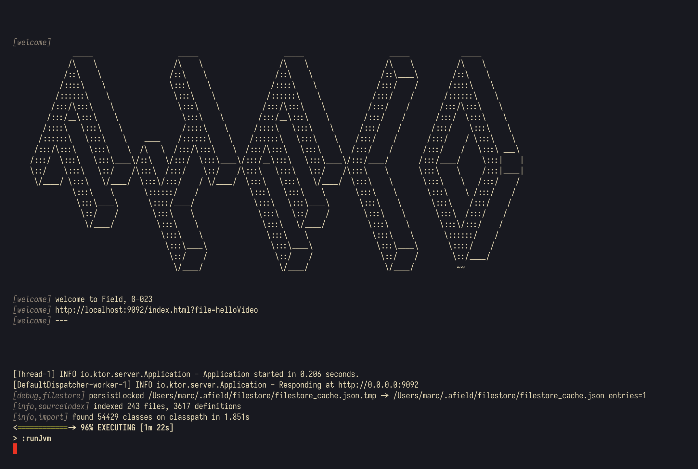
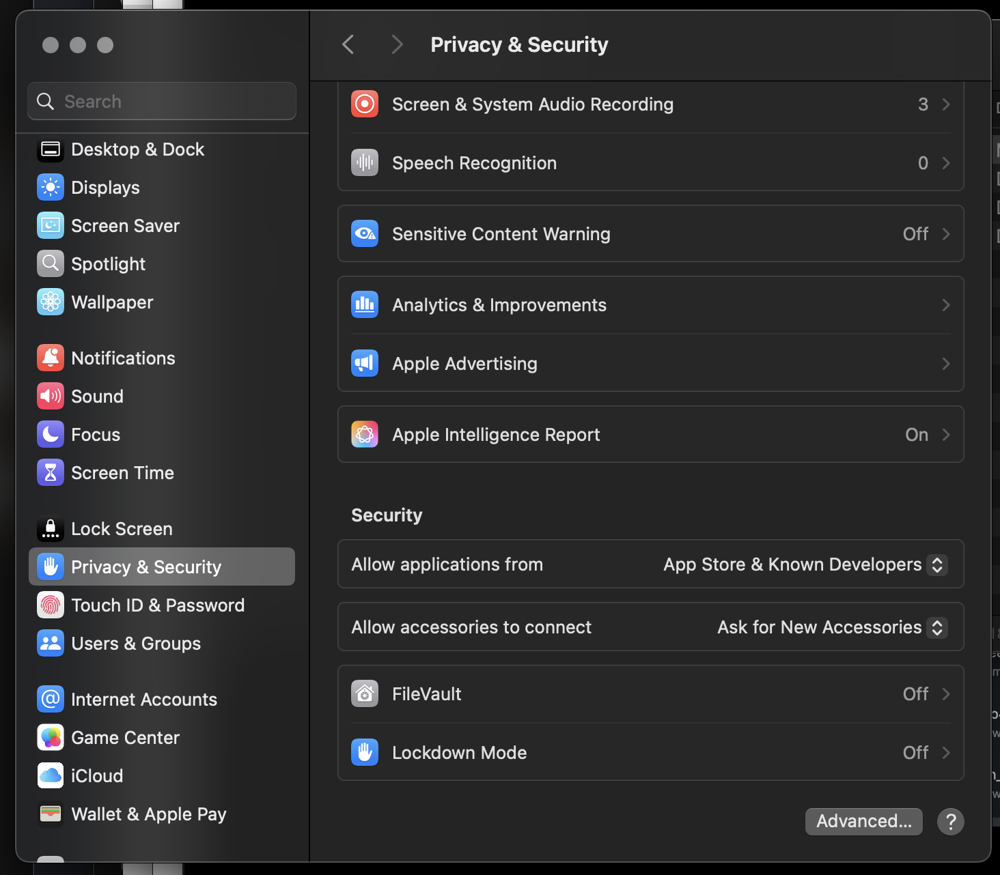

# Installation

The current version of _Field·4_ is **beta032**.

You can download the distribution [here](assets/field_beta1.zip). Alternatively you can press `f1` inside a running Field·4, "Check for Updates" and restart Field.

## Windows & Mac

0. Download and decompress that zip file — you can do this by double clicking the downloaded file. 

### Quick Start (Double-Click)

You can now launch Field·4 by simply double-clicking the appropriate file in the decompressed directory:

- **Mac**: Double-click `field.command` in Finder
- **Windows**: Double-click `field.bat` in File Explorer
- **Linux**: Double-click `field.sh` in your file manager (it will open a terminal automatically)

This will open a terminal window, download necessary dependencies, and start Field·4.

### Alternative (Command Line)

Alternatively, you can launch from the command line:

1. Open a _Terminal_ (Mac, or Windows if installed) or a _command prompt_ (Windows). 
2. Change the working directory of the terminal using the `cd` command to the directory to the decompressed archive (pro-tip: you can drag folders from explorer/finder into the terminal/command prompt to figure out what their path is). For me on a mac this looks like:

    ```diffstatic {data-lang=bash}
    cd /Users/marc/Downloads/field4/
    ```

    and on Windows 

    ```diffstatic {data-lang=powershell}
    cd c:\Users\marc\Downloads\field4\
    ```

3. Inside that directory type `.\field.bat` (for Windows) or `./field.sh` (Mac/Linux).

### First Launch

The first time you run Field·4, it will work _very hard_ for a while, downloading around 1Gb of other people's wonderful open source code needed to build your own copy of _Field·4_. But it won't do this every time.

Eventually you'll be greeted with the boot-screen:



Go ahead and and open [that url](https://localhost:9092/index.html?file=firstDocument) in a webrowser. You can press the `?` for help, or consult the [survival guide](survivalGuide.md).

### Troubleshooting

_Field·4_ is very new — we're expecting trouble, and we're glad to hear about it. If you are part of UChicago's VR class, ideally you would sign up for [Github](https://github.com) and ask Marc for an invite to the private repository to file bug reports.

On Mac you might find that Apple cannot abide the idea of you downloading some code from the internet, building it and running it — all outside their ecosystem. Most likely, this complaint is framed in terms of security and privacy. It's possible that you'll have to give `Terminal` permission to read files from your home directory. For reporting bugs with our installation process, beyond that I'll be very interested in the contents of your Security and Privacy settings page:



### Autoupdate

Field alpha002 and above has a handy "check for updates" from the `f1` menu. This will check for updates (!), download them, copy them into the right place. All you have to do is restart Field to pick up the new goodness:


