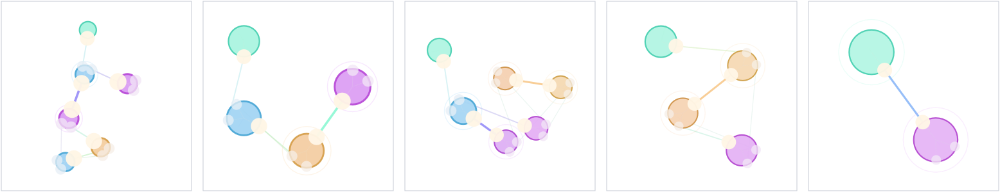

# Interaction Nets examples

*Every public declaration used below is listed, with its KDoc, in the codebase reference: [`interactionnets.kt`](reference/visualization.md#interactionnets-kt). Start from [what's already in the box](reference/index.md).*

An interaction net is a graph you compute with by rewriting it. Each node is an agent with one *principal* port and some auxiliaries; wherever two principal ports are wired to each other you have an active pair, and a rule says what that pair becomes. `Lambda` is a ready-made vocabulary of agents — `APP`, `LAM`, `DUP`, `ERASE`, `VAR`, `ROOT`, `CONST` — and `Lambda.rules()` is a rule book covering it.

So: build a net with `net { }`, wiring ports with `to`; `relax` it to let the force-directed layout settle; and hand it to `Reducer(Lambda.rules())`, whose `stepDetailed` fires one reaction and returns what changed. Draw it with `toFLines`, or summarise it as a card with `summaryHtml`. The four examples below each take a single step and show three cards over a before-and-after drawing; [Reference](#reference) is the whole surface in one table.

Every rule splits or attenuates the energy its nodes carry, so a reduction visibly decays instead of merely rewiring. That is art direction rather than semantics, and it is where the energy figures quoted below come from.

## Reducing a λ-term end to end

`LambdaTerms.normalise("(\\x. x x) (\\y. y)")` parses a term, compiles it to a net, reduces it and reads the answer back as a term. `parse` accepts `\x. x x` or `λx. x x`, with `\x y. e` sugar, and `format` round-trips exactly. `Lambda.rules()` covers fan meetings too: `fan-fan` reads a label off each `DUP` and annihilates two fans from the same duplication or commutes two from different ones, and `erase-erase` closes the matching gap for erasers. Pass `Reducer(relaxIterations = 0)` when nothing is watching, so a reduction does not pay for a layout it will never draw; the figure below passes 8.



Those are the five stages of `(λx. x x) (λy. y)`, the smallest term that shows the whole vocabulary at work. Left to right: the compiled net, 6 agents (ROOT, two APP, two LAM, one DUP — the fan for `x`, used twice); after `beta-linear`, 4; after `dup-lam`, 6, with the two fans facing each other, which is the pair the old rule book had no rule for; after a second `beta-linear`, 4; and after `fan-fan` annihilates the matched pair, 2 agents holding `λa. a`. Each panel is fitted to its own box, so the scales are not comparable — the agent counts are what say how big each net was.

Before you build on `normalise`: closed terms are the contract, because a free variable that gets duplicated reads back as an agent id rather than as its name. A term with no normal form does not terminate, so `normalise` takes a `maxSteps` and leaves `Run.finished` false when it runs out. And `Run.steps` counts betas, fan meetings and erasures alike, so it is not a β-step count and not comparable to one.

That sentence used to end "and `Run.steps` is a property of this rule book and this schedule, not of the term". The rule-book half is right and the schedule half is not: the reaction count is the same under every scheduler, on every term measured, and so is the multiset of rules fired. [A λ-term you can hear](chain_lambda_sound.md) is the measurement — 100 reductions over the corpus, plus the four counterexamples below — and the reason, which is that interaction nets are strongly confluent.

What is checked, and how: `readback(reduce(compile(t)))` is asserted α-equivalent to a plain capture-avoiding normal-order evaluator over a named corpus of 25 closed terms — Church numerals with `succ`, `add`, `mul` and `pred`, Church booleans with `if`, `S`/`K`/`I`, terms whose reduction copies a redex, and terms that erase an argument — and the same normal form is asserted across four `ActivationOrder`s, since the scheduler is a free choice and the answer must not be one. That is `stdlib.lambda-terms.smoke`. Over the corpus it takes 228 net reactions against the evaluator's 117 β-steps; those are two different units and neither is the word *optimal*.

## It is right on the corpus and wrong in general

This page used to end that paragraph by saying the sharing was "correct over the 25-term corpus, checked against the oracle, rather than maximal". The corpus part is still true. The general part is false, and since 2026-09-19 there is a second test that says so with a population rather than an adjective.

`stdlib.lambda-terms.property` generates closed terms from a seed instead of taking a hand-written list, and runs the same oracle identity over them: 4 000 simply-typed terms and 300 untyped ones, each under four schedulers, 17 200 checks. Four of those are a **wrong answer carrying no warning mark of any kind**, which is the case worth separating out — a marked answer at least tells you not to trust it. The smallest of the quiet four:

| | |
|---|---|
| term | `(\m n f x. f (f x)) (\f. f) (\x. x) ((\n f x. f (n f x)) (\n f x. n f x))` |
| correct | `λx. λx'. x (λx'1. x (λx''. x (λx''. x x' x'') x'') x'1)` |
| net | `λa. λb. a (λc. a (λd. a (λe. a b e) d) e)` |

One variable occurrence is wrong, and out of scope. Nothing in the answer says so.

The smallest disagreement of *any* kind is smaller — twelve nodes and four β-steps, `(\x z. x z x) (\x y. y y)`, where a duplicated abstraction that erases its own argument loses one copy of the answer to the eraser. But that one reads back as `λa. λb. b ⊥`, so it announces itself, and it is the easy case. Four counterexamples are pinned as named regressions, two quiet and two marked, and the four schedulers disagree with *each other* on 9 of the 4 300 generated terms — so confluence is a property of the corpus too, and not of the rule book.

The one clean line to draw is by type: **not one of the 4 000 simply-typed terms disagrees, under any scheduler.** Self-application, and an erasing abstraction under duplication, are exactly the shapes simple types forbid. This is not Lamping's optimal reduction — there are no brackets and no croissants — and without that bookkeeping a distinct label per fan is not enough once reduction starts copying the labels. `dev_docs/INTERACTION_NETS_LAMBDA.md` has the whole ledger, the shrunk counterexamples, and what it would take to fix.

## Beta bridge with swapped pair orientation

`APP ⟂ LAM` has to reduce the same way whichever order the active pair was connected in, so this net wires it backwards, `LAM -> APP`, and the rewrite card reports `swapped: yes`. What `beta-linear` then does is pure rewiring: the lambda's body is connected to the application's context and its binder to the application's argument, `created` is `none`, and APP and LAM are dropped. It is the one rule of the four that attenuates nothing: total energy falls from 5.90 to 3.70, which is exactly the 2.20 the two removed nodes were carrying.

<!--
FIELD_TEST
id: docs.interaction-nets.beta-bridge
runner: backdoor-box
tags: [docs, interaction-nets, beta, reducer]
timeoutSec: 45
withPlaywright: true
waitSec: 2.0
expect:
  outputContains:
    - "interaction beta bridge ready"
  eventKinds:
    - set-output
  screenshot:
    kind: box
    padding: 12
-->
```diffstatic_runner {data-lang=kotlin screenshot="assets/interaction_nets_examples/beta_bridge.png" wait="2.0" capture="box" open-outputs="true" embed=true name="interaction-beta-bridge" w="1240" padding="12"}
:::static
import afield.Rect

val reducer = Reducer(Lambda.rules())
val net = net {
    val root = node(Lambda.ROOT, id = "root", at = vec(-180.0, -80.0), state = NodeState(energy = 0.7))
    val app = node(Lambda.APP, id = "app", at = vec(-40.0, 0.0), state = NodeState(energy = 0.8))
    val lam = node(Lambda.LAM, id = "lam", at = vec(40.0, 0.0), state = NodeState(energy = 1.4))
    val arg = node(Lambda.CONST, id = "arg", at = vec(170.0, 80.0), state = NodeState(energy = 1.1))
    val binder = node(Lambda.VAR, id = "binder", at = vec(180.0, -70.0), state = NodeState(energy = 0.9))
    val body = node(Lambda.VAR, id = "body", at = vec(170.0, 10.0), state = NodeState(energy = 1.0))

    lam.principal to app.principal
    app.aux(0) to root.principal
    app.aux(1) to arg.principal
    lam.aux(0) to binder.principal
    lam.aux(1) to body.principal
}

net.relax(20)
val beforeLines = net.toFLines()
val beforeSummary = net.summaryHtml("Before beta", maxNodes = 5)
val detail = reducer.stepDetailed(net)!!
net.relax(28)
val afterLines = net.toFLines()
val beforeFrame = Rect(52.0, 54.0, 404.0, 232.0)
val afterFrame = Rect(584.0, 54.0, 404.0, 232.0)
val comparisonLines = listOf(
    beforeFrame.toFLine(filled = true, color = vec(0.08, 0.13, 0.18, 0.56)),
    afterFrame.toFLine(filled = true, color = vec(0.18, 0.11, 0.08, 0.54)),
    arrow(
        beforeFrame.right + 34.0, 170.0,
        afterFrame.x - 34.0, 170.0,
        color = vec(0.92, 0.90, 0.84, 0.95),
        thickness = 2.0
    ),
) +
    beforeLines.fitInto(beforeFrame, padding = 26.0) +
    afterLines.fitInto(afterFrame, padding = 26.0)

showInteractionOverview(
    graphicLines = comparisonLines,
    cards = listOf(
        beforeSummary,
        detail.summaryHtml("Rewrite"),
        net.summaryHtml("After beta", maxNodes = 5)
    ),
    channel = "overview",
    graphicTitle = "Before / rewrite / after geometry",
    graphicWidth = 1040.0,
    graphicHeight = 340.0
)

println("interaction beta bridge ready")
```

## Energy-biased scheduling

This net offers the reducer two structurally identical `DUP ⟂ CONST` pairs, one at energies 0.6 and 0.5 and one at 1.2 and 1.8, and asks for a single step. Under `ActivationOrder.HIGHEST_PAIR_ENERGY` the hotter pair fires and the colder one is left standing, so which rewrite happens next is a property of the state the nodes are carrying rather than of the order they were built in.

<!--
FIELD_TEST
id: docs.interaction-nets.energy-scheduler
runner: backdoor-box
tags: [docs, interaction-nets, scheduler, energy]
timeoutSec: 45
withPlaywright: true
waitSec: 2.0
expect:
  outputContains:
    - "interaction scheduler ready"
  eventKinds:
    - set-output
  screenshot:
    kind: box
    padding: 12
-->
```diffstatic_runner {data-lang=kotlin screenshot="assets/interaction_nets_examples/energy_scheduler.png" wait="2.0" capture="box" open-outputs="true" embed=true name="interaction-energy-scheduler" w="1240" padding="12"}
:::static
import afield.Rect

val reducer = Reducer(Lambda.rules(), order = ActivationOrder.HIGHEST_PAIR_ENERGY)
val net = net {
    val lowL = node(Lambda.ROOT, id = "lowL", at = vec(-320.0, -40.0), state = NodeState(energy = 0.2))
    val lowR = node(Lambda.ROOT, id = "lowR", at = vec(-320.0, 50.0), state = NodeState(energy = 0.2))
    val dupLow = node(Lambda.DUP, id = "dupLow", at = vec(-160.0, 0.0), state = NodeState(energy = 0.6))
    val constLow = node(Lambda.CONST, id = "constLow", at = vec(-40.0, 0.0), state = NodeState(energy = 0.5))

    val highL = node(Lambda.ROOT, id = "highL", at = vec(80.0, -40.0), state = NodeState(energy = 0.2))
    val highR = node(Lambda.ROOT, id = "highR", at = vec(80.0, 50.0), state = NodeState(energy = 0.2))
    val dupHigh = node(Lambda.DUP, id = "dupHigh", at = vec(220.0, 0.0), state = NodeState(energy = 1.2))
    val constHigh = node(Lambda.CONST, id = "constHigh", at = vec(340.0, 0.0), state = NodeState(energy = 1.8, hue = 0.14))

    dupLow.principal to constLow.principal
    dupLow.aux(0) to lowL.principal
    dupLow.aux(1) to lowR.principal

    dupHigh.principal to constHigh.principal
    dupHigh.aux(0) to highL.principal
    dupHigh.aux(1) to highR.principal
}

net.relax(20)
val beforeLines = net.toFLines()
val beforeSummary = net.summaryHtml("Before scheduler step", maxNodes = 5)
val detail = reducer.stepDetailed(net)!!
net.relax(28)
val afterLines = net.toFLines()
val beforeFrame = Rect(52.0, 54.0, 404.0, 232.0)
val afterFrame = Rect(584.0, 54.0, 404.0, 232.0)
val comparisonLines = listOf(
    beforeFrame.toFLine(filled = true, color = vec(0.08, 0.13, 0.18, 0.56)),
    afterFrame.toFLine(filled = true, color = vec(0.18, 0.11, 0.08, 0.54)),
    arrow(
        beforeFrame.right + 34.0, 170.0,
        afterFrame.x - 34.0, 170.0,
        color = vec(0.92, 0.90, 0.84, 0.95),
        thickness = 2.0
    ),
) +
    beforeLines.fitInto(beforeFrame, padding = 26.0) +
    afterLines.fitInto(afterFrame, padding = 26.0)

showInteractionOverview(
    graphicLines = comparisonLines,
    cards = listOf(
        beforeSummary,
        detail.summaryHtml("Selected pair"),
        net.summaryHtml("After one step", maxNodes = 5)
    ),
    channel = "overview",
    graphicTitle = "Before / rewrite / after geometry",
    graphicWidth = 1040.0,
    graphicHeight = 340.0
)

println("interaction scheduler ready")
```

## DUP splits state into two descendants

`dup-const` replaces the constant with one copy per `DUP` auxiliary, and the copies are not identical to it or to each other. Each inherits half the original's energy attenuated by 0.9 (0.81 from the constant's 1.8), and the two are pushed 0.05 apart in hue. Same shape, different colours: a second duplication further down then reads as a gradient rather than as a repeat.

<!--
FIELD_TEST
id: docs.interaction-nets.duplication
runner: backdoor-box
tags: [docs, interaction-nets, duplication, state]
timeoutSec: 45
withPlaywright: true
waitSec: 2.0
expect:
  outputContains:
    - "interaction duplication ready"
  eventKinds:
    - set-output
  screenshot:
    kind: box
    padding: 12
-->
```diffstatic_runner {data-lang=kotlin screenshot="assets/interaction_nets_examples/duplication.png" wait="2.0" capture="box" open-outputs="true" embed=true name="interaction-duplication" w="1240" padding="12"}
:::static
import afield.Rect

val reducer = Reducer(Lambda.rules(), order = ActivationOrder.HIGHEST_PAIR_ENERGY)
val net = Lambda.duplicatedConstantDemo()

net.relax(20)
val beforeLines = net.toFLines()
val beforeSummary = net.summaryHtml("Before duplication", maxNodes = 5)
val detail = reducer.stepDetailed(net)!!
net.relax(28)
val afterLines = net.toFLines()
val beforeFrame = Rect(52.0, 54.0, 404.0, 232.0)
val afterFrame = Rect(584.0, 54.0, 404.0, 232.0)
val comparisonLines = listOf(
    beforeFrame.toFLine(filled = true, color = vec(0.08, 0.13, 0.18, 0.56)),
    afterFrame.toFLine(filled = true, color = vec(0.18, 0.11, 0.08, 0.54)),
    arrow(
        beforeFrame.right + 34.0, 170.0,
        afterFrame.x - 34.0, 170.0,
        color = vec(0.92, 0.90, 0.84, 0.95),
        thickness = 2.0
    ),
) +
    beforeLines.fitInto(beforeFrame, padding = 26.0) +
    afterLines.fitInto(afterFrame, padding = 26.0)

showInteractionOverview(
    graphicLines = comparisonLines,
    cards = listOf(
        beforeSummary,
        detail.summaryHtml("Duplicate event"),
        net.summaryHtml("After duplication", maxNodes = 5)
    ),
    channel = "overview",
    graphicTitle = "Before / rewrite / after geometry",
    graphicWidth = 1040.0,
    graphicHeight = 340.0
)

println("interaction duplication ready")
```

## ERASE starts a visible decay cascade

`erase-app` does not delete a subtree. It removes the `ERASE ⟂ APP` pair and puts a fresh `ERASE` agent on each of the application's two auxiliaries, each carrying half the application's energy attenuated to 0.55 with a small bias added back, or 0.39 from the application's 1.25. So one active pair becomes two, and the cascade in the "after" card is queued rather than finished: total energy is down from 4.00 to 2.64, and the next two steps are what actually consume the constant and the variable.

<!--
FIELD_TEST
id: docs.interaction-nets.erase
runner: backdoor-box
tags: [docs, interaction-nets, erase, decay]
timeoutSec: 45
withPlaywright: true
waitSec: 2.0
expect:
  outputContains:
    - "interaction erase ready"
  eventKinds:
    - set-output
  screenshot:
    kind: box
    padding: 12
-->
```diffstatic_runner {data-lang=kotlin screenshot="assets/interaction_nets_examples/erase.png" wait="2.0" capture="box" open-outputs="true" embed=true name="interaction-erase" w="1240" padding="12"}
:::static
import afield.Rect

val reducer = Reducer(Lambda.rules())
val net = Lambda.eraseApplicationDemo()

net.relax(20)
val beforeLines = net.toFLines()
val beforeSummary = net.summaryHtml("Before erase", maxNodes = 5)
val detail = reducer.stepDetailed(net)!!
net.relax(28)
val afterLines = net.toFLines()
val beforeFrame = Rect(52.0, 54.0, 404.0, 232.0)
val afterFrame = Rect(584.0, 54.0, 404.0, 232.0)
val comparisonLines = listOf(
    beforeFrame.toFLine(filled = true, color = vec(0.08, 0.13, 0.18, 0.56)),
    afterFrame.toFLine(filled = true, color = vec(0.18, 0.11, 0.08, 0.54)),
    arrow(
        beforeFrame.right + 34.0, 170.0,
        afterFrame.x - 34.0, 170.0,
        color = vec(0.92, 0.90, 0.84, 0.95),
        thickness = 2.0
    ),
) +
    beforeLines.fitInto(beforeFrame, padding = 26.0) +
    afterLines.fitInto(afterFrame, padding = 26.0)

showInteractionOverview(
    graphicLines = comparisonLines,
    cards = listOf(
        beforeSummary,
        detail.summaryHtml("Prune step"),
        net.summaryHtml("After erase step", maxNodes = 5)
    ),
    channel = "overview",
    graphicTitle = "Before / rewrite / after geometry",
    graphicWidth = 1040.0,
    graphicHeight = 340.0
)

println("interaction erase ready")
```

## Two fans that commute, run to a fixed point

The four examples above each take one step, and one step is not enough to see `fan-fan` at all — a rule book reaches its fan meetings and its facing erasers at the *end* of a reduction, which is why those four passed unchanged on the day `fan-fan` and `erase-erase` were added.

This one runs to a fixed point. Two `DUP` fans face each other with **different** labels, 1 and 2, so `fan-fan` takes its commuting branch rather than its annihilating one: each duplication has to be applied to the other, and one fan pair becomes four fans wired in a 2×2 crossing. The count goes up before it goes down. Those four fans are then facing the four constants, so four `dup-const` reactions follow and the four constants come out as eight copies — five reactions in total, 6 agents to 8, and not one fan left standing. Give the two fans the *same* label and the first step is an annihilation instead: two reactions, and the constants are spliced straight through in pairs.

Read the last card carefully, because it is the point of running a net to its end rather than one step: it says **4 active pairs** and it is nevertheless finished. The eight constants are wired principal to principal in four pairs, and no rule in the book covers `CONST ⟂ CONST`, so `stepDetailed` returns null. An active pair is a wiring, not a promise — the number to watch is the rule that fires, and until 2026-09-18 two facing fans and two facing erasers looked exactly like this and were not finished at all.

<!--
FIELD_TEST
id: docs.interaction-nets.multi-step
runner: backdoor-box
tags: [docs, interaction-nets, fan, multi-step]
timeoutSec: 45
withPlaywright: true
waitSec: 2.0
expect:
  outputContains:
    - "interaction multi-step ready"
  eventKinds:
    - set-output
  screenshot:
    kind: box
    padding: 12
-->
```diffstatic_runner {data-lang=kotlin screenshot="assets/interaction_nets_examples/multi_step.png" wait="2.0" capture="box" open-outputs="true" embed=true name="interaction-multi-step" w="1240" padding="12"}
:::static
import afield.Rect

val reducer = Reducer(Lambda.rules())
val subject = net {
    val fanA = node(Lambda.DUP, id = "fanA", at = vec(-80.0, 0.0), state = Lambda.fan(1))
    val fanB = node(Lambda.DUP, id = "fanB", at = vec(80.0, 0.0), state = Lambda.fan(2))
    val c1 = node(Lambda.CONST, id = "c1", at = vec(-200.0, -80.0), state = NodeState(energy = 1.0, hue = 0.04))
    val c2 = node(Lambda.CONST, id = "c2", at = vec(-200.0, 80.0), state = NodeState(energy = 1.0, hue = 0.12))
    val c3 = node(Lambda.CONST, id = "c3", at = vec(200.0, -80.0), state = NodeState(energy = 1.0, hue = 0.20))
    val c4 = node(Lambda.CONST, id = "c4", at = vec(200.0, 80.0), state = NodeState(energy = 1.0, hue = 0.28))

    fanA.principal to fanB.principal
    fanA.aux(0) to c1.principal
    fanA.aux(1) to c2.principal
    fanB.aux(0) to c3.principal
    fanB.aux(1) to c4.principal
}

subject.relax(20)
val beforeLines = subject.toFLines()
val beforeSummary = subject.summaryHtml("Before: labels 1 and 2", maxNodes = 6)

// One step, so the commuting branch can be shown on its own.
val branch = reducer.stepDetailed(subject)!!
subject.relax(24)
val middleLines = subject.toFLines()
val middleSummary = subject.summaryHtml("After fan-fan", maxNodes = 8)

// The rest of the way. This is the part a single stepDetailed cannot reach.
val rest = reducer.reduceDetailed(subject, maxSteps = 32)
subject.relax(28)
val afterLines = subject.toFLines()

val firstFrame = Rect(28.0, 54.0, 296.0, 232.0)
val middleFrame = Rect(372.0, 54.0, 296.0, 232.0)
val lastFrame = Rect(716.0, 54.0, 296.0, 232.0)
val comparisonLines = listOf(
    firstFrame.toFLine(filled = true, color = vec(0.08, 0.13, 0.18, 0.56)),
    middleFrame.toFLine(filled = true, color = vec(0.16, 0.13, 0.08, 0.54)),
    lastFrame.toFLine(filled = true, color = vec(0.08, 0.17, 0.12, 0.54)),
    arrow(
        firstFrame.right + 12.0, 170.0,
        middleFrame.x - 12.0, 170.0,
        color = vec(0.92, 0.90, 0.84, 0.95),
        thickness = 2.0
    ),
    arrow(
        middleFrame.right + 12.0, 170.0,
        lastFrame.x - 12.0, 170.0,
        color = vec(0.92, 0.90, 0.84, 0.95),
        thickness = 2.0
    ),
) +
    beforeLines.fitInto(firstFrame, padding = 22.0) +
    middleLines.fitInto(middleFrame, padding = 22.0) +
    afterLines.fitInto(lastFrame, padding = 22.0)

showInteractionOverview(
    graphicLines = comparisonLines,
    cards = listOf(
        beforeSummary,
        branch.summaryHtml("fan-fan, commuting branch"),
        middleSummary,
        subject.summaryHtml("Fixed point after $rest more steps", maxNodes = 8)
    ),
    channel = "overview",
    graphicTitle = "Two fans, one commute, four duplications",
    graphicWidth = 1040.0,
    graphicHeight = 340.0
)

println("interaction multi-step ready: 1 + $rest reactions, ${subject.nodes.size} agents left")
```

## Reference

Building and wiring, inside `net { }`:

| | |
|---|---|
| `net { … }` | builds a `Net`; everything below is available inside the block |
| `node(type, id, at, state, impulse)` | one agent at an **absolute** position; `id` is generated if you omit it |
| `a.principal to b.principal` | wires two ports. Two principals wired together is an active pair |
| `node.aux(i)` | the `i`th auxiliary port, counting from 0 |
| `NodeState(energy, phase, hue, age, scalars)` | what a node carries. `energy` drives radius and pair ranking, `hue` drives colour, `phase` and `scalars` are yours |
| `Lambda.APP` / `.LAM` / `.DUP` | the agents with two auxiliaries each |
| `Lambda.ERASE` / `.VAR` / `.ROOT` / `.CONST` | the atoms, no auxiliaries |

Reducing:

| | |
|---|---|
| `Reducer(rules, order)` | a reducer over a rule book, picking pairs by an `ActivationOrder` |
| `ActivationOrder` | `FIRST_FOUND`, `LEFTMOST_BY_ID`, `RIGHTMOST_BY_ID`, `RANDOM`, `HIGHEST_PAIR_ENERGY`, `LOWEST_PAIR_ENERGY` |
| `.step(net)` | fires one reaction; `false` means nothing could fire |
| `.stepDetailed(net)` | the same, returning the rule name, the ids removed and created, and any emitted events — or `null` |
| `Lambda.rules()` | the rule book used on this page |
| `rules { autoRule(name, a, b) { … } }` | your own, in the same shape |
| `net.activePairs()` | every pair that could fire right now |

Looking at it:

| | |
|---|---|
| `net.relax(iterations, config)` | runs the force-directed layout; `LayoutConfig` holds the springs, repulsion and damping |
| `net.toFLines(…)` | the net as `FLine`s, for a Field box or a canvas |
| `net.summaryHtml(title, maxNodes)` | one HTML card: counts, energies, and the first `maxNodes` nodes |
| `showInteractionOverview(graphicLines, cards, …)` | a row of cards over one shared drawing, as a single output |
| `net.toSvg(width, height, padding)` | a standalone SVG, for outside Field |
| `net.totalEnergy()` / `.averageAge()` | the two aggregates the cards quote |
| `net.incrementAges(dt)` | advances `age` on whatever clock you choose |

λ-terms:

| | |
|---|---|
| `LambdaTerms.parse(source)` | reads `\x. x x` or `λx. x x`; `\x y. e` is sugar, application associates left |
| `LambdaTerms.format(term)` | the printer, with the fewest parentheses that parse back to the same term |
| `LambdaTerms.compile(term)` | a `CompiledTerm`: a net with one `ROOT`, a fan tree per multiply-used variable, an `ERASE` per unused binder |
| `LambdaTerms.readback(compiled)` | a reduced net back to a term, carrying a stack of fan choices |
| `LambdaTerms.normalise(term, order, maxSteps, relaxIterations)` | the whole pipeline; `relaxIterations` defaults to 0 |
| `LambdaTerms.referenceNormalOrder(term)` | the oracle — normal-order reduction by substitution, no nets, no sharing |
| `LambdaTerms.alphaEquivalent(a, b)` / `.deBruijnKey(term)` | how to compare two terms, and what to print when they differ |
| `LambdaTerms.corpus()` | the 25 named closed terms the smoke test asserts against the oracle |
| `Lambda.fan(label)` / `Lambda.fanLabelOf(node)` | a labelled `DUP`, and its label; an unlabelled one reads as 0 |
| `Reducer(rules, order, layout, relaxIterations)` | `relaxIterations = 0` skips the `O(n²)` layout for a headless run |

Starting points: `Lambda.duplicatedConstantDemo()` and `Lambda.eraseApplicationDemo()` are the nets behind the third and fourth examples above, and `dev_docs/agents/demos/interaction_nets_lambda` is a loadable document that normalises a term, draws a reduction and runs the whole corpus against the oracle.
