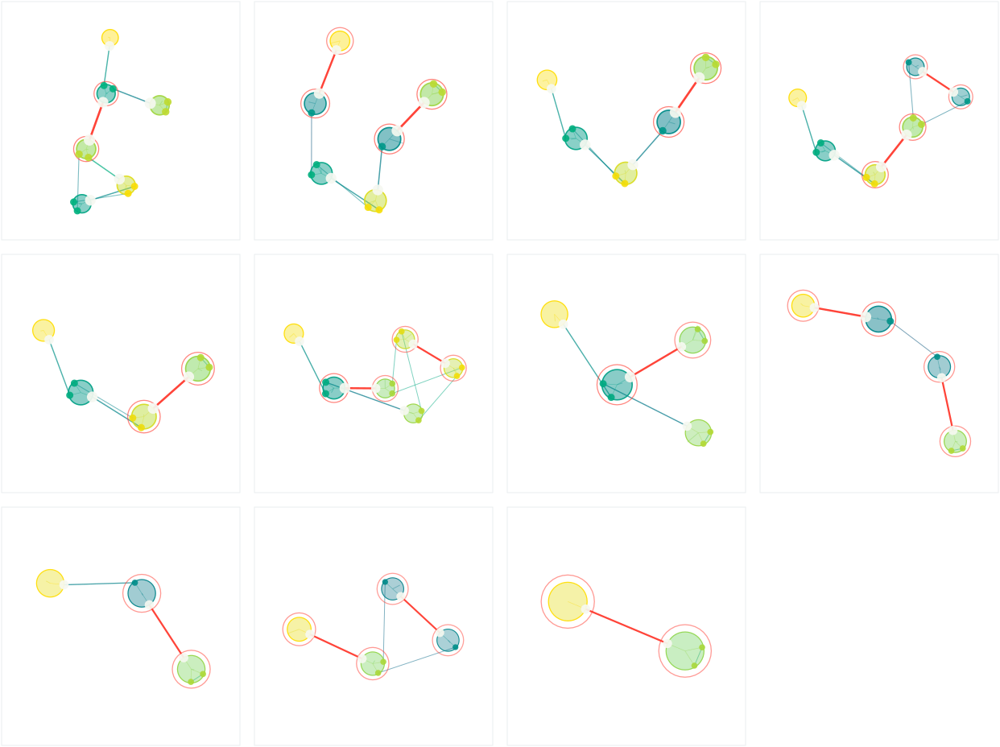

# Interaction Nets examples

An interaction net is a graph you compute with by rewriting it. Each node is an agent with one *principal* port and some auxiliaries; wherever two principal ports are wired to each other you have an active pair, and a rule says what that pair becomes. [`Lambda`](reference/visualization.md#interactionnets-kt-lambda) is a ready-made vocabulary of agents — `APP`, `LAM`, `DUP`, `DELIM`, `ERASE`, `VAR`, `ROOT`, `CONST` — and [`Lambda.rules()`](reference/visualization.md#interactionnets-kt--lambda--rules) is a rule book covering it.

Build a net with `net { }`, wiring ports with `to`; call `relax` to let the force-directed layout settle; and hand it to `Reducer(Lambda.rules())`, whose `stepDetailed` fires one reaction and returns what changed. Draw it with `toFLines`, or summarise it as a card with `summaryHtml`. The single-step examples below each show three cards over a before-and-after drawing; [Reference](#reference) lists the whole API.

Every node also carries an energy, and every rule splits or reduces the energy of the nodes it creates, so a reduction visibly fades as it runs. The energy is there for drawing and does not change what a net computes; it is where the energy figures quoted below come from.

## Reducing a λ-term end to end

`LambdaTerms.normalise("(\\x. x x) (\\y. y)")` parses a term, compiles it to a net, reduces it and reads the answer back as a term. `parse` accepts `\x. x x` or `λx. x x`, with `\x y. e` as shorthand, and `format` prints a term that parses back to the same thing. When two `DUP` fans meet, the `fan-fan` rule compares their levels: two fans at the same level cancel, and two at different levels pass through each other. `erase-erase` does the same for two erasers. Pass `Reducer(relaxIterations = 0)` when nothing will be drawn, so the reduction skips the layout work; the figure below passes 8.



Those are the five stages of `(λx. x x) (λy. y)`, a small term that exercises several kinds of agent. Left to right: the compiled net, 6 agents (ROOT, two APP, two LAM, one DUP — the fan for `x`, which is used twice); after `beta-linear`, 4; after `dup-lam`, 6, with two fans facing each other; after a second `beta-linear`, 4; and after `fan-fan` cancels the matched pair, 2 agents holding `λa. a`. Each panel is scaled to fit its own box, so compare the agent counts rather than the sizes of the drawings.

A term with no normal form never finishes reducing, so `normalise` takes a `maxSteps` and leaves `Run.finished` false when it runs out. `Run.steps` counts every reaction, fan meetings and erasures included, so it is larger than the number of β-steps.

For the test terms in `LambdaTerms.corpus()`, the order in which active pairs are chosen changes neither the result nor the amount of work: under every `ActivationOrder` each term takes the same number of reactions and fires the same rules. [A λ-term you can hear](chain_lambda_sound.md) measures and draws this.

## Reading back a shared answer

The rule book is Lambdascope (van Oostrom, van de Looij and Zwitserlood), an optimal reduction in which each `DUP` and each `DELIM` (a scope delimiter) carries a level, so shared structure is handled correctly on every term. On the terms in `LambdaTerms.corpus()` and on simply-typed terms it gives the same answer as substitution. On a small share of untyped terms, `readback` cannot tell which copy a shared part of the answer belongs to, and leaves a `⋈` mark in its place.

`LambdaTerms.marksOf` returns the marks `readback` left in a result: an empty list means the net read back as an ordinary term, and anything else means the reducer could not give a trustworthy answer. A `?` mark means a variable was found outside the body of its binder, so the net no longer describes a term.

`Run.finished` answers a different question: whether the reduction stopped because nothing was left to fire. Check both: a finished run with marks is still not an answer you should trust.

??? aside "Where the counterexamples live"
    `dev_docs/INTERACTION_NETS_LAMBDA.md` has the term population, the pinned counterexamples and what it would take to fix them.

## Beta bridge with swapped pair orientation

`APP ⟂ LAM` has to reduce the same way whichever order the active pair was connected in, so this net wires it backwards, `LAM -> APP`, and the rewrite card reports `swapped: yes`. What `beta-linear` then does is pure rewiring: the lambda's body is connected to the application's context and its binder to the application's argument, `created` is `none`, and APP and LAM are dropped. It is the one rule of the four that attenuates nothing: total energy falls from 5.90 to 3.70, which is exactly the 2.20 the two removed nodes were carrying.

<!--
FIELD_TEST
id: docs.interaction-nets.beta-bridge
runner: backdoor-box
tags: [docs, interaction-nets, beta, reducer]
timeoutSec: 45
withPlaywright: true
waitSec: 2.0
expect:
  outputContains:
    - "interaction beta bridge ready"
  eventKinds:
    - set-output
  screenshot:
    kind: box
    padding: 12
-->
```diffstatic_runner {data-lang=kotlin screenshot="assets/interaction_nets_examples/beta_bridge.png" alt="an output panel named overview, laid out as three stat cards over a geometry strip, all on black panels: before, after, then the rewrite between them. 'BEFORE BETA' reads 6 nodes, 5 edges, 1 active pair, total energy 5.90, mean age 0.00, over a node table of lam LAM 1.40, arg CONST 1.10, body VAR 1.00, binder VAR 0.90, app APP 0.80 and '+1 more nodes not shown', with the one active pair lam:LAM to app:APP. 'AFTER BETA' reads 6 nodes, 4 edges, 2 active pairs, total energy 5.90, mean age 0.67, over the two new DELIM delimiters, arg, body and binder, with the pairs delim_0:DELIM to root:ROOT and delim_1:DELIM to arg:CONST. 'REWRITE' reads rule beta-linear, swapped yes, pair energy 2.20, removed lam and app, created delim_0 and delim_1, 'beta @ 2.20'. Below, 'BEFORE / REWRITE / AFTER GEOMETRY' draws the net twice with an arrow between: on the left six coloured discs strung along a branching chain with the purple applicator in the middle; on the right the applicator and the lambda are gone and a delimiter now sits between the root and the body and another between the binder and the argument" wait="2.0" capture="box" open-outputs="true" embed=true name="interaction-beta-bridge" w="1240" padding="12"}
:::static
val reducer = Reducer(Lambda.rules())
val net = net {
    val root = node(Lambda.ROOT, id = "root", at = vec(-180.0, -80.0), state = NodeState(energy = 0.7))
    val app = node(Lambda.APP, id = "app", at = vec(-40.0, 0.0), state = NodeState(energy = 0.8))
    val lam = node(Lambda.LAM, id = "lam", at = vec(40.0, 0.0), state = NodeState(energy = 1.4))
    val arg = node(Lambda.CONST, id = "arg", at = vec(170.0, 80.0), state = NodeState(energy = 1.1))
    val binder = node(Lambda.VAR, id = "binder", at = vec(180.0, -70.0), state = NodeState(energy = 0.9))
    val body = node(Lambda.VAR, id = "body", at = vec(170.0, 10.0), state = NodeState(energy = 1.0))

    lam.principal to app.principal
    app.aux(0) to root.principal
    app.aux(1) to arg.principal
    lam.aux(0) to binder.principal
    lam.aux(1) to body.principal
}

net.relax(20)
// Capture before rewriting; later relaxation must not move this stage.
val before = stage("Before beta", net.toFLines(), net.summaryHtml("Before beta", maxNodes = 5))
val detail = reducer.stepDetailed(net)!!
net.relax(28)
val after = stage("After beta", net.toFLines(), net.summaryHtml("After beta", maxNodes = 5))
showInteractionStages(
    before,
    after,
    cards = [detail.summaryHtml("Rewrite")],
    channel = "overview",
    graphicTitle = "Before / rewrite / after geometry",
)

println("interaction beta bridge ready")
```

## Energy-biased scheduling

This net offers the reducer two structurally identical `DUP ⟂ CONST` pairs, one at energies 0.6 and 0.5 and one at 1.2 and 1.8, and asks for a single step. Under `ActivationOrder.HIGHEST_PAIR_ENERGY` the hotter pair fires and the colder one is left standing, so which rewrite happens next is a property of the state the nodes are carrying rather than of the order they were built in.

<!--
FIELD_TEST
id: docs.interaction-nets.energy-scheduler
runner: backdoor-box
tags: [docs, interaction-nets, scheduler, energy]
timeoutSec: 45
withPlaywright: true
waitSec: 2.0
expect:
  outputContains:
    - "interaction scheduler ready"
  eventKinds:
    - set-output
  screenshot:
    kind: box
    padding: 12
-->
```diffstatic_runner {data-lang=kotlin screenshot="assets/interaction_nets_examples/energy_scheduler.png" alt="the same three-card overview layout. 'BEFORE SCHEDULER STEP' reads 8 nodes, 6 edges, 2 active pairs, total energy 4.90, mean age 0.00, over constHigh CONST 1.80, dupHigh DUP 1.20, dupLow DUP 0.60, constLow CONST 0.50, highL ROOT 0.20 and '+3 more nodes not shown', and lists both pairs: dupLow:DUP to constLow:CONST and dupHigh:DUP to constHigh:CONST. 'AFTER ONE STEP' reads 8 nodes, 5 edges, 3 active pairs, total energy 3.52, mean age 1.00, with the untouched dupLow pair still there and the two new consts each wired to a root. 'SELECTED PAIR' reads rule dup-const, swapped no, pair energy 3.00, removed dupHigh and constHigh, created const_0 and const_1, 'duplicate @ 1.80' -- so of the two available pairs the scheduler took the more energetic one, not the first. The geometry strip shows two three-armed clusters before, and after them one cluster left alone with two small two-node links floating beside it" wait="2.0" capture="box" open-outputs="true" embed=true name="interaction-energy-scheduler" w="1240" padding="12"}
:::static
val reducer = Reducer(Lambda.rules(), order = ActivationOrder.HIGHEST_PAIR_ENERGY)
val net = net {
    val lowL = node(Lambda.ROOT, id = "lowL", at = vec(-320.0, -40.0), state = NodeState(energy = 0.2))
    val lowR = node(Lambda.ROOT, id = "lowR", at = vec(-320.0, 50.0), state = NodeState(energy = 0.2))
    val dupLow = node(Lambda.DUP, id = "dupLow", at = vec(-160.0, 0.0), state = NodeState(energy = 0.6))
    val constLow = node(Lambda.CONST, id = "constLow", at = vec(-40.0, 0.0), state = NodeState(energy = 0.5))

    val highL = node(Lambda.ROOT, id = "highL", at = vec(80.0, -40.0), state = NodeState(energy = 0.2))
    val highR = node(Lambda.ROOT, id = "highR", at = vec(80.0, 50.0), state = NodeState(energy = 0.2))
    val dupHigh = node(Lambda.DUP, id = "dupHigh", at = vec(220.0, 0.0), state = NodeState(energy = 1.2))
    val constHigh =
        node(Lambda.CONST, id = "constHigh", at = vec(340.0, 0.0), state = NodeState(energy = 1.8, hue = 0.14))

    dupLow.principal to constLow.principal
    dupLow.aux(0) to lowL.principal
    dupLow.aux(1) to lowR.principal

    dupHigh.principal to constHigh.principal
    dupHigh.aux(0) to highL.principal
    dupHigh.aux(1) to highR.principal
}

net.relax(20)
// Capture before rewriting; later relaxation must not move this stage.
val before = stage("Before scheduler step", net.toFLines(), net.summaryHtml("Before scheduler step", maxNodes = 5))
val detail = reducer.stepDetailed(net)!!
net.relax(28)
val after = stage("After one step", net.toFLines(), net.summaryHtml("After one step", maxNodes = 5))
showInteractionStages(
    before,
    after,
    cards = [detail.summaryHtml("Selected pair")],
    channel = "overview",
    graphicTitle = "Before / rewrite / after geometry",
)

println("interaction scheduler ready")
```

## DUP splits state into two descendants

`dup-const` replaces the constant with one copy per `DUP` auxiliary, and the copies are not identical to it or to each other. Each inherits half the original's energy attenuated by 0.9 (0.81 from the constant's 1.8), and the two are pushed 0.05 apart in hue. Same shape, different colours: a second duplication further down then reads as a gradient rather than as a repeat.

<!--
FIELD_TEST
id: docs.interaction-nets.duplication
runner: backdoor-box
tags: [docs, interaction-nets, duplication, state]
timeoutSec: 45
withPlaywright: true
waitSec: 2.0
expect:
  outputContains:
    - "interaction duplication ready"
  eventKinds:
    - set-output
  screenshot:
    kind: box
    padding: 12
-->
```diffstatic_runner {data-lang=kotlin screenshot="assets/interaction_nets_examples/duplication.png" alt="the same three-card overview layout. 'BEFORE DUPLICATION' reads 4 nodes, 3 edges, 1 active pair, total energy 4.80, mean age 0.00, over k CONST 1.80, dup DUP 1.40, rootL ROOT 0.80, rootR ROOT 0.80, with the pair dup:DUP to k:CONST. 'AFTER DUPLICATION' reads 4 nodes again but 2 edges, 2 active pairs, total energy 3.22, mean age 1.00, over const_0 and const_1 both CONST 0.81 and the two unchanged roots, paired const_0 to rootL and const_1 to rootR. 'DUPLICATE EVENT' reads rule dup-const, swapped no, pair energy 3.20, removed dup and k, created const_0 and const_1, 'duplicate @ 1.80'. The geometry strip makes the shape of it plain: before, two mint roots and an orange duplicator fanning into one yellow constant; after, two identical mint-to-yellow links sitting apart" wait="2.0" capture="box" open-outputs="true" embed=true name="interaction-duplication" w="1240" padding="12"}
:::static
val reducer = Reducer(Lambda.rules(), order = ActivationOrder.HIGHEST_PAIR_ENERGY)
val net = Lambda.duplicatedConstantDemo()

net.relax(20)
// Capture before rewriting; later relaxation must not move this stage.
val before = stage("Before duplication", net.toFLines(), net.summaryHtml("Before duplication", maxNodes = 5))
val detail = reducer.stepDetailed(net)!!
net.relax(28)
val after = stage("After duplication", net.toFLines(), net.summaryHtml("After duplication", maxNodes = 5))
showInteractionStages(
    before,
    after,
    cards = [detail.summaryHtml("Duplicate event")],
    channel = "overview",
    graphicTitle = "Before / rewrite / after geometry",
)

println("interaction duplication ready")
```

## ERASE starts a visible decay cascade

`erase-app` does not delete a subtree. It removes the `ERASE ⟂ APP` pair and puts a fresh `ERASE` agent on each of the application's two auxiliaries, each carrying half the application's energy attenuated to 0.55 with a small bias added back, or 0.39 from the application's 1.25. So one active pair becomes two, and the cascade in the "after" card is queued rather than finished: total energy is down from 4.00 to 2.64, and the next two steps are what actually consume the constant and the variable.

<!--
FIELD_TEST
id: docs.interaction-nets.erase
runner: backdoor-box
tags: [docs, interaction-nets, erase, decay]
timeoutSec: 45
withPlaywright: true
waitSec: 2.0
expect:
  outputContains:
    - "interaction erase ready"
  eventKinds:
    - set-output
  screenshot:
    kind: box
    padding: 12
-->
```diffstatic_runner {data-lang=kotlin screenshot="assets/interaction_nets_examples/erase.png" alt="the same three-card overview layout. 'BEFORE ERASE' reads 4 nodes, 3 edges, 1 active pair, total energy 4.00, mean age 0.00, over app APP 1.25, f CONST 1.10, erase ERASE 0.90, x VAR 0.75, with the pair erase:ERASE to app:APP. 'AFTER ERASE STEP' reads 4 nodes, 2 edges, 2 active pairs, total energy 2.64, mean age 1.00, pairing erase_0 to f:CONST and erase_1 to x:VAR. 'PRUNE STEP' reads rule erase-app, swapped no, pair energy 2.15, removed erase and app, created erase_0 and erase_1, 'prune @ 1.25' -- so erasing one node does not shrink the net, it pushes two fresh erasers down the applicator's other two ports. The geometry strip shows a salmon eraser joined to a blue applicator that fans out to a yellow and a cyan node; afterwards, two salmon erasers sit each on its own former port" wait="2.0" capture="box" open-outputs="true" embed=true name="interaction-erase" w="1240" padding="12"}
:::static
val reducer = Reducer(Lambda.rules())
val net = Lambda.eraseApplicationDemo()

net.relax(20)
// Capture before rewriting; later relaxation must not move this stage.
val before = stage("Before erase", net.toFLines(), net.summaryHtml("Before erase", maxNodes = 5))
val detail = reducer.stepDetailed(net)!!
net.relax(28)
val after = stage("After erase step", net.toFLines(), net.summaryHtml("After erase step", maxNodes = 5))
showInteractionStages(
    before,
    after,
    cards = [detail.summaryHtml("Prune step")],
    channel = "overview",
    graphicTitle = "Before / rewrite / after geometry",
)

println("interaction erase ready")
```

## Two fans that commute, run to a fixed point

The examples above each take one step. Fans and erasers usually meet near the end of a reduction, so to see `fan-fan` this example keeps stepping until nothing more can fire. Two `DUP` fans face each other at different levels, 1 and 2, so `fan-fan` takes its commuting branch rather than its annihilating one: each duplication has to be applied to the other, and one fan pair becomes four fans wired in a 2×2 crossing. The count goes up before it goes down. Those four fans are then facing the four constants, so four `dup-const` reactions follow and the four constants come out as eight copies — five reactions in total, 6 agents to 8, and not one fan left standing. Give the two fans the *same* label and the first step is an annihilation instead: two reactions, and the constants are spliced straight through in pairs.

The last card says **4 active pairs** and is nevertheless finished. The eight constants are wired principal to principal in four pairs, and no rule in the book covers `CONST ⟂ CONST`, so `stepDetailed` returns null. An active pair only reduces when a rule matches it.

<!--
FIELD_TEST
id: docs.interaction-nets.multi-step
runner: backdoor-box
tags: [docs, interaction-nets, fan, multi-step]
timeoutSec: 45
withPlaywright: true
waitSec: 2.0
expect:
  outputContains:
    - "interaction multi-step ready"
  eventKinds:
    - set-output
  screenshot:
    kind: box
    padding: 12
-->
```diffstatic_runner {data-lang=kotlin screenshot="assets/interaction_nets_examples/multi_step.png" alt="the overview layout again, this time with four stat cards: before, two later states, then the rewrite. 'BEFORE: LABELS 1 AND 2' reads 6 nodes, 5 edges, 1 active pair, total energy 6.00, mean age 0.00, over four CONSTs c1 to c4 and two DUPs fanA and fanB, all at energy 1.00, with the single pair fanA:DUP to fanB:DUP. 'AFTER FAN-FAN' reads 8 nodes, 8 edges, 4 active pairs, total energy 5.70, mean age 1.00, with each new dup facing one of c1 to c4. 'FIXED POINT AFTER 4 MORE STEPS' reads 8 nodes but only 4 edges, 4 active pairs, total energy 3.60, mean age 5.00, and every node is now a CONST at 0.45, paired const to const. 'FAN-FAN, COMMUTING BRANCH' reads rule fan-fan, swapped no, pair energy 2.00, removed fanA and fanB, created dup_0 through dup_3, 'branch @ 2.00' -- two fans at different levels do not annihilate, they cross and become four. Below, 'TWO FANS, ONE COMMUTE, FOUR DUPLICATIONS' draws three stages with arrows between: a symmetric bow-tie of two orange fans between four yellow constants; then a wider tangle of four fans; then, four separate two-node links" wait="2.0" capture="box" open-outputs="true" embed=true name="interaction-multi-step" w="1560" padding="12"}
:::static
val reducer = Reducer(Lambda.rules())
val subject = net {
    val fanA = node(Lambda.DUP, id = "fanA", at = vec(-80.0, 0.0), state = Lambda.fan(1))
    val fanB = node(Lambda.DUP, id = "fanB", at = vec(80.0, 0.0), state = Lambda.fan(2))
    val c1 = node(Lambda.CONST, id = "c1", at = vec(-200.0, -80.0), state = NodeState(energy = 1.0, hue = 0.04))
    val c2 = node(Lambda.CONST, id = "c2", at = vec(-200.0, 80.0), state = NodeState(energy = 1.0, hue = 0.12))
    val c3 = node(Lambda.CONST, id = "c3", at = vec(200.0, -80.0), state = NodeState(energy = 1.0, hue = 0.20))
    val c4 = node(Lambda.CONST, id = "c4", at = vec(200.0, 80.0), state = NodeState(energy = 1.0, hue = 0.28))

    fanA.principal to fanB.principal
    fanA.aux(0) to c1.principal
    fanA.aux(1) to c2.principal
    fanB.aux(0) to c3.principal
    fanB.aux(1) to c4.principal
}

subject.relax(20)
// Capture before rewriting; later relaxation must not move this stage.
val before =
    stage("Before: labels 1 and 2", subject.toFLines(), subject.summaryHtml("Before: labels 1 and 2", maxNodes = 6))

// One step, so the commuting branch can be shown on its own.
val branch = reducer.stepDetailed(subject)!!
subject.relax(24)
val middle = stage("After fan-fan", subject.toFLines(), subject.summaryHtml("After fan-fan", maxNodes = 8))

// The rest of the way. This is the part a single stepDetailed cannot reach.
val rest = reducer.reduceDetailed(subject, maxSteps = 32)
subject.relax(28)
val after =
    stage("Fixed point", subject.toFLines(), subject.summaryHtml("Fixed point after $rest more steps", maxNodes = 8))

showInteractionStages(
    before,
    middle,
    after,
    cards = [branch.summaryHtml("fan-fan, commuting branch")],
    channel = "overview",
    graphicTitle = "Two fans, one commute, four duplications",
    stageWidth = 296.0,
    gap = 48.0,
    padding = 22.0,
)

println("interaction multi-step ready: 1 + $rest reactions, ${subject.nodes.size} agents left")
```

## A program with numbers: five queens

The examples above use the λ-calculus vocabulary. [`NetPrograms`](reference/data.md#netprograms-kt-netprograms) is a second one, for small programs with whole numbers and recursion. You write definitions with `netProgram { }`: `v("x")` is a parameter, `n(5)` a number, `call("f", ...)` calls a definition, `switch(k, zero = ...) { ... }` tests for zero, and `let` names a value that is used more than once. `NetPrograms.compile` turns the program into nets, `instantiate` stamps `main` into a fresh net, and `rules` is the rule book that runs it.

The agents are a constructor `CON` (a λ, an application or a pair, depending on which way it faces), a fan `DUP` that copies a value, an eraser `ERA`, numbers `NUM`, operators `OP2` and `OP1`, a zero test `SWI`, and a reference `REF`. A `REF` stands for a definition, and when something meets it, it expands into a fresh copy of that definition's net. That is how a definition calls itself, and it means the net only ever holds the part of the program being run. Each branch of a `switch` is compiled to a definition of its own, so the branch not taken is a lone `REF` meeting an eraser, and the work inside it never starts.

The program below counts the ways to place five queens on a 5×5 board. `solve` places a queen on each row in turn, keeping the columns and the two diagonals already attacked as bit masks. `try` takes the free columns, splits off the lowest one with `a & ~p` (where `p` is one less than `a`), and adds the count for a queen there to the count for every other free column. Neither operand of that `+` waits for the other, so every choice on the board is explored at once.

`Reducer.stepFrontier` fires every pair that is ready when it is called, so one call is one round in which all the possible reactions happen together. The box runs one round per frame and relaxes the layout after each. It draws the net with `toPngBytes`, because at several hundred agents the SVG that `lines(...)` would send each frame gets too large. The net grows from 31 agents to a peak of 842, with up to 76 reactions in a single round, then the additions collapse it into a chain and finally into one number. It takes 4,444 reactions in 205 rounds and ends on 10, which is the number of solutions.

```diffstatic_runner {data-lang=kotlin video="assets/interaction_nets_examples/five_queens.mp4" capture="box" open-outputs="true" wait-output="true" wait-output-kind="display" execution="launch" duration="14" fps="20" timeout="600" w="540" embed=true name="interaction-five-queens-video" alt="an interaction net solving five queens: a small cluster of coloured agents spreads into hundreds of agents in many separate branches, then folds back into a chain of additions and ends as two agents, the root and the number 10"}
:::static
val program = netProgram {
    def("solve", "row", "cols", "d1", "d2") {
        // On the last row, one solution; otherwise try every column still free.
        switch(v("row") eq n(5), zero = call("try", v("row"), v("cols"), v("d1"), v("d2"),
            n(31) andNot (v("cols") or v("d1") or v("d2")))) { n(1) }
    }
    def("try", "row", "cols", "d1", "d2", "avail") {
        switch(v("avail"), zero = n(0), pred = "p") {
            let("a", v("p") + n(1)) {
                let("bit", v("a") andNot v("p")) {
                    // A queen in this column, plus every other free column, side by side.
                    call("solve", v("row") + n(1), v("cols") or v("bit"),
                        (v("d1") or v("bit")) shl n(1), (v("d2") or v("bit")) shr n(1)) +
                        call("try", v("row"), v("cols"), v("d1"), v("d2"), v("a") and v("p"))
                }
            }
        }
    }
    main { call("solve", n(0), n(0), n(0), n(0)) }
}

val compiled = NetPrograms.compile(program)
val net = NetPrograms.instantiate(compiled)
val reducer = Reducer(NetPrograms.rules(compiled), relaxIterations = 0)
val layout = LayoutConfig(repulsion = 3200.0, springLength = 34.0, springStrength = 0.03, clampStep = 12.0)
net.relax(40, layout)

var round = 0
var interactions = 0
var widest = 0
var lastFired = 0
var view = net.layoutBounds()!!

loop {
    // One round per frame: every pair that is ready fires together.
    val fired = reducer.stepFrontier(net, relaxIterations = 0)
    if (fired.isNotEmpty()) round++
    interactions += fired.size
    lastFired = fired.size
    widest = max(widest, fired.size)
    net.relax(4, layout)

    // Ease the framing toward the net's square bounds, so growth reads as growth rather than as a zoom.
    val b = net.layoutBounds()!!
    val cx = (b[0] + b[2]) / 2
    val cy = (b[1] + b[3]) / 2
    val half = max(b[2] - b[0], b[3] - b[1]) / 2
    val target = [cx - half, cy - half, cx + half, cy + half]
    view = DoubleArray(4) { view[it] + (target[it] - view[it]) * 0.3 }
    display("net", net.toPngBytes(540, 540, view))

    val answer = NetPrograms.resultOf(net)?.let { " · solutions = $it" } ?: ""
    display(
        "stats",
        "<div style='font-family:monospace;font-size:14px'>round $round · $lastFired firing · " +
            "$interactions interactions · ${net.nodes.size} agents · widest $widest$answer</div>",
    )
    frame()
}
```

`NetPrograms.run(program)` does the same reduction without drawing and returns a `Run`: the answer, the number of reactions, the number of rounds, the widest round and any pair left with no rule. `NetPrograms.queens(size)` builds this program for any board up to 16, and `NetPrograms.queensReference(size)` counts by ordinary backtracking to check it. Four queens takes 1,393 reactions in 133 rounds, and six takes 13,183 in 253. The number of rounds grows much more slowly than the number of reactions, because most of the extra work happens in parallel.

## From a program to a net

`NetPrograms.compile` turns each definition into a template: a small net with one loose port, which is where the caller plugs in. A definition with parameters starts with one `CON` per parameter, chained so that the call's arguments, also a chain of `CON`s, meet them head on and annihilate pair by pair. A number is a `NUM`. An operator is an `OP2` whose principal port faces its left operand, so it waits for that operand to become a number, turns into an `OP1` holding it, then waits for the right one. A call is a `REF` with the arguments applied to it.

Two things in a program are not wires. A name used more than once, a parameter or a `let`, gets a `DUP` fan with one branch per use, and its value flows into the fan's principal port. That port is wired to the place the value comes out, never to the expression itself, so the fan sits idle until the value is a number and then copies only the number: `let` shares the work rather than the code. A name used nowhere gets an `ERA`.

A `switch` is lifted. Each branch becomes a definition of its own, named after the definition it came from (`sum$z0` for the zero branch of the first switch in `sum`, `sum$s0` for the other), taking the branch's free variables as parameters, with the predecessor first. In its place the compiler leaves an `SWI` holding a pair of the two `REF`s. When a number meets the `SWI`, the `switch` rule picks one `REF` and hands the other to a fresh `ERA`, so the branch not taken costs one reaction and none of its body is ever stamped into the net.

The box below compiles `sum`, which adds up the numbers from `k` down to 1, and runs `sum(3)`. Its first card lists the templates the compiler made; the drawings show `main` as compiled, the net halfway through, and the answer. `k` is used twice, once by the `switch` and once in the addition, so the template for `sum` carries a `DUP`.

```diffstatic_runner {data-lang=kotlin screenshot="assets/interaction_nets_examples/program_to_net.png" alt="three stages of sum(3) with a summary card over each: main as compiled, 4 nodes and 1 active pair, a REF meeting a CON; after 14 rounds, 11 nodes and 2 active pairs, a DUP meeting a NUM and an OP2 meeting a NUM; after 28 rounds, 2 nodes, a NUM wired to the ROOT. A card at the right lists the templates: sum 7 agents, main 3, sum$z0 3, sum$s0 5. Below, the three drawings: a small star of four agents, a tangle of about a dozen, and two agents joined by one wire" wait="2.0" capture="box" open-outputs="true" embed=true name="interaction-program-to-net" w="1240" padding="12"}
:::static
val program = netProgram {
    def("sum", "k") {
        switch(v("k"), zero = n(0), pred = "p") { v("k") + call("sum", v("p")) }
    }
    main { call("sum", n(3)) }
}

val compiled = NetPrograms.compile(program)
val net = NetPrograms.instantiate(compiled)
val reducer = Reducer(NetPrograms.rules(compiled), relaxIterations = 0)
val rounds = NetPrograms.run(program).rounds

net.relax(60)
val before = stage("main, as compiled", net.toFLines(), net.summaryHtml("main, as compiled", maxNodes = 0))
repeat(rounds / 2) { reducer.stepFrontier(net) }
net.relax(60)
val middle = stage("after ${rounds / 2} rounds", net.toFLines(), net.summaryHtml("after ${rounds / 2} rounds", maxNodes = 0))
while (reducer.stepFrontier(net).isNotEmpty()) { }
net.relax(20)
val after = stage("after $rounds rounds", net.toFLines(), net.summaryHtml("after $rounds rounds", maxNodes = 0))

val templates = compiled.templates.joinToString("<br>") { "${it.name}: ${it.size} agents" }
showInteractionStages(
    before,
    middle,
    after,
    cards = ["<div><b>Templates</b><br>$templates</div>"],
    channel = "overview",
    graphicTitle = "sum(3): compiled, halfway, answer",
)

println("sum(3) = ${NetPrograms.resultOf(net)} in $rounds rounds; templates: " +
    compiled.templates.joinToString { "${it.name} ${it.size}" })
```

## A small gallery of programs

`NetPrograms.run` reduces a program without drawing it and returns a `Run`. Its `perRound` lists how many reactions each round fired, which is a picture of the parallelism: a round of 1 is a moment where everything waits on one reaction, and a wide round is many independent pieces of work happening at once.

The box below runs four programs and plots the first three; the fourth would flatten the others, so it appears only in the table. `sum` from the section above, on 40. `fib`, the doubly recursive Fibonacci, on 15, written with two nested `switch`es so that each call tests for 0 and then for 1. And two ways of computing 2¹² by doubling: `pow` names the recursive result with `let` and adds it to itself, while `pow2` writes the call out twice. Next to each it counts the calls the same function makes when run by ordinary recursion in Kotlin.

```diffstatic_runner {data-lang=kotlin screenshot="assets/interaction_nets_examples/program_gallery.png" alt="a line plot of reactions fired per round for sum 40, fib 15 and pow 12 with let: fib rises to a hump of about 600 reactions around round 100 and falls away by round 190, while sum and pow stay flat near the axis. Below it a table: sum 40 answers 820 in 449 reactions, 287 rounds, widest round 2, peak 53 agents, 41 Kotlin calls; fib 15 answers 610 in 25734 reactions, 193 rounds, widest 622, peak 3713 agents, 1973 calls; pow 12 with let answers 4096 in 127 reactions, 102 rounds, widest 2, peak 32 agents, 13 calls; pow2 12 written twice answers 4096 in 65526 reactions, 90 rounds, widest 6144, peak 32768 agents, 8191 calls" wait="3.0" capture="box" open-outputs="true" embed=true name="interaction-program-gallery" w="760" padding="12"}
:::static
val sum = netProgram {
    def("sum", "k") { switch(v("k"), zero = n(0), pred = "p") { v("k") + call("sum", v("p")) } }
    main { call("sum", n(40)) }
}
val fib = netProgram {
    def("fib", "k") {
        switch(v("k"), zero = n(0), pred = "j") {
            switch(v("j"), zero = n(1), pred = "i") { call("fib", v("i") + n(1)) + call("fib", v("i")) }
        }
    }
    main { call("fib", n(15)) }
}
val shared = netProgram {
    def("pow", "k") { switch(v("k"), zero = n(1), pred = "p") { let("h", call("pow", v("p"))) { v("h") + v("h") } } }
    main { call("pow", n(12)) }
}
val unshared = netProgram {
    def("pow2", "k") { switch(v("k"), zero = n(1), pred = "p") { call("pow2", v("p")) + call("pow2", v("p")) } }
    main { call("pow2", n(12)) }
}

// The same functions by ordinary recursion, counting calls.
var calls = 0
fun sumK(k: Int): Long { calls++; return if (k == 0) 0 else k + sumK(k - 1) }
fun fibK(k: Int): Long { calls++; return if (k < 2) k.toLong() else fibK(k - 1) + fibK(k - 2) }
fun powK(k: Int): Long { calls++; return if (k == 0) 1 else powK(k - 1).let { it + it } }
fun pow2K(k: Int): Long { calls++; return if (k == 0) 1 else pow2K(k - 1) + pow2K(k - 1) }
fun counted(f: () -> Long): Pair<Long, Int> { calls = 0; val v = f(); return v to calls }

val rows = [
    Triple("sum 40", sum, counted { sumK(40) }),
    Triple("fib 15", fib, counted { fibK(15) }),
    Triple("pow 12, let", shared, counted { powK(12) }),
    Triple("pow2 12, twice", unshared, counted { pow2K(12) }),
]
val runs = rows.map { it.first to NetPrograms.run(it.second) }

showSignals(
    // pow2 peaks above 6,000 reactions a round and would flatten the others; the table carries it.
    *runs.take(3).map { (name, run) -> name to run.perRound }.toTypedArray(),
    channel = "rounds",
    title = "reactions fired in each round",
    xTitle = "round",
    yTitle = "reactions",
    width = 720,
    height = 340,
    floatingLegend = true,
)

val table = StringBuilder("| program | answer | reactions | rounds | widest round | peak agents | Kotlin calls |\n")
table.append("| --- | --- | --- | --- | --- | --- | --- |\n")
rows.zip(runs).forEach { (row, named) ->
    val run = named.second
    table.append("| ${row.first} | ${run.value} | ${run.interactions} | ${run.rounds} | ${run.widest} | ${run.peakAgents} | ${row.third.second} |\n")
    println("${row.first}: value=${run.value} reference=${row.third.first} interactions=${run.interactions} " +
        "rounds=${run.rounds} widest=${run.widest} peak=${run.peakAgents} calls=${row.third.second} " +
        "stuck=${run.stuck} rules=${run.ruleCounts}")
}
markdown("table", table.toString())
```

The table holds the numbers. `sum` on 40 is 820 after 449 reactions in 287 rounds, and no round fires more than 2: each call has to know its `k` before it can start the next, so there is nothing to do side by side. `fib` on 15 is 610 after 25,734 reactions, but they take only 193 rounds, because the two recursive calls never wait for each other; the hump in the plot is the point where the tree of calls is widest, with 622 reactions in one round.

The two doublings give the same 4,096 and show what `let` buys. With `let`, the result of each call is copied once it is a number, so `pow` makes 13 calls and takes 127 reactions. Written twice, every call is made twice: `pow2` takes 65,526 reactions and reaches 32,768 agents. It finishes in fewer rounds, 90 against 102, because its 2¹³ − 1 calls all run side by side, as many as 6,144 reactions in one round. In both cases the net does what ordinary recursion would: the Kotlin call counts in the last column, 13 and 8,191, grow the same way the reactions do. The reduction does not notice that the two calls in `pow2` are the same; sharing is something you write with `let`.

A reaction is much smaller than a function call (a call to `fib` is about thirteen of them: expanding the `REF`, meeting the arguments, the two `switch`es, the arithmetic), so compare the columns by how they grow, not by their size.


## Reference

Building and wiring, inside `net { }`:

<div class="field-reference" data-code-lang="kotlin" markdown>

| Construction | Behavior |
| --- | --- |
| `net { … }` | Builds a `Net` using the construction DSL. Create nodes and connect their ports inside the block. |
| `node(type, id, at, state, impulse)` | Creates one agent at an absolute position. Omit `id` to generate an identifier; use an explicit one when a test or layout needs stable names. |
| `a.principal to b.principal` | Connects two ports. A principal-to-principal connection creates an active pair that the reducer may match against a rule. |
| `node.aux(i)` | Selects an auxiliary port by zero-based index. The node’s type determines how many auxiliaries it has. |
| `NodeState(energy, phase, hue, age, scalars)` | Stores the state carried by a node. Energy affects drawing radius and energy-based pair ordering; hue affects colour, while phase and extra scalars are available to rules. |
| `Lambda.APP` / `.LAM` / `.DUP` | Selects application, abstraction or duplication agents, each with two auxiliary ports. Connect those auxiliaries to represent arguments, bodies and shared uses. |
| `Lambda.ERASE` / `.VAR` / `.ROOT` / `.CONST` | Selects an atomic agent with no auxiliary ports. These represent erasure, variables, the term root and constants. |

</div>

Reducing:

<div class="field-reference" data-code-lang="kotlin" markdown>

| Reduction | Behavior |
| --- | --- |
| `Reducer(rules, order)` | Creates a reducer over a rule book and activation policy. The policy chooses which matching active pair is tried next. |
| `ActivationOrder` | Chooses first-found, leftmost/rightmost by identifier, random, or highest/lowest pair energy. Changing it changes scheduling, so keep it explicit when comparing runs. |
| `.step(net)` | Applies one available reaction to the net. Returns false when no reaction could fire, which is the condition for ending a reduction loop. |
| `.stepDetailed(net)` | Applies one reaction and reports its rule, removed and created identifiers, and emitted events. Returns null when nothing can fire. |
| `Lambda.rules()` | Returns the lambda-calculus rule book used in the examples. Use it with `Reducer` when reducing a compiled lambda term. |
| `rules { autoRule(name, a, b) { … } }` | Builds a custom rule book. Each automatic rule names the reacting pair and the construction that replaces it. |
| `net.activePairs()` | Lists the currently connected principal-port pairs. A pair still needs a matching rule before it can reduce. |

</div>

Looking at it:

<div class="field-reference" data-code-lang="kotlin" markdown>

| Layout and display | Behavior |
| --- | --- |
| `net.relax(iterations, config)` | Runs the force-directed layout for the requested number of iterations. `LayoutConfig` controls spring forces, repulsion and damping; layout changes positions, not the reduction rules. |
| `net.toFLines(…)` | Converts the current graph layout into `FLine` geometry. Draw those lines in a Field output or combine them with other geometry. |
| `net.summaryHtml(title, maxNodes)` | Builds an HTML summary of counts, energy and the first `maxNodes` nodes. Limit the node list to keep large nets inspectable. |
| `stage(title, lines, summary)` | Captures a net's drawing and summary card as it is now, before a later rewrite changes it. |
| `showInteractionStages(stages…, cards)` | Lays captured stages out left to right with arrows between them, their cards above, plus any extra `cards` describing the rewrites. The examples on this page use it. |
| `showInteractionOverview(graphicLines, cards, …)` | Displays summary cards above one graph drawing you have laid out yourself. |
| `net.toSvg(width, height, padding)` | Exports the current layout as a standalone SVG. Width, height and padding control the exported view. |
| `net.totalEnergy()` / `.averageAge()` | Returns aggregate energy or mean node age. These are the same quantities shown in the summary cards. |
| `net.incrementAges(dt)` | Adds `dt` to node ages. Call it on the simulation clock whose units you want age to represent. |

</div>

λ-terms:

<div class="field-reference" data-code-lang="kotlin" markdown>

| Lambda terms | Behavior |
| --- | --- |
| `LambdaTerms.parse(source)` | Parses `\x. x x` or `λx. x x` into a lambda term. Multiple binders are shorthand and application associates to the left. |
| `LambdaTerms.format(term)` | Prints a term with only the parentheses required to parse back to the same structure. Use it to make reduced terms readable. |
| `LambdaTerms.compile(term)` | Builds a `CompiledTerm` containing a net with one root. Multiply used variables get fan trees, unused binders get erasure agents, and a variable gets a scope delimiter for each abstraction between it and its binder. |
| `LambdaTerms.readback(compiled)` | Reconstructs a lambda term from a net. Fan choices and the scopes the walk is in are tracked during traversal, so shared structure can be read back. |
| `LambdaTerms.normalise(term, order, maxSteps, relaxIterations)` | Compiles, reduces and reads back a term with a step limit. Layout is disabled by the default `relaxIterations = 0` for headless computation. |
| `LambdaTerms.referenceNormalOrder(term)` | Reduces by ordinary substitution with normal order. Use this independent oracle to check the interaction-net result. |
| `LambdaTerms.alphaEquivalent(a, b)` / `.deBruijnKey(term)` | Compares terms while ignoring bound-variable names, or produces the canonical key used for that comparison. Use the key to inspect a disagreement. |
| `LambdaTerms.corpus()` | Returns the 25 named closed test terms. They are the shared input set used to compare the reducer with the substitution oracle. |
| `Lambda.fan(level)` / `Lambda.levelOf(node)` | A `NodeState` for a duplication (or `DELIM`) agent at a level, or the level of one. Without a level it is zero. Two agents of one kind and level annihilate; otherwise they copy each other. |
| `Reducer(rules, order, layout, relaxIterations)` | Configures reduction and optional force-directed layout together. Set `relaxIterations = 0` to avoid quadratic layout work in a headless run. |
| `reducer.stepFrontier(net, relaxIterations)` | Fires every pair that is ready, then relaxes once. One call is one round; the number of rounds is the reduction's longest chain of reactions that wait on each other. |
| `run.perRound` / `run.ruleCounts` | The reactions each round fired, and how often each rule fired, from `NetPrograms.run`. Plot `perRound` to see a program's parallelism. |
| `netProgram { def(…) { … }; main { … } }` | Builds a `NetProgram` of definitions over whole numbers. `NetPrograms.compile`, `instantiate` and `rules` turn it into a net and the rules that run it; `NetPrograms.run` reduces it headless. |
| `net.toPngBytes(width, height, view)` / `net.layoutBounds()` | Draws the net into a PNG for `display`, fitting the world rectangle `view`. Use it when a redrawn net has more than a few hundred agents. |

</div>

[`Lambda.duplicatedConstantDemo()`](reference/visualization.md#interactionnets-kt--lambda--duplicatedconstantdemo) and [`Lambda.eraseApplicationDemo()`](reference/visualization.md#interactionnets-kt--lambda--eraseapplicationdemo) build the nets used in the duplication and erasure examples above.

## Where to go next

- [A λ-term you can hear](chain_lambda_sound.md) turns the λ reductions on this page into sound and measures how scheduling changes them.
- [Petri nets](petri_nets.md) is the other kind of rewriting net in Field.
- The source is [`netprograms.kt`](https://github.com/OpenEndedGroup/Field4/blob/main/src/jvmMain/kotlin/afield/data/graph/netprograms.kt) and [`interactionnets.kt`](https://github.com/OpenEndedGroup/Field4/blob/main/src/jvmMain/kotlin/afield/data/graph/interactionnets.kt).
- Open questions: `pow2` shows that the net never shares work you did not name with `let`; a pass that finds repeated calls and introduces the `let` itself would make it as cheap as `pow`. `sum` never fires more than 2 reactions a round, and an accumulator version (`sum(k, acc)`) would show whether that is the program or the reducer. Drawing the gallery's nets per round, as the five-queens video does, would show where `fib`'s hump of 622 reactions sits in the net.

*The public declarations used on this page are listed, with their KDoc, in the codebase reference: [`interactionnets.kt`](reference/visualization.md#interactionnets-kt). To normalise terms, draw a reduction and check the reducer against an ordinary evaluator in
Field, open the [interaction_nets_lambda](agent_transcripts.md#interaction_nets_lambda) starting point.*

- Parsing, reducing and checking lambda terms:
  [`LambdaTerms`](reference/visualization.md#lambdaterms-kt-lambdaterms) —
  [`alphaEquivalent`](reference/visualization.md#lambdaterms-kt--lambdaterms--alphaequivalent),
  [`compile`](reference/visualization.md#lambdaterms-kt--lambdaterms--compile),
  [`normalise`](reference/visualization.md#lambdaterms-kt--lambdaterms--normalise),
  [`parse`](reference/visualization.md#lambdaterms-kt--lambdaterms--parse),
  [`referenceNormalOrder`](reference/visualization.md#lambdaterms-kt--lambdaterms--referencenormalorder).
