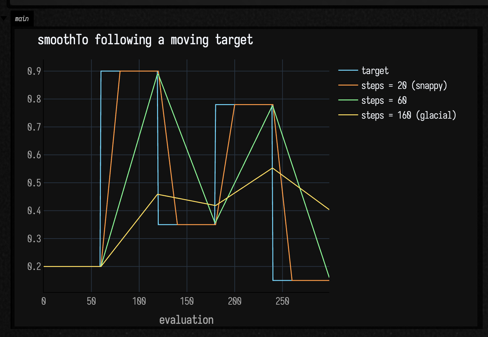
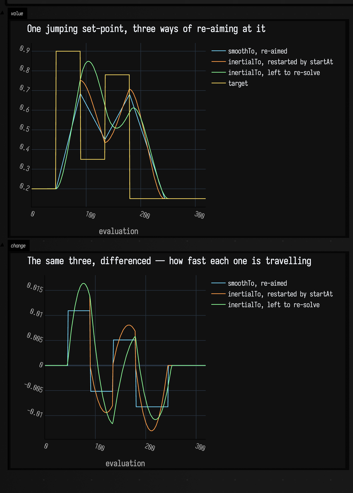
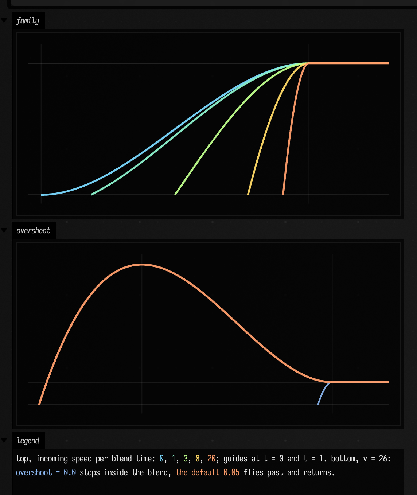
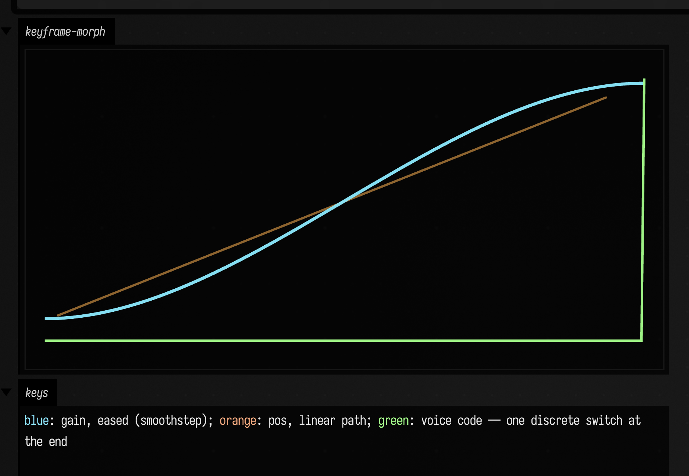
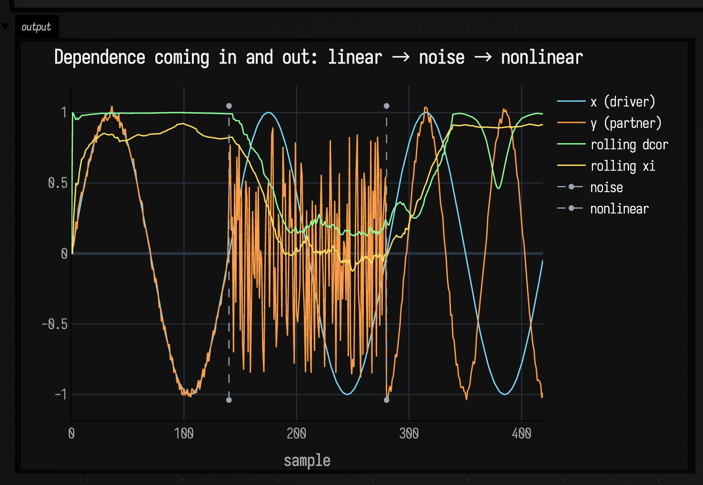
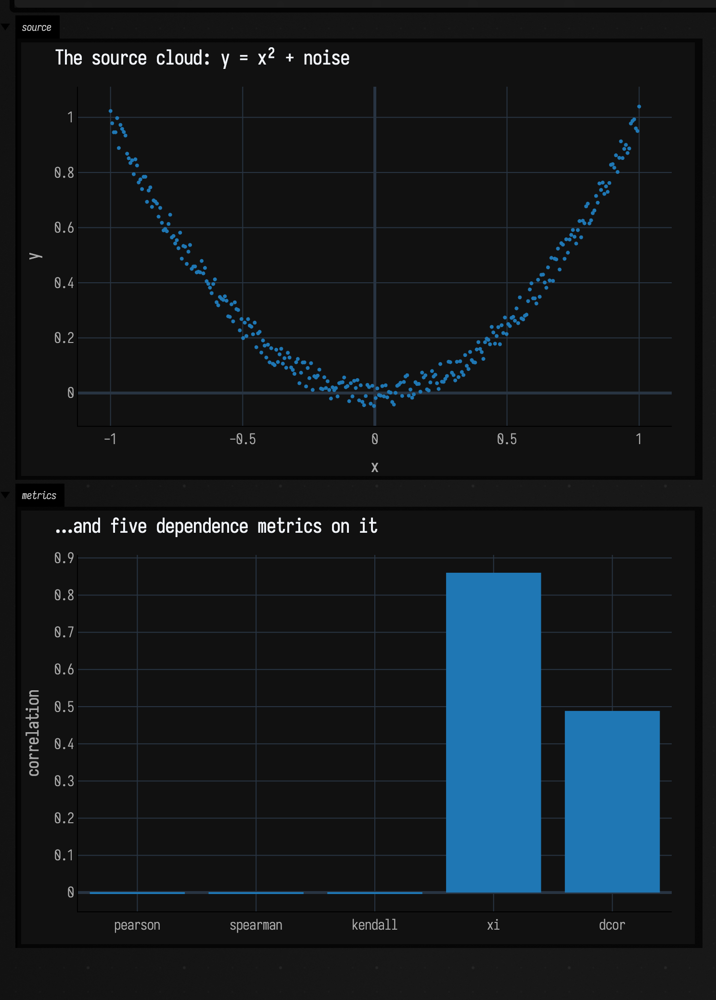

# Values over time: interpolants & keyframes

*Every public declaration used below is listed, with its KDoc, in the codebase reference: [`interpolants.kt`](reference/math.md#interpolants-kt), [`keyframer.kt`](reference/graphics.md#keyframer-kt). Start from [what's already in the box](reference/index.md).*

Some values are supposed to *move* rather than jump. The simplest case is a
single control that eases towards its target instead of snapping to it, so that
when you drag it the result feels like aiming at a value rather than setting one.
The same idea scales up to a whole parameter state morphing between two saved
looks, and out again to a relationship between two signals drifting as they play.
This page collects the tools for all three and draws the motion in each, with a
`showSignals` plot where the value is a signal over time and an `FLine` where the
shape is spatial.
For recovering a hidden value from noisy measurements, see
[State estimation](state_estimation_examples.md).

## Interpolants: easing a value to a target

An interpolant is a value that chases a target over a controlled number of
evaluations rather than jumping. `smoothTo(...)` is the workhorse. Opacity,
brightness, a filter cutoff, a camera move, a number coming off a gesture —
anything you would otherwise assign outright can be handed to it instead. The
single knob that shapes the approach is `steps`: fewer steps arrive sooner and
sharper, more steps settle later and softer. The way to feel that is to give three
interpolants a target that keeps *moving* (a set-point that jumps every 60
evaluations) and re-aim each one from wherever it currently sits (`startAt`) the
moment the target changes. Now `steps` reads as responsiveness: the snappy one
locks on almost immediately, the glacial one is still leaning into the last jump
when the next one arrives.

```diffstatic_runner {data-lang=kotlin screenshot="assets/interpolants_examples/smooth_family.png" wait="1.5" capture="box" open-outputs="true" name="interpolants-family"}
:::static
import afield.stdlib.NeedsStartingValue

val n = 300
// A target that jumps to a new set-point every 60 evaluations — the value to chase.
val setPoints = floatArrayOf(0.20f, 0.90f, 0.35f, 0.78f, 0.15f)
fun targetAt(i: Int) = setPoints[(i / 60).coerceAtMost(setPoints.size - 1)]

var goal = setPoints[0]
fun chaser(steps: Int) = smoothTo<Float>(steps = steps) { goal }
    .also { (it as NeedsStartingValue<Float>).startAt(goal) }

val snappy  = chaser(20)   // locks on fast
val medium  = chaser(60)   // arrives about when the next jump lands
val glacial = chaser(160)  // always leaning toward the last set-point

val tgt = FloatArray(n); val a = FloatArray(n); val b = FloatArray(n); val c = FloatArray(n)
var prev = goal
for (i in 0 until n) {
    goal = targetAt(i)
    if (goal != prev) {
        // Retarget: re-aim each interpolant from its current value toward the new set-point.
        (snappy  as NeedsStartingValue<Float>).startAt(a[i - 1])
        (medium  as NeedsStartingValue<Float>).startAt(b[i - 1])
        (glacial as NeedsStartingValue<Float>).startAt(c[i - 1])
        prev = goal
    }
    tgt[i] = goal
    a[i] = snappy(); b[i] = medium(); c[i] = glacial()
}

showSignals(
    "target" to tgt.toList(),
    "steps = 20 (snappy)" to a.toList(),
    "steps = 60" to b.toList(),
    "steps = 160 (glacial)" to c.toList(),
    channel = "main",
    title = "smoothTo re-aiming at a moving target — steps sets the responsiveness",
    xTitle = "evaluation",
)
```

The cyan step line is the target; the three curves re-aim at each jump. `steps = 20`
snaps onto every set-point and holds; `steps = 60` arrives just as the next jump
lands; `steps = 160` rounds every corner and never quite catches up before the
target moves again. Pick the ramp whose settling time matches the gesture.



### Diff: retime interpolation by duration

"Smooth" can mean "over the next 140 evaluations" or "over 1.2 seconds of real
time." Those are different promises, and the difference matters the moment frame
rate, scheduling, or sampling cadence drifts. The diff below keeps a step-counted
line and adds a duration-based one, sampling both under a cadence that slows
partway through:

```diff_runner {data-lang=kotlin screenshot="assets/interpolants_examples/smooth_duration.png" wait="1.0" capture="box" open-outputs="true"}
:::before
import afield.graphics.FLine
import afield.stdlib.NeedsStartingValue

val q = smoothTo<Float>(steps = 140) { 1.0f }
(q as NeedsStartingValue<Float>).startAt(0.0f)
val y = List(180) { q() }

val f = fline {
    y.forEachIndexed { i, v ->
        val x = 40.0 + i.toDouble() / (y.size - 1).toDouble() * 980.0
        val yy = 560.0 - v * 420.0
        if (i == 0) moveTo(x, yy) else lineTo(x, yy)
    }
    color = vec(1.0, 0.72, 0.35, 0.95)
    thickness = 2.2
}
lines(f, channel = "interpolants-diff", w = 1080.0, h = 640.0, fitToSize = true)
:::after
import afield.graphics.FLine
import afield.stdlib.NeedsStartingValue

data class Sample(val elapsed: Double, val byStep: Float, val byTime: Float)

val byStep = smoothTo<Float>(steps = 140) { 1.0f }
(byStep as NeedsStartingValue<Float>).startAt(0.0f)

var elapsed = 0.0
val byTime = smoothTo<Float>(time = 1.2, steps = null, clock = { elapsed }) { 1.0f }
(byTime as NeedsStartingValue<Float>).startAt(0.0f)

val samples = List(220) { i ->
    val sample = Sample(elapsed, byStep(), byTime())
    elapsed += if (i < 150) 0.002 else 0.018
    sample
}

val maxTime = 1.6
val duration = 1.2
fun x(t: Double) = 40.0 + (t / maxTime).coerceIn(0.0, 1.0) * 980.0
fun y(v: Float) = 560.0 - v * 420.0

fun trace(values: List<Pair<Double, Float>>, rgba: Vec4, width: Double) = fline {
    values.forEachIndexed { i, (t, v) ->
        val xx = x(t)
        val yy = y(v)
        if (i == 0) moveTo(xx, yy) else lineTo(xx, yy)
    }
    color = rgba
    thickness = width
}

val guides = listOf(
    fline { moveTo(40, 560); lineTo(1020, 560); color = vec(1,1,1,0.22); thickness = 1.2 },
    fline { moveTo(40, 140); lineTo(1020, 140); color = vec(1,1,1,0.14); thickness = 1.0 },
    fline { moveTo(x(duration), 110); lineTo(x(duration), 580); color = vec(1,1,1,0.18); thickness = 1.0 }
)

val stepLine = trace(samples.map { it.elapsed to it.byStep }, vec(1.0, 0.72, 0.35, 0.95), 2.6)
val timeLine = trace(samples.map { it.elapsed to it.byTime }, vec(0.56, 1.0, 0.68, 0.95), 3.0)

lines(guides + stepLine + timeLine, channel = "interpolants-diff", w = 1080.0, h = 640.0, fitToSize = true)
:::fold render the colour key
// The two colours name the trace colours above, so they stay as spans. The card around
// them does not need spelling out.
markdown("legend", """
    <span style='color:#ffb85a'>orange</span>: fixed 140 calls;
    <span style='color:#8fffad'>green</span>: 1.2 seconds;
    vertical guide = requested duration
""")
:::endfold
```


The orange trace arrives as soon as 140 calls have happened; the green trace
arrives at the requested timeline duration regardless of cadence. The example injects a synthetic
clock, so its uneven cadence is exact rather than whatever the machine happened to do. For a film or
offline render, use `clock = frameClock(24.0) { renderer.frameCounter }`: repeated reads in one frame
see the same time, and each rendered frame advances exactly 1/24 second. Use the
step form when the world is discrete and counted, the time form when it is
musical, animated, or otherwise measured in seconds.

## Inertia: re-aiming a blend that is already moving

Every `smoothTo` above is re-aimed by a call to `startAt`, and `startAt` restarts.
That is the right behaviour for a value that animates once, and the wrong
behaviour for a value that is being *dragged*: the current velocity is discarded,
so each new target puts the motion back at a standstill. Bind a `smoothTo` to a
mouse position, so that whatever owns it re-aims on every move, and the result
stutters once per move.

`inertialTo` takes the same target lambda and re-solves instead of restarting. It
compares the target against the one it was last aimed at, and when they differ it
finds the blend that passes through the value's current position *at its current
velocity*. Nobody has to call `startAt`, because noticing is the interpolant's
job, which is why the third interpolant below is the only one with no bookkeeping
around it:

```diffstatic_runner {data-lang=kotlin screenshot="assets/interpolants_examples/inertial_family.png" wait="1.5" capture="box" open-outputs="true" name="interpolants-inertial"}
:::static
import afield.stdlib.NeedsStartingValue

val n = 320
// The set-point jumps every 45 evaluations, which is less than the 64-evaluation blend,
// so every jump interrupts a blend that is still running.
val setPoints = floatArrayOf(0.20f, 0.90f, 0.35f, 0.78f, 0.15f)
fun targetAt(i: Int) = setPoints[(i / 45).coerceAtMost(setPoints.size - 1)]

var goal = setPoints[0]
val linear = smoothTo<Float>(steps = 64) { goal }
(linear as NeedsStartingValue<Float>).startAt(goal)
val restarted = inertialTo<Float>(steps = 64) { goal }
val carried = inertialTo<Float>(steps = 64) { goal }

val tgt = FloatArray(n)
val a = FloatArray(n)
val b = FloatArray(n)
val c = FloatArray(n)
var previous = goal
for (i in 0 until n) {
    goal = targetAt(i)
    if (goal != previous) {
        (linear as NeedsStartingValue<Float>).startAt(a[i - 1])
        (restarted as NeedsStartingValue<Float>).startAt(b[i - 1])
        previous = goal
    }
    tgt[i] = goal
    a[i] = linear()
    b[i] = restarted()
    c[i] = carried()
}

// The step-to-step change is the velocity, up to the constant factor of one evaluation.
fun change(v: FloatArray) = List(v.size) { if (it == 0) 0.0 else (v[it] - v[it - 1]).toDouble() }

showSignals(
    "smoothTo, re-aimed" to a.toList(),
    "inertialTo, restarted by startAt" to b.toList(),
    "inertialTo, left to re-solve" to c.toList(),
    "target" to tgt.toList(),
    channel = "value",
    title = "One jumping set-point, three ways of re-aiming at it",
    xTitle = "evaluation",
)
showSignals(
    "smoothTo, re-aimed" to change(a),
    "inertialTo, restarted by startAt" to change(b),
    "inertialTo, left to re-solve" to change(c),
    channel = "change",
    title = "The same three, differenced — how fast each one is travelling",
    xTitle = "evaluation",
)
```



The value panel separates the three at the corners; the change panel is where the
claim is. `smoothTo` is a straight line between two numbers, so its speed is a
plateau, and re-aiming steps that plateau to a new level between one evaluation
and the next. Restarting `inertialTo` replaces the step with a zero: the new blend
begins at rest, so whatever speed the value had is thrown away and built again
from nothing. Left to re-solve, it is the only one of the three whose speed after
a jump is the speed it had before — it carries on in the old direction for a
moment, turns around, and has no corner in it anywhere. That is the difference
between a drag that stutters and one that does not.

Two consequences of re-solving worth knowing before you bind one:

- `inertialTo` **never reports itself complete**, even while sitting on its
  target. A uniform that reports completion stops being written, and an
  interpolant that has to be read to notice its target has moved cannot afford
  that. So it keeps costing an evaluation for as long as it is bound; reach for
  `smoothTo` for a value that animates once and settles.
- It starts at rest on whatever the target first reads as, so it works standalone
  and not only as a bound uniform. `startAt` is available but optional.

### Entering the curve part-way

`InertialEasing` is the arithmetic underneath, exposed for driving a blend by hand
in a game loop, or on something the interpolant cannot carry — a quaternion, say.
`smoothstep(t, s)` is the scaled cubic `s · (3t² − 2t³)` indexed by its own time
rather than the GLSL function of the same name, `smoothstepDt` is its derivative,
and `solve(x, v)` is the interesting one: it returns the `t` and `s` whose curve
is `x` away from its destination *and* moving at velocity `v`. Advance `t` to 1
from there and the gap closes, arriving at rest. A restart is the `v = 0` case of
that, and the top panel below asks for the same distance at five different
incoming speeds instead:

```diffstatic_runner {data-lang=kotlin screenshot="assets/interpolants_examples/inertial_solve.png" wait="1.0" capture="box" open-outputs="true" name="interpolants-solve"}
:::static
// One unit of distance still to go, five different speeds of arrival at it. Velocity is
// per blend time, not per second: a 0.4s blend on something moving 5 units/second is v = 2.
val speeds = listOf(0.0, 1.0, 3.0, 8.0, 20.0)
val shades = listOf(
    vec(0.48, 0.85, 1.0, 0.95),
    vec(0.55, 0.95, 0.80, 0.95),
    vec(0.75, 1.00, 0.55, 0.95),
    vec(1.00, 0.85, 0.40, 0.95),
    vec(1.00, 0.62, 0.42, 0.95)
)

fun x(u: Double, from: Double) = 40.0 + (u - from) / (1.3 - from) * 1000.0
fun y(v: Double, span: Double) = 560.0 - v / span * 400.0

fun curve(v: Double, overshoot: Double, rgba: Vec4, from: Double, span: Double, width: Double): FLine {
    val solved = InertialEasing.solve(x = 1.0, v = v, overshoot = overshoot)
    val base = InertialEasing.smoothstep(solved.t, solved.s)
    return fline {
        for (i in 0..600) {
            val u = solved.t + (1.3 - solved.t) * i / 600.0
            val value = InertialEasing.smoothstep(u, solved.s) - base
            if (i == 0) moveTo(x(u, from), y(value, span)) else lineTo(x(u, from), y(value, span))
        }
        color = rgba
        thickness = width
    }
}

fun guides(from: Double, span: Double, at: List<Double>) = at.map { v ->
    fline {
        moveTo(x(from, from), y(v, span)); lineTo(x(1.3, from), y(v, span))
        color = vec(1, 1, 1, if (v == 0.0 || v == 1.0) 0.22 else 0.10); thickness = 1.2
    }
} + listOf(
    fline {
        moveTo(x(0.0, from), y(-0.06 * span, span)); lineTo(x(0.0, from), y(span * 1.04, span))
        color = vec(1, 1, 1, 0.16); thickness = 1.0
    },
    fline {
        moveTo(x(1.0, from), y(-0.06 * span, span)); lineTo(x(1.0, from), y(span * 1.04, span))
        color = vec(1, 1, 1, 0.16); thickness = 1.0
    }
)

val family = speeds.mapIndexed { i, v -> curve(v, 0.05, shades[i], -0.05, 1.1, 2.6) }
lines(guides(-0.05, 1.1, listOf(0.0, 1.0)) + family, channel = "family", w = 1080.0, h = 540.0, fitToSize = true)

// Past v = 21.3 × the distance left, `solve` prefers the negative root: the curve is entered
// before its own zero crossing, which flies past the target and comes back.
val jolt = curve(26.0, 0.0, vec(0.55, 0.72, 0.95, 0.9), -0.6, 6.4, 2.2)
val past = curve(26.0, 0.05, vec(1.00, 0.62, 0.42, 0.95), -0.6, 6.4, 2.8)
lines(guides(-0.6, 6.4, listOf(0.0, 1.0)) + jolt + past, channel = "overshoot", w = 1080.0, h = 540.0, fitToSize = true)
:::fold render the colour key
markdown("legend", """
    top, incoming speed per blend time:
    <span style='color:#7ad9ff'>0</span>,
    <span style='color:#8cf2cc'>1</span>,
    <span style='color:#bfff8c'>3</span>,
    <span style='color:#ffd966'>8</span>,
    <span style='color:#ff9e6b'>20</span>;
    guides at t = 0 and t = 1.
    bottom, v = 26: <span style='color:#8cb8f2'>overshoot = 0.0</span> stops inside the blend,
    <span style='color:#ff9e6b'>the default 0.05</span> flies past and returns.
""")
:::endfold
```



In the top panel every curve covers the same unit of distance and arrives at rest
at `t = 1`; the faster it is already going, the further along the curve it starts,
so `v = 20` enters at `t = 0.903` and has a tenth of a blend time left to do the
whole job. The bottom panel is the second root. `solve` returns two, and it picks
the negative one — the curve entered *before* its own zero crossing — when the
incoming speed exceeds about 21.3 times the distance remaining, which for
`overshoot = 0.05` is the whole of that branch. Stopping cleanly from there would
mean a deceleration nothing in the world could have produced, so it flies past
instead, by roughly two-ninths of a blend time's travel, and comes back over about
1.5 blend times. `overshoot = 0.0` refuses, and the blue sliver at the right of
that panel is what refusing costs: the same unit of distance, covered inside the
last 7% of the blend.

## Keyframes: morphing a whole parameter state — including code

An interpolant moves one number. A `KeyframeScope` moves a whole named *state*
between saved snapshots, and its values are typed: numbers and vectors ease
continuously, quaternions slerp, and **code values** (`StackSLString`, source
blocks) switch *discretely* at the end of the transition. So a patch can
crossfade its continuous parameters while its actual synthesis code snaps over at
the moment the crossfade completes. Two `Key`s and `interpolate`
are all it takes; here the numeric `gain` is eased through a smoothstep `remap`,
the `pos` vector eases linearly, and the `voice` code steps:

```diffstatic_runner {data-lang=kotlin screenshot="assets/interpolants_examples/keyframe_morph.png" wait="1.0" capture="box" open-outputs="true" name="interpolants-keyframe"}
:::static
import afield.graphics.FLine
import afield.stdlib.KeyframeScope
import afield.stdlib.stackSLString
import afield.stdlib.linalg.Vector2f

val scope = KeyframeScope()
val a = scope.Key(mutableMapOf(
    "gain"  to 0.12,
    "pos"   to Vector2f(80f, 500f),
    "voice" to stackSLString("saw 110 *")
))
val b = scope.Key(mutableMapOf(
    "gain"  to 0.94,
    "pos"   to Vector2f(960f, 150f),
    "voice" to stackSLString("sin 220 * fold")
))

// Ease only the gain with a smoothstep; pos stays linear.
scope.remap["gain"] = { t -> t * t * (3.0 - 2.0 * t) }

val steps = 220
val gain = fline {
    for (i in 0..steps) {
        val t = i.toDouble() / steps
        val g = (scope.interpolate(a, b, t)["gain"] as Number).toDouble()
        val x = 60.0 + t * 960.0
        val y = 560.0 - g * 460.0
        if (i == 0) moveTo(x, y) else lineTo(x, y)
    }
    color = vec(0.55, 0.92, 1.0, 0.95)
    thickness = 2.8
}

// The position vector traces an eased path across the frame.
val path = fline {
    for (i in 0..steps) {
        val t = i.toDouble() / steps
        val p = scope.interpolate(a, b, t)["pos"] as Vector2f
        if (i == 0) moveTo(p.x, p.y) else lineTo(p.x, p.y)
    }
    color = vec(1.0, 0.70, 0.32, 0.55)
    thickness = 2.0
}

// The code value is discrete: it stays "a" until t reaches 1, then snaps to "b".
// Draw that as a step trace to contrast it with the smooth gain.
val code = fline {
    for (i in 0..steps) {
        val t = i.toDouble() / steps
        val isEnd = scope.interpolate(a, b, t)["voice"] == b["voice"]
        val x = 60.0 + t * 960.0
        val y = if (isEnd) 120.0 else 540.0
        if (i == 0) moveTo(x, y) else lineTo(x, y)
    }
    color = vec(0.65, 1.0, 0.55, 0.95)
    thickness = 2.2
}

lines(listOf(path, gain, code), channel = "keyframe-morph", w = 1080.0, h = 640.0, fitToSize = true)
:::fold render the colour key
// As above: the three colours are the trace colours, the card around them is not.
markdown("keys", """
    <span style='color:#8fe6ff'>blue</span>: gain, eased (smoothstep);
    <span style='color:#ffb185'>orange</span>: pos, linear path;
    <span style='color:#a6ff8c'>green</span>: voice code — one discrete switch at the end
""")
:::endfold
```



The green step trace sits low for the whole transition and jumps exactly once, at
the very end — that is `StackSLString`/source-block interpolation, which never
produces a half-parsed intermediate. Two programs that differ only in *numbers*
can do better than that: see
[blending two programs](keyframer_examples.md#blending-two-programs-not-just-two-numbers). The blue gain is the smoothstep, the orange
path is the linear vector ease. A `Key` also knows how to `diff` against another
and emit the `update { ... }` code that reproduces it, so a captured look is both
a value you can interpolate *toward* and a snippet you can paste back into a box.

## Correlations: a relationship drawn instead of summarised

A correlation compresses a relationship into one number, which is useful and also
the problem — it can hide a nonlinear dependency or flatten timing into a
statistic that sounds more certain than it is. Two signals can clearly belong
together without a straight-line relationship; a rolling metric is the way to
watch that dependence drift over time:

```diffstatic_runner {data-lang=kotlin screenshot="assets/correlations_examples/rolling_dependence.png" wait="1.5" capture="box" open-outputs="true"}
:::static
val rollingD = RollingDistanceCorrelation(windowSize = 60)
val rollingXi = RollingXiCorrelation(windowSize = 60)

// A partner signal whose relationship to the driver changes in thirds: first it tracks x
// (linear), then it becomes independent noise, then it is a nonlinear function of x.
val n = 420
val xs = DoubleArray(n) { sin(it / n.toDouble() * 2.0 * PI * 3.0) }
val ys = DoubleArray(n) { i ->
    when {
        i < 140 -> xs[i] + (-0.05 + random() * 0.10)                    // linear dependence
        i < 280 -> -0.9 + random() * 1.8                               // independent noise
        else    -> 2.0 * xs[i] * xs[i] - 1.0 + (-0.05 + random() * 0.10) // nonlinear dependence
    }
}
val dcor = DoubleArray(n) { rollingD.push(xs[it], ys[it]) ?: 0.0 }
val xi   = DoubleArray(n) { rollingXi.push(xs[it], ys[it]) ?: 0.0 }

showSignals(
    "x (driver)" to xs.toList(),
    "y (partner)" to ys.toList(),
    "rolling dcor" to dcor.toList(),
    "rolling xi" to xi.toList(),
    title = "Dependence coming in and out: linear → noise → nonlinear",
    xTitle = "sample",
    marks = listOf("noise" to 140, "nonlinear" to 280),
    markColor = "#9aa4b2",
)
```

Both source signals are drawn alongside the metrics computed from them, so you can
see what each rolling window is actually looking at. In the first third `y` tracks
`x`; in the second it is independent noise; in the third it is a nonlinear function
of `x` (`y = 2x² − 1`). Both `RollingDistanceCorrelation` and `RollingXiCorrelation`
climb on the two *dependent* stretches and collapse across the noise band, so the
dependence visibly comes and goes (the grey guides mark the regime changes), which
a single summary number would smear into one lukewarm value.



The two metrics rise and fall together without coinciding, and both recover on the
*nonlinear* third where a straight-line correlation would not. Use this kind of
sanity check before trusting a rolling metric on sensor streams, musical
features, or exploratory data. When you instead want a fast comparison of several
metrics on one *fixed* dataset (which one notices the shape, which punishes you
for asking a linear question of a nonlinear cloud), plot the cloud they run on,
then the metrics as bars:

```diffstatic_runner {data-lang=kotlin screenshot="assets/correlations_examples/metric_profile.png" wait="1.0" capture="box" open-outputs="true"}
:::static
import afield.darkMode
import space.kscience.plotly.*
import space.kscience.plotly.models.ScatterMode

val n = 320
val xs = DoubleArray(n) { it / (n - 1.0) * 2.0 - 1.0 }
val ys = DoubleArray(n) { xs[it] * xs[it] + (-0.05 + random() * 0.10) }

val metrics = mapOf(
    "pearson" to StatsDependence.pearson(xs, ys),
    "spearman" to StatsDependence.spearman(xs, ys),
    "kendall" to StatsDependence.kendallTauB(xs, ys),
    "xi" to StatsDependence.xi(xs, ys),
    "dcor" to StatsDependence.distanceCorrelation(xs, ys)
)

display("source", Plotly.plot {
    scatter { mode = ScatterMode.markers; x.set(xs); y.set(ys); marker { size = 4 } }
    layout { title = "The source cloud: y = x² + noise"; xaxis { title = "x" }; yaxis { title = "y" } }
}.darkMode())

display("metrics", Plotly.plot {
    bar { x.set(metrics.keys.toList()); y.set(metrics.values.toList()) }
    layout { title = "…and five dependence metrics on it"; yaxis { title = "correlation" } }
}.darkMode())
```



The metrics visibly disagree about the same sample: `pearson` and `spearman`
shrug at the parabola while `xi` and `dcor` notice it. Check that disagreement
before choosing a statistic. For neighborhood and graph structure on related point sets,
see [Neighbors & graph connectivity examples](graph_connectivity_examples.md).

---

Three families, one habit: whether a value eases, morphs, or correlates, draw the
motion. For recovering a hidden value from noisy measurements, see
[State estimation](state_estimation_examples.md); for raw and filtered *signals*
rather than these derived quantities, continue with
[Timeseries examples](timeseries_examples.md).
