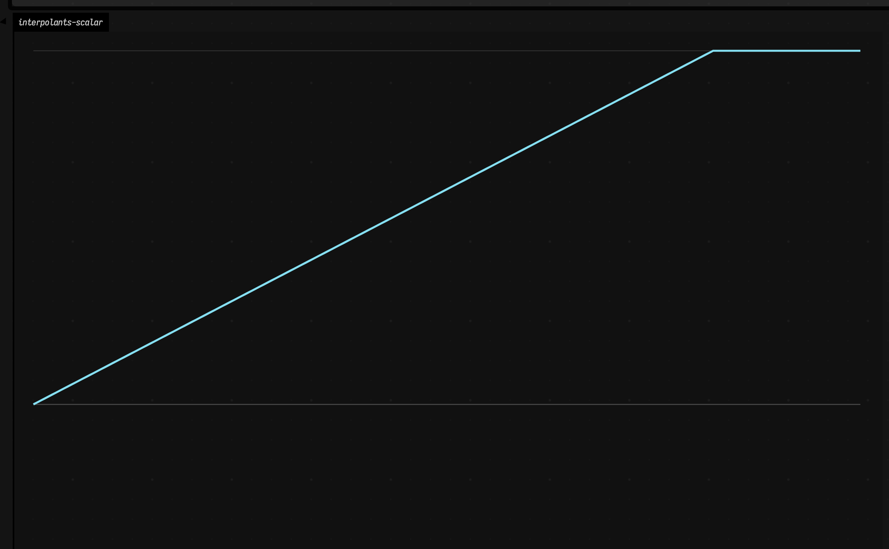
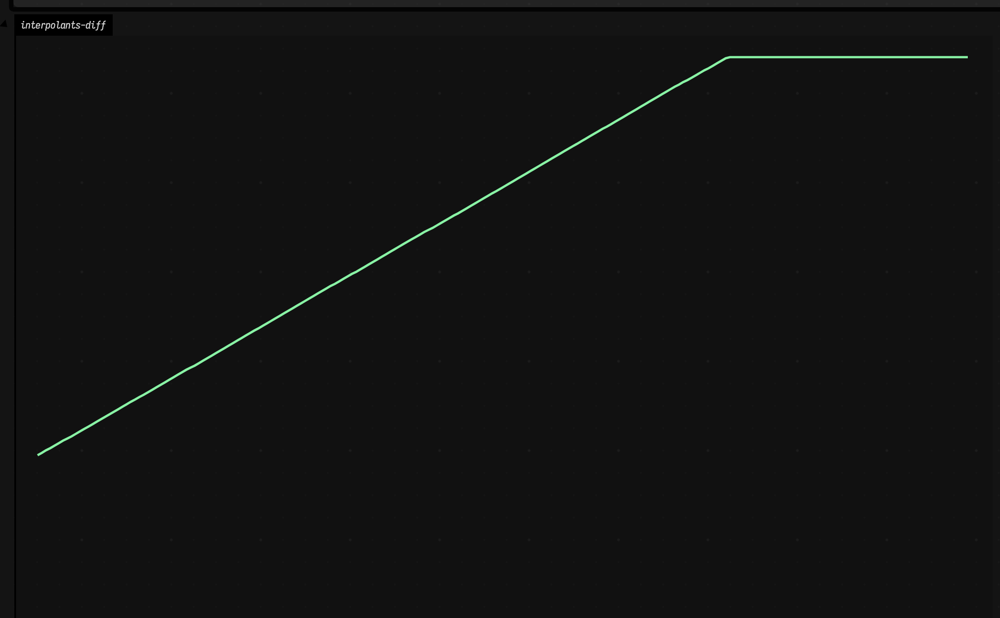

# Interpolants to FLine examples

Interpolants are what you reach for when you do not want a value to snap from here to there like a frightened rabbit. In animation that means smoother motion; in UI it means less mechanical transitions; in music and interaction it means gestures that settle instead of click. These examples make that behavior visible.

## smoothTo for scalar envelopes

Suppose you need a parameter to move decisively, but not abruptly. Opacity, brightness, a filter cutoff, a camera move, a gesture-derived control signal: all of these want *arrival* rather than *teleportation*. `smoothTo(...)` is one answer to that need.

```diffstatic_runner {data-lang=kotlin screenshot="assets/interpolants_examples/smooth_scalar.png" wait="1.0" capture="box"}
:::static
import afield.graphics.FLine
import afield.stdlib.*
import afield.stdlib.NeedsStartingValue

val ramp = smoothTo<Float>(steps = 180) { 1.0f }
(ramp as NeedsStartingValue<Float>).startAt(0.0f)

val values = List(220) { ramp() }

val curve = FLine().apply {
    values.forEachIndexed { i, v ->
        val x = 40.0 + i.toDouble() / (values.size - 1).toDouble() * 980.0
        val y = 560.0 - v * 420.0
        if (i == 0) moveTo(x, y) else lineTo(x, y)
    }
    color = vec(0.55, 0.92, 1.0, 0.95)
    thickness = 2.6
}

val guides = listOf(
    FLine().apply { moveTo(40, 560); lineTo(1020, 560); color = vec(1,1,1,0.24); thickness = 1.2 },
    FLine().apply { moveTo(40, 140); lineTo(1020, 140); color = vec(1,1,1,0.14); thickness = 1.0 }
)

lines(guides + curve, channel = "interpolants-scalar", w = 1080.0, h = 640.0, fitToSize = true)
```

Nothing exotic is happening in the code. We give one interpolant a starting value, let it chase a target, and draw the trace. The guide lines are only there so your eye can read the climb and the settling behavior more clearly.



What matters is the shape that comes back: fast at first, then increasingly reluctant to overshoot the target. That is why `smoothTo(...)` is so handy for animation parameters, fades, controller smoothing, and "make this feel less binary" problems in general. If you want to apply the same idea to live signals rather than a synthetic ramp, continue with [Timeseries examples](timeseries_examples.md) and [Stats examples](stats_examples.md).

## Diff: retime interpolation by duration

But what exactly do you mean by "smoothly"? Over the next 140 evaluations? Over 1.2 seconds of real time? Those are not the same promise, and the distinction matters the moment frame rate, scheduling, or sampling cadence starts to drift.

```diff_runner {data-lang=kotlin screenshot="assets/interpolants_examples/smooth_duration.png" wait="1.0" capture="window" open-outputs="true"}
:::before
import afield.graphics.FLine
import afield.stdlib.*
import afield.stdlib.NeedsStartingValue

val q = smoothTo<Float>(steps = 140) { 1.0f }
(q as NeedsStartingValue<Float>).startAt(0.0f)
val y = List(180) { q() }

val f = FLine().apply {
    y.forEachIndexed { i, v ->
        val x = 40.0 + i.toDouble() / (y.size - 1).toDouble() * 980.0
        val yy = 560.0 - v * 420.0
        if (i == 0) moveTo(x, yy) else lineTo(x, yy)
    }
    color = vec(1.0, 0.72, 0.35, 0.95)
    thickness = 2.2
}
lines(f, channel = "interpolants-diff", w = 1080.0, h = 640.0, fitToSize = true)
:::after
import afield.graphics.FLine
import afield.stdlib.*
import afield.stdlib.NeedsStartingValue

val q = smoothTo<Float>(time = 1.2, steps = null) { 1.0f }
(q as NeedsStartingValue<Float>).startAt(0.0f)
val y = List(220) {
    val v = q()
    Thread.sleep(6)
    v
}

val f = FLine().apply {
    y.forEachIndexed { i, v ->
        val x = 40.0 + i.toDouble() / (y.size - 1).toDouble() * 980.0
        val yy = 560.0 - v * 420.0
        if (i == 0) moveTo(x, yy) else lineTo(x, yy)
    }
    color = vec(0.56, 1.0, 0.68, 0.95)
    thickness = 2.6
}
lines(f, channel = "interpolants-diff", w = 1080.0, h = 640.0, fitToSize = true)
```

The diff isolates that choice. The first version counts calls; the second version cares about elapsed time. The small `Thread.sleep(...)` in the latter is there to expose the difference rather than hide it.



And there it is on the page: the time-based version behaves like a duration, not like a loop counter. Use the step-based form when your world is discrete and counted; use the time-based form when your world is musical, animated, interactive, or otherwise measured in seconds. For more timing-oriented examples, see [Visualizers](visualizers.md) and [Timeseries examples](timeseries_examples.md).
