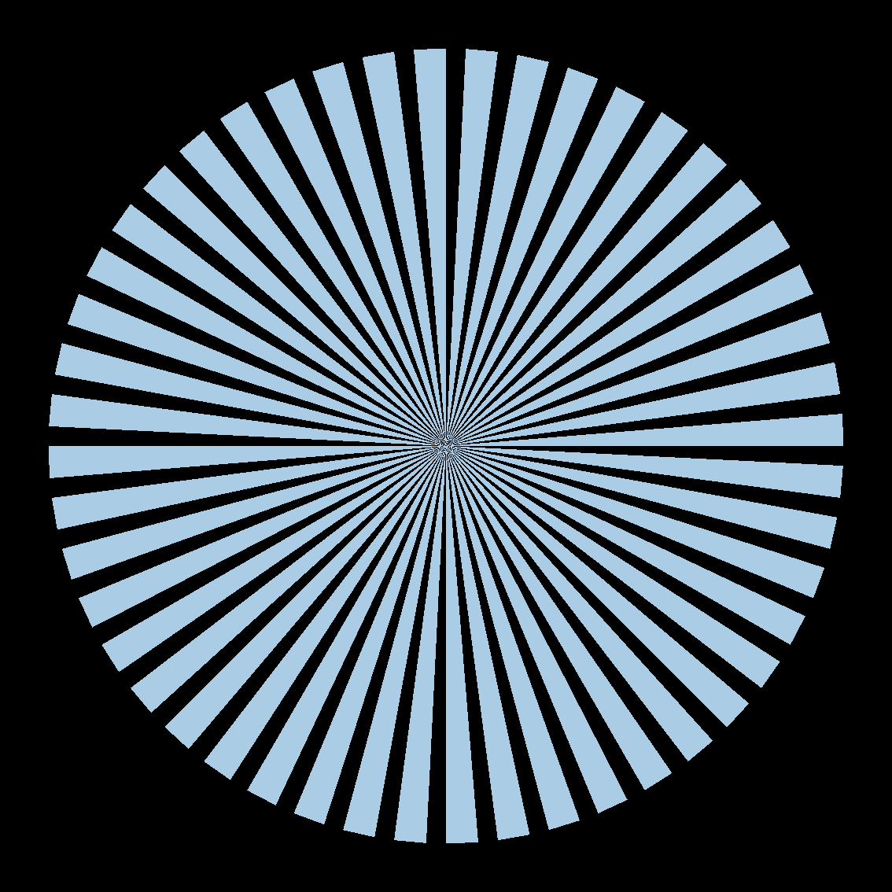
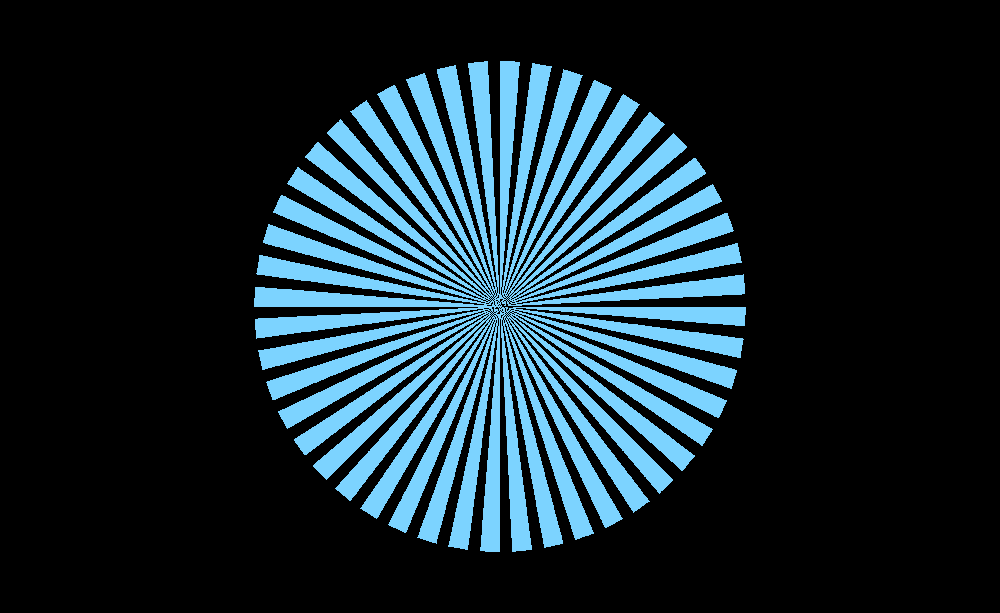
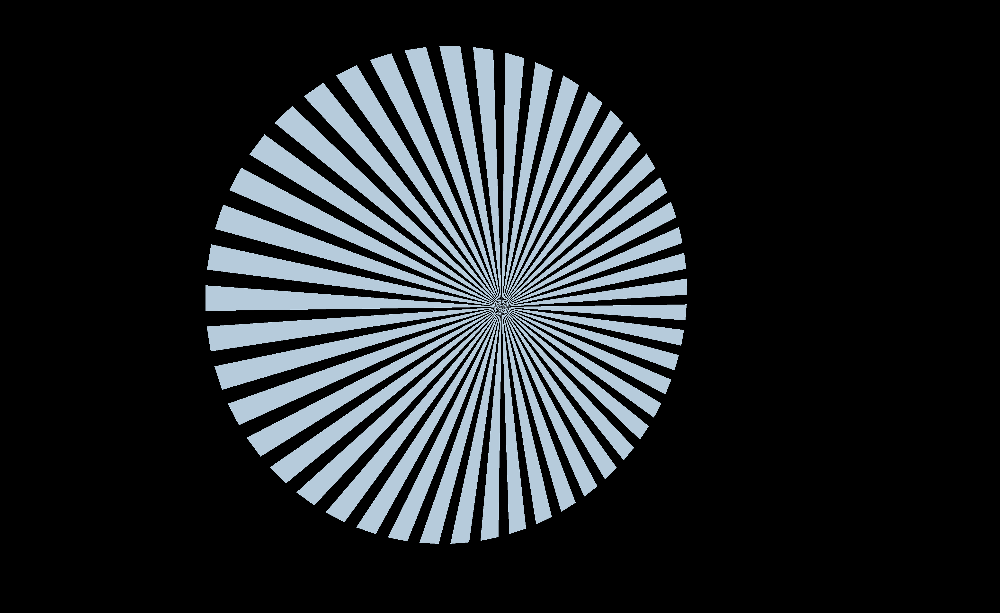
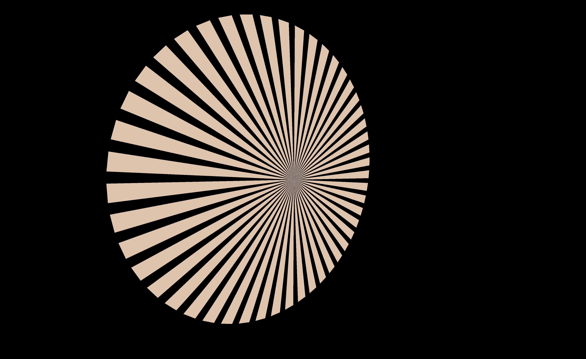
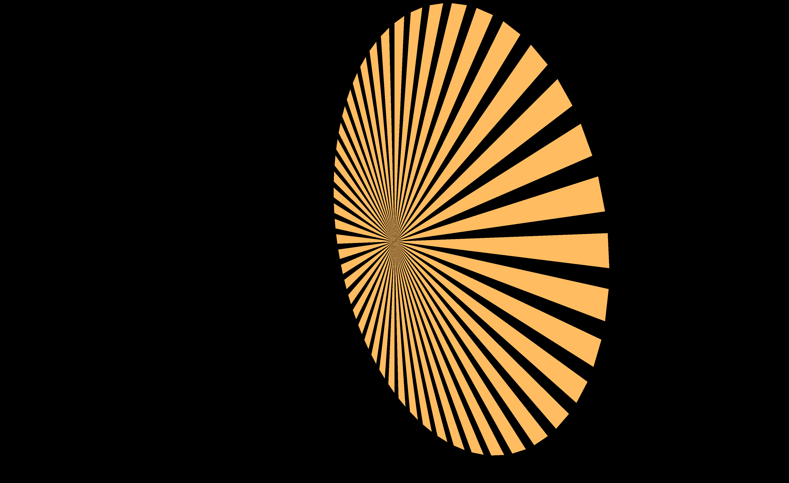
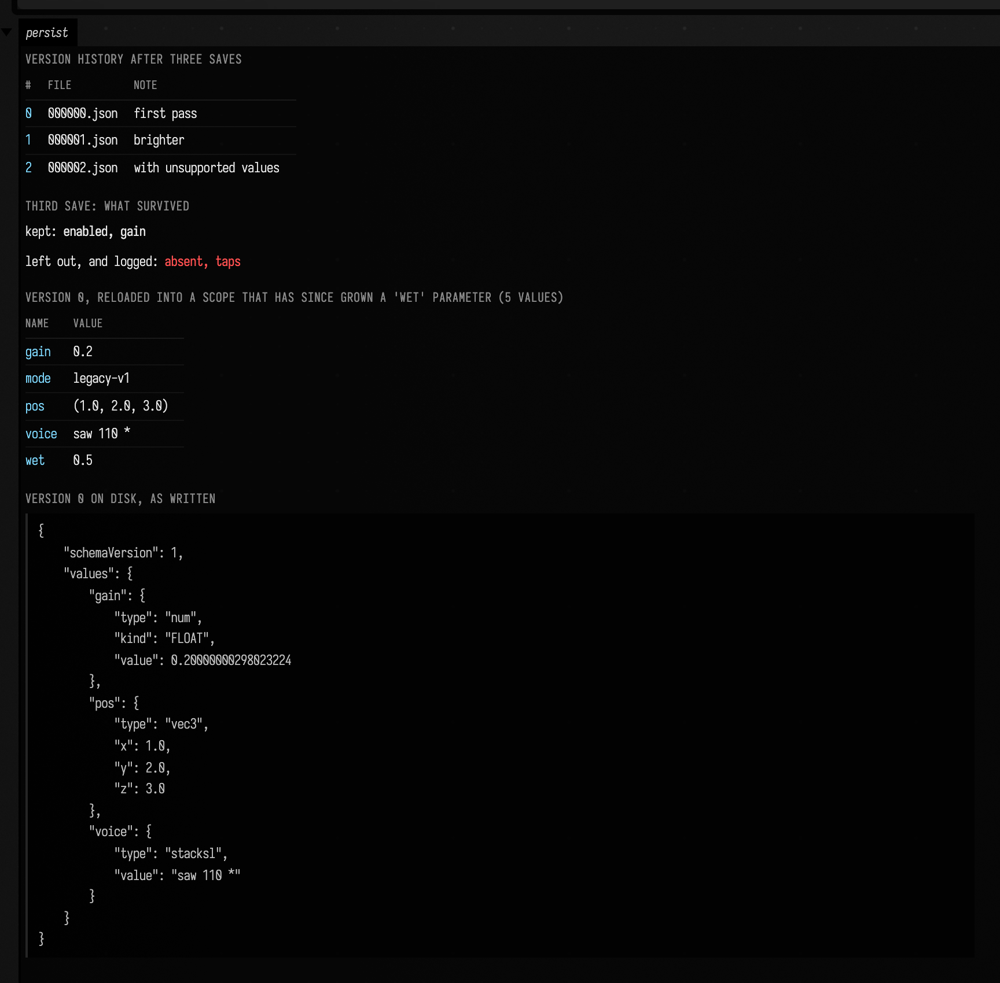

# Keyframes: capturing, persisting and replaying live state

*Every `keyframer.kt` declaration used below is listed, with its KDoc, in the codebase reference:
[`keyframer.kt`](reference/graphics.md#keyframer-kt). The two supporting types the examples lean on,
`afield.four.buffers.Structure` and `afield.four.util.CameraPose`, are not: they live in
`afield.four`, which the [reference](reference/index.md) leaves to
[afield.four Graphics](afield_four_graphics.md).*

Live coding has a specific kind of loss built into it. You push sliders around for twenty minutes,
arrive somewhere good, and then the thing you arrived at exists only as the current contents of a
running process. Reload the shader and it is gone. Close the document and it is gone. Try to
reproduce it tomorrow from memory and you get something that is *nearly* it, which is worse.

`keyframer.kt` is the answer to that: a `KeyframeScope` is a set of named live targets, `capture()`
reads all of them into a `Key`, and invoking that `Key` writes them all back. Once a look is a
`Key`, it is an ordinary value: you can diff it against another one, blend between them, write it
to disk with a version history, or turn it into Kotlin source you can paste into a box and commit.

The blending half of this (numbers and vectors easing while *code* steps discretely) has a worked
example over on
[Values over time](interpolants_examples.md#keyframes-morphing-a-whole-parameter-state-including-code).
This page is the rest of it: **what a scope can watch**, **why a camera move is a screw motion**,
**how saving works and what survives it**, and **how a captured look becomes source**.

Almost everything below runs on the CPU. `Structure` is constructible bare
(`Structure.kt:112#open class Structure(`) and its `bind`/`bindings` are plain map operations
(`Structure.kt:176#fun bind(property: String, value: Function0<*>) {`, `Structure.kt:136#val bindings: MutableMap<String, Function0<*>> = root?.bindings`). A keyframe scope can be exercised, and tested,
without a GPU anywhere in sight. The exception is
[the GPU still](#the-same-thing-driving-a-live-gpu-uniform), which is a real Vulkan render, and the
targets that need a renderer, which are listed at the [foot of the page](#what-is-actually-tested).

## What a scope watches

A scope holds no values of its own. It holds *targets*: places to read from and write to. The
simplest is a uniform `Structure`, and the interesting wrinkle is the `@` in a key name: everything
after the last `@` is the property driven on the target, so a glow pass and a blur pass can both own
a `radius` without colliding.

```diffstatic_runner {data-lang=kotlin screenshot="assets/keyframer_examples/capture_apply.png" wait="2.0" capture="box" open-outputs="true" w="900" h="620" padding="16"}
:::static
import afield.four.buffers.Structure
import afield.stdlib.KeyframeScope

// Two independent uniform structures, as a glow pass and a blur pass would each have.
val glow = Structure()
val blur = Structure()
glow.bind("radius") { 4.0f }
glow.bind("intensity") { 0.35f }
blur.bind("radius") { 12.0f }

val scope = KeyframeScope()
// The part after the last '@' is the property driven on the structure. Both passes have a
// `radius`; the qualifier is what keeps them apart in the key.
scope.target("glow@radius", glow)
scope.target("glow@intensity", glow)
scope.target("blur@radius", blur)

// The snapshot. Reading only — nothing is written anywhere.
val captured = scope.capture()

// Now fiddle, the way you would with the sketch running, and make it so.
val edited = captured.copy().update {
    this["glow@radius"] = 9.0f
    this["glow@intensity"] = 0.80f
}
edited()

// Read the live structures back to prove the write actually landed — and that it landed on the
// bare property name, not on the qualified key name.
fun live(s: Structure, p: String) = s.bindings[p]?.invoke()?.toString() ?: "{dim:unbound}"
// Read now, while the edit is still applied — the next line puts the old values back.
val liveRows = listOf(
    "glow.radius" to live(glow, "radius"),
    "glow.intensity" to live(glow, "intensity"),
    "blur.radius" to live(blur, "radius"),
    "glow.*glow@radius*" to live(glow, "glow@radius")
).joinToString("\n") { (k, v) -> "| $k | $v |" }

// Put the original back, and diff to show the scope is exactly where it started.
captured()
val restored = scope.capture()

:::fold render the four panels
// The card's width is pinned so the figure stays legible — see the persistence example below.
markdown("keys", """
    #### 1 — capture()
    ${captured.h}

    #### 2 — edited, then applied
    ${captured.diffHtml(edited, "captured", "edited")}

    #### 3 — the live structures, read back

    | binding | value |
    |---------|-------|
    $liveRows

    #### 4 — captured() again, then re-captured
    ~~~
${captured.diffText(restored, "captured", "restored")}
    ~~~
""", width = 820)
:::endfold
```


Panel 3 is the one to read carefully. The edited key wrote `9.0` to `glow`'s **`radius`**, not to
anything called `glow@radius`. That name is unbound on the structure, and applying the key does not
create it, because the write goes through the target's bind function, which was built with the
`@`-stripped property name. The qualifier exists purely so one key can address two structures that
use the same uniform name.

Panel 4 is the round trip closing: re-applying the original snapshot and re-capturing gives
`No key differences.` A `Key` really is a complete description of what the scope watches.

Objects that are not shader `Structure`s can join the same system through an explicit getter and
setter. The low-level form remains `target(name, get, set)`, but ordinary locals should use the typed
forms: `floatTarget`, `doubleTarget`, `booleanTarget`, `intTarget`, `vector2Target`,
`vector3Target`, `vector4Target`, or `stringTarget`. Their setters validate the loaded value at the
scope boundary, and the vector forms copy mutable vectors in both directions. A saved key never ends
up aliasing a live local.

Boolean and integer locals become float lanes, which is what gives them meaningful interpolation:
a Boolean crosses at `0.5`, while an integer rounds and optionally clamps on apply. That suits
controls such as an instance count, which changes CPU-authored geometry but should still travel
smoothly between two looks.

```diffstatic {data-lang=kotlin}
var opacity = 0.25f
var layers = 3

val scope = KeyframeScope().apply {
    floatTarget("outlines.opacity", { opacity }) { opacity = it }
    intTarget("outlines.layers", { layers }, 0..64) { layers = it }
}
```

### One value shared by a local, a control and a key

A normal `controlGroup` control caches its own visible value, while a keyframe normally drives a
Kotlin local. Registering those independently creates two authorities: recalling a key moves the
picture but leaves the slider behind, and rerunning the box can then restore that stale slider over
the recalled value.

The `keyframe*` control helpers make the local authoritative and the UI its writable mirror. A hand
moving the control writes the local. A key applying a value writes the same local and moves both the
desktop control and the remote controller. The programmatic UI update refreshes the box's live rerun
cache but does not emit one document operation per animation frame.

```diffstatic {data-lang=kotlin}
var gain = 0.35f
var projectedOnly = false
val keys = KeyframeScope()

thisBox.controlGroup("projected light") {
    keyframeFloatSlider(
        scope = keys, name = "light.gain", label = "gain",
        min = 0.0, max = 4.0,
        get = { gain }, set = { gain = it }
    )
    keyframeCheckbox(
        scope = keys, name = "light.projectedOnly", label = "projected only",
        get = { projectedOnly }, set = { projectedOnly = it }
    )
}
```

There are matching helpers for a `Double` slider, vec2 control, colour picker and text input. The
underlying grouped controls also hand back a `ControlValueHandle<T>`; `handle.set(value)` is the
UI-only half of that, for a custom integration that needs it. It never invokes the control callback,
so it cannot start a feedback loop.

### A custom class contributes lanes instead of inventing a file format

A score, instrument or simulation can implement `KeyframeContributor`. Its job is only to register
stable names and live getters/setters. `include` adds those lanes to an existing scope, alongside
shader structures, locals and controls; the ordinary `Key` JSON remains the sole persistence format.

```diffstatic {data-lang=kotlin}
class Look : KeyframeContributor {
    var opacity = 1f
    var position = vec(0, 0, 0)

    override fun registerKeyframes(scope: KeyframeScope, prefix: String) = with(scope) {
        floatTarget("$prefix.opacity", { opacity }) { opacity = it }
        vector3Target("$prefix.position", { position }) { position = it }
    }
}

val keys = KeyframeScope(schemaVersion = 2)
    .include(Look(), prefix = "foreground")
```

Composition-specific choices stay in the contributor: what a lane means, when its setter is queued,
whether a zero retires a resource, and how the names are versioned. Field only supplies composition,
typed boundaries, interpolation and persistence.

??? aside "The module-pointer target overloads can only address one member per block"

    Besides a `Structure`, a scope can target a live module's uniform structures:
    `target(module: ModulePointer, name)` and its `ComputeModulePointer` / `MeshModulePointer`
    siblings (`stdlib/keyframer.kt:820#fun target(module: ModulePointer, name: String) =`, `:824`, `:828`). All three need a live renderer. Every
    fence on this page uses the plain `Structure` form instead.

    Each is a one-line wrapper over the lazily-resolved `target(name) { … }`
    (`stdlib/keyframer.kt:702#fun target(name: String, structure: () -> Structure?) {`), and they pass the *same*
    `@`-suffixed string to two different lookups: it selects the structure, via
    `module.current.liveUniformStructures[…]`, **and** it is the member name bound inside that
    structure. That map is keyed by the **uniform block's name**
    (`Module.kt:580#vi.ubos.forEach { liveUniformStructures[it.name] =` for a graphics module, `ComputeModule.kt:163#ci.ubos.forEach  { liveUniformStructures[it.name] =` for a compute one), while the
    members inside it are the block's *fields*. So the key can only address a member whose name
    equals the block's own name, not an arbitrary field within the block, and not the independent
    structure-and-property pair the `@` qualifier gives a plain `Structure` target.

    The working way to keyframe a module's uniform is therefore the plain `Structure` overload
    against `module.<block>`, which resolves to that same live structure
    (`Module.kt:238#return inside.current.liveUniformStructures[property.name] ?:`). The next section drives a uniform that way, on a GPU.

!!! note "`capture()` reads either kind of property, and writes back a binding"

    A `Structure` can hold a property two ways: `structure.bind("radius") { 4f }` installs a
    binding, and `structure["radius"] = 4f` stores a value (and removes any binding). `capture()`
    reads binding-first-then-value (`keyframer.kt:572#private fun readProperty(structure: Structure?, property: String): Any? {`), the same precedence `Structure.get`
    (`Structure.kt:188#operator fun <T> get(property: String) =`) and the buffer writer (`Structure.kt:360`) use. Either kind snapshots,
    including a child `Structure`, whose bindings live in the *root's* map under a dotted path.

    The write side is not symmetric. Applying a key always goes through `Structure.bind`, so a
    value-held property comes back as a constant binding with the old `values` entry shadowed
    underneath. Every reader in the engine agrees on the binding; the shadowing shows up only if you
    inspect `structure.values` yourself.

## The same thing, driving a live GPU uniform

Everything so far ran on bare `Structure`s. This fence is a Vulkan render (a native window, a
`moduleHere()` graphics module, a fan of **white** triangles) in which the only source of colour in
the entire frame is a `vec4 tint` in the shader's uniform block, and the only thing that ever writes
that uniform is a keyframe.

```diffstatic_runner {data-lang=kotlin screenshot="assets/keyframer_examples/gpu_tint.png" wait="0.25" timeout="20" capture="native-window" native-wait-frames="4" trim-native=true graphics-context=true name="keyframer-gpu-tint" source-box="assets/canonical_graphics/keyframer-look" source-box-properties="vertex,fragment" source-box-wait="0.1"}
import afield.four.Renderer
import afield.four.modules.fromContext
import afield.stdlib.KeyframeScope

val renderer: Renderer = fromContext()

var m = Mesh()
var module = moduleHere()

module += "mainMesh" to m
renderer += module

// Fully qualified, and it has to be: a uniform block makes moduleHere() generate a Kotlin class of the
// same (capitalised) name straight into this box's preamble, and a declaration in the box beats
// any import. The block here is `look`, so the trap would bite anything called `Look`.
val camera = afield.four.util.Camera()
camera.at = vec(0, 0, 7)
camera.target = vec(0, 0, 0)

module.look.p = camera.p()
module.look.m = camera.m()

// A fan of WHITE triangles. Every colour in the picture comes from the tint, and nothing else.
val N = 48
m.set(3 * N, 1 * N) {
    N {
        val a0 = it / N.toDouble() * Math.PI * 2.0
        val a1 = (it + 0.62) / N.toDouble() * Math.PI * 2.0
        pos.add(
            0.0, 0.0, 0.0,
            2.4 * kotlin.math.cos(a0), 2.4 * kotlin.math.sin(a0), 0.0,
            2.4 * kotlin.math.cos(a1), 2.4 * kotlin.math.sin(a1), 0.0
        )
        3 { col.add(1, 1, 1, 1) }
        tri.add(0 + 3 * it, 1 + 3 * it, 2 + 3 * it)
    }
}

// ---- the keyframe part -------------------------------------------------------------------
// `module.look` resolves to the block's live uniform Structure (Module.kt:217), so the ordinary
// Structure target drives it. This is the overload to use for a module uniform.
val scope = KeyframeScope()
scope.target("tint", module.look)

val cool = scope.Key(mutableMapOf("tint" to vec(0.20, 0.65, 1.00, 1.0)))
val warm = scope.Key(mutableMapOf("tint" to vec(1.00, 0.50, 0.12, 1.0)))

// A quarter of the way from cool to warm — NOT the midpoint. These two are nearly
// complementary, so t = 0.5 blends to (0.60, 0.575, 0.56): a grey indistinguishable from an
// untinted fan, which would make the picture prove nothing. t = 0.25 is (0.40, 0.6125, 0.78).
scope.interpolate(cool, warm, 0.25)()
```



The fan is blue, and that is the whole argument. The mesh colours are all `(1, 1, 1, 1)`; a fan that
is *any* colour other than white can only have got it from the uniform, and an unwritten uniform
would have left it black.

The capture contains precisely two colours: black background, and `rgb(170, 205, 229)` across all
497,142 fan pixels. The keyframed value is the linear `(0.40, 0.6125, 0.78)`, and sRGB-encoding that
gives `(170, 205, 229)`, to the byte, on all three channels. So the pixels on screen are the
interpolated keyframe and nothing else: not the `cool` endpoint, not the `warm` one, not white.

That is also the one path no unit test can take: `Key.invoke()` writing through `Structure.bind`
into a uniform that a live Vulkan pipeline then reads.

### The interpolation, rendered at four values of `t`

A single still shows the uniform moving, but not the *interpolation*. Below is the same scene at four
values of `t`, with **two** things keyframed at once: the `vec4 tint`, and the camera as a
`CameraPose`, sclerped, which is the subject of the next section.

Each frame is a separate native Vulkan window capture. `t` is the only difference between the four
runs, and everything that moves is a uniform a keyframe wrote.

```diffstatic_runner {data-lang=kotlin screenshot="assets/keyframer_examples/strip_t00.png" wait="0.25" timeout="25" capture="native-window" native-wait-frames="4" graphics-context=true name="keyframer-strip-t00" source-box="assets/canonical_graphics/keyframer-look" source-box-properties="vertex,fragment" source-box-wait="0.1"}
import afield.four.Renderer
import afield.four.modules.fromContext
import afield.stdlib.KeyframeScope

val renderer: Renderer = fromContext()

var m = Mesh()
var module = moduleHere()
module += "mainMesh" to m
renderer += module

val camera = afield.four.util.Camera()

// The same white fan as above — every colour on screen still comes from the tint alone.
val N = 48
m.set(3 * N, 1 * N) {
    N {
        val a0 = it / N.toDouble() * Math.PI * 2.0
        val a1 = (it + 0.62) / N.toDouble() * Math.PI * 2.0
        pos.add(
            0.0, 0.0, 0.0,
            2.4 * kotlin.math.cos(a0), 2.4 * kotlin.math.sin(a0), 0.0,
            2.4 * kotlin.math.cos(a1), 2.4 * kotlin.math.sin(a1), 0.0
        )
        3 { col.add(1, 1, 1, 1) }
        tri.add(0 + 3 * it, 1 + 3 * it, 2 + 3 * it)
    }
}

val scope = KeyframeScope()
scope.camera(camera)               // a CameraPose target — sclerped, not lerped
scope.target("tint", module.look)  // the uniform block's live Structure

// Two endpoints. The camera swings 90 degrees around the fan and lifts, while the tint goes cool to
// warm. Poses are read off the camera rather than constructed, so this is exactly what capture()
// would have stored. Tint is a literal here rather than a captured value, since there is nothing
// to capture from yet — the uniform is untouched until the first key lands on it.
camera.at = vec(0, 0, 3.5); camera.target = vec(0, 0, 0)
val poseCool = camera.pose()
camera.at = vec(-3.03, 1.0, 1.75); camera.target = vec(0, 0, 0)
val poseWarm = camera.pose()

val cool = scope.Key(mutableMapOf("camera" to poseCool, "tint" to vec(0.20, 0.65, 1.00, 1.0)))
val warm = scope.Key(mutableMapOf("camera" to poseWarm, "tint" to vec(1.00, 0.50, 0.12, 1.0)))

val t = 0.0
scope.interpolate(cool, warm, t)()

// Applying the key moved the Camera object; the projection uniforms are read off it afterwards.
module.look.p = camera.p()
module.look.m = camera.m()
```

```diffstatic_runner {data-lang=kotlin screenshot="assets/keyframer_examples/strip_t33.png" wait="0.25" timeout="25" capture="native-window" native-wait-frames="4" graphics-context=true hidden=true name="keyframer-strip-t33" source-box="assets/canonical_graphics/keyframer-look" source-box-properties="vertex,fragment" source-box-wait="0.1"}
import afield.four.Renderer
import afield.four.modules.fromContext
import afield.stdlib.KeyframeScope

val renderer: Renderer = fromContext()
var m = Mesh()
var module = moduleHere()
module += "mainMesh" to m
renderer += module
val camera = afield.four.util.Camera()
val N = 48
m.set(3 * N, 1 * N) {
    N {
        val a0 = it / N.toDouble() * Math.PI * 2.0
        val a1 = (it + 0.62) / N.toDouble() * Math.PI * 2.0
        pos.add(
            0.0, 0.0, 0.0,
            2.4 * kotlin.math.cos(a0), 2.4 * kotlin.math.sin(a0), 0.0,
            2.4 * kotlin.math.cos(a1), 2.4 * kotlin.math.sin(a1), 0.0
        )
        3 { col.add(1, 1, 1, 1) }
        tri.add(0 + 3 * it, 1 + 3 * it, 2 + 3 * it)
    }
}
val scope = KeyframeScope()
scope.camera(camera)
scope.target("tint", module.look)
camera.at = vec(0, 0, 3.5); camera.target = vec(0, 0, 0)
val poseCool = camera.pose()
camera.at = vec(-3.03, 1.0, 1.75); camera.target = vec(0, 0, 0)
val poseWarm = camera.pose()
val cool = scope.Key(mutableMapOf("camera" to poseCool, "tint" to vec(0.20, 0.65, 1.00, 1.0)))
val warm = scope.Key(mutableMapOf("camera" to poseWarm, "tint" to vec(1.00, 0.50, 0.12, 1.0)))
scope.interpolate(cool, warm, 0.333)()
module.look.p = camera.p()
module.look.m = camera.m()
```

```diffstatic_runner {data-lang=kotlin screenshot="assets/keyframer_examples/strip_t66.png" wait="0.25" timeout="25" capture="native-window" native-wait-frames="4" graphics-context=true hidden=true name="keyframer-strip-t66" source-box="assets/canonical_graphics/keyframer-look" source-box-properties="vertex,fragment" source-box-wait="0.1"}
import afield.four.Renderer
import afield.four.modules.fromContext
import afield.stdlib.KeyframeScope

val renderer: Renderer = fromContext()
var m = Mesh()
var module = moduleHere()
module += "mainMesh" to m
renderer += module
val camera = afield.four.util.Camera()
val N = 48
m.set(3 * N, 1 * N) {
    N {
        val a0 = it / N.toDouble() * Math.PI * 2.0
        val a1 = (it + 0.62) / N.toDouble() * Math.PI * 2.0
        pos.add(
            0.0, 0.0, 0.0,
            2.4 * kotlin.math.cos(a0), 2.4 * kotlin.math.sin(a0), 0.0,
            2.4 * kotlin.math.cos(a1), 2.4 * kotlin.math.sin(a1), 0.0
        )
        3 { col.add(1, 1, 1, 1) }
        tri.add(0 + 3 * it, 1 + 3 * it, 2 + 3 * it)
    }
}
val scope = KeyframeScope()
scope.camera(camera)
scope.target("tint", module.look)
camera.at = vec(0, 0, 3.5); camera.target = vec(0, 0, 0)
val poseCool = camera.pose()
camera.at = vec(-3.03, 1.0, 1.75); camera.target = vec(0, 0, 0)
val poseWarm = camera.pose()
val cool = scope.Key(mutableMapOf("camera" to poseCool, "tint" to vec(0.20, 0.65, 1.00, 1.0)))
val warm = scope.Key(mutableMapOf("camera" to poseWarm, "tint" to vec(1.00, 0.50, 0.12, 1.0)))
scope.interpolate(cool, warm, 0.666)()
module.look.p = camera.p()
module.look.m = camera.m()
```

```diffstatic_runner {data-lang=kotlin screenshot="assets/keyframer_examples/strip_t10.png" wait="0.25" timeout="25" capture="native-window" native-wait-frames="4" graphics-context=true hidden=true name="keyframer-strip-t10" source-box="assets/canonical_graphics/keyframer-look" source-box-properties="vertex,fragment" source-box-wait="0.1"}
import afield.four.Renderer
import afield.four.modules.fromContext
import afield.stdlib.KeyframeScope

val renderer: Renderer = fromContext()
var m = Mesh()
var module = moduleHere()
module += "mainMesh" to m
renderer += module
val camera = afield.four.util.Camera()
val N = 48
m.set(3 * N, 1 * N) {
    N {
        val a0 = it / N.toDouble() * Math.PI * 2.0
        val a1 = (it + 0.62) / N.toDouble() * Math.PI * 2.0
        pos.add(
            0.0, 0.0, 0.0,
            2.4 * kotlin.math.cos(a0), 2.4 * kotlin.math.sin(a0), 0.0,
            2.4 * kotlin.math.cos(a1), 2.4 * kotlin.math.sin(a1), 0.0
        )
        3 { col.add(1, 1, 1, 1) }
        tri.add(0 + 3 * it, 1 + 3 * it, 2 + 3 * it)
    }
}
val scope = KeyframeScope()
scope.camera(camera)
scope.target("tint", module.look)
camera.at = vec(0, 0, 3.5); camera.target = vec(0, 0, 0)
val poseCool = camera.pose()
camera.at = vec(-3.03, 1.0, 1.75); camera.target = vec(0, 0, 0)
val poseWarm = camera.pose()
val cool = scope.Key(mutableMapOf("camera" to poseCool, "tint" to vec(0.20, 0.65, 1.00, 1.0)))
val warm = scope.Key(mutableMapOf("camera" to poseWarm, "tint" to vec(1.00, 0.50, 0.12, 1.0)))
scope.interpolate(cool, warm, 1.0)()
module.look.p = camera.p()
module.look.m = camera.m()
```

`t = 0` — the cool endpoint, the fan face-on:



`t = 0.333` — the camera has begun to swing and lift, and the tint has warmed:



`t = 0.666` — further round, and warmer again:



`t = 1` — the warm endpoint, the fan nearly edge-on:



Being the endpoints, `t = 0` and `t = 1` double as a check on the whole mechanism: if either
differed from the pose and colour the two keys hold, the interpolation would be wrong at its own
boundary.

## A camera move is a screw motion, not a straight line

`KeyframeScope.camera` registers a `Camera` as a target. What it stores is not a position and a
target point but a `CameraPose`: the camera's rigid transform as a dual quaternion, plus the focus
distance. That choice is what makes the target worth having, and the difference is easiest to see
drawn.

Interpolating a dual quaternion is a *screw motion* (`CameraPose.sclerp`, `CameraPose.kt:45#fun sclerp(other: CameraPose, t: Float): CameraPose =`, over
`DualQuaternionf.sclerp`, `DualQuaternionf.kt:158#fun sclerp(other: DualQuaternionf, t: Float, dest:`): a rotation and a translation about one axis,
performed together. Interpolating a position is a straight line. Between two cameras that both look
at the same subject, those are very different moves:

```diffstatic_runner {data-lang=kotlin screenshot="assets/keyframer_examples/camera_screw.png" wait="2.5" capture="box" open-outputs="true" w="1000" h="520" padding="16"}
:::static
import afield.four.util.CameraPose
import afield.stdlib.KeyframeScope
import afield.stdlib.linalg.Vector3f

val scope = KeyframeScope()
// Two cameras, both two units up, both looking at the origin, a quarter turn apart.
val a = scope.Key(mutableMapOf("camera" to CameraPose.lookAt(Vector3f(8f, 2f, 0f), Vector3f(0f, 0f, 0f))))
val b = scope.Key(mutableMapOf("camera" to CameraPose.lookAt(Vector3f(0f, 2f, 8f), Vector3f(0f, 0f, 0f))))
val pa = (a["camera"] as CameraPose).position
val pb = (b["camera"] as CameraPose).position

val n = 60
fun sclerpAt(t: Double) = (scope.interpolate(a, b, t)["camera"] as CameraPose)
fun lerpAt(t: Double) = Vector3f(pa).lerp(pb, t.toFloat())

// ---- panel 1: plan view, looking down the y axis. World units scaled up to figure units.
val S = 40.0
val screw = fline {
    for (i in 0..n) {
        val p = sclerpAt(i.toDouble() / n).position
        if (i == 0) moveTo(p.x * S, p.z * S) else lineTo(p.x * S, p.z * S)
    }
    color = vec(0.36, 0.84, 1.0, 1.0); thickness = 3.0
}
val chord = fline {
    moveTo(pa.x * S, pa.z * S); lineTo(pb.x * S, pb.z * S)
    color = vec(1.0, 0.62, 0.26, 1.0); thickness = 3.0
}
// Sight lines from the sclerp path to the subject: every one is the same length.
val sight = fline {
    for (i in 0..10) {
        val p = sclerpAt(i / 10.0).position
        moveTo(p.x * S, p.z * S); lineTo(0.0, 0.0)
    }
    color = vec(0.36, 0.84, 1.0, 0.22); thickness = 1.0
}
// …and from the lerped positions, which are visibly shorter in the middle.
val sightLerp = fline {
    for (i in 0..10) {
        val p = lerpAt(i / 10.0)
        moveTo(p.x * S, p.z * S); lineTo(0.0, 0.0)
    }
    color = vec(1.0, 0.62, 0.26, 0.22); thickness = 1.0
}
val subject = fline {
    val r = 14.0
    for (i in 0..48) {
        val ang = i / 48.0 * Math.PI * 2.0
        if (i == 0) moveTo(r * kotlin.math.cos(ang), r * kotlin.math.sin(ang))
        else lineTo(r * kotlin.math.cos(ang), r * kotlin.math.sin(ang))
    }
    color = vec(0.95, 0.95, 0.95, 0.9); thickness = 2.0
}

// ---- panel 2: distance from the camera to the subject, against t.
fun plotY(d: Double) = 330.0 - (d - 5.5) * 120.0
val dScrew = fline {
    for (i in 0..n) {
        val t = i.toDouble() / n
        if (i == 0) moveTo(0.0, plotY(sclerpAt(t).position.length().toDouble()))
        else lineTo(t * 400.0, plotY(sclerpAt(t).position.length().toDouble()))
    }
    color = vec(0.36, 0.84, 1.0, 1.0); thickness = 3.0
}
val dChord = fline {
    for (i in 0..n) {
        val t = i.toDouble() / n
        if (i == 0) moveTo(0.0, plotY(lerpAt(t).length().toDouble()))
        else lineTo(t * 400.0, plotY(lerpAt(t).length().toDouble()))
    }
    color = vec(1.0, 0.62, 0.26, 1.0); thickness = 3.0
}

// Every number in the captions is measured here, not asserted from memory.
val rMin = (0..n).minOf { sclerpAt(it.toDouble() / n).position.length() }
val rMax = (0..n).maxOf { sclerpAt(it.toDouble() / n).position.length() }
val worstAim = (0..n).maxOf { sclerpAt(it.toDouble() / n).target.length() }
val lerpMid = lerpAt(0.5).length()
val closer = (1.0 - lerpMid / rMax) * 100.0

showPlaneGrid(
    ("plan view, looking down y\n" +
        "blue: sclerp, a quarter circle. orange: the straight line between the same two positions") to
        listOf(sight, sightLerp, subject, chord, screw),
    ("distance to the subject, over the move\n" +
        "sclerp holds %.4f..%.4f; the straight line dips to %.4f — %.1f%% nearer".format(
            rMin, rMax, lerpMid, closer)) to
        listOf(dScrew, dChord),
    columns = 2, cellWidth = 440, cellHeight = 380
)
:::fold render the aiming-error note
markdown("aim", """
    worst-case aiming error along the sclerp path: **%.6f** world units —
    {muted:the subject never leaves the centre of frame.}
""".format(worstAim))
:::endfold
```


The blue path is a circle, and not approximately: the distance from the camera to the subject is
constant at **8.2462** for the entire move, and the height stays at exactly 2.0. Between two poses
like that the screw degenerates to a pure rotation about the vertical axis through the subject. The
orange path is what you get by lerping the two positions. It cuts the corner, and at the midpoint the
camera is **6.0000** away instead of 8.2462, **27.2% nearer**. On screen that reads as the subject lunging
toward the viewer and retreating again, which is not a move anyone asked for.

The right panel is the same fact plotted. The aiming error printed underneath is what makes this a
*camera* feature rather than a maths curiosity: over the whole move, the furthest the sclerp path's
aim ever strays from the origin is **0.000003 world units**, three millionths, which is `Float`
rounding rather than a wobble. The subject stays framed for free, with no look-at constraint
anywhere in the loop.

All of this is asserted in `aCameraPoseSclerpsItsTransformAndLerpsItsFocusDistance`: the constant
distance, the constant height and the aim are each checked at **eleven** sample points across the
move, and the midpoint figures (8/√2 on each axis for the sclerp, 6.0000 and 27.24% for the
straight line) once each, where they are defined.

??? aside "The camera target itself needs a renderer"

    `KeyframeScope.camera(camera)` takes a live `Camera`, and `Camera`'s constructor is
    `Camera(val renderer: Renderer = fromContext())` (`Camera.kt:16#class Camera(val renderer: Renderer = fromContext()) {`), which resolves a renderer from
    the box context. So the *registration* is one of the eight declarations no unit test reaches
    (the full list is at the [foot of the page](#what-is-actually-tested)); the pose arithmetic
    above, which is all of the behaviour, is tested. Note also that the target accepts a
    `CameraPose` or a bare `DualQuaternionf` and **silently ignores any other type**
    (`keyframer.kt:790#fun camera(camera: Camera, keyName: String = "camera") {` dispatches on a `when` with no `else`). A `Vector3f` "camera
    position" key will appear to apply and do nothing.

## Saving: every save is history

`saveKey` writes pretty JSON, and every single time also appends a numbered copy to a
`<file>.versions` directory with a manifest. Saving is always additive; nothing prunes it.

What survives the trip is a closed set. `KValue.fromAny` recognises numbers, `vec2`/`3`/`4`,
quaternion, dual quaternion, camera pose, string, StackSL source and source-backed block. Anything
else (a `Boolean`, a list, a null) is **dropped in silence**, and the key loads back one value short
with no warning anywhere.

```diffstatic_runner {data-lang=kotlin screenshot="assets/keyframer_examples/persistence.png" wait="3.0" capture="box" open-outputs="true" w="960" h="760" padding="16"}
:::static
import afield.stdlib.KeyframeScope
import afield.stdlib.stackSLString
import afield.stdlib.linalg.Vector3f
import java.nio.file.Files

val dir = Files.createTempDirectory("keyframer-docs")
val path = dir.resolve("look.json")

val scope = KeyframeScope(schemaVersion = 1)
scope.saveKey(path, scope.Key(mutableMapOf(
    "gain" to 0.20f,
    "pos" to Vector3f(1f, 2f, 3f),
    "voice" to stackSLString("saw 110 *")
)), note = "first pass")

scope.saveKey(path, scope.Key(mutableMapOf(
    "gain" to 0.65f,
    "pos" to Vector3f(4f, 5f, 6f),
    "voice" to stackSLString("sin 220 * fold")
)), note = "brighter")

// A third save that also carries values the union cannot represent.
val lossy = scope.Key(mutableMapOf(
    "gain" to 0.90f,
    "enabled" to true,          // a Boolean is outside the union
    "taps" to listOf(1, 2, 3),  // so is a list
    "absent" to null            // and a null is dropped too
))
scope.saveKey(path, lossy, note = "with unsupported values")

val versions = scope.keyVersions(path)
val versionRows = versions.joinToString("\n") { v ->
    "| ${v.index} | ${v.file.md} | ${v.note?.md ?: "—"} |"
}

val reloaded = scope.loadKey(path)
val kept = reloaded.values.keys.sorted().joinToString(", ")
val droppedNames = lossy.values.keys.sorted().filter { it !in reloaded.values.keys }

// An older snapshot loaded into a scope that has since grown a parameter.
val newer = KeyframeScope(schemaVersion = 1)
newer.missingKey("wet", 0.5f)                  // applies to every file this scope loads
newer.missingKey(1, "mode", "legacy-v1")       // only to files stamped schemaVersion = 1
val migrated = newer.loadKey(path, version = 0)

:::fold render the persistence card
// Rendered as flat text rather than through `migrated.h`. The Key's own HTML gives a Vector3f the
// interactive 3D axis widget, which is lovely in a box and wrong here: it loads asynchronously and
// reflowed the card mid-screenshot, so the first capture of this figure came out clipped.
val migratedRows = migrated.values.entries.sortedBy { it.key }.joinToString("\n") { (k, v) ->
    "| ${k.md} | ${v.md} |"
}

// The width is pinned. A `capture="box"` screenshot clips to the output card, and an
// unpinned card sized by its widest unbreakable line loses everything past the clip.
markdown("persist", """
    #### version history after three saves

    | # | file | note |
    |---|------|------|
    $versionRows

    #### third save: what survived

    kept: **$kept**

    dropped in silence: {bad:**${droppedNames.joinToString(", ")}**}

    #### version 0, reloaded into a scope that has since grown a 'wet' parameter (${migrated.values.size} values)

    | name | value |
    |------|-------|
    $migratedRows

    #### version 0 on disk, as written
    ~~~json
${java.nio.file.Files.readString(dir.resolve("look.json.versions").resolve("000000.json"))}
    ~~~
""", width = 820)
:::endfold
```



Three things to pull out of that.

**The drop is silent and total.** The third save went in with four names and came back with one. No
exception, no log line, no marker in the file. If you keyframe a `Boolean` you will simply never see
it again.

**`missingKey` is how a scope outgrows its own files.** Version 0 was written before `wet` existed;
loading it into a scope that declares `missingKey("wet", 0.5f)` fills the gap. The schema-qualified
form, `missingKey(1, "mode", …)`, applies only to files stamped with that `schemaVersion`, and it
is applied *after* the version-agnostic defaults — for a matching file it wins. Nothing ever
*rejects* a file for having a different schema version; the stamp only selects defaults.

**A name present in the file always beats a default**, even when its value is null.

`gain` was saved as the `Float` `0.20f` and appears on disk as `0.20000000298023224`, because every
number goes over the wire as a `Double`. The round trip is still exact: `"kind": "FLOAT"` is carried
alongside, and `KValue.toAny` uses it to narrow the value back to a `Float`, recovering `0.2f`
precisely, which `theFloatOnDiskNarrowsBackToExactlyTheFloatThatWasSaved` asserts against that exact
on-disk string.

The `Double` wire format does lose information in two cases, though. A `Long` past 2^53 has more
mantissa than a `Double` can hold and comes back changed. And any `Number` that is *not* one of the
six `NumKind`s, such as a `BigDecimal` or a `BigInteger`, is stored as a plain `DOUBLE` and comes
back a `Double`: even where the value survives, the **type** does not.

### The files are the history; the manifest is a cache

`<file>.versions` holds one numbered JSON file per save, plus a `manifest.json` carrying the two
things a file name cannot: each version's note and its timestamp. The two can disagree. A manifest
can be truncated by a crash mid-write, hand-edited, cut short by a full disk, or half-synced, and
`saveKey` writes the numbered file *before* the manifest row, leaving a window in which a file
exists that no row mentions.

The numbered files win. Because `keyVersions` returns the union of the two, neither alone can lose a
version:

- A **file no row mentions** is listed anyway, with the file's own modification time and a note
  reading `(recovered from disk; the manifest row for this version was lost)`. That marker shows up
  in the history table, saying that the snapshot survived and its note did not.
- A **row whose file is gone** is still listed, because the row is the only surviving evidence that
  the version existed. Loading it throws rather than returning something else.
- `saveKey` takes its next number from that union, so it never reuses an index and never overwrites
  an existing snapshot. That is the same way `nextSafeSaveBackup`
  (`saving.kt:1906#private fun File.nextSafeSaveBackup(backupDir: File): File {`) numbers a document backup: off the directory listing rather than off a
  side file.

An unreadable manifest is reported on the `error,keyframer` log channel rather than swallowed, and
the next `saveKey` moves it aside to `manifest.json.corrupt` instead of overwriting it. The notes in
a half-written file are still there for you to read. One test covers each way the manifest can go
wrong: `aCorruptManifestNeitherLosesHistoryNorReusesAVersionIndex`,
`aCorruptManifestIsRecoveredFromTheFilesAndQuarantinedRatherThanOverwritten`,
`aVersionFileTheManifestNeverRecordedIsNotOverwritten` and
`aDeletedManifestStillLeavesTheFilesAsTheHistory`.

One caveat for old files: a `.versions` directory written before 2026-08 can have gaps. An
unparseable manifest read as no history at all back then, so the next save called itself version 0
and wrote over `000000.json`. Whatever is on disk is still readable; what was overwritten is gone.

## A captured look becomes source

The last step of the loop closes it. `Key.updateCode()` emits the snapshot as pasteable Kotlin: an
`update { … }` or `updateAndApply { … }` block, sorted by name, so that a state you arrived at by
fiddling becomes a diff you can commit.

```diffstatic_runner {data-lang=kotlin screenshot="assets/keyframer_examples/update_code.png" wait="2.0" capture="box" open-outputs="true" w="900" h="560" padding="16"}
:::static
import afield.stdlib.KeyframeScope
import afield.stdlib.SourceBackedBlock
import afield.stdlib.stackSLString
import afield.stdlib.linalg.Vector3f
import afield.stdlib.linalg.Quaternionf

val scope = KeyframeScope()
val key = scope.Key(mutableMapOf(
    "gain" to 0.65f,           // a Float, and the 'f' suffix matters
    "steps" to 12,
    "seed" to 99L,
    "pos" to Vector3f(1.5f, 0f, -2.25f),
    "spin" to Quaternionf().setAngleAxis(0.7f, 0f, 1f, 0f),
    "voice" to stackSLString("sin 220 * fold"),
    // A source block whose body mentions a '$'. Emitting this as a Kotlin *raw* string would
    // have let the '$' interpolate at paste time; it now falls back to an escaped literal.
    "block" to SourceBackedBlock<Any?>("box-1", "val total = 2\nprintln(\"sum: \$total\")"),
    "notes" to listOf("unsupported", "on purpose")
))

:::fold render the generated update code
// A multi-line value goes into a fence at column zero, so it arrives byte for byte.
markdown("code", """
    ~~~kotlin
${key.updateCode("look")}
    ~~~
""")
:::endfold
```


Every literal is chosen so the paste round-trips as the same *type*, not merely the same number.
`0.65f` keeps its `f`, because without it a captured `Float` comes back as a `Double` literal and
`Key.set` does not re-coerce numbers. `99L` keeps its `L`; bytes and shorts get
`.toByte()` / `.toShort()`. Vectors come out as `vec(…)`, quaternions and poses as fully-qualified
constructor calls, and StackSL as `stackSLString(…)` so it stays *code* rather than decaying to a
string. A value outside that set (the list here) becomes `null` behind an `/* unsupported */`
comment: the emitted code still compiles, and nulls that one value.

The escaped `\$` in the source block is `kotlinRawStringLiteral` declining a raw string.
It reaches for one unless the body contains `"""`, ends in a quote, or contains a `$`. That last
case matters: a raw string still interpolates `$name` and `${…}`, and a block mentioning either
would paste as code that failed to compile or that silently substituted something else,
defeating the exact round trip `updateCode` exists for. Those bodies get the escaped literal
instead, which `updateCodeEscapesDollarInASourceBlock` holds in place.

`copyUpdateCodeToClipboard()` is the same string, put on the system clipboard. That one goes
through AWT: it throws on a headless JVM, and it replaces whatever the user had copied.

## Blending two programs, not just two numbers

A key can hold code — a `stack.auto` StackSL program registered with `stackAuto`, or a Kotlin
expression captured by the `sourceBlock { }` macro. By default `interpolate` **steps** those: the
left source until `t` reaches 1, then the right one. There is no midpoint between two arbitrary
programs, and a program assembled out of halves of two others is not one either.

Two programs that differ only in *numbers* are the exception, and they are the common case when the
two keys are two looks for one patch. `codeBlend` turns that case on:

```diffstatic {data-lang=kotlin}
import afield.stdlib.CodeBlendMode
import afield.stdlib.CodeBlendOptions
import afield.stdlib.KeyframeScope
import afield.stdlib.planStackSLCodeBlend

val warm = "uv 3.0 * fbm 0.15 + [1.0,0.55,0.2] *"
val cool = "uv 8.0 * fbm 0.45 + [0.2,0.5,1.0] *"

val plan = planStackSLCodeBlend(warm, cool, CodeBlendOptions(mode = CodeBlendMode.RUNTIME))
println(plan.describe())
// stacksl blend: 3 moving site(s) of 3, 0 divergence(s) — RUNTIME -> RUNTIME
//   number: 3.0 -> 8.0
//   number: 0.15 -> 0.45
//   vector: [1.0,0.55,0.2] -> [0.2,0.5,1.0]
```

Both sources are lexed with the language's own tokeniser, the two token streams are aligned on a
longest common subsequence, and a position where the alignment pairs a number with a number becomes
a **site**. A position it cannot pair is a **divergence**, and one divergence puts the whole slot
back on the stepping path. `fbm` against `noise` is a divergence; `3.0` against `8.0` is a site.

Everything outside a site is copied through byte for byte, so a blended program keeps the left one's
comments and layout.

### Two ways to spend it

`CodeBlendMode.STATIC` writes the interpolated numbers into the source: `uv 3.0 * fbm` and
`uv 8.0 * fbm` become `uv 5.5 * fbm` at `t = 0.5`. It reaches every numeric position, and it costs a
compile for every value of `t`. Use it to scrub or to step between looks.

`CodeBlendMode.RUNTIME` emits one program that reads the blend from outside, so it compiles once and
animates for nothing. Each moving literal becomes a push of both endpoints and the builtin `mix`:

```diffstatic {data-lang=text}
uv 3.0 8.0 ?pc.keyframeBlend .x mix * fbm 0.15 0.45 ?pc.keyframeBlend .x mix + …
```

`mix` leaves one value on the stack exactly as the literal it replaced did, so the surrounding stack
arithmetic is untouched. Two StackSL forms cannot be rewritten this way, because their grammar wants
a literal in that position: a modifier chain (`0.35s3`) and a random range (`0.2_0.5`). A plan
containing one reports `runtimeCapable = false`, and a RUNTIME request comes back as
`effectiveMode == STATIC` with `downgradeReason` saying why.

### The push-constant convention

A `stack.auto` slot cannot declare a uniform of its own, so the blend parameter arrives by
agreement: a `vec4` called `keyframeBlend` in the shader's push-constant block, and a keyframe lane
of the same name for the scope to write.

```diffstatic {data-lang=glsl}
layout(push_constant) uniform Controls {
    vec4 keyframeBlend;
} pc;
```

```diffstatic {data-lang=kotlin}
scope.target("keyframeBlend") { module.current.liveUniformStructures["pc"] }
scope.codeBlend = CodeBlendOptions(mode = CodeBlendMode.RUNTIME)
```

`interpolate` fills that lane with `keyframeBlendVector(t)` on every blend, and only when a target of
that name is registered. The four components are the same `t` in four shapes — `x` raw and
unclamped, `y` clamped, `z` smoothstepped, `w` the complement of `y` — so a program can read a
different one per number by setting `CodeBlendOptions.lane`. A block instance called something other
than `pc` is handled by `stackSLRead`.

Kotlin has the same two modes and a different transport. Generated source cannot close over a Kotlin
value, so a moving literal becomes a call that reads the parameter out of a registry slot addressed
by an integer written into the text:

```diffstatic {data-lang=text}
gain * afield.stdlib.kfMix(0.5f, 1.5f, afield.stdlib.keyframeBlendAmount(7, 0))
```

Fully qualified, so it resolves inside a `sourceBlock` body in a box that imported nothing. One
thing to know before you call the result: a blended block compiles its generated source in the box
the two keyframes came from, so invoke it from a frame loop, a control callback or another box — not
from inside that box's own running code, which re-enters. The whole call is handed the endpoints
rather than their components, which is what lets a `Quaternionf`
site slerp and a `DualQuaternionf` site sclerp instead of drifting through the inside of the sphere
component by component. A literal keeps its type: `0.5f` and `1.5f` blend to a `Float`, `1` and `3`
to an `Int`, and a hexadecimal or unsigned literal is left alone.

### Seeing what it decided

A blend that stepped looks exactly like a blend that is not working, so the plan is the thing to
read. `plan.describe()` is the text above; `display(plan)` renders the same breakdown as a table of
sites with each one's midpoint. `scope.codeBlendPlans(a, b)` returns a plan per code slot for a pair
of keys, and the keyframe collection browser's **Code blend** button does that for the two keys you
have selected there.

The whole feature is a runnable scene: `keyframe_code_blend` in the
[agent transcript corpus](agent_transcripts.md) blends two looks, renders the runtime program at five
values of the push constant, and compares both ends against the keyframe they are supposed to be.

## Where to go next

- [Values over time](interpolants_examples.md#keyframes-morphing-a-whole-parameter-state-including-code)
  — blending two keys, including code values that step rather than smear.

### What is actually tested

Every number stated on this page is asserted by a suite of 76 tests written against it. A companion
ledger reflects over the **members of a hand-listed set of `keyframer.kt`'s classes** and requires every
public one to be classified as either covered or unreachable-with-a-stated-reason. Add a method or a
property to one of those classes and the build fails until it is accounted for.

The class list itself, and the total below, are maintained by hand. Only the enumeration *within*
the listed classes is measured. A new **top-level** declaration is invisible to the ledger:
`enum class KeyDiffKind` (`stdlib/keyframer.kt:1458#enum class KeyDiffKind { ADDED, REMOVED, CHANGED }`) is public, absent from it, and the suite is green
regardless. The tests exercise it; it simply is not counted, which pushes the figure below down
rather than up.

**112 of 120 public behavioural declarations are exercised (93.3%).** Data-class members the Kotlin
compiler generates are excluded, on the same grounds the
[codebase reference](reference/index.md) excludes them.

The remaining **8** are the ones a unit test cannot reach, for one of two reasons:

| uncovered | why |
| --- | --- |
| `target(ModulePointer/ComputeModulePointer/MeshModulePointer, name)` | resolves `module.current.liveUniformStructures`; needs a live `Renderer` |
| `stackAuto(…)`, all three overloads | writes shader source through `stackAutoShaderSource`; needs a live `Renderer` |
| `camera(Camera, keyName)` | `Camera(val renderer: Renderer = fromContext())` (`Camera.kt:16#class Camera(val renderer: Renderer = fromContext()) {`) |
| `Key.copyUpdateCodeToClipboard(…)` | the AWT system clipboard throws on a headless JVM |

That is the whole gap, and the two asides above describe half of it. Closing it needs a renderer in
the loop, not more unit tests.
