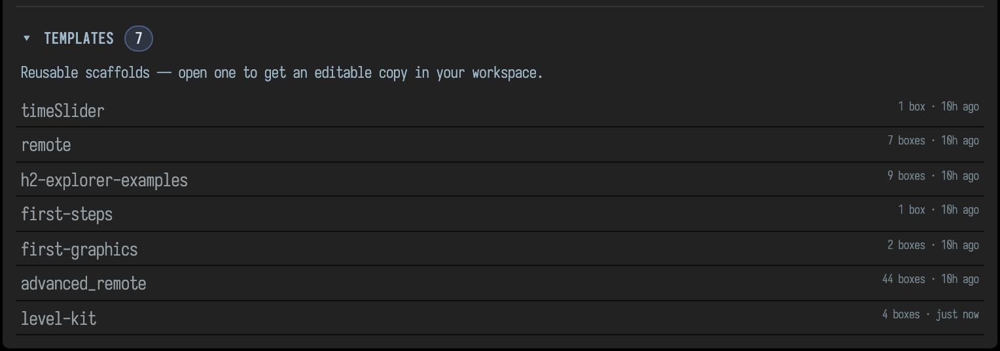
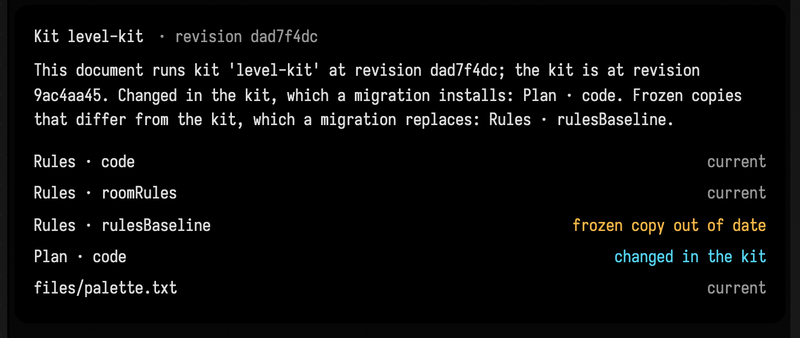

# Kits for Many Documents

When several documents are the same kind of thing, such as levels of one game or variants of one
design, they share their working parts: the boxes that do the work, the rules those boxes follow,
and the files they read. A kit keeps those parts in one directory. Every document made from the kit
gets its own copy, and a newer kit reaches a document only when you migrate it. Until then the
document goes on running the copy it has, and can tell you how it differs from the kit.

A kit has three kinds of part:

- **roles**: the boxes a document of this kind has, each with its code. A box plays a role when its
  `kitRole` property names it.
- **sources**: text a role's box holds in another property, such as a rule set or a recipe that an
  agent edits.
- **assets**: files in the document's `files/` folder that the boxes read.

The kit's `kit.json` lists them with a hash of each, and its revision is the hash of the whole list.

## Make a kit from a document

This document lays out a level. Its Rules box keeps the room sizes in its `roomRules` property,
which an agent changes through `SetBoxPropertyRequest` or a study's guarded edits. It also keeps
`rulesBaseline`, an unchanging copy of the rules that a check compares an agent's candidates with:

```diffstatic {data-lang=kotlin}
// The room sizes every level of this kind uses, read from this box's roomRules property.
prop<String>(roomRules, "")
val rules =
    roomRules
        .lines()
        .filter { "=" in it }
        .associate { it.substringBefore("=").trim() to it.substringAfter("=").trim().toInt() }
markdown("main", "Rooms are ${rules["minRoom"]} to ${rules["maxRoom"]} cells wide.")
```

The Plan box reads the colours it draws with from `palette.txt` in the document's `files/` folder:

```diffstatic {data-lang=kotlin}
// A plan of three rooms in the palette's first colour.
val colours = "palette.txt".file.readLines().filter { it.isNotBlank() }
markdown("main", "Plan: three rooms, walls in ${colours.first()}.")
```

With the document open in Field, make the kit. Name each role's box in launch order, then the
sources, the frozen copies and the assets:

```diffstatic {data-lang=bash}
uv run --project . --group backdoor python tools/field_kit.py make ~/kits/level-kit --document level-one \
  --role rules=Rules --role plan=Plan --source rules.roomRules \
  --frozen rules.rulesBaseline=rules.roomRules --asset palette.txt
```

```diffstatic {data-lang=text}
made kit level-kit b1595510 in ~/kits/level-kit: rules (3 properties), plan (1 property); 1 asset
  level-one is on it
```

`make` writes the kit to `~/kits/level-kit`: `kit.json`, each role's code and sources under
`roles/`, and the assets under `files/`. It sets `kitRole` on the two boxes and records the kit in the
document, which is now on it. `--frozen rules.rulesBaseline=rules.roomRules` says the baseline is a
copy of the rules, so the kit holds the two as one file.

`field_kit.py` talks to the Field on port 9092; pass `--port` for another. Keep the kit directory
under version control: the kit is the thing you will change.

To see which kit a document runs, and what differs from it, give it a box that shows the kit card:

```diffstatic {data-lang=kotlin}
showKit()
```


## Publish it as a starting point

`publish` saves the document and copies it, with the kit's assets and its record, into your own
templates, `~/.afield/templates`. It leaves out the document's history, its AI chats and its build
attempts.

```diffstatic {data-lang=bash}
uv run --project . --group backdoor python tools/field_kit.py publish --document level-one
```

```diffstatic {data-lang=text}
published level-one as starting point level-kit in ~/.afield/templates (kit level-kit b1595510)
```

The starting point appears under **Templates** on the Welcome screen. Opening it gives you a new
document in your workspace that is on the kit from the start:



`publish` refuses a document that differs from its kit, or one with a build running. Run it again
with `--replace` to publish a newer version; the previous one is kept in `~/.afield/templates/.replaced/`.

The first time a document made from the starting point opens, Field runs its roles in the kit's launch order, so it starts
working without a separate command. After that it runs only what `autorun` asks for, like any
document. To run a document's roles in launch order again later, use `activate`:

```diffstatic {data-lang=bash}
uv run --project . --group backdoor python tools/field_kit.py activate ~/kits/level-kit --document level-kit
```

## Change the kit

Change the kit's files, then `rehash` it to bring `kit.json` up to date. Here the plan gets a fourth
room, in `~/kits/level-kit/roles/plan/code.kt`:

```diffstatic {data-lang=kotlin}
// A plan of four rooms in the palette's first colour.
val colours = "palette.txt".file.readLines().filter { it.isNotBlank() }
markdown("main", "Plan: four rooms, walls in ${colours.first()}.")
```

```diffstatic {data-lang=bash}
uv run --project . --group backdoor python tools/field_kit.py rehash ~/kits/level-kit
```

```diffstatic {data-lang=text}
changed: plan.code
revision b1595510 -> 77b8d0f8
```

`rehash --check` changes nothing and exits 1 if `kit.json` is out of date. When the kit is in git and
your working tree holds kit changes you are not committing yet, `stage` writes a `kit.json` to the
index that hashes only what is staged.

Every document made from the kit still runs its own copy. Its card now says what a migration would
change:


## Migrate a document

`migrate --dry-run` says what a migration would do and changes nothing:

```diffstatic {data-lang=bash}
uv run --project . --group backdoor python tools/field_kit.py migrate ~/kits/level-kit --document level-kit --dry-run
```

```diffstatic {data-lang=text}
level-kit: kit level-kit b1595510 -> 77b8d0f8
  install: Plan · code (from the kit)
```

Without `--dry-run` it installs what changed, runs every role again in launch order (a role may
depend on one before it), and records the new revision last:

```diffstatic {data-lang=bash}
uv run --project . --group backdoor python tools/field_kit.py migrate ~/kits/level-kit --document level-kit
```

```diffstatic {data-lang=text}
level-kit: kit level-kit b1595510 -> 77b8d0f8
  install: Plan · code (from the kit)
  launched rules
  launched plan
  recorded kit level-kit 77b8d0f8
```

If a role fails to run, the migration stops there and the document still records the old revision.
Fix the role in the kit, rehash, and migrate again: what was already installed matches the kit and is
left as it is.

## When a migration refuses

A migration compares three versions of each part: the one the document recorded when it was last
migrated, the one the document holds now, and the kit's. If the document holds the recorded version,
the kit changed it and the migration installs the kit's. If the document holds a version that is
neither, someone changed it in this document, and the migration refuses rather than overwrite it.

In `level-one` an agent has changed the room rules, and the kit has a new plan:

```diffstatic {data-lang=bash}
uv run --project . --group backdoor python tools/field_kit.py migrate ~/kits/level-kit --document level-one
```

```diffstatic {data-lang=text}
Refusing to migrate level-one:
  Rules · roomRules was edited in this document (it holds 746b40e9; the record and the kit hold dfe21dd5)
Nothing was changed.
```


The migration changed nothing. To keep the agent's rules, fold them into the kit: copy them into
`roles/rules/roomRules.txt` and rehash. Every other document on the kit then gets them on its next
migration. To drop them, put the recorded text back in the box. Either way the document's copy then
matches the record or the kit, and the migration goes ahead.

A migration also refuses while a build is running in the document, because running the roles again
would cancel that build or leave it describing the old kit. It names the build; migrate again once it
finishes.

### Frozen copies

A frozen copy, such as `rulesBaseline`, is a part nothing in the document should change. A check
compares candidates with it, so a candidate must not be able to edit it. A migration replaces a frozen
copy whenever it differs from the kit's, and lists it as a frozen copy so the replacement is never
silent. With the agent's rules folded into the kit, `level-one`'s rules match the kit, and its
baseline is out of date:

```diffstatic {data-lang=bash}
uv run --project . --group backdoor python tools/field_kit.py rehash ~/kits/level-kit
```

```diffstatic {data-lang=text}
changed: rules.roomRules, rules.rulesBaseline
revision 77b8d0f8 -> 42fd5c7c
```



```diffstatic {data-lang=bash}
uv run --project . --group backdoor python tools/field_kit.py migrate ~/kits/level-kit --document level-one
```

```diffstatic {data-lang=text}
level-one: kit level-kit b1595510 -> 42fd5c7c
  install: Plan · code (from the kit)
  frozen copies: Rules · rulesBaseline (replaced with the kit's)
  launched rules
  launched plan
  recorded kit level-kit 42fd5c7c
```

## Ask the agent

AI4's `InspectKitRequest` tool reports the same thing as the card: the kit, the recorded revision,
the kit's revision now, and each part that differs and what a migration would do with it. It changes
nothing. Ask the agent whether the document is up to date with its kit before relying on its boxes
behaving as the kit describes.

## Pin the code a kit depends on

A kit's boxes often depend on code that is not in the kit: classes compiled into Field, or a native
library. When a build's results are only trustworthy with particular versions of that code,
`RuntimeIdentity` pins them. Capture the identity once, after you have checked the results, and keep
it as an asset of the kit:

```diffstatic {data-lang=kotlin}
RuntimeIdentity.capture([Solid::class], natives = [File(ManifoldLibrary.resolvedPath!!)])
    .write("runtime-identity.json".file)
```

Then check it before building on that code:

```diffstatic {data-lang=kotlin}
RuntimeIdentity.verify("runtime-identity.json".file, natives = [File(ManifoldLibrary.resolvedPath!!)])
```

`verify` refuses a Field that loaded other code, and names each class or library that differs with
both hashes. Name the classes that do the work rather than everything a box uses, so an unrelated
change does not make the pin fail. A native library is matched by its file name and its contents,
not by where it was loaded from, so the same library in another checkout passes.

See also: [Studies](studies.md), for sources an agent edits through guarded tools and for derived
builds, and [Let AI4 Wait for Long Builds](ai4_long_builds.md).

??? aside "How these figures were made"
    By `tools/capture_kits.py`, on a Field it starts in a temporary workspace with its own templates
    root. It builds `level-one` from this page's Kotlin, runs this page's commands in this order, and
    captures the Kit box's card (and the Welcome screen as Field serves it at `/welcome`) at each step.
    The text under each command is what that command printed in the run, with the run's temporary
    directories written as `~/kits` and `~/.afield/templates`; the script fails when the page quotes
    anything else.

