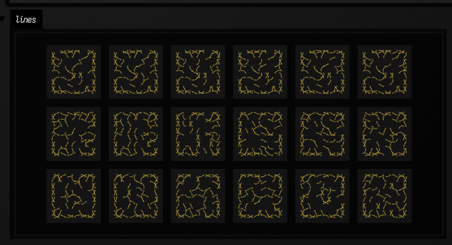

# Knight tours and uncrossed paths

A knight can visit every square of a chessboard once and leave behind a surprisingly intricate
line. Find some tours, then bend, layer and join their moves in four different views. Further down,
try a different challenge: draw the longest path whose moves never cross. You can give other pieces
the same problem, wrap the board around a cylinder or torus, and bring the paths back into the
drawing views.

[Open the editable starting point](offline.html?file=assets/agent_transcripts/knight_tour_workshop/metadata.edn)

Run **knight tours** first. It finds eighteen 8×8 tours in three rows: exhaustive search,
a Pósa-rotation walk, and independent randomised restarts. It draws the straight moves and
publishes tours, sampled three-point arcs, board dimensions and cell size as inherited properties.
All four connected child views refresh after publication; no child repeats the search.
Everything draws with FLines; no renderer, GPU or external service is needed.

## Four views to change

- **Arc growth:** take each successive triple of squares, A, B and C, and draw an arc through
  them. One tour accumulates 62 arcs. Gold is the new one, muted strokes are earlier ones; white
  marks A and C, and cyan marks B. Every arc passes through B, even when that takes a long, nearly
  complete sweep.
- **Perpendicular arcs:** scale each arc about its exact B; retain the perpendicular A–C
  shift as a separate parameter (zero by default). Try scales 0.5 and 0.25.
- **Glued arcs:** shrink, reorder and reverse arcs, then connect their endpoints into one
  open path. Multi-start nearest-neighbour plus 2-opt shortens the connectors; it does not prove
  the route is globally shortest. The saved scale preserves the current session value.
- **Line experiments:** draw each move as an independently transformed quadratic segment.

## Layered parameters

At the top of **knight tour line experiments**, edit `startTrim`, `endTrim`, `nextPull`,
`previousPull`, `rotationRadians`, `perpendicularOffset`, `alongSlide` and `strokeWidth`.
Use collection literals such as `[0.3, 0.5, -0.1]` or a scalar such as `0.3`.
Layers are zipped, not a Cartesian product: their count is the longest list, and every shorter
list holds its final value. Scalars repeat throughout. Empty lists are rejected.
Values are not clamped: negative trims extend a move and large trims may reverse it.

Fractional trims define the segment ends. The quadratic control point starts at their midpoint
and is pulled fixed distances towards the next and previous sequence points (missing neighbours
contribute nothing). Rotation uses `quat` in radians about the midpoint; perpendicular offset and
along-line slide use the rotated original move direction. Geometry uses native `Vector2f`/`vec`.
Each layer is drawn over the same board. The default rotation list is `[PI/20, 0.0, -PI/20]`.



## Uncrossed paths

Draw a knight's path as straight lines between square centres and forbid any line to cross another.
On a chessboard the longest such path has 35 moves. These sections find it, find the longest closed
one, then change the piece and the board: five leapers on a rectangle, a cylinder and a torus. The
paths are FLines, so they go back into the line and arc views above and out to a pen plotter.

This half has its own starting point: open **Starting points** on the welcome screen and search
for **uncrossed**.
[Browse the starting point ↗](offline.html?file=assets/agent_transcripts/uncrossed_leapers/metadata.edn)

L. D. Yarbrough asked for the longest uncrossed knight's path on an n×n board in the *Journal of
Recreational Mathematics* in 1969. The answers are OEIS
[A003192](https://oeis.org/A003192): 0, 0, 2, 5, 10, 17, 24, 35, 47 for n = 1 to 9, counting moves.
Each move rules out every move it would cross. As the path grows, the picture itself starts to
decide where the knight can go.

`afield.geometry.leaper` has the search. [`LeaperBoard(w, h, leaper, topology)`](reference/graphics.md#uncrossedleapers-kt-leaperboard) is the board's
move graph, with every pair of moves that cross worked out in advance.
`board.longestUncrossedPath()` returns the longest path, with `exhaustive` saying whether the search
finished and so proved it longest. `path.uncrossedTile(cell, x, y)` draws the board and the path.

### The longest paths up to 7×7

This box searches each board from 3×3 to 7×7 to the end, draws the longest path it finds and
tabulates it beside A003192. A white dot marks the start of each path and a cyan dot the end.

```diffstatic_runner {data-lang=kotlin screenshot="assets/uncrossed_leapers/knight.png" alt="Five dark checkerboards from 3×3 to 7×7, each crossed by a gold zigzag of knight moves that never cross, labelled 2, 5, 10, 17 and 24; below them a table with the same five lengths in the found and A003192 columns, every row proved" timeout="300" embed=true name="uncrossed-ul-knight"}
import afield.geometry.leaper.*

// The longest uncrossed knight path on each board from 3×3 to 7×7, by exhaustive search.
// The table sets each result beside OEIS A003192, the known maxima.
val sizes = 3..7
val cell = 10.0
var x = 0.0
val results = sizes.map { n -> LeaperBoard(n, n).longestUncrossedPath() }
val tiles = results.flatMap { r ->
    val tile = r.best!!.uncrossedTile(cell, x, 0.0) + leaperLabel("${r.board.w}×${r.board.w}  ${r.length}", x, -4.0)
    x += r.board.w * cell + 14.0
    tile
}
lines(tiles, w = 900.0, h = 230.0, fitToSize = true)
markdown(
    "| board | moves found | A003192 | proved | nodes searched | ms |\n|---|---|---|---|---|---|\n" +
        results.joinToString("\n") { r ->
            "| ${r.board.w}×${r.board.w} | ${r.length} | ${UNCROSSED_KNIGHT_PATH_MAXIMA[r.board.w - 1]} | " +
                "${if (r.exhaustive) "yes" else "no"} | ${r.nodes} | ${r.millis} |"
        },
)
```

The search goes depth first. From the end of the path it tries every move that reaches an unused
square and crosses nothing drawn so far. It abandons a branch when it cannot beat the best path
found, even if it visited every square still reachable from the end through moves that cross
nothing. A square with only one such move can only be the last square of the path, so the count
keeps just one of those. Each path is searched from one end only: the search starts only from one
square in each set of squares that are the same under the board's rotations and reflections.

### 8×8 and 9×9

Left to finish, the same call proves 35 on 8×8, but it takes 336,975,557 search steps, about ten
minutes on a laptop. For a long path quickly, `board.longUncrossedPath()` uses ruin and recreate.
It cuts a random tail off the best path so far and lets a short search grow a new one, 1000 times,
keeping any path at least as long. The result depends on the random seed and does not prove the
path is longest, so this box tries four seeds on each board.

```diffstatic_runner {data-lang=kotlin screenshot="assets/uncrossed_leapers/big.png" alt="An 8×8 and a 9×9 board, each with a long gold uncrossed knight path, labelled with the length found against the known optimum" timeout="300" embed=true name="uncrossed-ul-big"}
import afield.geometry.leaper.*
import kotlin.random.Random

/*
Past 7×7 a proof takes minutes (35 on 8×8 needs 337 million search steps), so this box uses
ruin and recreate: cut a random tail off the best path so far and regrow it with a short
search, 1000 times. It is not a proof, and where it ends depends on the seed, so each board
gets four seeds; the best is drawn, against the known optimum, 35 and 47.
*/
val seeds = 1..4
val cell = 10.0
var x = 0.0
val tiles = ArrayList<FLine>()
for (n in [8, 9]) {
    val board = LeaperBoard(n, n)
    val runs = seeds.map { s -> board.longUncrossedPath(random = Random(s)) }
    val best = runs.maxBy { it.length }
    val known = UNCROSSED_KNIGHT_PATH_MAXIMA[n - 1]
    tiles += best.best!!.uncrossedTile(cell, x, 0.0)
    tiles += leaperLabel("$n×$n  ${best.length} of $known", x, -4.0)
    x += n * cell + 16.0
    println(
        "$n×$n: seeds $seeds reach ${runs.map { it.length }} moves (known optimum $known), ${runs.sumOf { it.millis }} ms in all",
    )
}
lines(tiles, w = 700.0, h = 360.0, fitToSize = true)
```

Each board takes a few seconds per seed. On 8×8, two of the four seeds reach 35, the optimum. On
9×9 the seeds end between 42 and 46, short of 47, which Knuth proved optimal in 2010 with
zero-suppressed decision diagrams (ZDDs); other seeds and longer runs do reach 47.

### Closed paths

`longestUncrossedPath(closed = true)` asks for a path that comes back to its first square, where
the closing move must not cross anything either. The known maxima are OEIS
[A157416](https://oeis.org/A157416): 0, 0, 0, 4, 8, 12, 24, 32, 42, 54.

Up to 7×7 `bestUncrossedPath` finishes the exhaustive search and so proves its answer. On larger
boards it falls back to ruin and recreate.

```diffstatic_runner {data-lang=kotlin screenshot="assets/uncrossed_leapers/cycles.png" alt="Seven boards from 4×4 to 10×10, each with a closed gold loop of knight moves; the table below gives 4, 8, 12 and 24 proved, then 32, 40 and 52 found against 32, 42 and 54" timeout="300" embed=true name="uncrossed-ul-cycles"}
import afield.geometry.leaper.*

/*
Closed paths: the path must come back to its first square, and the closing move may not
cross anything either. Up to 7×7 the search is exhaustive; 8×8 to 10×10 use ruin and
recreate. The known maxima are OEIS A157416.
*/
val sizes = 4..10
val cell = 10.0
var x = 0.0
val results = sizes.map { n -> LeaperBoard(n, n).bestUncrossedPath(closed = true, nodeBudget = 3_000_000) }
val tiles = results.flatMap { r ->
    val tile = r.best!!.uncrossedTile(cell, x, 0.0) + leaperLabel("${r.board.w}×${r.board.w}  ${r.length}", x, -4.0)
    x += r.board.w * cell + 14.0
    tile
}
lines(tiles, w = 900.0, h = 200.0, fitToSize = true)
markdown(
    "| board | moves found | A157416 | proved |\n|---|---|---|---|\n" +
        results.joinToString("\n") { r ->
            "| ${r.board.w}×${r.board.w} | ${r.length} | ${UNCROSSED_KNIGHT_CYCLE_MAXIMA[r.board.w - 1]} | ${if (r.exhaustive) "yes" else "no"} |"
        },
)
```

7×7 is the board where the closed path catches up with the open one: both have 24 moves. Left to
finish, the exhaustive search proves 32 on 8×8 in 388,178,265 steps.

### Other leapers, other surfaces

A leaper `Leaper(a, b)` moves a squares along one axis and b along the other. The knight is
{1, 2}, the camel {1, 3}, the zebra {2, 3}, the giraffe {1, 4} and the antelope {3, 4}. Longer
moves cross more of the board, so they cross each other sooner.

`BoardTopology.CYLINDER` joins the board's left edge to its right, and `TORUS` joins top to bottom
as well. A move may then leave through one edge and come in through the opposite one, and it is
drawn that way: two pieces, one at each edge. Two moves cross if their lines cross on that surface.
This box finds the longest path for every leaper on every surface at 7×7. The dashed blue edges are
the joined ones.

```diffstatic_runner {data-lang=kotlin screenshot="assets/uncrossed_leapers/gallery.png" alt="A grid of fifteen 7×7 boards: five columns for knight, camel, zebra, giraffe and antelope, three rows for rectangle, cylinder and torus. On the rectangle the paths are open zigzags; on the cylinder they zigzag across the joined edges; on the torus four of the five fill the board with parallel strokes that wrap off one edge and back on the other" timeout="300" embed=true name="uncrossed-ul-gallery"}
import afield.geometry.leaper.*

/*
Five leapers on three surfaces, n×n. A cylinder joins the left and right edges; a torus also
joins top and bottom. A move may leave through a joined edge and come back through the
opposite one, and "uncrossed" is judged on that surface. Dashed blue edges are joined.
*/
val n = 7
val nodeBudget = 1_000_000L
val leapers = [Leaper.KNIGHT, Leaper.CAMEL, Leaper.ZEBRA, Leaper.GIRAFFE, Leaper.ANTELOPE]
val topologies = BoardTopology.entries
val cell = 10.0
val step = n * cell + 16.0
val out = ArrayList<FLine>()
val lengths = leapers.map { ArrayList<String>() }
leapers.forEachIndexed { c, leaper -> out += leaperLabel(leaper.name, 40.0 + c * step, -6.0, 6.0) }
topologies.forEachIndexed { r, t ->
    out += leaperLabel(t.name.lowercase(), 0.0, r * step + n * cell / 2, 5.0)
    leapers.forEachIndexed { c, leaper ->
        val board = LeaperBoard(n, n, leaper, t)
        val result = board.bestUncrossedPath(nodeBudget = nodeBudget, rounds = 300)
        val x = 40.0 + c * step
        val y = r * step
        out += result.best?.uncrossedTile(cell, x, y) ?: board.boardLines(cell, x, y)
        lengths[c] += "${result.length}${if (result.exhaustive) "" else "?"}"
    }
}
lines(out, w = 900.0, h = 520.0, fitToSize = true)
markdown(
    "| $n×$n | rectangle | cylinder | torus |\n|---|---|---|---|\n" +
        leapers.indices.joinToString("\n") { k -> "| ${leapers[k]} | ${lengths[k].joinToString(" | ")} |" } +
        "\n\n? = not proved: the best of a $nodeBudget-step search and 300 rounds of ruin and recreate",
)
```

On the rectangle the longer leapers are soon boxed in: 13 moves for the camel and 6 for the
antelope, against the knight's 24. Joining two edges gives the lines somewhere to go: the knight
goes from 24 moves to 34, and the camel and zebra roughly double. On the 7×7 torus the knight, camel,
zebra and giraffe all visit every one of the 49 squares, by zigzags whose strokes run parallel and
wrap round; the antelope manages 19.

### How much of the board each leaper covers

A sweep over board sizes shows the range. For each leaper, each surface and each n from 4 to 9, this
box plots the share of the n² squares the longest path visits. A filled dot is proved; a hollow one
is the best found within the budget.

```diffstatic_runner {data-lang=kotlin screenshot="assets/uncrossed_leapers/sweep.png" alt="Three small line charts, rectangle, cylinder and torus, each with five coloured lines for the five leapers showing the share of squares visited as the board grows from 4 to 9" timeout="300" embed=true name="uncrossed-ul-sweep"}
import afield.geometry.leaper.*

/*
How much of the board each leaper can cover without crossing itself: the share of the n×n
squares its longest uncrossed path visits, for n = 4..9, on each surface. A hollow dot is a
best-found value (the search ran out of budget), a filled one is proved.
*/
val sizes = 4..9
val nodeBudget = 200_000L
val leapers = [Leaper.KNIGHT, Leaper.CAMEL, Leaper.ZEBRA, Leaper.GIRAFFE, Leaper.ANTELOPE]
val colours = [
    vec(0.98, 0.85, 0.3, 1.0),
    vec(0.45, 0.8, 1.0, 1.0),
    vec(0.95, 0.45, 0.45, 1.0),
    vec(0.6, 0.9, 0.5, 1.0),
    vec(0.8, 0.6, 1.0, 1.0),
]
val panelW = 150.0
val panelH = 100.0
val out = ArrayList<FLine>()
val table = StringBuilder(
    "| surface | leaper | " +
        sizes.joinToString(" | ") { "$it×$it" } +
        " |\n|---|---|" +
        sizes.joinToString("") { "---|" } +
        "\n",
)
BoardTopology.entries.forEachIndexed { p, t ->
    val ox = p * (panelW + 30.0)
    out += fline {
        moveTo(ox, 0.0)
        lineTo(ox, panelH)
        lineTo(ox + panelW, panelH)
        color = vec(1.0, 1.0, 1.0, 0.5)
        thickness = 0.8
    }
    out += leaperLabel(t.name.lowercase(), ox + 4.0, -6.0, 6.0)
    out += leaperLabel("100%", ox - 22.0, 2.0, 4.0)
    out += leaperLabel("n = ${sizes.first}", ox, panelH + 9.0, 4.0)
    out += leaperLabel("${sizes.last}", ox + panelW - 4.0, panelH + 9.0, 4.0)
    leapers.forEachIndexed { k, leaper ->
        val results = sizes.map { n ->
            LeaperBoard(n, n, leaper, t).bestUncrossedPath(nodeBudget = nodeBudget, rounds = 100, nodesPerRound = 4_000)
        }
        val pts = results.mapIndexed { i, r ->
            val share = (if (r.best == null) 0.0 else r.length + 1.0) / (r.board.cells)
            Triple(ox + i * panelW / (sizes.count() - 1), panelH * (1 - share), r)
        }
        out += fline {
            pts.forEachIndexed { i, (x, y, _) -> if (i == 0) moveTo(x, y) else lineTo(x, y) }
            color = colours[k]
            thickness = 1.2
        }
        pts.forEach { (x, y, r) ->
            out += fline {
                circle(x, y, 2.2)
                color = colours[k]
                filled = r.exhaustive
                thickness = 1.0
            }
        }
        table.append(
            "| ${t.name.lowercase()} | ${leaper.name} | " +
                results.joinToString(" | ") { "${it.length}${if (it.exhaustive) "" else "?"}" } +
                " |\n",
        )
    }
}
leapers.forEachIndexed { k, leaper -> out += leaperLabel(leaper.name, k * 70.0, panelH + 24.0, 5.0, colours[k]) }
lines(out, w = 900.0, h = 260.0, fitToSize = true)
markdown(
    table.toString() +
        "\nMoves in the longest path found; ? = not proved (best of a $nodeBudget-step search and 100 rounds of ruin and recreate).",
)
```

On the rectangle each leaper's share stays in a narrow band as the board grows: the knight visits
around half the squares, the antelope about a sixth. The cylinder lifts every line. On the torus the share
jumps with n. The same leaper covers the whole board at one size and well under half at the next:
the knight covers 5×5, 7×7 and 9×9 completely, but the best path found on 8×8 visits 48 of the 64
squares.

### Back into the four views

The [four views](#four-views-to-change) at the top of this page read their tours from a parent box,
and two of them, the line experiments and the perpendicular arcs, only need squares in order, so an
uncrossed path can stand in for a tour. Box 6 of the uncrossed starting point finds four 24-move paths
on 7×7, no two of them turns or reflections of each other (`path.shapeKey()` says when two paths
have the same shape), and the 24-move closed path: forty random seeds find only one shape of it.
It publishes them under the workshop's property names:

```diffstatic {data-lang=kotlin}
prop<List<List<IntArray>>>(knightTourRows) = rows
prop<List<List<List<List<Pair<Double, Double>>>>>>(knightArcRows) = arcRows
prop<Int>(knightBoardWidth) = w
prop<Int>(knightBoardHeight) = w
prop<Double>(knightCellSize) = cell
```

The workshop's line experiments box, copied unchanged beneath it, then draws every move as layered
quadratic strokes:

```diffstatic_runner {data-lang=kotlin capture="box" open-outputs="true" screenshot="assets/uncrossed_leapers/workshop_lines.png" alt="Five dark tiles, four open uncrossed paths above and the closed one below, each move drawn as seven layered gold quadratic strokes that slide along the move and fan out" timeout="300" padding="12" embed=true hidden=true name="uncrossed-ul-lines" macro-file="../../dev_docs/agents/transcripts/docs_capture/uncrossed_workshop.yaml" capture-box="ul_lines"}
// The transcript builds box 6 and the two workshop views beneath it, and runs them.
```

The perpendicular arcs box, also unchanged, draws an arc through each three squares in a row:

```diffstatic_runner {data-lang=kotlin capture="box" open-outputs="true" screenshot="assets/uncrossed_leapers/workshop_arcs.png" alt="Five tiles of shrunken circular arcs, one per consecutive triple of squares along each uncrossed path, the closed path's arcs forming a ring of loops" timeout="300" padding="12" embed=true hidden=true name="uncrossed-ul-arcs" macro-file="../../dev_docs/agents/transcripts/docs_capture/uncrossed_workshop.yaml" capture-box="ul_arcs"}
// The transcript builds box 6 and the two workshop views beneath it, and runs them.
```

### A plotter sheet

`plotterSvg(lines)` writes FLines as an SVG with strokes only: one `<path>` per FLine, with no fill,
in millimetres on a page you choose. Board squares, which are filled, are left out. The labels use
the single-stroke Hershey font, so each one is drawn by a single pass of the pen. This box lays out
the longest 6×6 knight paths on the three surfaces as one landscape sheet, writes it to the temp
directory, and shows it.

```diffstatic_runner {data-lang=kotlin screenshot="assets/uncrossed_leapers/plotter.png" alt="A white SVG sheet with three 6×6 knight paths drawn as thin lines, the cylinder and torus boards with dashed joined edges, each labelled in a thin single-stroke font" timeout="300" embed=true name="uncrossed-ul-plotter"}
import afield.geometry.leaper.*

// A plotter sheet: the longest uncrossed knight paths on a 6×6 rectangle, cylinder and torus,
// with their labels, as stroke-only SVG (board squares left out, the joined edges kept as dashes).
val n = 6
val cell = 10.0
val sheet = ArrayList<FLine>()
BoardTopology.entries.forEachIndexed { c, t ->
    val board = LeaperBoard(n, n, Leaper.KNIGHT, t)
    val r = board.bestUncrossedPath(nodeBudget = 1_000_000)
    val x = c * (n * cell + 20.0)
    sheet += board.boardLines(cell, x, 0.0)
    sheet += r.best!!.pathLine(cell, x, 0.0)
    sheet += leaperLabel("${t.name.lowercase()}  ${r.length}${if (r.exhaustive) "" else "?"}", x, n * cell + 10.0, 5.0)
}
val svg = plotterSvg(sheet, widthMm = 297.0, heightMm = 120.0, marginMm = 12.0)
val file = java.io.File(System.getProperty("java.io.tmpdir"), "uncrossed_knights.svg")
file.writeText(svg)
display("plotter sheet", svg)
println("${svg.lines().count { it.startsWith("<path") }} pen paths, ${svg.length} bytes -> $file")
```

### Checking a path you draw

The uncrossed starting point's last box puts an empty board on the drawing layer next to itself. Press ++alt+d++, draw a knight
path through the squares' centres in one stroke, and run the box again. It reads your newest stroke
over the board through `notation`, snaps it to the squares it passes over with
`board.readDrawnPath(...)` and checks it with `board.check(cells)`. `check` returns null for a
legal path, or the first thing wrong with it. Until you draw, it checks a demonstration stroke of
its own, which crosses itself.

```diffstatic_runner {data-lang=kotlin screenshot="assets/uncrossed_leapers/draw.png" alt="The box's output: Not legal, the demonstration stroke visits a1 b3 c5 e4 c3 d5, c3 to d5 crosses move 3" timeout="300" embed=true name="uncrossed-ul-draw"}
import afield.geometry.leaper.*

/*
Draw a knight path on the board this box puts on the drawing layer (Alt+D, then the pen),
one stroke through the centres of the squares, and run the box again. It reads the newest
hand-drawn stroke over the board, snaps it to squares and says whether it is a legal
uncrossed path. Until you draw one it checks a demonstration stroke of its own.
*/
val n = 6
val cell = 40.0
val left = frame.x + frame.w + 60.0
val top = frame.y
val board = LeaperBoard(n, n)
// The newest hand-drawn stroke that lies over the board (with a square's slack all round).
val drawn =
    notation.strokes.lastOrNull { m ->
        val b = m.bounds
        m.handDrawn &&
            b.x >= left - cell &&
            b.y >= top - cell &&
            b.x + b.w <= left + (n + 1) * cell &&
            b.y + b.h <= top + (n + 1) * cell
    }
// The demonstration: a1 b3 c5 e4 c3 d5 — the last move crosses the third.
val demoCells = intArrayOf(0, 13, 26, 22, 14, 27)
notation("board") {
    stroke = "#5c7cfa"
    for (i in 0 until n) for (j in 0 until n) if ((i + j) % 2 == 0) {
        rect(left + i * cell, top + j * cell, cell, cell, fill = "#dbe4ff", stroke = "transparent")
    }
    rect(left, top, n * cell, n * cell, fill = "transparent")
    if (drawn == null) {
        // Twelve samples along each move, the way a pen stroke records points.
        fun centreX(c: Int) = left + (c % n + 0.5) * cell
        fun centreY(c: Int) = top + (c / n + 0.5) * cell
        val samples = ArrayList<Vec2>()
        for (i in 0 until demoCells.size - 1) for (k in 0 until 12) {
            val t = k / 12.0
            val from = demoCells[i]
            val to = demoCells[i + 1]
            samples +=
                vec(
                    centreX(from) + (centreX(to) - centreX(from)) * t,
                    centreY(from) + (centreY(to) - centreY(from)) * t,
                )
        }
        samples += vec(centreX(demoCells.last()), centreY(demoCells.last()))
        stroke(samples, name = "demo path", stroke = "#e8590c")
    }
}
val mark = drawn ?: notation.named("demo path")!!
val pts = mark.points
val cells = board.readDrawnPath(
    pts.map { it.x.toDouble() }.toDoubleArray(),
    pts.map { it.y.toDouble() }.toDoubleArray(),
    cell,
    left,
    top,
)
val verdict = board.check(cells)
val names = cells.joinToString(" ") { board.cellName(it) }
val source = if (drawn == null) "the demonstration stroke" else "your stroke"
markdown(
    if (verdict == null)
        "**Legal.** $source visits $names: an uncrossed path of ${cells.size - 1} moves " +
            "(the longest on $n×$n is ${UNCROSSED_KNIGHT_PATH_MAXIMA[n - 1]})."
    else "**Not legal.** $source visits $names: $verdict.",
)
```

## The conversation that made the workshop

[Download/read the saved chat](assets/knight_tour_workshop/chat.txt), with its
[shared-computation notes](assets/knight_tour_workshop/SHARED_TOURS.txt).
This is a snapshot of Field’s actual persisted chat, including tool progress and embedded images,
not an edited reconstruction. It begins with the rolling-circle question and includes the
publication request; later publication messages are outside this snapshot. Associated image blobs
are retained beside it. The runnable YAML is a compact final-scene export rather than a replay
of every conversational edit.

## See also

- [Drawing with FLines](fline_examples.md).
- [Drawing and notation](drawing_and_notation.md), for the drawing layer that the last uncrossed box reads.
- George Jelliss, [Non-intersecting paths](http://www.mayhematics.com/t/2n.htm), for rectangular
  boards and other leapers.
