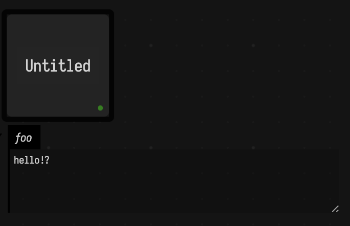
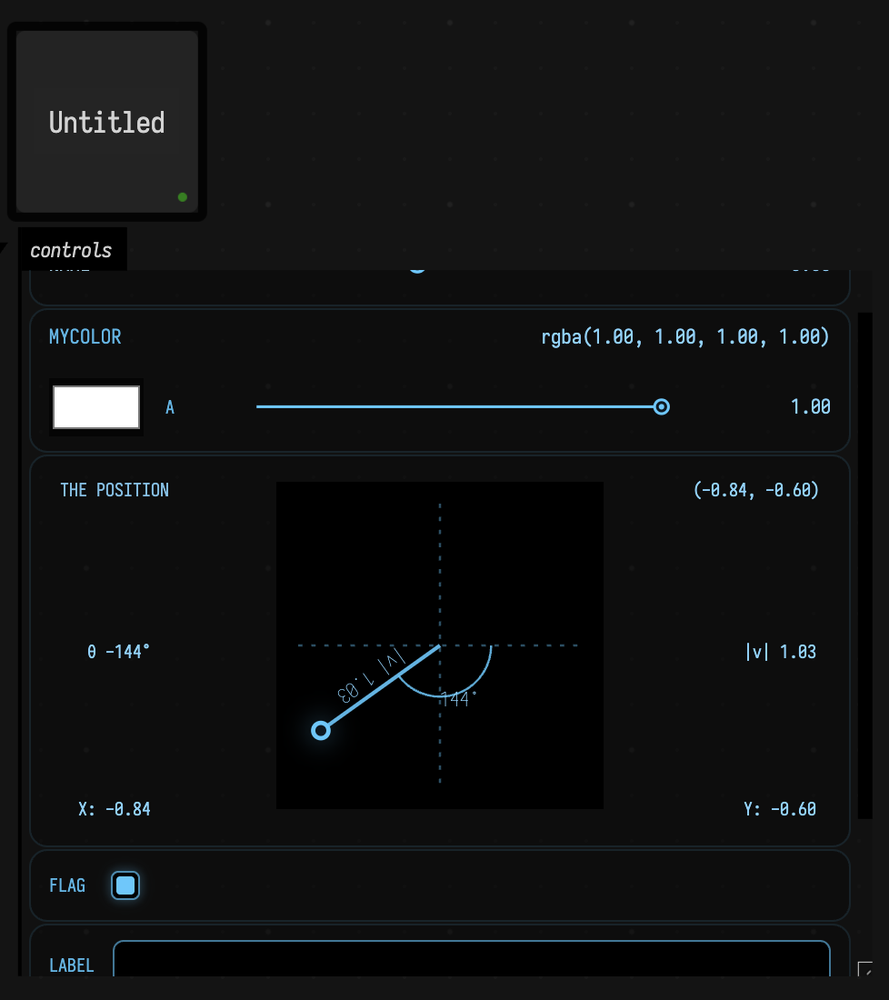

# Kotlin Syntax Overview <span style="font-size: 70%;">(for Python + JavaScript folks)</span>

Field uses _Kotlin_, which is a language that might be new to you. Promoted by Google as the "official" language for Android app development, Kotlin was initiated by (and is still maintained by) Jetbrains — a company that is primarily responsible for a really good Java development environment. Kotlin has emerged over the last decade as the winner of an attempt to invent a "better Java" through a cunning combination of interoperability (which means the ecosystem is _huge_), a terser syntax (which means it's much more fun to write), and quality of life improvements like operator overloading (which means that doing the kind of math that computer graphics wants us to do is tolerable).
 
All in all, 'live-coding' Kotlin is a fairly pleasant experience — safer than JS or Python (there's a compiler that checks your code before it runs), quicker than JS or Python (there's a real type system that can offer real help) and yet still understandable by LLMs. This document is to get you oriented towards 'live coding' in Kotlin.

## Basics

### Comments

Comments are notes for humans — the compiler ignores them. They’re a good place to explain _why_ something is written a certain way, or to temporarily disable a line while you experiment. Kotlin is just like JavaScript here.

```diffstatic {data-lang=kotlin}
:::static
// single-line
/* block comment */
```

Swift and C# also use `//` for single-line comments, and `/* ... */` for block comments.

In Python you use `#` for line comments; there’s no true block comment (triple-quoted strings are sometimes used as “docstrings/comments”). 

### Variables: `val` vs `var`

Almost everything you do in code starts by _naming_ a value so you can use it later. Kotlin makes you choose whether that name can be reassigned: use `val` for “this name won’t change” and `var` for “this name can change”. Kotlin will also usually infer the type from the value you assign.

```diffstatic {data-lang=kotlin}
:::static
val name = "Ada"     // name is "Ada" (and you can't reassign it)
var count = 0        // count is 0 (and you can change it)
count += 1           // count is now 1

// name = "Lady Ada"  // doesn't compile: val can't be reassigned
```

In Python, names are always re-bindable; there’s no `val`/`var` distinction. In JavaScript, `const` is closest to Kotlin `val`, and `let` is closest to Kotlin `var`.

If you’ve used Swift: Kotlin’s `val`/`var` are very close to Swift’s `let`/`var`. If you’ve used C#: Kotlin’s `val` feels like “don’t reassign this local name”, while C# has `const` (compile-time constants) and `readonly` (fields) rather than a direct local-variable keyword.

### Types and type inference

Types describe what kind of value something is (number, text, true/false, etc.). In Kotlin you can write a type after a name using `: Type`, but most of the time Kotlin figures it out for you.

```diffstatic {data-lang=kotlin}
:::static
val x = 10              // inferred Int
val y: Double = 2.5     // explicit type
val ok: Boolean = true
val ch: Char = 'x'
val s: String = "hi"
```

Kotlin often infers types; you write types mostly for public APIs or clarity. Python can use optional type hints (`x: int = 10`), but they aren’t enforced by the runtime.

If you haven’t seen Python’s `x: int` syntax before: those are optional type hints for tools (IDEs, linters, type checkers). They don’t change what the program does when you run it.

```diffstatic {data-lang=python}
:::static
x = 10        # common: no type annotation
x: int = 10   # optional: type hint (same runtime behavior)
```

JavaScript has no built-in type annotations (TypeScript is what you get if you add them). Swift and C# should feel familiar here: Swift infers types aggressively, and C# has `var` for type inference (but it’s still statically typed).

### Numbers are strict (Int vs Double vs Float)

Kotlin takes its number types seriously in ways that might irritate you (it certainly irritates me). `1` (an `Int`), `1L` (a `Long`), `1.0` (a `Double`), and `1.0f` (a `Float`) are different types, and Kotlin will not silently coerce one to another. In particular calling a function that expects a float with a double is an error; as is the other way around. This is one of the most common impedance mismatches when coming from Python or JavaScript.

```diffstatic {data-lang=kotlin}
:::static
val i = 1        // Int
val l = 1L       // Long
val d = 1.0      // Double
val f = 1.0f     // Float

// Kotlin won't do implicit widening conversions:
// val bad: Double = 1      // doesn't compile
// val bad2: Float = 1.0    // doesn't compile

val ok1: Double = i.toDouble() // result: 1.0
val ok2: Float = i.toFloat()   // result: 1.0f

val sumD = d + i.toDouble()    // result: 2.0
val sumF = f + i.toFloat()     // result: 2.0f

// If you want a Double literal, write 1.0; if you want Float, write 1.0f.
```

In Python and JavaScript there’s effectively “just number” in everyday code, so it’s easy to forget what kind of numeric value you’re holding. In Kotlin you’ll often add an explicit `.toDouble()`/`.toFloat()` at the boundary.

Field defines some extra psuedo-syntatical sauce for `.toDouble()` and friends by default:

```diffstatic {data-lang=kotlin}
:::static
val ok1: Double = i.d // result: 1.0
val ok2: Float = i.f   // result: 1.0f

val sumD = d + i.d    // result: 2.0
val sumF = f + i.f + 0.2.f    // result: 2.2f
```

And `.i` and `.l` as well. This looks a bit odd, but it's much less typing than `.toDouble()`.

### Printing

Printing is the simplest way to see what your code is doing. Kotlin uses `println(...)` (prints a line) and `print(...)` (prints without a trailing newline). Kotlin will call `toString()` for you.

```diffstatic {data-lang=kotlin}
:::static
val x = 42

println(x)           // prints: 42
println("x = " + x)  // prints: x = 42
```

Field wires Kotlin's `print( ... )` and `println( ... )` functions such that whatever is printed arrives at the bottom of the text editor. Furthermore, there's a `_print( ... )` that arrives right there next to that line itself. This is especially handy for instrumenting code and figuring out if it's even running.

For larger outputs Field also defines a `display(channel :String, contents: Any)` function that lets you 'print' to a channel on the canvas. So:

```diffstatic {data-lang=kotlin}
:::static
display("foo", "hello!?")
```



That output is straight HTML and therefore we can use this to embed charts, SVG files, and interactive controls. For example:

```diffstatic {data-lang=kotlin}
:::static
controlGroup("controls") {
    slider("name") { /*...*/ }
    colorPicker("myColor") { /*...*/ }
    vec2Control("the position") { /*...*/ }
    checkbox("flag") { /*...*/ }
    stringInput("label") { /*...*/ }
    checkbox("bar") { _print(it) }
    stringInput("foo") { _print(it) }
}
```

Yields:



In Python you use `print(...)` and, in Jupyter there's a protocol for embedding interactive widgets and showing pixel and SVG based output. In JavaScript you typically use `console.log(...)` (or conspire to put HTML into the DOM). Swift uses `print(...)`. C# uses `Console.WriteLine(...)` (or `Console.Write(...)`).

Python:

```diffstatic {data-lang=python}
:::static
x = 42
print(x)
print("x =", x)
```

JavaScript:

```diffstatic {data-lang=javascript}
:::static
const x = 42;
console.log(x);
console.log("x =", x);
```

Swift:

```diffstatic {data-lang=swift}
:::static
let x = 42
print(x)
print("x =", x)
```

C#:

```diffstatic {data-lang=csharp}
:::static
using System;

var x = 42;
Console.WriteLine(x);
Console.WriteLine("x = " + x);
```

### Strings and interpolation

Strings are text. Kotlin supports simple concatenation (`+`), but most Kotlin code uses string templates (`$name` and `${expression}`) to embed values directly into text.

```diffstatic {data-lang=kotlin}
:::static
val who = "world"
val msg1 = "Hello, " + who
val msg2 = "Hello, $who"
val msg3 = "2 + 3 = ${2 + 3}"

val raw = """ // a multi-line string
line 1
line 2
""".trimIndent()
```

Python interpolation (today) is typically f-strings (`f"Hello, {who}"`). JavaScript interpolation is template strings (`` `Hello, ${who}` ``).

Swift and C# both have built-in string interpolation too:

Swift:

```diffstatic {data-lang=swift}
:::static
let who = "world"
let msg = "Hello, \(who)"
```

C#:

```diffstatic {data-lang=csharp}
:::static
var who = "world";
var msg = $"Hello, {who}";
```

### Functions

Functions let you name a reusable piece of code. Kotlin function signatures start with `fun`, list parameters with types, and optionally include a return type.

```diffstatic {data-lang=kotlin}
:::static
fun add(a: Int, b: Int): Int {
  return a + b
}

fun add2(a: Int, b: Int) = a + b // expression body (type inferred)
```

Python uses `def` and indentation; type hints are optional. JavaScript uses `function` or arrow functions. Swift uses `func` and often feels close to Kotlin. C# uses methods/functions with explicit types (or `var` for locals).

### Packages and imports

Kotlin files can declare a `package` at the top, and can `import` names so you can refer to them without writing long qualified paths.

```diffstatic {data-lang=kotlin}
:::static
package my.project

import my.other.Thing
```

In Field you’ll often skip this because Field pre-imports a lot of things (mostly from itself) before you start writing. You’ll still occasionally see `import ...` in examples.

Python, JavaScript, Swift, and C# all have the same basic idea (bring names into scope), just with different syntax:

Python:

```diffstatic {data-lang=python}
:::static
import math
print(math.sqrt(9))
```

JavaScript:

```diffstatic {data-lang=javascript}
:::static
import { readFile } from "node:fs/promises";
console.log(await readFile("./foo.txt", "utf8"));
```

Swift:

```diffstatic {data-lang=swift}
:::static
import Foundation
print("hi")
```

C#:

```diffstatic {data-lang=csharp}
:::static
using System;
// In Unity you’ll also see: using UnityEngine;
Console.WriteLine("hi");
```

### Default args and named args

As your functions get more parameters, it’s helpful if callers don’t need to specify every single one. Kotlin supports default values for parameters, and “named arguments” so you can pass things by name (and in any order).

```diffstatic {data-lang=kotlin}
:::static
fun greet(name: String = "world", punct: String = "!") {
  println("Hello, $name$punct")
}

greet()
greet("Ada")
greet(punct = "?", name = "Ada")
```

Python supports default values and named arguments directly. JavaScript has no named arguments; the usual substitute is “options object” parameters.

If you’re curious, here’s the same idea in Python (named args work like Kotlin) and in JavaScript using an options object (because JS doesn’t have named args).

Python:

```diffstatic {data-lang=python}
:::static
def greet(name="world", punct="!"):
    print(f"Hello, {name}{punct}")

greet()
greet("Ada")
greet(punct="?", name="Ada")
```

JavaScript:

```diffstatic {data-lang=javascript}
:::static
function greet({ name = "world", punct = "!" } = {}) {
  console.log(`Hello, ${name}${punct}`);
}

greet();
greet({ name: "Ada" });
greet({ punct: "?", name: "Ada" });
```

Swift and C# both support default values and named arguments too (Swift leans on named arguments heavily):

Swift:

```diffstatic {data-lang=swift}
:::static
func greet(name: String = "world", punct: String = "!") {
  print("Hello, \(name)\(punct)")
}

greet()
greet(name: "Ada")
greet(punct: "?", name: "Ada")
```

C#:

```diffstatic {data-lang=csharp}
:::static
static void Greet(string name = "world", string punct = "!") {
  Console.WriteLine($"Hello, {name}{punct}");
}

Greet();
Greet("Ada");
Greet(punct: "?", name: "Ada");
```

### `if` is an expression

In Kotlin, `if` can _produce a value_. That means you can assign the result of an `if` directly to a variable.

```diffstatic {data-lang=kotlin}
:::static
val x = 10
val label = if (x > 0) "positive" else "non-positive"
```

Python uses an inline-if expression (`label = "positive" if x > 0 else "non-positive"`). JavaScript, Swift, and C# typically use the ternary operator.

### Loops and ranges

Loops repeat code. Kotlin’s `for` loop usually iterates over a range (like `0..3`) or any “sequence of values”, and it has convenient syntax for common patterns like “up to but not including”.

Kotlin:

```diffstatic {data-lang=kotlin}
:::static
for (i in 0..3) {
  println(i) // 0,1,2,3
}

for (i in 0 until 3) {
  println(i) // 0,1,2
}

for (i in 6 downTo 0 step 2) {
  println(i) // 6,4,2,0
}
```

Field also defines an extension function to make the common case even terser:

```diffstatic {data-lang=kotlin}
:::static
6 {
  _print(it) // 0,1,2,3,4,5
}
```

And for interpolation between 0 and 1 _inclusive_

```diffstatic {data-lang=kotlin}
:::static
5.alphas {
  _print(it) // 0, 0.25, 0.5, 0.75, 1
}
```

Python loops over values; counting uses `range(start, stop[, step])`. JavaScript usually uses classic `for (let i = ...; ...; ...)` loops for counting.

### Lists and maps

If you only learn two data structures in Kotlin for everyday Field scripting, learn `List` and `Map`. Kotlin distinguishes between read-only interfaces (`List`, `Map`) and mutable versions (`MutableList`, `MutableMap`). The common constructors are `listOf(...)` and `mapOf(...)`, and the mutable ones are `mutableListOf(...)` and `mutableMapOf(...)`.

```diffstatic {data-lang=kotlin}
:::static
val xs = listOf(10, 20, 30)
val first = xs[0] // result: 10

val ys = mutableListOf(1, 2, 3)
ys.add(4)
ys[0] = 99
// result: ys is [99, 2, 3, 4]

val m = mapOf("a" to 1, "b" to 2)
val a1 = m["a"]          // result: 1 (type is Int?)
val c1 = m["c"]          // result: null
val safe = m["c"] ?: 0   // result: 0

val mm = mutableMapOf("x" to 10)
mm["y"] = 20
mm["x"] = 11
// result: mm is {x=11, y=20}

for ((k, v) in mm) {
  println("$k -> $v")
}
```

The `"a" to 1` syntax builds a key/value `Pair`, which is why `mapOf("a" to 1)` looks a little unusual at first. Also note that `m["a"]` returns a nullable (`Int?`) because the key might not exist.

Python:

```diffstatic {data-lang=python}
:::static
xs = [10, 20, 30]
first = xs[0]  # result: 10

ys = [1, 2, 3]
ys.append(4)
ys[0] = 99
# result: ys is [99, 2, 3, 4]

m = {"a": 1, "b": 2}
a1 = m["a"]            # result: 1
c1 = m.get("c")        # result: None
safe = m.get("c", 0)   # result: 0

mm = {"x": 10}
mm["y"] = 20
mm["x"] = 11
# result: mm is {"x": 11, "y": 20}

for k, v in mm.items():
    print(f"{k} -> {v}")
```

JavaScript:

```diffstatic {data-lang=javascript}
:::static
const xs = [10, 20, 30];
const first = xs[0]; // result: 10

const ys = [1, 2, 3];
ys.push(4);
ys[0] = 99;
// result: ys is [99, 2, 3, 4]

const m = new Map([["a", 1], ["b", 2]]);
const a1 = m.get("a");           // result: 1
const c1 = m.get("c");           // result: undefined
const safe = (m.get("c") ?? 0);  // result: 0

const mm = new Map([["x", 10]]);
mm.set("y", 20);
mm.set("x", 11);

for (const [k, v] of mm) {
  console.log(`${k} -> ${v}`);
}
```

Swift:

```diffstatic {data-lang=swift}
:::static
let xs = [10, 20, 30]
let first = xs[0] // result: 10

var ys = [1, 2, 3]
ys.append(4)
ys[0] = 99
// result: ys is [99, 2, 3, 4]

let m = ["a": 1, "b": 2]
let a1 = m["a"]         // result: Int?
let c1 = m["c"]         // result: nil
let safe = m["c"] ?? 0  // result: 0

var mm: [String: Int] = ["x": 10]
mm["y"] = 20
mm["x"] = 11

for (k, v) in mm {
  print("\(k) -> \(v)")
}
```

### `when` (switch-like)

When you have more than two cases, Kotlin’s `when` is a clean way to choose between many branches. It can match exact values, multiple values, ranges, and even types.

```diffstatic {data-lang=kotlin}
:::static
fun describe(x: Any): String = when (x) {
  0 -> "zero"
  1, 2 -> "one or two"
  in 3..10 -> "3 to 10"
  is String -> "a string of length ${x.length}"
  else -> "something else"
}
```

Kotlin `when` can match values, ranges, types, and more.

Swift’s closest equivalent is `switch`, which also supports ranges and pattern matching. C# has `switch` expressions with rich pattern matching as well.

Swift:

```diffstatic {data-lang=swift}
:::static
func describe(_ x: Any) -> String {
  switch x {
  case 0:
    return "zero"
  case 1, 2:
    return "one or two"
  case let i as Int where (3...10).contains(i):
    return "3 to 10"
  case let s as String:
    return "a string of length \(s.count)"
  default:
    return "something else"
  }
}
```

C#:

```diffstatic {data-lang=csharp}
:::static
static string Describe(object x) => x switch
{
  0 => "zero",
  1 or 2 => "one or two",
  int i when i >= 3 && i <= 10 => "3 to 10",
  string s => $"a string of length {s.Length}",
  _ => "something else"
};
```

### Lambdas (anonymous functions)

Sometimes you want a tiny function without giving it a name. Lambdas are “functions as values”: you can store them in variables, pass them around, and call them later.

Kotlin:

```diffstatic {data-lang=kotlin}
:::static
val inc = { x: Int -> x + 1 }

val add: (Int, Int) -> Int = { a, b -> a + b }
```

Kotlin lambda parameters come before `->`, and Kotlin function types look like `(A, B) -> R`. JavaScript arrow functions are the closest equivalent to Kotlin lambdas; Python `lambda` is expression-only (no multi-line bodies in `lambda`).

The odd Kotlin-specific syntax is that if the _last_ argument to a function is a lambda, Kotlin lets you write the lambda _after_ the parentheses. If the lambda is the _only_ argument, you can drop the parentheses entirely. That’s why a lot of Kotlin reads like `thing { ... }`.

```diffstatic {data-lang=kotlin}
:::static
val nums = listOf(1, 2, 3)

val doubled = nums.map { it * 2 } // result: [2, 4, 6]

repeat(3) { i ->
  println(i) // result: prints 0, 1, 2 on separate lines
}

// If there's exactly one parameter, you can often use the implicit name `it`:
val odds = nums.filter { it % 2 == 1 } // result: [1, 3]
```

This syntactical feature trades readability for, well, something that's pretty puzzling the first time you discover it. One test of a language is whether you can introduce things that look like they are built into the language. In Kotlin it's not impossible to write something like `iff(foo) {}` if you define what `iff` is. Swift, Scala, Ruby and (kinda) Smalltalk among a few others have the same idea, but in most other languages you'd need a few more bits of punctuation somewhere.

Python and JavaScript don’t have a direct equivalent to “trailing braces”. In JS the callback stays inside the call (`nums.map(x => x * 2)`). In Python you’ll typically use a list comprehension (`[x*2 for x in nums]`) or pass a function in the normal way.

Swift calls lambdas “closures” and has very similar trailing-closure syntax. C# lambdas use `=>`, and the LINQ APIs (`Select`, `Where`, …) line up closely with Kotlin’s `map`/`filter`.

Swift:

```diffstatic {data-lang=swift}
:::static
let nums = [1, 2, 3]

let doubled = nums.map { $0 * 2 } // [2, 4, 6]
let odds = nums.filter { $0 % 2 == 1 } // [1, 3]

(0..<3).forEach { i in
  print(i)
}
```

C#:

```diffstatic {data-lang=csharp}
:::static
using System;
using System.Linq;

var nums = new[] { 1, 2, 3 };

var doubled = nums.Select(x => x * 2).ToArray();
var odds = nums.Where(x => x % 2 == 1).ToArray();

foreach (var i in Enumerable.Range(0, 3))
  Console.WriteLine(i);
```

### Building objects: `apply` and `also` (fluent setup)

In Field sketches you’ll often see patterns like `FLine().apply { ... }`. This is Kotlin’s way to “make an object, configure it, and return it” in one expression.

This is especially handy when the methods you’re calling don’t return the object (for example, `FLine.moveTo(...)` returns a `Node`, so it can’t be chained in the usual fluent style).

```diffstatic {data-lang=kotlin}
:::static
import afield.graphics.*
import afield.stdlib.*

// These three are equivalent: they all build the same FLine.

// 1) `apply { ... }`: inside the block, `this` is the object.
val f1 = FLine().apply {
  moveTo(50, 50)
  lineTo(200, 120)
  thickness = 4.0
  color = vec(1.0, 1.0, 1.0, 1.0)
}

// 2) `also { ... }` chaining: inside the block, `it` is the object.
val f2 = FLine()
  .also { it.moveTo(50, 50) }
  .also { it.lineTo(200, 120) }
  .also { it.thickness = 4.0 }
  .also { it.color = vec(1.0, 1.0, 1.0, 1.0) }

// 3) Explicit variable reuse.
val f3 = FLine()
f3.moveTo(50, 50)
f3.lineTo(200, 120)
f3.thickness = 4.0
f3.color = vec(1.0, 1.0, 1.0, 1.0)
```

## Advanced things

These features are very useful, but you can live-code a lot of Field sketches without bumping into them.

### Nullability (`?`, `?.`, `?:`, `!!`)

Sometimes a value might be “missing”. Kotlin makes that explicit in the type: `String?` means “a string or null”. Once you have a nullable type, Kotlin nudges you to handle it safely using `?.` (“only if not null”) and `?:` (“use a default”).

Kotlin:

```diffstatic {data-lang=kotlin}
:::static
val s1: String = "ok"
val s2: String? = null

val len1 = s1.length
val len2 = s2?.length          // safe call -> Int?
val len3 = s2?.length ?: 0     // Elvis -> Int

// Avoid unless you *really* mean it:
// val boom = s2!!.length
```

Python uses `None` and explicit checks. JavaScript uses `null`/`undefined`; optional chaining (`?.`) and nullish coalescing (`??`) are close to Kotlin’s `?.` and `?:`.

In Python we have:

```diffstatic {data-lang=python}
:::static
s2 = None
len2 = len(s2) if s2 is not None else 0
```

And in JavaScript:

```diffstatic {data-lang=javascript}
:::static
const s2 = null;
const len2 = (s2?.length ?? 0);
```

Swift has `Optional` and uses the same core operators (`?.` and `??`):

```diffstatic {data-lang=swift}
:::static
let s2: String? = nil
let len2 = s2?.count ?? 0
```

C# has nullable reference types and also uses `?.` and `??`:

```diffstatic {data-lang=csharp}
:::static
string? s2 = null;
int len2 = s2?.Length ?? 0;
```

### Equality: `==` vs `===`

It’s common to ask “are these two values the same?”. Kotlin splits this into two ideas: `==` compares _values_, while `===` checks if two variables point at the _same object_. JavaScript has a similar-looking `===`, but it means something different.

```diffstatic {data-lang=kotlin}
:::static
val a = "hi"
val b = "h" + "i"

val structural = (a == b)   // compares values
val referential = (a === b) // same object reference?
```

In Python, `==` compares values, and `is` checks object identity:

```diffstatic {data-lang=python}
:::static
a = "hi"
b = "h" + "i"

structural = (a == b)  # value equality
referential = (a is b) # same object?
```

In JavaScript, `==` coerces types, and `===` is strict equality (still not “object identity” in Kotlin’s `===` sense):

```diffstatic {data-lang=javascript}
:::static
const a = "hi";
const b = "h" + "i";

const structural = (a === b);
const loose = (1 == "1");    // true (coerces)
const strict = (1 === "1"); // false
```

Swift uses `==` for value equality, and `===` for reference identity on class instances:

```diffstatic {data-lang=swift}
:::static
let a = "hi"
let b = "h" + "i"
let structural = (a == b)

final class C {}
let o1 = C()
let o2 = o1
let sameRef = (o1 === o2)
```

C# uses `==` for many comparisons (and it can be overloaded); for pure reference identity use `ReferenceEquals`:

```diffstatic {data-lang=csharp}
:::static
var a = "hi";
var b = "h" + "i";
var structural = (a == b);

var o1 = new object();
var o2 = o1;
var sameRef = object.ReferenceEquals(o1, o2);
```

### Exceptions and `try` as an expression

Exceptions are how Kotlin represents “something went wrong” at runtime. Kotlin’s `try` is also an expression, so you can compute a value and fall back to something sensible when parsing or conversion fails.

```diffstatic {data-lang=kotlin}
:::static
val n: Int = try {
  "123".toInt()
} catch (e: Exception) {
  0
}
```

Python and JavaScript both use `try`/`except` or `try`/`catch` blocks in the usual statement style:

Python:

```diffstatic {data-lang=python}
:::static
try:
    n = int("123")
except Exception:
    n = 0
```

JavaScript:

```diffstatic {data-lang=javascript}
:::static
let n;
try {
  n = Number.parseInt("123", 10);
  if (Number.isNaN(n)) n = 0;
} catch (e) {
  n = 0;
}
```

Swift uses `throws` plus `do`/`try`/`catch`; a handy shorthand is `try?` which turns failures into `nil`:

```diffstatic {data-lang=swift}
:::static
enum ParseError: Error { case bad }

func parseInt(_ s: String) throws -> Int {
  guard let n = Int(s) else { throw ParseError.bad }
  return n
}

let n = (try? parseInt("123")) ?? 0
```

In C#, an idiomatic “no exceptions” parse is `TryParse`:

```diffstatic {data-lang=csharp}
:::static
var n = int.TryParse("123", out var tmp) ? tmp : 0;
```

### Smart casts (type checks that “stick”)

When you check a value’s type (for example, “is this a String?”), Kotlin often remembers that check inside the `if` block. This means you can use string operations without manual casting.

```diffstatic {data-lang=kotlin}
:::static
fun shout(x: Any) {
  if (x is String) {
    // inside this block, x is treated as String
    println(x.uppercase())
  }
}
```

Python and JavaScript can do similar checks, but they don’t “smart cast” the variable for you in quite the same way:

Python:

```diffstatic {data-lang=python}
:::static
def shout(x):
    if isinstance(x, str):
        print(x.upper())
```

JavaScript:

```diffstatic {data-lang=javascript}
:::static
function shout(x) {
  if (typeof x === "string") {
    console.log(x.toUpperCase());
  }
}
```

Swift typically uses `as?` to conditionally cast:

```diffstatic {data-lang=swift}
:::static
func shout(_ x: Any) {
  if let s = x as? String {
    print(s.uppercased())
  }
}
```

C# pattern matching binds a typed variable in the condition:

```diffstatic {data-lang=csharp}
:::static
static void Shout(object x)
{
  if (x is string s)
    Console.WriteLine(s.ToUpper());
}
```

### Classes: primary constructor + properties

Classes let you bundle data and behavior. Kotlin has a compact syntax where constructor parameters can become properties right in the class header (`val name: String`).

```diffstatic {data-lang=kotlin}
:::static
class Person(val name: String, var age: Int)

val p = Person("Ada", 36)
println(p.name)
p.age += 1
```

Python typically uses an `__init__` constructor and stores fields on `self`. JavaScript uses `class { constructor(...) { ... } }` and stores fields on `this`.

Here are direct equivalents. In the Python version, the `name: str` / `age: int` parts are optional type hints; delete them if you haven’t seen annotations before.

Python:

```diffstatic {data-lang=python}
:::static
class Person:
    def __init__(self, name: str, age: int):
        self.name = name
        self.age = age
```

JavaScript:

```diffstatic {data-lang=javascript}
:::static
class Person {
  constructor(name, age) {
    this.name = name;
    this.age = age;
  }
}
```

Swift has `class` and `struct` with initializers; C# has classes with auto-properties:

Swift:

```diffstatic {data-lang=swift}
:::static
final class Person {
  let name: String
  var age: Int

  init(name: String, age: Int) {
    self.name = name
    self.age = age
  }
}
```

C#:

```diffstatic {data-lang=csharp}
:::static
public class Person
{
  public string Name { get; }
  public int Age { get; set; }

  public Person(string name, int age)
  {
    Name = name;
    Age = age;
  }
}
```

### `data class` (struct-like)

If your class is mostly “some values that travel together”, Kotlin’s `data class` is a convenient shorthand. It generates common boilerplate like equality and a `copy` function.

```diffstatic {data-lang=kotlin}
:::static
data class Vec2(val x: Double, val y: Double)

val a = Vec2(1.0, 2.0)
val b = a.copy(y = 5.0)

// destructuring
val (x, y) = b
```

`data class` gives you generated `toString`, `equals`, `hashCode`, `copy`, and destructuring.

Python’s closest equivalent is usually a `@dataclass` (optional, but very common), and JavaScript often uses a plain object or a small class depending on taste:

Python:

```diffstatic {data-lang=python}
:::static
from dataclasses import dataclass, replace

@dataclass(frozen=True)
class Vec2:
  x: float
  y: float

a = Vec2(1.0, 2.0)
b = replace(a, y=5.0)  # like Kotlin copy
x, y = b.x, b.y
```

JavaScript:

```diffstatic {data-lang=javascript}
:::static
// plain object (common)
const a = { x: 1.0, y: 2.0 };
const b = { ...a, y: 5.0 }; // "copy" with one field changed
const { x, y } = b;
```

Swift’s closest equivalent is a `struct` (often `Equatable`) — copying is usually “by value”:

Swift:

```diffstatic {data-lang=swift}
:::static
struct Vec2: Equatable {
  var x: Double
  var y: Double
}

let a = Vec2(x: 1.0, y: 2.0)
var b = a
b.y = 5.0
let (x, y) = (b.x, b.y)
```

C#’s closest equivalent is a `record`, with `with`-expressions and deconstruction:

C#:

```diffstatic {data-lang=csharp}
:::static
public record Vec2(double X, double Y);

var a = new Vec2(1.0, 2.0);
var b = a with { Y = 5.0 };
var (x, y) = b;
```
