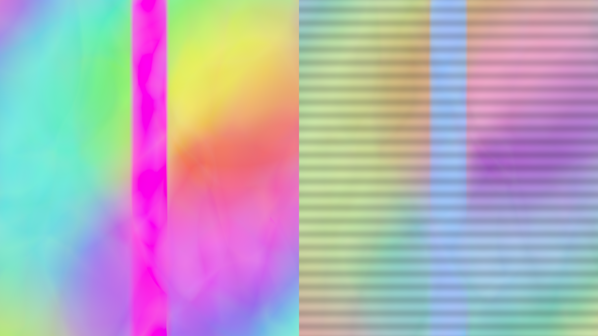

# A learned shader function

A small network can approximate a function that is expensive to evaluate at every pixel. This experiment trains an animated color function with a hard-edged vertical stripe outside Field, then evaluates its frozen weights inside a Vulkan shader. The function, training recipe, weights, and error view are all inspectable. You can also train directly on your own `moduleHere()` output: its GLSL stays in Field.


## Open the experiment

Open **Starting points → learned_shader** after building the optional shaders. **Compare** shows the original function, the learned approximation, and absolute RGB error multiplied by eight. The other views fill the image with either the original or the approximation.

Switch **Cooperative vectors** to compare NVIDIA's accelerated matrix-vector operations with ordinary shader arithmetic. Both use the same weights. **Animate time** traverses the training interval; the API rejects time outside −1 to 1 instead of implying that extrapolation has been tested.

Both examples on this page now include a magenta vertical stripe: x from −0.12 to +0.12 in the normalized image, covering 12% of its width. Its edges are hard steps, with no smoothing in the source. The same small network has to approximate those jumps while fitting the animated background. Watch the edges in the learned panel and the bright bands in **error × 8**; the stripe makes the model's finite transition width visible.


<video controls muted loop playsinline preload="metadata" src="assets/learned_shader/animation.mp4" width="1920" height="1080" style="max-width:100%;height:auto;aspect-ratio:16/9"></video>

## Train on your own `moduleHere()` shader

Open **Starting points → learned_from_module**. This is the complete workflow:

1. Edit the box's **fragment** shader and run the box. It starts by displaying the actual shader.
2. Press **Capture shader and train**. Field renders that module at a set of parameter values and exports its linear RGB output. A separate NumPy process fits the network while the source keeps animating.
3. Wait for **LEARNED MODULE READY**. Choose **2: Compare** to see source, learned output, and absolute RGB error × 8.
4. Choose **1: Learned** to use the replacement. Field then skips the original source render pass. **0: Source** immediately returns to the original.


<video controls muted loop playsinline preload="metadata" src="assets/learned_shader/from-module.mp4" width="1920" height="1080" style="max-width:100%;height:auto;aspect-ratio:16/9"></video>

The bundled editable shader was captured at 1920 × 1080: 98,304 training samples and 26,624 validation samples at separate parameter values. With 12,000 training steps, held-out RGB MSE was **0.000234**; the full GPU image at an additional parameter value measured **0.000194**. These results include the hard stripe. The [training manifest](assets/learned_shader/from-module-training.json) and [GPU check](assets/learned_shader/from-module-measurements.json) record the domain, errors and timings.


The example deliberately keeps the teacher in ordinary GLSL. No Python copy of its formula and no modification of the Slang inference shader are needed. Editing the teacher and pressing the button again creates a new dataset and model. A failed job or invalid model preserves the working view. Stopping the box cancels its training process.

The stripe is the final `step`/`mix` operation in the editable **fragment** property. Change its two edge positions or its colour, then capture and train again. The stripe is part of the training image, so switching to **Learned** asks the network to reproduce it too; it is not composited onto the learned output afterwards.

### Put the module's output somewhere capturable

If your module already renders into a `RenderToTexture`, use that target. Otherwise, make one when creating the module and keep your existing meshes, textures and uniforms:

```diffstatic {data-lang=kotlin}
val source = RenderToTexture(renderer) {
    width = 1920
    height = 1080
    useDepth = false
    format = VK_FORMAT_R32G32B32A32_SFLOAT
}
val teacher = moduleHere { source.apply() }
source += "teacher" to teacher
// Add your existing meshes to teacher as usual.
```

The target needs one opaque, linear RGBA16F or RGBA32F attachment. Capture reads actual GPU pixels before display tone mapping; it does not clamp RGB to 0–1. Alpha must be one. Coverage, latent pigment channels, depth and other attachments need separate handling.

### Decide what the network is allowed to know

This first model learns **(screen x, screen y, one parameter) → RGB**. The parameter can be time, a morph amount, or another scalar you choose. A callback sets that value in the real shader before each capture:

```diffstatic {data-lang=kotlin}
val setTime: (Float) -> Unit = { seconds ->
    mesh.push["time"] = seconds
}
val dataset = ShaderTraining.capture(
    renderer, source, File("build/my-shader/capture-001"),
    parameterRange = 0f..10f,
    fixedState = "Camera A; texture version 3; color controls unchanged",
    setParameter = setTime
)
```

Call capture **between frames**, for example from the Starting Point's button handler in its `frames` loop. Export briefly blocks that loop while rendering and reading back the dataset; training itself runs separately. Each capture uses a new directory, so an interrupted export cannot masquerade as a completed dataset.

Keep every input not represented by x, y or the chosen parameter fixed. If your shader also depends on camera position, normals, material identity, arbitrary texture contents or feedback history, this is a fit of the resulting image for the captured setup—not a general replacement for that material or simulation. A camera move or a changed texture requires a new fit. More independent inputs require an explicitly extended dataset, feature encoding and network; they are not inferred from GLSL.

### Train, inspect, and load

```diffstatic {data-lang=kotlin}
val trainingJob = ShaderTraining.trainAsync(
    dataset, File("build/my-shader/model-001"), steps = 12000
)
// Poll trainingJob.result.isDone in a frames loop; trainingJob.log contains progress.
// Once done, trainingJob.result.join() returns the model directory or throws its diagnostic.
```

The same job can run from a terminal:

```diffstatic {data-lang=bash}
uv run --project . --group docs python tools/lighting/train_shader.py \
    --dataset build/my-shader/capture-001 \
    --out build/my-shader/model-001 --steps 12000
```

The dataset has separate training and validation **parameter slices**. Validation therefore asks about parameter values not used for training, as well as other pixels. `weights.json` records RGB MSE, p95 and maximum absolute error after FP16 conversion, the sampled domain, source-shader fingerprint, dataset checksum, seed and tool versions. A finite model is not necessarily a good approximation: inspect the error image and motion, especially at thin lines, sharp edges and discontinuities.

For the comparison and replacement interface used by the Starting Point:

```diffstatic {data-lang=kotlin}
val comparison = ShaderLearningView(renderer, source,
    setSourceParameter = setTime)
comparison.load(File("build/my-shader/model-001"))
comparison.parameter = 4.5f  // original parameter units: seconds in this example
comparison.view = 2         // source / learned / error
// comparison.view = 1      // learned only: source pass is skipped
```

`ShaderLearningView` schedules the source itself. If you previously registered `source` directly in the render list, remove that registration when handing it to this view; otherwise your independent registration would keep drawing it. The source resources remain yours. Closing the comparison releases its learned model and display resources.

If you only want the learned texture in an existing pipeline:

```diffstatic {data-lang=kotlin}
val learned = LearnedShader(renderer,
    weightsFile = File("build/my-shader/model-001/weights.f16"),
    manifestFile = File("build/my-shader/model-001/weights.json"),
    attach = false)
learned.setParameter(4.5f)
// Schedule learned as a pre-target before consumers of learned.output.
renderer.renderList.preTargets["learned function"] = learned
```

Captured models use inference-only mode by default. They never compare themselves with the unrelated built-in analytic function. Values outside the captured parameter range are rejected. Load/reload at a frame boundary; the comparison checks the compiled source fingerprint and rejects weights for a changed shader. The fingerprint cannot identify changes to every bound texture or uniform, so the fixed-state contract still matters.

## What shader actually runs?

The trained result is a **buffer of weights**, used by a fixed **Slang compute shader** compiled directly to SPIR-V. Training changes the weights; it does not generate a new GLSL translation of your source. The current draw path is:

**normalized x, y, parameter → Slang network → RGB buffer → GLSL resolve → `learned.output` RTT → your GLSL material**

The Kotlin `LearnedShader` owns and schedules these passes. It uploads the weights once, passes their byte offsets and the current parameter to compute, and places a compute-write → fragment-read barrier before the resolve. The whole rendering path stays on the GPU.

### The actual inference kernel

This is the complete `src/jvmMain/resources/afield/four/neural/learned.slang` used by the experiment. `learned(v)` is the fitted function: feature encoding, two ReLU layers, then RGB. `FIELD_COOPERATIVE` selects accelerated matrix-vector instructions or the ordinary arithmetic loops; both read the same model. The `original` function and three-panel routing belong to the bundled analytic comparison. A model captured from your own module always uses the learned branch (`view = 1`); its source is not embedded in this kernel.

```diffstatic {data-lang=slang}
// Field's tiny MLP. Slang stays separate from the Forth/GLSL compiler.
// 16 features -> 32 ReLU -> 32 ReLU -> RGB. FP16 row-major weights, 64-byte offsets.
[[vk::binding(0,0)]] ByteAddressBuffer weights;
[[vk::binding(1,0)]] RWStructuredBuffer<float4> pixels;
struct Params {uint width;uint height;float time;uint view;uint w0;uint b0;uint w1;uint b1;uint w2;uint b2;};
[[vk::push_constant]] Params p;
float3 original(float3 v) {
    float3 result=0;
    for(int k=1;k<=48;k++){float a=k*.61803399;
        for(int c=0;c<3;c++)result[c]+=sin((v.x*cos(a)+v.y*sin(a))*3+v.z*(.3+.1*c)+c*2+a)*(.35/k);}
    float stripe=step(-.12,v.x)*(1-step(.12,v.x));
    return lerp(.5+.35*tanh(result*3),float3(.95,.04,.8),stripe);
}
void features(float3 v,out float f[16]) {
    float x=v.x,y=v.y,t=v.z;const float pi=3.14159265359;
    f[0]=x;f[1]=y;f[2]=t;f[3]=1;f[4]=sin(x*pi);f[5]=cos(x*pi);f[6]=sin(y*pi);f[7]=cos(y*pi);
    f[8]=sin(t*pi);f[9]=cos(t*pi);f[10]=sin((x+y)*pi);f[11]=cos((x-y)*pi);
    f[12]=sin(2*x*pi);f[13]=sin(2*y*pi);f[14]=cos(2*x*pi);f[15]=cos(2*y*pi);
}
float value(uint offset){uint word=weights.Load(offset&~3u);return f16tof32((word>>((offset&2u)*8))&65535u);}
float3 learned(float3 v) {
    float f[16];features(v,f);
#if FIELD_COOPERATIVE
    CoopVec<half,16> input;for(int i=0;i<16;i++)input[i]=half(f[i]);
    var h1=coopVecMatMulAdd<half,32>(input,CoopVecComponentType::Float16,weights,p.w0,CoopVecComponentType::Float16,
        weights,p.b0,CoopVecComponentType::Float16,CoopVecMatrixLayout::RowMajor,false,32);
    h1=max(h1,CoopVec<half,32>(half(0)));
    var h2=coopVecMatMulAdd<half,32>(h1,CoopVecComponentType::Float16,weights,p.w1,CoopVecComponentType::Float16,
        weights,p.b1,CoopVecComponentType::Float16,CoopVecMatrixLayout::RowMajor,false,64);
    h2=max(h2,CoopVec<half,32>(half(0)));
    var outv=coopVecMatMulAdd<half,3>(h2,CoopVecComponentType::Float16,weights,p.w2,CoopVecComponentType::Float16,
        weights,p.b2,CoopVecComponentType::Float16,CoopVecMatrixLayout::RowMajor,false,64);
    return float3(outv[0],outv[1],outv[2]);
#else
    float h1[32],h2[32];float3 result;
    for(int j=0;j<32;j++){float sum=value(p.b0+j*2);for(int i=0;i<16;i++)sum+=f[i]*value(p.w0+(j*16+i)*2);h1[j]=max(sum,0);}
    for(int j=0;j<32;j++){float sum=value(p.b1+j*2);for(int i=0;i<32;i++)sum+=h1[i]*value(p.w1+(j*32+i)*2);h2[j]=max(sum,0);}
    for(int j=0;j<3;j++){float sum=value(p.b2+j*2);for(int i=0;i<32;i++)sum+=h2[i]*value(p.w2+(j*32+i)*2);result[j]=sum;}
    return result;
#endif
}
[shader("compute")]
[numthreads(8,8,1)]
void main(uint3 id:SV_DispatchThreadID){
    if(id.x>=p.width||id.y>=p.height)return;
    float2 uv=(float2(id.xy)+.5)/float2(p.width,p.height);int panel=p.view==2?min(int(uv.x*3),2):0;
    if(p.view==2)uv.x=frac(uv.x*3);
    float3 v=float3(uv*2-1,p.time);float3 result;
    if(p.view==0 || (p.view==2 && panel==0))result=original(v);
    else {result=learned(v);if(p.view==2 && panel==2)result=abs(result-original(v))*8;}
    pixels[id.y*p.width+id.x]=float4(result,1);
}
```

There are 8 × 8 invocations per workgroup and one `float4` output per pixel. Pixel centers are mapped to −1…1; `setParameter()` maps your capture's parameter interval to that same range. RGB remains linear and unclamped, with alpha set to one. The Slang source, trained weights and host-side layout checks are separate, inspectable pieces.

### The actual GLSL bridge to an image

The compute output is a storage buffer. This is the fragment shader in `LearnedShader.kt` that copies it into the RGBA32F `learned.output` RTT (formatted here for readability):

```diffstatic {data-lang=glsl}
#version 460
#extension GL_EXT_buffer_reference : require
#extension GL_EXT_scalar_block_layout : require

layout(buffer_reference, std430) readonly buffer Pixels {
    vec4 data[];
};
layout(push_constant, scalar) uniform P {
    Pixels pixels;
    uint width;
} p;
layout(location=0) out vec4 color;

void main() {
    uvec2 xy = uvec2(gl_FragCoord.xy);
    color = p.pixels.data[xy.y * p.width + xy.x];
}
```

`p.pixels` is a Vulkan buffer device address supplied by Field. This bridge does not evaluate the network; it makes its already-computed RGB available through the same texture interface as other RTTs. A full-screen triangle covers the target.

### Keep learning finished, keep the material editable

Open **Starting points → learned_shader**. Stop the original comparison box and launch **editable learned material** under the same renderer. This second scene loads the same trained model at a fixed parameter and presents its output to an ordinary `moduleHere()`. The left panel shows the raw learned image; the right shows a color-and-stripe treatment.



The connection in the box's Kotlin is:

```diffstatic {data-lang=kotlin}
val learned = LearnedShader(renderer, attach = false)
learned.view = 1
learned.setParameter(.25f)
prop<RenderToTexture>(learnedImage) = learned.output

val material = moduleHere { depthTest = false; depthWrite = false; blend = false }
// The Starting point supplies the full-screen mesh and cleanup.
renderer.renderList.preTargets["editable learned material"] = learned
renderer.renderList.modules["editable learned material"] = material
```

This is that box's actual **fragment** property. Edit `.65`, change the channel order, or change the stripes while it runs, then use **Reload Shader (Alt-R)**:

```diffstatic {data-lang=glsl}
#version 460
layout(set=0,binding=0) uniform sampler2D learnedImage;
layout(location=0) in vec2 uv;
layout(location=0) out vec4 color;
void main() {
    // The left half is the model's RGB; the right is an editable treatment.
    vec2 st=vec2(fract(uv.x*2),uv.y);
    vec3 base=texture(learnedImage,st).rgb;
    vec3 treatment=mix(base,base.gbr,.65);
    treatment*=.85+.15*sin(st.y*160);
    color=vec4(uv.x<.5 ? base : treatment,1);
}
```

Reloading this fragment recompiles the material while keeping the inference kernel, weight allocation and output texture. In the live check, changing the right-hand treatment left the network object, texture handle and every raw RGB value unchanged; only the treated half of the displayed image changed. You do not need to recapture or retrain. The Starting point keeps this material in a separate scene so its shader property is independent of the original teacher and comparison controls.

For your own captured model, give `LearnedShader` the `weightsFile` and `manifestFile` produced by training, as in the earlier example. The texture connection is identical. `learnedImage` can be composited with other RTTs, sampled through warped coordinates, or used to drive another effect. Warping those UVs resamples the inferred image; the current public API does not inject a callable `learned(x,y,t)` into an arbitrary GLSL fragment shader.

There are three useful kinds of edits:

| What you edit | What can stay fixed? |
| --- | --- |
| GLSL that samples `learnedImage` | Kernel and trained weights. This is the normal live-coding path above. |
| Slang around `learned(v)`, such as combining its RGB with an analytic effect | Weights can stay fixed if the feature encoding, architecture and weight layout stay compatible. Rebuild the compute shader and recreate its `LearnedShader` view to load that binary. |
| The original teacher, its textures, or other captured inputs | The old model can still be used as its old approximation, but it does not learn the edit. Capture and train again if it should approximate the changed teacher. `ShaderLearningView.load` rejects a changed source-shader fingerprint; standalone inference does not need the teacher. |

Changing the network's inputs, layer sizes or feature encoding is a model change: update training and host layout validation together. Adding an effect after inference is just ordinary shader editing.

You can also treat `learned(v)` as an ingredient inside the Slang source itself—for example, multiply its RGB by an analytic pattern in `main()`. That requires recompiling the kernel, but can reuse the saved weights. Keep `v` inside the model's training domain; changing the surrounding source does not give the network knowledge of new inputs.

## The original analytic example

The original combines 48 weak waves into RGB. Sixteen input features feed two 32-unit ReLU layers and three output channels. Training uses NumPy on the CPU, a fixed seed, and Adam; the rendering loop only reads the result.

```diffstatic {data-lang=kotlin}
val function = LearnedShader(renderer, cooperative = true)
function.view = 2       // original / learned / error × 8
function.time = .25f    // training domain: −1 … 1
```

The training script is `tools/lighting/train_shader.py`. For this older analytic example only, change its `target` function and the corresponding `original` function in `src/jvmMain/resources/afield/four/neural/learned.slang`, then retrain and rebuild. Keep the feature encoding and declared architecture consistent. Press **Reload trained weights** to replace the view at a frame boundary; a failed replacement preserves the previous view.

```diffstatic {data-lang=bash}
uv run --project . --group docs python tools/lighting/train_shader.py
./gradlew buildLearnedShaders
```

The bundled model is 3,456 bytes of little-endian FP16 weights and biases, with row-major matrices and 64-byte alignment. It uses a supported row-major cooperative-vector layout directly; there is no opaque matrix-layout conversion to hide. The manifest records offsets, dimensions, seed, training settings, validation error, and a checksum. Input/output and matrix type support are checked before using the cooperative path.

## What was measured

The built-in striped function's held-out training set has RGB MSE **0.00127** across 8,192 points after 6,000 updates and FP16 weight conversion. The GPU check compares both execution paths with an independent CPU evaluation of those quantized weights. [Recorded timings and numerical errors](assets/learned_shader/measurements.json) compare the original function, ordinary network arithmetic, and cooperative-vector inference at 1920 × 1080 after warm-up.

On this RTX 4090, the network takes **5.57 ms** with ordinary arithmetic and **0.307 ms** with cooperative vectors—about 18 times faster. Maximum sampled disagreement with the CPU is 0.00105 RGB for cooperative inference. The original striped wave function itself takes about **0.279 ms**, so this particular approximation does **not** beat the original shader. It demonstrates a fast learned function and an inspectable tradeoff, rather than a reason to replace every analytic function with a network.

The **learned_from_module** workflow measures the complete comparison target as well as inference. In its current 1080p run, cooperative inference alone was **0.257 ms median**, but the learned view including buffer-to-texture resolve and comparison display was **5.58 ms**, versus **1.98 ms** for the source view. These spans exclude final window presentation. The original source pass was verified to be skipped in learned-only mode. Its extra passes currently outweigh any saving for this teacher; use the full-path timings when deciding whether to replace your shader. These are warmed runs under Wayland with automatic GPU clocks, not a fixed-clock comparison with earlier captures.

The discontinuity deserves its own measurement. The edge band covers pixels within 0.02 normalized x units of either stripe boundary—about 19 pixels on either side at 1920 pixels wide, or 3.96% of the image in total. Both rows below compare linear RGB from the real source and learned GPU images, using cooperative inference:

| Study | Whole-image MSE | Edge-band MSE | MSE away from edges |
| --- | ---: | ---: | ---: |
| Built-in function, parameter 0.25 | 0.00118 | 0.0175 | 0.000503 |
| Captured `moduleHere()`, held-out parameter 0.173 | 0.000194 | 0.00321 | 0.0000700 |

Maximum individual RGB error is about **0.50** in both studies, despite their much smaller image-wide averages. The network uses continuous features and ReLU layers, so it approximates a hard step with a finite transition. The two studies use different backgrounds, training data and step counts; this table describes their respective fits rather than ranking training methods.

This is an approximation, and the error panel is part of the instrument. The network can lose small details or smooth a deliberate discontinuity. Its fixed training domain and small architecture are useful constraints for an experiment, not evidence that arbitrary shaders can be compressed this way.

## Optional toolchain

Prepare the optional shader toolchain once from the Field checkout:

```diffstatic {data-lang=bash}
./gradlew buildLearnedShaders
```

This uses the same optional-build and shared download-cache mechanism as Field's native dependencies. It initializes the pinned [RTX Neural Shading SDK](https://github.com/NVIDIA-RTX/RTXNS/tree/f309ae68677a67060cc6ded2d0af925a3931435f) Git submodule at **`optional/lighting/RTXNS`**, fetches Field’s shared Slang 2026.18.3 compiler with a verified SHA-256 checksum, and builds both inference variants plus the optional GPU-training entry points. The upstream sample’s compiler pin remains independently recorded. There is no need to configure or build NVIDIA's sample renderer.

SDK source lives outside `build/`. Compiler downloads live in Field's per-user native cache, shared across checkouts; `AFIELD_NATIVE_DOWNLOAD_CACHE` can relocate it. Generated SPIR-V and its provenance go to **`build/lighting/learned-shader/`**. After `clean`, run the same task again: it reuses the source checkout and cached compiler. Once prepared, `./gradlew buildLearnedShaders --offline` also works.

Field already has [live Slang support](afield_four_graphics.md#slang): `moduleHere()` can read `vertex_fragment`, `vertex_s`, or `fragment_s`, and `computeModuleHere()` can read `compute_s`. Its existing `SlangCompiler` calls `slangc` and supplies reflection to Field. The optional task also makes its cached compiler available to that path. An explicit `AFIELD_SLANGC` or `-Dafield.slangc` wins, followed by a compiler on `PATH`, then the prepared copy. No compiler is downloaded during a live shader edit.

The learned function uses a specific **direct-to-SPIR-V compute build**, with `sm_6_6` and the cooperative-vector capability. Field's ordinary `compute_s` path currently translates Slang through GLSL; its shared `vertex_fragment` path also produces SPIR-V and Slang reflection. These are different compilation recipes using the same compiler. Editing your source shader through `moduleHere()` remains the normal way to define the function you want to capture and train.

The task is explicit: ordinary Field builds and startup do not fetch these optional dependencies. Existing SDK checkouts with a changed revision or local edits are preserved and reported. Linux x86-64 is the validated build here; the recipe also selects pinned Windows, macOS and Linux ARM compiler archives, whose builds have not been run in this session.

The NVIDIA upstream inference example was also built and run on this machine before the Field integration. The recorded compiler and binary hashes accompany the implementation notes in `dev_docs/lighting/NEURAL_TOOLS.md`.

Field loads the compiled SPIR-V and frozen weights; it does not load the SDK at runtime. Ordinary arithmetic remains available without cooperative vectors. GPU training, online weight updates, neural texture compression, and custom DLSS weights are separate projects.

To place the learned output in a larger image pipeline, see [From modules to reconstruction](reconstruction_plumbing.md). It shows the render-target and pass ordering for DLAA/SR and RR, including which guides must still come from your scene.

For training directly from a live render target on the GPU, see [GPU shader learning](gpu_shader_learning.md). It saves the same frozen weight format and uses the same editable host shader.
