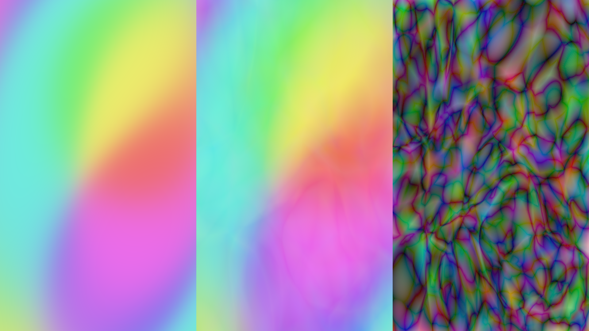
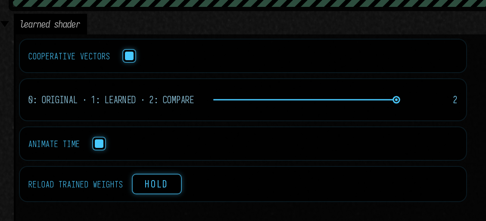
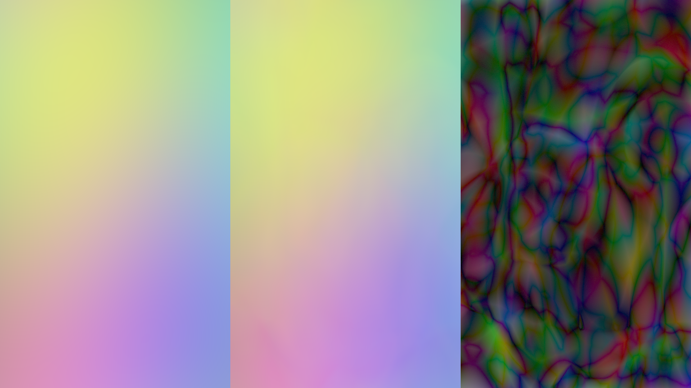
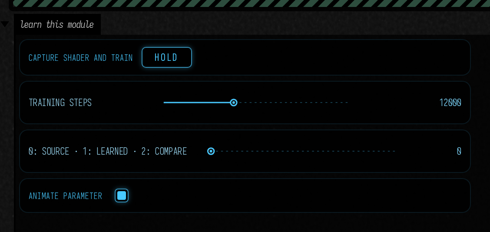

# A learned shader function

A small network can approximate a function that is expensive to evaluate at every pixel. This experiment trains a smooth animated color function outside Field, then evaluates its frozen weights inside a Vulkan shader. The function, training recipe, weights, and error view are all inspectable. You can also train directly on your own `moduleHere()` output: its GLSL stays in Field.



## Open the experiment

Open **Starting points → learned_shader** after building the optional shaders. **Compare** shows the original function, the learned approximation, and absolute RGB error multiplied by eight. The other views fill the image with either the original or the approximation.

Switch **Cooperative vectors** to compare NVIDIA's accelerated matrix-vector operations with ordinary shader arithmetic. Both use the same weights. **Animate time** traverses the training interval; the API rejects time outside −1 to 1 instead of implying that extrapolation has been tested.



<video controls muted loop playsinline preload="metadata" src="assets/learned_shader/animation.mp4" width="1920" height="1080" style="max-width:100%;height:auto;aspect-ratio:16/9"></video>

## Train on your own `moduleHere()` shader

Open **Starting points → learned_from_module**. This is the complete workflow:

1. Edit the box's **fragment** shader and run the box. It starts by displaying the actual shader.
2. Press **Capture shader and train**. Field renders that module at a set of parameter values and exports its linear RGB output. A separate NumPy process fits the network while the source keeps animating.
3. Wait for **LEARNED MODULE READY**. Choose **2: Compare** to see source, learned output, and absolute RGB error × 8.
4. Choose **1: Learned** to use the replacement. Field then skips the original source render pass. **0: Source** immediately returns to the original.



<video controls muted loop playsinline preload="metadata" src="assets/learned_shader/from-module.mp4" width="1920" height="1080" style="max-width:100%;height:auto;aspect-ratio:16/9"></video>

The bundled editable shader was captured at 1920 × 1080: 98,304 training samples and 26,624 validation samples at separate parameter values. With 12,000 training steps, held-out RGB MSE was **0.0000291**; the full GPU image at an additional parameter value measured **0.0000262**. The [training manifest](assets/learned_shader/from-module-training.json) and [GPU check](assets/learned_shader/from-module-measurements.json) record the domain, errors and timings.



The example deliberately keeps the teacher in ordinary GLSL. No Python copy of its formula and no modification of the Slang inference shader are needed. Editing the teacher and pressing the button again creates a new dataset and model. A failed job or invalid model preserves the working view. Stopping the box cancels its training process.

### Put the module's output somewhere capturable

If your module already renders into a `RenderToTexture`, use that target. Otherwise, make one when creating the module and keep your existing meshes, textures and uniforms:

```diffstatic {data-lang=kotlin}
val source = RenderToTexture(renderer) {
    width = 1920
    height = 1080
    useDepth = false
    format = VK_FORMAT_R32G32B32A32_SFLOAT
}
val teacher = moduleHere { source.apply() }
source += "teacher" to teacher
// Add your existing meshes to teacher as usual.
```

The target needs one opaque, linear RGBA16F or RGBA32F attachment. Capture reads actual GPU pixels before display tone mapping; it does not clamp RGB to 0–1. Alpha must be one. Coverage, latent pigment channels, depth and other attachments need separate handling.

### Decide what the network is allowed to know

This first model learns **(screen x, screen y, one parameter) → RGB**. The parameter can be time, a morph amount, or another scalar you choose. A callback sets that value in the real shader before each capture:

```diffstatic {data-lang=kotlin}
val setTime: (Float) -> Unit = { seconds ->
    mesh.push["time"] = seconds
}
val dataset = ShaderTraining.capture(
    renderer, source, File("build/my-shader/capture-001"),
    parameterRange = 0f..10f,
    fixedState = "Camera A; texture version 3; color controls unchanged",
    setParameter = setTime
)
```

Call capture **between frames**, for example from the Starting Point's button handler in its `frames` loop. Export briefly blocks that loop while rendering and reading back the dataset; training itself runs separately. Each capture uses a new directory, so an interrupted export cannot masquerade as a completed dataset.

Keep every input not represented by x, y or the chosen parameter fixed. If your shader also depends on camera position, normals, material identity, arbitrary texture contents or feedback history, this is a fit of the resulting image for the captured setup—not a general replacement for that material or simulation. A camera move or a changed texture requires a new fit. More independent inputs require an explicitly extended dataset, feature encoding and network; they are not inferred from GLSL.

### Train, inspect, and load

```diffstatic {data-lang=kotlin}
val trainingJob = ShaderTraining.trainAsync(
    dataset, File("build/my-shader/model-001"), steps = 12000
)
// Poll trainingJob.result.isDone in a frames loop; trainingJob.log contains progress.
// Once done, trainingJob.result.join() returns the model directory or throws its diagnostic.
```

The same job can run from a terminal:

```diffstatic {data-lang=bash}
uv run --project . --group docs python tools/lighting/train_shader.py \
    --dataset build/my-shader/capture-001 \
    --out build/my-shader/model-001 --steps 12000
```

The dataset has separate training and validation **parameter slices**. Validation therefore asks about parameter values not used for training, as well as other pixels. `weights.json` records RGB MSE, p95 and maximum absolute error after FP16 conversion, the sampled domain, source-shader fingerprint, dataset checksum, seed and tool versions. A finite model is not necessarily a good approximation: inspect the error image and motion, especially at thin lines, sharp edges and discontinuities.

For the comparison and replacement interface used by the Starting Point:

```diffstatic {data-lang=kotlin}
val comparison = ShaderLearningView(renderer, source,
    setSourceParameter = setTime)
comparison.load(File("build/my-shader/model-001"))
comparison.parameter = 4.5f  // original parameter units: seconds in this example
comparison.view = 2         // source / learned / error
// comparison.view = 1      // learned only: source pass is skipped
```

`ShaderLearningView` schedules the source itself. If you previously registered `source` directly in the render list, remove that registration when handing it to this view; otherwise your independent registration would keep drawing it. The source resources remain yours. Closing the comparison releases its learned model and display resources.

If you only want the learned texture in an existing pipeline:

```diffstatic {data-lang=kotlin}
val learned = LearnedShader(renderer,
    weightsFile = File("build/my-shader/model-001/weights.f16"),
    manifestFile = File("build/my-shader/model-001/weights.json"),
    attach = false)
learned.setParameter(4.5f)
// Schedule learned as a pre-target before consumers of learned.output.
renderer.renderList.preTargets["learned function"] = learned
```

Captured models use inference-only mode by default. They never compare themselves with the unrelated built-in analytic function. Values outside the captured parameter range are rejected. Load/reload at a frame boundary; the comparison checks the compiled source fingerprint and rejects weights for a changed shader. The fingerprint cannot identify changes to every bound texture or uniform, so the fixed-state contract still matters.

## The original analytic example

The original combines 48 weak waves into RGB. Sixteen input features feed two 32-unit ReLU layers and three output channels. Training uses NumPy on the CPU, a fixed seed, and Adam; the rendering loop only reads the result.

```diffstatic {data-lang=kotlin}
val function = LearnedShader(renderer, cooperative = true)
function.view = 2       // original / learned / error × 8
function.time = .25f    // training domain: −1 … 1
```

The training script is `tools/lighting/train_shader.py`. For this older analytic example only, change its `target` function and the corresponding `original` function in `src/jvmMain/resources/afield/four/neural/learned.slang`, then retrain and rebuild. Keep the feature encoding and declared architecture consistent. Press **Reload trained weights** to replace the view at a frame boundary; a failed replacement preserves the previous view.

```diffstatic {data-lang=bash}
uv run --project . --group docs python tools/lighting/train_shader.py
./gradlew buildLearnedShaders
```

The bundled model is 3,456 bytes of little-endian FP16 weights and biases, with row-major matrices and 64-byte alignment. It uses a supported row-major cooperative-vector layout directly; there is no opaque matrix-layout conversion to hide. The manifest records offsets, dimensions, seed, training settings, validation error, and a checksum. Input/output and matrix type support are checked before using the cooperative path.

## What was measured

The held-out training set has RGB MSE 0.000326 across 8,192 points after FP16 weight conversion. The GPU check compares both execution paths with an independent CPU evaluation of those quantized weights. [Recorded timings and numerical errors](assets/learned_shader/measurements.json) compare the original function, ordinary network arithmetic, and cooperative-vector inference at 1920 × 1080 after warm-up.

On this RTX 4090, the network takes **5.63 ms** with ordinary arithmetic and **0.267 ms** with cooperative vectors—about 21 times faster. Maximum sampled disagreement with the CPU is 0.000914 RGB for cooperative inference. The original wave function itself takes about **0.26 ms**, so this particular approximation does **not** beat the original shader. It demonstrates a fast learned function and an inspectable tradeoff, rather than a reason to replace every analytic function with a network.

The newer **learned_from_module** workflow measures the complete comparison target as well as inference. In its current 1080p run, cooperative inference alone was **0.218 ms median**, but the learned view including buffer-to-texture resolve and comparison display was **2.77 ms**, versus **0.539 ms** for the source view. These spans exclude final window presentation. The original source pass was verified to be skipped in learned-only mode. This reusable capture/training/replacement path is working, but its extra passes currently outweigh any saving for this teacher; use the full-path timings when deciding whether to replace your shader.

This is an approximation, and the error panel is part of the instrument. The network can lose small details or smooth a deliberate discontinuity. Its fixed training domain and small architecture are useful constraints for an experiment, not evidence that arbitrary shaders can be compressed this way.

## Optional toolchain

Prepare the optional shader toolchain once from the Field checkout:

```diffstatic {data-lang=bash}
./gradlew buildLearnedShaders
```

This uses the same optional-build and shared download-cache mechanism as Field's native dependencies. It initializes the pinned [RTX Neural Shading SDK](https://github.com/NVIDIA-RTX/RTXNS/tree/f309ae68677a67060cc6ded2d0af925a3931435f) Git submodule at **`optional/lighting/RTXNS`**, fetches its Slang 2026.10 compiler with a verified SHA-256 checksum, and builds both inference variants. There is no need to configure or build NVIDIA's sample renderer.

SDK source lives outside `build/`. Compiler downloads live in Field's per-user native cache, shared across checkouts; `AFIELD_NATIVE_DOWNLOAD_CACHE` can relocate it. Generated SPIR-V and its provenance go to **`build/lighting/learned-shader/`**. After `clean`, run the same task again: it reuses the source checkout and cached compiler. Once prepared, `./gradlew buildLearnedShaders --offline` also works.

Field already has [live Slang support](afield_four_graphics.md#slang): `moduleHere()` can read `vertex_fragment`, `vertex_s`, or `fragment_s`, and `computeModuleHere()` can read `compute_s`. Its existing `SlangCompiler` calls `slangc` and supplies reflection to Field. The optional task also makes its cached compiler available to that path. An explicit `AFIELD_SLANGC` or `-Dafield.slangc` wins, followed by a compiler on `PATH`, then the prepared copy. No compiler is downloaded during a live shader edit.

The learned function uses a specific **direct-to-SPIR-V compute build**, with `sm_6_6` and the cooperative-vector capability. Field's ordinary `compute_s` path currently translates Slang through GLSL; its shared `vertex_fragment` path also produces SPIR-V and Slang reflection. These are different compilation recipes using the same compiler. Editing your source shader through `moduleHere()` remains the normal way to define the function you want to capture and train.

The task is explicit: ordinary Field builds and startup do not fetch these optional dependencies. Existing SDK checkouts with a changed revision or local edits are preserved and reported. Linux x86-64 is the validated build here; the recipe also selects pinned Windows, macOS and Linux ARM compiler archives, whose builds have not been run in this session.

The NVIDIA upstream inference example was also built and run on this machine before the Field integration. The recorded compiler and binary hashes accompany the implementation notes in `dev_docs/lighting/NEURAL_TOOLS.md`.

Field loads the compiled SPIR-V and frozen weights; it does not load the SDK at runtime. Ordinary arithmetic remains available without cooperative vectors. GPU training, online weight updates, neural texture compression, and custom DLSS weights are separate projects.

To place the learned output in a larger image pipeline, see [From modules to reconstruction](reconstruction_plumbing.md). It shows the render-target and pass ordering for DLAA/SR and RR, including which guides must still come from your scene.
