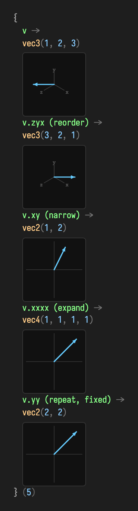
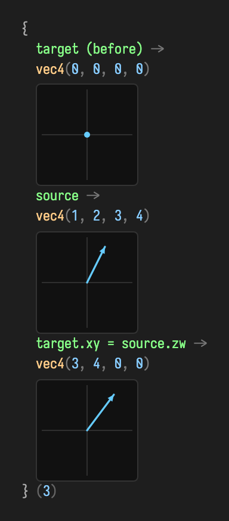
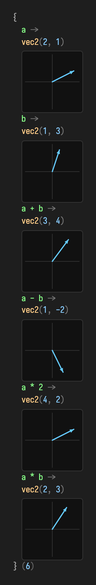
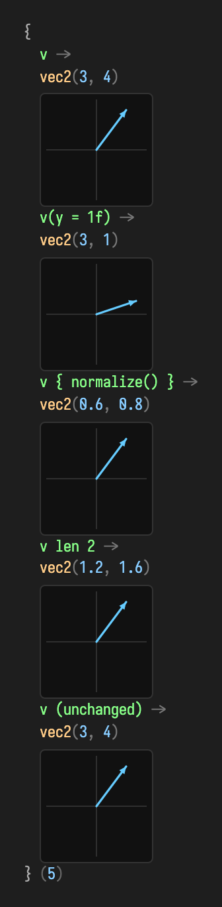
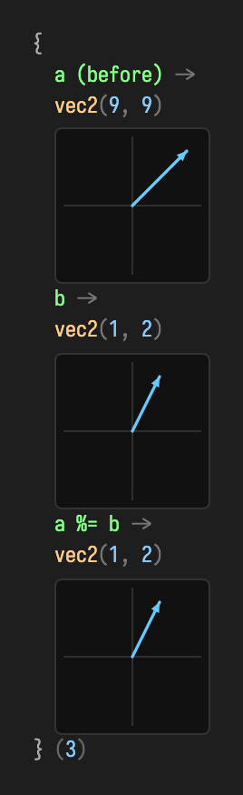
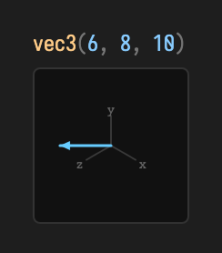

# Linear algebra in Field

Linear algebra is the small vocabulary underneath movement, cameras, lighting,
meshes, simulation, and spatial data. In Field it is meant to read like GLSL and
run like live code: reorder a vector's components by name, do arithmetic with the
usual `+ - * /`, copy a vector with one field changed, rescale it to a length —
all as *expressions*, without reaching for ceremony.

```diffstatic {data-lang=kotlin}
:::static
val position = vec(1, 2, 3)
position.x += 1f          // now (2, 2, 3)
position { normalize() }  // a unit copy; position itself is untouched
```

This whole surface — the vectors, their swizzles and operators, and the matrix
and quaternion types — is *generated* from one typed algebra model in
`tools/linalg-generator`, so the same names behave identically across `vec2`,
`vec3`, `vec4` and both precisions. You do not need to understand the storage
backends to begin.

Every image below is captured straight from Field's real value visualizer —
`ValueVisualizer.visualize(...)`, the renderer described in
[Visualizers & Controls](visualizers.md) — fed the actual result of the code
above it. Vectors draw as auto-scaled arrows (a 2D arrow for `vec2`, an isometric
frame for `vec3`); matrices draw as diverging heatmaps. Nothing here is mocked.
For the exhaustive, machine-generated member list of every type, see the
[generated vector API reference](linear_algebra_api.md).

## Constructing vectors

`vec(...)` is the ergonomic constructor: two, three, or four numbers give a
`Vector2f`, `Vector3f`, or `Vector4f`. It accepts any Kotlin `Number`, so live
code can mix integer, double, and float literals without decorating everything
with `f`. The number of arguments selects the arity.

```diffstatic {data-lang=kotlin}
:::static
val a = vec(2, 1)                 // Vector2f
val v = vec(1, 2, 3)              // Vector3f
val p = vec(0.25, 0.5, 1.0, 2.0)  // Vector4f
```

When the expected type is already known, Kotlin collection literals are an even
terser option:

```diffstatic {data-lang=kotlin}
:::static
val origin: Vec2 = [0, 0]
val up: Vec3 = [0, 1, 0]
val white: Vec4 = [1, 1, 1, 1]
```

The examples below use `vec(...)` because it also establishes the type when there
is no declaration annotation. In a Field box the linalg imports arrive with the
standard preamble, so you rarely type them yourself; a plain Kotlin file wants:

```diffstatic {data-lang=kotlin}
:::static
import afield.stdlib.*        // vec, swizzles, invoke / %= / len
import afield.stdlib.linalg.* // + - * / and the matrix/quaternion types
```

## Vectors are arrows (and sometimes points)

The most useful mental picture is an arrow. Its components say how far the arrow
travels along each axis; its `length()` is the arrow's magnitude. The same three
numbers can stand for a point or a displacement, and the operation reveals which
you mean — subtracting two points gives the arrow between them; adding an arrow
to a point moves it.

```diffstatic {data-lang=kotlin}
:::static
val from = vec(2, 1, 0)
val to   = vec(7, 4, 0)
to - from            // vec3(5, 3, 0) — the displacement between two points
(to - from).length() // 5.8309517     — how far apart they are
```

## Read swizzles: reorder, narrow, expand, repeat

Every length-2, length-3, and length-4 sequence of a vector's components is a
read swizzle — an extension `val` on the *read* interface (`Vector3fc`, …), so it
works on any view, not just a mutable vector. A swizzle returns a same-arity
vector: `v.xy` is a `vec2`, `v.xyz` a `vec3`. The sequence is free to:

- **reorder** the components — `v.zyx` reverses a `vec3`;
- **narrow** to fewer components — `v.xy` drops `z`;
- **expand** past the source arity — `v.xxxx` broadcasts `x` into a `vec4`;
- **repeat** a component — `v.yy` is `(y, y)`.

```diffstatic {data-lang=kotlin}
:::static
val v = vec(1, 2, 3)
v.zyx   // vec3(3, 2, 1)  — reorder
v.xy    // vec2(1, 2)     — narrow
v.xxxx  // vec4(1, 1, 1, 1) — expand
v.yy    // vec2(2, 2)     — repeat (this used to wrongly return (y, z))
```



Components can be spelled two ways — positional `x`/`y`/`z`/`w` or colour
`r`/`g`/`b`/`a` — so `v.rgb` and `v.xyz` are the same swizzle. The two
vocabularies are never mixed inside one name.

## Write swizzles: GLSL-style assignment

When a swizzle's indices are all *distinct*, it also gets a writable `var` on the
mutable vector type, so you can assign through it. This mutates the target **in
place**:

```diffstatic {data-lang=kotlin}
:::static
val target = vec(0, 0, 0, 0)
val source = vec(1, 2, 3, 4)
target.xy = source.zw     // target becomes vec4(3, 4, 0, 0)
```



The right-hand `source.zw` is an ordinary read swizzle producing a `vec2`; the
left-hand `target.xy` receives it. Repeated-index swizzles like `v.xx` have no
unambiguous target, so they stay read-only — there is no `var` for them.

## Arithmetic: `+ - * /`

The vectors carry the usual operators. Between two vectors of the same arity they
act component-wise; against a scalar they broadcast. Each returns a fresh vector,
leaving its operands untouched.

```diffstatic {data-lang=kotlin}
:::static
val a = vec(2, 1)
val b = vec(1, 3)
a + b   // vec2(3, 4)   — component-wise
a - b   // vec2(1, -2)
a * 2   // vec2(4, 2)   — scalar broadcast (2 * a works too)
a * b   // vec2(2, 3)   — component-wise (Hadamard) product
```



Note that `a * b` is the *component-wise* product, not a dot or cross product —
those keep their named forms (`a.dot(b)`, and `a x b` for the 3D cross, below).
Division by a scalar (`a / 2`) and unary minus (`-a`) round out the set.

## Copy operators: `invoke` and `len`

`invoke` gives a vector two live-coding conveniences. Called with named arguments,
it returns a **copy with those components replaced**, keeping the rest — a tidy
way to nudge one axis:

```diffstatic {data-lang=kotlin}
:::static
val v = vec(3, 4)     // length 5
v(y = 1f)             // vec2(3, 1) — copy, only y changed
```

Called with a block, it returns a **copy after applying the block**, leaving the
original alone — handy for the mutating vector methods:

```diffstatic {data-lang=kotlin}
:::static
v { normalize() }     // vec2(0.6, 0.8) — a normalized copy; v is untouched
```

Finally, the infix `len` returns a copy **rescaled to a given length**, keeping
direction. It is a *setter*, not a getter — for the current magnitude use
`v.length()`:

```diffstatic {data-lang=kotlin}
:::static
v len 2               // vec2(1.2, 1.6) — same direction, length 2
```



The bottom row confirms the copy semantics: after all three expressions `v` is
still `vec2(3, 4)`. Nothing above mutated it.

## In-place assignment: `%=`

When you *do* want to overwrite a vector in place — reusing the same object rather
than allocating — `%=` copies another vector's components into it:

```diffstatic {data-lang=kotlin}
:::static
val a = vec(9, 9)
val b = vec(1, 2)
a %= b     // a is now vec2(1, 2); same object, new contents
```



This pairs naturally with the copy operators: reach for `v { … }` and `v(…)` when
you want a new vector, and for `%=` (or the write swizzles) when you want to
mutate an existing one — for example a persistent vector held across animation
frames.

## Length, direction, and normalization

`length()` answers *how much?*; `normalize()` keeps the direction and sets the
length to one. Because normalizing mutates, reach for `v { normalize() }` when you
want a fresh unit copy:

```diffstatic {data-lang=kotlin}
:::static
val velocity = vec(6, 8, 0)
velocity.length()          // 10.0
velocity { normalize() }   // vec3(0.6, 0.8, 0) — same direction, unit length
velocity len 4             // vec3(2.4, 3.2, 0) — direction kept, length 4
```

The zero vector has no direction, so normalizing it produces non-finite
components — guard it when zero is possible. Use the squared forms for
comparisons; they skip the square root while preserving ordering:

```diffstatic {data-lang=kotlin}
:::static
if (velocity.lengthSquared() > 1e-12f) velocity.normalize()
if (candidate.distanceSquared(mouse) < 20f * 20f) { /* within 20 units */ }
```

## Dot product: “how much do these agree?”

The dot product multiplies matching components and adds them. For unit vectors it
is the cosine of the angle between them — `1` same way, `0` perpendicular, `-1`
opposed:

```diffstatic {data-lang=kotlin}
:::static
val forward = vec(0, 0, -1)
forward.dot(vec(0, 0, -1))  //  1.0  — identical direction
forward.dot(vec(1, 0, 0))   //  0.0  — perpendicular
vec(1, 2, 3).dot(vec(4, 5, 6)) // 32.0 — 1·4 + 2·5 + 3·6
```

A classic lighting term asks how much a surface normal agrees with the direction
toward a light, clamped so a light behind the surface contributes nothing:

```diffstatic {data-lang=kotlin}
:::static
val brightness = normal.dot(directionToLight).coerceAtLeast(0f)
```

## Cross product: “which way is perpendicular?”

The 3D cross product (`a x b`, or `a.cross(b)`) returns an arrow perpendicular to
both inputs, following the right-hand rule. Its length before normalizing is the
area of the parallelogram the inputs span, so parallel inputs give zero:

```diffstatic {data-lang=kotlin}
:::static
vec(1, 0, 0) x vec(0, 1, 0)   // vec3(0, 0, 1)  — right-hand rule
vec(0, 1, 0) x vec(1, 0, 0)   // vec3(0, 0, -1) — order flips the sign
```

That is the standard way to find a triangle's surface normal:

```diffstatic {data-lang=kotlin}
:::static
val normal = ((b - a) x (c - a)) { normalize() }
```

## Interpolation: `lerp` and `fma`

`lerp` traces a straight line from one vector to another — `t = 0` is the start,
`t = 1` the end, values outside extrapolate:

```diffstatic {data-lang=kotlin}
:::static
val start = vec(0, 0, 0)
val end   = vec(100, 40, 0)
start.lerp(end, 0.5f, vec(0, 0, 0))  // vec3(50, 20, 0) — halfway
```

For the repeated “position plus direction times amount” pattern, `fma` expresses
the whole step without a temporary vector:

```diffstatic {data-lang=kotlin}
:::static
position.fma(deltaSeconds, velocity)  // position += velocity * deltaSeconds
```

Operations either mutate the receiver or write into an explicit destination.
Mutating methods return the receiver; destination methods return the destination,
so both chain naturally:

```diffstatic {data-lang=kotlin}
:::static
val normal = vec(0, 0, 0)
edgeA.cross(edgeB, normal)  // no result allocation; returns normal
normal.normalize()
```

## Matrices: transforms & precision

Field's matrices come in two precisions that share one shape. The
**single-precision** family — `Matrix2f`, `Matrix3f`, `Matrix4f` — is what the
renderer, camera, and quaternion code speak. The **double-precision** family —
`Matrix2d`, `Matrix3d`, `Matrix4d` — is its f64 sibling, for arithmetic that must
never quietly round to `float`. Both are generated from the same model as the
vectors, so a shared method behaves identically bit-for-bit apart from storage
width.

A matrix draws as a **diverging heatmap**: neutral grey at zero, blue for
positive entries, orange for negative, scaled by magnitude. The header keeps the
full-precision numbers (and, for 3×3 and 4×4, the determinant and translation).
All matrices are **column-major** (the JOML convention).

### Constructing a matrix

Each type has a component constructor and defaults to the identity. The 2×2
constructor takes `(m00, m01, m10, m11)` — column by column, so `m00, m01` is the
first column. Read as a conventional maths matrix, that is the two rows
`(m00, m10)` and `(m01, m11)`.

```diffstatic {data-lang=kotlin}
:::static
val m = Matrix2d(1.0, 2.0, 3.0, 4.0)  // columns (1,2) and (3,4) → rows (1,3),(2,4)
```

![A 2×2 double matrix drawn as a labelled heatmap; header reads mat2d [1, 3 / 2, 4]](assets/matrix_algebra/construct_mat2.png)

The header spells the two rows — `[1, 3 / 2, 4]` — while the grid shows the
column-major storage. A bare `Matrix4d()` is the 4×4 identity.

### Multiply, determinant, inverse, transpose

These four are *precision-agnostic* — identical on `Matrix2d` and `Matrix2f`.
`mul` composes another matrix onto the receiver **in place**, so wrap the left
operand in a copy constructor when you want to keep it:

```diffstatic {data-lang=kotlin}
:::static
val a = Matrix2d(1.0, 2.0, 3.0, 4.0)   // rows (1,3),(2,4)
val b = Matrix2d(5.0, 6.0, 7.0, 8.0)   // rows (5,7),(6,8)
Matrix2d(a).mul(b)                     // A·B — a fresh copy, a and b untouched
```

![The product A·B as a heatmap; header reads mat2d [23, 31 / 34, 46]](assets/matrix_algebra/multiply_mat2.png)

The product `[[23, 31], [34, 46]]` is exactly the textbook result.
`determinant()` and `invert()` come along for free; a matrix times its own inverse
returns to the identity, exact at f64 scale:

```diffstatic {data-lang=kotlin}
:::static
a.determinant()                        // -2.0
Matrix2d(a).mul(Matrix2d(a).invert())  // ≈ identity
```

![A·A⁻¹ collapses to the identity; header reads mat2d [1, 0 / 0, 1]](assets/matrix_algebra/inverse_identity_mat2.png)

`invert()` and `transpose()` also mutate in place (with a `transpose(dest)`
overload). The same names — `mul`, `determinant`, `invert`, `transpose`,
`identity`, `set` — exist on the 2×2, 3×3, and 4×4 types alike.

### A 3×3 linear map

`Matrix3d` carries the same surface one size up. Its `set(...)` takes nine values,
row by row for readability, and the visualizer prints the determinant in the
header:

```diffstatic {data-lang=kotlin}
:::static
val m3 = Matrix3d().set(
    2.0, 0.0, 1.0,
    1.0, 3.0, 0.0,
    0.0, 1.0, 4.0,
)
m3.determinant()   // 25.0
```

![A 3×3 double matrix as a labelled heatmap; header reads mat3d [det=25]](assets/matrix_algebra/linear_mat3.png)

A non-zero determinant means the map is invertible; `Matrix3d(m3).invert()` gives
the inverse.

### Composing affine transforms in 4D

`Matrix4d` adds the affine builders `scale`, `translate`, `scaling`, and
`translation`. Like `mul`, they compose onto the receiver in place and return it.
Composition applies each step *in the frame established so far* — the JOML "local"
convention — which is worth watching:

```diffstatic {data-lang=kotlin}
:::static
val t = Matrix4d().scale(2.0, 3.0, 4.0).translate(5.0, 6.0, 7.0)
t.determinant()    // 24.0  (= 2·3·4; translation never changes the determinant)
```

![A 4×4 affine matrix as a heatmap; header reads mat4d [det=24, t=(10, 18, 28)]](assets/matrix_algebra/affine_mat4.png)

The header reports `t=(10, 18, 28)`, **not** `(5, 6, 7)`. Because the `translate`
runs *after* the `scale`, it moves in the already-scaled frame, so each component
is multiplied by its axis scale: `(5·2, 6·3, 7·4)`. The determinant stays `24` — a
pure translation preserves volume.

### Where precision stops: the f32 bridge

The f64 family deliberately covers only the precision-agnostic parts — multiply,
determinant, invert, transpose, scale, translate. **Rotation, projection/camera
helpers (`perspective`, `lookAt`), and transforming a vector live on the
single-precision `Matrix4f`**, matching Field's f32 quaternion and render
pipeline. Quaternion angles are in radians.

```diffstatic {data-lang=kotlin}
:::static
val r = Matrix4f().rotateY(0.6f)   // rotate about Y by 0.6 rad
r.determinant()                    // 1.0 — a rotation preserves volume
```

![A Y-rotation as a heatmap; header reads mat4 [det=1, t=(0, 0, 0)], cells show 0.83 / 0.56 / -0.56](assets/matrix_algebra/rotate_mat4f.png)

The header now reads `mat4` (not `mat4d`) — the visualizer distinguishes the two
precisions. The `cos 0.6 ≈ 0.83` on the diagonal and `±sin 0.6 ≈ ±0.56`
off-diagonal are the classic Y-rotation entries. Transforming a point is likewise
a `Matrix4f` operation: `*` on a `vec3` calls `transformPosition` (translation
included) and returns a fresh `Vector3f`:

```diffstatic {data-lang=kotlin}
:::static
Matrix4f().translation(5f, 6f, 7f) * vec(1, 2, 3)   // vec3(6, 8, 10)
```



Use `transformDirection` (or the `Vector4f` overload with `w = 0`) to rotate/scale
a direction *without* the translation.

## When allocation matters

Heap vectors and matrices are right for persistent box properties, saved state,
and almost all code where allocation is not a bottleneck. When a hot loop creates
many short-lived values, `frameScratch` gives them one shared lifetime:

```diffstatic {data-lang=kotlin}
:::static
frameScratch {
    val a = vec(1, 2, 3)
    val b = vec(4, 5, 6)
    val normal = vec3()
    a.cross(b, normal).normalize()
    println(normal.x)
}
```

`frameScratch` uses one thread-confined `FrameArena`; leaving the block
invalidates its allocations together. Copy deliberately (`copyTo`, `set`) when a
scratch result must outlive the scope. For dense CPU data, direct memory, or
mapped Vulkan buffers, the `SegmentVec2/3/4Buffer` views carry the same operation
surface over externally-owned memory. Development builds detect stale handles,
wrong types, and cross-thread access; a distribution build can compile those
checks out with `-PlinalgArenaChecks=false`.

| Situation | Use |
| --- | --- |
| Persistent box state or a handful of values | `Vector3f`, `Matrix4f`, `Quaternionf` |
| Temporary math in a stable render/update thread | `frameScratch { ... }` |
| A subsystem with explicit scratch ownership | `FrameArena` |
| Packed vertex/point data, or aligned mapped records | `SegmentVec2/3/4Buffer` |
| Passing a scratch result into persistent state | Explicit `copyTo` or `set` |

## Geometry recipes

The library ships closest-point, barycentric, containment, AABB/sphere overlap,
and common segment/ray intersection helpers. Their destination arguments follow
the same no-result-allocation convention as the vectors:

```diffstatic {data-lang=kotlin}
:::static
val closest = vec(0, 0, 0)
closestPointOnTriangle(point, a, b, c, closest)

val hit = vec(0, 0, 0)
if (intersectRayTriangle(rayOrigin, rayDirection, a, b, c, hit)) println("hit at $hit")

val nearFar = vec(0, 0)
if (intersectRayAabb(origin, direction, minimum, maximum, nearFar)) {
    println("enter ${nearFar.x}, leave ${nearFar.y}")
}
```

## The shape of it

Read top to bottom, the vocabulary is small and regular. **Vectors:** name
components in any order to read them, assign through distinct-index names to write
them, use `+ - * /` for arithmetic, `invoke` and `len` to copy, and `%=` to
overwrite — the same rules across `vec2`, `vec3`, and `vec4` (swizzles and the
`invoke`/`len`/`%=` operators are emitted for the *float* heap vectors; arithmetic
additionally covers the double and half-precision vectors). **Matrices:** pick the
width by need — the `…f` family for anything that ends up on screen (cameras,
rotations, per-frame transforms), the `…d` family when accumulated arithmetic must
stay exact — while rotation, projection, and pushing a vector through a matrix are
the f32 `Matrix4f`'s job.

Both sides are emitted from the one generator model in `tools/linalg-generator`,
which keeps the mathematics, aliasing behavior, and explanation in one reviewable
place. The public page is handwritten so examples follow the way people learn; for
the complete, machine-generated member listing of every type, precision, and
storage form, see the [generated vector API reference](linear_algebra_api.md).
