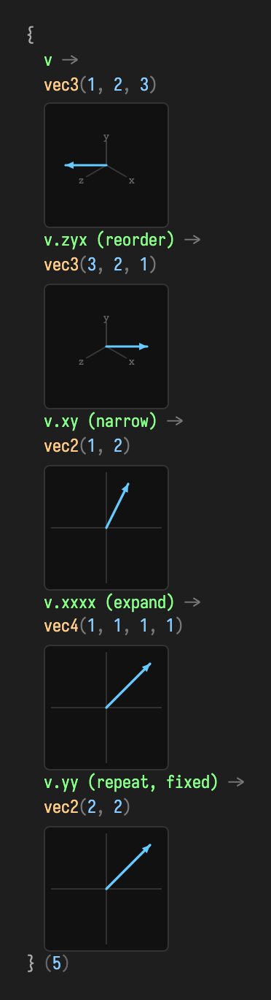
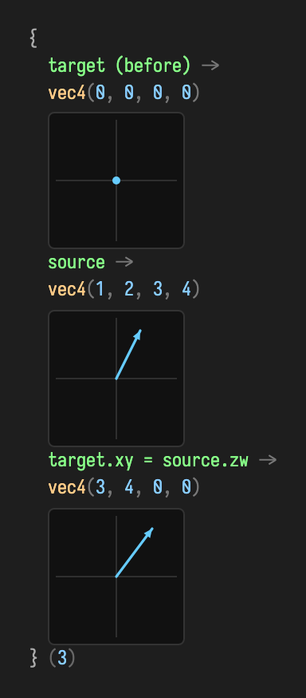
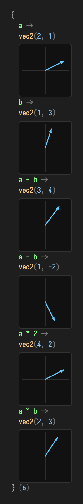
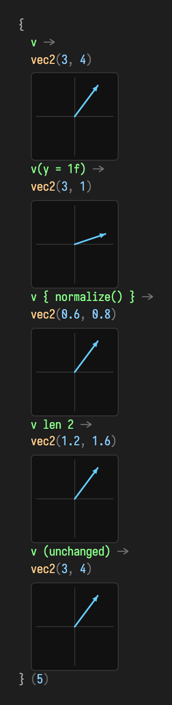
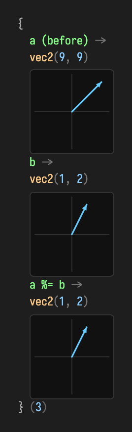
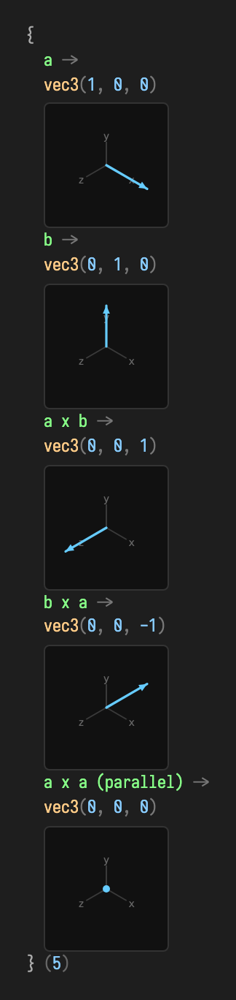
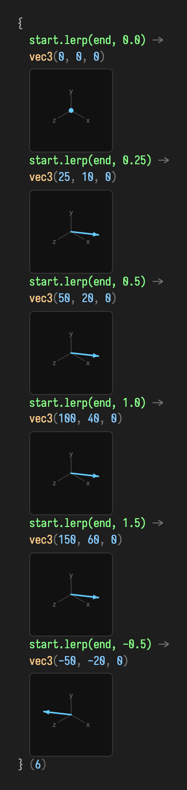
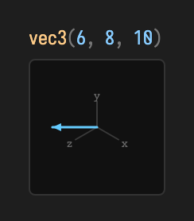

# Linear algebra in Field

Linear algebra is the small vocabulary underneath movement, cameras, lighting,
meshes, simulation, and spatial data. In Field it is meant to read like GLSL and
run like live code: reorder a vector's components by name, do arithmetic with the
usual `+ - * /`, copy a vector with one field changed, rescale it to a length,
all as *expressions* and without ceremony.

```diffstatic {data-lang=kotlin}
:::static
val position = vec(1, 2, 3)
position.x += 1f // now (2, 2, 3)
position { normalize() } // a unit copy; position itself is untouched
```

The same names behave the same way across `vec2`, `vec3`, `vec4` and both
precisions.

The images below come from Field's value visualizer,
`ValueVisualizer.visualize(...)`, the renderer described in
[Visualizers & Controls](visualizers.md), fed the result of the code above each
one. Vectors draw as auto-scaled arrows (a 2D arrow for `vec2`, an isometric
frame for `vec3`); matrices draw as diverging heatmaps. For the member list of
every type, see the [generated vector API reference](linear_algebra_api.md).

## Constructing vectors

`vec(...)` is the ergonomic constructor: two, three, or four numbers give a
`Vector2f`, `Vector3f`, or `Vector4f`. It accepts any Kotlin `Number`, so live
code can mix integer, double, and float literals without decorating everything
with `f`. The number of arguments selects the arity.

```diffstatic {data-lang=kotlin}
:::static
val a = vec(2, 1) // Vector2f
val v = vec(1, 2, 3) // Vector3f
val p = vec(0.25, 0.5, 1.0, 2.0) // Vector4f
```

When the expected type is already known, Kotlin collection literals are an even
terser option:

```diffstatic {data-lang=kotlin}
:::static
val origin: Vec2 = [0, 0]
val up: Vec3 = [0, 1, 0]
val white: Vec4 = [1, 1, 1, 1]
```

The examples below use `vec(...)` because it also establishes the type when there
is no declaration annotation. In a Field box the linalg imports arrive with the
standard preamble, so you rarely type them yourself; a plain Kotlin file wants:

```diffstatic {data-lang=kotlin}
:::static

```

## Vectors are arrows (and sometimes points)

The most useful mental picture is an arrow. Its components say how far the arrow
travels along each axis; its `length()` is the arrow's magnitude. The same three
numbers can stand for a point or a displacement, and the operation reveals which
you mean: subtracting two points gives the arrow between them, and adding an
arrow to a point moves it.

```diffstatic {data-lang=kotlin}
:::static
val from = vec(2, 1, 0)
val to = vec(7, 4, 0)
to - from // vec3(5, 3, 0) — the displacement between two points
(to - from).length() // 5.8309517     — how far apart they are
```

## Read swizzles: reorder, narrow, expand, repeat

Every length-2, length-3, and length-4 sequence of a vector's components is a
read swizzle: an extension `val` on the *read* interface (`Vector3fc`, …), so it
works on any view and not just a mutable vector. A swizzle returns a same-arity
vector: `v.xy` is a `vec2`, `v.xyz` a `vec3`. The sequence is free to:

- **reorder** the components — `v.zyx` reverses a `vec3`;
- **narrow** to fewer components — `v.xy` drops `z`;
- **expand** past the source arity — `v.xxxx` broadcasts `x` into a `vec4`;
- **repeat** a component — `v.yy` is `(y, y)`.

```diffstatic {data-lang=kotlin}
:::static
val v = vec(1, 2, 3)
v.zyx // vec3(3, 2, 1)  — reorder
v.xy // vec2(1, 2)     — narrow
v.xxxx // vec4(1, 1, 1, 1) — expand
v.yy // vec2(2, 2)     — repeat
```



Components can be spelled two ways, positional `x`/`y`/`z`/`w` or colour
`r`/`g`/`b`/`a`, so `v.rgb` and `v.xyz` are the same swizzle. The two
vocabularies are never mixed inside one name.

## Write swizzles: GLSL-style assignment

When a swizzle's indices are all *distinct*, it also gets a writable `var` on the
mutable vector type, so you can assign through it. This mutates the target **in
place**:

```diffstatic {data-lang=kotlin}
:::static
val target = vec(0, 0, 0, 0)
val source = vec(1, 2, 3, 4)
target.xy = source.zw // target becomes vec4(3, 4, 0, 0)
```



The right-hand `source.zw` is an ordinary read swizzle producing a `vec2`; the
left-hand `target.xy` receives it. Repeated-index swizzles like `v.xx` have no
unambiguous target, so they stay read-only: there is no `var` for them.

To write numbers rather than another swizzle, use a collection literal, `target.xy = [1, 2]`, or
`vec`, which takes any mix of `Int`, `Float` and `Double`: `target.xy = vec(1, 2.5)`.

## Arithmetic: `+ - * /`

The vectors carry the usual operators. Between two vectors of the same arity they
act component-wise; against a scalar they broadcast. Each returns a fresh vector,
leaving its operands untouched.

```diffstatic {data-lang=kotlin}
:::static
val a = vec(2, 1)
val b = vec(1, 3)
a + b // vec2(3, 4)   — component-wise
a - b // vec2(1, -2)
a * 2 // vec2(4, 2)   — scalar broadcast (2 * a works too)
a * b // vec2(2, 3)   — component-wise (Hadamard) product
```



`a * b` is the *component-wise* product. The dot and cross products keep their
named forms (`a.dot(b)`, and `a x b` for the 3D cross, below). Division by a
scalar (`a / 2`) and unary minus (`-a`) round out the set.

## Copy operators: `invoke` and `len`

`invoke` gives a vector two live-coding conveniences. Called with named arguments,
it returns a **copy with those components replaced**, keeping the rest. It is a
tidy way to nudge one axis:

```diffstatic {data-lang=kotlin}
:::static
val v = vec(3, 4) // length 5
v(y = 1f) // vec2(3, 1) — copy, only y changed
```

Called with a block, it returns a **copy after applying the block**, leaving the
original alone. That is the shape to reach for with the mutating vector methods:

```diffstatic {data-lang=kotlin}
:::static
v { normalize() } // vec2(0.6, 0.8) — a normalized copy; v is untouched
```

Finally, the infix `len` returns a copy **rescaled to a given length**, keeping
direction. It sets a length rather than reading one; for the current magnitude
use `v.length()`:

```diffstatic {data-lang=kotlin}
:::static
v len 2 // vec2(1.2, 1.6) — same direction, length 2
```



The bottom row confirms the copy semantics: after all three expressions `v` is
still `vec2(3, 4)`. Nothing above mutated it.

## In-place assignment: `%=`

When you *do* want to overwrite a vector in place, reusing the same object rather
than allocating, `%=` copies another vector's components into it:

```diffstatic {data-lang=kotlin}
:::static
val a = vec(9, 9)
val b = vec(1, 2)
a %= b // a is now vec2(1, 2); same object, new contents
```



This pairs naturally with the copy operators: reach for `v { … }` and `v(…)` when
you want a new vector, and for `%=` (or the write swizzles) when you want to
mutate an existing one, such as a persistent vector held across animation
frames.

## Length, direction, and normalization

`length()` answers *how much?*; `normalize()` keeps the direction and sets the
length to one. Because normalizing mutates, reach for `v { normalize() }` when you
want a fresh unit copy:

```diffstatic {data-lang=kotlin}
:::static
val velocity = vec(6, 8, 0)
velocity.length() // 10.0
velocity { normalize() } // vec3(0.6, 0.8, 0) — same direction, unit length
velocity len 4 // vec3(2.4, 3.2, 0) — direction kept, length 4
```

The zero vector has no direction, so normalizing it produces non-finite
components; guard it when zero is possible. Use the squared forms for
comparisons; they skip the square root while preserving ordering:

```diffstatic {data-lang=kotlin}
:::static
if (velocity.lengthSquared() > 1e-12f) velocity.normalize()
if (candidate.distanceSquared(mouse) < 20f * 20f) {
    /* within 20 units */
}
```

For a direction that may be zero, generated extensions on the heap-vector interfaces also provide
`normalized()`. It returns a new unit vector and preserves zero; `normalized(dest)` writes
into reusable storage without allocating a result. Neither mutates the source unless you
explicitly pass that same vector as the destination.

```diffstatic {data-lang=kotlin}
:::static
val direction = velocity.normalized()
val scratch = vec(0, 0, 0)
velocity.normalized(scratch, epsilon = 1e-6f)
```

The default epsilon is zero; choose a threshold when a very short direction should count
as stationary. Very large and very small finite inputs are handled; NaN, infinity and an
invalid epsilon are rejected. `normalize()` and `v { normalize() }` still produce
non-finite components for the zero vector. `normalized()` exists on float, double and
half vectors; see the [generated API reference](linear_algebra_api.md).

## Dot product: “how much do these agree?”

The dot product multiplies matching components and adds them. For unit vectors it
is the cosine of the angle between them: `1` same way, `0` perpendicular, `-1`
opposed:

```diffstatic {data-lang=kotlin}
:::static
val forward = vec(0, 0, -1)
forward.dot(vec(0, 0, -1)) //  1.0  — identical direction
forward.dot(vec(1, 0, 0)) //  0.0  — perpendicular
vec(1, 2, 3).dot(vec(4, 5, 6)) // 32.0 — 1·4 + 2·5 + 3·6
```

A classic lighting term asks how much a surface normal agrees with the direction
toward a light, clamped so a light behind the surface contributes nothing:

```diffstatic {data-lang=kotlin}
:::static
val brightness = normal.dot(directionToLight).coerceAtLeast(0f)
```

## Cross product: “which way is perpendicular?”

The 3D cross product (`a x b`, or `a.cross(b)`) returns an arrow perpendicular to
both inputs, following the right-hand rule. Its length before normalizing is the
area of the parallelogram the inputs span, so parallel inputs give zero:

```diffstatic {data-lang=kotlin}
:::static
vec(1, 0, 0) x vec(0, 1, 0) // vec3(0, 0, 1)  — right-hand rule
vec(0, 1, 0) x vec(1, 0, 0) // vec3(0, 0, -1) — order flips the sign
```



That is the standard way to find a triangle's surface normal:

```diffstatic {data-lang=kotlin}
:::static
val normal = ((b - a) x (c - a)) { normalize() }
```

## Interpolation: `lerp` and `fma`

`lerp` traces a straight line from one vector to another — `t = 0` is the start,
`t = 1` the end, values outside extrapolate:

```diffstatic {data-lang=kotlin}
:::static
val start = vec(0, 0, 0)
val end = vec(100, 40, 0)
start.lerp(end, 0.5f, vec(0, 0, 0)) // vec3(50, 20, 0) — halfway
```

Each arrow is scaled to its own box, so read the distance along the segment from the numbers:
`t = 1.5` lands past the end at `vec3(150, 60, 0)`, and `t = -0.5` behind the start, pointing the
other way.



For the repeated “position plus direction times amount” pattern, `fma` expresses
the whole step without a temporary vector:

```diffstatic {data-lang=kotlin}
:::static
position.fma(deltaSeconds, velocity) // position += velocity * deltaSeconds
```

Operations either mutate the receiver or write into an explicit destination.
Mutating methods return the receiver; destination methods return the destination,
so both chain naturally:

```diffstatic {data-lang=kotlin}
:::static
val normal = vec(0, 0, 0)
edgeA.cross(edgeB, normal) // no result allocation; returns normal
normal.normalize()
```

## Matrices: transforms & precision

Field's matrices come in two precisions that share one shape. The
**single-precision** family (`Matrix2f`, `Matrix3f`, `Matrix4f`) is what the
renderer, camera, and quaternion code speak. The **double-precision** family
(`Matrix2d`, `Matrix3d`, `Matrix4d`) is its f64 sibling, for arithmetic that must
never round to `float` silently. Both are generated from the same model as the
vectors, so corresponding methods have the same API while rounding at their respective precisions.

A matrix draws as a **diverging heatmap**: neutral grey at zero, blue for
positive entries, orange for negative, scaled by magnitude. The header keeps the
full-precision numbers (and, for 3×3 and 4×4, the determinant and translation).
All matrices are **column-major** (the JOML convention).

### Constructing a matrix

Each type has a component constructor and defaults to the identity. The 2×2
constructor takes `(m00, m01, m10, m11)`, column by column, so `m00, m01` is the
first column. Read as a conventional maths matrix, that is the two rows
`(m00, m10)` and `(m01, m11)`.

```diffstatic {data-lang=kotlin}
:::static
val m = Matrix2d(1.0, 2.0, 3.0, 4.0) // columns (1,2) and (3,4) → rows (1,3),(2,4)
```

![A 2×2 double matrix drawn as a labelled heatmap; header reads mat2d [1, 3 / 2, 4]](assets/matrix_algebra/construct_mat2.png)

The header spells the two rows, `[1, 3 / 2, 4]`, while the grid shows the
column-major storage. A bare `Matrix4d()` is the 4×4 identity.

### Multiply, determinant, inverse, transpose

These four are *precision-agnostic*, identical on `Matrix2d` and `Matrix2f`.
`mul` composes another matrix onto the receiver **in place**, so wrap the left
operand in a copy constructor when you want to keep it:

```diffstatic {data-lang=kotlin}
:::static
val a = Matrix2d(1.0, 2.0, 3.0, 4.0) // rows (1,3),(2,4)
val b = Matrix2d(5.0, 6.0, 7.0, 8.0) // rows (5,7),(6,8)
Matrix2d(a).mul(b) // A·B — a fresh copy, a and b untouched
```

![The product A·B as a heatmap; header reads mat2d [23, 31 / 34, 46]](assets/matrix_algebra/multiply_mat2.png)

The product `[[23, 31], [34, 46]]` is exactly the textbook result.
`determinant()` and `invert()` come along for free; a matrix times its own inverse
returns to the identity, exact at f64 scale:

```diffstatic {data-lang=kotlin}
:::static
a.determinant() // -2.0
Matrix2d(a).mul(Matrix2d(a).invert()) // ≈ identity
```

![A·A⁻¹ collapses to the identity; header reads mat2d [1, 0 / 0, 1]](assets/matrix_algebra/inverse_identity_mat2.png)

`invert()` and `transpose()` also mutate in place (with a `transpose(dest)`
overload). The same names (`mul`, `determinant`, `invert`, `transpose`,
`identity`, `set`) exist on the 2×2, 3×3, and 4×4 types alike.

### A 3×3 linear map

`Matrix3d` carries the same surface one size up. Its `set(...)` takes nine values,
row by row for readability, and the visualizer prints the determinant in the
header:

```diffstatic {data-lang=kotlin}
:::static
val m3 =
    Matrix3d()
        .set(
            2.0,
            0.0,
            1.0,
            1.0,
            3.0,
            0.0,
            0.0,
            1.0,
            4.0,
        )
m3.determinant() // 25.0
```

![A 3×3 double matrix as a labelled heatmap; header reads mat3d [det=25]](assets/matrix_algebra/linear_mat3.png)

A non-zero determinant means the map is invertible; `Matrix3d(m3).invert()` gives
the inverse.

### Composing affine transforms in 4D

`Matrix4d` adds the affine builders `scale`, `translate`, `scaling`, and
`translation`. Like `mul`, they compose onto the receiver in place and return it.
Composition applies each step *in the frame established so far*, which is the
JOML "local" convention and catches people out:

```diffstatic {data-lang=kotlin}
:::static
val t = Matrix4d().scale(2.0, 3.0, 4.0).translate(5.0, 6.0, 7.0)
t.determinant() // 24.0  (= 2·3·4; translation never changes the determinant)
```

![A 4×4 affine matrix as a heatmap; header reads mat4d [det=24, t=(10, 18, 28)]](assets/matrix_algebra/affine_mat4.png)

The header reports `t=(10, 18, 28)`, **not** `(5, 6, 7)`. Because the `translate`
runs *after* the `scale`, it moves in the already-scaled frame, so each component
is multiplied by its axis scale: `(5·2, 6·3, 7·4)`. The determinant stays `24`,
because a pure translation preserves volume.

### Where precision stops: the f32 bridge

The f64 family covers only the precision-agnostic parts: multiply, determinant,
invert, transpose, scale, translate. **Rotation, projection/camera
helpers (`perspective`, `lookAt`), and transforming a vector live on the
single-precision `Matrix4f`**, matching Field's f32 quaternion and render
pipeline. Quaternion angles are in radians.

```diffstatic {data-lang=kotlin}
:::static
val r = Matrix4f().rotateY(0.6f) // rotate about Y by 0.6 rad
r.determinant() // 1.0 — a rotation preserves volume
```

![A Y-rotation as a heatmap; header reads mat4 [det=1, t=(0, 0, 0)], cells show 0.83 / 0.56 / -0.56](assets/matrix_algebra/rotate_mat4f.png)

The header now reads `mat4` rather than `mat4d`, because the visualizer
distinguishes the two precisions. The \( \cos 0.6 \approx 0.83 \) on the diagonal and \( \pm\sin 0.6 \approx \pm 0.56 \)
off-diagonal are the classic Y-rotation entries. Transforming a point is likewise
a `Matrix4f` operation: `*` on a `vec3` calls `transformPosition` (translation
included) and returns a fresh `Vector3f`:

```diffstatic {data-lang=kotlin}
:::static
Matrix4f().translation(5f, 6f, 7f) * vec(1, 2, 3) // vec3(6, 8, 10)
```



Use `transformDirection` (or the `Vector4f` overload with `w = 0`) to rotate/scale
a direction *without* the translation.

## When allocation matters

Heap vectors and matrices are right for persistent box properties, saved state,
and almost all code where allocation is not a bottleneck. When a hot loop creates
many short-lived values, `frameScratch` gives them one shared lifetime:

```diffstatic {data-lang=kotlin}
:::static
frameScratch {
    val a = vec(1, 2, 3)
    val b = vec(4, 5, 6)
    val normal = vec3()
    a.cross(b, normal).normalize()
    println(normal.x)
}
```

Everything made inside `frameScratch { }` is released together when the block
ends, so copy a result out (`copyTo`, `set`) when you need it afterwards, and use
the block from one thread only. For dense CPU data, direct memory, or mapped
Vulkan buffers, the `SegmentVec2/3/4Buffer` views offer the same operations over
memory something else owns. Field reports an error when a scratch value is used
after its block has ended, as the wrong type, or from another thread.

??? aside "Turning the scratch checks off"
    The checks are compiled in by default. A distribution build can drop them with
    `-PlinalgArenaChecks=false`.

<div class="field-data-table" markdown>

| Situation | Use |
| --- | --- |
| Persistent box state or a handful of values | `Vector3f`, `Matrix4f`, `Quaternionf` |
| Temporary math in a stable render/update thread | `frameScratch { ... }` |
| A subsystem with explicit scratch ownership | `FrameArena` |
| Packed vertex/point data, or aligned mapped records | `SegmentVec2/3/4Buffer` |
| Passing a scratch result into persistent state | Explicit `copyTo` or `set` |

</div>

## Geometry recipes

The library ships closest-point, barycentric, containment, AABB/sphere overlap,
and common segment/ray intersection helpers. Their destination arguments follow
the same no-result-allocation convention as the vectors:

```diffstatic {data-lang=kotlin}
:::static
val closest = vec(0, 0, 0)
closestPointOnTriangle(point, a, b, c, closest)

val hit = vec(0, 0, 0)
if (intersectRayTriangle(rayOrigin, rayDirection, a, b, c, hit)) println("hit at $hit")

val nearFar = vec(0, 0)
if (intersectRayAabb(origin, direction, minimum, maximum, nearFar)) {
    println("enter ${nearFar.x}, leave ${nearFar.y}")
}
```

## Spinny algebras: complex, dual and quaternion numbers

A `Quat` is four numbers, and so is a `Vec4`. What makes one a rotation is its multiplication.
This section builds that up from two numbers, following the argument of 2swap's video
[*The best algebras are spinny*](https://youtube.com/watch?v=-k-Dnw0F3kc), redrawn here from the
textbook math with FLines. Every figure is the box code above it.

### Two numbers and one rule

Take pairs `a + bε`, add them component by component, and multiply them by expanding the brackets.
The only choice left is what `ε²` is. Up to rescaling there are three answers:

- `ε² = -1` gives the **complex numbers**;
- `ε² = 0` gives the **dual numbers**;
- `ε² = +1` gives the **split-complex numbers**.

Field has all three as one type, `Hypercomplexd(a, b, eps2)` (and `Hypercomplexf`), whose `*`
expands the brackets with the `ε²` you give it; `Complexd` and `Complexf` are the complex numbers on
their own, with `conj`, `abs`, `arg`, `exp` and `Complexd.polar(r, angle)`.

Multiplying by a fixed number `w` is a linear map of the plane, so the clearest way to see an
algebra is to multiply a whole grid by one `w` and draw where it lands. Here `w = 0.9 + 0.5ε` in
all three, and only `ε²` changes:

```diffstatic_runner {data-lang=kotlin screenshot="assets/spinny_algebras/grid.png" embed=true name="spinny-grid" alt="Three copies of a 7×7 grid, each multiplied by 0.9 + 0.5ε, over the faint original: on the left (ε² = -1) the grid is turned and enlarged but still square; in the middle (ε² = 0) it is sheared upward; on the right (ε² = +1) it is squeezed into a long thin parallelogram along the diagonal"}
:::static
// Multiply every point of a grid by one fixed number w = a + bε, in three algebras that differ only in ε².
fun gridTimes(a: Double, b: Double, eps2: Double, ox: Double, tint: Vec4): List<FLine> {
    val s = 40.0
    val grid =
        (-3..3).flatMap { k ->
            [
                (0..60).map { vec(k / 3.0, -1 + it / 30.0) }, // a vertical line of the grid
                (0..60).map { vec(-1 + it / 30.0, k / 3.0) }, // a horizontal one
            ]
        }
    val w = Hypercomplexd(a, b, eps2)
    fun draw(pts: List<Vec2>, col: Vec4, t: Double) = fline {
        pts.forEachIndexed { i, p ->
            val q = (w * Hypercomplexd(p.x, p.y, eps2)).toVector()
            if (i == 0) moveTo(ox + s * q.x, -s * q.y) else lineTo(ox + s * q.x, -s * q.y)
        }
        color = col
        thickness = t
    }
    val before = grid.map { pts ->
        fline {
            pts.forEachIndexed { i, p ->
                if (i == 0) moveTo(ox + s * p.x, -s * p.y) else lineTo(ox + s * p.x, -s * p.y)
            }
            color = vec(1, 1, 1, 0.15)
        }
    }
    return before + grid.map { draw(it, tint, 1.5) }
}

lines(
    *(gridTimes(0.9, 0.5, -1.0, 0.0, vec(0.35, 0.8, 1.0, 0.9)) + // complex: ε² = -1
            gridTimes(0.9, 0.5, 0.0, 170.0, vec(0.95, 0.85, 0.3, 0.9)) + // dual: ε² = 0
            gridTimes(0.9, 0.5, 1.0, 340.0, vec(1.0, 0.45, 0.55, 0.9)))
        .toTypedArray(), // split-complex: ε² = +1
    w = 760.0,
    h = 260.0,
    fitToSize = true,
)
```

In the complex numbers (blue) the grid turns and grows, and stays square: multiplication is a
rotation and a scale. The dual numbers (yellow) shear it. The split-complex numbers (red) squeeze
it along one diagonal and stretch it along the other.

### Sine and cosine fall out of `exp`

The exponential is a power series, `exp(x) = 1 + x + x²/2! + x³/3! + ...`, and it needs only `+`
and `*`, so every algebra has one. Sum `exp(tε)` for `t` from -π to π and plot it:

```diffstatic_runner {data-lang=kotlin screenshot="assets/spinny_algebras/taylor.png" embed=true name="spinny-taylor" alt="Left: exp(tε) for t from -π to π in three algebras, the 30-term sums drawn bold over faint 3- and 5-term sums: a blue unit circle (ε² = -1), a yellow vertical line through 1 (ε² = 0), and a red hyperbola opening to the right (ε² = +1)"}
:::static
// exp(tε) = 1 + tε + (tε)²/2! + ..., summed with nothing but the algebra's own multiplication.
fun expSeries(t: Double, eps2: Double, terms: Int): Vector2d {
    val tEps = Hypercomplexd(0, t, eps2)
    var sum = Hypercomplexd(0, 0, eps2)
    var term = Hypercomplexd(1, 0, eps2)
    for (n in 1..terms) {
        sum = sum + term
        term = term * tEps / n
    }
    return sum.toVector()
}

val s = 60.0
fun curve(eps2: Double, terms: Int, col: Vec4, ox: Double, width: Double = 1.5) = fline {
    (0..200).forEach {
        val t = Math.PI * (-1.0 + 2.0 * it / 200)
        val p = expSeries(t, eps2, terms)
        if (p.length() < 4.0) {
            if (nodes.isEmpty()) moveTo(ox + s * p.x, -s * p.y) else lineTo(ox + s * p.x, -s * p.y)
        }
    }
    color = col
    thickness = width
}

val axes = [
    fline {
        moveTo(-3 * s, 0)
        lineTo(4 * s, 0)
        color = vec(1, 1, 1, 0.25)
    },
    fline {
        moveTo(0, -3 * s)
        lineTo(0, 3 * s)
        color = vec(1, 1, 1, 0.25)
    },
]

// The three named algebras, with the series cut off after 3, 5 and 30 terms.
val named =
    [-1.0 to vec(0.35, 0.8, 1.0), 0.0 to vec(0.95, 0.85, 0.3), 1.0 to vec(1.0, 0.45, 0.55)].flatMap { (k, c) ->
        [3 to 0.25, 5 to 0.5, 30 to 1.0].map { (n, a) ->
            curve(k, n, vec(c.x, c.y, c.z, a), 0.0, if (n == 30) 2.0 else 1.0)
        }
    }

lines(*(axes + named).toTypedArray(), w = 760.0, h = 340.0, fitToSize = true)
```

Each algebra is summed to 3, 5 and 30 terms (faint to bold). With `ε² = -1` the series closes into
the unit circle, and its two parts are `cos t` and `sin t`. With `ε² = 0` every term after `tε`
vanishes, so `exp(tε) = 1 + tε`, a straight line. With `ε² = +1` it is `cosh t + ε sinh t`, a
hyperbola.

`ε²` need not be one of the three. Let it slide from -1 to +1 and back, and draw both pictures at
once: the grid multiplied by `0.9 + 0.5ε` on the left, and `exp(tε)` on the right with a dot
running along it. The bar underneath shows where `ε²` is:

```diffstatic_runner {data-lang=kotlin video="assets/spinny_algebras/eps_sweep.mp4" capture="box" open-outputs="true" wait-output="true" wait-output-kind="display" execution="launch" duration="10" fps="20" timeout="300" w="1000" embed=true name="spinny-eps-sweep" alt="ε² sliding from -1 to +1 and back. Left, a 7×7 grid multiplied by 0.9 + 0.5ε turns while square, shears, then stretches along a diagonal. Right, exp(tε) is a unit circle with a dot going round it; it stretches into an ellipse, opens into a vertical line and bends into a hyperbola that the dot runs off, then closes again. A bar at the bottom tracks ε²"}
:::static
:::fold exp and the fixed frame
fun expSeries(t: Double, eps2: Double): Vector2d {
    val tEps = Hypercomplexd(0, t, eps2)
    var sum = Hypercomplexd(0, 0, eps2)
    var term = Hypercomplexd(1, 0, eps2)
    for (n in 1..30) {
        sum = sum + term
        term = term * tEps / n
    }
    return sum.toVector()
}

val s = 55.0
val gridX = 0.0
val expX = 420.0
val barY = 200.0

// A fixed border, drawn every frame, so fitToSize does not rescale the view as the shapes move.
val border = fline {
    rect(-220.0, -190.0, 880.0, 420.0)
    color = vec(1, 1, 1, 0.08)
}

// Blue at ε² = -1, yellow at 0, red at +1, as in the figures above.
fun tint(k: Double, a: Double = 0.95): Vec4 {
    val f = (k + 1) / 2
    return if (f < 0.5) vec(0.35 + 1.2 * f, 0.8 + 0.1 * f, 1.0 - 1.4 * f, a)
    else vec(0.95 + 0.1 * (f - 0.5), 0.85 - 0.8 * (f - 0.5), 0.3 + 0.5 * (f - 0.5), a)
}

fun polyline(pts: List<Vec2>, col: Vec4, width: Double) = fline {
    pts.forEachIndexed { i, p -> if (i == 0) moveTo(p.x, p.y) else lineTo(p.x, p.y) }
    color = col
    thickness = width
}

val gridLines =
    (-3..3).flatMap { j ->
        [(0..40).map { vec(j / 3.0, -1 + it / 20.0) }, (0..40).map { vec(-1 + it / 20.0, j / 3.0) }]
    }

:::endfold

// While ε² < 0 the curve closes after t = 2π / √(-ε²), so draw one whole period. Past that the
// series runs off the frame, and t up to ±6 is plenty to show the shape.
fun halfSpan(k: Double) = if (k < 0) kotlin.math.min(Math.PI / kotlin.math.sqrt(-k), 6.0) else 6.0

fun draw(k: Double, phase: Double) {
    val w = Hypercomplexd(0.9, 0.5, k)
    val span = halfSpan(k)
    val tau = span * (2 * phase - 1) // the dot's parameter: one trip from -span to +span per phase
    val grid = gridLines.map { pts ->
        polyline(pts.map { p -> (w * Hypercomplexd(p.x, p.y, k)).toVector().let { q -> vec(gridX + s * q.x, -s * q.y) } }, tint(k, 0.9), 1.4)
    }
    val curve =
        (0..240)
            .map { expSeries(span * (-1.0 + it / 120.0), k) }
            .filter { it.length() < 3.2 }
            .map { vec(expX + s * it.x, -s * it.y) }
    val p = expSeries(tau, k)
    val dot = fline {
        if (p.length() < 3.2) circle(expX + s * p.x, -s * p.y, 6.0, segments = 20)
        color = vec(1, 1, 1, 1)
        filled = true
        stroked = false
    }
    val axes = [
        fline {
            moveTo(expX - 3 * s, 0)
            lineTo(expX + 3.5 * s, 0)
            color = vec(1, 1, 1, 0.25)
        },
        fline {
            moveTo(expX, -3 * s)
            lineTo(expX, 3 * s)
            color = vec(1, 1, 1, 0.25)
        },
    ]
    // The ε² bar: a track from -1 to +1 with ticks at -1, 0 and +1, and a marker at k.
    val track = fline {
        moveTo(100.0, barY)
        lineTo(340.0, barY)
        for (x in [100.0, 220.0, 340.0]) {
            moveTo(x, barY - 6)
            lineTo(x, barY + 6)
        }
        color = vec(1, 1, 1, 0.4)
    }
    val marker = fline {
        circle(220.0 + 120.0 * k, barY, 7.0, segments = 20)
        color = tint(k, 1.0)
        filled = true
        stroked = false
    }
    lines(
        border,
        *grid.toTypedArray(),
        *axes.toTypedArray(),
        polyline(curve, tint(k), 2.2),
        dot,
        track,
        marker,
        channel = "main",
        w = 1000.0,
        h = 480.0,
        fitToSize = true,
    )
}

val started = AnimationClock.nowSeconds()
loop {
    val t = AnimationClock.nowSeconds() - started
    val k = -kotlin.math.cos(2 * Math.PI * t / 10.0) // -1 → +1 → -1 every ten seconds
    draw(k, (t / 2.5) % 1.0) // the dot goes once round every 2.5 seconds
}
```

The grid stays square only at `ε² = -1`. For any negative `ε²` the curve still closes, into an
ellipse that takes longer to go round (its period is `2π / √(-ε²)`), and the dot comes back to 1.
From `ε² = 0` up it never does. That is what "spinny" means here: an algebra whose `exp` is
periodic, so repeated multiplication goes round rather than off to infinity.

### Three numbers do not work

The obvious next step is `a + bi + cj` with `i² = j² = -1`. It has to say what `ij` is, and
closure means `ij = p + qi + rj` for some real `p`, `q`, `r`. Multiply both sides on the left by
`i`, and use `i² = -1` on the left and `ij` again on the right:

```diffstatic {data-lang=text}
i(ij) = -j
i(p + qi + rj) = pi - q + r(ij) = pi - q + r(p + qi + rj)
```

Matching the `j` parts gives `r² = -1`, which no real number satisfies. No three-number algebra
with these rules exists. Frobenius's theorem classifies the finite-dimensional associative real
division algebras: the reals, complexes and quaternions.

### Four numbers: quaternions and bicomplex numbers

Add a fourth number `k` to hold `ij`. Two consistent choices keep `i² = j² = -1`:

- **quaternions**: `ij = k = -ji`. Multiplication does not commute, and `k² = -1`.
- **bicomplex numbers**: `ij = ji = k`. Multiplication commutes, and `k² = +1`.

Field's `Quat` is a quaternion: multiplying two of them gives the Hamilton product. The box uses
it to sum `exp(t·u)` in seven unit directions `u = cos θ·i + sin θ·j` between `i` and `j`, then
repeats the calculation with the bicomplex product written out by hand. Each path is projected onto
`(real, i, j)` and coloured by its fourth component `k` (blue negative, red positive):

```diffstatic_runner {data-lang=kotlin screenshot="assets/spinny_algebras/quat.png" embed=true name="spinny-quat" alt="Seven paths exp(t·u) for t from 0 to 2π, drawn in an oblique projection of (real, i, j) and coloured by k. Left, the quaternions: seven grey circles all passing through the same two points, 1 and -1, with no k colour. Right, the bicomplex numbers: tangled loops that turn blue and orange as they pick up k and do not close"}
:::static
// exp(t·u) summed as a power series, once with Field's Quat and once in the bicomplex numbers.
// Both are four numbers (real, i, j, k) with i² = j² = -1; they differ in what ij and ji are.
fun quatExp(u: Quat, t: Double): Quat {
    var sum = Quat(0f, 0f, 0f, 0f)
    var term = Quat() // the identity, 1
    for (n in 1..40) {
        sum = sum + term
        term = term * u * (t / n)
    }
    return sum
}

// Bicomplex: ij = ji = k, so k² = +1. Stored as (real, i, j, k).
fun biTimes(p: Vec4, q: Vec4) = vec(
    p.x * q.x - p.y * q.y - p.z * q.z + p.w * q.w,
    p.x * q.y + p.y * q.x - p.z * q.w - p.w * q.z,
    p.x * q.z + p.z * q.x - p.y * q.w - p.w * q.y,
    p.x * q.w + p.w * q.x + p.y * q.z + p.z * q.y,
)

fun biExp(u: Vec4, t: Double): Vec4 {
    var sum = vec(0, 0, 0, 0)
    var term = vec(1, 0, 0, 0)
    for (n in 1..40) {
        sum = sum + term
        term = biTimes(term, u * (t / n).toFloat())
    }
    return sum
}

// Draw (real, i, j) in an oblique projection and colour by k: blue for k < 0, red for k > 0.
val s = 55.0
fun path(points: List<Vec4>, ox: Double) =
    points
        .zipWithNext()
        .filter { (a, _) -> a.length() < 3.5 }
        .map { (a, b) ->
            fun at(p: Vec4) = vec(ox + s * (p.y + 0.45 * p.x), -s * (p.z + 0.3 * p.x))
            val c = (a.w * 0.8).coerceIn(-1.0, 1.0)
            fline {
                moveTo(at(a))
                lineTo(at(b))
                color = vec(0.6 + 0.4 * c, 0.65 - 0.25 * kotlin.math.abs(c), 0.6 - 0.4 * c, 0.95)
                thickness = 1.8
            }
        }

val ts = (0..240).map { it * 2 * Math.PI / 240 }
val angles = (0..6).map { it * Math.PI / 6 } // u = cos θ·i + sin θ·j, a unit "imaginary"

val quaternion = angles.flatMap { th ->
    val u = Quat(kotlin.math.cos(th).toFloat(), kotlin.math.sin(th).toFloat(), 0f, 0f)
    path(ts.map { quatExp(u, it).let { q -> vec(q.w, q.x, q.y, q.z) } }, 0.0)
}
val bicomplex = angles.flatMap { th ->
    val u = vec(0.0, kotlin.math.cos(th), kotlin.math.sin(th), 0.0)
    path(ts.map { biExp(u, it) }, 230.0)
}

lines(*(quaternion + bicomplex).toTypedArray(), w = 760.0, h = 340.0, fitToSize = true)
```

Every quaternion path (left) is a circle through 1, with `k = 0` the whole way round: any unit
imaginary quaternion squares to -1, so every direction between `i` and `j` (and `k`) is a copy of the
complex plane, and `exp` turns at the same rate in all of them. The bicomplex paths (right) are
circles only along `i` and `j` themselves. In between, `u²` is `-1` plus some `k`, the path splits
into two rotations at different speeds, and it wanders off the plane into `k` and does not come back to 1 after one turn.
The bicomplex numbers also have zero divisors: `(1 + k)(1 - k) = 0`, so a product can vanish without
either factor vanishing. A quaternion's length is multiplied by every product, which is why a unit
quaternion can stand for a rotation.

### Sliding between them

Keep `i² = -1` and `ij = -ji = k`, and let `j² = κ` be any number. `κ = -1` is the quaternions;
`κ = +1` is the split-quaternions. The same seven paths, while `κ` slides from -1 to +1 and back
(the bar underneath):

```diffstatic_runner {data-lang=kotlin video="assets/spinny_algebras/kappa_sweep.mp4" capture="box" open-outputs="true" wait-output="true" wait-output-kind="display" execution="launch" duration="10" fps="20" timeout="300" w="1000" embed=true name="spinny-kappa-sweep" alt="The seven exp(t·u) paths as j² = κ slides from -1 to +1 and back. At κ = -1 they are seven grey circles through 1 and -1; as κ rises the path along j straightens into a vertical line and the others stretch into long loops; past 0 the directions near j open into hyperbolic branches that leave the frame, picking up blue and orange k colour, while those near i still loop; then they close back into circles"}
:::static
// Keep i² = -1 and ij = -ji = k, but let j² = κ be any number. κ = -1 is the quaternions.
// Elements are (real, i, j, k); with these rules k² = κ as well.
fun times(p: Vec4, q: Vec4, kappa: Double): Vec4 {
    val K = kappa.toFloat()
    return vec(
        p.x * q.x - p.y * q.y + K * (p.z * q.z + p.w * q.w),
        p.x * q.y + p.y * q.x + K * (p.w * q.z - p.z * q.w),
        p.x * q.z + p.z * q.x - p.y * q.w + p.w * q.y,
        p.x * q.w + p.w * q.x + p.y * q.z - p.z * q.y,
    )
}

fun exp(u: Vec4, t: Double, kappa: Double): Vec4 {
    var sum = vec(0, 0, 0, 0)
    var term = vec(1, 0, 0, 0)
    for (n in 1..40) {
        sum = sum + term
        term = times(term, u * (t / n).toFloat(), kappa)
    }
    return sum
}

val s = 70.0
fun panel(kappa: Double, ox: Double): List<FLine> {
    val ts = (0..160).map { it * 2 * Math.PI / 160 }
    return (0..6).flatMap { step ->
        val th = step * Math.PI / 6
        val u = vec(0.0, kotlin.math.cos(th), kotlin.math.sin(th), 0.0)
        ts.map { exp(u, it, kappa) }
            .zipWithNext()
            .filter { (a, _) -> a.length() < 3.5 }
            .map { (a, b) ->
                fun at(p: Vec4) = vec(ox + s * (p.y + 0.45 * p.x), -s * (p.z + 0.3 * p.x))
                val c = (a.w * 0.8).coerceIn(-1.0, 1.0)
                fline {
                    moveTo(at(a))
                    lineTo(at(b))
                    color = vec(0.6 + 0.4 * c, 0.65 - 0.25 * kotlin.math.abs(c), 0.6 - 0.4 * c, 0.95)
                    thickness = 1.6
                }
            }
    }
}

// A fixed border so fitToSize does not rescale as the paths move, and a bar for κ.
val border = fline {
    rect(-260.0, -260.0, 520.0, 400.0)
    color = vec(1, 1, 1, 0.08)
}
fun bar(kappa: Double) = [
    fline {
        moveTo(-120.0, 115.0)
        lineTo(120.0, 115.0)
        for (x in [-120.0, 0.0, 120.0]) {
            moveTo(x, 109.0)
            lineTo(x, 121.0)
        }
        color = vec(1, 1, 1, 0.4)
    },
    fline {
        circle(120.0 * kappa, 115.0, 7.0, segments = 20)
        color = vec(1, 1, 1, 0.9)
        filled = true
        stroked = false
    },
]

val started = AnimationClock.nowSeconds()
loop {
    val t = AnimationClock.nowSeconds() - started
    val kappa = -kotlin.math.cos(2 * Math.PI * t / 10.0) // -1 → +1 → -1 every ten seconds
    lines(
        border,
        *(panel(kappa, 0.0) + bar(kappa)).toTypedArray(),
        channel = "main",
        w = 1000.0,
        h = 760.0,
        fitToSize = true,
    )
}
```

At `κ = -1` all seven paths are circles. At `κ = 0` the path along `j` is a straight line and the
others stretch into long loops. At `κ = +1` every direction nearer to `j` than to `i` has a
positive square, so its path is a hyperbola and leaves the frame: only part of the space still
spins. The demo document
[`spinny_algebras/metadata.edn`](assets/spinny_algebras/metadata.edn) has a slider for `ε²` and one
for `κ`, so you can watch the circle open.

### Why rotations in Field are quaternions

A unit quaternion `q` rotates a point `p` as `q p q⁻¹`, and `exp` above is the bridge between an
axis-and-angle and that `q`: `quat(angle, axis)` is `exp(angle/2 · axis)`. Because the unit
quaternions are spinny in every direction, the shortest path between two orientations is a great
circle, and `Quat.slerp` walks along it at constant speed with no gimbal lock. A rotation matrix
has no such path: blending two matrices shrinks and skews in between.

`DualQuat` combines the last two ideas: a quaternion whose coefficients are dual numbers. The
quaternion half rotates; the `ε` half, whose square is 0, carries translation. Interpolating one
(`DualQuaternionf.sclerp`) is a screw motion, which is how Field moves a camera between keys
([A camera move is a screw motion](keyframer_examples.md#a-camera-move-is-a-screw-motion-not-a-straight-line)),
and blending several is dual quaternion skinning, which keeps a twisted limb from collapsing
([A twisted limb, weighed and traced](chain_skinned_volume.md)).

### Ideas for extensions

- **Draw the 4D paths on the renderer.** The quaternion and κ figures are oblique projections in
  FLines; a Vulkan version could spin the projection by hand and colour `k` on the GPU.
- **A whole multiplication table as sliders.** Here only `ε²` and `j²` move. Making `i²`, `j²` and
  `ij` all free walks through every 4D algebra of this family, including the ones that stop being
  associative.
- **Octonions.** Eight numbers, one more doubling past the quaternions: still spinny in every
  direction, but `(ab)c ≠ a(bc)`, which a figure of `exp` paths cannot show and a figure of
  products can.
- **Geometric algebra.** Rotors in 3D are the quaternions under another name, and the same
  construction gives rotations in any dimension and the motors of projective geometric algebra,
  a common language for `Quat` and `DualQuat`.
- **Slerp, drawn.** The great-circle path `Quat.slerp` follows, against a straight blend of two
  rotation matrices, as a pair of animated figures.

## The shape of it

For vectors: name components in any order to read them, assign through
distinct-index names to write them, use `+ - * /` for arithmetic, `invoke` and
`len` to copy, and `%=` to overwrite. The same rules hold across `vec2`, `vec3`,
and `vec4`. Swizzles and the `invoke`/`len`/`%=` operators exist on the float
vectors; arithmetic also works on the double and half-precision vectors.

For matrices, pick the precision by need: the `…f` family for anything that ends
up on screen (cameras, rotations, per-frame transforms), the `…d` family when
accumulated arithmetic needs greater precision. Rotation, projection, and transforming a
vector are done with the single-precision `Matrix4f`.

For the complete member listing of every type, precision, and storage form, see
the [generated vector API reference](linear_algebra_api.md).

## Where to go next

- [Visualizers & Controls](visualizers.md#vectors-matrices-and-quaternions) shows how `.h` draws a
  `Quat` and the other values on this page; the sliders in the demo are the controls described there.
- [A camera move is a screw motion](keyframer_examples.md#a-camera-move-is-a-screw-motion-not-a-straight-line)
  interpolates `DualQuat` camera poses, and [A twisted limb, weighed and traced](chain_skinned_volume.md)
  measures what dual quaternion skinning keeps that linear blending loses.
- [Complex arithmetic and rotation weights](stacksl_cheatsheet.md#complex-arithmetic-and-rotation-weights)
  in StackSL types complex values by how they turn when the input turns: squaring a weight-1
  number gives weight 2, the `ε² = -1` multiplication above seen as a type system.
- [Values over time: interpolants & keyframes](interpolants_examples.md) eases quaternions towards a target alongside the rest of Field's values.
- Open [`spinny_algebras/metadata.edn`](assets/spinny_algebras/metadata.edn) to drag `ε²` and `j²`
  yourself; the source of `Quat`'s operators is `src/jvmMain/kotlin/afield/math/linalg/linalg.kt`.
- Next builds: draw the `j²` sweep on the Vulkan renderer as a live 3D figure, with the fourth
  component as colour; a `DualQuat` grid figure like the one at the top of the spinny section,
  showing a screw motion as repeated multiplication; octonions, where associativity goes too.

*The public declarations used on this page are listed, with their KDoc, in the codebase reference: [`linalg.kt`](reference/math.md#linalg-kt). Start from [what's already in the box](reference/index.md).*
