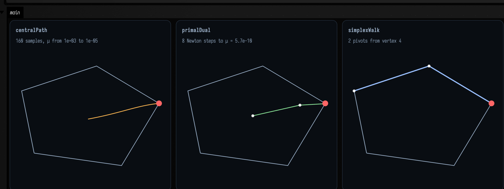
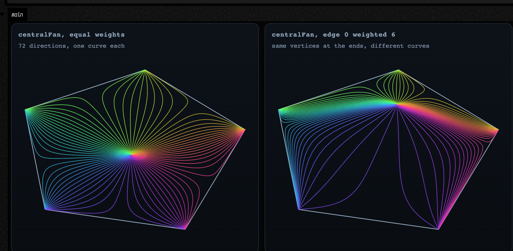
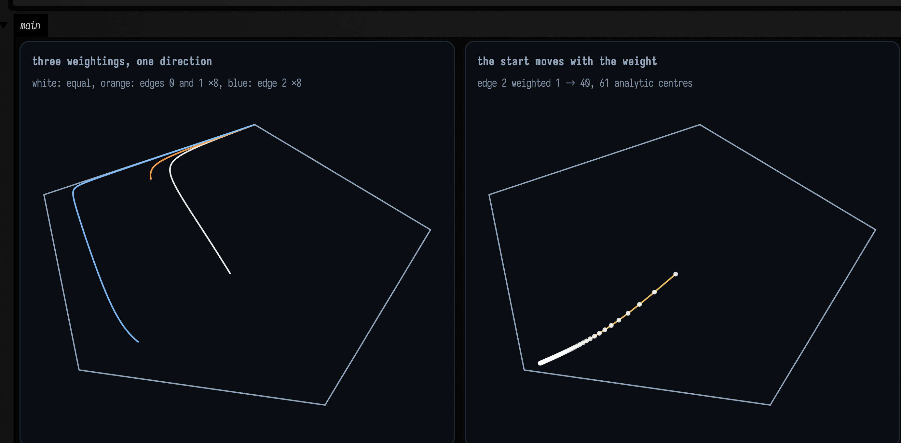
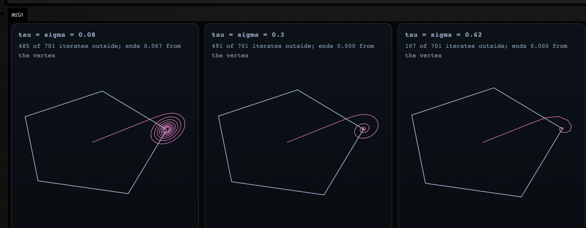
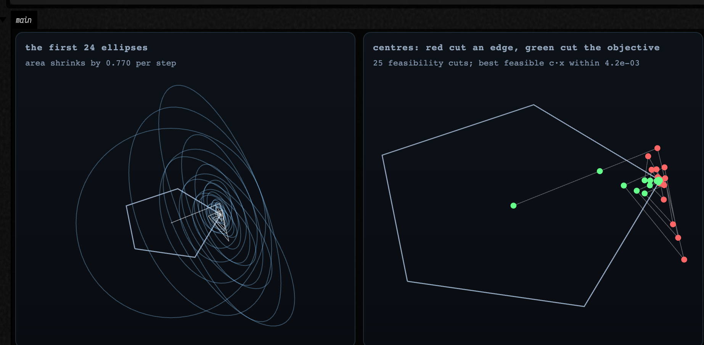
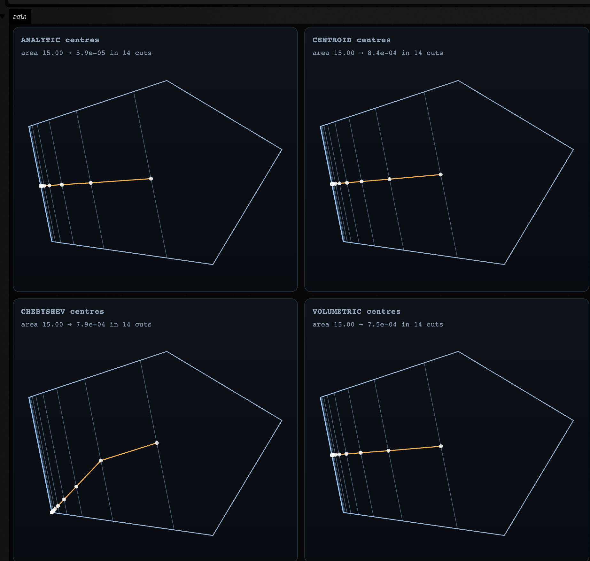
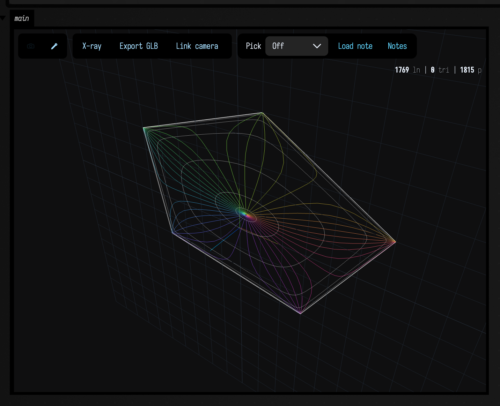
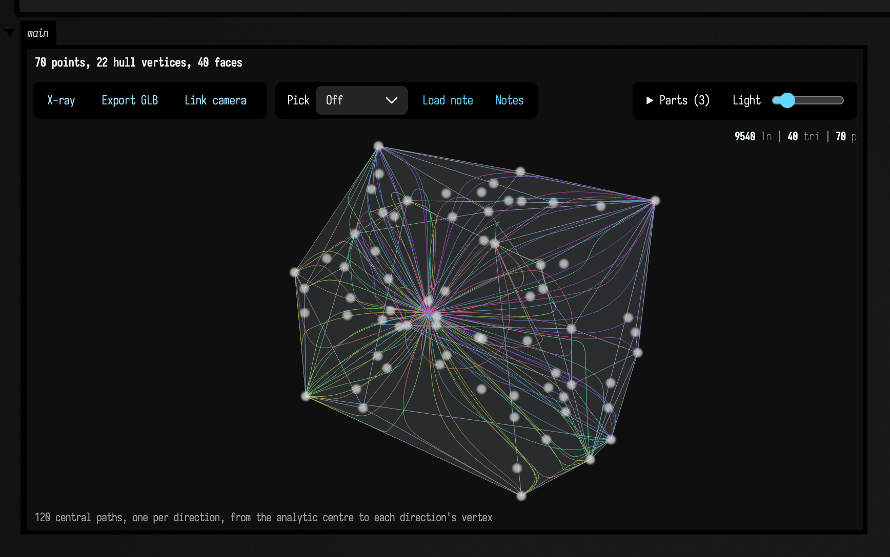
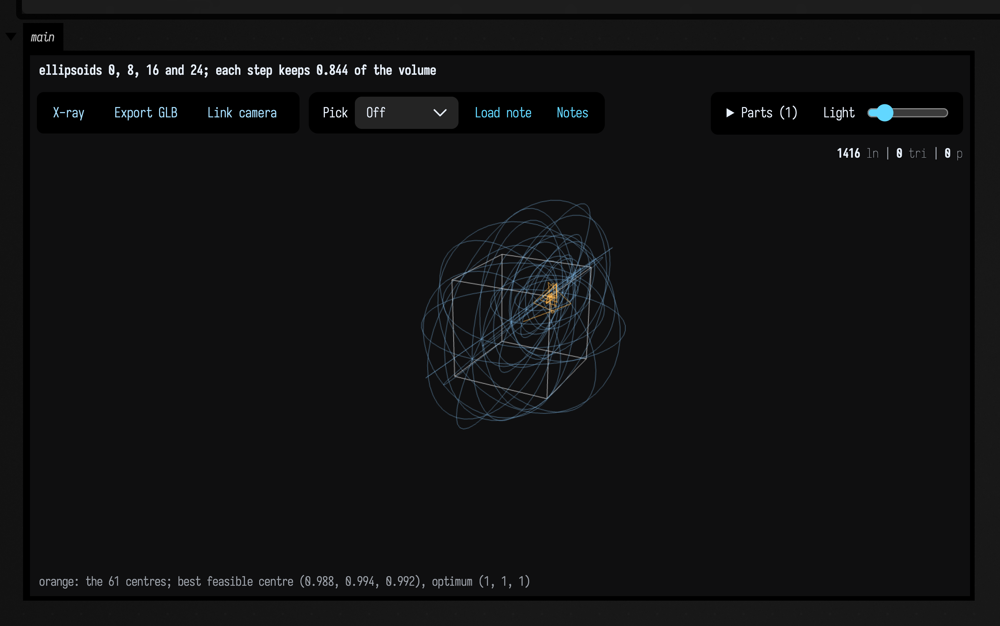

# Linear programs as curves

<!-- capture-sources: src/jvmMain/kotlin/afield/geometry/spatial/lp_trajectories.kt src/jvmMain/kotlin/afield/geometry/spatial/lp_polytope.kt -->

*Every public declaration used below is listed, with its KDoc, in the codebase reference:
[Graphics](reference/graphics.md).*

A two-dimensional linear program asks for the point of a convex polygon that goes furthest in one
direction: maximise `c·x` over the polygon. The answer is always a vertex, and every classical
algorithm for it gets there. What differs is the route. The barrier method follows a smooth arc out
of the polygon's centre, the primal-dual method takes a few long strides, PDHG spirals in from
outside, the ellipsoid method shrinks a sequence of ellipses around the answer, and the simplex
method hops round the boundary. [lpviz.net](https://lpviz.net) draws these routes in a browser.

In Field these routes are the product: each method returns its whole trajectory, step by step,
as something you can draw, sample, animate and feed into other geometry. A polygon, an objective
direction and a few dials (weights on the edges, step sizes, a centring rule) give you a family of
curves that all agree about where they end.

## A polygon and three routes

Build an `LpPolygon` from its vertices (either winding; it is normalised to counter-clockwise), pick
a direction, and ask for a route. The example below draws the barrier method's central path, the
primal-dual method's iterates and the simplex method's walk, all for the same direction.

```diffstatic_runner {data-lang=kotlin screenshot="assets/lp_curves/three_routes.png" wait="3.0" capture="box" open-outputs="true" w="1000" h="400" padding="14"}
:::static
val polygon = LpPolygon([vec(-2.0, -1.0), vec(1.5, -1.5), vec(3.0, 1.0), vec(0.5, 2.5), vec(-2.5, 1.5)])
val c = vec(1.0, 0.4)

val central = polygon.centralPath(c) // 160 samples as the barrier weight μ falls
val pd = polygon.primalDual(c) // one sample per Newton step
val walk = polygon.simplexWalk(c, startVertex = 4) // vertex to vertex along the boundary
:::fold draw the three panels
val outline = polygon.toFLine()
val answer = pointCloudFLine([polygon.optimalVertex(c)], vec(1.0, 0.4, 0.4, 1.0), 2.0)
val dots = { t: LpTrajectory -> pointCloudFLine(t.positions, vec(1.0, 1.0, 1.0, 0.9), 1.0) }

showPlaneGrid(
    "centralPath\n${central.samples.size} samples, μ from %.0e to %.0e".format(central.samples.first().scale, central.last.scale) to
        [outline, central.toFLine(), answer],
    "primalDual\n${pd.samples.size - 1} Newton steps to μ = %.1e".format(pd.last.scale) to
        [outline, pd.toFLine(vec(0.55, 0.9, 0.6, 0.95)), dots(pd), answer],
    "simplexWalk\n${walk.samples.size - 1} pivots from vertex 4" to
        [outline, walk.toFLine(vec(0.6, 0.75, 1.0, 0.95), 2.4), dots(walk), answer],
    columns = 3,
    yUp = true,
    cellWidth = 310,
    cellHeight = 280,
)
:::endfold
```



Each route is an `LpTrajectory`: a list of `LpSample`s, each carrying its position, its iteration
number, its objective value `c·x`, its constraint violation, a `scale` and a `tag`. What `scale`
measures depends on the method: μ for the two interior-point methods, the dual norm for PDHG, the
ellipse's size for the ellipsoid method, the remaining area for cutting planes. `toFLine()` draws the
route; `positions` gives the points.

## A fan of central paths

Turn the objective direction through a full circle and you get one central path per direction. All
of them leave the same point (the polygon's *analytic centre*, where the barrier alone balances)
and each ends at the vertex that wins for its direction. `centralFan` returns the whole family; it
is a sampling of a surface `x(θ, μ)` whose two parameters are the direction's angle and the barrier
weight.

```diffstatic_runner {data-lang=kotlin screenshot="assets/lp_curves/fan.png" wait="3.0" capture="box" open-outputs="true" w="900" h="420" padding="14"}
:::static
val polygon = LpPolygon([vec(-2.0, -1.0), vec(1.5, -1.5), vec(3.0, 1.0), vec(0.5, 2.5), vec(-2.5, 1.5)])

val fan = polygon.centralFan(angles = 72, samples = 90)
// Weight 6 on edge 0 (the bottom-left edge) pushes every path, and the centre, away from it.
val leaning = polygon.centralFan(angles = 72, samples = 90, weights = doubleArrayOf(6.0, 1.0, 1.0, 1.0, 1.0))

showPlaneGrid(
    "centralFan, equal weights\n${fan.size} directions, one curve each" to [polygon.toFLine()] + fan.toFLines(),
    "centralFan, edge 0 weighted 6\nsame vertices at the ends, different curves" to [polygon.toFLine()] + leaning.toFLines(),
    columns = 2,
    yUp = true,
    cellWidth = 420,
    cellHeight = 340,
)
```



## Weights and redundant constraints

The barrier is a sum of `wᵢ · ln(slackᵢ)`, one term per edge. Giving an edge weight 3 is exactly the
same as listing that edge three times: the polygon is unchanged, but the path is not. That makes
the weights a drawing control. The left panel below follows one direction with three different
weightings; the right panel sweeps the weight on one edge from 1 to 40 and plots where the path
starts, which is the weighted analytic centre.

```diffstatic_runner {data-lang=kotlin screenshot="assets/lp_curves/weights.png" wait="3.0" capture="box" open-outputs="true" w="900" h="420" padding="14"}
:::static
val polygon = LpPolygon([vec(-2.0, -1.0), vec(1.5, -1.5), vec(3.0, 1.0), vec(0.5, 2.5), vec(-2.5, 1.5)])
val c = vec(-0.3, 1.0)

val plain = polygon.centralPath(c)
val heavyBottom = polygon.centralPath(c, weights = doubleArrayOf(8.0, 8.0, 1.0, 1.0, 1.0))
val heavyRight = polygon.centralPath(c, weights = doubleArrayOf(1.0, 1.0, 8.0, 1.0, 1.0))

// The weighted analytic centre as edge 2's weight grows: the first sample of each path.
val centres = (0..60).map { k ->
    val w = 1.0 + 39.0 * k / 60
    polygon.centralPath(c, weights = doubleArrayOf(1.0, 1.0, w, 1.0, 1.0), samples = 2).samples.first().position
}
:::fold draw the two panels
showPlaneGrid(
    "three weightings, one direction\nwhite: equal, orange: edges 0 and 1 ×8, blue: edge 2 ×8" to
        [
            polygon.toFLine(),
            plain.toFLine(vec(1.0, 1.0, 1.0, 0.9)),
            heavyBottom.toFLine(vec(1.0, 0.65, 0.3, 0.95)),
            heavyRight.toFLine(vec(0.5, 0.75, 1.0, 0.95)),
        ],
    "the start moves with the weight\nedge 2 weighted 1 → 40, 61 analytic centres" to
        [polygon.toFLine(), polylineFrom(centres).also { it.color = vec(1.0, 0.8, 0.4, 0.9); it.thickness = 1.6 }, pointCloudFLine(centres, pointSize = 0.8)],
    columns = 2,
    yUp = true,
    cellWidth = 420,
    cellHeight = 340,
)
:::endfold
```



## PDHG: spirals from outside

The primal-dual hybrid gradient method does no Newton solves. It keeps one dual value per edge,
pushes `x` along the objective, and lets each edge's dual push back once `x` crosses it. The
iterates leave the polygon, overshoot, and spiral into the vertex. `pdhg` keeps every state,
infeasible ones included, and the duals too (`trace.duals`). The step sizes `tau` and `sigma` set
the spiral's character: small steps wind round the vertex many times before settling, larger ones
settle in a turn or two, and past the stability limit the iterates oscillate without settling,
which the trace keeps.

```diffstatic_runner {data-lang=kotlin screenshot="assets/lp_curves/pdhg.png" wait="3.0" capture="box" open-outputs="true" w="1000" h="400" padding="14"}
:::static
val polygon = LpPolygon([vec(-2.0, -1.0), vec(1.5, -1.5), vec(3.0, 1.0), vec(0.5, 2.5), vec(-2.5, 1.5)])
val c = vec(1.0, 0.4)
val answer = polygon.optimalVertex(c)

val panels = [0.08, 0.3, 0.62].map { step ->
    val trace = polygon.pdhg(c, iterations = 700, tau = step, sigma = step)
    val end = trace.trajectory.last
    val outside = trace.trajectory.samples.count { it.violation > 0.0 }
    "tau = sigma = $step\n$outside of 701 iterates outside; ends %.3f from the vertex".format(end.position.distance(answer)) to
        [polygon.toFLine(), trace.trajectory.toFLine(vec(1.0, 0.55, 0.85, 0.85), 1.0)]
}

showPlaneGrid(*panels.toTypedArray(), columns = 3, cellWidth = 310, cellHeight = 280, yUp = true)
```



## The ellipsoid method, with its ellipses

The ellipsoid method keeps an ellipse known to contain the answer. At each step it cuts the ellipse
in half through its centre (on the most violated edge if the centre is outside the polygon, on the
objective if it is inside) and replaces it with the smallest ellipse containing the half it keeps.
In two dimensions every cut multiplies the area by `√(16/27) ≈ 0.77`. `ellipsoid` returns both the
centres and the ellipses (`LpEllipse`, a centre and a 2×2 shape matrix, with `toFLine()`).

```diffstatic_runner {data-lang=kotlin screenshot="assets/lp_curves/ellipsoid.png" wait="3.0" capture="box" open-outputs="true" w="900" h="420" padding="14"}
:::static
val polygon = LpPolygon([vec(-2.0, -1.0), vec(1.5, -1.5), vec(3.0, 1.0), vec(0.5, 2.5), vec(-2.5, 1.5)])
val c = vec(1.0, 0.4)

val trace = polygon.ellipsoid(c, iterations = 40)
val samples = trace.trajectory.samples
val feasibilityCuts = samples.count { it.tag == "feasibility-cut" }
val best = samples.filter { it.violation == 0.0 }.maxOf { it.objective }
val optimum = polygon.simplexWalk(c).last.objective // c·x at the optimal vertex
val shrink = kotlin.math.sqrt(trace.ellipses[1].determinant / trace.ellipses[0].determinant)
:::fold draw the two panels
val ellipses = trace.ellipses.take(24).map { it.toFLine(color = vec(0.55, 0.8, 1.0, 0.35)) }
val centres = { tag: String, color: Vec4 -> pointCloudFLine(samples.filter { it.tag == tag }.map { it.position }, color, 1.3) }

showPlaneGrid(
    "the first 24 ellipses\narea shrinks by %.3f per step".format(shrink) to
        [polygon.toFLine()] + ellipses + trace.trajectory.toFLine(vec(1.0, 1.0, 1.0, 0.6), 0.8),
    "centres: red cut an edge, green cut the objective\n$feasibilityCuts feasibility cuts; best feasible c·x within %.1e".format(optimum - best) to
        [polygon.toFLine(), trace.trajectory.toFLine(vec(1.0, 1.0, 1.0, 0.35), 0.8), centres("feasibility-cut", vec(1.0, 0.4, 0.4, 1.0)), centres("objective-cut", vec(0.4, 1.0, 0.55, 1.0))],
    columns = 2,
    yUp = true,
    cellWidth = 420,
    cellHeight = 340,
)
:::endfold
```



## Cutting planes

A cutting-plane method keeps a region instead of an ellipse. It finds a centre of what is left,
cuts away everything worse than that centre, and repeats. The four `LpCenter`s choose the centre:

- `CENTROID`, the centre of gravity of the region.
- `ANALYTIC`, the analytic centre of every constraint so far, so each earlier cut keeps pushing, as
  an extra constraint pushes a central path.
- `CHEBYSHEV`, the centre of the largest disc that fits in the region. Only the edges the disc
  touches decide it.
- `VOLUMETRIC`, Vaidya's volumetric centre: like the analytic centre, but each constraint counts
  in proportion to how much it constrains, so a stack of nearly parallel cuts counts for less.

`trace.regions` holds the region at every step. In the example the direction `(-1, -0.2)` ties
the two left-hand vertices, so the whole left edge is optimal and the methods may end anywhere on
it: three end near its middle, while the Chebyshev centres slide down to the lower corner.

```diffstatic_runner {data-lang=kotlin screenshot="assets/lp_curves/cutting_planes.png" wait="3.0" capture="box" open-outputs="true" w="900" h="820" padding="14"}
:::static
val polygon = LpPolygon([vec(-2.0, -1.0), vec(1.5, -1.5), vec(3.0, 1.0), vec(0.5, 2.5), vec(-2.5, 1.5)])
val c = vec(-1.0, -0.2)

val panels = LpCenter.entries.map { kind ->
    val trace = polygon.cuttingPlanes(c, iterations = 14, center = kind)
    val regions = trace.regions.map { r -> polylineFrom(r, closed = true).also { it.color = vec(0.6, 0.8, 1.0, 0.4); it.thickness = 0.9 } }
    "$kind centres\narea %.2f → %.1e in ${trace.regions.size - 1} cuts".format(trace.trajectory.samples.first().scale, trace.trajectory.last.scale) to
        [polygon.toFLine()] + regions + trace.trajectory.toFLine(vec(1.0, 0.72, 0.32, 0.95)) + pointCloudFLine(trace.trajectory.positions, pointSize = 1.0)
}

showPlaneGrid(*panels.toTypedArray(), columns = 2, cellWidth = 420, cellHeight = 340, yUp = true)
```



## Animated: a turning objective

The objective direction below turns once every eight seconds while the hexagon's vertices breathe,
and every frame redraws the central path, the PDHG spiral and the simplex walk for the new
direction. The routes swing from vertex to vertex as the arrow from the centre passes each one.

The central path comes from an `LpContinuation`. Each frame's polygon and direction are close to
the last frame's, so the continuation starts Newton for each μ at the previous frame's sample for
that μ (`centralPath(..., warm = previous)` does the same by hand). The path is the same one a
cold start would find. The caption shows both Newton step counts, and they do not always favour
the warm start: when frames are close together it saves steps, but at this clip's 2.25° a frame,
and while the path swings from one vertex to the next, a stale start can cost more than following
the path from the centre.

```diffstatic_runner {data-lang=kotlin video="assets/lp_curves/turning.mp4" capture="box" open-outputs="true" wait-output="true" wait-output-kind="display" execution="launch" duration="8" fps="20" timeout="300" w="620" embed=true name="lp-curves-turning" alt="a breathing hexagon with an arrow turning from its centre; an orange central path, a pink PDHG spiral and a blue simplex walk swing together from vertex to vertex as the arrow turns"}
:::static
import kotlin.math.*

val period = 8.0 // seconds per turn of the objective
val weights = doubleArrayOf(1.0, 1.0, 3.0, 1.0, 1.0, 1.0)
val window = Rect(-3.6, -3.4, 7.2, 6.8)

// Each vertex's radius wanders between 1.9 and 2.9, which keeps the hexagon convex.
fun shape(t: Double) = LpPolygon((0 until 6).map { k ->
    val a = 2.0 * PI * k / 6 + 0.25
    val r = 2.4 + 0.5 * sin(t * 0.9 + k * 1.7)
    vec(r * cos(a), r * sin(a))
})

val continuation = LpContinuation()
val started = AnimationClock.nowSeconds()

loop {
    val t = AnimationClock.nowSeconds() - started
    val polygon = shape(t)
    val theta = 2.0 * PI * t / period
    val c = vec(cos(theta), sin(theta))
    val central = continuation.centralPath(polygon, c, weights, samples = 90)
    val coldSteps = polygon.centralPath(c, weights, samples = 90).solverSteps
    val spiral = polygon.pdhg(c, iterations = 300, tau = 0.3, sigma = 0.3)
    val walk = polygon.simplexWalk(c)
    val o = polygon.center
    val arrow = fline {
        moveTo(o.x, o.y)
        lineTo(o.x + 0.9 * c.x, o.y + 0.9 * c.y)
        color = vec(1.0, 1.0, 1.0, 0.6)
        thickness = 1.4
    }
    showPlane(
        [
            polygon.toFLine(),
            arrow,
            spiral.trajectory.toFLine(vec(1.0, 0.55, 0.85, 0.7), 0.9),
            walk.toFLine(vec(0.6, 0.75, 1.0, 0.95), 2.4),
            central.toFLine(vec(1.0, 0.72, 0.32, 1.0), 2.0),
        ],
        title = "θ = %3.0f°".format(Math.toDegrees(theta) % 360.0),
        caption = "orange: central path, ${central.solverSteps} Newton steps warm, $coldSteps cold · pink: PDHG · blue: simplex walk",
        width = 560,
        height = 520,
        window = window,
        interactive = false,
        yUp = true,
    )
}
```

The starting point [lp_curves](agent_transcripts.md#lp_curves) opens the same animation in a box
of its own, next to a box that draws every route at once. Change the weights or the step sizes and
run it again.

## Polygons from point sets and drawings

The `LpPolygon` constructor wants a convex polygon and says so when it is not. To run these methods
over anything else (a scatter of points, a non-convex outline, a stroke drawn by hand) take its
convex hull first. `LpPolygon.hull(points)` accepts points in any order, with repeats, and drops
those inside the hull and those on a hull edge between two corners. `LpPolygon.hullOf(line)` does
the same for the node positions of an `FLine`.

The example builds both: a hull of 40 scattered points, and a hull of a star whose inner corners
the strict constructor would refuse as reflex. A fan of central paths runs inside each.

```diffstatic_runner {data-lang=kotlin screenshot="assets/lp_curves/hulls.png" wait="3.0" capture="box" open-outputs="true" w="900" h="420" padding="14"}
:::static
import kotlin.math.*

val random = kotlin.random.Random(5)
val points = List(40) { vec(random.nextDouble(-3.0, 3.0), random.nextDouble(-2.0, 2.0) * random.nextDouble()) }
val scattered = LpPolygon.hull(points)

// A five-pointed star: non-convex, so LpPolygon.of(star) would fail on its first inner corner.
val star = fline {
    for (k in 0..10) {
        val a = Math.PI / 2 + Math.PI * k / 5
        val r = if (k % 2 == 0) 2.6 else 1.1
        if (k == 0) moveTo(r * cos(a), r * sin(a)) else lineTo(r * cos(a), r * sin(a))
    }
    color = vec(1.0, 1.0, 1.0, 0.5)
}
val tips = LpPolygon.hullOf(star)
:::fold draw the two panels
showPlaneGrid(
    "LpPolygon.hull(points)\n${points.size} points, ${scattered.edgeCount} on the hull" to
        [scattered.toFLine()] + scattered.centralFan(angles = 48, samples = 80).toFLines() + pointCloudFLine(points, pointSize = 1.0),
    "LpPolygon.hullOf(star)\n${star.nodes.size} nodes, ${tips.edgeCount} hull vertices" to
        [star, tips.toFLine()] + tips.centralFan(angles = 48, samples = 80).toFLines(),
    columns = 2,
    yUp = true,
    cellWidth = 420,
    cellHeight = 340,
)
:::endfold
```


`LpPolygon.of(line)` and the constructor stay strict: when the outline is meant to be convex
already, a reflex corner or three collinear vertices is a mistake to be told about, not something
to cut off. Both read only the end point of each segment, so flatten curved segments first if their
bulge should count. For a polytope in space, built the same way from a point cloud, see
[In three dimensions](#in-three-dimensions).

## The fan as a map

A fan of central paths is a sampling of a map with two inputs: the objective direction's angle θ
and the barrier weight μ. Give it any pair and it returns one point inside the polygon, the
barrier maximiser `x(θ, μ)`. `polygon.fanMap()` hands you that map as an object, `LpFanMap`. It
takes `log μ` rather than μ, because the interesting range of μ spans several powers of ten.

Each point it returns, an `LpFanPoint`, carries the map's derivatives as well as its position:
`dxdTheta`, how the point moves as the direction turns, and `dxdLogMu`, how it moves as μ grows.
They are exact, not differences: at the maximiser `c(θ) = μ Σ wᵢ nᵢ / sᵢ`, and differentiating that
gives `∂x/∂θ = M⁻¹ c'(θ)` and `∂x/∂log μ = −M⁻¹ c(θ)`, where `M = μ Σ wᵢ nᵢnᵢᵀ / sᵢ²` is the
barrier's curvature. `jacobianDeterminant` is the area a unit square of (θ, log μ) covers at that
point, and it works out to `1 / det M`, which is always positive. So the map never folds: each
interior point except the analytic centre is hit by exactly one (θ, μ). In fact θ and `1/μ` are
the polar angle and radius of the barrier's gradient, so the fan is polar coordinates, carried
into the polygon.

`fanMap().grid(thetas, logMus)` samples the map on a grid and returns its coordinate lines:
`thetaLines()` are central paths, one per angle, and `muLines()` are closed rings, one per value of
μ. Each grid point starts Newton from an already solved neighbour, so a grid of a few thousand
points takes a few milliseconds. `warp(line)` carries an `FLine` drawn in the (θ, log μ) plane,
x as θ and y as `log μ`, into the polygon. The example draws the grid, then a set of waves and
spirals drawn in the parameter plane and warped, and then a regular lattice of dots in (θ, log μ),
mapped and coloured by the determinant, in six bands of equal count from blue (smallest) to
yellow (largest).

```diffstatic_runner {data-lang=kotlin screenshot="assets/lp_curves/fan_map.png" wait="3.0" capture="box" open-outputs="true" w="1100" h="420" padding="14"}
:::static
import kotlin.math.*

val polygon = LpPolygon([vec(-2.0, -1.0), vec(1.5, -1.5), vec(3.0, 1.0), vec(0.5, 2.5), vec(-2.5, 1.5)])
val map = polygon.fanMap()
val high = ln(100.0) // log μ at the centre end
val low = ln(1e-3) // log μ at the vertex end

val grid = map.grid(thetas = 96, logMus = 48, logMuHigh = high, logMuLow = low)

// Waves and spirals, drawn in the (θ, log μ) rectangle and carried into the polygon.
val waves = (0 until 9).map { k ->
    val level = high + (low - high) * (k + 0.5) / 9
    map.warp(fline {
        moveTo(0.0, level)
        for (s in 1..240) lineTo(2 * PI * s / 240, level + 0.35 * sin(10 * PI * s / 240))
        color = vec(0.55, 0.85, 1.0, 0.8)
    })
}
val spirals = (0 until 12).map { k ->
    map.warp(fline {
        moveTo(2 * PI * k / 12, high)
        lineTo(2 * PI * k / 12 + PI, low)
        color = vec(1.0, 0.7, 0.35, 0.8)
    }, stepsPerSegment = 160)
}

// A lattice of dots in (θ, log μ), mapped; brighter where the map stretches area more.
val dots = (0 until 120).flatMap { i -> (0 until 40).map { j -> map.at(2 * PI * i / 120, high + (low - high) * (j + 0.5) / 40) } }
val logDet = dots.map { ln(it.jacobianDeterminant) }
val lo = logDet.min()
val hi = logDet.max()
:::fold draw the three panels
// Six bands by rank, so each colour holds a sixth of the dots.
val rank = logDet.indices.sortedBy { logDet[it] }.withIndex().associate { (r, k) -> k to r }
val shades = (0 until 6).map { b ->
    val picked = dots.filterIndexed { k, _ -> rank.getValue(k) * 6 / dots.size == b }
    val t = b / 5.0
    pointCloudFLine(picked.map { it.position }, vec(0.3 + 0.7 * t, 0.35 + 0.5 * t, 1.0 - 0.6 * t, 0.9), pointSize = 0.5)
}

showPlaneGrid(
    "fanMap().grid(96, 48)\nθ lines are central paths, μ lines are rings" to
        [polygon.toFLine()] + grid.thetaLines(every = 3, alpha = 0.7) + grid.muLines(every = 3),
    "warp(line)\n9 waves and 12 straight lines from (θ, log μ)" to [polygon.toFLine()] + waves + spirals,
    "map.at(θ, log μ), coloured by det J\ndet from %.0e to %.0e".format(exp(lo), exp(hi)) to [polygon.toFLine()] + shades,
    columns = 3,
    yUp = true,
    cellWidth = 340,
    cellHeight = 300,
)
:::endfold
```


The grid shows where the map is uneven. Near the analytic centre and in the corners the cells
shrink to slivers, and the determinant goes to zero: at large μ every direction lands next to the
centre, as at the origin of polar coordinates, and at small μ every direction in a corner's range
lands on that corner. The opposite happens along the edges. A ring of small μ crosses a whole edge
within a narrow range of angles, about μ wide, so the map is steep in θ there and a grid of fixed
angular step draws that crossing as one straight chord. Neither effect is a sampling error; a finer
grid shows the same thing, closer to the boundary.

The same map moves particles. Below, 900 points start at random positions in (θ, log μ) and slide
down in `log μ` at a steady rate, wrapping back to the top when they reach the bottom. Mapped into
the polygon, each one follows its own central path out of the centre and into a corner, slowing as
it goes, because the corners take up so little of the polygon. Each frame starts every point's
Newton from where it was in the last frame.

```diffstatic_runner {data-lang=kotlin video="assets/lp_curves/fan_flow.mp4" capture="box" open-outputs="true" wait-output="true" wait-output-kind="display" execution="launch" duration="8" fps="20" timeout="300" w="620" embed=true name="lp-curves-fan-flow" alt="white dots stream out of a point inside the pentagon along faint rainbow central paths, spread across the middle and gather into the five corners, where they slow and bunch before reappearing at the centre"}
:::static
import kotlin.math.*

val polygon = LpPolygon([vec(-2.0, -1.0), vec(1.5, -1.5), vec(3.0, 1.0), vec(0.5, 2.5), vec(-2.5, 1.5)])
val map = polygon.fanMap()
val high = ln(30.0)
val low = ln(1e-3)
val speed = 1.2 // log μ per second

val random = kotlin.random.Random(3)
val angles = List(900) { random.nextDouble(0.0, 2 * PI) }
val phases = List(900) { random.nextDouble() }
var points = angles.map { map.at(it, high) }
val paths = map.grid(thetas = 48, logMus = 40, logMuHigh = high, logMuLow = low).thetaLines(alpha = 0.25)
val started = AnimationClock.nowSeconds()

loop {
    val t = AnimationClock.nowSeconds() - started
    points = points.mapIndexed { k, p ->
        val along = (phases[k] + t * speed / (high - low)) % 1.0
        map.at(angles[k], high + (low - high) * along, near = p)
    }
    showPlane(
        [polygon.toFLine()] + paths + pointCloudFLine(points.map { it.position }, pointSize = 0.6),
        title = "900 points sliding down in log μ",
        caption = "each follows the central path for its own θ",
        width = 560,
        height = 480,
        interactive = false,
        yUp = true,
    )
}
```

### Drag the polygon

`threeLines(lines, editable = true, onEditCommitted = { edited -> … })` shows FLines in a viewer
whose points you can drag with the pencil tool, and calls back with the edited lines each time a
drag ends. That is enough to make the fan map editable: the first line is the polygon's outline,
the callback takes the convex hull of the dragged outline (`LpPolygon.hullOf`, so a corner dragged
inwards is dropped rather than refused) and redraws the grid for the new polygon under the same
viewer name. Choose the pencil tool, then drag a corner of the white outline.

```diffstatic_runner {data-lang=kotlin screenshot="assets/lp_curves/fan_map_editable.png" wait="5.0" capture="box" open-outputs="true" padding="14"}
:::static
fun redraw(polygon: LpPolygon) {
    val grid = polygon.fanMap().grid(thetas = 72, logMus = 30)
    val outline = polylineFrom(polygon.vertices, closed = true).also {
        it.color = vec(1.0, 1.0, 1.0, 0.95)
        it.thickness = 2.0
    }
    threeLines(
        [outline] + grid.thetaLines(every = 2, alpha = 0.7) + grid.muLines(every = 3),
        channel = "main",
        name = "fan-map",
        height = 520,
        width = 620,
        editable = true,
        // Runs once each time a drag ends, with copies of every line as edited.
        onEditCommitted = { edited -> redraw(LpPolygon.hullOf(edited[0])) },
    )
}

redraw(LpPolygon([vec(-2.0, -1.0), vec(1.5, -1.5), vec(3.0, 1.0), vec(0.5, 2.5), vec(-2.5, 1.5)]))
```



The callback runs when a drag ends, not while it moves, and the grid is recomputed then; at this
size that takes a few milliseconds. Only `threeLines` has this callback. A `three { }` scene and a
plane figure (`showPlane`) can be panned and zoomed but not edited, and `Box.lines(...,
editable = true)` lets you drag points but has no callback: read its lines with
`currentLines()` on the value it returns. The starting point
[lp_curves](agent_transcripts.md#lp_curves) has this box as `lp_fan_map`.

## In three dimensions

Everything above works in space too. A three-dimensional linear program maximises `c·x` over a
convex polytope, the answer is again a vertex, and the same methods walk there by their own
routes, now through a solid. `LpPolytope` holds the solid, and each method returns its walk as a
3-D trajectory that draws as an `FLine` in a `three { }` scene.

### A polytope from a point cloud

`LpPolytope.hull(points)` takes the convex hull of any point cloud and turns each face of the hull
into a half-space, the constraint `n·x ≤ b`. The triangles of one flat face become one constraint,
so a cube has six, not twelve. `LpPolytope.of(mesh)` does the same for a mesh's vertices, and
`LpPolytope(normals, bounds)` takes the half-spaces directly.

The example takes the hull of 70 points and draws a fan of central paths inside it, one per
objective direction, with the directions spread evenly over the sphere. Every path leaves the
polytope's analytic centre and ends at the vertex that wins for its direction.

```diffstatic_runner {data-lang=kotlin screenshot="assets/lp_curves_3d/hull_fan.png" wait="6.0" capture="box" open-outputs="true" padding="20"}
:::static
val random = kotlin.random.Random(11)
val cloud = List(70) {
    vec(random.nextDouble(-1.6, 1.6), random.nextDouble(-1.0, 1.0), random.nextDouble(-1.0, 1.0))
}
val polytope = LpPolytope.hull(cloud)
val fan = polytope.centralFan(directions = 120, samples = 80)
:::fold draw the scene
val dots = fline {
    cloud.forEach { moveTo(it) }
    pointed = true
    stroked = false
    pointSize = 4.0
    color = vec(1.0, 1.0, 1.0, 0.7)
}
three(name = "hull-fan", width = 760, height = 470) {
    mesh(polytope.toMesh(), wireframe = false, opacity = 0.12, cullBackFaces = false)
    lines(polytope.toFLine())
    lines(dots)
    lines(fan.toFLines(alpha = 0.85, thickness = 1.2))
    camera(yaw = 32.0, pitch = 24.0)
    title("${cloud.size} points, ${polytope.vertices.size} hull vertices, ${polytope.constraintCount} faces")
    caption("${fan.size} central paths, one per direction, from the analytic centre to each direction's vertex")
}
:::endfold
```



The scene can be orbited by dragging, and `turntable(degreesPerSecond = …)` turns it on its own.
The clip below records the same scene in the Three.js viewer, with half as many paths and
`turntable(degreesPerSecond = 30.0)`. Dragging the view holds the turn, and it carries on two
seconds after you let go.

??? aside "How the clip was recorded"
    The recorder takes one frame per Field frame and waits for each to be painted and saved, while
    the turntable steps on the browser's own clock, so the clip's speed of turn follows how fast
    the capture ran rather than the 30° a second you see live. An earlier
    version of this page drew the turn by projecting the hull into `showPlane`, because the
    recorder waited for a relaunched box to be *running* and a box that only builds a `three { }`
    scene finishes instead; the recorder now accepts a relaunch that ran to completion.

```diffstatic_runner {data-lang=kotlin video="assets/lp_curves_3d/turning_fan.mp4" capture="box" open-outputs="true" wait-output="true" wait-output-kind="display" duration="12" fps="15" timeout="300" padding="20" embed=true name="lp-curves-3d-turning-fan" alt="the translucent hull with its grey edges and white dots, and its fan of rainbow central paths, turning about the vertical axis in the Three.js viewer; the paths bundle at a point inside and spread to every corner, and as the solid turns, paths that overlapped in one view separate"}
:::static
val random = kotlin.random.Random(11)
val cloud = List(70) {
    vec(random.nextDouble(-1.6, 1.6), random.nextDouble(-1.0, 1.0), random.nextDouble(-1.0, 1.0))
}
val polytope = LpPolytope.hull(cloud)
val fan = polytope.centralFan(directions = 60, samples = 80)
:::fold draw the scene
val dots = fline {
    cloud.forEach { moveTo(it) }
    pointed = true
    stroked = false
    pointSize = 4.0
    color = vec(1.0, 1.0, 1.0, 0.7)
}
three(name = "turning-fan", width = 640, height = 430) {
    mesh(polytope.toMesh(), wireframe = false, opacity = 0.12, cullBackFaces = false)
    lines(polytope.toFLine())
    lines(dots)
    lines(fan.toFLines(alpha = 0.85, thickness = 1.2))
    camera(yaw = 32.0, pitch = 24.0)
    turntable(degreesPerSecond = 30.0)
    caption("${fan.size} central paths, turning")
}
:::endfold
```

### Every route to one vertex

For a single direction, the methods take visibly different routes. The central path is a smooth
arc from the centre. The primal-dual method covers the same ground in a few long strides. The
simplex method walks along the polytope's edges, from vertex to neighbouring vertex, each step
improving the objective. PDHG starts at the centre, overshoots the solid and spirals back in.

```diffstatic_runner {data-lang=kotlin screenshot="assets/lp_curves_3d/routes.png" wait="6.0" capture="box" open-outputs="true" padding="20"}
:::static
val random = kotlin.random.Random(11)
val cloud = List(70) {
    vec(random.nextDouble(-1.6, 1.6), random.nextDouble(-1.0, 1.0), random.nextDouble(-1.0, 1.0))
}
val polytope = LpPolytope.hull(cloud)
val c = vec(1.0, 0.5, 0.3)
val answer = polytope.optimalVertex(c)
val far = polytope.vertices.indexOf(polytope.optimalVertex(vec(-1.0, -0.5, -0.3))) // the worst vertex

val central = polytope.centralPath(c)
val pd = polytope.primalDual(c)
val walk = polytope.simplexWalk(c, startVertex = far)
val spiral = polytope.pdhg(c, iterations = 800, tau = 0.25, sigma = 0.25)
:::fold draw the scene
fun dots(t: LpTrajectory3, color: Vec4) = fline {
    t.positions.forEach { moveTo(it) }
    pointed = true
    stroked = false
    pointSize = 6.0
    this.color = color
}
three(name = "routes", width = 760, height = 470) {
    mesh(polytope.toMesh(), wireframe = false, opacity = 0.1, cullBackFaces = false)
    lines(polytope.toFLine(vec(0.62, 0.70, 0.80, 0.5)))
    lines(
        central.toFLine(vec(1.0, 0.72, 0.32, 1.0), 2.4),
        pd.toFLine(vec(0.55, 0.9, 0.6, 1.0), 1.6), dots(pd, vec(0.55, 0.9, 0.6, 1.0)),
        walk.toFLine(vec(0.6, 0.75, 1.0, 1.0), 3.0), dots(walk, vec(0.6, 0.75, 1.0, 1.0)),
        spiral.trajectory.toFLine(vec(1.0, 0.55, 0.85, 0.8), 1.0),
    )
    camera(yaw = 20.0, pitch = 20.0)
    title("c = (1, 0.5, 0.3): four routes to the vertex at (%.2f, %.2f, %.2f)".format(answer.x, answer.y, answer.z))
    caption("orange: central path · green: primal-dual, ${pd.samples.size - 1} steps · blue: simplex, ${walk.samples.size - 1} pivots along edges · pink: PDHG")
}
:::endfold
```


The trajectories are `LpTrajectory3`s of `LpSample3`s, carrying the same per-step data as in 2-D
(position, iteration, objective, violation, `scale`, `tag`), and `toFLine()` draws each one as a
3-D polyline.

### Ellipsoids

The ellipsoid method keeps an ellipsoid known to contain the answer, halves it through its centre
at each step, and replaces it by the smallest ellipsoid containing the half it keeps. The
constants depend on the dimension. In three dimensions the centre moves a quarter of the way
across (`1/(n+1)`), the shape matrix grows by `n²/(n²−1) = 9/8`, and each step multiplies the
volume by `27/32 ≈ 0.84`, a slower shrink than the plane's `0.77`. `LpEllipsoid.toFLine()` draws an
ellipsoid as a wireframe of latitude and longitude rings.

```diffstatic_runner {data-lang=kotlin screenshot="assets/lp_curves_3d/ellipsoids.png" wait="6.0" capture="box" open-outputs="true" padding="20"}
:::static
val cube = LpPolytope.cube(1.0)
val c = vec(1.0, 0.6, 0.3)

// Start from a ball of radius 2, just larger than the cube's circumscribed sphere (√3).
val trace = cube.ellipsoid(c, iterations = 60, initialRadius = 2.0)
val shrink = kotlin.math.sqrt(trace.ellipsoids[1].determinant / trace.ellipsoids[0].determinant)
val best = trace.trajectory.samples.filter { it.violation == 0.0 }.maxBy { it.objective }
:::fold draw the scene
three(name = "ellipsoids", width = 760, height = 470) {
    lines(cube.toFLine(vec(1.0, 1.0, 1.0, 0.8), 1.6))
    lines((0..24 step 8).map { trace.ellipsoids[it].toFLine(rings = 4, color = vec(0.55, 0.8, 1.0, 0.5)) })
    lines(trace.trajectory.toFLine(vec(1.0, 0.72, 0.32, 0.9), 1.4))
    camera(yaw = 28.0, pitch = 22.0)
    helpers(false)
    title("ellipsoids 0, 8, 16 and 24; each step keeps %.3f of the volume".format(shrink))
    caption("orange: the ${trace.trajectory.samples.size} centres; best feasible centre (%.3f, %.3f, %.3f), optimum (1, 1, 1)".format(best.x, best.y, best.z))
}
:::endfold
```



### Cutting planes

A cutting-plane method keeps the region still in play, finds a centre of it, and cuts away the half
where `c·x` is worse than at the centre. `cuttingPlanes` returns the region at every step as an
`LpPolytope` of its own. In three dimensions the centre is `ANALYTIC`, `CENTROID` or `CHEBYSHEV`
(the centre of the largest ball inside), as in the plane; `VOLUMETRIC` is not implemented for
polytopes and is refused. The example cuts toward the cube's top corner through centroids, each of
which removes at least `1 − (3/4)³ ≈ 58%` of the volume.

```diffstatic_runner {data-lang=kotlin screenshot="assets/lp_curves_3d/cutting_planes.png" wait="6.0" capture="box" open-outputs="true" padding="20"}
:::static
val cube = LpPolytope.cube(1.0)
val c = vec(1.0, 0.6, 0.3)

val trace = cube.cuttingPlanes(c, iterations = 8, center = LpCenter.CENTROID)
val volumes = trace.trajectory.samples.map { it.scale }
:::fold draw the scene
three(name = "cuts", width = 760, height = 470) {
    trace.regions.forEachIndexed { k, region ->
        val t = k / (trace.regions.size - 1.0)
        lines(region.toFLine(vec(0.5 + 0.5 * t, 0.8 - 0.2 * t, 1.0 - 0.6 * t, 0.35 + 0.6 * t), 1.0 + t))
    }
    lines(trace.trajectory.toFLine(vec(1.0, 1.0, 1.0, 0.9), 2.0))
    camera(yaw = 28.0, pitch = 22.0)
    helpers(false)
    title("centroid cuts toward (1, 1, 1): volume %.1f → %.4f in ${volumes.size - 1} cuts".format(volumes.first(), volumes.last()))
    caption("each region is drawn as its edges, blue first and orange last; white: the path of centroids")
}
:::endfold
```


The starting point [lp_curves_3d](agent_transcripts.md#lp_curves_3d) opens a hull with every route
in one box and the turning fan in another.


## Reference

<div class="field-data-table" markdown>

| Entry point | What it returns |
|---|---|
| `LpPolygon(points)`, `LpPolygon.of(line)`, `LpPolygon.regular(sides, radius)` | a strictly convex polygon, counter-clockwise, as vertices and edge half-planes |
| `LpPolygon.hull(points)`, `LpPolygon.hullOf(line)` | the convex hull of any point set or line's nodes, as an `LpPolygon` |
| `polygon.centralPath(direction, weights, samples, muHigh, muLow, start, warm)` | the log-barrier central path, `LpTrajectory`; `warm` reuses a previous path's samples as Newton starts |
| `LpContinuation().centralPath(polygon, direction, ...)` | a central path warm-started from the previous call's, for animation |
| `polygon.centralFan(angles, samples, weights)` | one central path per direction round the circle, `List<LpTrajectory>` |
| `polygon.fanMap(weights)` | `LpFanMap`, the fan as a map `x(θ, log μ)`: `at(theta, logMu, near)` gives an `LpFanPoint` with `dxdTheta`, `dxdLogMu` and `jacobianDeterminant` |
| `fanMap.grid(thetas, logMus, logMuHigh, logMuLow)` | `LpFanGrid`: `thetaLines()` (central paths) and `muLines()` (rings) as `FLine`s |
| `fanMap.warp(line, stepsPerSegment)` | an `FLine` drawn in the (θ, log μ) plane, carried into the polygon |
| `polygon.primalDual(direction)` | Mehrotra predictor–corrector iterates, `LpTrajectory` |
| `polygon.pdhg(direction, iterations, tau, sigma, theta)` | `LpPdhgTrace`: the primal walk and every dual vector |
| `polygon.ellipsoid(direction, iterations)` | `LpEllipsoidTrace`: centres and `LpEllipse`s |
| `polygon.simplexWalk(direction, startVertex)` | the boundary walk, `LpTrajectory` |
| `polygon.cuttingPlanes(direction, iterations, center)` | `LpCuttingPlaneTrace`: centres and remaining regions; `center` is `ANALYTIC`, `CENTROID`, `CHEBYSHEV` or `VOLUMETRIC` |
| `trajectory.toFLine()`, `fan.toFLines()`, `ellipse.toFLine()`, `polygon.toFLine()` | drawable `FLine`s |

</div>

In three dimensions:

<div class="field-data-table" markdown>

| Entry point | What it returns |
|---|---|
| `LpPolytope.hull(points)`, `LpPolytope.of(mesh)` | the convex hull as half-spaces, one per flat face |
| `LpPolytope(normals, bounds)`, `LpPolytope.box(...)`, `LpPolytope.cube(half)` | a polytope from half-spaces `n·x ≤ b`; refused when unbounded or flat |
| `polytope.vertices`, `.edges`, `.vertexPlanes`, `.center`, `.volume` | the solid's vertices, its edges as vertex pairs, the faces tight at each vertex |
| `polytope.centralPath(direction, weights, samples, muHigh, muLow, start)` | the log-barrier central path, `LpTrajectory3` |
| `polytope.centralFan(directions, samples, weights)`, `sphereDirections(n)` | one central path per direction, spread over the sphere |
| `polytope.primalDual(direction)` | Mehrotra predictor–corrector iterates |
| `polytope.pdhg(direction, iterations, tau, sigma, theta)` | `LpPdhgTrace3`: the primal walk and every dual vector |
| `polytope.ellipsoid(direction, iterations)` | `LpEllipsoidTrace3`: centres and `LpEllipsoid`s |
| `polytope.simplexWalk(direction, startVertex)` | the walk along edges, `LpTrajectory3` |
| `polytope.cuttingPlanes(direction, iterations, center)` | `LpCuttingPlaneTrace3`: centres and remaining regions; `ANALYTIC`, `CENTROID` or `CHEBYSHEV` |
| `trajectory.toFLine()`, `fan.toFLines()`, `ellipsoid.toFLine()`, `polytope.toFLine()`, `polytope.toMesh()` | 3-D `FLine`s and the solid as a `TriMesh` |

</div>

??? aside "Agents: what pins these figures"
    `src/jvmTest/kotlin/afield/geometry/spatial/LpTrajectoriesTest.kt` asserts what the captions
    show: strict feasibility of the central path and primal-dual iterates, convergence of every
    method to the optimal vertex, the `16/27` determinant ratio of successive ellipses (the 2-D
    central-cut factor is `n²/(n²−1) = 4/3`, not `16/9`), that each ellipse still contains the
    optimum, that weights move the path, the Chebyshev centre against a rectangle and a 3-4-5
    triangle, the volumetric centre's vanishing gradient, and that a warm-started path matches the
    cold one in at most 85% of the Newton steps, and that `LpPolygon.hull` drops interior, repeated
    and collinear points and returns a counter-clockwise hull. `LpFanMapTest.kt` checks the fan map's analytic Jacobian
    against central differences, that its points are the central path's samples, that the
    determinant stays positive and falls toward the centre and the corners, that grid and warp
    points stay inside, and that the warm-started grid agrees with cold starts. Figures pass `yUp = true` to `showPlaneGrid` and
    `showPlane`, so +y is up the page, as in the maths. The animated starting point is
    `dev_docs/agents/transcripts/lp_curves.yaml`.

??? aside "Agents: what pins the 3-D figures"
    `src/jvmTest/kotlin/afield/geometry/spatial/LpPolytopeTest.kt` asserts what the captions show:
    a cube's six faces, eight vertices and twelve edges, and the same from a box mesh's hull (its
    twelve triangles merged back into six faces); that a random hull contains its cloud, has one
    vertex per hull point and satisfies Euler's `V − E + F = 2`; strict feasibility and convergence
    of the central path and primal-dual iterates on the cube and the hull; one fan path per sphere
    direction; PDHG leaving the solid and returning; the `(27/32)²` determinant ratio of successive
    ellipsoids and that every ellipsoid contains the optimum; the simplex walk reaching the optimum
    from every vertex; and the three cutting-plane centres shrinking the volume. Vertices are found
    by intersecting every triple of planes, so construction is `O(m⁴)` in the face count. The
    animated starting point is `dev_docs/agents/transcripts/lp_curves_3d.yaml`.

Source: `src/jvmMain/kotlin/afield/geometry/spatial/lp_trajectories.kt`, `src/jvmMain/kotlin/afield/geometry/spatial/lp_fan_map.kt` and `src/jvmMain/kotlin/afield/geometry/spatial/lp_polytope.kt`.
