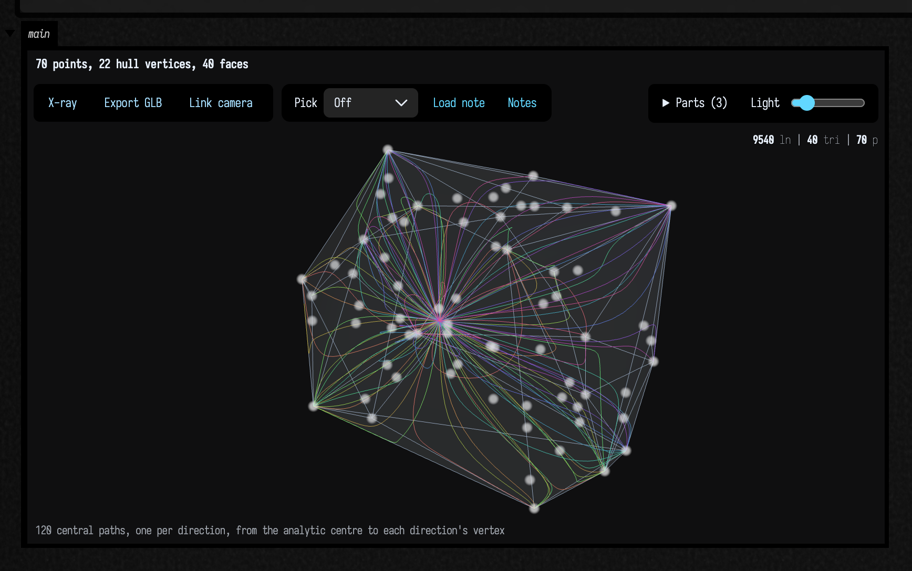
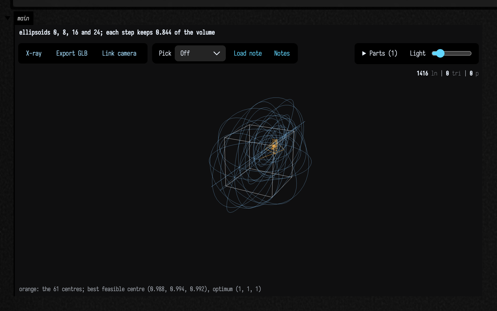

# Linear programs in three dimensions

<!-- capture-sources: src/jvmMain/kotlin/afield/geometry/spatial/lp_polytope.kt -->

*Every public declaration used below is listed, with its KDoc, in the codebase reference:
[Graphics](reference/graphics.md).*

[Linear programs as curves](lp_curves.md) draws the routes that linear-programming methods take
across a polygon to its best vertex. Everything there works in space too. A three-dimensional
linear program maximises `c·x` over a convex polytope, the answer is again a vertex, and the same
methods (central path, primal-dual, PDHG, ellipsoid, simplex, cutting planes) walk there by their
own routes, now through a solid. `LpPolytope` holds the solid, and each method returns its walk as
a 3-D trajectory that draws as an `FLine` in a `three { }` scene.

## A polytope from a point cloud

`LpPolytope.hull(points)` takes the convex hull of any point cloud and turns each face of the hull
into a half-space, the constraint `n·x ≤ b`. The triangles of one flat face become one constraint,
so a cube has six, not twelve. `LpPolytope.of(mesh)` does the same for a mesh's vertices, and
`LpPolytope(normals, bounds)` takes the half-spaces directly.

The example takes the hull of 70 points and draws a fan of central paths inside it, one per
objective direction, with the directions spread evenly over the sphere. Every path leaves the
polytope's analytic centre and ends at the vertex that wins for its direction.

```diffstatic_runner {data-lang=kotlin screenshot="assets/lp_curves_3d/hull_fan.png" wait="6.0" capture="box" open-outputs="true" padding="20"}
:::static
val random = kotlin.random.Random(11)
val cloud = List(70) {
    vec(random.nextDouble(-1.6, 1.6), random.nextDouble(-1.0, 1.0), random.nextDouble(-1.0, 1.0))
}
val polytope = LpPolytope.hull(cloud)
val fan = polytope.centralFan(directions = 120, samples = 80)
:::fold draw the scene
val dots = fline {
    cloud.forEach { moveTo(it) }
    pointed = true
    stroked = false
    pointSize = 4.0
    color = vec(1.0, 1.0, 1.0, 0.7)
}
three(name = "hull-fan", width = 760, height = 470) {
    mesh(polytope.toMesh(), wireframe = false, opacity = 0.12, cullBackFaces = false)
    lines(polytope.toFLine())
    lines(dots)
    lines(fan.toFLines(alpha = 0.85, thickness = 1.2))
    camera(yaw = 32.0, pitch = 24.0)
    title("${cloud.size} points, ${polytope.vertices.size} hull vertices, ${polytope.constraintCount} faces")
    caption("${fan.size} central paths, one per direction, from the analytic centre to each direction's vertex")
}
:::endfold
```



The scene can be orbited by dragging. The clip below turns the same hull once every twelve
seconds, with half as many paths.
It is drawn in the plane rather than in the Three.js viewer: every frame rotates the hull's edges
and the paths about the vertical axis and projects them onto the page.

```diffstatic_runner {data-lang=kotlin video="assets/lp_curves_3d/turning_fan.mp4" capture="box" open-outputs="true" wait-output="true" wait-output-kind="display" execution="launch" duration="12" fps="15" timeout="300" w="640" embed=true name="lp-curves-3d-turning-fan" alt="the hull's grey edges and its fan of rainbow central paths turning about the vertical axis; the paths bundle at a point inside and spread to every corner, and as the solid turns, paths that overlapped in one view separate"}
:::static
import kotlin.math.*

val random = kotlin.random.Random(11)
val cloud = List(70) {
    vec(random.nextDouble(-1.6, 1.6), random.nextDouble(-1.0, 1.0), random.nextDouble(-1.0, 1.0))
}
val polytope = LpPolytope.hull(cloud)
val fan = polytope.centralFan(directions = 60, samples = 80)

val period = 12.0 // seconds per turn
val pitch = 0.4 // radians the view looks down
// Turn p about the vertical axis by yaw, tilt by pitch, and keep x and y.
fun project(p: Vec3, yaw: Double): Vec2 {
    val x = p.x * cos(yaw) + p.z * sin(yaw)
    val z = -p.x * sin(yaw) + p.z * cos(yaw)
    return vec(x, p.y * cos(pitch) - z * sin(pitch))
}

val started = AnimationClock.nowSeconds()
loop {
    val yaw = 2.0 * PI * (AnimationClock.nowSeconds() - started) / period
    val edges = polytope.edges.map { (a, b) ->
        polylineFrom([project(polytope.vertices[a], yaw), project(polytope.vertices[b], yaw)]).also {
            it.color = vec(0.62, 0.70, 0.80, 0.8)
            it.thickness = 1.2
        }
    }
    val paths = fan.mapIndexed { i, path ->
        val hue = 2.0 * PI * i / fan.size // the same hue circle as fan.toFLines()
        polylineFrom(path.positions.map { project(it, yaw) }).also {
            it.color = vec(0.6 + 0.4 * cos(hue), 0.6 + 0.4 * cos(hue - 2.1), 0.6 + 0.4 * cos(hue + 2.1), 0.85)
            it.thickness = 1.0
        }
    }
    showPlane(
        edges + paths,
        title = "${fan.size} central paths, turned %3.0f°".format(Math.toDegrees(yaw) % 360.0),
        width = 640,
        height = 480,
        window = Rect(-2.2, -1.65, 4.4, 3.3),
        interactive = false,
        yUp = true,
    )
}
```

## Every route to one vertex

For a single direction, the methods take visibly different routes. The central path is a smooth
arc from the centre. The primal-dual method covers the same ground in a few long strides. The
simplex method walks along the polytope's edges, from vertex to neighbouring vertex, each step
improving the objective. PDHG starts at the centre, overshoots the solid and spirals back in.

```diffstatic_runner {data-lang=kotlin screenshot="assets/lp_curves_3d/routes.png" wait="6.0" capture="box" open-outputs="true" padding="20"}
:::static
val random = kotlin.random.Random(11)
val cloud = List(70) {
    vec(random.nextDouble(-1.6, 1.6), random.nextDouble(-1.0, 1.0), random.nextDouble(-1.0, 1.0))
}
val polytope = LpPolytope.hull(cloud)
val c = vec(1.0, 0.5, 0.3)
val answer = polytope.optimalVertex(c)
val far = polytope.vertices.indexOf(polytope.optimalVertex(vec(-1.0, -0.5, -0.3))) // the worst vertex

val central = polytope.centralPath(c)
val pd = polytope.primalDual(c)
val walk = polytope.simplexWalk(c, startVertex = far)
val spiral = polytope.pdhg(c, iterations = 800, tau = 0.25, sigma = 0.25)
:::fold draw the scene
fun dots(t: LpTrajectory3, color: Vec4) = fline {
    t.positions.forEach { moveTo(it) }
    pointed = true
    stroked = false
    pointSize = 6.0
    this.color = color
}
three(name = "routes", width = 760, height = 470) {
    mesh(polytope.toMesh(), wireframe = false, opacity = 0.1, cullBackFaces = false)
    lines(polytope.toFLine(vec(0.62, 0.70, 0.80, 0.5)))
    lines(
        central.toFLine(vec(1.0, 0.72, 0.32, 1.0), 2.4),
        pd.toFLine(vec(0.55, 0.9, 0.6, 1.0), 1.6), dots(pd, vec(0.55, 0.9, 0.6, 1.0)),
        walk.toFLine(vec(0.6, 0.75, 1.0, 1.0), 3.0), dots(walk, vec(0.6, 0.75, 1.0, 1.0)),
        spiral.trajectory.toFLine(vec(1.0, 0.55, 0.85, 0.8), 1.0),
    )
    camera(yaw = 20.0, pitch = 20.0)
    title("c = (1, 0.5, 0.3): four routes to the vertex at (%.2f, %.2f, %.2f)".format(answer.x, answer.y, answer.z))
    caption("orange: central path · green: primal-dual, ${pd.samples.size - 1} steps · blue: simplex, ${walk.samples.size - 1} pivots along edges · pink: PDHG")
}
:::endfold
```


The trajectories are `LpTrajectory3`s of `LpSample3`s, carrying the same per-step data as in 2-D
(position, iteration, objective, violation, `scale`, `tag`), and `toFLine()` draws each one as a
3-D polyline.

## Ellipsoids

The ellipsoid method keeps an ellipsoid known to contain the answer, halves it through its centre
at each step, and replaces it by the smallest ellipsoid containing the half it keeps. The
constants depend on the dimension. In three dimensions the centre moves a quarter of the way
across (`1/(n+1)`), the shape matrix grows by `n²/(n²−1) = 9/8`, and each step multiplies the
volume by `27/32 ≈ 0.84`, a slower shrink than the plane's `0.77`. `LpEllipsoid.toFLine()` draws an
ellipsoid as a wireframe of latitude and longitude rings.

```diffstatic_runner {data-lang=kotlin screenshot="assets/lp_curves_3d/ellipsoids.png" wait="6.0" capture="box" open-outputs="true" padding="20"}
:::static
val cube = LpPolytope.cube(1.0)
val c = vec(1.0, 0.6, 0.3)

// Start from a ball of radius 2, just larger than the cube's circumscribed sphere (√3).
val trace = cube.ellipsoid(c, iterations = 60, initialRadius = 2.0)
val shrink = kotlin.math.sqrt(trace.ellipsoids[1].determinant / trace.ellipsoids[0].determinant)
val best = trace.trajectory.samples.filter { it.violation == 0.0 }.maxBy { it.objective }
:::fold draw the scene
three(name = "ellipsoids", width = 760, height = 470) {
    lines(cube.toFLine(vec(1.0, 1.0, 1.0, 0.8), 1.6))
    lines((0..24 step 8).map { trace.ellipsoids[it].toFLine(rings = 4, color = vec(0.55, 0.8, 1.0, 0.5)) })
    lines(trace.trajectory.toFLine(vec(1.0, 0.72, 0.32, 0.9), 1.4))
    camera(yaw = 28.0, pitch = 22.0)
    helpers(false)
    title("ellipsoids 0, 8, 16 and 24; each step keeps %.3f of the volume".format(shrink))
    caption("orange: the ${trace.trajectory.samples.size} centres; best feasible centre (%.3f, %.3f, %.3f), optimum (1, 1, 1)".format(best.x, best.y, best.z))
}
:::endfold
```



## Cutting planes

A cutting-plane method keeps the region still in play, finds a centre of it, and cuts away the half
where `c·x` is worse than at the centre. `cuttingPlanes` returns the region at every step as an
`LpPolytope` of its own. In three dimensions the centre is `ANALYTIC`, `CENTROID` or `CHEBYSHEV`
(the centre of the largest ball inside), as in the plane; `VOLUMETRIC` is not implemented for
polytopes and is refused. The example cuts toward the cube's top corner through centroids, each of
which removes at least `1 − (3/4)³ ≈ 58%` of the volume.

```diffstatic_runner {data-lang=kotlin screenshot="assets/lp_curves_3d/cutting_planes.png" wait="6.0" capture="box" open-outputs="true" padding="20"}
:::static
val cube = LpPolytope.cube(1.0)
val c = vec(1.0, 0.6, 0.3)

val trace = cube.cuttingPlanes(c, iterations = 8, center = LpCenter.CENTROID)
val volumes = trace.trajectory.samples.map { it.scale }
:::fold draw the scene
three(name = "cuts", width = 760, height = 470) {
    trace.regions.forEachIndexed { k, region ->
        val t = k / (trace.regions.size - 1.0)
        lines(region.toFLine(vec(0.5 + 0.5 * t, 0.8 - 0.2 * t, 1.0 - 0.6 * t, 0.35 + 0.6 * t), 1.0 + t))
    }
    lines(trace.trajectory.toFLine(vec(1.0, 1.0, 1.0, 0.9), 2.0))
    camera(yaw = 28.0, pitch = 22.0)
    helpers(false)
    title("centroid cuts toward (1, 1, 1): volume %.1f → %.4f in ${volumes.size - 1} cuts".format(volumes.first(), volumes.last()))
    caption("each region is drawn as its edges, blue first and orange last; white: the path of centroids")
}
:::endfold
```


## Reference

<div class="field-data-table" markdown>

| Entry point | What it returns |
|---|---|
| `LpPolytope.hull(points)`, `LpPolytope.of(mesh)` | the convex hull as half-spaces, one per flat face |
| `LpPolytope(normals, bounds)`, `LpPolytope.box(...)`, `LpPolytope.cube(half)` | a polytope from half-spaces `n·x ≤ b`; refused when unbounded or flat |
| `polytope.vertices`, `.edges`, `.vertexPlanes`, `.center`, `.volume` | the solid's vertices, its edges as vertex pairs, the faces tight at each vertex |
| `polytope.centralPath(direction, weights, samples, muHigh, muLow, start)` | the log-barrier central path, `LpTrajectory3` |
| `polytope.centralFan(directions, samples, weights)`, `sphereDirections(n)` | one central path per direction, spread over the sphere |
| `polytope.primalDual(direction)` | Mehrotra predictor–corrector iterates |
| `polytope.pdhg(direction, iterations, tau, sigma, theta)` | `LpPdhgTrace3`: the primal walk and every dual vector |
| `polytope.ellipsoid(direction, iterations)` | `LpEllipsoidTrace3`: centres and `LpEllipsoid`s |
| `polytope.simplexWalk(direction, startVertex)` | the walk along edges, `LpTrajectory3` |
| `polytope.cuttingPlanes(direction, iterations, center)` | `LpCuttingPlaneTrace3`: centres and remaining regions; `ANALYTIC`, `CENTROID` or `CHEBYSHEV` |
| `trajectory.toFLine()`, `fan.toFLines()`, `ellipsoid.toFLine()`, `polytope.toFLine()`, `polytope.toMesh()` | 3-D `FLine`s and the solid as a `TriMesh` |

</div>

The starting point [lp_curves_3d](agent_transcripts.md#lp_curves_3d) opens a hull with every route
in one box and the turning fan in another.

??? aside "Agents: what pins these figures"
    `src/jvmTest/kotlin/afield/geometry/spatial/LpPolytopeTest.kt` asserts what the captions show:
    a cube's six faces, eight vertices and twelve edges, and the same from a box mesh's hull (its
    twelve triangles merged back into six faces); that a random hull contains its cloud, has one
    vertex per hull point and satisfies Euler's `V − E + F = 2`; strict feasibility and convergence
    of the central path and primal-dual iterates on the cube and the hull; one fan path per sphere
    direction; PDHG leaving the solid and returning; the `(27/32)²` determinant ratio of successive
    ellipsoids and that every ellipsoid contains the optimum; the simplex walk reaching the optimum
    from every vertex; and the three cutting-plane centres shrinking the volume. Vertices are found
    by intersecting every triple of planes, so construction is `O(m⁴)` in the face count. The
    animated starting point is `dev_docs/agents/transcripts/lp_curves_3d.yaml`.

Source: `src/jvmMain/kotlin/afield/geometry/spatial/lp_polytope.kt`.
