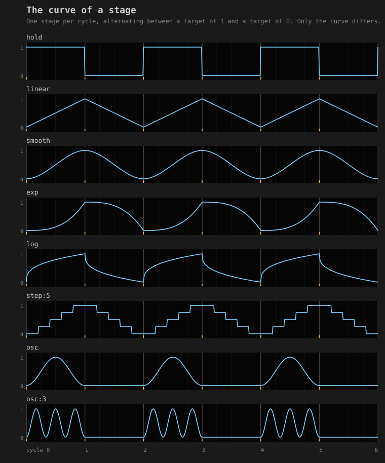
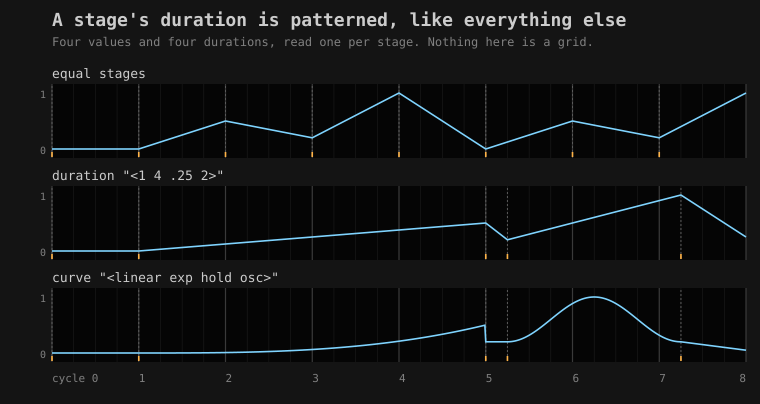
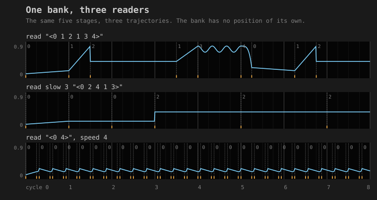
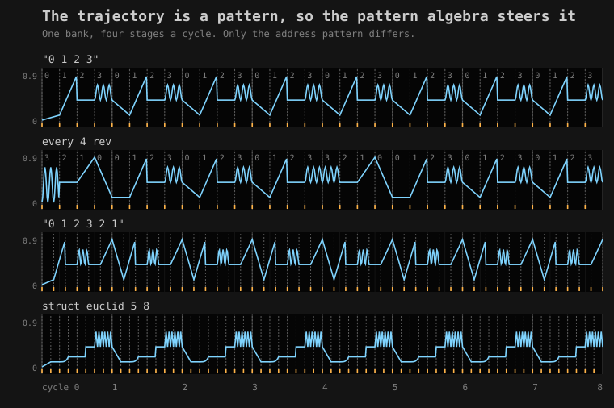
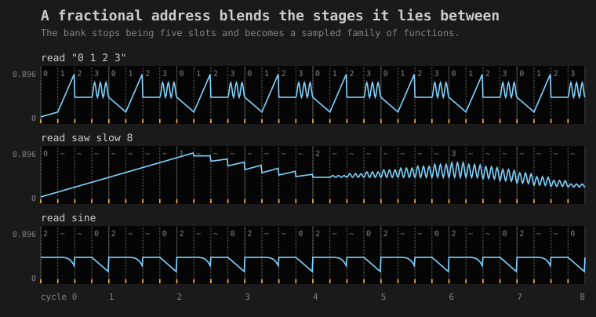
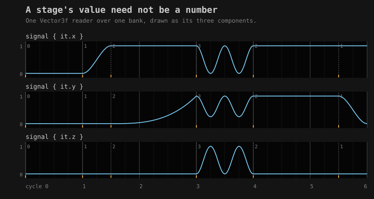
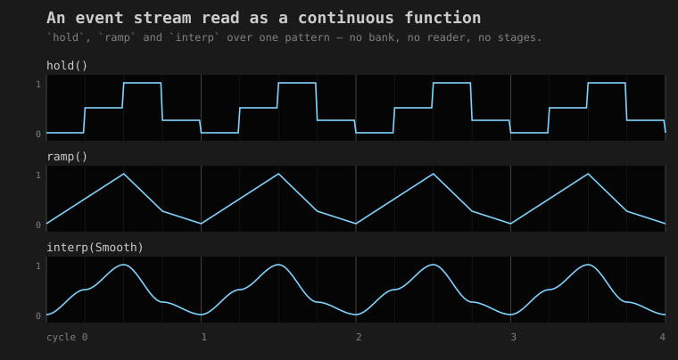

# A pattern as a function generator

A pattern says what happens and when. A function generator says what a value *does* while it is
happening. `marf(...)` is the second one built out of the first, so that a sequence, an envelope, an
LFO and a trajectory through stored material are four uses of one thing.

The idea comes from the Buchla 248 Multiple Arbitrary Function Generator. What is worth taking from
it is not the step sequencer. It is the way the 248 keeps four things on separate patch points:

* the **material** stored in a bank of stages,
* the **address** that chooses which stage to read,
* the **time** each stage is given,
* and the **function** drawn while a stage is active.

Here all four are ordinary [patterns](pattern_language.md). `slow`, `rev`, `every`, `euclid`,
`degradeBy` and `struct` already work on all four, so this layer adds almost no operators of its
own. The figures below are drawn by
[`MarfGallery`](reference/patterns.md#marfgallery-kt), which samples each reader through its own
public surface and asserts the geometry it drew: one boundary line per stage, one pulse per
triggering stage, one polyline point per sample.

---

## A stage, and the shape of it

A stage has a destination, a length, and a curve. It has no starting value: it departs from wherever
the output already was. That is what makes a run of stages an envelope rather than a list of
unrelated ramps, and it is why the output never jumps when one stage hands over to the next.

```diffstatic {data-lang=kotlin}
rampTo(0.9, duration = 0.5)            // slew to 0.9 over half a cycle
holdAt(0.4, duration = 2.0)            // step to 0.4 and stay for two
oscTo(0.7, duration = 1.0, cycles = 3) // three oscillations toward 0.7 and back
curveTo(0.2, duration = 0.25, amount = 4.0)
stage(0.5, duration = 1.0, curve = MarfCurve.Smooth)
```

A curve is a shaping function on the stage's own local phase, `0..1`. The reader turns it into an
output with `from + (to - from) * shape(phase)`, so a curve never needs to know which values it is
moving between.



`hold` is the sample-and-hold case: it arrives at once and stays, which is the step in the top lane.
`step:5` is a staircase in five treads. `osc` takes a whole number of oscillations and returns to
where it started, so a stage can be an LFO burst whose rate is set by its own length rather than by
a frequency in hertz. The declarative family is data rather than lambdas, so a stage can be printed,
compared and stored; `MarfCurve.Shape("chirp") { p -> ... }` is there for when that does not matter.

---

## Duration is one of the patterns

Stage length is patterned like everything else, and the stages that come out are not on a grid.

```diffstatic {data-lang=kotlin}
val env = marf(
    value    = pat("<0 .5 .2 1>").nums(),
    duration = pat("<1 4 .25 2>").nums(),
    curve    = curves("<linear exp hold osc>"),
    fields   = MarfFieldClock.STAGES
)
```



The middle lane's four stages are one, four, a quarter and two cycles long. Those numbers are exact:
stage time accumulates in `PatQ` rationals, never in `Double`, so a reader is still phase-locked to
the bar after ten thousand stages. The gallery asserts the four durations as rationals rather than
within a tolerance.

Each field is read at the instant the stage begins, through the same latch the parameter algebra
uses for `gain(...)` at a note onset. Then the next stage begins where this one ends. The reader's
own traversal generates its clock, which is why the periods drift against each other: give the
address a period of six and the duration a period of four and the pair repeats every twelve.

A field pattern with rests holds rather than resetting. When nothing is sounding at a stage
boundary, that field keeps the value the previous stage had, so `struct` and `degradeBy` on an
address become *how long an address is held for*.

---

## Banks, and the readers over them

A bank is stored material. It has no position, no direction and no clock; all of that belongs to the
readers, which is the property worth borrowing from the hardware.

```diffstatic {data-lang=kotlin}
val b = marfBank(
    rampTo(0.1, 1.0), rampTo(0.9, 0.5), holdAt(0.4, 2.0),
    oscTo(0.7, 1.0, cycles = 3.0), curveTo(0.2, 0.25, amount = 4.0)
)

val a = b.read(pat("<0 1 2 1 3 4>").nums())
val c = b.read(pat("<0 2 4 1 3>").nums().slow(3))
val d = b.read(pat("<0 4>").nums(), speed = constant(4.0))
```



Three voices reading one score. `slow(3)` holds each address for three stages; `speed = 4`
divides every duration, so the third lane's stages are a quarter as long as the bank wrote them.
The bank is the same object in all three lanes, and the gallery requires the three curves to
differ, so this figure cannot become three copies of one journey.

---

## The trajectory is compositional material

Once the address is a pattern, sequential reading is one case among many, and the pattern algebra
does the work that a list of traversal modes would otherwise have to.



```diffstatic {data-lang=kotlin}
b.read(pat("0 1 2 3").nums(), duration = constant(0.25))                    // forward
b.read(pat("0 1 2 3").nums().every(4) { it.rev() }, duration = constant(0.25)) // periodic reversal
b.read(pat("0 1 2 3 2 1").nums(), duration = constant(1.0 / 6.0))           // ping-pong
b.read(struct(euclid(5, 8), pat("0 4 2 3").nums()), duration = constant(0.125))
```

`"0 1 2 3 2 1"` is ping-pong; there is no `direction = PINGPONG` in this layer and there should not
be one. In the second lane the first cycle's addresses read `3 2 1 0` and the next three read
`0 1 2 3`, which is what `every(4)` means. In the fourth, E(5,8) leaves three of the eight steps
empty and the address holds across them.

One thing to know about mini-notation here: `<a b c>` carries one event per cycle, so `rev()` has
nothing to reverse inside it. Reversal needs an address with steps inside the cycle, which is why
these lanes use `"0 1 2 3"` and four stages a cycle.

---

## Addresses between slots

The address is a `PatPattern<Double>`, not a pattern of integers. A fractional address evaluates the
two stages it lies between over the same local phase and mixes their outputs,
`(1-α)·f(i) + α·f(i+1)`, blending their durations the same way. The entry value is shared between
the two, so the output stays continuous across a boundary exactly as it does for a whole address.



The bank stops being five slots and becomes a sampled one-dimensional family of functions.

!!! warning "A latched address is a sequence, however continuous the signal feeding it"

    The address is read once per stage, so a reader with periodic durations visits
    `lcm(address period, stage period) / stage period` distinct addresses and then repeats. The
    bottom lane above is `sine().range(0, 4)` against quarter-cycle stages: four addresses,
    `2, 4, 2, 0`, forever. The middle lane is `saw().slow(8)` against the same stages, which is
    thirty-two of them and reads as a glide. An aperiodic address (`perlin()`, `rand()`) never
    repeats.

    When you check this, count the distinct addresses **rounded**. An aliased address repeats to a
    few parts in 10⁴ rather than bit-exactly, because the probe instant is an exact rational and
    `PatQ.toDouble()` rounds it at twelve places, so a raw `distinct()` reports seventeen different
    addresses for that four-value cycle.

---

## Two ways out, one structure

A reader's continuous output is a signal in the sense of [`PatSignals.kt`](pattern_language.md), so
every combinator in the language already applies to it and the parameter algebra can sample it
without knowing what it is.

```diffstatic {data-lang=kotlin}
// Two readers of one bank as two parameters of one voice.
val voice = pat("bd*8")
    .with(gain(c.signal().range(0.25, 1.0)))
    .with(pan(d.signal()))

// And the same temporal structure as pulses: one event per stage, spanning that stage.
a.triggers().respond(cps = 1.0) { event ->
    __m("pat").patHighlight(event)
}
```

`voice` is an ordinary pattern carrying `gain` and `pan` annotations, so every route in
[Sound: the Pattern → Audio Path](sound.md) takes it unchanged. `triggers()` gives one event per
stage, and the event's `whole` is the stage's real span, so `respond` strikes it once and the
callback sees the stage's true length. A `trigger` pattern thins that stream without touching the
continuous output.

For graphics, sample directly. `at(cycle)` and `atSeconds(seconds, cps)` return a `MarfSample`,
which carries the several notions of time that are live at once: the global cycle, the stage index,
the time since this stage began, and that time normalised to `0..1`.

```diffstatic {data-lang=kotlin}
val x = b.read(pat("<0 1 2 3 4>").nums())
val y = b.read(pat("<0 2 4 1 3>").nums().slow(3))

// The path those two readers trace together over eight cycles.
val path = fline {
    for (i in 0..800) {
        val t = i / 100.0
        if (i == 0) moveTo(x.at(t).value * 300.0, y.at(t).value * 300.0)
        else lineTo(x.at(t).value * 300.0, y.at(t).value * 300.0)
    }
    stroked = true
    thickness = 1.0
    color = vec(1.0, 1.0, 1.0, 0.7)
}
lines(listOf(path), w = 320.0, h = 170.0, fitToSize = true)
```

Two readers of one bank as two coordinates. The path stays coherent without the coordinates being
synchronised, because both are reading the same material on their own clocks. A third reader on
`radius` or on a colour channel joins in on the same terms.

A curve is written against `stagePhase` and never has to reconstruct it, which makes the comparison
with a shader a useful one to keep: a fragment shader computes over `uv`, a stage computes over its
own local phase, inside a structure the pattern algebra laid out.

---

## A stage's value need not be a number

A stage's value is a type parameter. `MarfSpace` is the arithmetic a reader needs in order to move
one value toward another, and it is three operations: subtract to get the direction, scale to walk
part of it, add to arrive. The curve stays scalar, because a stage's *shape* is one-dimensional
however many dimensions its value has.

```diffstatic {data-lang=kotlin}
val path = marfBankIn(
    MarfVector3f,
    stageTo(Vector3f(0f, 0f, 0f), 1.0),
    stageTo(Vector3f(1f, 0f, 0f), 0.5, MarfCurve.Smooth),
    stageTo(Vector3f(1f, 1f, 0f), 1.5, MarfCurve.Exp(3.0)),
    stageTo(Vector3f(0f, 0.25f, 1f), 1.0, MarfCurve.Osc(2.0))
).read(pat("<0 1 2 3 2 1>").nums(), fields = MarfFieldClock.STAGES)

path.at(3.5).value               // a Vector3f
path.signal { it.x.toDouble() }  // any component, as an ordinary signal
```



Three lanes, one reader. The dashed boundaries fall in the same places in all three, because there
is one stage structure carrying three values; the `osc:2` stage at cycle 3 puts its double bump
into every component at once, and each component arrives at a different place because the stage
targets differ. `signal { … }` is how a vector reader reaches the rest of the language, which is
scalar nearly everywhere: each component is a `PatPattern<Double>`, so `gain`, `range` and
`segment` apply to it unchanged.

`marf(...)` and `marfBank(...)` are the scalar spellings; `marfIn` and `marfBankIn` take a space.
Instances for `Vector2f`, `Vector3f` and `Vector4f` ship with it.

!!! warning "A space instance must copy before it writes"

    In Field's generated linalg, `add(other)`, `sub(other)`, `mul(scalar)` and `normalize()` are
    in-place members that return the receiver, and `/` resolves to the mutating member operator
    rather than the allocating extension. A stage target lives in a bank and is read once per stage
    for as long as the reader runs, so one in-place write does not give you a wrong frame: it
    rewrites the material. The shipped instances use the out-parameter forms
    (`a.add(b, Vector3f())`), and `MarfVectorSpaceTest` reads a bank twice and requires the second
    pass to agree with the first, which is the property a mutating implementation breaks and a type
    check does not.

`MarfSpace` is a vector space, which rules out the types that are not one. A quaternion
interpolates by `slerp` and a hue wraps, so neither is expressible as add-and-scale and neither has
an instance here. Those want a reader whose blend is its own function.

---

## An event stream as a continuous function

Three of these need no bank and no reader. A discrete pattern is four events a quarter-cycle apart
and nothing samples it in between; these give it a value everywhere, so it can be a filter cutoff,
an `x` coordinate or a radius.

```diffstatic {data-lang=kotlin}
pat("0 .5 1 .25").nums().hold()                   // sample and hold
pat("0 .5 1 .25").nums().ramp()                   // linear between onsets
pat("0 .5 1 .25").nums().interp(MarfCurve.Smooth) // any curve between onsets
```



Unlike `segment`, these do not change the rhythm; they remove it. The result is analog, with no
onsets at all, and `segment(n)` is how you get onsets back.

`hold()` and `interp(MarfCurve.Hold)` are different, and both are wanted. A segment in `interp` is
named by both its ends, so arriving at once means arriving at the *next* onset's value: a staircase
one step early. A stage in a reader is named only by its destination, so the same curve there is an
ordinary sample-and-hold.

---

## Which clock the fields are read in

`MarfFieldClock` chooses the time coordinate the four patterns are read in, and the two answers suit
different intentions.

`CYCLES`, the default, reads each field at the stage's wall-clock instant. This is the control-voltage
reading and the hardware's one. Every pattern means something in it: `"0 .7 .2 1"` is four values
across the bar and `sine()` is a sweep across it. When the durations happen to sum to a cycle the
reader locks to the bar and the fields line up with their own steps.

`STAGES` reads field `k` at cycle `k`, so one cycle of a field pattern is one stage and the fields
become a sequence. `duration = "<1 4 .25 2>"` then gives stages of exactly those four lengths, and
`address = "<0 1 2 1 3 4>"` walks the bank one slot per stage however long a stage takes. The cost
is that a bare `"0 .7 .2 1"` collapses to its first step, since only the value at the cycle boundary
is ever latched. In this mode `<…>` is the idiom.

---

## Not here yet

**A bank entry that is itself a pattern.** A stage's continuous behaviour is a `MarfCurve`, and
`MarfCurve.Shape` can close over anything, including another reader. A nested pattern given its own
local temporal scope inside the stage is not modelled, and would want the stage phase threaded into
a real evaluation context rather than passed as a `Double`.

**Audio on this page.** The figures here are geometry. A reader's output is a control signal rather
than a note stream, so the clip worth having is a voice whose gain, pan and filter are three readers
of one bank; that needs a registered offline renderer, which does not exist yet.

---

## Running it

There is a saved document that opens and runs all of this, four boxes over one bank:

```diffstatic {data-lang=bash}
./field.sh dev_docs/agents/demos -d marf_demo
```

Three of its boxes draw the figures above from live readers; the fourth plays one, sending the same
bank through `patSpatial` so that a reader's output becomes a source's azimuth, its filter cutoff
and its distance. `dev_docs/MARF_DEMO.md` is the note that goes with it.

---

## Where the pieces are

| | |
| --- | --- |
| The layer | [`Marf.kt`](reference/patterns.md#marf-kt) |
| Spaces for the linalg vectors | [`MarfVectors.kt`](reference/patterns.md#marfvectors-kt) |
| The figures, and their checks | [`MarfGallery.kt`](reference/patterns.md#marfgallery-kt) |
| A worked example, printed as text | [`MarfSmokeTest.kt`](reference/patterns.md#marfsmoketest-kt) |
| The pattern language underneath | [Patterns & Rhythm](pattern_language.md) |
