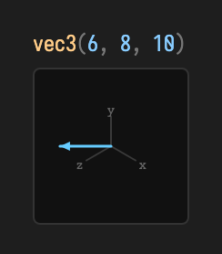

# Matrix algebra: transforms & precision

Field's matrices come in two precisions that share one shape. The **single-precision** family — `Matrix2f`, `Matrix3f`, `Matrix4f` — is what the renderer, camera, and quaternion code speak. The **double-precision** family — `Matrix2d`, `Matrix3d`, `Matrix4d` — is its f64 sibling, for the times you need exact arithmetic that never quietly rounds to `float`. Both families are *generated* from the same typed algebra model in `tools/linalg-generator` (the same generator behind the [vector swizzles](vector_algebra.md)), so a method that exists on both behaves identically bit-for-bit apart from the storage width.

This page is a worked tour. Every image below is captured straight from Field's real value visualizer — `ValueVisualizer.visualize(...)`, the same renderer described in [Reading your values](reading_your_values.md) — fed the actual result of the code above it. A matrix draws as a **diverging heatmap**: neutral grey at zero, blue for positive entries, orange for negative, scaled by magnitude. The terse header keeps the full-precision numbers (and, for 3×3 and 4×4, the determinant and translation). Nothing here is mocked. For the wider library see the [Linear Algebra guide](linear_algebra.md).

All matrices are **column-major** (the JOML convention): storage index runs down each column before moving right, and the `set(...)` constructors take their arguments in that order.

## Constructing a matrix

Each type has a component constructor and defaults to the identity. The 2×2 constructor takes `(m00, m01, m10, m11)` — column by column, so `m00, m01` is the first column and `m10, m11` is the second. Read as a conventional maths matrix that is the two rows `(m00, m10)` and `(m01, m11)`.

```diffstatic {data-lang=kotlin}
:::static
import afield.stdlib.*         // vec
import afield.stdlib.linalg.*  // Matrix2d / 3d / 4d, Matrix4f, operators

val m = Matrix2d(1.0, 2.0, 3.0, 4.0)  // columns (1,2) and (3,4) → rows (1,3),(2,4)
```

![A 2×2 double matrix drawn as a labelled heatmap; header reads mat2d [1, 3 / 2, 4]](assets/matrix_algebra/construct_mat2.png)

The header spells the two rows — `[1, 3 / 2, 4]` — while the grid shows the column-major storage. Every constructor accepts `Double`s for the `…d` types and `Float`s for the `…f` types; a bare `Matrix4d()` is the 4×4 identity.

## Multiply, determinant, inverse, transpose

These four operations are *precision-agnostic* — they read the same on `Matrix2d` as on `Matrix2f`. `mul` composes another matrix onto the receiver **in place**, so wrap the left operand in a copy constructor when you want to keep it:

```diffstatic {data-lang=kotlin}
:::static
val a = Matrix2d(1.0, 2.0, 3.0, 4.0)   // rows (1,3),(2,4)
val b = Matrix2d(5.0, 6.0, 7.0, 8.0)   // rows (5,7),(6,8)
Matrix2d(a).mul(b)                     // A·B — a fresh copy, a and b untouched
```

![The product A·B as a heatmap; header reads mat2d [23, 31 / 34, 46]](assets/matrix_algebra/multiply_mat2.png)

The product `[[23, 31], [34, 46]]` is exactly the textbook result. `determinant()` and `invert()` come along for free; a matrix times its own inverse returns to the identity, and the round-trip stays exact at f64 scale:

```diffstatic {data-lang=kotlin}
:::static
a.determinant()                        // -2.0
Matrix2d(a).mul(Matrix2d(a).invert())  // ≈ identity
```

![A·A⁻¹ collapses to the identity; header reads mat2d [1, 0 / 0, 1]](assets/matrix_algebra/inverse_identity_mat2.png)

`invert()` and `transpose()` also mutate in place (with a `transpose(dest)` overload that writes into a destination instead), matching the `mul` convention. Because both families are generated from one model, the same names — `mul`, `determinant`, `invert`, `transpose`, `identity`, `set` — exist on the 2×2, 3×3, and 4×4 types alike.

## A 3×3 linear map

`Matrix3d` carries the same linear surface at one size up. Its `set(...)` takes nine values, row by row for readability, and the visualizer labels every cell and prints the determinant in the header:

```diffstatic {data-lang=kotlin}
:::static
val m3 = Matrix3d().set(
    2.0, 0.0, 1.0,
    1.0, 3.0, 0.0,
    0.0, 1.0, 4.0,
)
m3.determinant()   // 25.0
```

![A 3×3 double matrix as a labelled heatmap; header reads mat3d [det=25]](assets/matrix_algebra/linear_mat3.png)

A non-zero determinant means the map is invertible; `Matrix3d(m3).invert()` gives the inverse, and `m3.determinant()` reports `25.0` exactly.

## Composing affine transforms in 4D

`Matrix4d` adds the affine builders `scale`, `translate`, `scaling`, and `translation`. Like `mul`, they compose onto the receiver in place and return it, so you can chain them. Composition applies each step *in the frame established so far* — the JOML "local" convention — which is worth watching:

```diffstatic {data-lang=kotlin}
:::static
val t = Matrix4d().scale(2.0, 3.0, 4.0).translate(5.0, 6.0, 7.0)
t.determinant()    // 24.0  (= 2·3·4; translation never changes the determinant)
```

![A 4×4 affine matrix as a heatmap; header reads mat4d [det=24, t=(10, 18, 28)]](assets/matrix_algebra/affine_mat4.png)

The header reports `t=(10, 18, 28)`, **not** `(5, 6, 7)`. Because the `translate` runs *after* the `scale`, it moves in the already-scaled frame, so each translation component is multiplied by its axis scale: `(5·2, 6·3, 7·4)`. The determinant stays `24` — a pure translation shears nothing and preserves volume. The diagonal `2, 3, 4, 1` is the scale, and the fourth column is the translation.

## Where precision stops: the f32 bridge

The f64 family deliberately covers only the parts of the API that are precision-agnostic — multiply, determinant, invert, transpose, scale, translate. **Rotation, projection/camera helpers (`perspective`, `lookAt`), and transforming a vector live on the single-precision `Matrix4f`**, matching Field's f32 quaternion and render pipeline. So a rotation is built on `Matrix4f`:

```diffstatic {data-lang=kotlin}
:::static
val r = Matrix4f().rotateY(0.6f)   // rotate about Y by 0.6 rad
r.determinant()                    // 1.0 — a rotation preserves volume
```

![A Y-rotation as a heatmap; header reads mat4 [det=1, t=(0, 0, 0)], cells show 0.83 / 0.56 / -0.56](assets/matrix_algebra/rotate_mat4f.png)

The header now reads `mat4` (not `mat4d`) — the visualizer distinguishes the two precisions. The `cos 0.6 ≈ 0.83` on the diagonal and the `±sin 0.6 ≈ ±0.56` off-diagonal are the classic Y-rotation entries, orange marking the single negative.

Transforming a point is likewise a `Matrix4f` operation. The `*` operator applied to a `vec3` calls `transformPosition` — it includes the translation — and returns a fresh `Vector3f`:

```diffstatic {data-lang=kotlin}
:::static
Matrix4f().translation(5f, 6f, 7f) * vec(1, 2, 3)   // vec3(6, 8, 10)
```



The result `(6, 8, 10)` is `(1, 2, 3)` shifted by the translation, drawn by the vector visualizer as an arrow. Use `transformDirection` (or the `Vector4f` overload with `w = 0`) when you want to rotate/scale a direction *without* the translation.

## The shape of it

Pick the width by need: reach for the `…f` family for anything that ends up on screen — cameras, rotations, per-frame transforms — and the `…d` family when accumulated arithmetic must stay exact. The shared surface (`mul`, `determinant`, `invert`, `transpose`, `identity`, `set`, and on 4×4 `scale`/`translate`) reads identically across both, because both are emitted from the one generator model. When you need rotation, projection, or to push a vector through a matrix, that is the f32 `Matrix4f`'s job. For the vector side of the same library see [Vector algebra](vector_algebra.md); for the full guide, [Linear Algebra](linear_algebra.md).
