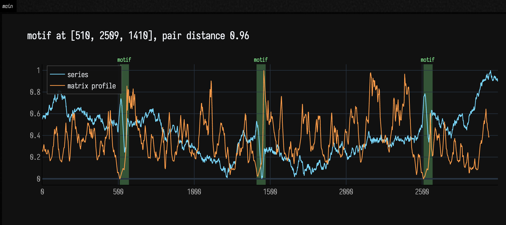
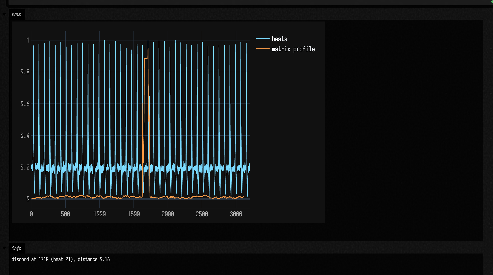
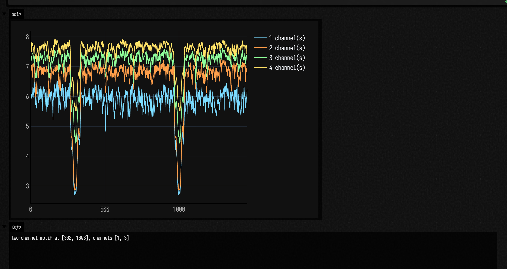
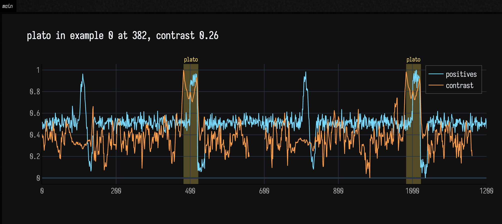

# Motifs, Discords and Contrast: the Matrix Profile

You have a long signal: a sensor log, an envelope of a recording, a mouse trace, the output of a
simulation. Two questions come up again and again. *What happens more than once?* And *what happens
only once?* The matrix profile (Keogh and colleagues, from 2016) answers both, with one parameter:
the length `m` of the shapes you care about.

For every subsequence of length `m`, the matrix profile records how far away its nearest
neighbour is, comparing shapes after z-normalization (so a shape matches itself shifted up or
scaled). Where the profile is low, the shape has a twin somewhere else: a **motif**. Where it is
high, the shape is like nothing else in the signal: a **discord**. The same machinery compares two
signals with each other, works across several channels at once, and finds the shapes that set one
set of recordings apart from another (the **contrast profile**).

Everything is in the package `afield.math.matrixprofile`:

```diffstatic {data-lang=kotlin}
import afield.math.matrixprofile.*
```

## Motifs

The box below makes a slow random walk and hides the same 60-sample wiggle (one cycle of a sine) in it at three places.
`matrixProfile(series, m = 60)` returns the profile, and `motifs()` reads the repeated shapes out
of it.

<!--
FIELD_TEST
id: docs.matrix-profile.motifs
runner: backdoor-box
tags: [docs, matrixprofile]
timeoutSec: 90
expect:
  outputContains:
    - "motif at"
-->
```diffstatic_runner {data-lang=kotlin screenshot="assets/matrix_profile/motifs.png" alt="two traces over 3000 samples: a wandering random walk, and the matrix profile, which dips close to zero at the three shaded motif bands; the title names where the motif starts" wait-output=true wait-output-kind=display wait-output-channel="main" capture="box" open-outputs="true" padding="0" name="mp-motifs"}
:::static
import afield.math.matrixprofile.*

// A slow random walk with the same wiggle hidden in it three times.
val rnd = java.util.Random(4)
var level = 0.0
val series = 3000 {
    level += rnd.nextGaussian() * 0.1
    level
}
    .toMutableList()
for (at in [500, 1400, 2500]) for (k in 0 until 60) series[at + k] += 2 * sin(2 * PI * k / 60)

val mp = matrixProfile(series, m = 60)
val motif = mp.motifs(1).first()

showSignals(
    "series" to series,
    "matrix profile" to mp.profile,
    regions = motif.indices.map { SignalRegion("motif", it, it + mp.m, "#8fff9a") },
    title = "motif at ${motif.indices}, pair distance ${motif.pairDistance.f2}",
    channel = "main",
    normalize = true,
    width = 1000,
    height = 420,
    floatingLegend = true,
)
```



The profile drops towards zero at the three wiggles, since each has two close twins. None of them
is easy to pick out of the walk by eye: each sits on whatever level the walk has wandered to, and
z-normalization takes the level away.

The shaded bands are `showSignals(..., regions = ...)`: one `SignalRegion(label, from, to)` per
occurrence, which is how to mark anything found in a signal on its plot.

## Discords

A discord is the subsequence whose nearest neighbour is furthest away. It only means something
against a background that repeats, so this box makes 40 beats of a pulse and malforms one of them:

<!--
FIELD_TEST
id: docs.matrix-profile.discords
runner: backdoor-box
tags: [docs, matrixprofile]
timeoutSec: 90
expect:
  outputContains:
    - "discord at"
-->
```diffstatic_runner {data-lang=kotlin screenshot="assets/matrix_profile/discords.png" alt="a regular train of pulses with one beat whose pulse is doubled, and below it the matrix profile, low and flat everywhere except a single tall peak over the shaded discord band" wait-output=true wait-output-kind=display wait-output-channel="main" capture="box" open-outputs="true" padding="0" name="mp-discords"}
:::static
import afield.math.matrixprofile.*

// 40 beats of 80 samples. Beat 21 has a doubled, late pulse.
val rnd = java.util.Random(15)
fun bump(t: Double, at: Double, w: Double) = exp(-((t - at) / w).pow(2))
val beats = (40 * 80) { i ->
    val t = (i % 80).toDouble()
    val pulse = if (i / 80 == 21) 2 * (bump(t, 35.0, 3.0) + bump(t, 50.0, 3.0)) else 3 * bump(t, 30.0, 3.0)
    pulse - 0.6 * bump(t, 45.0, 6.0) + rnd.nextGaussian() * 0.05
}

val mp = matrixProfile(beats, m = 80)
val discord = mp.discords(1).first()

showSignals(
    "beats" to beats,
    "matrix profile" to mp.profile,
    regions = [SignalRegion("discord", discord.index, discord.index + mp.m, "#ff7a9e")],
    title = "discord at ${discord.index} (beat ${discord.index / 80}), distance ${discord.distance.f2}",
    channel = "main",
    normalize = true,
    width = 1000,
    height = 420,
    floatingLegend = true,
)
```



In white noise every window is unlike every other, and the "discord" is whichever random stretch
happened to be most unlike the rest. A signal that repeats itself closely (a square wave, say) is
the opposite trap: it is its own motif, a period further along.

## Reading the profile

`motifs(count)` returns `Motif`s, best first. Each grows from the closest pair still in the profile
and collects every other subsequence within `radius` (default 2) times that pair's distance, so a
shape that happens five times comes back as one motif with five `indices`, not as two pairs.
`discords(count)` returns `Discord`s, most unusual first. Neither returns two answers that overlap
by more than the exclusion zone, a quarter of `m` either side (`exclusion =` changes it).

`mp.distances` and `mp.indices` are the profile itself, one entry per subsequence start. The
self-join also keeps one-sided profiles: `leftDistances`/`leftIndices` only look for neighbours
earlier in the signal and `rightDistances`/`rightIndices` only later ones. A low right profile
followed by a high left profile is a shape that is about to stop happening.

### Choosing `m`

`m` is the length of the shapes you are asking about, in samples. Too short and every wiggle has
a twin; too long and a motif is diluted by whatever surrounds it. Start with the length of one
occurrence of the thing you are looking for (a beat, a stride, a gesture), then try half and
double. Distances run from 0 (identical shapes) to \( 2\sqrt{m} \) (one is the other upside down), so
compare distances only between profiles with the same `m`.

The walk from [Motifs](#motifs) at half, once and twice the hidden wiggle's 60 samples:

```diffstatic_runner {data-lang=kotlin screenshot="assets/matrix_profile/choosing-m.png" alt="three panels of the same walk and its profile at m = 30, 60 and 120, each with its top motif shaded; at 30 and 60 the shading falls on the three planted wiggles, at 120 on five unrelated places" wait="1.5" capture="box" open-outputs="true" padding="0" name="mp-choosing-m" embed=true}
import afield.math.matrixprofile.*

// The walk from Motifs, with the same 60-sample wiggle hidden in it three times.
val rnd = java.util.Random(4)
var level = 0.0
val series = 3000 {
    level += rnd.nextGaussian() * 0.1
    level
}
    .toMutableList()
for (at in [500, 1400, 2500]) for (k in 0 until 60) series[at + k] += 2 * sin(2 * PI * k / 60)

// Half, once and twice the wiggle's length, each with its top motif shaded.
for (m in [30, 60, 120]) {
    val mp = matrixProfile(series, m = m)
    val motif = mp.motifs(1).first()
    showSignals(
        "series" to series,
        "profile, m = $m" to mp.profile,
        regions = motif.indices.map { SignalRegion("motif", it, it + m, "#8fff9a") },
        title = "m = $m: motif at ${motif.indices}",
        channel = "m = $m",
        normalize = true,
        width = 1000,
        height = 240,
    )
}
```

At `m = 30` and `m = 60` the top motif is the three planted wiggles. At `m = 120` each window is half wiggle and half walk, and the top motif lands somewhere else.

## Comparing two signals

`matrixProfile(a, b, m)` is a join: for every subsequence of `a`, the nearest one in `b`. Where it
is high, `a` does something `b` never does. `joinBothWays(a, b, m)` returns the profile in both
directions from one pass. For a join, `motifs()` returns the places in `b` that resemble the best
match from `a`, with `seed` giving where in `a` it came from.

`distanceProfile(query, series)` is the single-row case: the distance from one shape to every
subsequence of a signal, computed with an FFT (Mueen's MASS algorithm). It is the way to ask
"where else does *this* happen?" once you have a shape in hand.

Below, `b` is the walk with a square step added at 1900 that `a` never makes, and the query is the wiggle at 500:

```diffstatic_runner {data-lang=kotlin screenshot="assets/matrix_profile/join-distance.png" alt="top: signal b and its join profile against a, zero everywhere except a spike around the added step at 1900, which is shaded; bottom: the walk and the distance profile of the wiggle at 500, whose only value below 1.0 is at 500" wait="1.5" capture="box" open-outputs="true" padding="0" name="mp-join-distance" embed=true}
import afield.math.matrixprofile.*

// The walk from Motifs, with the same 60-sample wiggle hidden in it three times.
val rnd = java.util.Random(4)
var level = 0.0
val series = 3000 {
    level += rnd.nextGaussian() * 0.1
    level
}
    .toMutableList()
for (at in [500, 1400, 2500]) for (k in 0 until 60) series[at + k] += 2 * sin(2 * PI * k / 60)

// b is a's walk with a square step added at 1900 that a never makes.
val b = series.toMutableList()
for (k in 0 until 60) b[1900 + k] += if (k < 30) 2.0 else -2.0
val join = matrixProfile(b, series, m = 60)
val unusual = join.discords(1).first()
showSignals(
    "b" to b,
    "join profile of b against a" to join.profile,
    regions = [SignalRegion("only in b", unusual.index, unusual.index + 60, "#ff7a9e")],
    title = "b against a: highest at ${unusual.index}",
    channel = "join",
    normalize = true,
    width = 1000,
    height = 300,
)

// Where else does the wiggle happen? The distance from one copy of it to every window of the walk.
val query = DoubleArray(60) { series[500 + it] }
val dp = distanceProfile(query, DoubleArray(series.size) { series[it] })
val found = dp.indices.filter { i -> dp[i] < 1.0 && (i == 0 || dp[i] <= dp[i - 1]) && (i == dp.size - 1 || dp[i] <= dp[i + 1]) }
showSignals(
    "series" to series,
    "distanceProfile of the wiggle at 500" to dp.toList(),
    regions = found.map { SignalRegion("match", it, it + 60, "#8fff9a") },
    title = "distance below 1.0 at $found",
    channel = "distance",
    normalize = true,
    width = 1000,
    height = 300,
)
```

The join profile is zero wherever `b` copies `a` and rises only over the step. The distance profile drops to zero at the query's own position.

## Big signals, and answers before the end

The profile is exact. The cost is proportional to \( n^2 \), where `n` is the length of the signal,
but with a small constant: each cell of the distance matrix is a few multiplications, updated
along the matrix's diagonals (the SCAMP formulation), and the diagonals are shared across all
cores. On a ten-core laptop a signal of 10 000 samples takes about 20 ms and one of 100 000 about 1.5 s.

For a signal too long to wait for, `fraction` evaluates only that share of the diagonals, picked at
random (the SCRIMP "anytime" idea):

```diffstatic_runner {data-lang=kotlin screenshot="assets/matrix_profile/anytime.png" alt="four overlaid profiles of the walk at fraction 0.01, 0.05, 0.2 and 1.0; each lies on or above the next, and the exact profile is shaded at its motif and discord" wait="1.5" capture="box" open-outputs="true" padding="0" name="mp-anytime" embed=true}
import afield.math.matrixprofile.*

// The walk from Motifs, with the same 60-sample wiggle hidden in it three times.
val rnd = java.util.Random(4)
var level = 0.0
val series = 3000 {
    level += rnd.nextGaussian() * 0.1
    level
}
    .toMutableList()
for (at in [500, 1400, 2500]) for (k in 0 until 60) series[at + k] += 2 * sin(2 * PI * k / 60)

val quick = matrixProfile(series, m = 60, fraction = 0.05)

:::fold overlay four fractions
// The anytime profile at four fractions of the diagonals, overlaid: it only comes down.
val fractions = [0.01, 0.05, 0.2, 1.0]
val profiles = fractions.map { f -> matrixProfile(series, m = 60, fraction = f, seed = 1) }
val exact = profiles.last()
showSignals(
    *profiles.mapIndexed { i, p -> "fraction ${fractions[i]}" to p.profile }.toTypedArray(),
    regions = exact.motifs(1).first().indices.map { SignalRegion("motif", it, it + 60, "#8fff9a") } +
        SignalRegion("discord", exact.discords(1).first().index, exact.discords(1).first().index + 60, "#ff7a9e"),
    title = "first motif index ${profiles.map { it.motifs(1).first().indices.first() }} · discord ${profiles.map { it.discords(1).first().index }}, fraction 0.01 to 1.0",
    channel = "anytime",
    width = 1000,
    height = 360,
)
```

Every value of a partial profile is at least the exact value, so the profile can only come down as
`fraction` grows. Motifs show up early, because a shape with several twins needs only one of its
diagonals to be sampled. Discords are the slowest to settle: a subsequence can look unique only
because its twin's diagonal has not been visited yet.

## Several channels at once

An accelerometer has three axes; a motion capture has dozens of channels. A motif across them is
rarely in *all* of them: a wave of the hand shows up in two axes, not the third. Requiring every
channel to match hides the motif, and summing over channels lets noise in the unused ones drown it.

`multiMatrixProfile(channels, m)` computes the multidimensional matrix profile (mSTAMP, Yeh,
Kavantzas and Keogh 2017). Instead of one profile there is one per number of channels `k`:
`distances(k)` is, for each subsequence, the smallest mean distance to a neighbour over the best
`k` channels, with the channels chosen afresh for every pair. `subspace(k, i)` names the channels
that subsequence `i` matched in.

The box below makes four noisy channels and puts a gesture into two of them (once upside down) at
two times:

<!--
FIELD_TEST
id: docs.matrix-profile.multidimensional
runner: backdoor-box
tags: [docs, matrixprofile]
timeoutSec: 90
expect:
  outputContains:
    - "channels [1, 3]"
-->
```diffstatic_runner {data-lang=kotlin screenshot="assets/matrix_profile/multidimensional.png" alt="four profiles over the same 1500 samples: the one- and two-channel profiles dip sharply at two places, the three- and four-channel profiles much less; the two shaded motif bands are in channels 1 and 3, as the title says" wait-output=true wait-output-kind=display wait-output-channel="main" capture="box" open-outputs="true" padding="0" name="mp-multidimensional"}
:::static
import afield.math.matrixprofile.*

// Four channels of noise. A 40-sample gesture appears in channels 1 and 3, at two times.
val rnd = java.util.Random(13)
val channels = 4 { 1500 { rnd.nextGaussian() }.toMutableList() }
for (at in [300, 1000]) for (k in 0 until 40) {
    channels[1][at + k] += 4 * sin(2 * PI * k / 40)
    channels[3][at + k] -= 4 * sin(2 * PI * k / 40)
}

val mmp = multiMatrixProfile(channels, m = 40)
val motif = mmp.motifs(k = 2, count = 1).first()

showSignals(
    *Array(4) { k -> "${k + 1} channel(s)" to mmp.profile(k + 1) },
    regions = motif.indices.map { SignalRegion("motif", it, it + mmp.m, "#8fff9a") },
    title = "two-channel motif at ${motif.indices}, channels ${motif.channels.sorted()}",
    channel = "main",
    width = 1000,
    height = 420,
    floatingLegend = true,
)
```



Reading across `k` is how to decide how many channels a motif lives in: the profile stays low
while channels that carry the motif are added, and jumps at the first one that does not. Here the
two-channel profile dips at the gesture and the three-channel profile barely moves. `motifs(k)`
returns `MultiMotif`s with the `channels` they were found in; `discords(k)` works as before.

The multidimensional profile is exact, and costs a few times `d` times the one-channel profile for `d`
channels, since each cell also sorts `d` distances: four channels of 10 000 samples take about half a second.

## What one set of recordings has and another lacks: the contrast profile

Sometimes the question is not "what repeats?" but "what repeats *here* and not *there*?": the
shape in the recordings of a fault that never appears in the healthy ones; the figure in one
performer's takes and not another's. The contrast profile (Mercer, Keogh and colleagues 2021)
answers it from two sets of examples.

`contrastProfile(positive, negative, m)` takes two lists of signals. For each subsequence of the
positives it subtracts the distance to its nearest neighbour among the positives from the distance
to its nearest neighbour among the negatives, and divides by \( \sqrt{2m} \). The higher the value, the closer
the shape's twin in the positives compared with anything like it in the negatives; near zero or
below, the negatives have it too. The best of these
shapes is what the paper calls a *plato*; `platos(count)` picks out the best `count` of them, each
with the example and offset it came from.

<!--
FIELD_TEST
id: docs.matrix-profile.contrast
runner: backdoor-box
tags: [docs, matrixprofile]
timeoutSec: 90
expect:
  outputContains:
    - "plato in example"
-->
```diffstatic_runner {data-lang=kotlin screenshot="assets/matrix_profile/contrast.png" alt="the two positive examples laid end to end, and under them the contrast profile, which is near zero at the shared sine shape and peaks at the square step that only the positives contain, shaded as the two platos" wait-output=true wait-output-kind=display wait-output-channel="main" capture="box" open-outputs="true" padding="0" name="mp-contrast"}
:::static
import afield.math.matrixprofile.*

// Every example has a sine bump at 100. Only the positive ones have a step at 400.
val rnd = java.util.Random(14)
fun example(withStep: Boolean) = 600 { i ->
    rnd.nextGaussian() * 0.3 +
        (if (i in 100 until 140) 3 * sin(2 * PI * (i - 100) / 40) else 0.0) +
        (if (withStep && i in 400 until 440) (if (i < 420) 3.0 else -3.0) else 0.0)
}
    .toDoubleArray()

val cp = contrastProfile([example(true), example(true)], [example(false), example(false)], m = 40)
val platos = cp.platos(2)
val plato = platos.first()

showSignals(
    "positives" to cp.positive.toList(),
    "contrast" to cp.profile,
    regions = platos.map { SignalRegion("plato", it.index, it.index + cp.m, "#ffe066") },
    title = "plato in example ${plato.example} at ${plato.offset}, contrast ${plato.contrast.f2}",
    channel = "main",
    normalize = true,
    width = 1000,
    height = 420,
    floatingLegend = true,
)
```



The sine bump is in every example, so it has twins on both sides and its contrast is near zero.
The step has a twin in the other positive and none in the negatives, so it peaks. The positives are
joined end to end with a single NaN between them, which is why the curve breaks there: a
subsequence that spans two examples is no subsequence at all.

## Gaps, flat stretches and edges

- A subsequence containing NaN has no neighbour: its distance is `+∞` (`NaN` in `profile`, so it
  plots as a gap) and its index is `-1`. Mark missing data with NaN rather than zero.
- A perfectly flat subsequence has no shape to compare, so it counts as uncorrelated with
  everything, at distance \( \sqrt{2m} \). A signal that sits at a constant level for long stretches will
  show a plateau in its profile there.
- `m` must be at least 3 and no longer than the signal.
- There is no streaming (append-one-sample) profile and no GPU evaluation, and `k` for the
  multidimensional profile is yours to choose.

??? aside "How the profile is computed and tested"
    The self-join walks each diagonal of the distance matrix once, keeping the mean-centred
    covariance of the pair up to date with SCAMP's two-term update (`df`, `dg`); per-window means
    and norms are computed exactly, not from running sums, so long signals do not drift. Workers
    keep their own best-so-far arrays and are merged at the end, so there is no locking in the
    inner loop. `MatrixProfileTest` checks the self-join, both directions of the join, MASS, the
    one-sided profiles and every `k` of the multidimensional profile against brute force, the
    anytime profile as an upper bound, and planted motifs, discords, subspaces and platos.

## Further reading

- The [UCR Matrix Profile page](https://www.cs.ucr.edu/~eamonn/MatrixProfile.html) collects the
  papers, including the original STAMP/STOMP, SCRIMP++, mSTAMP and contrast profile work.
- [STUMPY](https://stumpy.readthedocs.io/) is the Python library most people meet first; the names
  here (`motifs`, `discords`, the exclusion zone of `m/4`) follow its conventions where they could.
- A starting point with these scenes as boxes is in the
  [agent transcript gallery](agent_transcripts.md#matrix_profile).
