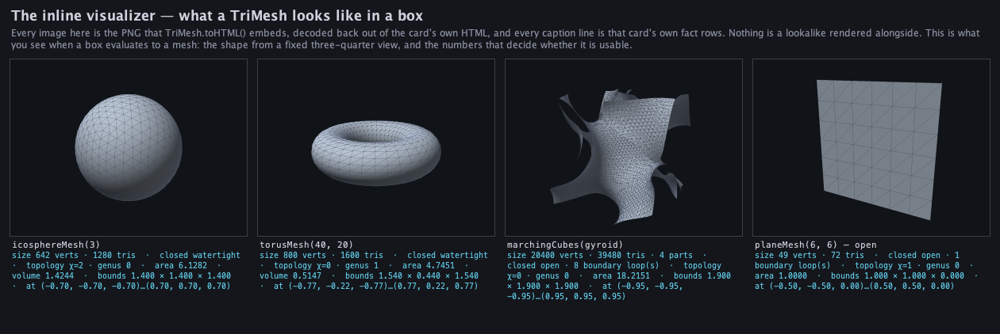
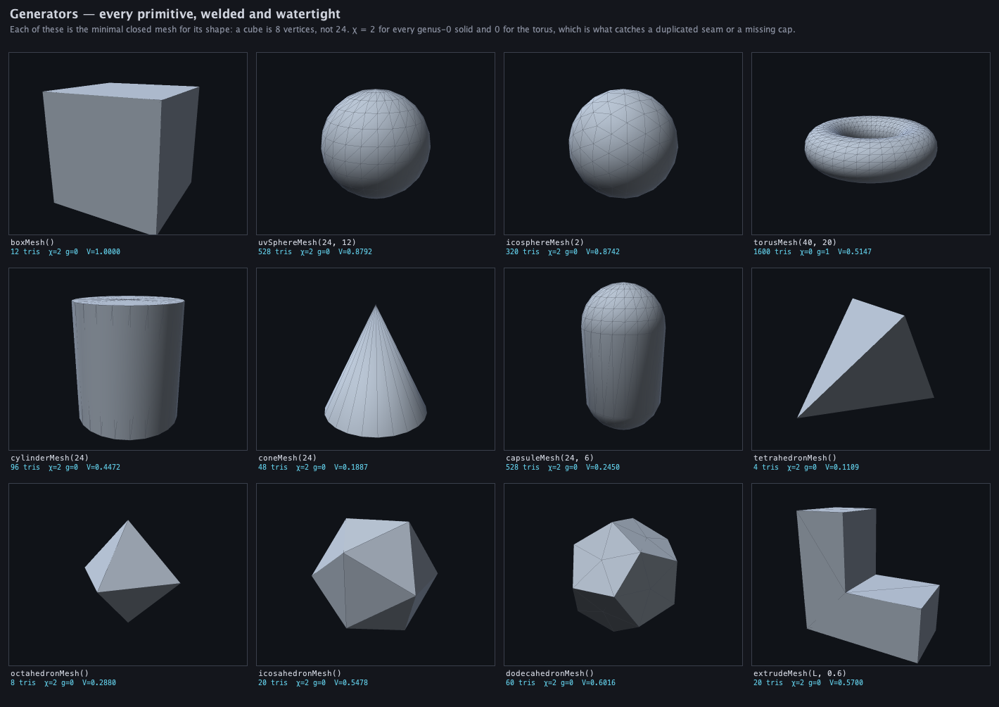
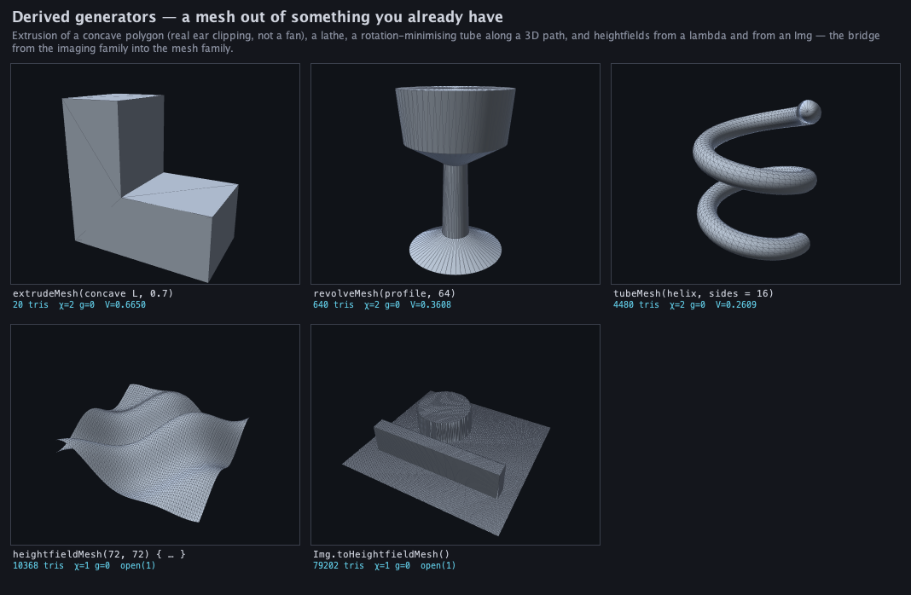
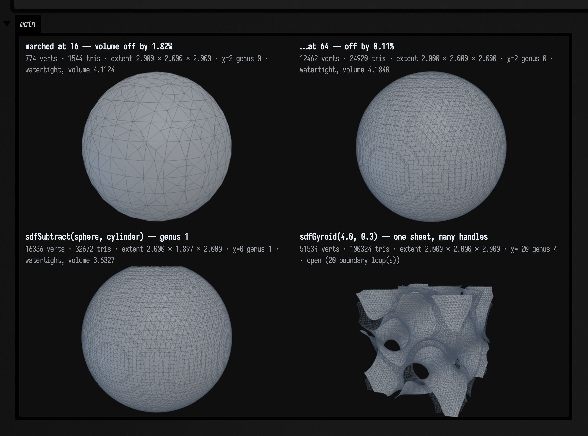
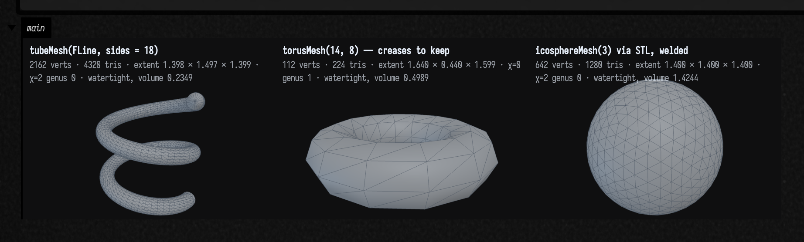
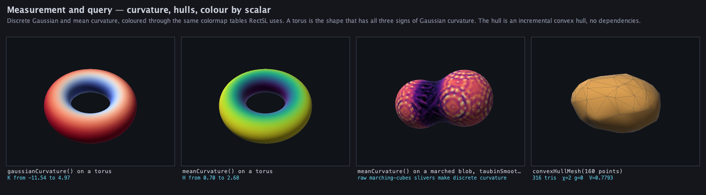
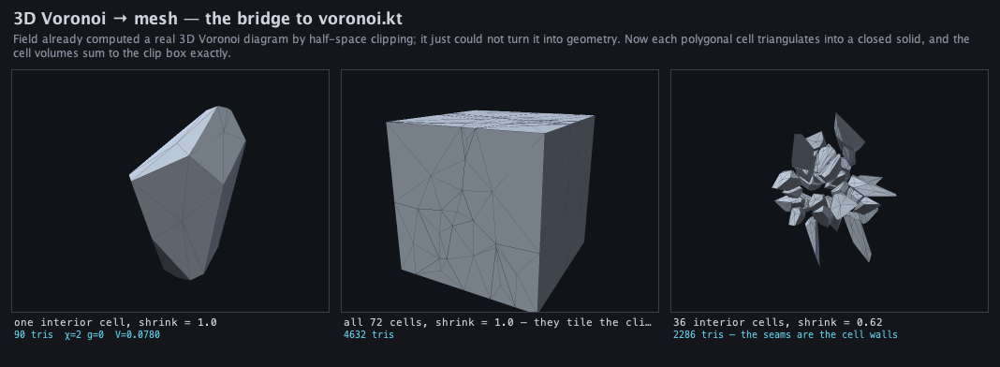

# Meshes and 3D geometry

*Every public declaration used below is listed, with its KDoc, in the codebase reference:
[`mesh.kt`](reference/index.md). Start from [what's already in the box](reference/index.md).*

Drawing in three dimensions is one thing. An [`FLine`](fline_examples.md) has a `z`, the renderer
takes triangles, the [ray tracer](ray_tracing_examples.md) intersects analytic solids. **Computing
with a surface** is another. Ask a mesh whether it is closed, subdivide it, smooth it without
deflating it, decimate it to a budget, measure its volume, shoot a ray at it, write it out for
another program to read.

`afield.stdlib` carries a CPU triangle-mesh family for that, built around a single value type,
`TriMesh`. It generates primitives, marches an SDF into a surface, works out a mesh's topology,
subdivides it (Loop), smooths it (Laplacian and Taubin), decimates it (QEM), welds it, measures its
curvature, raycasts it through a BVH, reads and writes OBJ and STL, and takes a convex hull. All of
it is pure Kotlin with no external dependency and no GPU, and all of it runs headless in a box. It is
the 3D counterpart to the raster [imaging family](imaging_examples.md) and is built the same way.

Two things about it shape the rest of this page. A `TriMesh` is a **value you can look at**. It
implements `ToHTML`, so ending a box on one draws it, with the numbers that decide whether it is
usable printed beside the picture:



And there is a hop back out: `toFLines(...)` turns a mesh into `FLine`s, so a wireframe, a crease set
or a normal field lands in the same drawing, animation and export machinery as anything you drew by
hand.

## The value type

```diffstatic {data-lang=kotlin}
TriMesh(positions, indices, normals = null, uvs = null, colors = null)
```

Flat `FloatArray`s (`positions` is `3 * vertexCount` floats, `indices` is `3 * triangleCount` ints),
with optional per-vertex `normals`, `uvs` and `colors`. Three choices in that shape change how the
type behaves:

- **Flat arrays, not a list of vertex objects.** `Vec3` in `afield.stdlib.linalg` is *mutable*, and a
  mesh built out of mutable vectors is an aliasing bug waiting to happen: transform one vertex twice
  because two triangles share it and the surface tears. So `TriMesh` stores floats and every accessor
  (`position(i)`, `faceNormal(t)`, `triangle(t)`) hands back a **fresh** `Vec3` that cannot write
  back into the mesh. `positionInto(i, dest)` is there for the inner loop that cares.
- **Immutable in practice.** Everything returns a new mesh: `translated`, `scaled`, `rotated`,
  `transformed { }`, `flipped`, `weld`, `loopSubdivide`, `decimate`. So a pipeline stays readable as
  one expression, and re-running a box gives you the same answer every time.
- **Topology is computed, not stored.** `topology()` builds the edge map, the vertex stars and the
  boundary loops on demand and caches the expensive parts lazily. The mesh itself stays a plain
  buffer that a GPU upload or a file writer can take verbatim.

The generators return the **minimal** closed mesh for their shape, which is a much stronger guarantee
than "it renders": a cube is 8 vertices and 12 triangles, not 24 and 12.



Four more generators build a mesh out of something you already have rather than out of parameters:
`extrudeMesh` (real ear clipping, so a *concave* polygon works and does not fan), `revolveMesh` (a
lathe), `tubeMesh` (a rotation-minimising sweep along a 3D path) and `heightfieldMesh`, which has a
lambda form and an `Img.toHeightfieldMesh()` form, and that second one is the bridge from the
[imaging family](imaging_examples.md) into this one. The two heightfields are the only panels here
that are open surfaces rather than closed solids, so they report χ=1 instead of 2. A heightfield has
a rim.



## Modelling with a field

The centrepiece of the family is the SDF path, because it is the one that makes a shape feel like an
**expression you can edit** rather than a thing you assembled. A `ScalarField3D` is a type alias for
`(Vec3) -> Float` (negative inside, positive outside), and every combinator is one line.

```diffstatic_runner {data-lang=kotlin screenshot="assets/mesh_examples/modelling.png" wait="2.5" capture="box" open-outputs="true" padding="20"}
:::static
// A shape as an expression. Every one of these is a (Vec3) -> Float; nothing is a mesh yet.
val ball = sdfSphere(0.8)
val bar = sdfBox(vec(2.2, 0.34, 0.34))
val sharp = sdfUnion(ball, bar)
val soft = sdfSmoothUnion(ball, bar, k = 0.3)              // the k is the fillet radius
val drilled = sdfSmoothSubtract(soft, sdfCylinder(0.28, 4.0), k = 0.1)
val twisted = sdfBox(vec(1.2, 1.8, 0.4)).twisted(0.35)

// marchingCubes samples the field once per grid corner and shares one vertex per crossed grid
// edge, so the surface it emits is closed rather than a triangle soup.
val window = boundsAround(radius = 1.35)
val sharpMesh = marchingCubes(sharp, window, 72)
val softMesh = marchingCubes(soft, window, 72)
val drilledMesh = marchingCubes(drilled, window, 72)
val twistedMesh = marchingCubes(twisted, boundsAround(radius = 1.2), 72)

// A shell looked at from outside is indistinguishable from the solid, so cut it open with a
// half-space: intersecting with sdfPlane keeps only the half you want and the wall becomes visible.
val shell = soft.shell(0.07)
val closedShell = marchingCubes(shell, window, 88)
val cutaway = marchingCubes(sdfIntersect(shell, sdfPlane(vec(0, 0, -1), 0.0)), window, 88)
:::fold print what each one came out as, then draw the six
// A fillet only ever ADDS material, so the smooth union must enclose more than the sharp one.
// That is a property you can assert rather than eyeball.
println("sharp union  volume %.5f".format(sharpMesh.signedVolume()))
println("smooth union volume %.5f  (the fillet adds %.5f)".format(
    softMesh.signedVolume(), softMesh.signedVolume() - sharpMesh.signedVolume()))
println("drilled      ${drilledMesh.summary()}")
println("twisted      ${twistedMesh.summary()}")
println("closed shell ${closedShell.summary()}")
println("cut open     ${cutaway.summary()}")

showMeshGrid(
    "sdfUnion(sphere, box)" to sharpMesh,
    "sdfSmoothUnion(…, k = 0.3)" to softMesh,
    "…then sdfSmoothSubtract(cylinder)" to drilledMesh,
    "sdfBox(…).twisted(0.35)" to twistedMesh,
    "shell(0.07) — closed, chi = 4" to closedShell,
    "…cut open by sdfPlane" to cutaway,
    columns = 2,
    cellWidth = 320,
)
:::endfold
```


Read the numbers rather than the shapes and the whole story is there. They are what the box
`println`s when you run it, quoted here because a `showMeshGrid` panel is labelled rather than
captioned. The sharp union encloses **2.2135** and the filleted one **2.2690**, because a fillet only
ever *adds* material. A test can assert that ordering; your eye cannot. Drilling through drops it to
**1.8805** and takes χ from 2 to **0**, genus 0 to **1**: the drill added a handle. The closed shell
reports **χ = 4**, which is exactly right, if odd at first: a shell is *two* nested closed surfaces,
an outer and an inner, and 2 + 2 = 4. Cutting it with a half-space glues them into one surface again
(χ = 2) and halves the *z* extent, from 1.739 to 0.870, which is how you know the cut actually
happened.

`showMeshGrid(...)` is the fastest way to see a whole pipeline: labelled panels side by side, in the
Three.js viewer, so in a live box you can orbit the whole sheet at once. It is one WebGL context
tiled into viewports rather than one iframe per panel. See [Field's 3D
output](three_output.md#one-webgl-context-several-panels). Pass `renderer = MeshRenderer.CPU` for a
static rasterized sheet instead.

Its panels carry a label and no fact line. The counts, extent, χ, genus and volume that the
single-mesh `showMesh` and the inline card print are not there, because `showMeshGrid` calls
`threeGrid` with `facts` left off. To get them under every panel, call `threeGrid(..., facts = true)`
directly, or hand it `ThreeMeshPanel(label, mesh, facts = "…")` cells with a sentence of your own;
[polytope_examples.md](polytope_examples.md) does the latter throughout.

The primitives are `sdfSphere`, `sdfBox`, `sdfRoundBox`, `sdfTorus`, `sdfPlane`, `sdfCylinder`,
`sdfCapsule`, `sdfGyroid` and `sdfMetaballs`. The combinators are `sdfUnion`, `sdfIntersect`,
`sdfSubtract`, `sdfInvert`, their three `sdfSmooth…` variants, `sdfExpUnion`, and the modifiers
`shell`, `rounded`, `translated`, `scaled`, `rotated`, `repeated`, `twisted` and `displaced`.
`gradient(p)` and `normalAt(p)` finite-difference the field where you need a direction.

## Looking at what you got

This is the part a mesh library usually leaves to your eyes, and eyes are bad at it. A duplicated
seam, a missing cap, an unwelded weld and a leaked marching-cubes surface all still render
plausibly. One integer catches all four: the **Euler characteristic** `V - E + F`, which is exactly 2
for any closed genus-0 solid and `2 - 2g` for genus *g*.

`summary()` prints the whole verdict in one line. The rest of the pieces are separately available:
`isWatertight()`, `isManifold()`, `eulerCharacteristic()`, `genus()`, `boundaryLoops()`,
`surfaceArea()`, `signedVolume()`, and `topology()` gives you the object they all delegate to.

The other half of "looking at what you got" is checking the geometry against an answer you already
know. A marched sphere is the best test case there is, because the volume it should converge to is
4/3 π:

```diffstatic_runner {data-lang=kotlin screenshot="assets/mesh_examples/convergence.png" wait="2.5" capture="box" open-outputs="true" padding="20"}
:::static
// Marching cubes is O(h^2) accurate, so the error should fall by ~4x each time the resolution
// doubles. Watch it: this is the check that tells you the marcher is right, not just plausible.
val exact = 4.0 / 3.0 * PI
println("resolution   tris    volume     relative error")
for (resolution in listOf(12, 24, 48, 64)) {
    val m = marchingCubes(sdfSphere(1.0), boundsAround(radius = 1.4), resolution)
    val error = abs(m.signedVolume() - exact) / exact
    println("%10d %7d %10.6f %14.5f   watertight=%s chi=%d".format(
        resolution, m.triangleCount, m.signedVolume(), error,
        m.isWatertight(), m.eulerCharacteristic()))
}
println("the analytic answer is 4/3 pi = $exact")

// Drilling straight through a solid adds a handle, so the genus goes from 0 to 1. That is the
// topology layer telling you something a picture cannot: the two look identical from outside.
val drilled = marchingCubes(
    sdfSubtract(sdfSphere(1.0), sdfCylinder(0.3, 4.0)),
    boundsAround(radius = 1.3), 64,
)
println()
println("drilled sphere: ${drilled.summary()}")

// A gyroid is a triply-periodic minimal surface: one sheet with many handles, so chi goes strongly
// negative. The marcher does not mind that the gyroid is not a distance function at all — it only
// ever looks at signs.
val gyroid = marchingCubes(sdfGyroid(4.0, 0.3), boundsAround(radius = 1.0), 56)
println("gyroid: ${gyroid.summary()}")
:::fold draw the coarse and fine spheres beside the two harder shapes
val coarse = marchingCubes(sdfSphere(1.0), boundsAround(radius = 1.4), 16)
val fine = marchingCubes(sdfSphere(1.0), boundsAround(radius = 1.4), 64)
fun err(m: TriMesh) = "%.2f%%".format(100.0 * abs(m.signedVolume() - exact) / exact)
showMeshGrid(
    "marched at 16 — volume off by ${err(coarse)}" to coarse,
    "…at 64 — off by ${err(fine)}" to fine,
    "sdfSubtract(sphere, cylinder) — genus 1" to drilled,
    "sdfGyroid(4.0, 0.3) — one sheet, many handles" to gyroid,
    columns = 2,
    cellWidth = 340,
)
:::endfold
```



The two spheres are the same field at two grid resolutions: **1544 triangles and a volume of
4.1124** at 16, **24920 and 4.1840** at 64, against an analytic 4/3 π = 4.18879. Both are watertight
with χ = 2, and the error falls from **1.82% to 0.11%**, roughly the O(*h*²) you should demand of a
marcher, and the printed table in the box carries all four resolutions. The drilled solid carries the
topology: it looks like a sphere from most angles and reports **χ = 0, genus 1**. The gyroid is the
awkward edge case (**χ = −20, genus 4, and *open*, with 20 boundary loops**) because the surface
runs out of the sampling box rather than closing inside it. `summary()` reports it as open, and
[Field's 3D output](three_output.md#one-scene-two-kinds-of-thing) draws those twenty loops over the
surface so you can see where they are.

**Why the surface is closed at all** takes a paragraph, because plain marching cubes leaks and the
leak is invisible until you count. Two cubes sharing a face can each pick a different
triangulation for the four crossings on that face; the two disagree and the surface tears there.
`marchingCubes` resolves that face with the **asymptotic decider**, which is a pure function of the
face's own four corner values, so the two cubes always agree. It also nudges a crossing off a grid
corner whose sample sits *exactly* on the iso level, a case that is not exotic at all (a unit sphere
on a 0.2 grid has corners at `(1,0,0)` and `(0.6,0.8,0)` precisely on it) and that otherwise
collapses every crossing out of that corner onto the corner itself.

## Subdivide, and smooth without shrinking

`loopSubdivide(times)` quadruples the triangles and preserves χ exactly, so a watertight input stays
watertight at the same genus. Smoothing needs more care: the naive answer is
subtly wrong and the mesh will not tell you unless you measure it.

A Laplacian pass moves every vertex toward the average of its neighbours. That is **diffusion**, and
diffusion of a closed surface deflates it: run it long enough and the shape collapses to a point.
Taubin's fix is to alternate a positive shrinking step `lambda` with a slightly larger negative
inflating step `mu`, chosen so the pair is a low-pass filter with unity gain in the passband. The
noise still goes; the volume stays.

```diffstatic_runner {data-lang=kotlin screenshot="assets/mesh_examples/process.png" wait="3.0" capture="box" open-outputs="true" padding="20"}
:::static
// Loop subdivision converges on the Loop LIMIT surface, not on the sphere its control vertices sit
// on, so the volume falls monotonically in geometrically shrinking steps. chi never moves.
var control = icosahedronMesh(0.8)
val rounds = ArrayList<TriMesh>()
:::fold subdivide three times, printing the volume step each round
println("round  tris    volume     step")
var previous = control.signedVolume()
println("%5d %6d %10.5f".format(0, control.triangleCount, previous))
for (round in 1..3) {
    control = control.loopSubdivide(1)
    rounds.add(control)
    val v = control.signedVolume()
    println("%5d %6d %10.5f %9.5f   chi=%d".format(
        round, control.triangleCount, v, v - previous, control.eulerCharacteristic()))
    previous = v
}
:::endfold

// Now the smoothing comparison. Same input, same iteration count, same lambda — the only
// difference is Taubin's second, inflating pass.
val rng = java.util.Random(7)
val clean = icosphereMesh(3, 0.8)
val noisy = clean.transformed { p ->
    val s = 1f + (rng.nextFloat() - 0.5f) * 0.18f          // 18% radial noise
    vec(p.x * s, p.y * s, p.z * s)
}.withVertexNormals()
val laplacian = noisy.laplacianSmooth(iterations = 30, lambda = 0.6)
val taubin = noisy.taubinSmooth(iterations = 30, lambda = 0.6, mu = -0.63)
:::fold print the four volumes — this is the whole point — and draw the six meshes
println()
println("clean     volume %.5f".format(clean.signedVolume()))
println("noisy     volume %.5f".format(noisy.signedVolume()))
println("laplacian volume %.5f  <- a diffusion deflates the ball".format(laplacian.signedVolume()))
println("taubin    volume %.5f  <- the lambda/mu pair holds it".format(taubin.signedVolume()))

showMeshGrid(
    "icosahedronMesh() control" to icosahedronMesh(0.8),
    "loopSubdivide(1)" to rounds[0],
    "loopSubdivide(3)" to rounds[2],
    "+18% radial noise" to noisy,
    "laplacianSmooth(30) — deflated" to laplacian,
    "taubinSmooth(30) — volume held" to taubin,
    columns = 3,
    cellWidth = 290,
)
:::endfold
```


The picture will not settle the two smoothed balls for you: **look at the printed volumes, not at the
panels.** Each panel of a `showMeshGrid` frames its own bounds and zoom-to-fits, so the Laplacian
ball's 20% smaller extent is normalised straight back out and the two come out the same apparent
size.
The noisy input encloses **2.1293** across an extent of 1.701. Thirty Laplacian iterations at λ = 0.6
leave **1.1509** across 1.301: it has thrown away **46% of the volume**. Thirty Taubin iterations of
the same λ, with μ = −0.63, leave **2.1840** across 1.631, within about 3% of the clean ball this
noise was added to, and, at 1280 triangles and χ = 2 throughout, just as smooth. Reach for Taubin
whenever the volume has to survive the smoothing.

The top row has a second lesson in it. The volume falls 1.2985 → 0.8518 → … → 0.7490
and does *not* stop at the sphere the icosahedron's vertices sit on, because Loop subdivision
converges on the **Loop limit surface**, not on whatever you imagined the control mesh approximated.
The steps shrink geometrically and χ never moves off 2.

Both smoothers take `cotangent = true` for the cotangent-weighted Laplacian, which is the right
choice on an irregular triangulation because it weights by the geometry rather than by valence, and
`withVertexNormals()` recomputes the shading normals afterwards.

## Decimate to a budget, and know the price

`decimate(targetTriangles)` is quadric-error-metric edge collapse: each vertex accumulates the
quadric of its incident face planes, every candidate collapse is scored by the error at its optimal
position, and the cheapest is taken until the budget is met. Collapses are vetoed by the **link
condition** (so the mesh cannot go non-manifold), by a normal-flip test, and by a shape test that
defers a collapse which would produce a sliver.

You get the triangle count you asked for, so the number to judge a decimation by is the *deviation*:
how far either mesh's vertices sit from the other's surface. `maxDeviation(a, b)` reports it
symmetrically, so a decimation cannot look good by having simply shrunk inside the original.

```diffstatic_runner {data-lang=kotlin screenshot="assets/mesh_examples/decimate.png" wait="3.0" capture="box" open-outputs="true" padding="20"}
:::static
val detailed = icosphereMesh(4, 0.8)          // 5120 triangles
println("start: ${detailed.summary()}")
println()
println("target    got   deviation   min angle   watertight")

val budgets = ArrayList<Pair<String, TriMesh>>()
for (target in listOf(2000, 600, 150)) {
    val small = detailed.decimate(target)
    // Symmetric: the largest distance either mesh's vertices sit from the other's surface.
    val deviation = maxDeviation(detailed, small)
    println("%6d %6d %11.5f %11.1f   %s".format(
        target, small.triangleCount, deviation,
        small.quality().minAngleDegrees, small.isWatertight()))
    budgets.add("decimate($target) — deviation ${"%.4f".format(deviation)}" to small)
}
:::fold draw the original beside the three budgets
showMeshGrid(
    "icosphereMesh(4) — ${detailed.triangleCount} tris" to detailed,
    budgets[0].first to budgets[0].second,
    budgets[1].first to budgets[1].second,
    budgets[2].first to budgets[2].second,
    columns = 2,
    cellWidth = 340,
)
:::endfold
```


Every budget is hit **exactly** (2000, 600 and 150 triangles) and all three stay watertight at
χ = 2, which is the link condition doing its job. The volume drifts from 2.1400 down to 2.1252,
2.0860 and 2.0724 (the collapses cut corners off a convex solid, so it can only lose). The number to
budget against is the deviation in each panel heading: **0.0047** at 2000 triangles, **0.0166** at 600
and **0.0326** at 150, on a ball of radius 0.8, so a 34× reduction costs you about 4<!--derive: 0.0326/0.8*100-->% of the radius.
The deviation grows *slower* than the triangle count falls. Decimation trades on that asymmetry.

`quality()` is the other half of that judgement: minimum and mean triangle angle, aspect ratio,
degenerate count. A decimator that hits its budget by producing slivers has not helped you, and the
minimum angle is where that shows up first.

## Drawing it, and writing it out

`toFLines(mode)` is the bridge back into Field. Five modes:

| mode | what you get |
|---|---|
| `MeshLines.EDGES` | every unique edge, one `FLine` each — the full wireframe |
| `MeshLines.CREASES` | only edges where the two faces disagree by more than `creaseAngleDegrees`, plus every boundary edge |
| `MeshLines.BOUNDARY` | the boundary loops, as closed `FLine`s — empty for a watertight mesh |
| `MeshLines.NORMALS` | one short segment per vertex along its normal — a normal-field debugger |
| `MeshLines.FACES` | one closed triangle per face; draws each edge twice, but keeps faces apart |

`CREASES` is the one that makes a drawing readable: on a smooth mesh the full wireframe is a grey mat
and the crease set is correctly empty, while on a faceted or CSG solid the creases are exactly the
silhouette you would have drawn by hand. Once you have `FLine`s, everything else in Field applies:

```diffstatic {data-lang=kotlin}
lines(mesh.toFLines(MeshLines.CREASES, creaseAngleDegrees = 30.0))
```

Going the other way, `tubeMesh(fline, radius, sides, samples, caps)` sweeps a tube along an `FLine`
using rotation-minimising frames rather than Frenet frames, so it does not twist where the path's
curvature swings through vertical.

For files: `toObj(name)` / `objToTriMesh(text)` and `toStlAscii` / `toStlBinary` /
`stlToTriMesh(bytes)`, plus `saveObj(file)`, `saveStl(file)` and `triMeshFromObj(file)`. The
two formats differ in what you get back. OBJ keeps the index structure, so a watertight mesh
round-trips watertight. **STL is triangle soup** (three unshared vertices per triangle, no indices at
all), so it comes back with 3× the vertices and `isWatertight()` false until you `weld(1e-5)` it. Both
recover the volume exactly.

Shading normals are a **choice rather than a property**, and the choice changes the vertex count. A
generator ships without normals when its vertices sit on a crease, and then `flatShaded()` splits
every one, `shadedNormals(creaseAngleDegrees = 35.0)` splits only across creases, and
`withVertexNormals()` shares them all: 144, 50 and 26 vertices for the same 12-sided cylinder, from a
hard-faceted tube to one with a rounded-off rim:


OBJ and STL are the two formats this family reads and writes without a dependency; PLY, glTF and GLB
read as well. [Geometry from disk](geometry_from_disk.md) is the route from any format to pixels: one
call per format, a measured table of what each one loses in each direction, and a list of what
cannot be read at all (STEP and every other CAD boundary representation).

```diffstatic_runner {data-lang=kotlin screenshot="assets/mesh_examples/bridges.png" wait="3.0" capture="box" open-outputs="true" padding="20"}
:::static
// A tube swept along an FLine: rotation-minimising frames, so it does not twist where the path's
// curvature swings through vertical.
val path = FLine()
for (i in 0..120) {
    val t = i / 120.0
    val a = 2.0 * PI * 2.0 * t
    val p = vec(cos(a) * 0.6, (t - 0.5) * 1.3, sin(a) * 0.6)
    if (i == 0) path.moveTo(p) else path.lineTo(p)
}
val coil = tubeMesh(path, radius = 0.1, sides = 18, samples = 120, caps = true)
println("tube along an FLine: ${coil.summary()}")

// A coarse torus, so there really are creases to keep. On a fine one the crease set is empty,
// which is the correct answer and a dull demonstration.
val ring = torusMesh(14, 8, 0.6, 0.22)
println("torus: ${ring.toFLines(MeshLines.EDGES).size} edges, " +
    "${ring.toFLines(MeshLines.CREASES, creaseAngleDegrees = 30.0).size} creases at 30 degrees, " +
    "${ring.toFLines(MeshLines.NORMALS).size} normals")
val patch = planeMesh(6, 6, 1.2, 1.2)
println("plane patch: ${patch.toFLines(MeshLines.BOUNDARY).size} boundary loop(s), " +
    "${patch.toFLines(MeshLines.BOUNDARY).firstOrNull()?.nodes?.size} nodes around it")

// OBJ keeps the indices; STL is soup and needs a weld. Both must recover the volume exactly.
val source = icosphereMesh(3, 0.7)
val viaObj = objToTriMesh(source.toObj("ball"))
val viaStl = stlToTriMesh(source.toStlBinary())
println()
println("source     ${source.vertexCount} verts  volume %.6f".format(source.signedVolume()))
println("via OBJ    ${viaObj.vertexCount} verts  volume %.6f  watertight ${viaObj.isWatertight()}".format(
    viaObj.signedVolume()))
println("via STL    ${viaStl.vertexCount} verts  volume %.6f  watertight ${viaStl.isWatertight()}".format(
    viaStl.signedVolume()))
println("STL welded ${viaStl.weld(1e-5).vertexCount} verts  watertight ${viaStl.weld(1e-5).isWatertight()}")
:::fold draw the coil beside the coarse torus and the STL round trip
showMeshGrid(
    "tubeMesh(FLine, sides = 18)" to coil,
    "torusMesh(14, 8) — creases to keep" to ring,
    "icosphereMesh(3) via STL, welded" to viaStl.weld(1e-5),
    columns = 3,
    cellWidth = 250,
)
:::endfold
```



The coil is the frame test: 4320 triangles, watertight, χ = 2, and no twist anywhere along the helix
even though the path's curvature swings through vertical twice. The round-tripped sphere comes back
at **642 vertices, watertight, χ = 2, volume 1.4244**, the same 642 vertices it started with, after
having been flattened to 3840 unshared ones by the STL writer and welded back.

## Measuring and querying

`surfaceArea()`, `signedVolume()` (the divergence-theorem sum, so it is *signed*: an inside-out
closed mesh reports a negative volume, which is the only thing that will tell you), `centroid()` for
the area-weighted surface centroid and `solidCentroid()` for the enclosed solid's.

Discrete curvature: `gaussianCurvature()` is the angle deficit and `meanCurvature()` the cotangent
Laplacian's magnitude, both divided by the mixed Voronoi area from `mixedVertexAreas()`. On a sphere
of radius *r* they are 1/*r*² and 1/*r*. A torus is the shape to look at, because its Gaussian
curvature has both signs, positive on the outside and negative in the hole:



The global check is **Gauss–Bonnet**: the integral of Gaussian curvature over a closed surface is
exactly 2πχ. No local sign error or area-weighting bug survives it, so it is the assertion to put in
a test.

```diffstatic {data-lang=kotlin}
val k = mesh.gaussianCurvature()
val areas = mesh.mixedVertexAreas()
val total = (0 until mesh.vertexCount).sumOf { k[it] * areas[it] }   // == 2 * PI * chi
```

`bvh()` builds a bounding-volume hierarchy and turns every useful query from O(*n*) into O(log *n*):
`raycast(origin, direction)`, `raycastAll(...)`, `closestPoint(query)`, `contains(query)` (a parity
test, so it needs a watertight mesh) and `signedDistance(query)`. `asSdf()` hands the whole thing
back as a `ScalarField3D`, which closes the loop: you can march a mesh's own signed distance field
and get a remeshed version of it. There are `TriMesh.raycast` / `closestPoint` / `contains`
shorthands that build a throwaway BVH, fine for one query and wrong for a loop.

`convexHullMesh(points)` is an incremental hull with no dependencies, and
`deviationFrom` / `maxDeviation` / `isContainedIn` / `samplePoints` are the comparison tools.

## A Voronoi diagram as solids

`voronoi3d(...)` clips half-spaces and hands back `VoronoiCell3`s with polygonal faces.
`VoronoiCell3.toTriMesh(shrink)` and `VoronoiLattice.toTriMesh(shrink, boundedOnly)` turn those into
geometry you can measure, cut, export or print. Because a Voronoi tessellation partitions its clip box
*exactly*, there is a one-line total check on the result: the cell volumes must sum to the box's own
volume.



```diffstatic {data-lang=kotlin}
val lattice = Voronoi3d.build(sites, clipPadding = 0.15f)
val total = lattice.cells.sumOf { abs(it.toTriMesh(shrink = 1.0).signedVolume()) }
// total agrees with the clip box's volume to ~1e-8 relative
showMeshGrid(
    "all the cells" to lattice.toTriMesh(shrink = 1.0),
    "the interior cells, exploded" to lattice.toTriMesh(shrink = 0.6, boundedOnly = true),
    columns = 2,
)
```

Face membership in `src/jvmMain/kotlin/afield/stdlib/voronoi.kt` is combinatorial rather than metric: a corner records which three
planes produced it, and a face's polygon is exactly the corners recording that plane. That matters
around a near-cospherical site cluster, where the genuine corners sit closer together than any
usable distance tolerance, and a face decided by proximity claims corners that are not its own and
fails to close. `dev_docs/MESH_GEOMETRY.md` has the measurements.

## Recipes

<div class="field-data-table" markdown>

<div data-code-lang="kotlin" markdown>

| Task | Call | What to expect |
| --- | --- | --- |
| a shape from an equation | `marchingCubes(field, boundsAround(radius = r), resolution)` | Extracts the zero surface of a scalar field within the supplied bounds. Increase resolution to resolve finer geometry, at greater sampling cost. |
| is this mesh usable? | `println(mesh.summary())` | Reports mesh counts, extent and topology measurements. Inspect it before treating imported geometry as a closed solid. |
| a mesh from a photo or a heightfield | `img.toHeightfieldMesh(scale = 0.25)` or `heightfieldMesh(nx, nz) { x, z -> h }` | Builds a sampled height surface from image values or a function. The result is a heightfield rather than a closed volume. |
| a lathed profile | `revolveMesh(profile, segments)` | Revolves a profile around an axis. Segment count controls angular tessellation. |
| a swept tube along a path | `tubeMesh(fline, radius, sides, samples)` | Sweeps a polygonal cross-section along the path. Radius sets thickness, sides sets the cross-section detail and samples sets path resolution. |
| smooth without shrinking | `taubinSmooth(iterations = 30, lambda = 0.6, mu = -0.63)` | Alternates smoothing passes to reduce shrinkage. Compare the result with the original when feature preservation matters. |
| more detail | `loopSubdivide(2)` | Subdivides triangle connectivity twice. This adds mesh detail and changes the surface; it does not recover detail absent from the source. |
| less detail, bounded error | `decimate(target)` then `maxDeviation(original, small)` | Reduces the mesh toward the requested target, then measures deviation from the original. Treat the measurement as a check on the chosen simplification. |
| hard edges for a renderer | `flatShaded()`, or `shadedNormals(creaseAngleDegrees = 35.0)` | Creates flat face normals or splits shading at the chosen crease angle in degrees. This controls visible hard edges separately from topology repair. |
| soft edges | `withVertexNormals()` | Computes shared vertex normals for smooth shading. It does not weld disconnected vertices or close holes. |
| a mesh that came in broken | `repaired(1e-6)` (weld, drop degenerates, fix winding) | Welds nearby vertices, removes degenerate triangles and repairs winding. Check topology afterwards; repair is not proof that an arbitrary input became a valid solid. |
| just the biggest piece | `largestComponent()` | Keeps the largest connected component. Smaller disconnected pieces are removed. |
| draw it in Field | `lines(mesh.toFLines(MeshLines.CREASES))` | Extracts crease edges as line geometry for a Field drawing. This emphasizes sharp changes in surface direction. |
| colour it by a per-vertex number | `coloredByScalar(values, "coolwarm")` | Maps one scalar per vertex through the chosen palette. Keep the value array aligned with the mesh’s vertex indices. |
| an outline, not a solid | `toFLines(MeshLines.BOUNDARY)` | Extracts open boundary edges. A watertight mesh has no such boundary outline. |
| hand it to another program | `mesh.saveObj(File("out.obj"))` | Writes the mesh as OBJ. Choose a format according to which normals, colours and material data need to survive. |
| point-in-solid, many times | `val tree = mesh.bvh()` then `tree.contains(p)` | Builds an acceleration structure once for repeated inside tests. Reuse it while the mesh geometry is unchanged. |
| the mesh's own distance field | `mesh.bvh().asSdf()` | Turns mesh distance queries into a scalar field. This lets a mesh participate in field-based modelling. |
| a normalised mesh for a thumbnail | `mesh.normalized(1.0)` | Rescales and centres a mesh for display. Use this on a copy when the original dimensions have physical meaning. |

</div>

</div>

## Where the pictures come from

The figures come by two routes, which cost different amounts to produce:

| figure | how |
|---|---|
| the five `diffstatic_runner` fences above | **executed by the docs build**; the image under each is that box's own output, drawn by the Three.js viewer that `showMeshGrid` uses |
| `assets/mesh_gallery/*.png` (six figures) | **committed captures** from the `mesh.gallery` FIELD_TEST: `MESH_GALLERY_DIR=public/docs/assets/mesh_gallery python3 tools/run_field_tests.py --id mesh.gallery --port 9700`. These are composited from `renderPixels`, so they show the **CPU rasterizer** rather than the viewer. The gallery renders eleven figures; the five not shown here are the ones the `diffstatic_runner` fences above already cover live, and they stay in `dev_docs/assets/mesh_gallery/` |

Both routes show the output as of when it was taken, so regenerate them after changing the family.
The gallery is also what guards the family continuously. It **fails** if the invariants break: if a
generator stops being watertight, if a marched sphere's volume error stops falling with resolution,
if a decimation misses its budget, if Gauss–Bonnet stops matching 2πχ, or if the Voronoi cells stop
tiling their clip box.

??? aside "Neither route notices on its own when the code moves underneath it"
    A `diffstatic_runner` fence is re-executed only when the build decides its capture is out of date, and
    that decision comes from a fixed digest list (`RUNNER_DIGEST_SOURCE_FILES` in `public/docs_hooks.py`)
    which covers the runner's own machinery and no stdlib source at all. So editing `mesh_*.kt` leaves every
    digest unchanged, an incremental build is a cache hit, and the fences are not re-run;
    `FIELD_DOCS_RUNNER_MODE=always` forces them. The six gallery figures are committed PNGs with the same
    property: they need `mesh.gallery` re-run to reflect a change.

There is a third route for playing with it rather than reading it: replay
`dev_docs/agents/transcripts/mesh_geometry_examples.yaml` into a fresh Field with the agent backdoor
(`field_run_transcript`) and you get seven live boxes covering the same ground. Change a resolution, a
smoothing parameter or an SDF expression, re-run the box, and watch it update. See
[Agent transcripts](agent_transcripts.md).

## Reference

<div data-code-lang="kotlin" markdown>

### Value type

Construct indexed triangle meshes and transform or colour them. These operations work on mesh values without requiring a renderer.

<div class="field-reference" data-code-lang="kotlin" markdown>

| Entry point | Behavior |
| --- | --- |
| `TriMesh` | An indexed triangle mesh: `vertexCount * 3` position floats, `triangleCount * 3` indices, and optional matching normal / uv / colour arrays. [API](reference/graphics.md#mesh-kt). |
| `TriMeshBuilder` | The accumulator every generator in this family is written against: append vertices, append triangles that reference them, `build`. [API](reference/graphics.md#mesh-kt). |
| `inline fun triMesh(block: TriMeshBuilder.() -> Unit): TriMesh` | Run `block` against a fresh [`TriMeshBuilder`](reference/graphics.md#mesh-kt-trimeshbuilder) and `TriMeshBuilder.build` the result. [API](reference/graphics.md#mesh-kt). |
| `fun position(i: Int): Vec3` | A **fresh** `Vec3` holding vertex `i`'s position — mutating it does not touch the mesh. [API](reference/graphics.md#mesh-kt). |
| `val triangle: Int` | Index of the triangle that was hit. [API](reference/graphics.md#mesh-measure-kt). |
| `fun faceNormal(t: Int): Vec3` | Triangle `t`'s geometric normal from its winding — `normalize((b-a) x (c-a))`. [API](reference/graphics.md#mesh-kt). |
| `fun triangleArea(t: Int): Double` | Triangle `t`'s area — half the length of the cross product, in double precision. [API](reference/graphics.md#mesh-kt). |
| `fun vertices(): List<Vec3>` | All vertex positions as fresh vectors — convenient, but allocates one per vertex. [API](reference/graphics.md#mesh-kt). |
| `fun withColor(r: Number, g: Number, b: Number): TriMesh` | This mesh painted a single flat colour — the fast way to make a preview readable. [API](reference/graphics.md#mesh-kt). |
| `fun coloredBy(f: (Vec3) -> Vec3): TriMesh` | This mesh with per-vertex colours from a function of position. [API](reference/graphics.md#mesh-kt). |
| `fun transformed(f: (Vec3) -> Vec3): TriMesh` | Every vertex position through `f`, indices unchanged. [API](reference/graphics.md#mesh-kt). |
| `fun translated(d: Vec3): TriMesh` | Translated by a vector. [API](reference/graphics.md#mesh-kt). |
| `fun scaled(s: Number): TriMesh` | Uniformly scaled about the origin. [API](reference/graphics.md#mesh-kt). |
| `fun rotated(q: Quat): TriMesh` | Rotated by a [`Quat`](reference/math.md#linalg-kt-quat). Rigid, so the normals are rotated with the positions rather than dropped. [API](reference/graphics.md#mesh-kt). |
| `fun flipped(): TriMesh` | Every triangle wound the other way, and every normal negated — an inside-out copy. [API](reference/graphics.md#mesh-kt). |
| `fun filterTriangles(keep: (Int) -> Boolean): TriMesh` | A mesh made of the triangles `keep` accepts, with the now-unused vertices removed and the indices renumbered. Attributes follow their vertices. [API](reference/graphics.md#mesh-kt). |
| `operator fun plus(other: TriMesh): TriMesh` | Two meshes as one, `other`'s indices shifted past this one's vertices. [API](reference/graphics.md#mesh-kt). |

</div>

### Topology

Inspect connectivity before treating a mesh as a solid.

<div class="field-reference" data-code-lang="kotlin" markdown>

| Entry point | Behavior |
| --- | --- |
| `MeshTopology` | Cached connectivity for one [`TriMesh`](reference/graphics.md#mesh-kt-trimesh). [API](reference/graphics.md#mesh-topology-kt). |
| `val topology: MeshTopology` | The topology this diagnosis reads. Shared, so ask it your own questions rather than rebuilding. [API](reference/graphics.md#mesh-repair-kt). |
| `val isWatertight: Boolean` | True when the mesh is manifold and has no boundary — a closed surface enclosing a volume. [API](reference/graphics.md#mesh-topology-kt). |
| `val isManifold: Boolean` | True when every edge has one or two triangles and every vertex star is a single fan. [API](reference/graphics.md#mesh-topology-kt). |
| `val isConsistentlyOriented: Boolean by lazy` | True when neighbouring triangles agree about which side is out: every interior edge is traversed in **opposite** directions by its two triangles. [API](reference/graphics.md#mesh-topology-kt). |
| `val eulerCharacteristic: Int` | `V - E + F` over the vertices triangles actually use. [API](reference/graphics.md#mesh-topology-kt). |
| `val genus: Int?` | Genus from `χ = 2c - 2g - b` — the number of handles, `1` for a torus, `2` for a two-holed solid — where `c` is `componentCount` and `b` the number of `boundaryLoops`. [API](reference/graphics.md#mesh-topology-kt). |
| `val boundaryLoops: List<BoundaryLoopInfo>` | Every open boundary loop, measured — see [`BoundaryLoopInfo`](reference/graphics.md#mesh-repair-kt-boundaryloopinfo). Largest first. [API](reference/graphics.md#mesh-repair-kt). |
| `val components: List<MeshComponentInfo>` | Each connected piece, measured — see [`MeshComponentInfo`](reference/graphics.md#mesh-repair-kt-meshcomponentinfo). Largest first. [API](reference/graphics.md#mesh-repair-kt). |
| `fun TriMesh.weld(tolerance: Double = 1e-6): TriMesh` | Merge vertices closer together than `tolerance` and renumber the triangles onto the survivors. [API](reference/graphics.md#mesh-topology-kt). |
| `fun TriMesh.fixWinding(): TriMesh` | Make the winding consistent across the whole mesh, then make it point **outward**. [API](reference/graphics.md#mesh-topology-kt). |
| `fun TriMesh.removeDegenerateTriangles(areaEpsilon: Double = 1e-14): TriMesh` | Drop triangles with no area — a repeated index, or three collinear corners — and any vertex that leaves unreferenced. [API](reference/graphics.md#mesh-topology-kt). |
| `fun TriMesh.removeUnusedVertices(): TriMesh` | Drop vertices no triangle references, renumbering the rest. [API](reference/graphics.md#mesh-topology-kt). |
| `fun TriMesh.repaired(tolerance: Double = 1e-6): TriMesh` | Weld, drop degenerate triangles, drop unused vertices and fix the winding — the one call to make before trusting a mesh that came from a file, a scanner, or a per-cell generator. [API](reference/graphics.md#mesh-topology-kt). |
| `fun TriMesh.largestComponent(): TriMesh` | The largest connected component, by triangle count — the usual way to throw away the specks a noisy iso-surface leaves around the shape you wanted. [API](reference/graphics.md#mesh-topology-kt). |

</div>

### Generators

Build a starting shape from primitives, profiles or a height field.

<div class="field-reference" data-code-lang="kotlin" markdown>

| Entry point | Behavior |
| --- | --- |
| `fun boxMesh(sizeX: Number = 1.0, sizeY: Number = 1.0, sizeZ: Number = 1.0): TriMesh` | An axis-aligned box centred on the origin, 8 vertices and 12 triangles — the minimal watertight cube. [API](reference/graphics.md#mesh-generate-kt). |
| `fun cubeMesh(size: Number = 1.0): TriMesh` | A cube: `boxMesh` with all three extents equal to `size`. [API](reference/graphics.md#mesh-generate-kt). |
| `fun planeMesh(nx: Int = 1, ny: Int = 1, width: Number = 1.0, height: Number = 1.0): TriMesh` | A rectangular grid of quads in the `xy` plane at `z = 0`, facing `+z`, with normals and uvs. [API](reference/graphics.md#mesh-generate-kt). |
| `fun uvSphereMesh(segments: Int = 32, rings: Int = 16, radius: Number = 1.0): TriMesh` | A latitude/longitude sphere: two pole vertices and `rings - 1` rows of `segments`. [API](reference/graphics.md#mesh-generate-kt). |
| `fun icosphereMesh(subdivisions: Int = 2, radius: Number = 1.0): TriMesh` | A geodesic sphere: an icosahedron with each triangle split into four `subdivisions` times, every vertex pushed out to `radius`. [API](reference/graphics.md#mesh-generate-kt). |
| `fun torusMesh(majorSegments: Int = 48, minorSegments: Int = 24, majorRadius: Number = 1.0, minorRadius: Number = 0.35): TriMesh` | A torus in the `xz` plane: `majorRadius` out to the centre of the tube, `minorRadius` the tube itself. Watertight, smooth normals, and the family's canonical **genus 1** shape — `χ = 0`, `MeshTopology.genus` `1`. [API](reference/graphics.md#mesh-generate-kt). |
| `fun cylinderMesh(segments: Int = 32, radius: Number = 0.5, height: Number = 1.0, caps: Boolean = true): TriMesh` | A cylinder along `y`, centred on the origin. Watertight with `caps` (`χ = 2`); an open tube without them (`χ = 0`, two boundary loops). [API](reference/graphics.md#mesh-generate-kt). |
| `fun coneMesh(segments: Int = 32, radius: Number = 0.5, height: Number = 1.0, cap: Boolean = true): TriMesh` | A cone along `y` with its apex at `+height/2` and its base at `-height/2`. Watertight with `cap` (`χ = 2`). No normals — the apex is a genuine singularity. [API](reference/graphics.md#mesh-generate-kt). |
| `fun capsuleMesh(segments: Int = 32, rings: Int = 8, radius: Number = 0.4, height: Number = 1.0): TriMesh` | A capsule (cylinder with hemispherical ends) along `y`: total length `height + 2 * radius`. [API](reference/graphics.md#mesh-generate-kt). |
| `fun tetrahedronMesh(radius: Number = 1.0): TriMesh` | A regular tetrahedron with its vertices on a sphere of `radius`. 4 vertices, 4 triangles, `χ = 2`. No normals — every face is a crease. [API](reference/graphics.md#mesh-generate-kt). |
| `fun octahedronMesh(radius: Number = 1.0): TriMesh` | A regular octahedron with its 6 vertices on a sphere of `radius`. 8 triangles, `χ = 2`. [API](reference/graphics.md#mesh-generate-kt). |
| `fun icosahedronMesh(radius: Number = 1.0): TriMesh` | A regular icosahedron with its 12 vertices on a sphere of `radius`. 20 triangles, `χ = 2`. [API](reference/graphics.md#mesh-generate-kt). |
| `fun dodecahedronMesh(radius: Number = 1.0): TriMesh` | A regular dodecahedron with its 20 vertices on a sphere of `radius`, as 12 pentagons fanned from their own centres — 32 vertices, 60 triangles, `χ = 2`. [API](reference/graphics.md#mesh-generate-kt). |
| `fun triangulatePolygon(polygon: List<Vec2>): List<Int>` | Ear-clipping triangulation of a simple (non-self-intersecting) polygon. [API](reference/graphics.md#mesh-generate-kt). |
| `fun polygonMesh(polygon: List<Vec2>): TriMesh` | A flat, triangulated polygon in the `xy` plane at `z = 0`, facing `+z`. Concave polygons are handled (`triangulatePolygon`). A disc: `χ = 1`, one boundary loop. [API](reference/graphics.md#mesh-generate-kt). |
| `fun extrudeMesh(polygon: List<Vec2>, height: Number = 1.0, caps: Boolean = true): TriMesh` | A prism: `polygon` in the `xy` plane swept along `+z` by `height`. [API](reference/graphics.md#mesh-generate-kt). |
| `fun revolveMesh(profile: List<Vec2>, segments: Int = 48, turns: Double = 1.0): TriMesh` | A lathe: a 2D `profile` of `(radius, y)` points swept around the **`y` axis**. [API](reference/graphics.md#mesh-generate-kt). |
| `fun heightfieldMesh(nx: Int = 64, nz: Int = 64, width: Number = 2.0, depth: Number = 2.0, height: (Float, Float) -> Float): TriMesh` | A landscape: a grid in the `xz` plane whose `y` comes from `height`, with computed normals and uvs. [API](reference/graphics.md#mesh-generate-kt). |
| `fun Img.toHeightfieldMesh(scale: Number = 0.25, width: Number = 2.0, depth: Number? = null, step: Int = 1): TriMesh` | A heightfield sampled from an [`Img`](reference/imaging.md#imaging-kt-img) — one grid vertex per pixel by default, with the image's luminance (or its single channel) as `y`. [API](reference/graphics.md#mesh-generate-kt). |

</div>

### Fields / marching cubes

Define a solid by a scalar field and extract its surface with marching cubes.

<div class="field-reference" data-code-lang="kotlin" markdown>

| Entry point | Behavior |
| --- | --- |
| `ScalarField3D` | A scalar function of x, y and z. Negative values represent the inside when it is used as a signed-distance field; marching cubes extracts an iso-surface from it. |
| `fun boundsOf(a: Vec3, b: Vec3): AxisAlignedBoundingBox3D` | An [`AxisAlignedBoundingBox3D`](reference/math.md#linalg-kt-axisalignedboundingbox3d) from two corners, sorted so `min <= max` on every axis. [API](reference/graphics.md#mesh-sdf-kt). |
| `fun boundsAround(center: Vec3 = Vec3(0f, 0f, 0f), radius: Number = 1.0): AxisAlignedBoundingBox3D` | A cube of side `2 * radius` centred on `center` — the usual march window for a centred shape. [API](reference/graphics.md#mesh-sdf-kt). |
| `fun bounds(): AxisAlignedBoundingBox3D` | Bounds of the whole hierarchy — the mesh's AABB, for free. [API](reference/graphics.md#mesh-measure-kt). |
| `fun sdfSphere(radius: Number = 1.0, center: Vec3 = Vec3(0f, 0f, 0f)): ScalarField3D` | A sphere of `radius` centred on `center`. Exact signed distance. [API](reference/graphics.md#mesh-sdf-kt). |
| `fun sdfBox(size: Vec3 = Vec3(1f, 1f, 1f), center: Vec3 = Vec3(0f, 0f, 0f)): ScalarField3D` | An axis-aligned box of full extents `size` centred on `center`. Exact signed distance (the standard `length(max(q,0)) + min(max(q.x,q.y,q.z),0)` form, correct outside *and* inside). [API](reference/graphics.md#mesh-sdf-kt). |
| `fun sdfRoundBox(size: Vec3 = Vec3(1f, 1f, 1f), radius: Number = 0.1, center: Vec3 = Vec3(0f, 0f, 0f)): ScalarField3D` | A box with its edges and corners rounded off by `radius` — `sdfBox` shrunk then offset. [API](reference/graphics.md#mesh-sdf-kt). |
| `fun sdfTorus(majorRadius: Number = 1.0, minorRadius: Number = 0.3, center: Vec3 = Vec3(0f, 0f, 0f)): ScalarField3D` | A torus in the `xz` plane: `majorRadius` to the tube centre, `minorRadius` the tube. Exact. [API](reference/graphics.md#mesh-sdf-kt). |
| `fun sdfPlane(normal: Vec3 = Vec3(0f, 1f, 0f), offset: Number = 0.0): ScalarField3D` | A half-space: the signed distance to the plane through `normal * offset` with that `normal`. [API](reference/graphics.md#mesh-sdf-kt). |
| `fun sdfCylinder(radius: Number = 0.5, height: Number = 1.0, center: Vec3 = Vec3(0f, 0f, 0f)): ScalarField3D` | A finite cylinder along `y`: `radius` across, `height` tall, centred on `center`. Exact. [API](reference/graphics.md#mesh-sdf-kt). |
| `fun sdfCapsule(a: Vec3, b: Vec3, radius: Number = 0.25): ScalarField3D` | A capsule: the `radius`-thick tube around the segment from `a` to `b`. Exact. [API](reference/graphics.md#mesh-sdf-kt). |
| `fun sdfGyroid(scale: Number = 3.0, thickness: Number = 0.2): ScalarField3D` | The gyroid, `sin x cos y + sin y cos z + sin z cos x`, thresholded to a sheet of `thickness`. [API](reference/graphics.md#mesh-sdf-kt). |
| `fun sdfMetaballs(centers: List<Vec3>, radius: Number = 0.5, iso: Number = 1.0): ScalarField3D` | A sum of smooth radial blobs — the classic metaball field, `iso` at the surface. [API](reference/graphics.md#mesh-sdf-kt). |
| `fun sdfUnion(vararg fields: ScalarField3D): ScalarField3D` | Everything inside any of `fields` — pointwise `min`. [API](reference/graphics.md#mesh-sdf-kt). |
| `fun sdfIntersect(vararg fields: ScalarField3D): ScalarField3D` | Everything inside all of `fields` — pointwise `max`. [API](reference/graphics.md#mesh-sdf-kt). |
| `fun sdfSubtract(a: ScalarField3D, b: ScalarField3D): ScalarField3D` | `a` with `b` drilled out of it — `max(a, -b)`. [API](reference/graphics.md#mesh-sdf-kt). |
| `fun sdfInvert(f: ScalarField3D): ScalarField3D` | Inside and outside swapped. [API](reference/graphics.md#mesh-sdf-kt). |
| `fun sdfSmoothUnion(a: ScalarField3D, b: ScalarField3D, k: Number = 0.2): ScalarField3D` | A union with a fillet of radius roughly `k` where the two surfaces meet — the polynomial smooth minimum, the operator that makes SDF modelling feel like clay rather than CSG. [API](reference/graphics.md#mesh-sdf-kt). |
| `fun sdfSmoothIntersect(a: ScalarField3D, b: ScalarField3D, k: Number = 0.2): ScalarField3D` | `sdfSmoothUnion`'s counterpart for intersection: a filleted `max`. [API](reference/graphics.md#mesh-sdf-kt). |
| `fun sdfSmoothSubtract(a: ScalarField3D, b: ScalarField3D, k: Number = 0.2): ScalarField3D` | `sdfSubtract` with a fillet, for a drilled hole whose rim is not a knife edge. [API](reference/graphics.md#mesh-sdf-kt). |
| `fun sdfExpUnion(fields: List<ScalarField3D>, k: Number = 8.0): ScalarField3D` | The exponential smooth minimum — smoother than `sdfSmoothUnion` and, unlike it, associative, so blending many shapes at once gives the same answer whatever order you fold them in. [API](reference/graphics.md#mesh-sdf-kt). |
| `fun ScalarField3D.shell(thickness: Number = 0.05): ScalarField3D` | A hollow shell of wall thickness `2 * thickness` around this field's surface. [API](reference/graphics.md#mesh-sdf-kt). |
| `fun ScalarField3D.rounded(radius: Number = 0.05): ScalarField3D` | This shape grown outward by `radius`, which rounds off every convex edge it has. [API](reference/graphics.md#mesh-sdf-kt). |
| `fun ScalarField3D.translated(offset: Vec3): ScalarField3D` | This field moved by `offset`. [API](reference/graphics.md#mesh-sdf-kt). |
| `fun ScalarField3D.scaled(factor: Number): ScalarField3D` | This field uniformly scaled about the origin. Distances are rescaled too, so it stays an SDF. [API](reference/graphics.md#mesh-sdf-kt). |
| `fun ScalarField3D.rotated(q: Quat): ScalarField3D` | This field rotated by `q`. Rigid, so it stays an SDF. [API](reference/graphics.md#mesh-sdf-kt). |
| `fun ScalarField3D.repeated(period: Vec3): ScalarField3D` | This shape tiled infinitely on a lattice of `period` — one primitive, unlimited copies, at no extra cost per copy. Zero on an axis leaves that axis untiled. [API](reference/graphics.md#mesh-sdf-kt). |
| `fun ScalarField3D.twisted(turnsPerUnit: Number = 0.25): ScalarField3D` | This shape twisted about `y` by `turnsPerUnit` full turns per unit of height. [API](reference/graphics.md#mesh-sdf-kt). |
| `fun ScalarField3D.displaced(amplitude: Number = 0.05, frequency: Number = 6.0): ScalarField3D` | This shape's surface pushed in and out by a sine lattice of amplitude `amplitude` and spatial `frequency` — the cheapest interesting texture, and no longer a true distance function (which the marcher does not mind). [API](reference/graphics.md#mesh-sdf-kt). |
| `fun ScalarField3D.gradient(p: Vec3, h: Number = 1e-3): Vec3` | Central-difference gradient of this field at `p`, step `h`. Six evaluations. [API](reference/graphics.md#mesh-sdf-kt). |
| `fun ScalarField3D.normalAt(p: Vec3, h: Number = 1e-3): Vec3` | The unit outward normal of this field's iso-surface at `p` — `gradient`, normalised. [API](reference/graphics.md#mesh-sdf-kt). |
| `fun marchingCubes(field: ScalarField3D, bounds: AxisAlignedBoundingBox3D, nx: Int, ny: Int, nz: Int, iso: Double = 0.0, positiveOutside: Boolean = true, vertexNormals: Boolean = true): TriMesh` | `marchingCubes` with the cell count given per axis, when the shape wants an anisotropic grid. [API](reference/graphics.md#mesh-sdf-kt). |
| `fun ScalarField3D.march(bounds: AxisAlignedBoundingBox3D = boundsAround(), resolution: Int = 48, iso: Double = 0.0, positiveOutside: Boolean = true): TriMesh` | `marchingCubes` as a method on the field, for `sdfSphere(1.0).march(...)`-style chains. [API](reference/graphics.md#mesh-sdf-kt). |
| `fun Img.asHeightSdf(scale: Number = 0.25, bounds: AxisAlignedBoundingBox3D = boundsAround()): ScalarField3D` | An [`Img`](reference/imaging.md#imaging-kt-img) as a 3D field, one z-slice per… no — this is the *2D* bridge: the image's value at `(x, z)`, independent of `y`, minus `y`. Marching it gives the same surface `Img.toHeightfieldMesh` builds directly, which is a useful cross-check and occasionally a useful modelling primitive (you can subtract a heightfield from a solid). [API](reference/graphics.md#mesh-sdf-kt). |

</div>

### Processing

Change surface normals, density or smoothness.

<div class="field-reference" data-code-lang="kotlin" markdown>

| Entry point | Behavior |
| --- | --- |
| `fun TriMesh.withVertexNormals(areaWeighted: Boolean = true): TriMesh` | Per-vertex normals from the incident triangles, each weighted by its area. [API](reference/graphics.md#mesh-process-kt). |
| `fun TriMesh.flatShaded(): TriMesh` | One normal per **triangle**: every triangle gets its own three vertices, so every edge is hard. [API](reference/graphics.md#mesh-process-kt). |
| `fun TriMesh.shadedNormals(creaseAngleDegrees: Double = 35.0): TriMesh` | Crease-aware normals: smooth across edges where the two faces are within `creaseAngleDegrees` of each other, hard where they are not. [API](reference/graphics.md#mesh-process-kt). |
| `fun TriMesh.loopSubdivide(times: Int = 1): TriMesh` | Loop subdivision, `times` rounds: every triangle becomes four, and every old vertex moves toward the average of its neighbours by the Loop weights. [API](reference/graphics.md#mesh-process-kt). |
| `fun TriMesh.laplacianSmooth(iterations: Int = 1, lambda: Double = 0.5, cotangent: Boolean = false, preserveBoundary: Boolean = true): TriMesh` | Laplacian smoothing: each vertex moved `lambda` of the way toward the weighted average of its neighbours, `iterations` times. [API](reference/graphics.md#mesh-process-kt). |
| `fun TriMesh.taubinSmooth(iterations: Int = 10, lambda: Double = 0.5, mu: Double = -0.53, cotangent: Boolean = false, preserveBoundary: Boolean = true): TriMesh` | Taubin λ/μ smoothing: a shrinking pass at `+λ` followed by an inflating pass at `-μ`, `iterations` times. [API](reference/graphics.md#mesh-process-kt). |
| `fun TriMesh.decimate(targetTriangles: Int, maxError: Double? = null): TriMesh` | Simplify to at most `targetTriangles` by quadric-error-metric edge collapse. [API](reference/graphics.md#mesh-process-kt). |
| `fun TriMesh.quality(): MeshQuality` | Measure this mesh's triangle shapes — see [`MeshQuality`](reference/graphics.md#mesh-process-kt-meshquality). [API](reference/graphics.md#mesh-process-kt). |
| `MeshQuality` | How well-shaped a mesh's triangles are — the number to look at before and after a remesh, a decimation or a marching pass. [API](reference/graphics.md#mesh-process-kt). |

</div>

### Measure / query

Measure a surface or query where points and rays meet it.

<div class="field-reference" data-code-lang="kotlin" markdown>

| Entry point | Behavior |
| --- | --- |
| `fun TriMesh.surfaceArea(): Double` | Total area of every triangle, in double precision. [API](reference/graphics.md#mesh-measure-kt). |
| `fun TriMesh.signedVolume(): Double` | Volume enclosed, as the signed sum of the tetrahedra from the origin to each triangle. [API](reference/graphics.md#mesh-measure-kt). |
| `fun TriMesh.volume(): Double` | `signedVolume`'s magnitude — the volume whichever way the mesh is wound. [API](reference/graphics.md#mesh-measure-kt). |
| `fun TriMesh.centroid(): Vec3` | The **area-weighted centroid of the surface** — where a hollow shell of this shape would balance. [API](reference/graphics.md#mesh-measure-kt). |
| `fun TriMesh.solidCentroid(): Vec3` | The centre of mass of the **enclosed solid**, assuming uniform density — the volume-weighted sum of the same tetrahedra `signedVolume` uses. [API](reference/graphics.md#mesh-measure-kt). |
| `fun TriMesh.mixedVertexAreas(): DoubleArray` | Per-vertex **mixed Voronoi area** — the area each vertex "owns", the denominator both curvatures need. [API](reference/graphics.md#mesh-measure-kt). |
| `fun TriMesh.gaussianCurvature(): DoubleArray` | Discrete Gaussian curvature per vertex: the angle deficit `2π - Σθ` divided by the vertex's mixed area. [API](reference/graphics.md#mesh-measure-kt). |
| `fun TriMesh.meanCurvature(): DoubleArray` | Discrete mean curvature per vertex, signed against the surface normal: half the magnitude of the cotangent Laplacian, divided by the mixed area. [API](reference/graphics.md#mesh-measure-kt). |
| `MeshBvh` | A bounding-volume hierarchy over a mesh's triangles: build once, query many times. [API](reference/graphics.md#mesh-measure-kt). |
| `fun TriMesh.bvh(leafSize: Int = 8): MeshBvh` | Build a [`MeshBvh`](reference/graphics.md#mesh-measure-kt-meshbvh) over this mesh. Hold on to it — building is the expensive part. [API](reference/graphics.md#mesh-measure-kt). |
| `fun TriMesh.raycast(origin: Vec3, direction: Vec3): RayHit?` | One-shot ray query. Builds a BVH, so use `bvh` directly for more than a handful of rays. [API](reference/graphics.md#mesh-measure-kt). |
| `fun raycastAll(origin: Vec3, direction: Vec3, maxDistance: Double = Double.MAX_VALUE): List<RayHit>` | Every triangle the ray meets, nearest first — what a "cut this solid with a line" query wants. [API](reference/graphics.md#mesh-measure-kt). |
| `fun closestPoint(query: Vec3): SurfacePoint?` | The nearest point of the mesh's surface to `query`, or `null` for an empty mesh. [API](reference/graphics.md#mesh-measure-kt). |
| `fun contains(query: Vec3): Boolean` | Is `query` inside the mesh? [API](reference/graphics.md#mesh-measure-kt). |
| `fun signedDistance(query: Vec3): Double` | Distance to the surface, negative inside — the mesh as a [`ScalarField3D`](reference/graphics.md#mesh-sdf-kt-scalarfield3d). [API](reference/graphics.md#mesh-measure-kt). |
| `fun asSdf(): ScalarField3D` | This mesh as a signed-distance [`ScalarField3D`](reference/graphics.md#mesh-sdf-kt-scalarfield3d), for composing with the `sdf…` combinators. [API](reference/graphics.md#mesh-measure-kt). |
| `RayHit` | What a ray hit: the triangle, the distance along the ray, and the point and normal there. [API](reference/graphics.md#mesh-measure-kt). |
| `SurfacePoint` | The nearest point on a mesh to a query point. [API](reference/graphics.md#mesh-measure-kt). |
| `fun convexHullMesh(points: List<Vec3>, tolerance: Double = 1e-7): TriMesh` | The convex hull of a point cloud, as a [`TriMesh`](reference/graphics.md#mesh-kt-trimesh) — incremental construction, no dependencies. [API](reference/graphics.md#mesh-measure-kt). |
| `fun TriMesh.convexHull(): TriMesh` | The convex hull of this mesh's own vertices — see `convexHullMesh`. [API](reference/graphics.md#mesh-measure-kt). |
| `fun TriMesh.deviationFrom(other: TriMesh): Double` | How far apart two meshes are, sampled: the largest distance from a vertex of `other` to the surface of this mesh (a one-sided, vertex-sampled Hausdorff distance). [API](reference/graphics.md#mesh-measure-kt). |
| `fun maxDeviation(a: TriMesh, b: TriMesh): Double` | The larger of the two one-sided `deviationFrom` distances — symmetric, still vertex-sampled. [API](reference/graphics.md#mesh-measure-kt). |
| `fun TriMesh.isContainedIn(hullCandidate: TriMesh, tolerance: Double = 1e-4): Boolean` | The solid angle-free, purely combinatorial check that this mesh's vertices all lie on or inside `hullCandidate` — used by the convex-hull tests, and occasionally useful on its own. [API](reference/graphics.md#mesh-measure-kt). |
| `fun TriMesh.samplePoints(count: Int, seed: Long = 1L): List<Vec3>` | Uniform-ish points on this mesh's surface, chosen by area so a finely triangulated region is not over-sampled — the sampler a Monte-Carlo volume check or a point-cloud export wants. [API](reference/graphics.md#mesh-measure-kt). |
| `fun angleBetweenDegrees(a: Vec3, b: Vec3): Double` | The angle between two vectors in degrees, `0..180`, or `0` if either has no length. [API](reference/graphics.md#mesh-measure-kt). |

</div>

### I/O

Read or write mesh files. OBJ and STL use the direct helpers; the broader loader also accepts PLY and scene formats such as glTF.

<div class="field-reference" data-code-lang="kotlin" markdown>

| Entry point | Behavior |
| --- | --- |
| `fun TriMesh.toObj(name: String = "mesh", decimals: Int = 6): String` | This mesh as Wavefront OBJ text: `v` positions, then `vn` normals and `vt` uvs if present, then `f` faces with 1-based indices. [API](reference/graphics.md#mesh-io-kt). |
| `fun objToTriMesh(text: String): TriMesh` | Parse Wavefront OBJ text into a [`TriMesh`](reference/graphics.md#mesh-kt-trimesh). [API](reference/graphics.md#mesh-io-kt). |
| `fun TriMesh.saveObj(file: File, name: String = file.nameWithoutExtension)` | Write this mesh to `file` as OBJ. Creates parent directories. [API](reference/graphics.md#mesh-io-kt). |
| `fun triMeshFromObj(file: File): TriMesh` | Read an OBJ file — see `objToTriMesh` for what survives. [API](reference/graphics.md#mesh-io-kt). |
| `fun TriMesh.toStlAscii(name: String = "mesh"): String` | This mesh as ASCII STL. One `facet` per triangle with its face normal, no vertex sharing (the format has none). [API](reference/graphics.md#mesh-io-kt). |
| `fun TriMesh.toStlBinary(header: String = "Field afield.stdlib mesh_io.kt"): ByteArray` | This mesh as binary STL: an 80-byte header, the triangle count, then 50 bytes per triangle (little-endian float normal, three float positions, a zero attribute short). [API](reference/graphics.md#mesh-io-kt). |
| `fun stlToTriMesh(bytes: ByteArray): TriMesh` | Parse STL, ASCII or binary — the format is sniffed, not declared. [API](reference/graphics.md#mesh-io-kt). |
| `fun TriMesh.saveStl(file: File)` | Write binary STL to `file`. Creates parent directories. [API](reference/graphics.md#mesh-io-kt). |
| `fun meshFromFile(path: String): TriMesh` | Load a mesh from a path, choosing the reader by extension (`.obj`, `.stl`). [API](reference/graphics.md#mesh-io-kt). |
| `meshFromAnyFile(path)` | Loads OBJ, STL, PLY or an Assimp-supported scene into a CPU `TriMesh`. Scene parts are baked through their transforms; unreadable paths throw instead of returning an empty mesh. |

</div>

### Field integration

Convert a mesh for display, renderer upload or further Field drawing.

<div class="field-reference" data-code-lang="kotlin" markdown>

| Entry point | Behavior |
| --- | --- |
| `MeshLines` | Which lines `TriMesh.toFLines` should produce. [API](reference/graphics.md#mesh-field-kt). |
| `fun TriMesh.toFLines(mode: MeshLines = MeshLines.EDGES, creaseAngleDegrees: Double = 25.0, normalLength: Double = 0.03): List<FLine>` | This mesh as drawable `FLine`s — the fastest way to see a mesh in a Field document without involving a renderer. [API](reference/graphics.md#mesh-field-kt). |
| `fun tubeMesh(path: List<Vec3>, radius: Number = 0.1, sides: Int = 12, closed: Boolean = false, caps: Boolean = true): TriMesh` | A round tube swept along a 3D polyline — the mesh you want for a drawn stroke, a trajectory or a graph edge in 3D. [API](reference/graphics.md#mesh-generate-kt). |
| `fun VoronoiCell3.toTriMesh(shrink: Double = 1.0, fanFromCentroid: Boolean = true, healToConvexHull: Boolean = true): TriMesh` | One 3D Voronoi cell's polygonal faces, triangulated into a closed [`TriMesh`](reference/graphics.md#mesh-kt-trimesh). [API](reference/graphics.md#mesh-field-kt). |
| `fun VoronoiLattice.toTriMesh(shrink: Double = 0.92, boundedOnly: Boolean = false): TriMesh` | Every cell of a 3D Voronoi lattice as one [`TriMesh`](reference/graphics.md#mesh-kt-trimesh), one connected component per cell. [API](reference/graphics.md#mesh-field-kt). |
| `fun TriMesh.toCapturedMesh(label: String = "TriMesh", creaseAngleDegrees: Double = 35.0): VisionGeometryPreview.CapturedMesh` | Pack this mesh into the 16-float-per-vertex layout `VisionGeometryPreview`'s rasterizer consumes, so the whole shaded / depth-buffered / wireframed renderer applies to a [`TriMesh`](reference/graphics.md#mesh-kt-trimesh) for free. [API](reference/graphics.md#mesh-field-kt). |
| `fun TriMesh.coloredByScalar(values: DoubleArray, colormap: String = "viridis", low: Double? = null, high: Double? = null, percentile: Double = 0.02): TriMesh` | Per-vertex colours from a per-vertex scalar, through the same [`afield.Colormaps`](reference/visualization.md#colormaps-kt-colormaps) tables RectSL's charts and `Img.colormap` use — so a curvature field, a distance field and a bar chart in the same document are coloured by one source of truth. [API](reference/graphics.md#mesh-field-kt). |
| `MeshView` | How to draw a [`TriMesh`](reference/graphics.md#mesh-kt-trimesh) in a preview: where the camera stands and what the frame looks like. [API](reference/graphics.md#mesh-field-kt). |
| `fun TriMesh.renderPng(view: MeshView = MeshView(), caption: String? = null, title: String? = null): ByteArray` | This mesh rasterised to PNG bytes: perspective, z-buffer, two-light lambert shading over the per-vertex colours, and a depth-tested wireframe. [API](reference/graphics.md#mesh-field-kt). |
| `fun TriMesh.renderPixels(view: MeshView = MeshView()): VisionGeometryPreview.Raster` | This mesh's raster as ARGB ints plus its size — for compositing several meshes into one figure. [API](reference/graphics.md#mesh-field-kt). |
| `fun TriMesh.toFigureHtml(view: MeshView = MeshView(), caption: String? = null, title: String? = null): String` | A complete `<figure>` — this mesh rendered as an inline PNG plus its measurements as a caption — for `display(…)` in a box output or for the value visualizer. [API](reference/graphics.md#mesh-field-kt). |
| `fun Box.showMesh(mesh: TriMesh, channel: String = "main", view: MeshView = MeshView(), caption: String? = null, title: String? = null, renderer: MeshRenderer = MeshRenderer.GPU, height: Int = 430)` | Push a rendered view of `mesh` to one of this box's output channels, with its measurements as a caption. [API](reference/graphics.md#mesh-field-kt). |
| `fun Box.showMeshGrid(vararg panels: Pair<String, TriMesh>, channel: String = "main", columns: Int = 2, cellWidth: Int = 380, view: MeshView = MeshView(), renderer: MeshRenderer = MeshRenderer.GPU)` | Several meshes side by side, each rendered and captioned — the fastest way to see a whole pipeline (generated / subdivided / smoothed / decimated) side by side. [API](reference/graphics.md#mesh-field-kt). |
| `fun Box.showMeshTurntable(mesh: TriMesh, channel: String = "main", views: List<MeshView> = MeshView.turntable(4), cellWidth: Int = 260, title: String? = null, renderer: MeshRenderer = MeshRenderer.GPU)` | A turntable contact sheet of one mesh: the same shape from `views`, laid out in a row. [API](reference/graphics.md#mesh-field-kt). |
| `fun TriMesh.summary(): String` | A one-line factual summary of a mesh: counts, extent, topology and volume — the thing to `print` when you want the numbers rather than the picture. [API](reference/graphics.md#mesh-field-kt). |
| `fun TriMesh.longestEdge(): Double` | Longest edge in the mesh — a useful scale for choosing a weld tolerance or a march resolution. [API](reference/graphics.md#mesh-field-kt). |
| `fun TriMesh.meanEdgeLength(): Double` | Mean edge length over the mesh's unique edges. [API](reference/graphics.md#mesh-field-kt). |
| `fun TriMesh.normalized(size: Number = 1.0): TriMesh` | This mesh recentred on its own bounding box and scaled so its longest axis is `size`. [API](reference/graphics.md#mesh-field-kt). |

</div>


</div>

Source:
`src/jvmMain/kotlin/afield/stdlib/mesh.kt`,
`src/jvmMain/kotlin/afield/stdlib/mesh_topology.kt`,
`src/jvmMain/kotlin/afield/stdlib/mesh_generate.kt`,
`src/jvmMain/kotlin/afield/stdlib/mesh_sdf.kt`,
`src/jvmMain/kotlin/afield/stdlib/mesh_process.kt`,
`src/jvmMain/kotlin/afield/stdlib/mesh_measure.kt`,
`src/jvmMain/kotlin/afield/stdlib/mesh_io.kt`,
`src/jvmMain/kotlin/afield/stdlib/mesh_field.kt`.
Developer notes, including the measurements behind the Voronoi fix:
`dev_docs/MESH_GEOMETRY.md`.

Reading a mesh *in* from PLY, glTF or GLB: [Geometry from disk](geometry_from_disk.md), over
`afield/four/modules/MeshFromDisk.kt`.

Build a scene with meshes, lines and points using [`three { … }`](three_output.md#your-first-three-scene). Use [geometry review](geometry_review.md) to select a visible feature and return its coordinates, note and images to Field.
