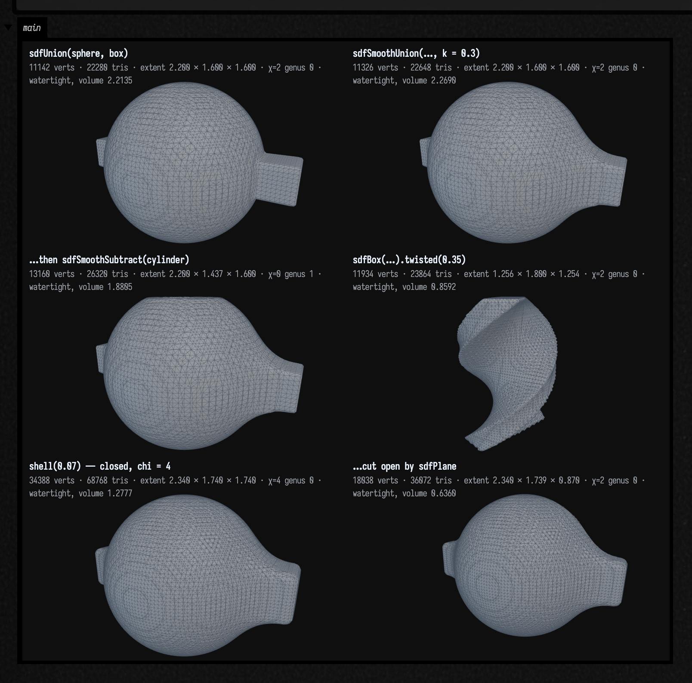
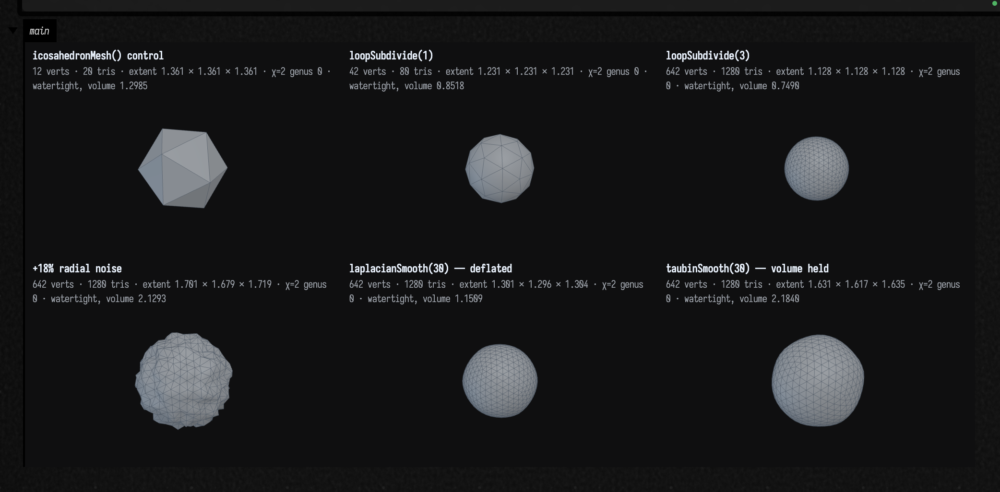
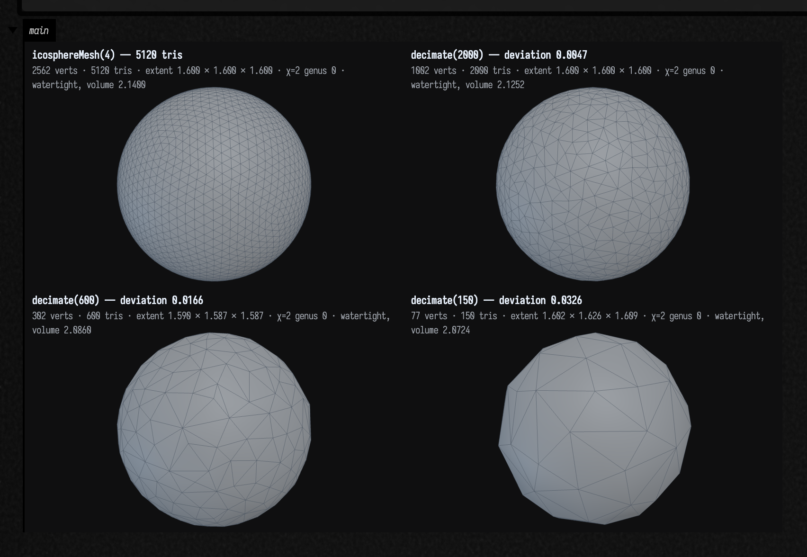

# Meshes and 3D geometry

*Every public declaration used below is listed, with its KDoc, in the codebase reference:
[`mesh.kt`](reference/index.md). Start from [what's already in the box](reference/index.md).*

Field could always *draw* in three dimensions — an [`FLine`](fline_examples.md) has a `z`, the
renderer takes triangles, the [ray tracer](ray_tracing_examples.md) intersects analytic solids. What
it could not do was **compute with a surface**: ask a mesh whether it is closed, subdivide it, smooth
it without deflating it, decimate it to a budget, measure its volume, shoot a ray at it, or write it
to a file another program will read.

`afield.stdlib` now carries a CPU triangle-mesh family for exactly that. One value type, `TriMesh`,
and the operations that turn a surface into structure — topology, generators, marching cubes over an
SDF, Loop subdivision, Laplacian and Taubin smoothing, QEM decimation, curvature, a BVH, OBJ and STL
I/O, a convex hull. It is the 3D counterpart to the raster [imaging family](imaging_examples.md), and
it is built the same way: pure Kotlin, no external dependency, no GPU, works headless in a box.

Two things make it Field's rather than a generic geometry library. The first is that a `TriMesh` is a
**value you can look at** — it implements `ToHTML`, so ending a box on one draws it, with the numbers
that decide whether it is usable printed beside the picture:


The second is the last hop back out: `toFLines(...)` turns a mesh into `FLine`s, so a wireframe, a
crease set or a normal field lands in the same drawing, animation and export machinery as anything
you drew by hand.

## The value type

```
TriMesh(positions, indices, normals = null, uvs = null, colors = null)
```

Flat `FloatArray`s — `positions` is `3 * vertexCount` floats, `indices` is `3 * triangleCount` ints —
with optional per-vertex `normals`, `uvs` and `colors`. Three choices worth knowing about, because
they change what the type feels like to use:

- **Flat arrays, not a list of vertex objects.** `Vec3` in `afield.stdlib.linalg` is *mutable*, and a
  mesh built out of mutable vectors is an aliasing bug waiting to happen — transform one vertex twice
  because two triangles share it and the surface tears. So `TriMesh` stores floats and every accessor
  (`position(i)`, `faceNormal(t)`, `triangle(t)`) hands back a **fresh** `Vec3` that cannot write
  back into the mesh. `positionInto(i, dest)` is there for the inner loop that cares.
- **Immutable in practice.** Everything returns a new mesh: `translated`, `scaled`, `rotated`,
  `transformed { }`, `flipped`, `weld`, `loopSubdivide`, `decimate`. That is what makes a pipeline
  readable as one expression, and it is why re-running a box is always the same answer.
- **Topology is computed, not stored.** `topology()` builds the edge map, the vertex stars and the
  boundary loops on demand and caches the expensive parts lazily. The mesh itself stays a plain
  buffer that a GPU upload or a file writer can take verbatim.

The generators return the **minimal** closed mesh for their shape, which is a much stronger guarantee
than "it renders": a cube is 8 vertices and 12 triangles, not 24 and 12.


## Modelling with a field

The centrepiece of the family is the SDF path, because it is the one that makes a shape feel like an
**expression you can edit** rather than a thing you assembled. A `ScalarField3D` is a type alias for
`(Vec3) -> Float` — negative inside, positive outside — and every combinator is one line.

```diffstatic_runner {data-lang=kotlin screenshot="assets/mesh_examples/modelling.png" wait="2.5" capture="box" open-outputs="true" padding="20"}
:::static
// A shape as an expression. Every one of these is a (Vec3) -> Float; nothing is a mesh yet.
val ball = sdfSphere(0.8)
val bar = sdfBox(vec(2.2, 0.34, 0.34))
val sharp = sdfUnion(ball, bar)
val soft = sdfSmoothUnion(ball, bar, k = 0.3)              // the k is the fillet radius
val drilled = sdfSmoothSubtract(soft, sdfCylinder(0.28, 4.0), k = 0.1)
val twisted = sdfBox(vec(1.2, 1.8, 0.4)).twisted(0.35)

// marchingCubes samples the field once per grid corner and shares one vertex per crossed grid
// edge, so the surface it emits is closed rather than a triangle soup.
val window = boundsAround(radius = 1.35)
val sharpMesh = marchingCubes(sharp, window, 72)
val softMesh = marchingCubes(soft, window, 72)
val drilledMesh = marchingCubes(drilled, window, 72)
val twistedMesh = marchingCubes(twisted, boundsAround(radius = 1.2), 72)

// A shell looked at from outside is indistinguishable from the solid, so cut it open with a
// half-space: intersecting with sdfPlane keeps only the half you want and the wall becomes visible.
val shell = soft.shell(0.07)
val closedShell = marchingCubes(shell, window, 88)
val cutaway = marchingCubes(sdfIntersect(shell, sdfPlane(vec(0, 0, -1), 0.0)), window, 88)
:::fold print what each one came out as, then draw the six
// A fillet only ever ADDS material, so the smooth union must enclose more than the sharp one.
// That is a property you can assert rather than eyeball.
println("sharp union  volume %.5f".format(sharpMesh.signedVolume()))
println("smooth union volume %.5f  (the fillet adds %.5f)".format(
    softMesh.signedVolume(), softMesh.signedVolume() - sharpMesh.signedVolume()))
println("drilled      ${drilledMesh.summary()}")
println("twisted      ${twistedMesh.summary()}")
println("closed shell ${closedShell.summary()}")
println("cut open     ${cutaway.summary()}")

showMeshGrid(
    "sdfUnion(sphere, box)" to sharpMesh,
    "sdfSmoothUnion(…, k = 0.3)" to softMesh,
    "…then sdfSmoothSubtract(cylinder)" to drilledMesh,
    "sdfBox(…).twisted(0.35)" to twistedMesh,
    "shell(0.07) — closed, chi = 4" to closedShell,
    "…cut open by sdfPlane" to cutaway,
    columns = 3,
    cellWidth = 300,
)
:::endfold
```



`showMeshGrid(...)` is the fastest way to see a whole pipeline: captioned panels side by side, each
one rasterised by the same CPU renderer the inline card uses — perspective, z-buffer, two-light
lambert, depth-tested wireframe — then encoded with `PngEncoder` and pushed to the box output. No AWT
is involved, so it works anywhere, including in this docs build.

The primitives are `sdfSphere`, `sdfBox`, `sdfRoundBox`, `sdfTorus`, `sdfPlane`, `sdfCylinder`,
`sdfCapsule`, `sdfGyroid` and `sdfMetaballs`. The combinators are `sdfUnion`, `sdfIntersect`,
`sdfSubtract`, `sdfInvert`, their three `sdfSmooth…` variants, `sdfExpUnion`, and the modifiers
`shell`, `rounded`, `translated`, `scaled`, `rotated`, `repeated`, `twisted` and `displaced`.
`gradient(p)` and `normalAt(p)` finite-difference the field where you need a direction.

## Looking at what you got

This is the part a mesh library usually leaves to your eyes, and eyes are bad at it. A duplicated
seam, a missing cap, an unwelded weld and a leaked marching-cubes surface all still render
plausibly. One integer catches all four: the **Euler characteristic** `V - E + F`, which is exactly 2
for any closed genus-0 solid and `2 - 2g` for genus *g*.

`summary()` prints the whole verdict in one line. The rest of the pieces are separately available —
`isWatertight()`, `isManifold()`, `eulerCharacteristic()`, `genus()`, `boundaryLoops()`,
`surfaceArea()`, `signedVolume()` — and `topology()` gives you the object they all delegate to.

The other half of "looking at what you got" is checking the geometry against an answer you already
know. A marched sphere is the best test case there is, because the volume it should converge to is
4/3 π:

```diffstatic_runner {data-lang=kotlin screenshot="assets/mesh_examples/convergence.png" wait="2.5" capture="box" open-outputs="true" padding="20"}
:::static
// Marching cubes is O(h^2) accurate, so the error should fall by ~4x each time the resolution
// doubles. Watch it: this is the check that tells you the marcher is right, not just plausible.
val exact = 4.0 / 3.0 * PI
println("resolution   tris    volume     relative error")
for (resolution in listOf(12, 24, 48, 64)) {
    val m = marchingCubes(sdfSphere(1.0), boundsAround(radius = 1.4), resolution)
    val error = abs(m.signedVolume() - exact) / exact
    println("%10d %7d %10.6f %14.5f   watertight=%s chi=%d".format(
        resolution, m.triangleCount, m.signedVolume(), error,
        m.isWatertight(), m.eulerCharacteristic()))
}
println("the analytic answer is 4/3 pi = $exact")

// Drilling straight through a solid adds a handle, so the genus goes from 0 to 1. That is the
// topology layer telling you something a picture cannot: the two look identical from outside.
val drilled = marchingCubes(
    sdfSubtract(sdfSphere(1.0), sdfCylinder(0.3, 4.0)),
    boundsAround(radius = 1.3), 64,
)
println()
println("drilled sphere: ${drilled.summary()}")

// A gyroid is a triply-periodic minimal surface: one sheet with many handles, so chi goes strongly
// negative. The marcher does not mind that the gyroid is not a distance function at all — it only
// ever looks at signs.
val gyroid = marchingCubes(sdfGyroid(4.0, 0.3), boundsAround(radius = 1.0), 56)
println("gyroid: ${gyroid.summary()}")
:::fold draw the coarse and fine spheres beside the two harder shapes
showMeshGrid(
    "sdfSphere marched at 16" to marchingCubes(sdfSphere(1.0), boundsAround(radius = 1.4), 16),
    "…at 64" to marchingCubes(sdfSphere(1.0), boundsAround(radius = 1.4), 64),
    "sdfSubtract(sphere, cylinder) — genus 1" to drilled,
    "sdfGyroid(4.0, 0.3)" to gyroid,
    columns = 2,
    cellWidth = 380,
)
:::endfold
```


**Why the surface is closed at all** is worth one paragraph, because plain marching cubes leaks and
the leak is invisible until you count. Two cubes sharing a face can each pick a different
triangulation for the four crossings on that face; the two disagree and the surface tears there.
`marchingCubes` resolves that face with the **asymptotic decider**, which is a pure function of the
face's own four corner values, so the two cubes always agree. It also nudges a crossing off a grid
corner whose sample sits *exactly* on the iso level — a case that is not exotic at all (a unit sphere
on a 0.2 grid has corners at `(1,0,0)` and `(0.6,0.8,0)` precisely on it) and that otherwise
collapses every crossing out of that corner onto the corner itself.

## Subdivide, and smooth without shrinking

`loopSubdivide(times)` quadruples the triangles and preserves χ exactly, so a watertight input stays
watertight at the same genus. Smoothing is the more interesting one, because the naive answer is
subtly wrong and the mesh will not tell you unless you measure it.

A Laplacian pass moves every vertex toward the average of its neighbours. That is **diffusion**, and
diffusion of a closed surface deflates it: run it long enough and the shape collapses to a point.
Taubin's fix is to alternate a positive shrinking step `lambda` with a slightly larger negative
inflating step `mu`, chosen so the pair is a low-pass filter with unity gain in the passband. The
noise still goes; the volume stays.

```diffstatic_runner {data-lang=kotlin screenshot="assets/mesh_examples/process.png" wait="3.0" capture="box" open-outputs="true" padding="20"}
:::static
// Loop subdivision converges on the Loop LIMIT surface, not on the sphere its control vertices sit
// on, so the volume falls monotonically in geometrically shrinking steps. chi never moves.
var control = icosahedronMesh(0.8)
val rounds = ArrayList<TriMesh>()
:::fold subdivide three times, printing the volume step each round
println("round  tris    volume     step")
var previous = control.signedVolume()
println("%5d %6d %10.5f".format(0, control.triangleCount, previous))
for (round in 1..3) {
    control = control.loopSubdivide(1)
    rounds.add(control)
    val v = control.signedVolume()
    println("%5d %6d %10.5f %9.5f   chi=%d".format(
        round, control.triangleCount, v, v - previous, control.eulerCharacteristic()))
    previous = v
}
:::endfold

// Now the smoothing comparison. Same input, same iteration count, same lambda — the only
// difference is Taubin's second, inflating pass.
val rng = java.util.Random(7)
val clean = icosphereMesh(3, 0.8)
val noisy = clean.transformed { p ->
    val s = 1f + (rng.nextFloat() - 0.5f) * 0.18f          // 18% radial noise
    vec(p.x * s, p.y * s, p.z * s)
}.withVertexNormals()
val laplacian = noisy.laplacianSmooth(iterations = 30, lambda = 0.6)
val taubin = noisy.taubinSmooth(iterations = 30, lambda = 0.6, mu = -0.63)
:::fold print the four volumes — this is the whole point — and draw the six meshes
println()
println("clean     volume %.5f".format(clean.signedVolume()))
println("noisy     volume %.5f".format(noisy.signedVolume()))
println("laplacian volume %.5f  <- a diffusion deflates the ball".format(laplacian.signedVolume()))
println("taubin    volume %.5f  <- the lambda/mu pair holds it".format(taubin.signedVolume()))

showMeshGrid(
    "icosahedronMesh() control" to icosahedronMesh(0.8),
    "loopSubdivide(1)" to rounds[0],
    "loopSubdivide(3)" to rounds[2],
    "+18% radial noise" to noisy,
    "laplacianSmooth(30) — deflated" to laplacian,
    "taubinSmooth(30) — volume held" to taubin,
    columns = 3,
    cellWidth = 290,
)
:::endfold
```



Put the two results in one frame, as the last two panels do, and the Laplacian ball is unmistakably
the smaller of the two. The printed volumes say the same thing without needing your eye.

Both smoothers take `cotangent = true` for the cotangent-weighted Laplacian, which is the right
choice on an irregular triangulation because it weights by the geometry rather than by valence, and
`withVertexNormals()` recomputes the shading normals afterwards.

## Decimate to a budget, and know the price

`decimate(targetTriangles)` is quadric-error-metric edge collapse: each vertex accumulates the
quadric of its incident face planes, every candidate collapse is scored by the error at its optimal
position, and the cheapest is taken until the budget is met. Collapses are vetoed by the **link
condition** (so the mesh cannot go non-manifold), by a normal-flip test, and by a shape test that
defers a collapse which would produce a sliver.

The number that matters is not the triangle count you asked for — you get that — it is the
*deviation*: how far either mesh's vertices sit from the other's surface. `maxDeviation(a, b)`
reports it symmetrically, so a decimation cannot look good by having simply shrunk inside the
original.

```diffstatic_runner {data-lang=kotlin screenshot="assets/mesh_examples/decimate.png" wait="3.0" capture="box" open-outputs="true" padding="20"}
:::static
val detailed = icosphereMesh(4, 0.8)          // 5120 triangles
println("start: ${detailed.summary()}")
println()
println("target    got   deviation   min angle   watertight")

val budgets = ArrayList<Pair<String, TriMesh>>()
for (target in listOf(2000, 600, 150)) {
    val small = detailed.decimate(target)
    // Symmetric: the largest distance either mesh's vertices sit from the other's surface.
    val deviation = maxDeviation(detailed, small)
    println("%6d %6d %11.5f %11.1f   %s".format(
        target, small.triangleCount, deviation,
        small.quality().minAngleDegrees, small.isWatertight()))
    budgets.add("decimate($target)" to small)
}
:::fold draw the original beside the three budgets
showMeshGrid(
    "icosphereMesh(4) — ${detailed.triangleCount} tris" to detailed,
    budgets[0].first to budgets[0].second,
    budgets[1].first to budgets[1].second,
    budgets[2].first to budgets[2].second,
    columns = 2,
    cellWidth = 360,
)
:::endfold
```



`quality()` is the other half of that judgement: minimum and mean triangle angle, aspect ratio,
degenerate count. A decimator that hits its budget by producing slivers has not helped you, and the
minimum angle is where that shows up first.

## Drawing it, and writing it out

`toFLines(mode)` is the bridge back into Field. Five modes:

| mode | what you get |
|---|---|
| `MeshLines.EDGES` | every unique edge, one `FLine` each — the full wireframe |
| `MeshLines.CREASES` | only edges where the two faces disagree by more than `creaseAngleDegrees`, plus every boundary edge |
| `MeshLines.BOUNDARY` | the boundary loops, as closed `FLine`s — empty for a watertight mesh |
| `MeshLines.NORMALS` | one short segment per vertex along its normal — a normal-field debugger |
| `MeshLines.FACES` | one closed triangle per face; draws each edge twice, but keeps faces apart |

`CREASES` is the one that makes a drawing readable: on a smooth mesh the full wireframe is a grey mat
and the crease set is correctly empty, while on a faceted or CSG solid the creases are exactly the
silhouette you would have drawn by hand. Once you have `FLine`s, everything else in Field applies:

```kotlin
lines(mesh.toFLines(MeshLines.CREASES, creaseAngleDegrees = 30.0))
```

Going the other way, `tubeMesh(fline, radius, sides, samples, caps)` sweeps a tube along an `FLine`
using rotation-minimising frames, so it does not twist where the path's curvature swings through
vertical — the failure mode of the obvious Frenet-frame implementation.

For files: `toObj(name)` / `objToTriMesh(text)` and `toStlAscii` / `toStlBinary` /
`stlToTriMesh(bytes)`, plus `saveObj(file)`, `saveStl(file)` and `triMeshFromObj(file)`. The
difference between the two formats is worth stating, because it changes what you get back. OBJ keeps
the index structure, so a watertight mesh round-trips watertight. **STL is triangle soup by design** —
three unshared vertices per triangle, no indices at all — so it comes back with 3× the vertices and
`isWatertight()` false until you `weld(1e-5)` it. Both recover the volume exactly.

```diffstatic_runner {data-lang=kotlin screenshot="assets/mesh_examples/bridges.png" wait="3.0" capture="box" open-outputs="true" padding="20"}
:::static
// A tube swept along an FLine: rotation-minimising frames, so it does not twist where the path's
// curvature swings through vertical.
val path = FLine()
for (i in 0..120) {
    val t = i / 120.0
    val a = 2.0 * PI * 2.0 * t
    val p = vec(cos(a) * 0.6, (t - 0.5) * 1.3, sin(a) * 0.6)
    if (i == 0) path.moveTo(p) else path.lineTo(p)
}
val coil = tubeMesh(path, radius = 0.1, sides = 18, samples = 120, caps = true)
println("tube along an FLine: ${coil.summary()}")

// A coarse torus, so there really are creases to keep. On a fine one the crease set is empty,
// which is the correct answer and a dull demonstration.
val ring = torusMesh(14, 8, 0.6, 0.22)
println("torus: ${ring.toFLines(MeshLines.EDGES).size} edges, " +
    "${ring.toFLines(MeshLines.CREASES, creaseAngleDegrees = 30.0).size} creases at 30 degrees, " +
    "${ring.toFLines(MeshLines.NORMALS).size} normals")
val patch = planeMesh(6, 6, 1.2, 1.2)
println("plane patch: ${patch.toFLines(MeshLines.BOUNDARY).size} boundary loop(s), " +
    "${patch.toFLines(MeshLines.BOUNDARY).firstOrNull()?.nodes?.size} nodes around it")

// OBJ keeps the indices; STL is soup and needs a weld. Both must recover the volume exactly.
val source = icosphereMesh(3, 0.7)
val viaObj = objToTriMesh(source.toObj("ball"))
val viaStl = stlToTriMesh(source.toStlBinary())
println()
println("source     ${source.vertexCount} verts  volume %.6f".format(source.signedVolume()))
println("via OBJ    ${viaObj.vertexCount} verts  volume %.6f  watertight ${viaObj.isWatertight()}".format(
    viaObj.signedVolume()))
println("via STL    ${viaStl.vertexCount} verts  volume %.6f  watertight ${viaStl.isWatertight()}".format(
    viaStl.signedVolume()))
println("STL welded ${viaStl.weld(1e-5).vertexCount} verts  watertight ${viaStl.weld(1e-5).isWatertight()}")
:::fold draw the coil beside the coarse torus and the STL round trip
showMeshGrid(
    "tubeMesh(FLine, sides = 18)" to coil,
    "torusMesh(14, 8) — creases to keep" to ring,
    "icosphereMesh(3) via STL, welded" to viaStl.weld(1e-5),
    columns = 3,
    cellWidth = 300,
)
:::endfold
```


## Measuring and querying

`surfaceArea()`, `signedVolume()` (the divergence-theorem sum, so it is *signed* — an inside-out
closed mesh reports a negative volume, which is the only thing that will tell you), `centroid()` for
the area-weighted surface centroid and `solidCentroid()` for the enclosed solid's.

Discrete curvature: `gaussianCurvature()` is the angle deficit and `meanCurvature()` the cotangent
Laplacian's magnitude, both divided by the mixed Voronoi area from `mixedVertexAreas()`. On a sphere
of radius *r* they are 1/*r*² and 1/*r*. A torus is the shape to look at, because its Gaussian
curvature has both signs — positive on the outside, negative in the hole:


The global check is **Gauss–Bonnet**: the integral of Gaussian curvature over a closed surface is
exactly 2πχ. No local sign error or area-weighting bug survives it, which makes it the single best
assertion to put in a test.

```kotlin
val k = mesh.gaussianCurvature()
val areas = mesh.mixedVertexAreas()
val total = (0 until mesh.vertexCount).sumOf { k[it] * areas[it] }   // == 2 * PI * chi
```

`bvh()` builds a bounding-volume hierarchy and turns every useful query from O(*n*) into O(log *n*):
`raycast(origin, direction)`, `raycastAll(...)`, `closestPoint(query)`, `contains(query)` (a parity
test, so it needs a watertight mesh) and `signedDistance(query)`. `asSdf()` hands the whole thing
back as a `ScalarField3D`, which closes the loop — you can march a mesh's own signed distance field
and get a remeshed version of it. There are `TriMesh.raycast` / `closestPoint` / `contains`
shorthands that build a throwaway BVH, fine for one query and wrong for a loop.

`convexHullMesh(points)` is an incremental hull with no dependencies, and
`deviationFrom` / `maxDeviation` / `isContainedIn` / `samplePoints` are the comparison tools.

## Now do something you couldn't before

Field has computed a real 3D Voronoi diagram for a while — `voronoi3d(...)` clips half-spaces and
hands back `VoronoiCell3`s with polygonal faces. What it could not do was turn one into geometry you
could measure, cut, export or hold in your hand. `VoronoiCell3.toTriMesh(shrink)` and
`VoronoiLattice.toTriMesh(shrink, boundedOnly)` do that, and because a Voronoi tessellation
partitions its clip box *exactly*, there is a one-line total check on the result: the cell volumes
must sum to the box's own volume.


```kotlin
val lattice = Voronoi3d.build(sites, clipPadding = 0.15f)
val total = lattice.cells.sumOf { abs(it.toTriMesh(shrink = 1.0).signedVolume()) }
// total agrees with the clip box's volume to ~1e-8 relative
showMeshGrid(
    "all the cells" to lattice.toTriMesh(shrink = 1.0),
    "the interior cells, exploded" to lattice.toTriMesh(shrink = 0.6, boundedOnly = true),
    columns = 2,
)
```

Writing that bridge is what turned up a real defect in `voronoi.kt` itself: for cells near a
near-cospherical site cluster, face membership was decided by a *distance* test against a tolerance
larger than the spacing of the genuine corners there, so faces claimed corners that were not theirs
and the cell's faces did not close — one edge on one side of a seam, two on the other. Membership is
now combinatorial (a corner records which three planes produced it, and a face's polygon is exactly
the corners recording that plane), which is the incidence information the distance test was trying
to recover from geometry. `dev_docs/MESH_GEOMETRY.md` has the measurements.

## Recipes

| you want | the call |
|---|---|
| a shape from an equation | `marchingCubes(field, boundsAround(radius = r), resolution)` |
| is this mesh usable? | `println(mesh.summary())` |
| a mesh from a photo or a heightfield | `img.toHeightfieldMesh(...)` or `heightfieldMesh(nx, ny) { x, y -> h }` |
| a lathed profile | `revolveMesh(profile, segments)` |
| a swept tube along a path | `tubeMesh(fline, radius, sides, samples)` |
| smooth without shrinking | `taubinSmooth(iterations = 30, lambda = 0.6, mu = -0.63)` |
| more detail | `loopSubdivide(2)` |
| less detail, bounded error | `decimate(target)` then `maxDeviation(original, small)` |
| hard edges for a renderer | `flatShaded()`, or `shadedNormals(creaseAngleDegrees = 35.0)` |
| soft edges | `withVertexNormals()` |
| a mesh that came in broken | `repaired(1e-6)` (weld, drop degenerates, fix winding) |
| just the biggest piece | `largestComponent()` |
| draw it in Field | `lines(mesh.toFLines(MeshLines.CREASES))` |
| colour it by a per-vertex number | `coloredByScalar(values, "coolwarm")` |
| an outline, not a solid | `toFLines(MeshLines.BOUNDARY)` |
| hand it to another program | `mesh.saveObj(File("out.obj"))` |
| point-in-solid, many times | `val tree = mesh.bvh()` then `tree.contains(p)` |
| the mesh's own distance field | `mesh.bvh().asSdf()` |
| a normalised mesh for a thumbnail | `mesh.normalized(1.0)` |

## Where the pictures come from

Everything on this page is real output, and there are two routes on it, because they cost different
amounts to produce:

| figure | how |
|---|---|
| the five `diffstatic_runner` fences above | **executed by the docs build**; the image under each is that box's own output, regenerated every build |
| `assets/mesh_gallery/*.png` (four figures) | **committed captures** from the `mesh.gallery` FIELD_TEST: `python3 tools/run_field_tests.py --id mesh.gallery --port 9700` |

The distinction matters: the fences can never go stale, because a change that breaks them breaks the
docs build. The four gallery figures are real renders from real code, but they are committed PNGs and
would need the test re-run to reflect a change. The gallery is a FIELD_TEST rather than a script, so
it **fails** if the invariants break — if a generator stops being watertight, if a marched sphere's
volume error stops falling with resolution, if a decimation misses its budget, if Gauss–Bonnet stops
matching 2πχ, or if the Voronoi cells stop tiling their clip box.

There is a third route for playing with it rather than reading it: replay
`dev_docs/agents/transcripts/mesh_geometry_examples.yaml` into a fresh Field with the agent backdoor
(`field_run_transcript`) and you get seven live boxes covering the same ground. Change a resolution, a
smoothing parameter or an SDF expression, re-run the box, and watch it update. See
[Agent transcripts](agent_transcripts.md).

## Reference

| | |
|---|---|
| **value type** | `TriMesh`, `TriMeshBuilder`, `triMesh { }`, `position`, `triangle`, `faceNormal`, `triangleArea`, `vertices`, `withColor`, `coloredBy`, `transformed`, `translated`, `scaled`, `rotated`, `flipped`, `filterTriangles`, `plus` |
| **topology** | `MeshTopology`, `topology`, `isWatertight`, `isManifold`, `isConsistentlyOriented`, `eulerCharacteristic`, `genus`, `boundaryLoops`, `components`, `weld`, `fixWinding`, `removeDegenerateTriangles`, `removeUnusedVertices`, `repaired`, `largestComponent` |
| **generators** | `boxMesh`, `cubeMesh`, `planeMesh`, `uvSphereMesh`, `icosphereMesh`, `torusMesh`, `cylinderMesh`, `coneMesh`, `capsuleMesh`, `tetrahedronMesh`, `octahedronMesh`, `icosahedronMesh`, `dodecahedronMesh`, `triangulatePolygon`, `polygonMesh`, `extrudeMesh`, `revolveMesh`, `heightfieldMesh`, `Img.toHeightfieldMesh` |
| **fields / marching cubes** | `ScalarField3D`, `boundsOf`, `boundsAround`, `bounds`, `sdfSphere`, `sdfBox`, `sdfRoundBox`, `sdfTorus`, `sdfPlane`, `sdfCylinder`, `sdfCapsule`, `sdfGyroid`, `sdfMetaballs`, `sdfUnion`, `sdfIntersect`, `sdfSubtract`, `sdfInvert`, `sdfSmoothUnion`, `sdfSmoothIntersect`, `sdfSmoothSubtract`, `sdfExpUnion`, `shell`, `rounded`, `translated`, `scaled`, `rotated`, `repeated`, `twisted`, `displaced`, `gradient`, `normalAt`, `marchingCubes`, `march`, `Img.asHeightSdf` |
| **processing** | `withVertexNormals`, `flatShaded`, `shadedNormals`, `loopSubdivide`, `laplacianSmooth`, `taubinSmooth`, `decimate`, `quality`, `MeshQuality` |
| **measure / query** | `surfaceArea`, `signedVolume`, `volume`, `centroid`, `solidCentroid`, `mixedVertexAreas`, `gaussianCurvature`, `meanCurvature`, `MeshBvh`, `bvh`, `raycast`, `raycastAll`, `closestPoint`, `contains`, `signedDistance`, `asSdf`, `RayHit`, `SurfacePoint`, `convexHullMesh`, `convexHull`, `deviationFrom`, `maxDeviation`, `isContainedIn`, `samplePoints`, `angleBetweenDegrees` |
| **I/O** | `toObj`, `objToTriMesh`, `saveObj`, `triMeshFromObj`, `toStlAscii`, `toStlBinary`, `stlToTriMesh`, `saveStl`, `meshFromFile` |
| **Field integration** | `MeshLines`, `toFLines`, `tubeMesh`, `VoronoiCell3.toTriMesh`, `VoronoiLattice.toTriMesh`, `toCapturedMesh`, `coloredByScalar`, `MeshView`, `renderPng`, `renderPixels`, `toFigureHtml`, `showMesh`, `showMeshGrid`, `showMeshTurntable`, `summary`, `longestEdge`, `meanEdgeLength`, `normalized` |

Source: `src/jvmMain/kotlin/afield/stdlib/mesh.kt`, `mesh_topology.kt`, `mesh_generate.kt`,
`mesh_sdf.kt`, `mesh_process.kt`, `mesh_measure.kt`, `mesh_io.kt`, `mesh_field.kt`. Developer notes,
including the measurements behind the Voronoi fix: `dev_docs/MESH_GEOMETRY.md`.
