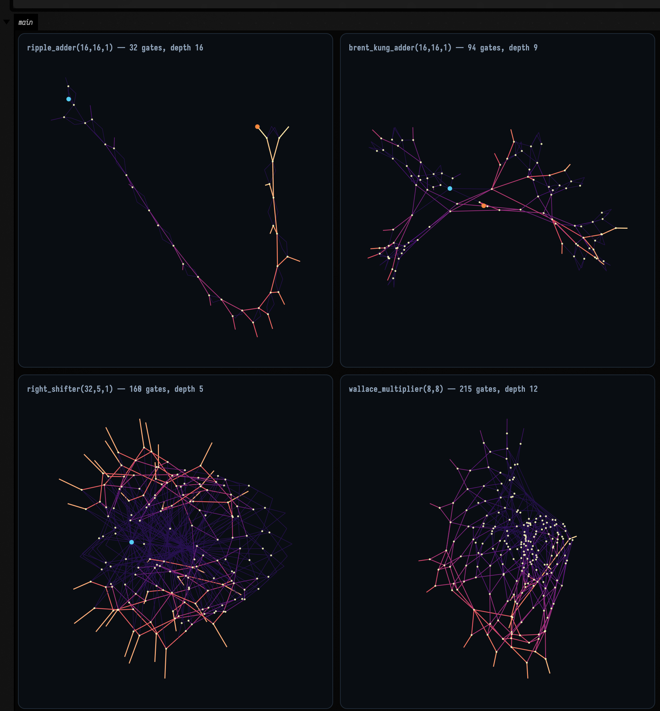
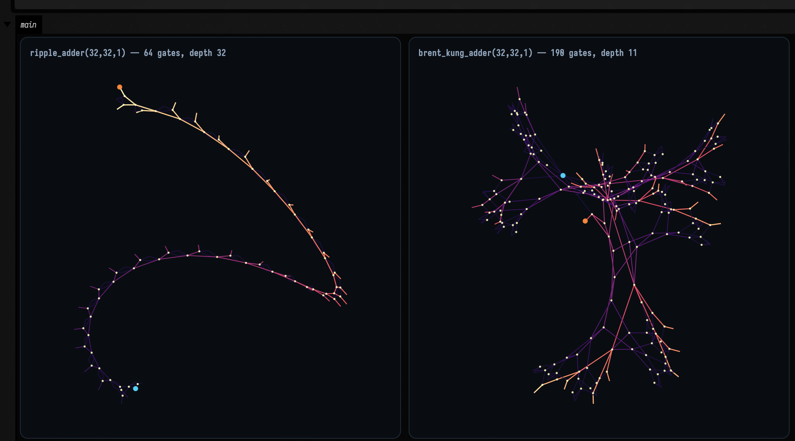
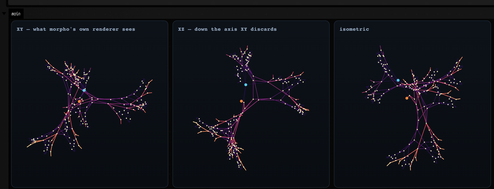
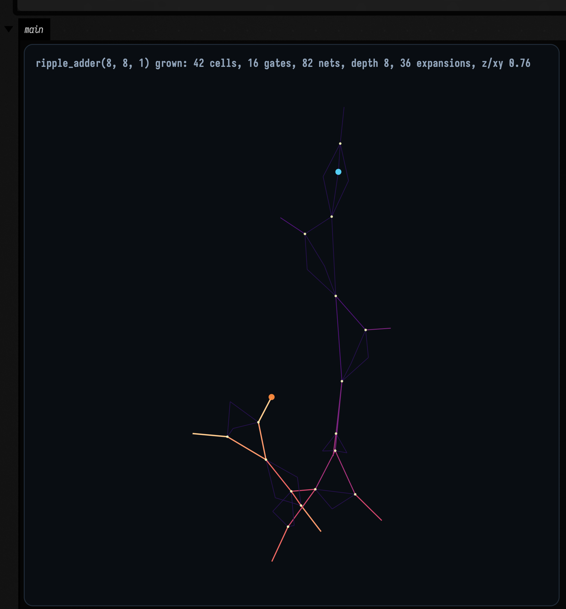
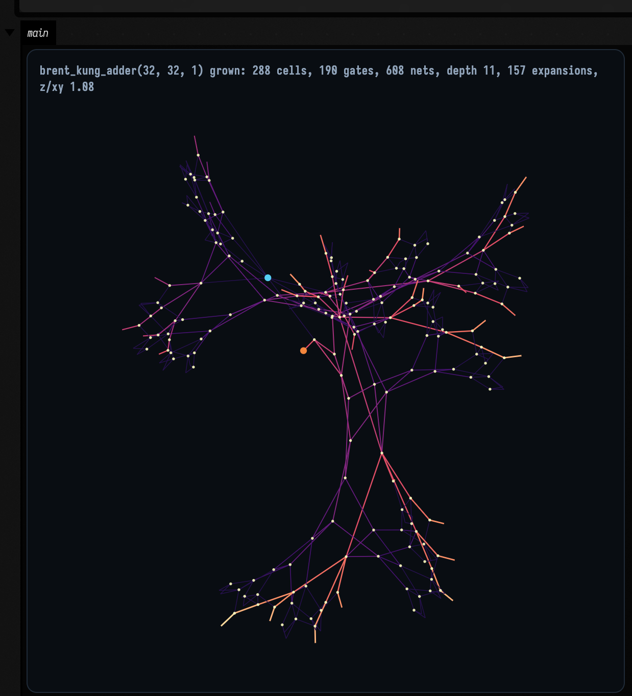
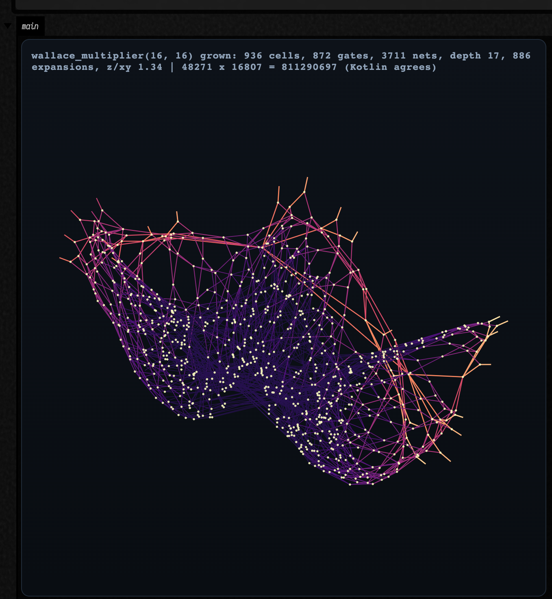
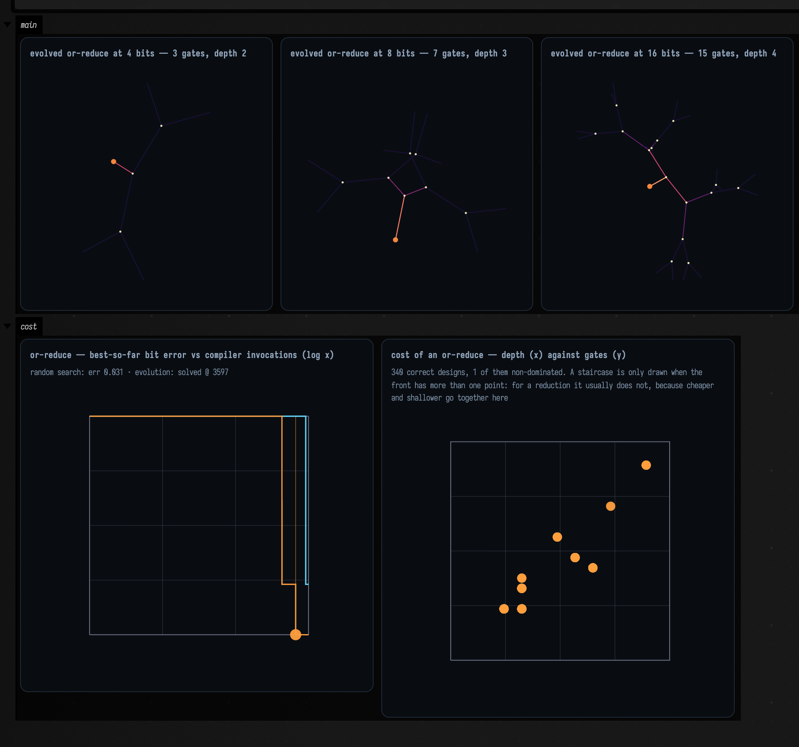
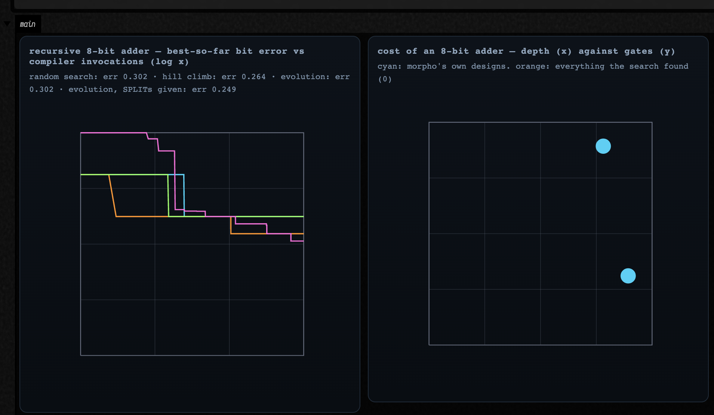

# Somebody else's language, running in Field

[MorphoHDL](https://paradigms-of-intelligence.github.io/morpho/) (Apache-2) is a hardware description language
built on recursive cell division. You write a cell that halves its inputs and calls itself; the
compiler keeps dividing until a `SPLIT` runs out of bits, and the recursion bottoms out into a
fallback. Bus widths are never declared — a 32-bit adder and an 8-bit adder are the same eleven
lines of source, and the difference is entirely in how far the division ran.

That is a good language and Field did not write it. This page is about what it takes to run it here
anyway, and it is as much about the *seam* as about the circuits.

The short version: **none of MorphoHDL is reimplemented.** Field runs upstream's parser, upstream's
compiler and upstream's layout kernel, byte-identical to
[commit `3ff923f`](https://github.com/paradigms-of-intelligence/morpho/tree/3ff923f9fafcb5b97ad2ef393795c96710ed00ea),
and supplies only the things a language needs from an environment rather than from itself:
simulation, drawing, and somewhere to be typed.

---

## What it looks like

Four designs out of morpho's standard library, compiled through GraalJS, laid out by morpho's WASM
kernel in 3D, and drawn by Field as vector `FLine`s. Wire colour is **signal arrival time** — dark
where a value is known early, bright on the critical path — so each panel shows its own logic depth
as a gradient. Blue dots are input ports, orange are outputs.

```diffstatic_runner {data-lang=kotlin screenshot="assets/morpho_examples/family.png" wait="34.0" capture="box" open-outputs="true" padding="20"}
:::static
import afield.morpho.*

// Each panel gets its OWN window: these are four different circuits at four different sizes, and a
// shared frame would shrink the shifter to a speck to fit the multiplier. Where a shared frame IS
// required -- the two adders below, the three projections further down -- it is used and said so.
val designs = listOf(
    Triple("ripple_adder", intArrayOf(16, 16, 1), "carry chain"),
    Triple("brent_kung_adder", intArrayOf(16, 16, 1), "prefix tree"),
    Triple("right_shifter", intArrayOf(32, 5, 1), "mux cascade"),
    Triple("wallace_multiplier", intArrayOf(8, 8), "compression tree")
)

val panels = designs.map { (design, sig, kind) ->
    val c = morphoCircuit(design, *sig)
    c.growFully(relaxSteps = 220)
    println("%-20s %4d gates  depth %2d  z/xy %.2f  (%s)".format(
        design, c.netlist.gateCount, c.depth.toInt(), c.layout.flatness(), kind))
    "%s(%s) — %d gates, depth %d".format(design, sig.joinToString(","), c.netlist.gateCount, c.depth.toInt()) to
        c.flines(fit = true)
}

// fit = true normalises each panel into the unit square, which is the only way showPlaneGrid can
// frame four differently-sized circuits independently: it takes one window for the whole grid.
showPlaneGrid(*panels.toTypedArray(), columns = 2, cellWidth = 430, cellHeight = 430,
    window = morphoUnitWindow())
```



The shapes are the algorithms, up to a point. The ripple adder is a chain because a carry has to walk
the whole width, and the Brent–Kung is a branching tree because that is the entire point of a
parallel-prefix adder. But a force-directed layout draws *connectivity*, not a schematic: it will not
lay the shifter out as five tidy stages just because it shifts by 1, 2, 4, 8 and 16.

What the shifter shows instead is in the colour. Its 160 gates are nearly all bright, because its
depth is 5 and almost everything settles at once — against the ripple adder, whose gates run the
whole ramp from dark to bright because a 16-bit carry chain is 16 levels deep. Where the geometry
stops being informative, the arrival time takes over.

---

## What was already in the box

Two facts about Field made this a weekend's work instead of a port.

**Field already runs other people's runtimes.** `afield.runtime.MainLanguageRegistry` is a
five-field data class and a map. Registering a language is one call, and Field had five
already — Forth, Clojure, Python, Nano, RemoteJS — so there was a shape to copy rather than a
design to invent.

**Field already ships GraalVM's JS and WASM.** `build.gradle.kts` declares
`org.graalvm.polyglot:js` and `:wasm`, and `afield.four.synth.Dough` was already using a
`Context.newBuilder("js", "wasm")` to run a WebAssembly synthesiser. MorphoHDL is implemented in
JavaScript. So the question was never "how do we port this" but "how much of it can we just run".

The answer turned out to be: all of the parts worth having.

| upstream file | lines | what it is | in Field? |
| --- | --- | --- | --- |
| `js/parser.js` | 216 | tokenizer, parser, SSA | **run as-is** |
| `js/primitives.js` | 193 | `SPLIT`/`CAT`/`LSLICE`, LUT reduction | **run as-is** |
| `js/compiler.js` | 1118 | SoA netlist compiler, width inference, expansion, DCE | **run as-is** |
| `js/utils.js` | 179 | `SoA`, `MaxHeap`, seeded RNG | **run as-is** |
| `graphs_engine/main.wasm` | 11 KB | Barnes–Hut force layout | **run as-is** |
| `tiny_morpho.py` | 867 | Python reference + the MorphoHDL standard library | **oracle + stdlib** |
| `js/grower.js` | 105 | expansion schedule | reimplemented, 40 lines — see below |
| `viewer.js`, `layout_renderer.js`, `swissgl.js`, `hex_layout.js`, `bloom.js`, `figures.js`, `demo.js` | ~2900 | canvas/WebGL rendering, DOM | **dropped** |

Everything Field wrote is in `src/jvmMain/kotlin/afield/morpho/` (five files) plus two driver
scripts and a Monaco grammar. The vendored tree is under `src/jvmMain/resources/morpho/` with a
`PROVENANCE.md` recording exactly what it is and what was left out.

??? aside "The one place a bridge always leaks"
    `grower.js` is the exception, and it is worth being precise about why, because "we reimplemented
    a bit of it" is the sentence that turns a bridge into a fork.

    Its expansion *schedule* — largest-estimated-subtree first, chasing chains of single-child
    expansions so a recursion that unrolls one cell at a time does not cost a frame per level — is
    exactly what Field wants. But its constructor builds a `LayoutEngine`, which is the 2D layout
    Field is replacing, so importing the schedule drags in the thing being dropped. The 40 lines of
    schedule are reproduced in `morpho-field-driver.mjs`.

    That reimplementation is the highest-risk code in the bridge, so it is the code with the most
    specific test: `expansion order does not change the circuit` compiles a 32-bit Brent–Kung both
    ways and asserts identical gate counts, identical cell counts, **and** identical outputs over
    512 random vectors. The schedule decides *when* a cell expands, never *what* it expands into,
    and if that ever stops being true the test says so.

---

## Does it actually work? Two oracles

A bridge that produces plausible circuits is worse than no bridge, because you find out later. So
the netlists are checked two independent ways, and neither is "it looks right".

### Arithmetic

An adder that does not add is broken no matter what any reference says. So every design on this page is
compiled through GraalJS, its netlist extracted into Kotlin, and simulated against integer arithmetic —
exhaustively where that is possible.

| design | check | vectors |
| --- | --- | --- |
| `ripple_adder(8,8,1)` | `a + b + carry` | **131 072 — exhaustive** |
| `brent_kung_adder(32,32,1)` | `a + b + carry` | 4 096 random |
| `wallace_multiplier(16,16)` | `a * b` | 2 048 random |
| `right_shifter(32,5,1)` | `x >>> s` | 2 048 random |

Exhaustive matters more than it looks: a carry chain is precisely the thing an off-by-one in pin
indexing gets right on almost every input and wrong on the rare vector where a carry propagates the
full width.

The multiplier and the shifter are in the list for a specific reason. `Xor3` and `Maj3` are
symmetric in their inputs, so an adder still adds if you feed a LUT's ports in the wrong order — the
adders cannot catch a transposed truth-table index. `Mux2`, the carry-save tree and a positional
shift amount can.

### `tiny_morpho.py`

Arithmetic alone would pass a circuit that is correct and twice the size it should be. So gate
counts are pinned against morpho's *other* implementation — the Python reference, which shares no
code at all with the JavaScript. Both were run:

```diffstatic {data-lang=bash}
uv run --project . --with numpy python src/jvmMain/resources/morpho/tiny_morpho.py
```

| design | optimize | `tiny_morpho.py` | Field via GraalJS |
| --- | --- | --- | --- |
| `ripple_adder(8,8,1)` | yes | 16 | **16** |
| `ripple_adder(32,32,1)` | yes | 64 | **64** |
| `brent_kung_adder(32,32,1)` | yes | 190 | **190** |
| `wallace_multiplier(16,16)` | yes | 872 | **872** |
| `wallace_multiplier(16,16)` | no | 1086 | **1086** |
| `right_shifter(32,5,1)` | yes | 160 | **160** |

Two implementations of the same language — one Python and numpy, one JavaScript and a
struct-of-arrays compiler — agreeing to the gate is a far sharper instrument than either agreeing
with itself.

What is **not** compared is netlist *shape*. Python emits a flat op list, JavaScript a
hierarchical cell graph, and there is no structural comparison between them that would not
amount to reimplementing one in terms of the other.

---

## The bug this found, and what it says about bridging

The optimized Wallace multiplier was the one design that failed, and the way it failed is the
general lesson.

First it crashed: a LUT input pin whose net index was `-1`. The obvious reading is "inactive cell",
but the cell was live. Morpho's LUT cells are **broadcast** — one truth table applied across many
independent bit slices — and constant propagation retires slices *individually*. A cell can be
active while one of its slots has been bypassed, its output net left driverless and its input pins
disconnected. So the invariant a bridge naturally assumes,

> an active cell has connected pins

is false, and the unit of liveness is the slot, not the cell.

Guarding per-slot stopped the crash and produced wrong answers instead — `62754 * 62244` came back
as `29376512` instead of `3906059976`. The fix was not a guess. `optimizeLUT` in
`primitives.js` — the function that disconnects the pin in the first place — begins its reindexing
with:

```diffstatic {data-lang=javascript}
if (w < 0) w = 0; // Treat disconnected inputs as constant 0
```

A disconnected port reads as constant zero, because constant propagation prunes a port *without*
rewriting the cell's truth table: the arity and the table stay as they were, and everyone
downstream reads the pruned port as 0. Adopting upstream's own convention rather than inventing a
plausible one — a don't-care, which is what it looks like — made all six exhaustive multiplier
checks pass.

??? aside "Read the optimizer, not just the data structure"
    The netlist's field names are a description of the representation. They are not a description
    of the *invariants*, and the invariants live in whatever last mutated the graph. Both wrong
    answers here came from reading the schema and guessing; both fixes came from reading the pass
    that produced the state.

    Note also the direction of the fix. There is a version of this where you "correct" morpho's
    behaviour to what seems more principled. That would produce a Field that disagrees with morpho
    about what a MorphoHDL program means — which is the failure mode a bridge exists to avoid.

A second defect turned up in Field's own code on the way through, and it is worth recording because
adding the sixth language is what exposed it — it had been latent in all five of the others.

`Box.mainLanguage` is declared `Delegation<String?>`, but `Delegation.setValue` ended in
`setPropertyRaw(name, _v as Any)`. Assigning null threw. Reverting a language root to Kotlin *is*
`setMainLanguageFor(roots, null)`, so the shipped **"Set Main Language: Kotlin"** action threw
`NullPointerException` for **every** registered language — Forth, Clojure, Python, Nano, RemoteJS
and morpho alike. Nothing caught it because a language that fails to revert looks, from the outside,
like a language that was never switched.

It is fixed: the delegate now erases a property assigned null rather than casting it, so erased and
never-set read back identically — which is what every nullable delegate in the tree already assumed.
`the Set Main Language Kotlin action reverts a morpho root` drives the real action through
`Action.target`, the way the command palette does, and asserts the property is *absent* afterwards
rather than present-and-null. Absent is what keeps it out of the saved document.

The general point: a bridge is a second reader of shared infrastructure, and a second reader finds
the assumptions the first one never had to state.

---

## Depth: why there are two adders

The clearest thing the bridge produces is not a picture, it is a table. Morpho's timing pass
(`updateTimes()`, upstream's own, and what its viewer animates) gives per-cell signal arrival; the
deepest cell is the critical path.

| width | `ripple_adder` | `brent_kung_adder` |
| --- | --- | --- |
| 4 | 4 | 5 |
| 8 | 8 | 7 |
| 16 | 16 | 9 |
| 32 | 32 | 11 |
| 64 | 64 | 13 |

Drawn at the same width and in the **same window** — these two are commensurable, so they are framed
together — the difference stops being a table:

```diffstatic_runner {data-lang=kotlin screenshot="assets/morpho_examples/depth.png" wait="26.0" capture="box" open-outputs="true" padding="20"}
:::static
import afield.morpho.*

// Same width, same colormap, same window, same everything except the algorithm. Colour is arrival
// time normalised PER PANEL, so each shows its own critical path end to end -- the comparison is the
// shape of the gradient, not its absolute value, which the depth numbers in the titles carry.
val ripple = morphoCircuit("ripple_adder", 32, 32, 1)
val bk = morphoCircuit("brent_kung_adder", 32, 32, 1)
listOf(ripple, bk).forEach { it.growFully(relaxSteps = 260) }

listOf("ripple_adder" to ripple, "brent_kung_adder" to bk).forEach { (name, c) ->
    println("%-18s %3d gates  depth %2d  %d nets".format(
        name, c.netlist.gateCount, c.depth.toInt(), c.netlist.nNets))
}

showPlaneGrid(
    "ripple_adder(32,32,1) — 64 gates, depth ${ripple.depth.toInt()}" to ripple.flines(fit = true),
    "brent_kung_adder(32,32,1) — 190 gates, depth ${bk.depth.toInt()}" to bk.flines(fit = true),
    columns = 2, cellWidth = 470, cellHeight = 470, window = morphoUnitWindow()
)
```



The ripple adder's gradient runs the full length of a single chain — that *is* the 32 levels. The
Brent–Kung reaches its brightest wires after a handful of tree levels and then spends its remaining
gates in parallel, which is why it costs three times as many gates (190 against 64) to be three times
shallower.

A ripple carry is exactly linear in width. Brent–Kung is `2·log₂(N) + 1`. And at four bits the
parallel-prefix adder is **worse** — 5 against 4 — because its prefix tree costs two levels that a
four-stage carry chain never pays for. The crossover is between 4 and 8 bits. That is the real
shape of the tradeoff, and it is the kind of thing that is one line to measure once the language is
actually running inside your environment and a research project when it is not.

### Watching one divide

A language whose only control structure is recursive division should be watched dividing. A morpho
box in **launch** mode expands a few cells per frame and relaxes the layout between expansions; this
is that loop, recorded straight off a box's output area, one `FLine` per wire, every frame.

```diffstatic_runner {data-lang=kotlin video="assets/morpho_examples/growth.mp4" capture="box" open-outputs="true" wait-output="true" wait-output-kind="display" execution="launch" duration="14" fps="20" timeout="360" w="1000" name="morpho-growth-video" alt="two MorphoHDL circuits unfolding from a single cell: a Brent-Kung adder resolving into a symmetrical prefix tree, and a triangle cell growing into a nested recursive shell, both re-laying-out continuously as they expand"}
:::static
import afield.morpho.*

// Two designs growing on the same clock. Both start as ONE unexpanded cell -- everything you see
// arrive is morpho's compiler dividing a cell and rewiring what it divided.
val adder = morphoCircuit("brent_kung_adder", 32, 32, 1)
val shell = morphoCircuit("triangle", 32)

// The frame only ever grows (morphoWindowUnion), because a window recomputed per frame around an
// expanding circuit jitters on every single step. New cells are seeded at their parent's position,
// so a subtree unfolds from where it came from rather than teleporting in.
var wAdder: DoubleArray? = null
var wShell: DoubleArray? = null

loop {
    adder.step(grow = 2, relax = 5)
    shell.step(grow = 12, relax = 5)
    wAdder = morphoWindowUnion(wAdder, adder.planeBounds(padFraction = 0.10))
    wShell = morphoWindowUnion(wShell, shell.planeBounds(padFraction = 0.10))

    showPlaneGrid(
        "brent_kung_adder — %d gates, %d expansions".format(adder.netlist.gateCount, adder.expansions) to
            adder.flines(fit = true),
        "triangle(32) — %d gates, %d expansions".format(shell.netlist.gateCount, shell.expansions) to
            shell.flines(fit = true),
        columns = 2, cellWidth = 470, cellHeight = 470, window = morphoUnitWindow()
    )
    frame()
}
```

<video controls muted loop playsinline preload="metadata" width="1000" aria-label="two MorphoHDL circuits unfolding from a single cell: a Brent-Kung adder resolving into a symmetrical prefix tree, and a triangle cell growing into a nested recursive shell, both re-laying-out continuously as they expand"><source src="assets/morpho_examples/growth.mp4" type="video/mp4"></video>

Both panels start as a single cell. The adder is given two expansions a frame and the triangle
twelve, because they have very different budgets — 157 expansions against 993 — and matching them
would either finish the adder in three seconds or leave the triangle half-built at the end of the
clip.

??? aside "This clip is vector, and that is not the usual case"
    Field's other animated figures are rasters by construction: `animateEvolution`'s `panels` lambda
    is typed `List<Pair<String, Img>>`, so a clip built that way is pixels before it is ever
    recorded. This one is not. The docs runner's `record-box` is a Playwright recording of the box's
    **output element**, so a launched box that calls `showPlaneGrid` every frame is recorded with
    every frame drawn as real SVG. The mp4 is an encoding of vector frames rather than a montage of
    bitmaps — which is why the wires stay hairline-thin as the circuit fills the panel.

---

## Everything, measured

Regenerate with:

```diffstatic {data-lang=bash}
./gradlew jvmTest --tests "afield.morpho.MorphoMeasurements" --rerun -i
```

| design | cells | gates | nets | depth | expansions | compile+grow | 200 relax steps | z / xy |
| --- | --- | --- | --- | --- | --- | --- | --- | --- |
| `ripple_adder(8,8,1)` | 42 | 16 | 82 | 8 | 36 | 1563 ms\* | 588 ms | 0.76 |
| `ripple_adder(32,32,1)` | 162 | 64 | 386 | 32 | 156 | 142 ms | 1225 ms | 0.92 |
| `brent_kung_adder(32,32,1)` | 288 | 190 | 608 | 11 | 157 | 46 ms | 634 ms | 1.09 |
| `wallace_multiplier(16,16)` | 936 | 872 | 3711 | 17 | 886 | 175 ms | 161 ms | 1.33 |
| `wallace_multiplier(16,16)` unopt | 1150 | 1086 | 3711 | 18 | 1014 | 61 ms | 252 ms | 1.06 |
| `right_shifter(32,5,1)` | 230 | 160 | 392 | 5 | 227 | 15 ms | 17 ms | 0.73 |
| `triangle(32)` | 1025 | 992 | 1058 | 62 | 993 | 34 ms | 946 ms | 1.10 |
| `medusa(36,8)` | 4252 | 4144 | 16726 | 63 | 5491 | 269 ms | 1557 ms | 0.91 |

\* The first row is Graal warming up — it includes JIT-compiling morpho's compiler. Every later row
is the steady state, which is the number that matters for live coding: a 4 144-gate `medusa`
compiles and fully expands in 269 ms.

**Simulation throughput.** All 131 072 vectors of the exhaustive 8-bit adder check in **17.8 ms** —
2 048 passes of 64 samples. Each net holds a `Long` whose bit *s* is that net's value for sample
*s*, so the sample axis *is* the machine word and a LUT evaluation is a few `and`/`or`/`inv`. This
mirrors what `tiny_morpho.py`'s `CircuitRunner` does with numpy, using a register instead of an
array.

---

## The WASM engine is 3D, and morpho never uses it that way

The most interesting thing found in the repository is not in the language.

`graphs_engine/main.wasm` is 11 KB of zig compiled to `wasm32-freestanding`. It has **no import
section at all** — it owns its memory and asks the host for nothing — so GraalWasm instantiates it
with no shim whatsoever. It exports twelve functions and it is 3D throughout: stride-3 positions,
an octree with a θ opening criterion, SIMD `v128` inner loops, and angular-momentum compensation
via a full 3×3 inertia tensor.

And then `force_layout.js`, upstream's own driver, does this on every particle on every frame:

```diffstatic {data-lang=javascript}
this.pos[p * 3 + 2] = 0.0;
this.vel[p * 3 + 2] = 0.0;
```

The kernel is a 3D solver and the shipped demo pins it flat. Field's driver simply does not do that,
and the circuits come out as solids — the `z / xy` column above is z extent over the larger of the x
and y extents, and it runs from 0.73 to 1.33. A 16×16 Wallace multiplier is *taller than it is
wide*.

Three views of one circuit, sharing a window, so the only thing that differs between panels is
where the camera is:

```diffstatic_runner {data-lang=kotlin screenshot="assets/morpho_examples/projections.png" wait="24.0" capture="box" open-outputs="true" padding="20"}
:::static
import afield.morpho.*

// One circuit, one layout, three cameras. XY is the view morpho's own renderer is restricted to,
// because force_layout.js pins z. XZ looks straight down the axis XY drops: if the layout really
// were planar, THAT panel would be a horizontal line and nothing else.
val c = morphoCircuit("brent_kung_adder", 32, 32, 1)
c.growFully(relaxSteps = 300)

val b = c.layout.bounds()
println("extent  x %.1f  y %.1f  z %.1f".format(b[3] - b[0], b[4] - b[1], b[5] - b[2]))
println("z / max(x,y) = %.2f".format(c.layout.flatness()))

showPlaneGrid(
    "XY — what morpho's own renderer sees" to c.flines(projection = MorphoProjection.XY, fit = true),
    "XZ — down the axis XY discards" to c.flines(projection = MorphoProjection.XZ, fit = true),
    "isometric" to c.flines(projection = MorphoProjection.ISOMETRIC, fit = true),
    columns = 3, cellWidth = 340, cellHeight = 340, window = morphoUnitWindow()
)
```



The middle panel is the whole argument. It is the view along the axis the flat renderer throws away,
and if the layout were planar it would be a single horizontal line. It is not.

A still can always be accused of a lucky camera, so here is the camera moving. The circuit is fully
grown and completely static; only the azimuth changes.

```diffstatic_runner {data-lang=kotlin video="assets/morpho_examples/orbit.mp4" capture="box" open-outputs="true" wait-output="true" wait-output-kind="display" execution="launch" duration="12" fps="20" timeout="360" w="820" name="morpho-orbit-video" alt="a fully grown 32-bit Brent-Kung adder rotating slowly about its vertical axis, never flattening into a line at any angle, showing that the force-directed layout occupies three dimensions"}
:::static
import afield.morpho.*

// NOTHING about the circuit changes in this clip -- it is grown before the loop starts and never
// stepped again. Every frame re-projects the same fixed 3D positions from a new angle.
val c = morphoCircuit("brent_kung_adder", 32, 32, 1)
c.growFully(relaxSteps = 320)

// One window covering every azimuth, so the circuit turns instead of breathing. Recomputing the
// frame per angle would rescale it on every frame and hide the very thing being demonstrated.
var window: DoubleArray? = null
for (i in 0 until 48) {
    window = morphoWindowUnion(window, c.planeBounds(morphoOrbit(i * Math.PI / 24.0), padFraction = 0.06))
}
val viewWindow = morphoPlaneWindow(window!!)

var azimuth = 0.0
loop {
    azimuth += 0.026
    showPlaneGrid(
        "brent_kung_adder(32,32,1) — %d gates, azimuth %3d°".format(
            c.netlist.gateCount, Math.round(Math.toDegrees(azimuth)) % 360) to
            c.flines(projection = morphoOrbit(azimuth)),
        columns = 1, cellWidth = 700, cellHeight = 700, window = viewWindow
    )
    frame()
}
```

<video controls muted loop playsinline preload="metadata" width="820" aria-label="a fully grown 32-bit Brent-Kung adder rotating slowly about its vertical axis, never flattening into a line at any angle, showing that the force-directed layout occupies three dimensions"><source src="assets/morpho_examples/orbit.mp4" type="video/mp4"></video>

A projection of a plane collapses to a line twice per turn. This one never does, at any angle — which
is what "the kernel was always 3D and nobody was using it" looks like.

This is the part that most repays bridging rather than porting. Nobody would have written a 3D
Barnes–Hut kernel for this; it already existed, unused, inside a file that was being thrown away
with the renderer.

`wasm layout uses all three dimensions` asserts it, so it cannot silently regress back to a plane.

---

## Using it

### As a language

Set a box's main language to **MorphoHDL** and its children become morpho boxes. A morpho box is
MorphoHDL source plus one Field directive:

```diffstatic_runner {data-lang=morpho screenshot="assets/morpho_examples/as-a-language.png" wait="26.0" capture="box" open-outputs="true" padding="20"}
# main ripple_adder(8, 8, 1)

Xor3 = LUT(3, 0b1001_0110)
Maj3 = LUT(3, 0b1110_1000)

@morpho
def full_adder(a, b, c_in):
    sum = Xor3(a, b, c_in)
    c_out = Maj3(a, b, c_in)
    return sum, c_out

@morpho(fallback=full_adder)
def ripple_adder(a, b, c):
    a0, a1 = SPLIT(a)
    b0, b1 = SPLIT(b)
    s0, c_mid = ripple_adder(a0, b0, c)
    s1, c_out = ripple_adder(a1, b1, c_mid)
    sum = CAT(s0, s1)
    return sum, c_out
```



That figure is not an illustration of the code above it — it *is* the code above it. The fence is
`data-lang=morpho`, so what the page runs is that MorphoHDL text, wrapped by `docs_hooks.py` the same
way it already wraps `nano` and `forth` snippets. Sixteen gates, depth 8: the same 8-bit ripple adder
whose exhaustive arithmetic check appears near the top of this page.

The directive rides in a `#` comment because morpho's tokenizer discards comments wholesale — Field
can annotate a program without the language ever seeing it, and the same file still parses in
upstream's demo. `the directive is invisible to morphos parser` pins that.

An empty box inherits morpho's standard library, so the shortest useful morpho program in Field is
one line:

```diffstatic_runner {data-lang=morpho screenshot="assets/morpho_examples/one-liner.png" wait="26.0" capture="box" open-outputs="true" padding="20"}
# main brent_kung_adder(32, 32, 1) grow=8 relax=4
```



One line in, 190 gates out.

**Execute** grows the circuit to completion. **Launch** grows it `grow` cells per frame and relaxes
the layout `relax` iterations between expansions — which is the mode worth having, because a
language built on recursive division should be watched dividing.

There is no default signature, and that is deliberate: MorphoHDL cells are size-agnostic by design,
so there is no width a box could assume that would not be a silent guess at a different circuit.
A box without a directive says so, and lists the cells it found.

### From Kotlin

The circuit lands on `Box.morphoCircuit`, so a Kotlin box beside a morpho box can draw it — or skip
the morpho box entirely and compile from Kotlin:

```diffstatic_runner {data-lang=kotlin screenshot="assets/morpho_examples/from-kotlin.png" wait="26.0" capture="box" open-outputs="true" padding="20"}
:::static
import afield.morpho.*

val c = morphoCircuit("wallace_multiplier", 16, 16)
c.growFully(relaxSteps = 250)
println(c.summary())

// The simulator is Field's, not morpho's -- there is no logic evaluator in the JavaScript at all.
val a = 48271L
val b = 16807L
val product = c.evaluateOne(a, b)[0]
val check = "%d x %d = %d %s".format(a, b, product, if (product == a * b) "(Kotlin agrees)" else "WRONG")

// The check goes in the panel TITLE, not through println: the docs runner captures the box's
// output area, and a println does not land there.
showPlaneGrid("${c.summary()}  |  $check" to c.flines(),
    columns = 1, cellWidth = 620, cellHeight = 620,
    window = morphoPlaneWindow(c.planeBounds()))
```



That title line is the whole bridge in one frame. Morpho's compiler produced the netlist (872 gates,
3711 nets), morpho's WASM kernel placed it in three dimensions (`z/xy 1.34` — taller than it is
wide), Field's simulator pushed `48271 × 16807` through the gates, and Kotlin's own `*` agrees.

Box code takes an `import` line like any other Kotlin, so the bridge lives in its own package rather
than being poured into `afield.stdlib` — nothing here needs to be a global name.

`flines()` gives one `FLine` per wire and one point-set each for gates, inputs and outputs, coloured
by signal arrival time — so the difference between a ripple adder and a Brent–Kung is a gradient you
can see rather than a number you have to look up. Everything Field can already do to an `FLine`
applies: SVG export, the plane grid, `animateEvolution`, the docs capture pipeline.

To watch it grow instead:

```diffstatic {data-lang=kotlin}
import afield.morpho.*

val c = morphoCircuit("medusa", 36, 8)
var window: DoubleArray? = null
loop {
    c.step(grow = 24, relax = 6)
    window = morphoWindowUnion(window, c.planeBounds())
    showPlaneGrid(c.summary() to c.flines(), window = morphoPlaneWindow(window!!))
    frame()
}
```

The projection defaults to isometric, because the layout is genuinely 3D and dropping z throws that
away. `MorphoProjection.XY` gives the view directly comparable with morpho's own renderer.

---

## Searching for circuits nobody wrote

A hosted language you can only *run* is half a language. `afield.morpho` also has a search layer:
`MorphoSpec` / `MorphoEvaluator` (what a circuit should compute, at which widths, and what it
costs), `MorphoGenome` / `MorphoProgramGenerator` (candidate programs, and small changes to them),
and `MorphoSearch` (random sampling, hill climbing, a (μ+λ) population, and a width curriculum).

The genome is **MorphoHDL source text**. Every candidate is compiled by upstream's own
`compileModule()` and run by `MorphoSim`, so a search result is a program you can read and paste
into a morpho box — and so the search is optimising against MorphoHDL rather than against Field's
idea of it. That is the same principle the rest of this page is built on, applied to generation.

```diffstatic_runner {data-lang=kotlin screenshot="assets/morpho_examples/search-control.png" wait="40.0" timeout="360" capture="box" open-outputs="true" padding="20" name="morpho-search-control"}
:::static
import afield.morpho.*

// The whole layer in four lines: a problem is an oracle plus a width family plus a
// grammar, and a driver turns a budget into a program. Nothing about addition is supplied
// except `sum, c_out = a + b + c_in`; the parts list is morpho's own eight standard cells,
// lifted out of tiny_morpho.py rather than copied into Kotlin.
val problem = MorphoProblems.fullAdderCell()
val budget = 4000
println(problem)
println("palette: " + MorphoPalette.standard.luts.joinToString { it.name })
println("input space at 1 bit: ${problem.spec.inputSpace(1)} vectors, " +
    "exhaustive = ${problem.spec.isExhaustiveAt(1)}")

// Same generator, same seed, same budget. One unit of budget is one invocation of
// morpho's compiler, which is the only resource all three spend at comparable rates.
val runs = listOf(
    MorphoSearch.random(problem.spec, problem.generator, budget, seed = 2),
    MorphoSearch.hillClimb(problem.spec, problem.generator, budget, seed = 2),
    MorphoSearch.evolve(problem.spec, problem.generator, budget, seed = 2),
)
runs.forEach { println(it.summary()) }

// What was actually found, in MorphoHDL. This is paste-into-a-morpho-box text.
runs.firstOrNull { it.solved }?.best?.let { winner ->
    println()
    println(winner.genome.phenotype().cells[0].render())
    println("cost: ${winner.fitness.cost}")
}

// The control arm IS the figure: cyan is random sampling, orange the hill climb, green
// the population. A dropped tick marks the invocation at which a run first became exactly
// correct, because at this scale a curve that reaches zero and one that reaches 0.004
// look identical and that is the entire question.
showPlaneGrid(
    "one-bit full adder — best-so-far bit error vs compiler invocations (log x, $budget budget)\n" +
        morphoRunCaption(runs) to morphoConvergenceFLines(runs),
    columns = 1, cellWidth = 700, cellHeight = 420, window = morphoPlotWindow()
)
```


One unit of budget is one invocation of morpho's compiler, which on a three-width adder problem —
parse, compile, expand, extract, simulate, three times over — costs about **1 ms** once Graal is
warm. Roughly a thousand candidates a second, single-threaded because a Graal `Context` is not safe
for concurrent access.

### What it found, with the control arm next to it

Five seeds per cell, three for the last two rows. Regenerate with
`./gradlew jvmTest --tests "afield.morpho.MorphoSearchMeasurements" --rerun -i`.

| problem | widths | budget | random (control) | hill climb | evolution |
| --- | --- | --- | --- | --- | --- |
| bitwise xor (the harness canary) | 2/4/8 | 2 000 | 5/5 | 5/5 | 5/5 |
| one-bit full adder | 1 | 4 000 | **0/5** | 4/5 | **5/5** |
| or-reduce, `y = (x != 0)` | 2/3/5 | 6 000 | 3/5 | **0/5** | 3/5 |
| and-reduce, `y = (x == ~0)` | 2/3/5 | 6 000 | 3/5 | **0/5** | 3/5 |
| recursive 8-bit adder | 2/4/8 | 20 000 | 0/3 | 0/3 | 0/3 |
| the same, with both `SPLIT`s given | 2/4/8 | 20 000 | 0/3 | 0/3 | 0/3 |

**The full adder is where selection earns its keep.** Random sampling never finds it and plateaus at
a bit-error rate of 0.125 — that is `sum = Xor3(a, b, c)` with `c_out = And(a, b)`, right on six of
the eight truth-table rows and one gate swap short. Evolution finds it every time, in 165 to 1152
invocations. Same generator, same seeds, same budget: the only difference is selection.

**And it is the only row where selection helps.** On the two reductions, random sampling matches
evolution (3/5 each) and hill climbing finds nothing at all — it converges on a two-gate design
that is 3% wrong and cannot get off it. Those spaces are small enough that sampling them is a
perfectly good algorithm, and quoting the full-adder row without this one would be cherry-picking.

**Or-reduce is the interesting positive result** because it cannot be done without recursion.
Morpho sizes a LUT cell to its widest operand and broadcasts the narrow ones (`compiler.js:964#const w = Math.max(...inputs.map(x => x.length));`), so
no gate and no combination of gates turns eight wires into one bit — the only route down is to keep
`SPLIT`ting.
Every correct answer is genuinely divide-and-conquer. The designs found come out at four gates and
depth 3 at five bits — `n - 1` two-input gates, arranged as a balanced tree — and the same source
text is then re-compiled and checked at 16, 32 and 48 bits, widths nothing was ever selected on.

```diffstatic_runner {data-lang=kotlin screenshot="assets/morpho_examples/search-recursion.png" wait="90.0" timeout="360" capture="box" open-outputs="true" padding="20" name="morpho-search-recursion"}
:::static
import afield.morpho.*

// y = (x != 0). The reason this is the interesting target and bitwise XOR is not: morpho
// sizes a LUT cell to its widest operand and broadcasts the narrow ones, so there is no
// gate and no combination of gates that turns eight wires into one. The only way down is
// SPLIT, which means every correct answer is divide-and-conquer by construction.
val problem = MorphoProblems.orReduce()
println(problem)

val runs = listOf(
    MorphoSearch.random(problem.spec, problem.generator, 6000, seed = 2),
    MorphoSearch.evolve(problem.spec, problem.generator, 6000, seed = 2, mu = 24, lambda = 40),
)
runs.forEach { println(it.summary()) }

// Cheapest correct design across both runs; if a seed happens not to solve it, fall back
// to the closest thing found rather than throwing -- this is a demo, not an assertion.
val correct = runs.mapNotNull { it.best }.filter { it.fitness.correct }
val best = correct.minByOrNull { it.gates } ?: runs.mapNotNull { it.best }.first()
println()
println(if (correct.isEmpty()) "(nothing exactly correct this run; showing the best found)" else "")
println(best.genome.phenotype().cells[0].render())

// Selected at 2, 3 and 5 -- an ODD family, chosen so. SPLIT gives equal halves exactly
// when the width is even, so a family of powers of two never shows the search a cell
// whose two halves differ, and it will happily return a design that is silently wrong at
// 5, 7 and 9. Re-compiled here at widths nothing was selected on: same source text, new
// signature, nothing to translate and nothing to get wrong.
listOf(7, 9, 16, 32, 48).forEach { w ->
    val f = MorphoSearch.generalization(best.genome, problem.spec, listOf(w))
    println("  at %2d bits: %s".format(w, f))
}

// The Pareto front over every correct design the two runs produced. It is small and it is
// not empty: a reduction can be a shallow wide tree or a deep cheap one, and the search
// finds both ends. The staircase is drawn as a step function -- there is no
// design at a fractional gate count, and a smooth curve would claim there is.
val found = runs.flatMap { it.costPoints() }
println()
println("Pareto front (gates, depth) at %d bits: %s".format(
    problem.spec.widths.max(),
    runs.flatMap { it.front }.joinToString(", ") { "(${it.gates}, ${it.depth})" }))

// And the circuits themselves, through the same MorphoFLines the rest of the page uses.
// One source, three signatures, three different circuits: that is the language's whole
// conceit and it now applies to a design nobody wrote.
val source = best.genome.render()
val panels = listOf(4, 8, 16).map { w ->
    val c = morphoCircuit(MorphoProblems.ROOT, w, source = source)
    c.growFully(relaxSteps = 220)
    "evolved or-reduce at %d bits — %d gates, depth %d".format(w, c.netlist.gateCount, c.depth.toInt()) to
        c.flines(fit = true)
}
showPlaneGrid(*panels.toTypedArray(), columns = 3, cellWidth = 300, cellHeight = 300,
    window = morphoUnitWindow())

showPlaneGrid(
    "or-reduce — best-so-far bit error vs compiler invocations (log x)\n" +
        morphoRunCaption(runs) to morphoConvergenceFLines(runs),
    "cost of an or-reduce — depth (x) against gates (y)\n" +
        "${found.size} correct designs, ${runs.sumOf { it.front.size }} of them non-dominated. " +
        "A staircase is only drawn when the front has more than one point: for a reduction " +
        "it usually does not, because cheaper and shallower go together here" to
        morphoParetoFLines(found),
    channel = "cost", columns = 2, cellWidth = 430, cellHeight = 380, window = morphoPlotWindow()
)
```



### The result nobody was looking for: a power-of-two width family is not enough

Selecting on widths 2, 4 and 8 produced **400 distinct correct `or-reduce` designs**. Re-compiled at
twelve other widths, all 400 are correct at 3, 6, 12, 16, 32 and 48 — and **399 of them are wrong at
5, 7 and 9**. Exactly one design in four hundred is actually parametric. The dual, `and-reduce`,
gives **zero of 400**.

The mechanism is a hole in the language, not a quirk of the search. `SPLIT` halves a bus as
`floor(w/2), w - floor(w/2)` (`primitives.js:42#const half = Math.floor(w.length / 2);`), so the two halves are the same width exactly when
the width is even; 5, 7 and 9 are the small widths where they differ *and* both are wider than one
bit. A LUT applied to both halves — `Or(x0, x1)`, which is what these designs do — then has operands
of two different widths, and `materializeLut` (`compiler.js:962-973`) takes the maximum and
broadcasts only operands of width **1**. Unequal wider operands are neither broadcast nor rejected:
the extra pins simply read past the end of the shorter bus. The circuit is silently wrong, and a search that has never been shown an odd width has
no way to find out.

Change the family to 2, 3 and 5 — one line — and **400 of 400 designs are correct at every width
tried**, from 2 to 48. That is now `MorphoProblems.ODD_FAMILY`, the default for the reduction
problems, and `a power of two width family selects designs that are not parametric` is the test that
holds the claim in place.

This is the strongest argument on the page for scoring a MorphoHDL design at several widths rather
than one, and it is not the argument the width family was built for. It was built because a
parametric design is a claim about all N and one width is one point. What it actually caught was
undefined behaviour in the compiler, exploited by a search that had no idea it was cheating.

### The recursive adder is not found, and that is the finding

Nobody finds a divide-and-conquer adder. Not random sampling, not hill climbing, not a population,
not with lexicase selection over per-bit test cases, not with a width curriculum, and not with both
`SPLIT`s handed over as an unremovable prologue.

The near miss is worth reporting precisely, because it is not a uniform failure. Random sampling and
hill climbing stop on **depth-1** circuits — broadcast logic, no recursion at all, bit-error rates
around 0.25 to 0.27. Evolution at 20 000 invocations gets to **16 gates and depth 8**, which is
`ripple_adder`'s cost profile exactly, and is still **17.9% wrong**. It has found the shape and not
the wiring: eight levels of something chained across the width, carrying the wrong thing.

Three measurements say why the rest of the way is so far, rather than leaving it as a shrug.

*The target is in the space.* The ripple skeleton, written by hand in the generator's own grammar,
is five statements and scores exactly `ripple_adder`: 16 gates and depth 8 at eight bits, 64 gates
and depth 32 at thirty-two. `the recursive adder is reachable in the genome grammar` asserts it.

*The recursion is being tried and is not paying.* Of 4 000 random programs on the guided problem,
511 — 12.8% — contain a self-call in the compiled circuit. The best of those scores 0.2880 and the
best purely combinational candidate scores 0.3017. An eighth of the population is recursing, for
1.4% of the error. On the unguided problem only 2.8% recurse, and the best of those is *worse* than
the best combinational one (0.3753 against 0.3017) — the two `SPLIT`s are the difference.
(`MorphoSearchMeasurements.recursionDensity`.)

*And the reason is arithmetic about the answer.* A correct adder needs both halves recursed, both
carries chained in the right order, and the two sums `CAT`ed back — four statements worth nothing
until all four are right and wired to the outputs. Or-reduce needs two, and half of it already pays.

```diffstatic_runner {data-lang=kotlin screenshot="assets/morpho_examples/search-adder.png" wait="90.0" timeout="360" capture="box" open-outputs="true" padding="20" name="morpho-search-adder"}
:::static
import afield.morpho.*

// The result this branch set out to get, and did not. Reported because the alternative is
// to not mention it at all.
val free = MorphoProblems.recursiveAdder()
val guided = MorphoProblems.guidedRecursiveAdder()
val budget = 6000
val runs = listOf(
    MorphoSearch.random(free.spec, free.generator, budget, seed = 1),
    MorphoSearch.hillClimb(free.spec, free.generator, budget, seed = 1),
    MorphoSearch.evolve(free.spec, free.generator, budget, seed = 1),
    MorphoSearch.evolve(guided.spec, guided.generator, budget, seed = 1,
        label = "evolution, SPLITs given"),
)
runs.forEach { println(it.summary()) }

// A negative result is only worth printing if the thing not found was findable. Here is
// the ripple skeleton, written by hand in exactly the grammar the generator emits, scored
// by exactly the evaluator the search used.
val target = MorphoGenome(
    listOf(MorphoCellGenome(
        name = MorphoProblems.ROOT,
        inputs = listOf("a", "b", "c"),
        statements = listOf(
            MorphoStatement(listOf("a0", "a1"), "SPLIT", listOf("a")),
            MorphoStatement(listOf("b0", "b1"), "SPLIT", listOf("b")),
            MorphoStatement(listOf("s0", "cm"), MorphoProblems.ROOT, listOf("a0", "b0", "c")),
            MorphoStatement(listOf("s1", "co"), MorphoProblems.ROOT, listOf("a1", "b1", "cm")),
            MorphoStatement(listOf("sum"), "CAT", listOf("s0", "s1")),
        ),
        outputs = listOf("sum", "co"),
        fallback = "full_adder",
    )),
    free.generator.preamble,
)
println()
println(target.cells[0].render())
println("  scored at 2/4/8: " + MorphoEvaluator(free.spec).evaluate(target.render(), target.rootName))
println("  at 16 bits:      " + MorphoSearch.generalization(target, free.spec, listOf(16)))
println("  at 32 bits:      " + MorphoSearch.generalization(target, free.spec, listOf(32)))

// What the humans cost, through the same evaluator rather than quoted from a paper.
val references = listOf("ripple_adder", "brent_kung_adder").mapNotNull { design ->
    free.reference(design).cost?.let { MorphoCostPoint(design, it.gates, it.depth, reference = true) }
}
references.forEach { println("  reference ${it.label}: ${it.gates} gates, depth ${it.depth}") }

// Left: four flat tails, none of which reaches zero. Right: the cost plane for an 8-bit
// adder, occupied entirely by the two designs a person wrote. The empty half of that
// panel is the finding.
val found = runs.flatMap { it.costPoints() }
println("correct designs found by any driver: ${found.size}")
showPlaneGrid(
    "recursive 8-bit adder — best-so-far bit error vs compiler invocations (log x)\n" +
        morphoRunCaption(runs) to morphoConvergenceFLines(runs),
    "cost of an 8-bit adder — depth (x) against gates (y)\n" +
        "cyan: morpho's own designs.  orange: everything the search found (${found.size})" to
        morphoParetoFLines(found + references),
    columns = 2, cellWidth = 430, cellHeight = 400, window = morphoPlotWindow()
)
```



That negative result is asserted, not merely described: `the recursive adder is not solved at this
budget` fails if a later change solves it, and the failure message says to come back and rewrite
this section.

---

## What this cost, as a template

If you want to bring another language into Field, this is the shape of the job:

| piece | file | lines |
| --- | --- | --- |
| host the foreign runtime | `MorphoGraal.kt` | 254 |
| the netlist it produces | `MorphoNetlist.kt` | 171 |
| simulation Field adds | `MorphoSim.kt` | 192 |
| the 3D layout bridge | `MorphoLayout3D.kt` | 111 |
| grow-and-draw handle | `MorphoCircuit.kt` | 121 |
| drawing | `MorphoFLines.kt` | 187 |
| **the language registration itself** | `MorphoInterface.kt` | 426 |
| driver scripts | `morpho-field-driver.mjs`, `morpho-field-layout.mjs` | 446 |
| editor grammar | `morpho.js` | 94 |
| tests | `MorphoBridgeTest`, `MorphoLanguageTest`, `MorphoRegistrationTest` | 628 |
| measurement run | `MorphoMeasurements.kt` | 78 |

(The search layer of the previous section is a separate ~1 700 lines on top of this, and needed
nothing from the bridge that was not already there.)

(Line counts include KDoc, which in this codebase is a substantial fraction of every file.)

The registration proper — `MorphoExecution : BoxExecution` plus one
`registerMainLanguageRuntime(...)` call, a `TopologyWatcher` and a `Box.isMorphoRoot` property — is
about 60 of those lines, and is a near-copy of the same block in `afield/forth/ForthInterface.kt`.
The other ~360 are the box's behaviour: what execute means, what launch means, what completion
offers, where an error's line number comes from.

The ratio is the point. Getting a language *registered* in Field is nearly free. What costs is
deciding what the language should *do* when it is running, and — if you are bridging rather than
porting — reading the other implementation carefully enough not to disagree with it by accident.

*Every claim on this page is either checked on every build or measured; none of it is a description of
code nobody ran.*

??? aside "Which harness holds what"
    The checks are `MorphoBridgeTest`, `MorphoLanguageTest`, `MorphoRegistrationTest` and
    `MorphoSearchTest` — 38 tests between them. The numbers that are measurements rather than assertions
    come from `MorphoMeasurements` and `MorphoSearchMeasurements`. The search layer's design notes, and
    what to try next on the adder, are in `dev_docs/morpho_circuit_search.md`.
