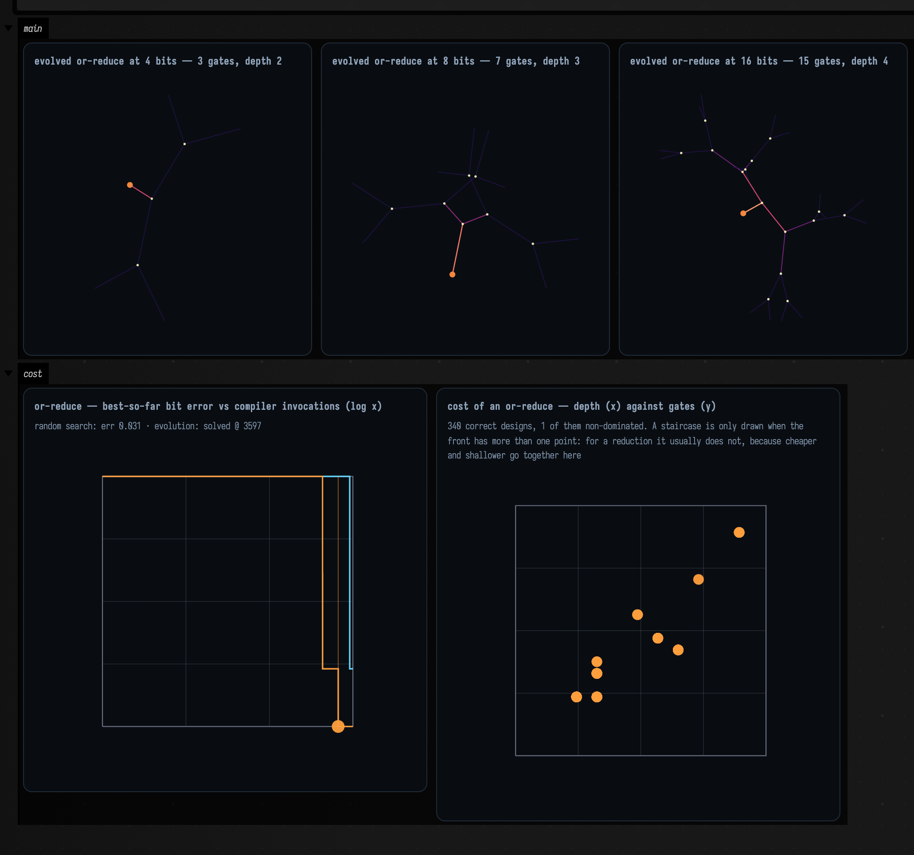
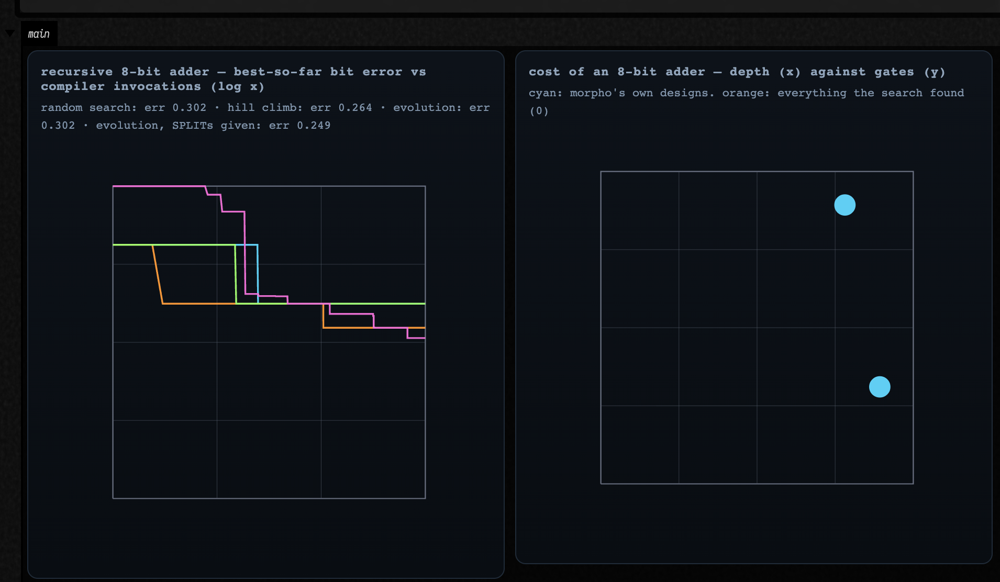

# Searching for MorphoHDL Circuits

[MorphoHDL](morpho_examples.md) circuits can be written by hand, or searched for: you say what a
circuit should compute, and Field generates MorphoHDL programs until one does. `afield.lang.morpho` has
the pieces:
`MorphoSpec` / `MorphoEvaluator` (what a circuit should compute, at which widths, and what it
costs), `MorphoGenome` / `MorphoProgramGenerator` (candidate programs, and small changes to them),
and `MorphoSearch` (random sampling, hill climbing, a (μ+λ) population, and a width curriculum).

The genome is **MorphoHDL source text**. Every candidate is compiled by upstream's own
`compileModule()` and run by `MorphoSim`. A search result is a program you can read and paste into a
morpho box, and the search is optimising against MorphoHDL itself rather than against Field's idea
of it.

```diffstatic_runner {data-lang=kotlin screenshot="assets/morpho_examples/search-control.png" wait="40.0" timeout="360" capture="box" open-outputs="true" padding="20" name="morpho-search-control"}
:::static
import afield.lang.morpho.*

// A problem is what the circuit should compute, the widths to test it at, and the cells a
// candidate may use. The only thing said about addition is `sum, c_out = a + b + c_in`;
// the cells are morpho's own eight standard ones.
val problem = MorphoProblems.fullAdderCell()
val budget = 4000
println(problem)
println("palette: " + MorphoPalette.standard.luts.joinToString { it.name })
println("input space at 1 bit: ${problem.spec.inputSpace(1)} vectors, " +
    "exhaustive = ${problem.spec.isExhaustiveAt(1)}")

// Three drivers with the same generator, seed and budget. One unit of budget is one
// invocation of morpho's compiler.
val runs = listOf(
    MorphoSearch.random(problem.spec, problem.generator, budget, seed = 2),
    MorphoSearch.hillClimb(problem.spec, problem.generator, budget, seed = 2),
    MorphoSearch.evolve(problem.spec, problem.generator, budget, seed = 2),
)
runs.forEach { println(it.summary()) }

// What was actually found, in MorphoHDL. This is paste-into-a-morpho-box text.
runs.firstOrNull { it.solved }?.best?.let { winner ->
    println()
    println(winner.genome.phenotype().cells[0].render())
    println("cost: ${winner.fitness.cost}")
}

// Cyan is random sampling, orange the hill climb, green the population. A dropped tick
// marks the invocation at which a run first became exactly correct, since a curve that
// reaches zero and one that reaches 0.004 look the same at this scale.
showPlaneGrid(
    "one-bit full adder — best-so-far bit error vs compiler invocations (log x, $budget budget)\n" +
        morphoRunCaption(runs) to morphoConvergenceFLines(runs),
    columns = 1, cellWidth = 700, cellHeight = 420, window = morphoPlotWindow()
)
```


One unit of budget is one invocation of morpho's compiler, which on a three-width adder problem
(parse, compile, expand, extract, simulate, three times over) costs about **1 ms** once Graal is
warm. Roughly a thousand candidates a second, single-threaded because a Graal `Context` is not safe
for concurrent access.

### What it found, with the control arm next to it

Each cell counts the seeds that found an exactly correct circuit: five seeds per cell, three for the
last two rows.

| problem | widths | budget | random (control) | hill climb | evolution |
| --- | --- | --- | --- | --- | --- |
| bitwise xor (the harness canary) | 2/4/8 | 2 000 | 5/5 | 5/5 | 5/5 |
| one-bit full adder | 1 | 4 000 | **0/5** | 4/5 | **5/5** |
| or-reduce, `y = (x != 0)` | 2/3/5 | 6 000 | 3/5 | **0/5** | 3/5 |
| and-reduce, `y = (x == ~0)` | 2/3/5 | 6 000 | 3/5 | **0/5** | 3/5 |
| recursive 8-bit adder | 2/4/8 | 20 000 | 0/3 | 0/3 | 0/3 |
| the same, with both `SPLIT`s given | 2/4/8 | 20 000 | 0/3 | 0/3 | 0/3 |

**The full adder is where selection earns its keep.** Random sampling never finds it and plateaus at
a bit-error rate of 0.125: that is `sum = Xor3(a, b, c)` with `c_out = And(a, b)`, right on six of
the eight truth-table rows and one gate swap short. Evolution finds it every time, in 165 to 1152
invocations. Same generator, same seeds, same budget: the only difference is selection.

**And it is the only row where selection helps.** On the two reductions, random sampling matches
evolution (3/5 each) and hill climbing finds nothing at all: it converges on a two-gate design
that is 3% wrong and cannot get off it. Those spaces are small enough that sampling them is a
perfectly good algorithm.

**Or-reduce cannot be done without recursion**, which is what makes it the positive result.
Morpho sizes a LUT cell to its widest operand and broadcasts the narrow ones (`compiler.js:964#const w = Math.max(...inputs.map(x => x.length));`):
no gate and no combination of gates turns eight wires into one bit. The only route down is to keep
`SPLIT`ting, and any design that gets the answer right has recursed to reach it.
The designs found come out at four gates and depth 3 at five bits (`n - 1` two-input gates,
arranged as a balanced tree) and the same source text is then re-compiled and checked at 16, 32 and
48 bits, widths nothing was ever selected on.

```diffstatic_runner {data-lang=kotlin screenshot="assets/morpho_examples/search-recursion.png" wait="90.0" timeout="360" capture="box" open-outputs="true" padding="20" name="morpho-search-recursion"}
:::static
import afield.lang.morpho.*

// y = (x != 0). No combination of gates turns eight wires into one bit, so the only way
// down is SPLIT: every correct answer divides and recurses.
val problem = MorphoProblems.orReduce()
println(problem)

val runs = listOf(
    MorphoSearch.random(problem.spec, problem.generator, 6000, seed = 2),
    MorphoSearch.evolve(problem.spec, problem.generator, 6000, seed = 2, mu = 24, lambda = 40),
)
runs.forEach { println(it.summary()) }

// The cheapest correct design across both runs, or the closest one if neither solved it.
val correct = runs.mapNotNull { it.best }.filter { it.fitness.correct }
val best = correct.minByOrNull { it.gates } ?: runs.mapNotNull { it.best }.first()
println()
println(if (correct.isEmpty()) "(nothing exactly correct this run; showing the best found)" else "")
println(best.genome.phenotype().cells[0].render())

// Selected at widths 2, 3 and 5 (see "Why the width family is 2, 3 and 5" below), then
// re-compiled from the same source at widths it was never tested on.
listOf(7, 9, 16, 32, 48).forEach { w ->
    val f = MorphoSearch.generalization(best.genome, problem.spec, listOf(w))
    println("  at %2d bits: %s".format(w, f))
}

// The Pareto front over every correct design the two runs produced, drawn as a step
// function because there is no design at a fractional gate count.
val found = runs.flatMap { it.costPoints() }
println()
println("Pareto front (gates, depth) at %d bits: %s".format(
    problem.spec.widths.max(),
    runs.flatMap { it.front }.joinToString(", ") { "(${it.gates}, ${it.depth})" }))

// The found circuit itself at three widths: one source, three signatures, three circuits.
val source = best.genome.render()
val panels = listOf(4, 8, 16).map { w ->
    val c = morphoCircuit(MorphoProblems.ROOT, w, source = source)
    c.growFully(relaxSteps = 220)
    "evolved or-reduce at %d bits — %d gates, depth %d".format(w, c.netlist.gateCount, c.depth.toInt()) to
        c.flines(fit = true)
}
showPlaneGrid(*panels.toTypedArray(), columns = 3, cellWidth = 300, cellHeight = 300,
    window = morphoUnitWindow())

showPlaneGrid(
    "or-reduce — best-so-far bit error vs compiler invocations (log x)\n" +
        morphoRunCaption(runs) to morphoConvergenceFLines(runs),
    "cost of an or-reduce — depth (x) against gates (y)\n" +
        "${found.size} correct designs, ${runs.sumOf { it.front.size }} of them non-dominated. " +
        "A staircase is only drawn when the front has more than one point: for a reduction " +
        "it usually does not, because cheaper and shallower go together here" to
        morphoParetoFLines(found),
    channel = "cost", columns = 2, cellWidth = 430, cellHeight = 380, window = morphoPlotWindow()
)
```



### Why the width family is 2, 3 and 5

Selecting on widths 2, 4 and 8 produced **400 distinct correct `or-reduce` designs**. Re-compiled at
twelve other widths, all 400 are correct at 3, 6, 12, 16, 32 and 48; **399 of them are wrong at
5, 7 and 9**. Exactly one design in four hundred is actually parametric. The dual, `and-reduce`,
gives **zero of 400**.

The mechanism is a hole in the language, not a quirk of the search. `SPLIT` halves a bus as
`floor(w/2), w - floor(w/2)` (`primitives.js:42#const half = Math.floor(w.length / 2);`), so the two halves are the same width exactly when
the width is even; 5, 7 and 9 are the small widths where they differ *and* both are wider than one
bit. A LUT applied to both halves (`Or(x0, x1)`, which is what these designs do) then has operands
of two different widths, and `materializeLut` (`compiler.js:962-973`) takes the maximum and
broadcasts only operands of width **1**. Unequal wider operands are neither broadcast nor rejected:
the extra pins simply read past the end of the shorter bus. The circuit is silently wrong, and a search that has never been shown an odd width has
no way to find out.

Change the family to 2, 3 and 5 (one line) and **400 of 400 designs are correct at every width
tried**, from 2 to 48. That family is `MorphoProblems.ODD_FAMILY`, the default for the reduction
problems, and `a power of two width family selects designs that are not parametric` is the test that
holds the claim in place.

A parametric design is a claim about all N, and one width is one point: that on its own is the case
for scoring at several widths. What several widths also catch is undefined behaviour in the
compiler, exploited by a search that had no idea it was cheating.

### The recursive adder

Nothing finds a divide-and-conquer adder. Not random sampling, not hill climbing, not a population,
not with lexicase selection over per-bit test cases, not with a width curriculum, and not with both
`SPLIT`s handed over as an unremovable prologue.

The near miss is not uniform across the drivers, and the difference is informative. Random sampling
and hill climbing stop on **depth-1** circuits: broadcast logic, no recursion at all, bit-error rates
around 0.25 to 0.27. Evolution at 20 000 invocations gets to **16 gates and depth 8**, which is
`ripple_adder`'s cost profile exactly, and is still **17.9% wrong**. It has found the shape and not
the wiring: eight levels of something chained across the width, carrying the wrong thing.

Three measurements say why the rest of the way is so far.

*The target is in the space.* The ripple skeleton, written by hand in the generator's own grammar,
is five statements and scores exactly `ripple_adder`: 16 gates and depth 8 at eight bits, 64 gates
and depth 32 at thirty-two. `the recursive adder is reachable in the genome grammar` asserts it.

*The recursion is being tried and is not paying.* Of 4 000 random programs on the guided problem,
511 (12.8%) contain a self-call in the compiled circuit. The best of those scores 0.2880 and the
best purely combinational candidate scores 0.3017. An eighth of the population is recursing, for
1.4% of the error. On the unguided problem only 2.8% recurse, and the best of those is *worse* than
the best combinational one (0.3753 against 0.3017); the two `SPLIT`s are the difference.
(`MorphoSearchMeasurements.recursionDensity`.)

*And the reason is arithmetic about the answer.* A correct adder needs both halves recursed, both
carries chained in the right order, and the two sums `CAT`ed back: four statements worth nothing
until all four are right and wired to the outputs. Or-reduce needs two, and half of it already pays.

```diffstatic_runner {data-lang=kotlin screenshot="assets/morpho_examples/search-adder.png" wait="90.0" timeout="360" capture="box" open-outputs="true" padding="20" name="morpho-search-adder"}
:::static
import afield.lang.morpho.*

// Four drivers on a recursive 8-bit adder, two of them with both SPLITs given.
val free = MorphoProblems.recursiveAdder()
val guided = MorphoProblems.guidedRecursiveAdder()
val budget = 6000
val runs = listOf(
    MorphoSearch.random(free.spec, free.generator, budget, seed = 1),
    MorphoSearch.hillClimb(free.spec, free.generator, budget, seed = 1),
    MorphoSearch.evolve(free.spec, free.generator, budget, seed = 1),
    MorphoSearch.evolve(guided.spec, guided.generator, budget, seed = 1,
        label = "evolution, SPLITs given"),
)
runs.forEach { println(it.summary()) }

// The ripple adder written by hand in the generator's own grammar, scored by the same
// evaluator: the answer is in the search space.
val target = MorphoGenome(
    listOf(MorphoCellGenome(
        name = MorphoProblems.ROOT,
        inputs = listOf("a", "b", "c"),
        statements = listOf(
            MorphoStatement(listOf("a0", "a1"), "SPLIT", listOf("a")),
            MorphoStatement(listOf("b0", "b1"), "SPLIT", listOf("b")),
            MorphoStatement(listOf("s0", "cm"), MorphoProblems.ROOT, listOf("a0", "b0", "c")),
            MorphoStatement(listOf("s1", "co"), MorphoProblems.ROOT, listOf("a1", "b1", "cm")),
            MorphoStatement(listOf("sum"), "CAT", listOf("s0", "s1")),
        ),
        outputs = listOf("sum", "co"),
        fallback = "full_adder",
    )),
    free.generator.preamble,
)
println()
println(target.cells[0].render())
println("  scored at 2/4/8: " + MorphoEvaluator(free.spec).evaluate(target.render(), target.rootName))
println("  at 16 bits:      " + MorphoSearch.generalization(target, free.spec, listOf(16)))
println("  at 32 bits:      " + MorphoSearch.generalization(target, free.spec, listOf(32)))

// morpho's own adders, scored by the same evaluator.
val references = listOf("ripple_adder", "brent_kung_adder").mapNotNull { design ->
    free.reference(design).cost?.let { MorphoCostPoint(design, it.gates, it.depth, reference = true) }
}
references.forEach { println("  reference ${it.label}: ${it.gates} gates, depth ${it.depth}") }

// Left: the four runs' error curves. Right: the cost plane for an 8-bit adder, with
// morpho's designs and whatever the search found.
val found = runs.flatMap { it.costPoints() }
println("correct designs found by any driver: ${found.size}")
showPlaneGrid(
    "recursive 8-bit adder — best-so-far bit error vs compiler invocations (log x)\n" +
        morphoRunCaption(runs) to morphoConvergenceFLines(runs),
    "cost of an 8-bit adder — depth (x) against gates (y)\n" +
        "cyan: morpho's own designs.  orange: everything the search found (${found.size})" to
        morphoParetoFLines(found + references),
    columns = 2, cellWidth = 430, cellHeight = 400, window = morphoPlotWindow()
)
```



??? aside "Where these numbers come from"
    The table is regenerated with
    `./gradlew jvmMeasurements --tests "afield.lang.morpho.MorphoSearchMeasurements" --rerun -i`.
    `MorphoSearchTest` asserts the claims above, including that the recursive adder is reachable
    in the grammar and not solved at this budget. The design notes are in
    `dev_docs/morpho_circuit_search.md`.

## See also

- [MorphoHDL in Field](morpho_examples.md) for writing and drawing MorphoHDL circuits.
- [morpho_circuit_search](agent_transcripts.md#morpho_circuit_search), a starting point with these
  searches as boxes you can run.
