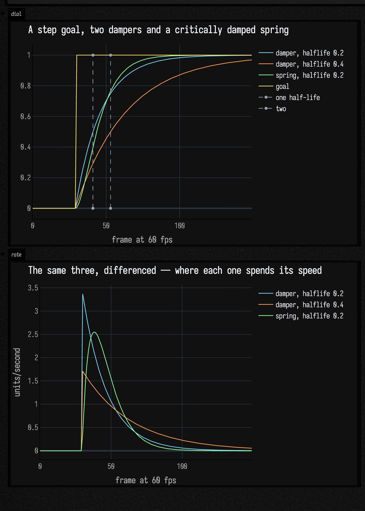
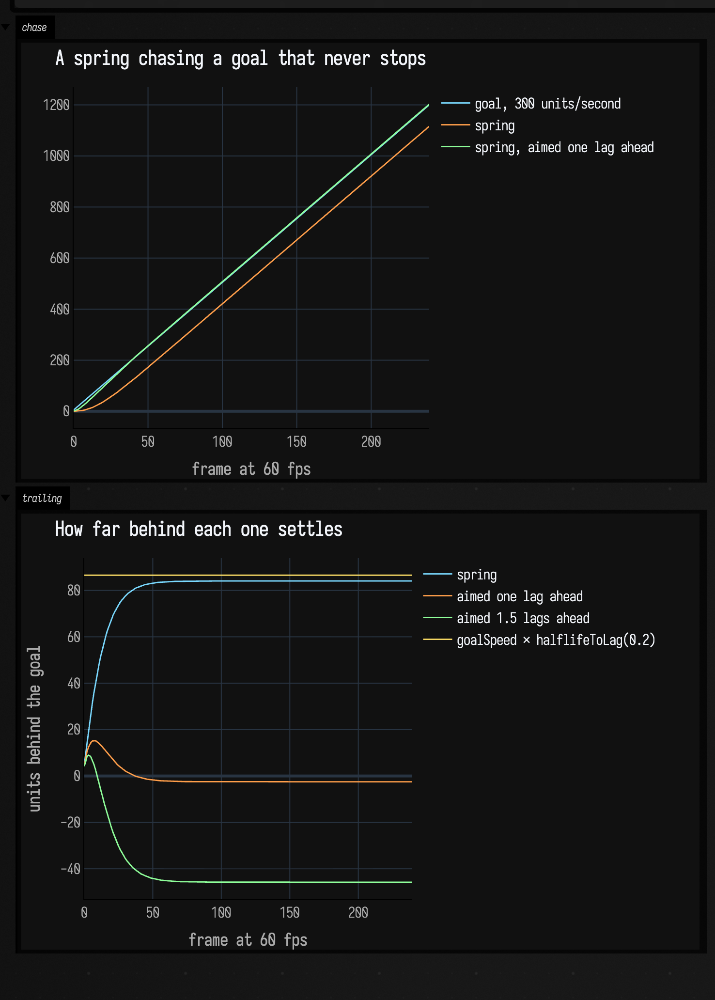
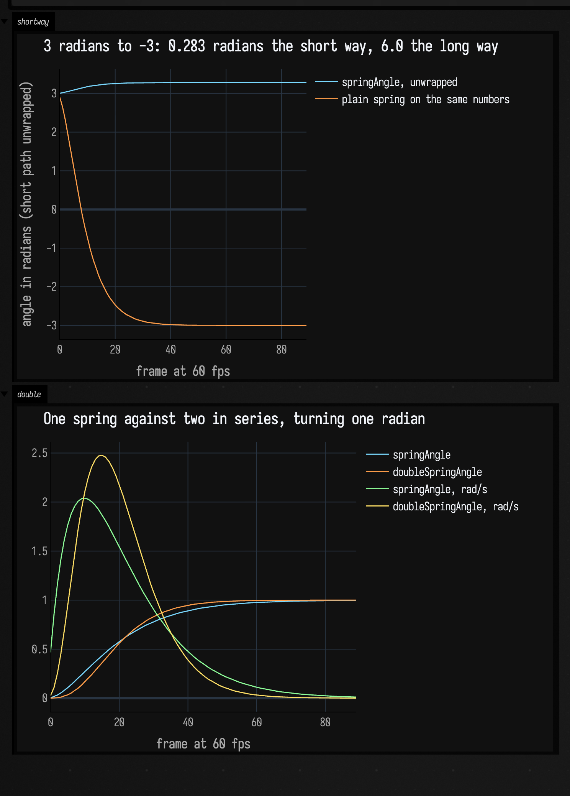
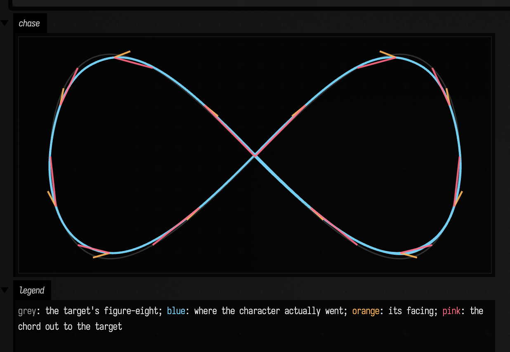
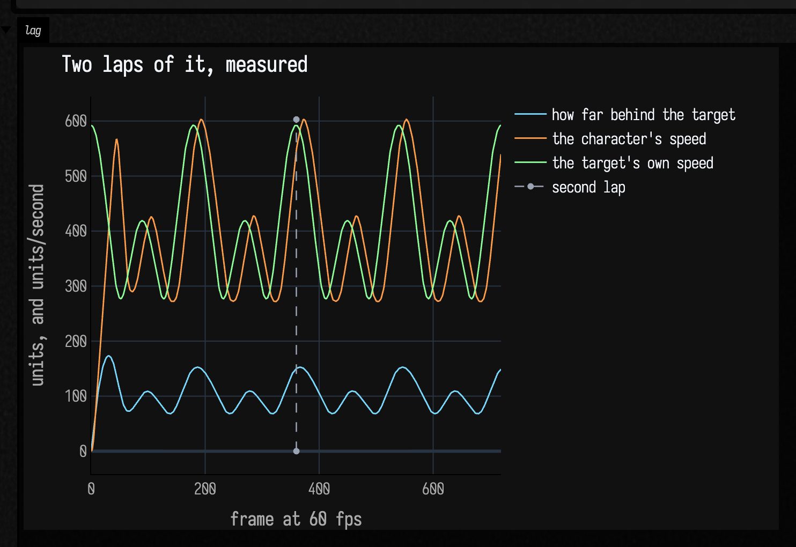
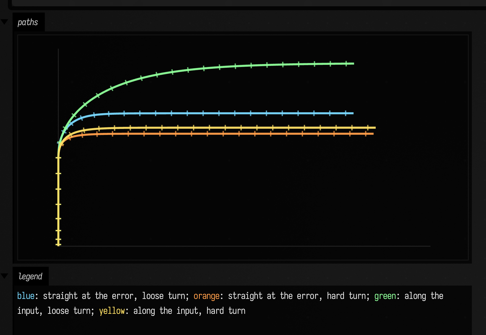
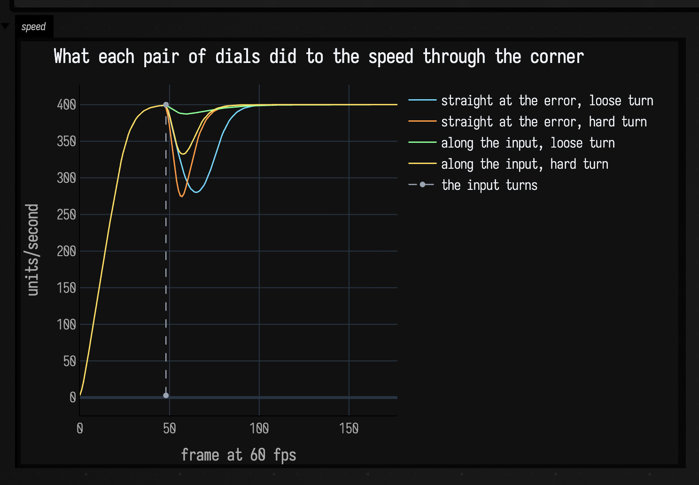

# Springs, dampers, and a character with mass

*Every public declaration used below is listed, with its KDoc, in the codebase reference: [`movement.kt`](reference/simulation.md#movement-kt). Start from [what's already in the box](reference/index.md).*

`Springs` is a handful of one-line functions for making a value arrive somewhere
without a hard edge, and `MovementState` is what you get when you stack four of
them into a character that can be steered. Both are ports of Daniel Holden's
["Spring-It-On"](https://theorangeduck.com/page/spring-roll-call) and
["A New Movement Model"](https://theorangeduck.com/page/new-movement-model), and
both are plain CPU arithmetic on `Float` and `Vector2f` — no renderer, no solver,
nothing to set up. If you want a value eased *once*, to a target that then stays
put, [interpolants](interpolants_examples.md) are the shorter route; springs are
for the case where the target keeps moving and the motion has to stay believable
through every change of mind.

One parameter runs through all of it: **half-life**, the time the spring takes to
close half the distance to its goal. It is the only spring parameter that
describes something you can watch, which is the whole reason to reach for these
rather than tuning a stiffness against a damping ratio.

## Half-life is the dial

Two shapes, one dial. `damper` is the plain exponential: it leaves at full speed
and slows as it arrives, so it eases out but not in. `spring` carries a velocity
of its own and is *critically damped*, the fastest approach that still arrives
without overshooting or ringing. The grey marks below sit one and two half-lives
after the goal jumps, which is where the 0.2 damper reads 0.5 and 0.75:

```diffstatic_runner {data-lang=kotlin screenshot="assets/movement_examples/halflife_dial.png" wait="1.5" capture="box" open-outputs="true" name="movement-halflife"}
:::static
val dt = 1f / 60f
val n = 150
// The goal is 0 for half a second and then 1 forever.
val goal = FloatArray(n) { if (it < 30) 0f else 1f }

var quick = 0f
var slow = 0f
var sprung = 0f
var sprungV = 0f
val a = FloatArray(n)
val b = FloatArray(n)
val c = FloatArray(n)
for (i in 0 until n) {
    quick = Springs.damper(quick, goal[i], halflife = 0.2f, dt = dt)
    slow = Springs.damper(slow, goal[i], halflife = 0.4f, dt = dt)
    val step = Springs.spring(sprung, sprungV, goal[i], halflife = 0.2f, dt = dt)
    sprung = step.x
    sprungV = step.v
    a[i] = quick
    b[i] = slow
    c[i] = sprung
}

showSignals(
    "damper, halflife 0.2" to a.toList(),
    "damper, halflife 0.4" to b.toList(),
    "spring, halflife 0.2" to c.toList(),
    "goal" to goal.toList(),
    channel = "dial",
    title = "A step goal, two dampers and a critically damped spring",
    xTitle = "frame at 60 fps",
    marks = listOf("one half-life" to 41, "two" to 53),
    markColor = "#9aa4b2",
)

// Per-frame change × 60 is the speed each one is travelling at, in units/second.
fun rate(v: FloatArray) = List(v.size) { if (it == 0) 0.0 else (v[it] - v[it - 1]).toDouble() * 60.0 }

showSignals(
    "damper, halflife 0.2" to rate(a),
    "damper, halflife 0.4" to rate(b),
    "spring, halflife 0.2" to rate(c),
    channel = "rate",
    title = "The same three, differenced — where each one spends its speed",
    xTitle = "frame at 60 fps",
    yTitle = "units/second",
)
```



The two dampers are the same shape at two rates, and the 0.2 one crosses the marks
where the name promises: 0.5 at one half-life, 0.75 at two. Nothing in the top
panel crosses 1.

The rate panel is the shape difference. A damper's fastest instant is the one where
the goal moved, and it only slows from there; that step in the rate is what "eases
out but not in" means. The spring's rate starts at zero, peaks at 2.55
units/second seven frames in, and decays from there, so it leaves smoothly *and*
arrives sooner — on the same half-life it is within 1% of the goal by frame 87
where the damper needs 109.

Every step here is *exact* — the analytic solution of the spring's differential
equation, not a numerical integration — so one step of `dt` lands where ten steps
of `dt / 10` do, and the motion does not change shape when the frame rate does.
`MovementTest.aSpringStepIsExactWhateverTheStepSize` pins that at 1e-4 over a
fifty-fold change in step size. Holden's `fast_negexp` polynomial is the one thing
not carried across; a real `exp` is what makes the exactness true.

Two more members round the object out. `decay(x, v, halflife, dt)` runs the same
shape on a pair heading for zero rather than for a goal, which is the offset half
of an inertialisation: hold the difference between where something was and where
it has just jumped to, decay that with `decay`, and add it back to hide the jump.
And `halflifeToDamping` / `dampingToHalflife` convert between the half-life and
the damping coefficient the spring is actually built from, for when something else
in the pipeline insists on the coefficient.

## Spring lag behind a moving goal

Aim a spring at something travelling at a constant speed and it settles into a
fixed distance behind, forever. That distance is knowable: `halflifeToLag` returns
it in *seconds* of the goal's own travel, so at 300 units/second with a half-life
of 0.2 the spring ends up `300 × halflifeToLag(0.2)` = 86.6 units back. Which
means it can be cancelled — aim the spring a lag ahead of where the goal is, and
it lands on the goal instead of behind it:

```diffstatic_runner {data-lang=kotlin screenshot="assets/movement_examples/lag_compensation.png" wait="1.5" capture="box" open-outputs="true" name="movement-lag"}
:::static
val dt = 1f / 60f
val halflife = 0.2f
val goalSpeed = 300f
val lag = Springs.halflifeToLag(halflife)
val n = 240

var goal = 0f
var px = 0f; var pv = 0f
var ax = 0f; var av = 0f
var ex = 0f; var ev = 0f

val goals = FloatArray(n)
val plain = FloatArray(n)
val aimed = FloatArray(n)
val eager = FloatArray(n)
for (i in 0 until n) {
    goal += goalSpeed * dt
    val p = Springs.spring(px, pv, goal, halflife, dt); px = p.x; pv = p.v
    // Aim at where the goal will be one lag from now. `goalSpeed * lag` is that distance.
    val a = Springs.spring(ax, av, goal + goalSpeed * lag, halflife, dt); ax = a.x; av = a.v
    val e = Springs.spring(ex, ev, goal + 1.5f * goalSpeed * lag, halflife, dt); ex = e.x; ev = e.v
    goals[i] = goal; plain[i] = px; aimed[i] = ax; eager[i] = ex
}

showSignals(
    "goal, 300 units/second" to goals.toList(),
    "spring" to plain.toList(),
    "spring, aimed one lag ahead" to aimed.toList(),
    channel = "chase",
    title = "A spring chasing a goal that never stops",
    xTitle = "frame at 60 fps",
)
showSignals(
    "spring" to List(n) { (goals[it] - plain[it]).toDouble() },
    "aimed one lag ahead" to List(n) { (goals[it] - aimed[it]).toDouble() },
    "aimed 1.5 lags ahead" to List(n) { (goals[it] - eager[it]).toDouble() },
    "goalSpeed × halflifeToLag(0.2)" to List(n) { (goalSpeed * lag).toDouble() },
    channel = "trailing",
    title = "How far behind each one settles",
    xTitle = "frame at 60 fps",
    yTitle = "units behind the goal",
)
```



In the top panel the compensated trace lies on the goal and the plain one runs
parallel below it. The bottom panel measures that gap. The plain spring settles at
84.1 units against the yellow line's continuous-time 86.6, half a frame of travel
short of it, which is the whole error a per-frame spring introduces. The
compensated one sits within 2.5 units of zero, and at 1.5 lags it runs *ahead* of
the goal by 46. `lagToHalflife` goes the other way, if what you know is how much
lag you are willing to accept.

This is the trick `MovementParams.accelerationCompensation` is made of, and it is
why smoothing in the movement model below costs shape without costing
responsiveness.

## Angles take the short way

`springAngle` differs from `spring` in one place: the distance to the goal is
measured as a wrapped angle. A facing at 3 radians chasing −3 is 0.283 radians
from its goal going onward through π, not 6 radians going back through zero, and
a plain spring has no way to know that:

```diffstatic_runner {data-lang=kotlin screenshot="assets/movement_examples/angle_short_way.png" wait="1.5" capture="box" open-outputs="true" name="movement-angle"}
:::static
val dt = 1f / 60f
val n = 90

var x = 3f; var v = 0f
var unwrapped = 3.0
var plainX = 3f; var plainV = 0f
val short = DoubleArray(n)
val long = DoubleArray(n)
for (i in 0 until n) {
    val step = Springs.springAngle(x, v, goal = -3f, halflife = 0.12f, dt = dt)
    // springAngle reports its answer near the *goal*, so the raw number jumps by 2π on the
    // step where the short way crosses ±π. Accumulate wrapped increments to plot the travel.
    unwrapped += Springs.wrapAngle(step.x - x).toDouble()
    x = step.x; v = step.v
    val naive = Springs.spring(plainX, plainV, -3f, 0.12f, dt)
    plainX = naive.x; plainV = naive.v
    short[i] = unwrapped
    long[i] = plainX.toDouble()
}

showSignals(
    "springAngle, unwrapped" to short.toList(),
    "plain spring on the same numbers" to long.toList(),
    channel = "shortway",
    title = "3 radians to −3: 0.283 radians the short way, 6.0 the long way",
    xTitle = "frame at 60 fps",
    yTitle = "radians travelled from 3",
)

// A single spring leaves at once when the goal jumps, which reads as a flick. Two in series,
// each on half the half-life, removes it: the visible spring chases something that is itself
// accelerating.
var sx = 0f; var sv = 0f
var dx = 0f; var dv = 0f; var ix = 0f; var iv = 0f
val single = DoubleArray(n)
val double = DoubleArray(n)
val singleRate = DoubleArray(n)
val doubleRate = DoubleArray(n)
for (i in 0 until n) {
    val one = Springs.springAngle(sx, sv, goal = 1f, halflife = 0.25f, dt = dt)
    sx = one.x; sv = one.v
    val two = Springs.doubleSpringAngle(dx, dv, ix, iv, goal = 1f, halflife = 0.25f, dt = dt)
    dx = two.x; dv = two.v; ix = two.intermediateX; iv = two.intermediateV
    single[i] = sx.toDouble(); double[i] = dx.toDouble()
    singleRate[i] = sv.toDouble(); doubleRate[i] = dv.toDouble()
}

showSignals(
    "springAngle" to single.toList(),
    "doubleSpringAngle" to double.toList(),
    "springAngle, rad/s" to singleRate.toList(),
    "doubleSpringAngle, rad/s" to doubleRate.toList(),
    channel = "double",
    title = "One spring against two in series, turning one radian",
    xTitle = "frame at 60 fps",
)
```



The top panel is the wrapping. The bottom panel is the other angle function:
`doubleSpringAngle` runs two `springAngle`s in series, each on half the half-life,
and the visible one chases the intermediate one rather than the goal. Its rate
starts at 0.05 rad/s where the single spring's is already at 0.45, so the turn
begins as an acceleration rather than a departure — that flick off the mark is
what the second spring is there to remove. It costs about half a second of being
behind, then overtakes: peak rate 2.48 rad/s at frame 14 against 2.04 at frame 9,
and a slightly earlier arrival, because two springs on half a half-life each
settle faster than one on the whole.

!!! warning "`springAngle` reports its answer near the goal"
    The returned number can jump by 2π on the step where the short way crosses
    ±π, even though the angle does not. Feed it to `cos`/`sin` or a rotation and
    that is invisible. Compare it against a previous value, as the plot above has
    to, and take the difference through `wrapAngle` first.

## A character following a moving target

`MovementState` holds a position, a velocity, an acceleration and a facing.
`update` takes a *desired velocity* — an instruction carrying both a direction and
a speed, so a half-deflected stick is a shorter vector and not a slower approach
to a long one — and moves the character toward it under a rate cap, then smooths
the result. A zero vector is a request to stop.

Here the instruction comes from a target running a figure-eight: point at it, and
ask for four times the distance to it, capped at 650. So the character only asks
for its top speed once it is more than 162 units behind, and the target — which
runs its lap in six seconds, moving between 277 and 592 units per second — spends
most of every lap putting it there. The grey chords connect the two at a dozen
instants of the second lap:

```diffstatic_runner {data-lang=kotlin screenshot="assets/movement_examples/character_chase.png" wait="1.5" capture="box" open-outputs="true" name="movement-chase"}
:::static
val dt = 1f / 60f
val period = 6.0
val frames = (period * 2.0 * 60).toInt()

fun target(t: Double): Vector2f {
    val th = t * 2.0 * PI / period
    return Vector2f((540.0 + 400.0 * sin(th)).toFloat(), (330.0 + 200.0 * sin(2.0 * th)).toFloat())
}

val character = MovementState()
character.placeAt(target(0.0))

val path = mutableListOf<Vector2f>()
val marks = mutableListOf<FLine>()
for (i in 0 until frames) {
    val here = target(i * dt.toDouble())
    val to = here - character.position
    val distance = to.length()
    // Point at the target and ask for four times the distance to it, capped.
    val aim = if (distance > 1e-4f) Vector2f(to.x / distance, to.y / distance) else Vector2f()
    character.update(aim * minOf(650f, distance * 4f), dt)
    path += Vector2f(character.position)

    // A tick along `heading` plus a chord out to the target, every second of the second lap.
    if (i >= frames / 2 && i % 30 == 0) {
        val p = character.position
        val h = character.heading
        marks += fline {
            moveTo(p.x, p.y)
            lineTo(p.x + h.x * 34f, p.y + h.y * 34f)
            color = vec(1.0, 0.72, 0.35, 0.9)
            thickness = 2.2
        }
        marks += fline {
            moveTo(p.x, p.y)
            lineTo(here.x, here.y)
            color = vec(1.0, 0.42, 0.52, 0.9)
            thickness = 2.2
        }
    }
}

val targetPath = fline {
    for (i in 0..600) {
        val p = target(i / 600.0 * period)
        if (i == 0) moveTo(p.x, p.y) else lineTo(p.x, p.y)
    }
    color = vec(1, 1, 1, 0.22)
    thickness = 1.6
}

val walked = fline {
    path.forEachIndexed { i, p -> if (i == 0) moveTo(p.x, p.y) else lineTo(p.x, p.y) }
    color = vec(0.48, 0.85, 1.0, 0.95)
    thickness = 2.6
}

lines(listOf(targetPath, walked) + marks, channel = "chase", w = 1080.0, h = 560.0, fitToSize = true)
:::fold render the colour key
markdown("legend", """
    <span style='color:#9a9a9a'>grey</span>: the target's figure-eight;
    <span style='color:#7ad9ff'>blue</span>: where the character actually went;
    <span style='color:#ffb85a'>orange</span>: its facing;
    <span style='color:#ff6b85'>pink</span>: the chord out to the target
""")
:::endfold
```



The *shape* of the path is close to the target's, because the lag is mostly along
the track rather than across it: every pink chord points roughly where the
character is already going. What the path does show is the corner-cutting, at the
two outer ends of the lobes, where the turn is tightest and the rate cap bites.
The orange ticks are the separate facing spring. They lean out of the turn at the
tight end of each lobe, because facing is sprung toward the direction of travel
with `rotationHalflife` and arrives there late; it has no effect at all on where
the character goes.

The cost of the mass is not in the shape, it is in the timing, so it needs
measuring rather than drawing:

```diffstatic_runner {data-lang=kotlin screenshot="assets/movement_examples/character_lag.png" wait="1.5" capture="box" open-outputs="true" name="movement-chase-lag"}
:::static
val dt = 1f / 60f
val period = 6.0
val frames = (period * 2.0 * 60).toInt()

fun target(t: Double): Vector2f {
    val th = t * 2.0 * PI / period
    return Vector2f((540.0 + 400.0 * sin(th)).toFloat(), (330.0 + 200.0 * sin(2.0 * th)).toFloat())
}

val character = MovementState()
character.placeAt(target(0.0))

val behind = mutableListOf<Number>()
val speed = mutableListOf<Number>()
val targetSpeed = mutableListOf<Number>()
for (i in 0 until frames) {
    val here = target(i * dt.toDouble())
    val to = here - character.position
    val distance = to.length()
    val aim = if (distance > 1e-4f) Vector2f(to.x / distance, to.y / distance) else Vector2f()
    character.update(aim * minOf(650f, distance * 4f), dt)
    behind += distance
    speed += character.speed
    targetSpeed += (target((i + 1) * dt.toDouble()) - here).length() / dt
}

showSignals(
    "how far behind the target" to behind.toList(),
    "the character's speed" to speed.toList(),
    "the target's own speed" to targetSpeed.toList(),
    channel = "lag",
    title = "Two laps of it, measured",
    xTitle = "frame at 60 fps",
    yTitle = "units, and units/second",
    marks = listOf("second lap" to frames / 2),
    markColor = "#9aa4b2",
)
```



The two speed traces have the same shape and the character's arrives about 16
frames late, a quarter of a second of phase behind an instruction it is otherwise
matching. The distance that phase costs is the blue trace: 173 units at its worst
during the opening acceleration from rest, then a steady oscillation between 68
and 153 as each lobe alternately pulls away and lets the character catch up. None
of it ever converges to zero, because the target never stops.

`velocity` is the field to animate from; `immediateVelocity` is the clamped but
unsmoothed velocity the smoothing spring is chasing, exposed because it is
occasionally the more useful thing to compare against. Every field is a plain
`var`: assign `position` to teleport, or call `placeAt` to teleport and come to
rest in one move.

## Two dials decide what it feels like

`MovementParams` has ten fields and two of them carry most of the character.
`directionalAcceleration` decides *where the acceleration is allowed to point*:
at 0 all of it goes at the velocity error, which turns readily and loses speed
doing it; at 1 it can only push along the requested direction, so it holds its
speed through a turn and drifts instead. Holden calls the two ends a quad-copter
and an airboat. `turnStrength` is the other half: it rotates the current direction
of travel toward the requested one as a damper of half-life `1 / turnStrength`,
which buys sharpness directly.

The four runs below are the corners of that square. Each accelerates upward for
0.8 seconds, then asks to go right instead. The tick across each path is drawn
every six frames, so tick spacing reads as speed:

```diffstatic_runner {data-lang=kotlin screenshot="assets/movement_examples/turn_paths.png" wait="1.5" capture="box" open-outputs="true" name="movement-dial-paths"}
:::static
val dt = 1f / 60f
val up = 48
val across = 130

// Four MovementParams, and a colour each. The two dials are the first two arguments.
// The colours are signalPalette's first four, in order, so they mean the same thing here
// as in the showSignals plot below.
val runs = listOf(
    Triple("straight at the error, loose turn", MovementParams(directionalAcceleration = 0f, turnStrength = 1f), vec(0.478, 0.851, 1.0, 0.95)),
    Triple("straight at the error, hard turn", MovementParams(directionalAcceleration = 0f, turnStrength = 16f), vec(1.0, 0.620, 0.290, 0.95)),
    Triple("along the input, loose turn", MovementParams(directionalAcceleration = 1f, turnStrength = 1f), vec(0.561, 1.0, 0.604, 0.95)),
    Triple("along the input, hard turn", MovementParams(directionalAcceleration = 1f, turnStrength = 16f), vec(1.0, 0.878, 0.400, 0.95))
)

// y grows downwards in the output, so "up" is negative and the origin sits at the bottom left.
fun sx(v: Float) = 100.0 + v
fun sy(v: Float) = 540.0 + v

val drawn = mutableListOf<FLine>()
for ((_, params, rgba) in runs) {
    val character = MovementState()
    val trace = mutableListOf<Vector2f>()
    repeat(up) { character.update(Vector2f(0f, -400f), dt, params); trace += Vector2f(character.position) }
    repeat(across) { character.update(Vector2f(400f, 0f), dt, params); trace += Vector2f(character.position) }

    drawn += fline {
        trace.forEachIndexed { i, p -> if (i == 0) moveTo(sx(p.x), sy(p.y)) else lineTo(sx(p.x), sy(p.y)) }
        color = rgba
        thickness = 2.6
    }
    // A tick across the path every six frames: closely spaced ticks mean the run slowed down.
    for (i in 6 until trace.size step 6) {
        val along = trace[i] - trace[i - 1]
        val len = along.length()
        if (len < 1e-4f) continue
        val nx = -along.y / len * 7f
        val ny = along.x / len * 7f
        drawn += fline {
            moveTo(sx(trace[i].x - nx), sy(trace[i].y - ny))
            lineTo(sx(trace[i].x + nx), sy(trace[i].y + ny))
            color = rgba
            thickness = 1.6
        }
    }
}

val corner = listOf(
    fline { moveTo(sx(0f), sy(0f)); lineTo(sx(940f), sy(0f)); color = vec(1, 1, 1, 0.18); thickness = 1.2 },
    fline { moveTo(sx(0f), sy(0f)); lineTo(sx(0f), sy(-500f)); color = vec(1, 1, 1, 0.18); thickness = 1.2 }
)

lines(corner + drawn, channel = "paths", w = 1080.0, h = 560.0, fitToSize = true)
:::fold render the colour key
markdown("legend", """
    <span style='color:#7ad9ff'>blue</span>: straight at the error, loose turn;
    <span style='color:#ff9e4a'>orange</span>: straight at the error, hard turn;
    <span style='color:#8fff9a'>green</span>: along the input, loose turn;
    <span style='color:#ffe066'>yellow</span>: along the input, hard turn
""")
:::endfold
```



Turning hard pulls both variants round into almost the same place: orange and
yellow finish 285 and 300 units above the corner, within 15 of each other despite
sitting at opposite ends of the other dial. Loosen the turn and the two separate,
blue at 337 and green at 462, so the widest swing in the set belongs to the run
that both accelerates along its input and turns lazily. The tick spacing is the
other half of it: green's stay even all the way through, and blue's bunch up
through the corner.

The same four runs, measured rather than eyeballed. The colours carry over:

```diffstatic_runner {data-lang=kotlin screenshot="assets/movement_examples/turn_speed.png" wait="1.5" capture="box" open-outputs="true" name="movement-dial-speed"}
:::static
val dt = 1f / 60f
val up = 48
val across = 130

val runs = listOf(
    "straight at the error, loose turn" to MovementParams(directionalAcceleration = 0f, turnStrength = 1f),
    "straight at the error, hard turn" to MovementParams(directionalAcceleration = 0f, turnStrength = 16f),
    "along the input, loose turn" to MovementParams(directionalAcceleration = 1f, turnStrength = 1f),
    "along the input, hard turn" to MovementParams(directionalAcceleration = 1f, turnStrength = 16f)
)

val speeds = runs.map { (label, params) ->
    val character = MovementState()
    val speed = mutableListOf<Number>()
    repeat(up) { character.update(Vector2f(0f, -400f), dt, params); speed += character.speed }
    repeat(across) { character.update(Vector2f(400f, 0f), dt, params); speed += character.speed }
    label to speed.toList()
}

showSignals(
    *speeds.toTypedArray(),
    channel = "speed",
    title = "What each pair of dials did to the speed through the corner",
    xTitle = "frame at 60 fps",
    yTitle = "units/second",
    marks = listOf("the input turns" to up),
    markColor = "#9aa4b2",
)
```



All four ask for 400 units/second and all four are back within 1% of it inside
three quarters of a second. What separates them is the dip. The two runs whose
acceleration points at the velocity error give away 120 and 126 units, close to a
third of their speed; pointing it along the input instead costs 13 with a loose
turn and 67 with a hard one. The cost is geometric: rotating a velocity by damping
it cuts the chord instead of following the arc, and `turnStrength = 16` is asking
for a lot of chord.

So the two dials do different jobs. `turnStrength` buys the angle,
`directionalAcceleration` buys the speed, and turning both up is a character that
turns sharply *and* keeps moving. A reversal is not a turn and still stops: there
is no short way round 180°.

The rest of `MovementParams` is the weight. `acceleration` and `deceleration` cap
how hard the speed can change, and a deceleration higher than the acceleration is
what makes a stop read as deliberate; `accelerationHalflife` and
`decelerationHalflife` are how much smoothing sits on top of that cap, with zero
giving the raw and slightly robotic version; and `accelerationCompensation` buys
back the lag the smoothing costs, by the trick in the second figure above. At 1
the cancellation is exact for as long as the movement is changing at a steady
rate. Above 1 it anticipates, which reads as keenness. Speeding up and slowing
down get their own halves of each of those pairs, which is how a stop can be much
more abrupt than a start without looking wrong; `decelerationCompensation`
defaults to 0, so a stop is allowed to keep its lag.

The last two fields are facing only. `rotationHalflife` is the facing spring's
half-life, and `rotationDoubleSpring` chooses between `springAngle` and
`doubleSpringAngle` for it — the difference is the bottom panel of the angle
figure above. Neither affects where the character goes, and if you are aiming
independently of travel, pass `desiredRotation` to `update` rather than reaching
for these.

---

For a value eased once to a target that then stays put, and for the retargeting
interpolant that keeps its velocity through a change of mind, see
[Values over time](interpolants_examples.md). For motion that comes out of a
constraint solve rather than a steering instruction, see
[Physics](physics.md); for what `dt` should be when any of this runs in a real
loop, [Frames, and what a frame is](animation_time_model.md).
