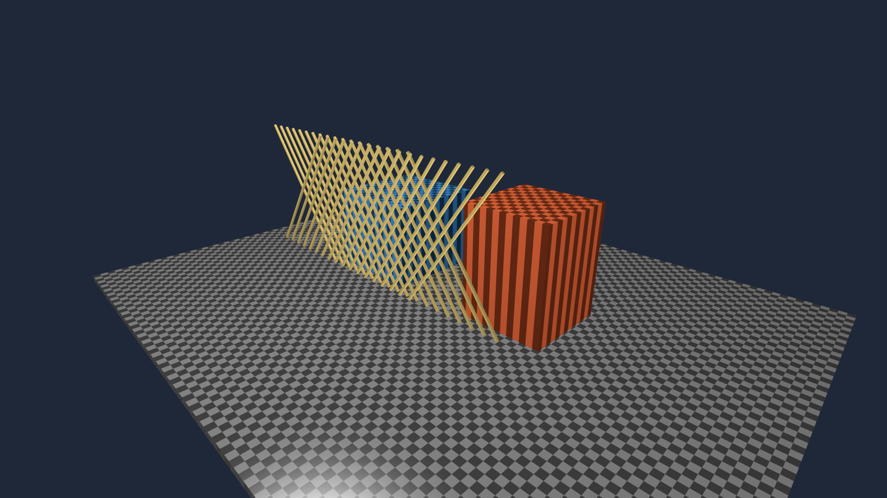
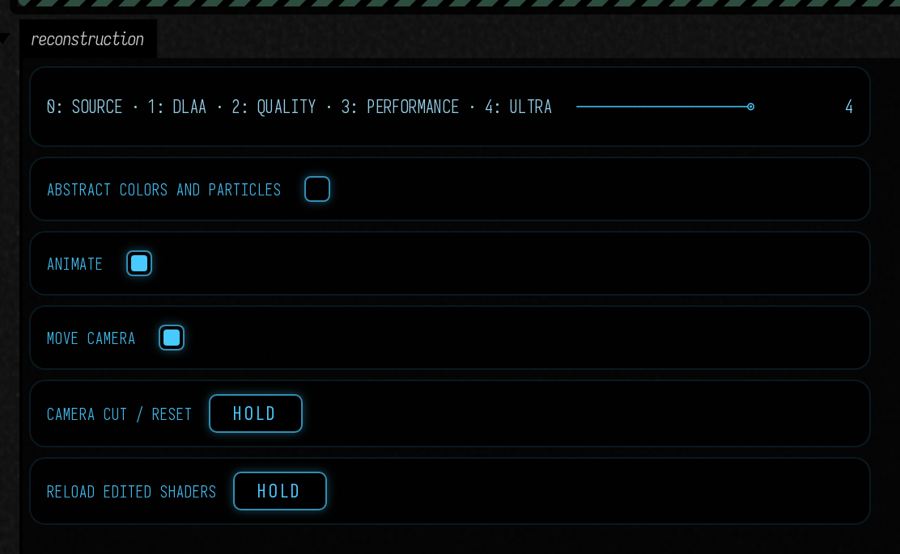
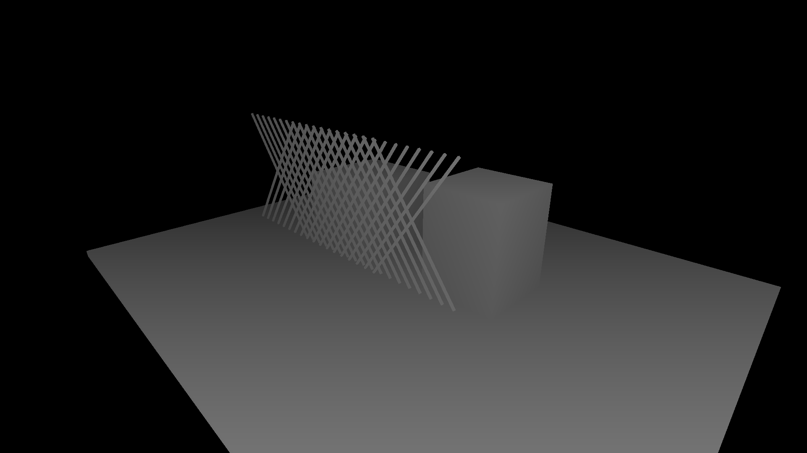
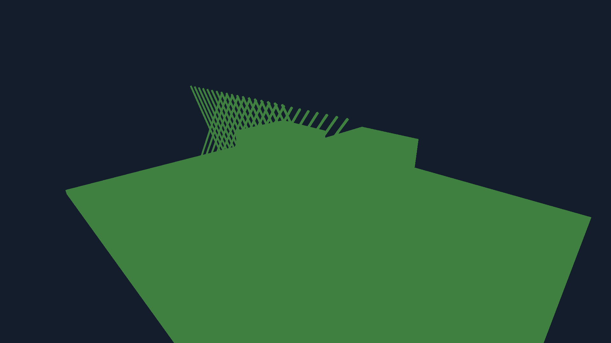

# Neural reconstruction

**Keep the same output size, and change how Field gets there.** DLAA reconstructs the native-resolution
image to smooth edges. DLSS Super Resolution starts with a smaller render and reconstructs it to the
same output size. Both run inside Field's Vulkan renderer; neither needs ray tracing.

The **neural_reconstruction** Starting Point compares the original image, DLAA, Quality and Performance
at **1920 × 1080**, with Ultra Performance for pushing the source down to 360p.
Its crossing rods, checkerboard surfaces and moving highlights make the differences
easy to see. Switch to **Abstract colors and particles** to try less conventional imagery.



## Open the experiment

On Field's welcome screen, search **Starting points** for **neural_reconstruction** and open an editable
copy. Run the **renderer** box, then **neural reconstruction**. The controls appear in that box; the image
appears in the native graphics window.

- **0: Source** shows the unjittered native-resolution scene.
- **1: DLAA** applies neural antialiasing at native resolution.
- **2: Quality** renders at the SDK's recommended size and reconstructs to 1080p.
- **3: Performance** uses a smaller input, again producing 1080p.
- **4: Ultra** selects Ultra Performance: **640 × 360 → 1920 × 1080** on this machine,
  nine output pixels for each source pixel.
- **Animate** and **Move camera** let you separate changing shading from camera motion.
- **Camera cut / reset** jumps the scene forward and discards temporal history.

The mode control replaces the reconstruction context at a frame boundary. You can return to Source
immediately. If NGX is unavailable, the scene opens in Source mode and prints the reason.



## Movement matters

The following comparisons show consecutive rendered frames at 30 frames per second. Each includes a
deliberate camera cut halfway through. All four modes use the same scene times and output size.

<video controls muted loop playsinline preload="metadata" src="assets/neural_reconstruction/geometry.mp4" poster="../assets/neural_reconstruction/dlaa-geometry.png" width="3840" height="2160" style="max-width:100%;height:auto;aspect-ratio:16/9"></video>

Top left: Source. Top right: DLAA. Bottom left: Quality. Bottom right: Performance. Open the video
fullscreen to inspect the thin edges. The source remains available at every stage of the experiment.

Neural reconstruction uses earlier frames. Geometric motion can describe a moving particle or camera,
but cannot describe every changing fragment function. The abstract scene deliberately changes colors
without moving their surfaces, so it is also a way to inspect the limits of reconstruction.

<video controls muted loop playsinline preload="metadata" src="assets/neural_reconstruction/abstract.mp4" poster="../assets/neural_reconstruction/dlaa-abstract.png" width="3840" height="2160" style="max-width:100%;height:auto;aspect-ratio:16/9"></video>

For imagery whose abrupt changes should remain abrupt, use Source or draw that layer after
reconstruction. Alpha coverage, translucent compositing and latent pigment channels are outside this
first opaque RGB example. The adapter does not invent a velocity for changing colors.

## Push the source smaller

Keep the output at 1080p and move the mode control to **4: Ultra**. Its **640 × 360** source has
only **11.1% of the output pixels**, and 44.4% as many pixels as Performance's 960 × 540 input.
The pinned SDK reports 640 × 360 as both the minimum and maximum for Ultra at this output size;
320 × 180 is outside its supported range. The box prints the runtime limit.

Switching creates a fresh context and resets history, so previous higher-resolution frames cannot
carry the smaller source through the comparison.

<video controls muted loop playsinline preload="metadata" src="assets/neural_reconstruction/stress-geometry.mp4" poster="../assets/neural_reconstruction/stress-ultra_performance-geometry.png" width="3840" height="2160" style="max-width:100%;height:auto;aspect-ratio:16/9"></video>

Top left: native Source. Top right: Performance. Bottom left: Ultra. Bottom right: Ultra's actual
360p input enlarged with **nearest-neighbour scaling**, without reconstruction. Each panel fills
1920 × 1080; its label gives the source dimensions. Watch the crossing
rods and checkerboards, especially after the cut halfway through.

<video controls muted loop playsinline preload="metadata" src="assets/neural_reconstruction/stress-abstract.mp4" poster="../assets/neural_reconstruction/stress-ultra_performance-abstract.png" width="3840" height="2160" style="max-width:100%;height:auto;aspect-ratio:16/9"></video>

The abstract version stresses changing color and small particles as well as geometry. Stop **Animate**
and **Move camera** to inspect how much improves with history, then use **Camera cut / reset** to
discard it. The [smaller-input measurements](assets/neural_reconstruction/stress-measurements.json)
record the actual size limits, motion check and GPU timings.

## Change it while it runs

Edit the **vertex** or **fragment** property of the scene box, then press **Reload edited shaders**.
A compilation error keeps the last working image. A change to inputs, outputs or resource layout is
rejected; create a new scene for that change. A successful compatible edit resets reconstruction history.

The reusable scene is also a small piece of ordinary Field code:

```diffstatic {data-lang=kotlin}
import afield.four.reconstruction.*

val experiment = ReconstructionDemo(
    renderer,
    ReconstructionMode.DLAA,
    ReconstructionSize(1920, 1080)
)
experiment.abstractScene = true
experiment.reset("material edit")
// experiment.close() when replacing it
```

`renderer` comes from the parent renderer box. `mode = null` selects Source. The example contains the
controls and shader properties needed to keep editing, rather than requiring a separate launch script.

For Ultra Performance in your own experiment:

```diffstatic {data-lang=kotlin}
val outputSize = ReconstructionSize(1920, 1080)
val mode = ReconstructionMode.ULTRA_PERFORMANCE
val experiment = ReconstructionDemo(renderer, mode, outputSize)
```

You can also pass an explicit `inputSize` between the reported minimum and maximum. Unsupported
dimensions are rejected before scene images are allocated. DLAA still requires native resolution.

For your own image pipeline, query `DlssReconstruction.recommend(renderer, outputSize, mode)` first.
Create render targets at the returned input size, render with `ReconstructionJitter.halton(...)`, then
call `evaluate(command, ReconstructionInputs(color, depth, motion), frame)` after the producer has
finished its render pass. Present `output` or use it in another Field pass. Keep the source for bypass.

The input contract is deliberately specific:

| Input | Convention |
|---|---|
| Color | Opaque linear HDR RGB, explicit pre-exposure; UI added afterward |
| Depth | Vulkan 0–1, ordinary Z, background 1 |
| Motion | Current pixel → previous pixel, input-pixel units, X right/Y down, no jitter |
| Jitter | Projection displacement in input pixels, matching the rendered image |
| Reset | Camera cuts, live edits, new resources, skipped frames and context recreation |

Field's direct-lighting motion texture stores current-minus-previous **UV** displacement, so it needs
both a sign and unit conversion before this adapter can use it. Merely passing that texture through
would produce incorrect history.

??? aside "Inspect the input guides"

    This depth image uses logarithmic display scaling to make its structure visible:

    

    In the known-translation check, the whole scene moves four input pixels right. Its motion guide
    must point four pixels left. The colored foreground below encodes X/Y velocity; the maximum
    measured error was below 0.001 pixel. The background is a constant field with zero motion.

    

## On the RTX 4090

On this Linux machine (RTX 4090, driver 610.43.02), 100 measurements after warm-up gave:

| Mode | Render → output | NGX median / 95th percentile |
|---|---|---|
| DLAA | 1920 × 1080 → 1920 × 1080 | 5.44 / 5.52 ms |
| Quality | 1280 × 720 → 1920 × 1080 | 4.92 / 5.01 ms |
| Performance | 960 × 540 → 1920 × 1080 | 6.23 / 6.30 ms |
| Ultra Performance | 640 × 360 → 1920 × 1080 | 5.25 / 5.29 ms |

Ultra was measured in the separate smaller-input run, after 72 warm-up frames, again with 100
timed evaluations. It uses one ninth of the output pixel count as input; its reconstruction cost
does not fall by the same factor.

Against an independently rendered four-sample spatial reference, static linear-RGB mean squared error
fell from **0.000233** for Source to **0.0000708** for DLAA, a **69.6% reduction** in this scene.
That is an edge-quality check, not a verdict about all abstract imagery. Camera cuts, mode replacement,
resize and shader-reload rollback passed the GPU check with zero Vulkan validation errors.

Each 1080p reconstruction output allocation is 16.9 MiB on this driver. The SDK reported 89.7, 172.4
and 206.0 MiB of device allocations as DLAA, Quality and Performance were created in sequence; these figures include
its retained device cache and must not be added together as independent per-view costs.

The [measurement report](assets/neural_reconstruction/measurements.json) includes the device capability
report, sample counts, memory and motion-vector errors.
GPU timings cover NGX evaluation and its surrounding barriers after warm-up; they are not a claim
about the complete frame time. The smaller input can reduce scene-rendering cost, but a mode named
Performance does not guarantee a cheaper reconstruction pass with every SDK model.

## Optional installation

This experiment uses native Linux Vulkan NGX, with NVIDIA's public DLSS SDK pinned to
[`3749594`](https://github.com/NVIDIA/DLSS/tree/374959484e79a640feaba44c93ac8cfb0a03f5b5), library version
310.9.1. The SDK is separately licensed; Field does not bundle its binaries. Ordinary builds and the
Source view work without it.

??? aside "Build the optional adapter in a source checkout"

    Obtain that revision of NVIDIA/DLSS, then build Field's small wrapper:

    ```diffstatic {data-lang=bash}
    FIELD_DLSS_ROOT=/path/to/DLSS bash tools/lighting/build_ngx.sh
    ```

    Launch Field with the same `FIELD_DLSS_ROOT`. The wrapper defaults to
    `build/native/field-ngx/libfield_ngx.so`; `FIELD_NGX_LIBRARY` can select another location.
    Configure these before creating the renderer, because NGX requires Vulkan extensions at creation.
    `FIELD_NGX_DISABLE=1` disables the adapter for fallback testing.

The next experiments are now available as Starting Points: [Ray Reconstruction](ray_reconstruction.md),
[hardware optical flow](optical_flow.md), and [a learned shader function](learned_shader.md).
Desktop minimize/restore has also been verified through KWin with GLFW’s native Wayland backend: three compositor-confirmed
cycles retained a responsive Field loop and resumed DLAA output without Vulkan validation errors.
Each feature has its own input contract and availability check.

For the complete editable pass graph—from `moduleHere()` and three render attachments to this adapter—continue with [From modules to reconstruction](reconstruction_plumbing.md) and its **reconstruction_plumbing** Starting Point.
