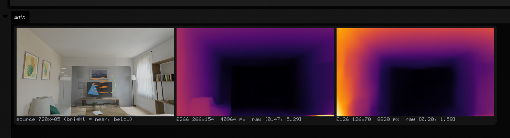
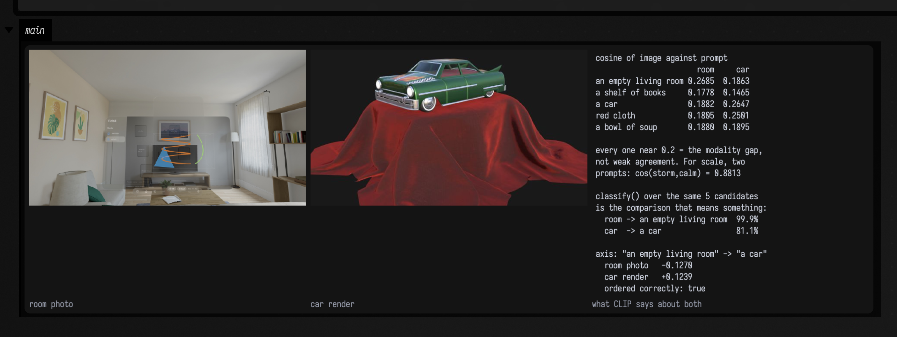

# Depth and CLIP: neural vision in a box

*Every public declaration used below carries its own KDoc — start from `OnnxRuntime`, `OnnxModel`,
`DepthAnything` and `Clip` in `afield.onnx`. The transcript that ships as an openable starting point
is [onnx_webcam_live](agent_transcripts.md).*

Field has been able to *look* at a picture since the [imaging family](imaging_examples.md) landed:
convolutions, edges, corners, Hough lines, optical flow. All of that is arithmetic you could have
written out by hand. What it could not do is the thing you cannot write out by hand —

> **ask a picture how far away things are, or what it is a picture *of*.**

`afield.onnx` is two answers to that, on the ONNX Runtime JNI artifact
(`com.microsoft.onnxruntime:onnxruntime`, 1.27.0) that was already on the classpath because
[semantic search](semantic_index.md) embeds text with it. No new native dependency, no build step, no
toolchain. Two models get downloaded the first time you ask for them, and that is the whole install.

```diffstatic {data-lang=kotlin}
import afield.onnx.*

// How far away is everything? — one image in, one single-channel map out.
val depth = DepthAnything(width = 266, height = 266)
depth.infer(rgbaBytes, srcW = 640, srcH = 480)
depth.depthFp16                       // ready to upload as VK_FORMAT_R16_SFLOAT

// What is this a picture of? — no training, no labels, just prompts.
val prompts = ClipText.encodeAll(listOf("an empty room", "a person at a desk"))
ClipImage().encode(rgbaBytes, 640, 480).best(prompts)   // the better-matching label, and its share
```

!!! info "Orientation only — `rgbaBytes` is not defined, so nothing runs this block"
    Every call in it is exercised elsewhere, but *this text* is not compiled by anything.
    [Which code on this page runs](#which-code-on-this-page-runs) says which blocks are copy-and-run and
    which are illustration.

## The one idea that makes this live-codeable

Session construction is the *expensive* half of ONNX — the graph is parsed, fused and specialised for
the execution provider, which costs hundreds of milliseconds. Inference is the cheap half. A box that
says `DepthAnything(...)` and gets re-evaluated on every keystroke must not pay that on every
keystroke.

So `OnnxRuntime` keeps its sessions in a `ConcurrentHashMap` inside an `object` loaded by the
application class loader. Field recompiles the **box**, not the application, so the map outlives every
recompilation of the code that reads it. This is the same discipline
[`FaustEngine`](faust.md#what-it-costs) uses for compiled DSP, and it is the reason hot-reload here is
free.

```diffstatic {data-lang=kotlin}
// Cached. Two boxes asking for the same spec get the identical OrtSession.
val loaded = OnnxRuntime.session(spec)

// NOT cached — this rebuilds on every keystroke, and it is the one mistake to avoid.
val mine = OnnxRuntime.env.createSession(path, options)
```

*Not executed, and half of it must never be: the second line is an anti-example. That two calls return
the identical `OrtSession` is asserted on every build.*

The cache key is a `SessionSpec`: the model file, the provider, and the two thread counts. Thread
pools are baked in at construction, so two specs differing only in `intraOpThreads` really are
different sessions — asserted, rather than assumed. `evict()` and `closeAll()`
exist for the two legitimate reasons (the file changed; the memory is wanted back). Calling either
because a box re-ran defeats the entire point.

## Depth: what the model actually gives you

[Depth Anything V2](https://depth-anything-v2.github.io) Small is the least demanding useful vision
model there is: one image in, one single-channel map out, no anchors, no non-maximum suppression, no
decode step, no state between frames.

!!! warning "It is relative *inverse* depth, in arbitrary units — not metres"
    This is the single thing to get straight before building anything. `predicted_depth` is **not**
    metres, **not** normalised, and **larger means nearer**. The numeric range depends on the scene
    *and* on the input resolution, so a threshold calibrated on one frame at one size means nothing
    on another.

    A reader who assumes metric depth will build something that looks approximately right and is
    wrong in a way no single frame reveals. If you need metres, this is the wrong model.

Here is that, on a real photograph, with no webcam and no depth camera anywhere — the image is a
Vision Pro passthrough frame that already ships in this repository.

```diffstatic_runner {data-lang=kotlin screenshot="assets/onnx/depth.png" wait="12" capture="box" open-outputs="true" padding="20"}
:::static
import afield.onnx.*
import java.nio.ByteBuffer
import java.nio.ByteOrder

// A real photograph that already ships with Field: a Vision Pro passthrough frame of a room.
val photo = imgFromFile("public/docs/assets/vision/fline-viewer.jpg", 3).scaleBy(0.45)

// Both models want tightly packed RGBA8, and an Img is interleaved floats in 0..1 — so this is the
// whole adapter. Nothing in afield.onnx knows about Img; it asks for bytes and a size.
fun toRgba8(img: Img): ByteBuffer {
    val out = ByteBuffer.allocateDirect(img.width * img.height * 4).order(ByteOrder.nativeOrder())
    for (p in 0 until img.pixelCount) {
        for (c in 0 until 3) {
            val v = (img.data[p * img.channels + c].coerceIn(0f, 1f) * 255f + 0.5f).toInt()
            out.put(p * 4 + c, v.toByte())
        }
        out.put(p * 4 + 3, 255.toByte())
    }
    return out
}

val rgba = toRgba8(photo)

// Run the same frame at two sizes. sizeFor snaps to multiples of 14 (the backbone is ViT-S/14) and
// preserves aspect. adaptation = 1f means "normalise against this frame's own range", which is what
// a single still wants; a video stream wants the default 0.1f so the picture does not flicker.
fun runAt(longestSide: Int): Triple<DepthAnything, DepthStats, Img> {
    val (w, h) = DepthAnything.sizeFor(photo.width, photo.height, longestSide)
    val d = DepthAnything(w, h, adaptation = 1f)
    val s = d.infer(rgba, photo.width, photo.height)
    // depthRaw is the model's own units. Wrap it in an Img to actually look at it.
    return Triple(d, s, Img(w, h, 1, FloatArray(w * h) { d.depthRaw.get(it) }))
}

val (big, bigStats, bigMap) = runAt(266)
val (small, smallStats, smallMap) = runAt(126)
:::fold caption them with their own measurements, and draw
// No milliseconds in the caption: a wall-clock number would differ on every run. The pixel count
// makes the same point and is deterministic; timings go to stdout instead.
fun caption(tag: String, d: DepthAnything, s: DepthStats) =
    "%s %dx%d  %d px  raw [%.2f, %.2f]".format(tag, d.width, d.height, d.width * d.height, s.rawMin, s.rawMax)

println("source ${photo.width}x${photo.height} — a real photograph, no depth camera anywhere")
println("${caption("@266", big, bigStats)}  ${big.lastInferenceMs}ms on ${big.activeProvider}")
println("${caption("@126", small, smallStats)}  ${small.lastInferenceMs}ms on ${small.activeProvider}")
println("window settled=${bigStats.settled}; larger raw value = NEARER; the units are arbitrary")

// Both maps are upscaled to the source size so the panels are comparable by eye, and each is
// colour-mapped against its OWN range — which is exactly why the two look similarly bright despite
// the ranges in their captions being completely different.
showImgGrid(
    "source ${photo.width}x${photo.height} (bright = near, below)" to photo,
    caption("@266", big, bigStats) to bigMap.colormap("inferno").resize(photo.width, photo.height),
    caption("@126", small, smallStats) to smallMap.colormap("inferno").resize(photo.width, photo.height),
    columns = 3,
    cellSide = 600,
)
```



The model has no idea what a sofa is and it gets the room right anyway: the near floor and the left
arm of the sofa are bright, the wall behind the television is dark, and the bookshelf on the right
comes forward. Read the two captions together and the warning above stops being abstract — **the same
photograph, at two sizes, produces two entirely different numeric ranges**. That property is pinned: the
518² and 266² ranges of a reference frame are required to differ by more than 0.5, precisely so nobody
can quietly start treating the output as calibrated.

Resolution is also the only performance dial that really matters, because cost is roughly quadratic in
it. The `@126` panel has about 4.6× fewer pixels than `@266` — the counts are in the captions — and ran
in roughly a quarter of the time.

### The normalisation window, and what `settled` means

A texture needs values in `[0,1]`, so the raw map has to be normalised against *something*. Picking
each frame's own min and max makes the image flicker — a hand entering shot rescales the entire
background. So `DepthAnything` tracks the window with an exponential moving average and normalises
against the smoothed version. `infer` returns a `DepthStats` reporting both, so a box can watch that
decision instead of guessing at it:

| field | what it is |
|---|---|
| `rawMin` / `rawMax` | the range this frame's output actually contained |
| `windowMin` / `windowMax` | the smoothed window that was mapped to `0.0` and `1.0` |
| `settled` | true once the smoothed window has *caught up* with the raw range |

`settled` is the **arrived** state, not the chasing one — it is true on the first frame after
construction or `resetAdaptation()`, because the window is seeded from that frame's own range, and
false for the frames after the scene changes while the average walks towards the new one. Wait for
`settled` if you want a stable picture; watch for `!settled` if you want to know one is still
rescaling.

`adaptation` is the EMA rate per frame, in `(0,1]`. `1.0` means "use this frame's own range", which is
right for a single still and wrong for video. The default `0.1f` is the cheap version of the one-euro
filter that anything body-tracked eventually needs. `resetAdaptation()` forgets the window entirely,
which is what you want after a cut.

A constant frame — a lens cap, a solid colour — would give a zero-width window and a texture full of
NaN. It emits mid-grey instead, and that case is forced directly on every build rather than left to a
flat input to produce by accident.

### Nothing here is frame rate, so use the worker

On a CPU execution provider Depth Anything Small costs roughly 100ms at 266² and roughly 400ms at
518². 400ms is 2.6fps. Calling `infer` from a render loop turns 60fps into a slideshow, so
`DepthAnythingWorker` puts it on its own thread and hands the renderer *staleness* instead of latency:

```diffstatic {data-lang=kotlin}
// once
val depth = DepthAnythingWorker(width = 266, height = 266)
val tex = StreamingTexture(depth.depthFp16, depth.width, depth.height,
                           imageFormat = VK10.VK_FORMAT_R16_SFLOAT)
// per frame
depth.submit(webcam.frameBuffer, 640, 480)   // returns immediately
if (depth.consume()) tex.recordUpload(commandBuffer)
```

!!! info "This one needs a Vulkan device and a webcam, so it does not run here"
    The ONNX half of it is nonetheless covered without a GPU: `DepthAnythingWorker` is driven through
    `submit` and `consume` end to end, and `depthFp16`'s size is asserted to be exactly what `ImageData`
    computes for `VK_FORMAT_R16_SFLOAT` — the seam this snippet depends on.

Two design choices worth knowing, because both are the opposite of the obvious:

- **Frames are dropped, not queued.** `submit` overwrites anything not yet picked up. A queue would
  grow without bound whenever inference is slower than capture — which is always — and every frame it
  held would be staler than the one behind it. `framesSubmitted`, `framesInferred` and `framesDropped`
  are all readable, so the drop rate is observable rather than mysterious.
- **`consume()` copies, on the calling thread.** `depthFp16` must keep a fixed identity, because
  `StreamingTexture` captures its source buffer once at construction and re-reads it every frame. The
  worker therefore cannot write into it directly — the renderer could be mid-read and would show a
  torn map. So the worker publishes into an internal buffer and `consume()` copies under the lock.
  That copy is the only work the render thread does.

Six frames of staleness at 60fps looks fine for displacement, parallax and depth-keyed compositing,
and looks like lag for anything a hand is steering directly. That is the real constraint, and no
provider flag fixes it — see [what was measured](#what-was-measured-and-what-it-contradicts).

## CLIP: a shared space for pictures and words

[CLIP](https://openai.com/research/clip) embeds images and text into one 512-dimensional space. Field
binds both towers — `text_model.onnx` and `vision_model.onnx` — each of which emits an
already-projected 512-vector, so no head has to be reimplemented.

```diffstatic_runner {data-lang=kotlin screenshot="assets/onnx/clip.png" wait="30" capture="box" open-outputs="true" padding="20"}
:::static
import afield.onnx.*
import java.nio.ByteBuffer
import java.nio.ByteOrder

fun toRgba8(img: Img): ByteBuffer {
    val out = ByteBuffer.allocateDirect(img.width * img.height * 4).order(ByteOrder.nativeOrder())
    for (p in 0 until img.pixelCount) {
        for (c in 0 until 3) {
            val v = (img.data[p * img.channels + c].coerceIn(0f, 1f) * 255f + 0.5f).toInt()
            out.put(p * 4 + c, v.toByte())
        }
        out.put(p * 4 + 3, 255.toByte())
    }
    return out
}

// Two real images already in the repository, deliberately unalike.
val room = imgFromFile("public/docs/assets/vision/fline-viewer.jpg", 3).scaleBy(0.45)
val car = imgFromFile("public/docs/assets/fabricate-toy-car-donmccurdy-reference-close.png", 3)

// Encode the prompts ONCE, into a val. That is the whole discipline: the text tower is then simply
// not in the per-frame path, and there is nothing cleverer to do about it than this.
val prompts = listOf("an empty living room", "a shelf of books", "a car", "red cloth", "a bowl of soup")
val text: Map<String, ClipVector> = ClipText.encodeAll(prompts)

val encoder = ClipImage()
val roomVec = encoder.encode(toRgba8(room), room.width, room.height)
val carVec = encoder.encode(toRgba8(car), car.width, car.height)

// A text-text cosine for scale, so the modality gap below is visible rather than asserted.
val textText = clipEncode("storm").cosine(clipEncode("calm"))

// A semantic axis: the unit direction from one prompt towards another. Projecting an image onto it
// is a continuous knob whose units are meaning rather than pixels. What matters is not the absolute
// value — same modality gap — but that the two images order correctly along it.
val axis = text.getValue("an empty living room") axisTo text.getValue("a car")
val roomOnAxis = roomVec.project(axis)
val carOnAxis = carVec.project(axis)
:::fold draw the numbers into the figure, because a box capture shows the output area, not stdout
val rows = buildList {
    add("cosine of image against prompt")
    add("                       room     car")
    prompts.forEach {
        add("%-20s %.4f  %.4f".format(it, roomVec.cosine(text.getValue(it)), carVec.cosine(text.getValue(it))))
    }
    add("")
    add("every one near 0.2 = the modality gap,")
    add("not weak agreement. For scale, two")
    add("prompts: cos(storm,calm) = %.4f".format(textText))
    add("")
    add("classify() over the same 5 candidates")
    add("is the comparison that means something:")
    add("  room -> %-20s %5.1f%%".format(roomVec.best(text)!!.first, roomVec.best(text)!!.second * 100))
    add("  car  -> %-20s %5.1f%%".format(carVec.best(text)!!.first, carVec.best(text)!!.second * 100))
    add("")
    add("axis: \"an empty living room\" -> \"a car\"")
    add("  room photo   %+.4f".format(roomOnAxis))
    add("  car render   %+.4f".format(carOnAxis))
    add("  ordered correctly: %s".format(carOnAxis > roomOnAxis))
}
var table = Img.filled(600, 540, 3, 0.08f)
rows.forEachIndexed { i, line -> table = table.withLabel(line, 8, 10 + i * 25, 2) }

showImgGrid(
    "room photo" to room,
    "car render" to car,
    "what CLIP says about both" to table,
    columns = 3,
    cellSide = 600,
)
```



Nothing was trained, and no label was ever written down. The room photograph picks "an empty living
room" and the car render picks "a car" — and it picks "red cloth" second, which is the correct second
answer, because the car really is sitting on red drapery.

### What a cosine between a prompt and an image is — and is not

This is the most misread property of CLIP, and the reason `classify` exists rather than a bare
threshold on `cosine`.

Look at the numbers in that figure. Every single image↔text cosine sits between about 0.15 and 0.27,
including the *correct* ones. Meanwhile two unrelated *text* prompts, `storm` and `calm`, sit at
0.8813. The two towers occupy offset regions of the sphere — the **modality gap** — so:

| comparison | where it lands | what you may conclude |
|---|---|---|
| text ↔ text | a narrow high cone, ~0.75–0.95 | almost nothing; even opposites score high |
| image ↔ text | far lower, ~0.15–0.30 | almost nothing in absolute terms |
| one image ↔ *several* prompts | ranked | **this is the signal** |
| one prompt ↔ the same scene over time | a moving projection | **this is also the signal** |

`0.21` does not mean "unrelated" and `0.88` does not mean "the same". Only **rank** and **difference**
carry information. An absolute threshold on a raw cosine will not survive contact with a second scene,
so the gap is asserted explicitly — every image↔text cosine below 0.5, every text↔text cosine above
0.75 — and cannot quietly stop being true.

`classify(candidates)` is the honest form of the question: it softmaxes the cosines *against each
other* and returns probabilities that sum to 1, most likely first. `best()` is its first element. The
`logitScale` only changes how peaked the distribution is — it cannot change the ranking, which is
asserted by re-running at 500 and comparing the order.

### A knob whose units are meaning

The third thing CLIP offers is the one nothing else does. The difference of two prompt embeddings is a
*direction*, and projecting a frame onto it is a continuous parameter that tracks a semantic axis
rather than a pixel statistic. Two lines — `a axisTo b`, then `.project(axis)` — which is why they are
not shown here as a snippet: they are executed in the figure above, on the axis from
`"an empty living room"` towards `"a car"`, and its last three rows are the two projections and the
check that they order correctly.

The two projections come out small and on opposite sides of zero, which is what to expect — the same
modality gap applies to a projection as to a cosine, so the magnitude is not a score. The signal is
that the car render sits *further along* the axis than the room photograph, which the figure computes
and states outright rather than asking you to eyeball it. For a live input the useful thing is not the
value but how it *moves*. `ClipVector.mean(...)` averages and renormalises several prompts, which is
the standard prompt-ensemble trick and one CLIP responds well to.

The rest of `ClipVector` is small and pure: `plus`/`minus`/`times` (deliberately not renormalised,
because the length of a difference is meaningful), `dot`, `cosine`, `normalized`, and
`toBase64`/`fromBase64` for persisting an embedding — 2732 characters of exact fp32 round trip, for a
stored identity to cosine against later.

## Getting the models onto a fresh machine

Weights are not in the repository — they are tens to hundreds of megabytes and separately licensed —
so a model is a URL plus somewhere to put it, and the first call fetches it.

**The cache root is `~/.afield/onnx/models`**, overridable with the `afield.onnx.cacheRoot` system
property or the `AFIELD_ONNX_CACHE_ROOT` environment variable, matching the convention semantic search
already established. Sizes are what these files actually occupy, read off disk:

| file | on disk | what it is |
|---|---|---|
| `depth-anything-v2-small/model.onnx` | 99.1 MB | fp32 depth weights, ~25M params — the default |
| `depth-anything-v2-small/model_fp16.onnx` | 49.6 MB | fp16 weights; half the download, *slower* |
| `clip-vit-base-patch32/text_model.onnx` | 254.1 MB | CLIP text tower, fp32, projected to 512-d |
| `clip-vit-base-patch32/vision_model.onnx` | 351.7 MB | CLIP vision tower, likewise |
| `clip-vit-base-patch32/tokenizer.json` | 2.2 MB | the BPE vocabulary; `sot=49406`, `eot=49407` |

So depth alone costs about 99 MB and CLIP costs about 608 MB more. What happens on first call:

1. `ensureLocal()` checks for the file and returns immediately if it is there. The second call, and
   every call in every later session, is a file-exists check.
2. Otherwise it downloads to a `.part` sibling and moves it into place **atomically**, so an
   interrupted fetch cannot leave a truncated model that then fails to parse in a way that looks like
   a bug in the model rather than in the download.
3. The sha256 is verified before the move, against a digest recorded in the source. A mismatch deletes
   the partial file and throws.
4. Then the session is built, which is the slow part — see the caching note above.

`OnnxModel.isPresent` is a cheap boolean if you want to branch on it, and `Clip.TOKENIZER` reuses the
same fetch machinery even though nothing about a `tokenizer.json` is ONNX, because it is the same
problem: a large asset that must not live in the repository.

!!! note "Nothing is optional-at-build-time here"
    Unlike [Manifold](manifold.md#installing-it), which needs a native library installed before a box
    can use it, `afield.onnx` needs nothing but network access on first run. The ONNX Runtime native
    library ships inside the JNI jar. `COMPILE_ONLY` box code that mentions `clipEncode("…")` compiles
    without ever opening a model, because `ClipText`'s session is `by lazy` — which is what lets the
    completion corpus guard compile the shipped transcript with no network at all.

## What was measured, and what it contradicts

The figures below were recorded when the package landed, on Apple Silicon with 10 cores, at 518²
unless stated. They are quoted from the source's own KDoc rather than re-measured here, and each one
contradicts a plausible guess — which is exactly why they are worth writing down:

| the guess | what was measured | so |
|---|---|---|
| CoreML will accelerate this | 43 of 848 nodes claimed, across 19 partitions; ≈470ms vs ≈388ms for CPU | CoreML is **slower**; `AUTO` resolves to CPU |
| fp16 weights will run faster | ≈462ms vs ≈388ms — every operator upcasts | fp16's win is download size, **not** speed |
| pinning threads will help | `setIntraOpNumThreads(4)` gave ≈457ms vs ≈388ms for ORT's default | leave `intraOpThreads` at 0 |

The fp16 one is worth restating because the name misleads: an HF `model_fp16.onnx` still has fp32
*tensors*, so nothing is saved at the ORT boundary. Pick it to save 50 MB of disk, never to save time.
CoreML remains worth requesting for transformer encoders, where the partition count is small.

Two things that follow from the shape of all this rather than from any single number: nothing on a CPU
execution provider is frame rate, and resolution is a far bigger lever than any provider flag.

There is also **no `IoBinding` in the ONNX Runtime Java API** — verified by inspecting the 1.27.0 jar,
not inferred from documentation. Outputs are therefore always copies, and zero-copy GPU interop is not
reachable from Java without dropping to Panama downcalls against the same loaded library. That is fine
for everything here: a 518² fp32 depth map is 1.07MB and the copy is invisible beside the inference.

!!! note "Treat every millisecond on this page as an observation, not a guarantee"
    Depth at 266×154 has been observed anywhere between about 60 ms and 95 ms across six runs of one
    machine, and at 126×70 between about 16 ms and 25 ms; the CLIP vision tower, 31–34 ms per image. The
    spread is the machine, not the model. What *is* asserted, and therefore stable across runs and
    machines, is the numerics — see below.

??? aside "Where those observations came from"
    Recorded 2026-08-15 on Apple Silicon with a concurrent build in progress, which is why the range is
    as wide as it is. The numbers burned into the captures above are whatever that particular capture run
    measured rather than anything written down here.

## What the tests actually cover

Two entries in the smoke catalog, both `jvm-main`, both tagged `network` because a cold machine
downloads weights before they can run:

| id | asserts |
|---|---|
| `onnx.depth.smoke` | model I/O signature and dynamic axes; output ranges at 518² and 266² against a Python `onnxruntime` oracle; that the range genuinely differs between the two; ImageNet normalisation; identity resampling at equal size; session memoisation and the thread-count cache key; fp16 agreement with Field's own converter; the `R16_SFLOAT` buffer stride against `ImageData`; window adaptation and `resetAdaptation`; no NaN from a zero-width window; and one frame end to end through the worker |
| `onnx.clip.smoke` | tokenizer ids identical to Python's; both towers emitting projected 512-d; CLIP's own normalisation constants; the first components and pairwise cosines of four prompt embeddings to four decimals; the modality gap as an ordering property; the vector algebra; base64 round trip; and that `classify` is a softmax whose ranking follows cosine order and ignores temperature |

The reference values in both were produced independently, under Python's `onnxruntime` and
`tokenizers` on the same weight files, on a synthetic frame built with integer-only arithmetic so that
Kotlin and NumPy construct a byte-identical image. That last detail is what lets the tolerance be
`1e-3` instead of twenty times looser.

Run them the usual way — see [building and testing](building_and_testing.md):

```diffstatic {data-lang=bash}
python3 tools/run_field_tests.py --id onnx.depth.smoke --id onnx.clip.smoke
```

??? aside "Last recorded pass"
    Both passed on 2026-08-15 with `cos(storm,calm) = 0.881320` and depth at 518² of `[1.0353, 2.8187]`,
    matching the Python reference to four decimals.

What is **not** covered: anything involving a camera. `WebcamPerceptionDemo` is deliberately not a
`FIELD_TEST` because it needs hardware and a human to point it at something. It does have a
still-image path, which is the runnable no-webcam route from a shell:

```diffstatic {data-lang=bash}
# second argument is a path rather than a camera index -> still-image mode
run-jvm-main afield.examples.onnx.WebcamPerceptionDemo \
    --arg /tmp/out.png --arg public/docs/assets/vision/fline-viewer.jpg
```

That writes a side-by-side PNG of the source and its depth map, and prints a zero-shot ranking plus
two semantic-axis projections. On the room photograph above it ranks "an empty room" at 52.0% and "a
computer screen" at 41.7%, and puts "a person sitting at a desk" at 0.4% — correctly, since there is
nobody in the picture. It also guards against the failure that matters: if the decode produces an
all-black buffer, every number below would still be produced and would still look plausible, so it
checks mean luma and fails instead.

## Which code on this page runs { #which-code-on-this-page-runs }

Two of the Kotlin blocks on this page — the depth figure and the CLIP figure — are executed by the docs
build every time, imports and all, and the image under each is that box's own output. The other four are
illustration, and are marked as such where they appear:

| block | why it is not executed | what stands behind it |
|---|---|---|
| the orientation snippet | `rgbaBytes` is deliberately undefined | every call in it, via both smokes |
| the session-cache do/don't | half of it is an anti-example that *must* not run | the caching claim, asserted directly |
| the worker + `StreamingTexture` | needs a Vulkan device and a webcam | the ONNX half end to end; the buffer stride against `ImageData` |
| the hoist-a-prompt example | `rgbaBytes` again | `clipEncode` and `best`, via the CLIP smoke |

The honest gap, stated once: **`StreamingTexture(...)` and `recordUpload(...)` are the only lines on this
page that nothing in this repository checks.**

??? aside "Why this page keeps a census at all"
    Documentation rots in a specific way: a snippet nobody executes drifts from the API it describes, and
    looks exactly like one that works. This page had that bug during drafting — an orientation snippet
    carried a confident `0.94f` that had never been computed. Two blocks and 112 non-blank lines are
    executed against four blocks that are not, plus two shell commands run by hand. Blocks are counted
    whole because an import that does not resolve is exactly the rot being measured; lines exclude the
    `:::static` / `:::fold` markers.

    The bar is deliberately narrow. If "covered" were allowed to mean "the API this snippet calls is
    asserted somewhere", every block would count — because that is already true today, and it is
    precisely the condition under which the invented `0.94f` survived review. Asserting `ClipImage.encode`
    in a smoke says nothing about whether a page's prose about it is right. Only the two capture fences are
    compiled and run *as written*.

## Encode a prompt once

A CLIP prompt is a constant, and encoding one costs about 5 ms and needs the 242 MB text encoder
resident. So hoist it out of anything that runs repeatedly:

```diffstatic {data-lang=kotlin}
:::static
// once, at the top of the box
val prompts = mapOf(
    "an empty room" to clipEncode("an empty room"),
    "a person at a desk" to clipEncode("a person at a desk"),
)

// then, per frame, no encoder involved
ClipImage().encode(rgbaBytes, 640, 480).best(prompts.values.toList())
```

That is the whole technique, and there is nothing cleverer to do — a macro that baked prompt vectors
into the document was built and then removed, for reasons recorded in `dev_docs/ONNX_CLIP_MACRO.md`.

## Reference

| | |
|---|---|
| `OnnxRuntime.session(spec)` | the cached session for a `SessionSpec`, built on first request |
| `OnnxRuntime.evict(spec)` / `.closeAll()` | drop and close; for a changed file or a cold measurement |
| `OnnxRuntime.liveSessionCount` | how many sessions are cached; how tests prove reuse |
| `OnnxModel.ensureLocal()` | the local file, downloading and sha256-checking it if absent |
| `OnnxModel.isPresent` / `.localPath` | is it already on disk, and where |
| `OnnxModel.cacheRoot` | `~/.afield/onnx/models` unless overridden |
| `DepthAnything(w, h, …)` | one frame at a time; `w`/`h` must be multiples of 14 |
| `DepthAnything.sizeFor(w, h, longestSide)` | nearest legal input size, aspect preserved |
| `DepthAnything.forSource(w, h, …)` | the same, as a constructed estimator |
| `.infer(rgba, srcW, srcH)` | run one frame; returns `DepthStats` |
| `.depthRaw` / `.depthFp16` | model units, and `[0,1]` fp16 ready for `R16_SFLOAT` |
| `.resetAdaptation()` | forget the normalisation window |
| `DepthAnythingWorker(…)` | the same on its own thread; `submit` / `consume` |
| `ClipText.encode(text)` / `clipEncode(text)` | one prompt to a unit 512-vector |
| `ClipText.encodeAll(texts)` | several, sharing the loaded model |
| `ClipImage().encode(rgba, w, h)` | one frame to a unit 512-vector |
| `ClipVector.cosine` / `.dot` / `.project` | similarity, inner product, scalar projection |
| `a axisTo b` | the unit direction from `a` towards `b` — a semantic axis |
| `.classify(candidates)` / `.best(…)` | softmax over labelled candidates, most likely first |
| `.toBase64()` / `ClipVector.fromBase64(s)` | persist an embedding exactly |

### Where to go next

- [Imaging and computer vision](imaging_examples.md) — `Img`, and everything you would do to a depth
  map once you have one: colour maps, gradients, thresholds, contours.
- [afield.four graphics](afield_four_graphics.md) — `StreamingTexture` and the Vulkan side of getting
  an `R16_SFLOAT` map onto the GPU.
- [Agent transcripts](agent_transcripts.md) — `onnx_webcam_live` is an openable starting point running
  both models on one webcam frame in a single box.
- [Faust](faust.md) — the other subsystem in Field built around a process-global compile cache, for
  the same reason.
