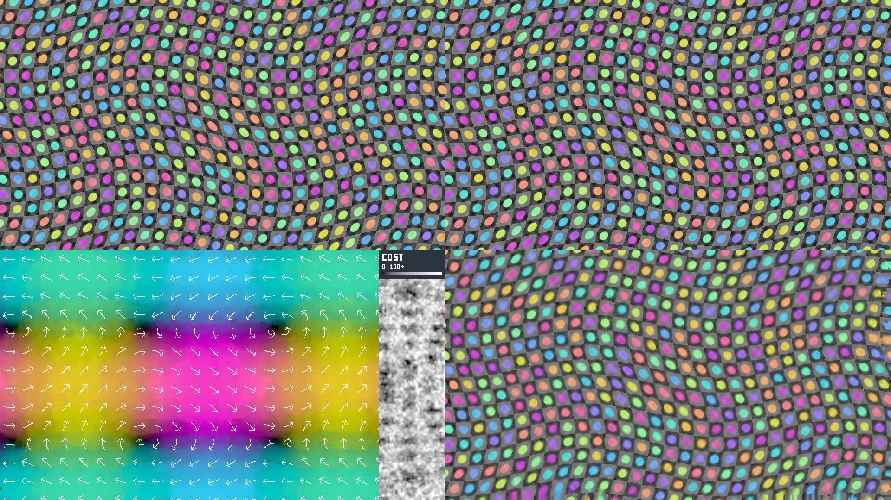
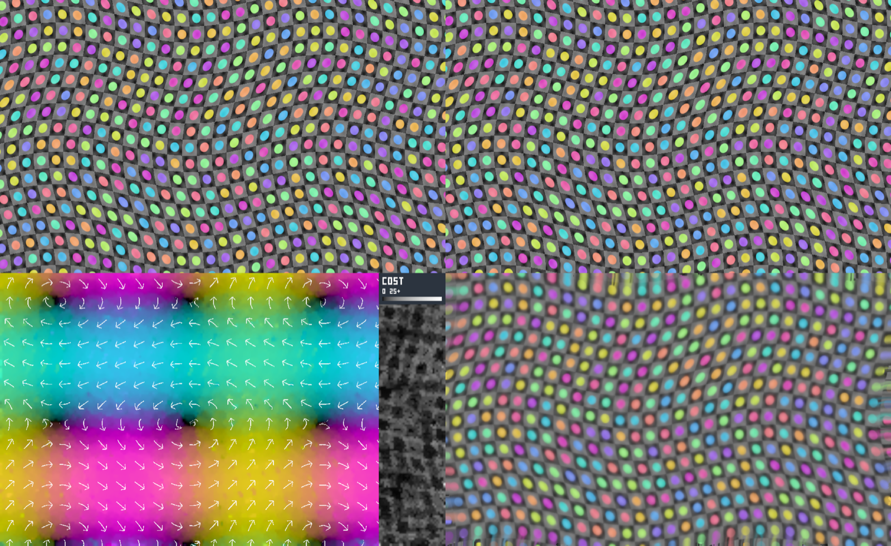
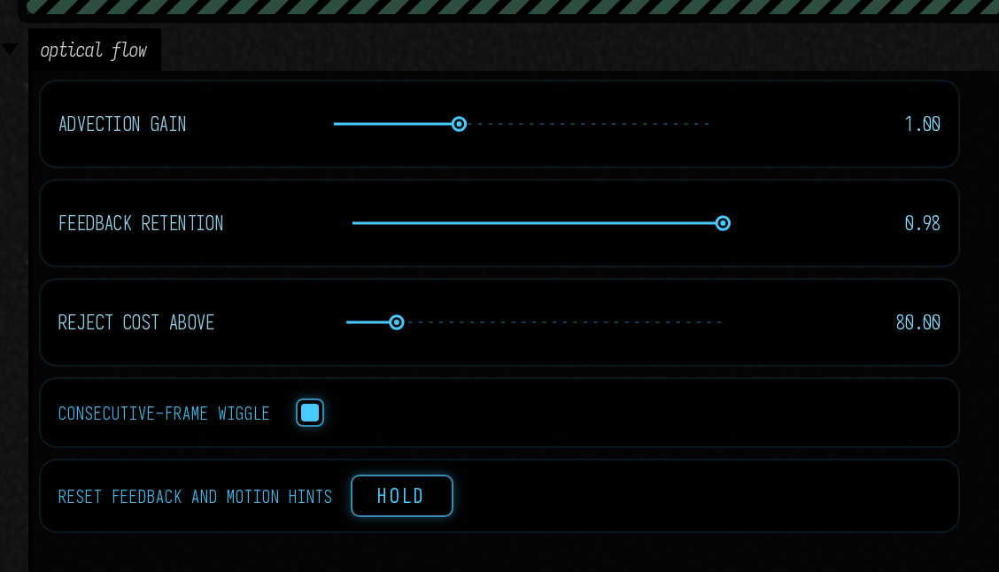
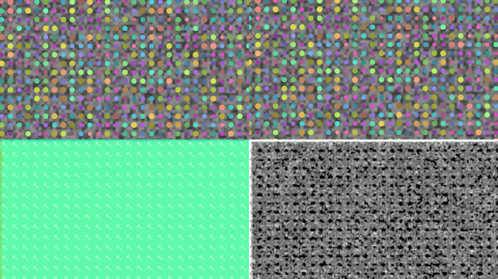
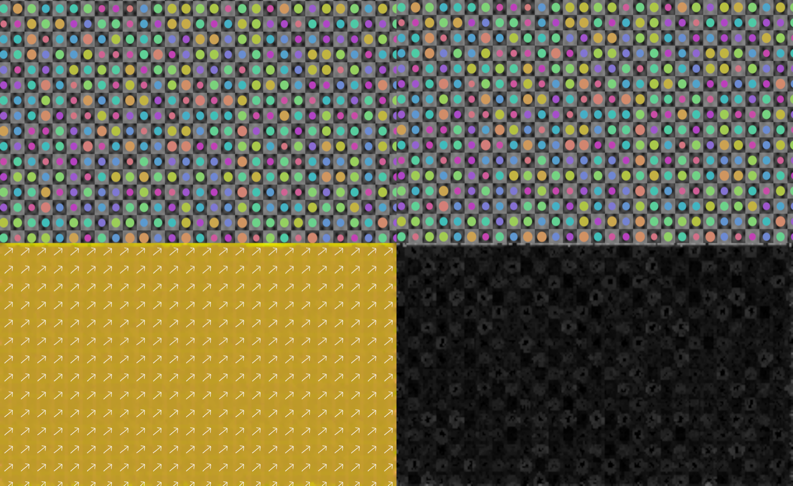

# Optical flow

Optical flow turns two images into a motion field you can use in another shader. It follows visible image patterns, so it can work on video, rendered geometry, or a changing procedural texture. It does not know which patterns belong to a real moving object.



## Which backend runs where

Field has two implementations behind one contract. `opticalFlow(...)` picks between them for you:

| Backend | Class | Runs on | Cost channel |
| --- | --- | --- | --- |
| `HARDWARE` | `OpticalFlow` | Devices with `VK_NV_optical_flow` enabled: NVIDIA Ada (RTX 40-series) and later | The engine's raw matching cost |
| `PYRAMID` | `PyramidOpticalFlow` | Every Vulkan device Field runs on, including macOS through MoltenVK | Mean absolute window residual, in grey levels 0–255 |

`OpticalFlowBackend.AUTO`, the default, chooses `HARDWARE` when the device reports the extension and `PYRAMID` otherwise. Both starting points below print the backend they used. The motion vectors mean the same thing on both. **The cost scales differ**, so a rejection threshold tuned on one backend does not transfer to the other.

`PyramidOpticalFlow` is a coarse-to-fine Lucas–Kanade tracker written as ordinary fragment passes. It builds a five-level image pyramid and searches the coarsest level exhaustively for integer offsets. Each finer level then refines the upsampled estimate with Gauss–Newton steps over a 9 × 9 window, and a 3 × 3 vector median rejects isolated wrong matches. It needs no extension. Its constructor exposes `levels`, `radius`, `iterations`, `finestIterations` and `search`.

### A forward–backward confidence map

`PyramidOpticalFlow(renderer, first, second, consistency = true)` also tracks the images in reverse, inside the same submission, and fills `consistencyMap`: a texture the size of `output` whose `.x` is the **forward–backward error** in input pixels. It follows each forward vector, reads the backward vector where it lands, and reports how far the pair fails to return to the start. The residual in `output.z` asks whether the pixels look alike; this map asks whether the two directions agree about where they went. It is high where content is occluded, revealed, or leaves the frame, even when a wrong match happens to look plausible.

```diffstatic {data-lang=kotlin}
val flow = PyramidOpticalFlow(renderer, previousImage, currentImage, consistency = true)
prop<RenderToTexture>(motion) = flow.output
prop<RenderToTexture>(motionConfidence) = flow.consistencyMap!!
```

On the M1 Max's (+12, −8) pair, interior samples return to within 0.00003 pixels (p95, 21,424 samples). The two rightmost flow columns, whose content moves out of the second image, miss by a median of 43 pixels. On one wiggle phase the p95 is 0.19 pixels. A checked pair costs about twice an ordinary one, 24.6 ms median. The hardware engine has no equivalent output.



## Open the experiment

Open **Starting points → optical_flow**. The top row shows the two input images. Below them are a color wheel and arrows for motion, a grayscale strip labelled **COST**, and a feedback image carried by that motion. The strip's scale label shows which backend is running: **0 100+** for the hardware cost, **0 25+** for the portable residual.

**Consecutive-frame wiggle** compares two frames of the same deforming image, 1/30 second apart. There is no added global translation: arrows should bend across the image and reverse as the source wiggles. Their lengths are normalized for readability; color intensity represents speed, with full intensity at 3 input pixels per pair.

Turn off the wiggle to run the separate **known translation** check: exactly 12 pixels right and 8 pixels up. That setting should produce a mostly uniform up-right field. **Advection gain**, **Feedback retention**, and **Reject cost above** control how the measured field moves the feedback image. Reset clears feedback and the engine's temporal hints.



<video controls muted loop playsinline preload="metadata" src="assets/optical_flow/advection.mp4" width="1920" height="1080" style="max-width:100%;height:auto;aspect-ratio:16/9"></video>

The wiggle is checked against the known local deformation, not just against a global shift. On the RTX 4090's hardware engine, median endpoint error across 85,696 interior samples at four animation phases is **0.15 input pixels**, and p95 is **0.35 pixels**. Measured vectors occupy all four direction quadrants. The identical-frame check stays below 0.25 pixel everywhere. These checks would fail if the output remained the old constant up-right field.

??? aside "Why the earlier clip mostly pointed up and right"

    The earlier pair added a fixed (+12, −8) displacement to a much smaller temporal wiggle. The measured field followed that dominant offset correctly, but the clip was a poor demonstration of local deformation. The revised default removes that offset and advances by exactly the pair interval; the feedback image now follows consecutive source frames.

The **COST** strip displays the backend's matching cost at those same image coordinates. On hardware its **0 100+** scale runs from black (low cost) to white (100 or above); on the portable backend **0 25+** covers 0 to 25 grey levels of residual. It occupies the rightmost 15% of the flow panel; it is not a compressed cost map of the whole image. The **Reject cost above** control uses this same signal when deciding whether to carry the previous image or take the fresh source at that pixel.

The field can be useful even when the correspondence is imperfect. Repetition, newly revealed regions, lighting changes, and abrupt procedural edits all make it less reliable. The cost strip exposes some of that uncertainty; neither backend's cost is a calibrated probability or confidence score.

## What goes in, and what comes out

`opticalFlow(renderer, firstImage, secondImage, grid = 4)` creates a reusable operation, an `OpticalFlowOperation`, on whichever backend `AUTO` picks. Pass `backend = OpticalFlowBackend.PYRAMID` to force the portable one. Constructing `OpticalFlow(...)` directly still means hardware only, and it fails on a device without the extension. The two image arguments have type **`HasImageView`**, Field's interface for a GPU image view. **A `RenderToTexture` implements that interface**, so two RTTs can be passed directly:

```diffstatic {data-lang=kotlin}
// firstTarget and secondTarget are already-rendered RTTs of the same size.
val flow = opticalFlow(renderer, firstTarget, secondTarget, grid = 4)

// After the input producers have submitted, between Field frames:
flow.evaluate(reset = cameraCut)

// Publish the result for ordinary texture lookup by name.
prop<RenderToTexture>(motion) = flow.output
```

| Argument or result | Meaning |
| --- | --- |
| `renderer` | Owns the Vulkan device and submission resources; both inputs must belong to that device. |
| `firstImage` | Earlier image. An RTT passed directly supplies its first color attachment. |
| `secondImage` | Later image, with the same width and height. |
| `grid = 4` | One flow texel per 4 × 4 input pixels. A 960 × 540 pair produces a 240 × 135 field. Supported grids are checked on the device. |
| `backend` | `OpticalFlowBackend.AUTO` (the default), `HARDWARE`, or `PYRAMID`. |
| `quality` | Hardware only, on `OpticalFlow(...)`: `OpticalFlow.Quality.FAST`, `MEDIUM`, or `SLOW` (the default). |
| `flow.output` | An owned **`RenderToTexture`**, containing a sampled RGBA32F motion texture. |

For two attachments of one RTT, select them explicitly:

```diffstatic {data-lang=kotlin}
val flow = opticalFlow(renderer,
    pair.imageViewArray[0], pair.imageViewArray[1], grid = 4)
```

The inputs are borrowed: keep them alive while the operation uses them. `evaluate()` reads their current contents; it neither renders them nor keeps a previous input frame for you. Recreate the operation when dimensions, grid, quality, or input resources change. Call `flow.close()` when finished, after removing consumers of its output.

Inputs are opaque linear RGB images of equal size. Both backends apply the same tone map and gamma conversion to each. The hardware path then makes the engine's BGRA8 inputs and unpacks its signed fixed-point vectors on the GPU; the portable path tracks the resulting luma. None of the images cross the CPU boundary during evaluation.

## Sample the motion as a texture

**`flow` is the operation; `flow.output` is the texture.** Publishing the latter as `prop<RenderToTexture>(motion)` lets a `moduleHere()` in this box or a child resolve `sampler2D motion` by name, just like a color RTT. A fragment or compute shader can read it with:

```diffstatic {data-lang=glsl}
layout(set=0,binding=0) uniform sampler2D motion;

// In your shader, at normalized image coordinates uv:
vec4 field = texture(motion, uv);
vec2 displacementPixels = field.xy;
float matchingCost = field.z;
```

XY is **first-image → second-image displacement in input pixels**: X points right and Y points down. Z is the backend's matching cost, where lower is better; W is 1. The vectors remain in input pixels even though the texture has fewer texels. Divide by the **input image size**, not the motion-texture size, to obtain a UV displacement. This is numerical data: do not apply color grading or gamma conversion to the motion field.

The hardware adapter submits to a dedicated optical-flow queue; the portable one records its passes into a graphics-queue command buffer. Both wait for a final fence before returning. Call `evaluate()` **between frames, after the producers have submitted**, rather than inside a `Target.render` callback that is already recording a frame. Its output is ready for the following Field rendering. It does not yet overlap several image pairs; account for the wait in your frame budget.

## Keep the previous frame with ping-pong

Open **Starting points → optical_flow_pingpong** for the complete editable example. The parent box renders one `moduleHere()` into a `PingPongRenderToTexture`; its child samples the previous image, current image, and motion texture. The four panels show **previous / current** above **motion / matching cost**.



```diffstatic {data-lang=kotlin}
prop<PingPongRenderToTexture>(history) = PingPongRenderToTexture(renderer) {
    width = 960; height = 540; useDepth = false
    format = VK_FORMAT_R16G16B16A16_SFLOAT
}

val flow = opticalFlow(renderer,
    history.previousImageView, history.latestImageView, grid = 4)
prop<RenderToTexture>(motion) = flow.output
```

Those two image-view providers follow the ring as it rotates; keep the providers themselves, rather than caching their `.imageView` handles. After each source render, `latestImageView` is the new completed frame and `previousImageView` is the one before it. No manual swap is needed.

The example's frame loop is:

```diffstatic {data-lang=kotlin}
// renderSource() is a helper defined in the example: it records history.render(),
// submits that command buffer, and waits for the source to finish.
if (reset) renderSource()   // Seed both slots with the same time on startup/reset.
renderSource()
flow.evaluate(reset = reset || !animate)
frame()                    // The child now samples the completed motion texture.
```

Edit the parent's **fragment** to change the source; edit the child's **fragment** to use the motion. **Animate source** pauses time: both slots receive the paused frame, and motion should settle near zero. Repeated paused pairs disable temporal hints on every evaluation. **Reset the pair** seeds both slots and disables hints for that pair. A successful source shader edit does the same, so unrelated old and new patterns are not treated as consecutive animation frames. When relaunching the parent, relaunch the child too so its texture bindings follow the new allocation.

This source also publishes `expectedMotion`, its analytical displacement in input pixels. The live check compares the measured interior field against it through movement, pause, reset, and relaunch. The repeated circles still admit occasional wrong matches: bright patches in the motion panel coincide with higher matching cost. Inspect that cost before using a vector for feedback; the example deliberately shows the raw result.

## Measured

These two sets of numbers come from different machines running different algorithms. Read each set as what that backend does on that GPU, not as a head-to-head comparison.

### Hardware engine, RTX 4090

On the RTX 4090, the 960 × 540 translation test has **zero median error** and **1/32 pixel p95 error**, measured away from the image borders. At a 4 × 4 grid, median GPU costs are 0.039 ms for conversion, 0.523 ms for optical flow, and 0.083 ms for unpacking. The complete call, including submissions and the final fence, takes 1.20 ms median / 1.56 ms p95. These are 100 warmed measurements using SLOW quality; the adapter owns about 10.6 MB of visible allocations. Driver-private session memory is not included.

The [measurements](assets/optical_flow/measurements.json) retain the distribution summaries and numerical check. The implementation uses `VK_NV_optical_flow` through the existing LWJGL bindings, with no additional native library. Feature, format, grid, and queue checks decide availability; a missing extension does not affect other Field workflows.

### Portable backend, Apple M1 Max (MoltenVK)

The same 960 × 540 pair was run through `PyramidOpticalFlow` at grid 4 with its defaults. Every error is an endpoint error in input pixels, measured over interior samples at least 64 pixels from the border.

| Case | Samples | Median | p95 |
| --- | --- | --- | --- |
| Known translation (+12, −8) | 21,424 | 0.00001 | 0.00002 |
| Translation (+40, −24) | 21,424 | 0.00001 | 0.00002 (1.2% of samples over 1 px) |
| Consecutive-frame wiggle, four phases | 85,696 | **0.080** | **0.26** |
| Identical frames | 32,400 | 0 | 0 (maximum 0) |

A zero field would score a median of 1.98 pixels on the wiggle, so these errors are small compared with the motion they measure. On this synthetic wiggle the portable tracker's error is below the 4090 engine's 0.15 / 0.35. That result does not rank the two backends in general: the source is a clean procedural image with none of the noise, blur or lighting change of real footage, and it matches Lucas–Kanade's assumptions unusually well. In the ping-pong starting point, the moving pair's median error against its analytical `expectedMotion` was 0.13 and 0.07 pixels in two checks on 29,464 samples each (p95 0.35 and 0.13), and exactly 0 while paused.

The residual flags the same content leaving the frame. The two rightmost flow columns have a median residual of 17.3 grey levels, and every interior sample has 0; the starting point's default rejection threshold for this backend is 8.

The known translations are almost exact because the second image is the first shifted by whole pixels, the easiest possible case for this method. At (+40, −24), about 1.2% of samples lock onto the checkerboard's 64-pixel repeat. The coarse search compares colour as well as brightness for this reason: in a development run that used brightness alone, 11.5% of samples locked on.

The portable backend is slower. One pair takes **11.9 ms** median and 12.8 ms p95 of wall time, including submission and the final fence (100 warmed pairs). GPU timestamps put 0.43 ms on the pyramid and 5.2 ms on the finest level, which reads widely spaced windows from the full-resolution image; the four coarser levels take 0.7 to 1.6 ms each. It allocates 30.3 MB. In the RTX 4090 run the hardware engine took 1.20 ms per pair. The [portable measurements](assets/optical_flow/portable_measurements.json) come from `PortableOpticalFlowSmoke`, the `four.vision.portable-optical-flow` smoke test. It forces the portable backend on any machine and asserts regression floors just above these numbers.



Use this as an image-processing primitive. Engine motion vectors for [DLAA/SR](neural_reconstruction.md) or [RR](ray_reconstruction.md) have a different contract and should not silently be replaced with optical flow.
