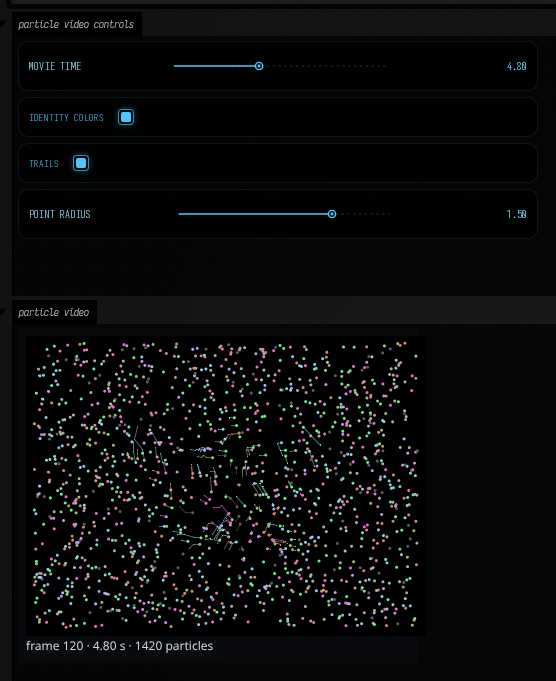

# Video particles

Turn a movie into trajectories, then inspect their motion as continuous polylines in Field.
The optional PyTorch tracker follows frame-to-frame motion; the Kotlin reader and visualizer play
the recorded result without a Python process or a neural model.

Open the [particle_video](agent_transcripts.md#particle_video) starting point to scrub the example or
track your own movie.

## A dance in 24,000 particles

Each polyline joins consecutive recorded positions of one tracked particle (one identity). The
recent path shows bends, stalls and sudden jumps that dots alone conceal. The source dance is on the left;
stable identity-colored trajectories are on the right. These colors stay fixed through the film's
intentional recoloring, so the motion is easier to follow.
<video controls muted loop playsinline preload="metadata" width="1600" height="600" poster="../assets/particle_video/comparison.png" style="width:100%;height:auto">
  <source src="assets/particle_video/comparison.mp4" type="video/mp4">
</video>

The example uses 24,000 target particles at the source's full 400 × 300 resolution, 25 frames
per second, and 20 RAFT updates in each direction. Increasing the particle count adds sampling
density without running a separate neural prediction per particle. Tracking runs offline; playback
uses the recorded positions.

For readable individual paths, the comparison shows identities with `id % 16 == 0`, about 1,500
at a time, with 25 frames (one second) of history. The underlying run still tracks 24,000.
The [full-density polyline movie](assets/particle_video/polylines-full.mp4) draws every live
trajectory with 12 frames of history and source colors. The
[source video](assets/particle_video/source.mp4) and original
[dot-only movie](assets/particle_video/particles.mp4) are also available. The footage is
[public domain on Wikimedia Commons](https://commons.wikimedia.org/wiki/File:Loie_Fuller_-_Vue_Lumi%C3%A8re_No_76_-_Serpentine_Dance_-_1896.ogv).
Its historical filename refers to Loïe Fuller; the performer is not verified as Fuller herself.

Each path ends at its current recorded position; earlier vertices belong to earlier frames.
Watch the same polylines over a dimmed source to check the endpoints against the fabric:

<video controls muted loop playsinline preload="metadata" width="800" height="600" poster="../assets/particle_video/polylines-overlay.png" style="width:100%;height:auto">
  <source src="assets/particle_video/polylines-overlay.mp4" type="video/mp4">
</video>

## Scrub recorded tracks

The starting point's second box loads a small, representative subset of the same trajectories. It
keeps every sample of each selected identity, so time, births, retirement and colors are preserved.
Move **movie time**, adjust **history (frames)** and **line width**, or switch **identity colors**
to inspect motion independently of the source's changing tint. Lines are the default; **points**
adds endpoint dots. **Trajectory stride** thins displayed identities without changing the tracks.

```diffstatic_runner {data-lang=kotlin screenshot="assets/particle_video/field-view.png" capture="box" open-outputs="true" wait="2" padding="12" timeout="120" w="900" h="900" hidden=true embed=true name="particle-video-reader" alt="Actual Kotlin particle reader and scrubber with movie-time, identity-color and trail controls" macro-file="../../dev_docs/agents/transcripts/docs_capture/particle_video_view.yaml" capture-box="particle_video_view"}
val video = loadParticleVideo("public/docs/assets/particle_video/example.pvt.gz")
particleVideoView(video, initialSeconds = 7.2, scale = 1, pointRadius = 1.5)
```

At another time, a longer history reveals the shape of the recorded paths:



A loaded video exposes positions in **processed image pixels**, with x right and y down. Velocity
is displacement per processed frame; multiply by `video.fps` to obtain pixels per second. The
reader validates finalized files and complete lifecycles, and indexes records that arrived out of
order while the tracker checked whether a new trajectory was long enough to keep.

Query one time or one identity, and make ordinary Field geometry from those samples:

```diffstatic {data-lang=kotlin}
val frame = video.at(2.35) // interpolate matching IDs between recorded frames
val points = frame.samples.map { it.position }
val rgb = frame.samples.map { vec(it.red, it.green, it.blue, 1) }
val trajectory = video.trajectory(frame.samples.first().id)
val paths = video.trails(frame.index, length = 25, stride = 16)
val gpuPoints = frame.points(pointSize = 2.0, color = ParticleColor.SAMPLED)
```

`points()` returns a single `FLine` with per-node colors for a node-color-aware renderer such as
Field's Vulkan drawing. The 2D `particleVideoView()` rasterizes sampled colors directly in Kotlin.
`video.image(frame)` draws polylines into a `BufferedImage`; `video.renderMovie(path)` exports that same Kotlin
drawing through FFmpeg. Reading tracks and making geometry need no FFmpeg; movie export does.

## Track your own movie

Prepare the optional environment once from a checkout. It uses pinned Torch/Torchvision packages;
the first tracker call fetches the approximately 21 MB pretrained RAFT-large checkpoint. A fresh
CUDA Python environment needs several GB of disk space. FFmpeg, FFprobe and a C++17 compiler must
be available on PATH.

```diffstatic {data-lang=shell}
uv sync --project optional/particle-tracker --python 3.11 --frozen
```

On an **Apple Silicon Mac**, install FFmpeg and the Xcode command-line tools, then use the same
`uv sync` command with a native arm64 Python. Choose `device = "mps"` in
`ParticleTrackingOptions` for Metal, or `device = "cpu"` explicitly. The default is CUDA.
The pinned Torch 2.6 packages do not include Intel Mac wheels, but recorded tracks can still be
read and visualized on an Intel Mac without installing the tracking environment. Tracking on a Mac
is untested.

If you already have a compatible environment, set `FIELD_PARTICLE_TRACKER_PYTHON` to its Python
executable before starting Field. The tracker is optional: Field startup and normal builds do not
install these packages or fetch weights.

The starting point's third box runs the long job in a coroutine, then opens the complete recorded
result. Change the input filename and particle count for your own movie:

```diffstatic {data-lang=kotlin}
val tracker = particleTracker()
suspend fun process() {
    val run = tracker.track(
        "my-movie.mp4",
        ParticleTrackingOptions(particles = 24000, colorLimit = 1.0),
    )
    println("cached=${run.cacheHit}")
    particleVideoView(run.load(), stride = 16)
}
start(::process)
```

Stopping or rerunning that box cancels its subprocess work. Repeating the same successful request
reuses checksummed tracks in `~/.afield/particle-tracker`. Video content, all options, source,
compiler, model checkpoint and environment versions contribute to the cache key. A file edited in
place gets a new result. Logs and provenance live beside the cached binary.

| Option | Effect |
| --- | --- |
| `width = 0` | Preserve native source resolution; set a positive width to resize with aspect ratio retained. |
| `particles = 3000` | Target live population; local spacing and confidence can leave holes. |
| `frames = 0`, `fps = null` | Process the whole clip at the source's average frame rate. |
| `colorLimit = .18` | Retire a point after sustained RGB RMS change from its birth color; `1.0` disables this rule. |
| `minTrack = 10`, `grace = 5` | Omit trajectories shorter than ten samples; require five bad frames before retirement. |
| `spacing = 0.0` | Choose birth spacing from image area and target population. Set pixels explicitly to change density. |
| `stillSpeed = 0.0` | Disable retirement of still particles; set a positive speed in pixels/frame to enable it. |
| `mergeDistance = 0.0` | Disable merging; enable with a positive pixel radius for close, similarly moving mature tracks. |
| `device = "cuda"` | Use CUDA; request `"cpu"` or `"mps"` explicitly for another prepared backend. |

For the dance, `colorLimit = 1.0` is intentional: recoloring should change the sampled color rather
than retire an otherwise useful point. For stable-color footage, the birth-color rule can help
retire points that drift into a different surface. Treat it as an artistic choice about when
points die; it does not measure tracking accuracy.

Confidence combines forward/backward agreement and local photometric consistency. An uncertain
point holds its position during the grace interval; crowding may retire younger points as fabric
compresses. Fresh identities fill available space. Stable identity colors make these events
visible, but do not imply recovery of the same material point after an occlusion.

Dense tracks are sizeable: this twelve-second example is about 575 MB before compression.
The Kotlin reader memory-maps uncompressed files and decodes queried frames on demand. Its current
limit is 2 GiB per file; split longer dense work into clips. Portable gzip copies can inflate to at
most 256 MiB. Old cache entries can be deleted when you no longer need them.

??? aside "Example and validation"

    The example is seconds 4–16 of the Commons file, tracked on a Linux RTX 4090. It keeps the
    source's 400 × 300 pixels rather than inventing detail by upscaling. The original 1,500-particle
    test and the denser 24,000-particle version use the same bidirectional RAFT-large engine.
    The
    [manifest](assets/particle_video/manifest.json) records model versions, options, hashes,
    cache reuse, duration and the representative-subset rule. The source is also available
    [losslessly](assets/particle_video/source.mkv) for rerunning the exact request.

    The imported engine came from
    [the shared tracker conversation](https://chatgpt.com/share/6ac2b442-dda4-83eb-a7c6-3923754dab9b).
    [Optional tool source and setup](https://github.com/OpenEndedGroup/Field4/tree/main/optional/particle-tracker)
    retain its origin and component hashes. Linux CUDA was executed here, and a short Linux CPU smoke passed. Mac/MPS execution
    and Mac performance remain unverified.

For GPU-resident flow between Field render targets, see [Optical flow](optical_flow.md). For
deforming a canonical sheet to learned image densities, see [Stipple transport](stipple_transport.md).
Video tracking instead follows recorded frame-to-frame motion and recycles identities as needed.
