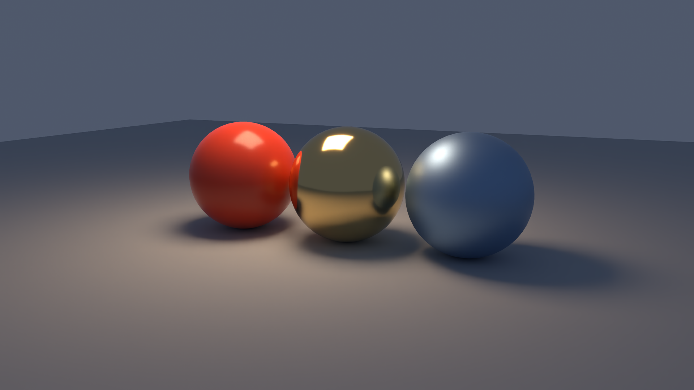
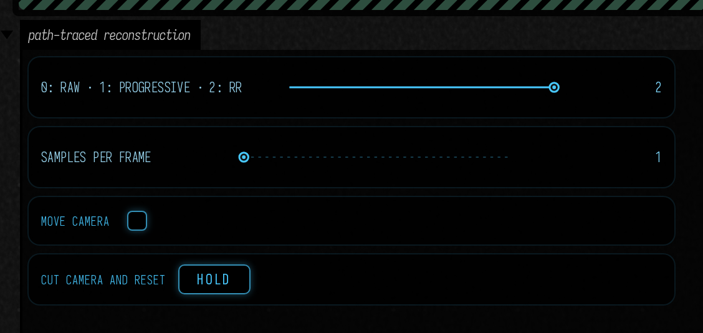
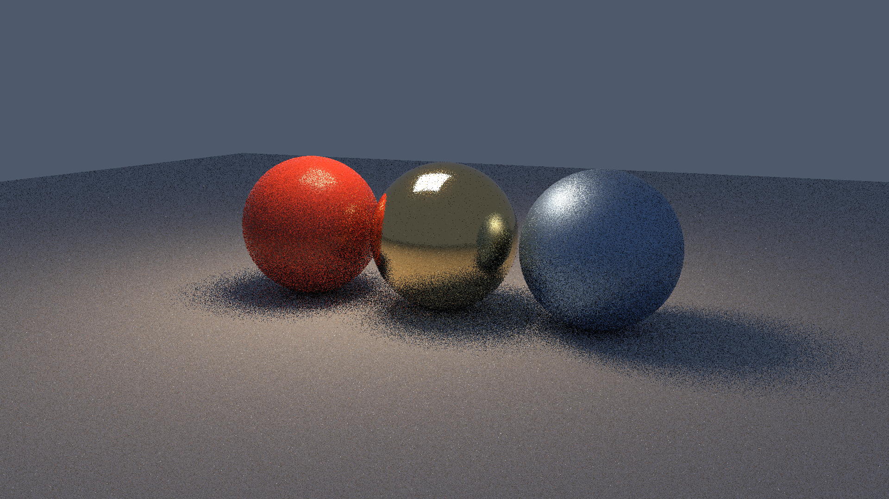

# Ray Reconstruction for the path tracer

The path tracer can now send its current frame directly to the same Ray Reconstruction adapter used by [RTXDI lighting](ray_reconstruction.md). This includes indirect bounces, glossy reflections and an area emitter. The raw signal and progressive accumulation remain available for comparison.



## Open the scene

Open **Starting points → path_traced_reconstruction**, after the [optional NGX setup](neural_reconstruction.md). The scene contains a diffuse floor, plastic and metallic spheres, and an area emitter. It renders at **1920 × 1080** with one sample per pixel per frame.

Choose **Raw**, **Progressive** or **RR** without restarting. **Move camera** tests reprojection; **Cut camera and reset** deliberately changes the view and discards reconstruction history. Samples per frame controls the actual integrator. The raw view stays noisy because it shows a single dispatch before any temporal accumulation.

<video controls muted loop playsinline preload="metadata" src="assets/path_traced_reconstruction/animation.mp4" width="1920" height="1080" style="max-width:100%;height:auto;aspect-ratio:16/9"></video>



## The plumbing

Create your scene and an **uninstalled** `PathTracingRenderer`, then give it to `PathTracedReconstruction`. The adapter owns dispatch order and closes that tracer when it closes.

```diffstatic {data-lang=kotlin}
val tracer = PathTracingRenderer(renderer, scene, environment,
    1920, 1080, camera)
val lab = PathTracedReconstruction(tracer).install()
lab.view = PathTracedReconstruction.View.RECONSTRUCTED
// On a camera cut or an appearance change:
lab.reset("camera cut")
```

This records **path tracing → guide conversion → NGX** on Field's graphics queue. The tracer writes raw linear radiance before progressive accumulation, together with primary-surface data. A GPU pass exposes those records as seven image attachments. No pixels cross the JVM/native boundary; the existing NGX adapter receives image handles and records reconstruction into the command buffer.

| Input | Source and convention |
| --- | --- |
| Color | Current dispatch's unclamped linear RGB, before exposure or tone mapping |
| Depth | Perspective Vulkan 0…1; near 0.01, far 10,000, background 1 |
| Motion | Previous minus current position, in input pixels, without jitter; camera motion for the scene snapshot |
| Diffuse guide | Actual primary-surface diffuse reflectance |
| Specular guide | View-dependent BRDF approximation from the NGX guide, using the actual material |
| Normal / roughness | World-space shading normal and primary-surface roughness |
| Specular hit distance | A traced stochastic GGX reflection distance; documented sky sentinel |

The primary visibility sample uses the adapter's Halton jitter. UI and display tone mapping occur afterwards. Material shader revisions and tracer configuration resets invalidate reconstruction history; explicit cuts and other appearance edits use `lab.reset()`. Recreate the adapter for changed input/output dimensions. The input images belong to the tracer and are borrowed by NGX until the tracer closes.

`tracer.enableFrameOutput()` also exposes these images without NGX. That lets your own `Target` inspect or process raw lighting, depth, motion and guides. The existing [reconstruction plumbing](reconstruction_plumbing.md) page explains the generic image contract; the difference here is that the path integrator produces the guides itself.

## Put a material shader in the box

The scene above starts with Kotlin material values. To edit their appearance in GLSL, replace its `PathTracingRenderer(...)` construction and `lab = ...` assignment with the following. `pathTracingHere()` seeds the box's **compute** property with the material hook and connects it to Field's normal shader reload actions.

```diffstatic {data-lang=kotlin}
val tracer = pathTracingHere(scene, PathTraceEnvironment.constant(.08f, .1f, .15f),
    width = 1920, height = 1080, camera = camera, name = "rr-materials")
// pathTracingHere installs standalone passes. Hand scheduling over to RR:
renderer.computeList.others.remove(tracer.name, tracer)
renderer.renderList.preTargets.remove("${tracer.name}-output")
lab = PathTracedReconstruction(tracer).install()
```

Now open **compute** and replace the identity material hook with this shader. The two template lines supply the integrator and its types; leave them in place. This edits the floor, whose material ID is zero in this Starting Point.

```diffstatic {data-lang=glsl}
{{ pathTracing.preamble }}

Material shadeMaterial(Material material, PathTraceSurface surface) {
    if (surface.materialId == 0) {
        float stripe = smoothstep(.35, .65,
            .5 + .5 * sin(surface.position.x * 8.0));
        material.base.rgb = mix(vec3(.06, .12, .3), vec3(.8, .18, .04), stripe);
        material.base.w = 0.0;     // metallic
        material.emission.w = .3; // roughness
    }
    return material;
}

{{ pathTracing.integrator }}
```

Use **Update Compute Shader**, then change `8.0` to vary the stripe frequency or `.3` to change roughness. The function runs at surface hits, so the material affects direct light, indirect light and reflections; the primary-surface RR guides use its result too. Successful reload resets accumulation and reconstruction history; a compile error preserves the working pipeline. Keep materials opaque for this adapter. If you later animate a material uniform, call `lab.reset("material parameter changed")` when its value changes—geometric motion vectors do not describe that appearance change. See [material shaders](path_tracing.md#material-shaders-in-a-field-box) for the full `Material` and `PathTraceSurface` contracts.

## Quality and cost

The GPU check compares both raw one-sample lighting and RR against a much longer progressive reference of the same static scene. It also verifies an analytical plane's radiance, depth and known camera translation in both compute-BVH and ray-query backends, then exercises moving cameras, cuts, two resolutions and recreation under Vulkan validation.

At 1920 × 1080 on the RTX 4090, the final warmed run measured **11.86 ms median / 12.16 ms p95** for the complete pass, including **6.09 / 6.22 ms** in NGX. Raw RGB MSE was **0.01934**, versus **0.0000689** after RR against the progressive reference. Guide storage was **308 MiB**; NGX’s internal allocation query returned zero, so its memory remains unknown. These are this scene’s results with automatic GPU clocks and Wayland presentation, not fixed-clock throughput benchmarks.

The [measurement record](assets/path_traced_reconstruction/measurements.json) contains raw/reference error, reconstructed/reference error, separate NGX and complete-pass time distributions, and guide storage at 960 × 540 and 1920 × 1080. Timings come from a continuous warmed run, separate from PNG capture. The guide path uses a 96-byte record per input pixel plus seven images, so its memory is substantial; it is an inspectable first integration rather than a compact final packing.



## Current boundaries

This adapter supports **opaque diffuse and glossy surfaces with a pinhole camera**. It explicitly rejects transmission/coverage materials, participating media, fog and depth of field. Those effects need different correspondence and guide treatment; their existing progressive path-tracing modes remain available. Scene geometry is a snapshot: changing geometry recreates the tracer rather than implying that object motion vectors have been supplied.

RR is optional. It may suppress an intentional noisy or unstable appearance, and a lower static error does not prove that every moving highlight remains faithful. Keep the raw view and test your own shader edits and abrupt changes. The existing path tracer, compute fallback and RTXDI reconstruction path retain their own interfaces.
