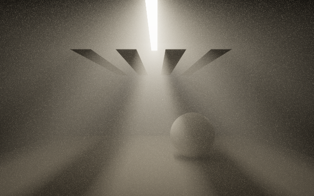
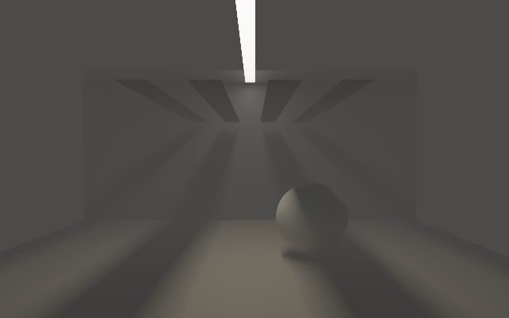
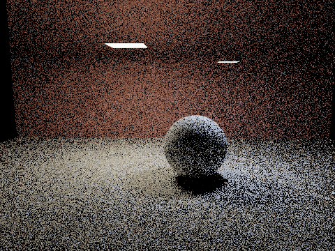
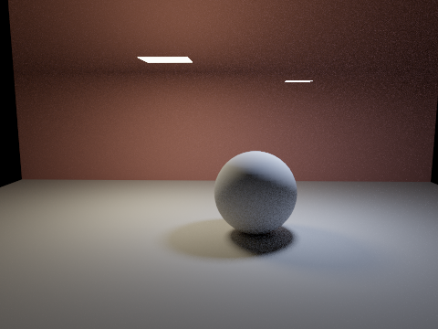

# Progressive path tracing

[`PathTracingRenderer`](reference/renderers.md#pathtracingrenderer-kt-pathtracingrenderer) is a GPU
path tracer for `afield.four`. It runs on ordinary
Vulkan compute devices, including MoltenVK on macOS. When Field has enabled
`VK_KHR_ray_query`, `AUTO` selects hardware triangle traversal. Both backends use
the same lighting, material evaluation and accumulation code. Every type this page calls is
browsable on the [Renderers](reference/renderers.md) reference page, with the KDoc that sits beside
it in the source, next to the real-time deferred renderer this one is an alternative to and the
splat renderer that is neither.

```diffstatic_runner {data-lang=kotlin screenshot="assets/path_tracing/materials.png" capture="native-window" native-wait-frames="3" wait-output=true wait-output-kind="all" wait-output-contains="materials study converged" embed=true hidden=true timeout="150" name="path-tracing-materials" alt="Plastic, polished gold and rough metal spheres lit by a Venice sunset environment, rendered by the compute path tracer" macro-file="../../dev_docs/agents/transcripts/path_tracing_materials.yaml" capture-box="path_trace_materials"}
// Built and launched from dev_docs/agents/transcripts/path_tracing_materials.yaml.
```

Environment: Venice Sunset by Greg Zaal / Poly Haven (CC0), from the existing
[Fabricate demo assets](assets/fabricate_demo/ATTRIBUTION.md).

## Start with the material study

Create a child box beneath an existing renderer box, then run the code below.
It traces three spheres over a floor using the bundled Venice sunset OpenEXR
map. Rerunning the box automatically replaces its previous tracer; no cleanup
coroutine is needed. The environment path is relative to the Field checkout.
See the [graphics guide](afield_four_graphics.md) for setting up renderer boxes.
The two opaque material studies opt into `indirectClamp = 10f`; the glass study leaves
clamping disabled so its transmitted lighting and caustics are preserved.

```diffstatic {data-lang=kotlin}
import afield.four.fabricated.*
import afield.four.modules.fromContext

val renderer: Renderer = fromContext()
val tracer = PathTraceDemo.install(renderer,
    "public/docs/assets/fabricate_demo/venice_sunset_1k.exr")
tracer.samplesPerFrame = 1
tracer.maxBounces = 5
tracer.indirectClamp = 10f // optional: reduces indirect fireflies, with some bias
tracer.blitToScreen() // separate pass sampling tracer.output
```

The checkout also includes a complete renderer-and-scene example in
`dev_docs/agents/transcripts/path_tracing_materials.yaml`, which can be run as an
OperationTranscript.

## Supply your own scene

Build geometry in world coordinates. Colours are linear RGB. For opaque materials,
metallic controls the dielectric/metal mixture, and roughness controls isotropic GGX.
Opaque roughness zero uses a small finite roughness floor. Glass has a true specular
reflection/refraction mode at zero roughness.

```diffstatic {data-lang=kotlin}
import afield.four.fabricated.*
import afield.four.util.Camera
import afield.stdlib.linalg.Vector3f

val scene = PathTraceScene()
val paint = scene.material(PathTraceMaterial.plastic(0.7f, 0.08f, 0.02f))
val gold = scene.material(PathTraceMaterial.metal(0.95f, 0.7f, 0.3f, 0.15f))
scene.sphere(Vector3f(-1f, 1f, 0f), 1f, paint)
scene.sphere(Vector3f(1f, 1f, 0f), 1f, gold)
// scene.mesh(positions, triangleIndices, paint, optionalVertexNormals)
// scene.triangle(a, b, c, paint)
// scene.quad(a, b, c, d, paint)

val env = PathTraceEnvironment.fromFile("/absolute/path/studio.exr")
val camera = Camera(renderer).also {
    it.at.set(0f, 2f, 7f)
    it.target.set(0f, 1f, 0f)
}
val tracer = PathTracingRenderer(renderer, scene, env,
    width = 640, height = 360, camera = camera).install()
```

`PathTraceEnvironment` accepts OpenEXR, Radiance HDR, STB-supported ordinary image
files, or a linear RGBA `FloatArray`. LDR files are converted to linear floats by
STB. Maps are equirectangular: north at the top; longitude is `atan2(z, x)`.
`environmentRotation` rotates the map around Y in radians, and
`environmentIntensity` scales its radiance. Construction copies scene and map data.
Recreate the tracer after geometry, CPU material or map changes. Shader material
functions can instead be edited and reloaded in place, as below.

## Camera, jitter and depth of field

The tracer uses an ordinary Field `Camera`: `at`, `target`, `up` and `p.fov` control
the view. You can share it with rasterized geometry, animate it, or attach the usual
keyboard controls. The tracer uses perspective projection and its own output aspect
ratio; `SuperProjection` orthographic blending and principal-point offsets are not used.

```diffstatic {data-lang=kotlin}
import afield.four.util.keyCamera

val camera = tracer.camera
camera.at.set(0f, 2.6f, 8f)
camera.target.set(0f, 0.65f, 0f)
camera.p.fov = 0.62 // vertical field of view, in radians
var cameraKeys by keyCamera(renderer = renderer, camera = camera)

tracer.pixelJitter = 1f
tracer.apertureRadius = 0.25f
tracer.focusDistance = null // follow the target
```

```diffstatic_runner {data-lang=kotlin screenshot="assets/path_tracing/camera.png" capture="native-window" native-wait-frames="3" wait-output=true wait-output-kind="all" wait-output-contains="camera study converged" embed=true hidden=true timeout="180" name="path-tracing-camera" alt="A sharp gold sphere at the focus plane between a blurred near red sphere and distant blue sphere, over a checkerboard" macro-file="../../dev_docs/agents/transcripts/path_tracing_camera.yaml" capture-box="path_trace_camera"}
// Camera, antialiasing and depth of field in a live Field scene.
```

| Control | Default | Meaning |
| --- | --- | --- |
| `pixelJitter` | `1f` | Samples the full pixel footprint for antialiasing. `0f` samples its centre; values between zero and one narrow the footprint. |
| `apertureRadius` | `0f` | Circular lens radius in world units. Zero disables depth of field; larger values increase defocus blur. |
| `focusDistance` | `null` | Tracks the camera target. Set a positive distance in world units to hold focus independently of the target. |

```diffstatic {data-lang=kotlin}
tracer.focusDistance = 5f // focus plane five world units along camera.forward
tracer.apertureRadius = 0.08f // a smaller opening gives subtler blur
// tracer.apertureRadius = 0f // pinhole view again
```

Focus is a plane perpendicular to the viewing direction, so off-axis objects at the
same depth remain sharp. This uses a [thin-lens camera model](https://www.pbr-book.org/4ed/Cameras_and_Film/Projective_Camera_Models):
each path starts at a sampled point on the circular lens and aims at that plane.
Aperture changes blur without changing exposure. Lens samples use their own two
Sobol dimensions, independently of pixel and lighting samples; depth of field still
converges when `pixelJitter` is zero.

By default, pose, FOV, jitter, aperture and focus changes reset accumulation before
the next sample. Enable [temporal reuse](#keeping-convergence-during-camera-motion)
to retain compatible surface history on camera movement. With automatic focus,
moving only the target nearer or farther still resets accumulation, even if the
viewing direction is unchanged. If sampling is paused, the new view
appears when you resume. Scaling a scene calls for scaling its aperture and explicit
focus distance too. This models a circular aperture; it does not simulate shutter
motion blur, diffraction or a multi-element photographic lens.

## Loading glTF and GLB models

```diffstatic_runner {data-lang=kotlin screenshot="assets/path_tracing/gltf.png" capture="native-window" native-wait-frames="3" wait-output=true wait-output-kind="all" wait-output-contains="glTF study converged" embed=true hidden=true timeout="240" name="path-tracing-gltf" alt="Textured Toy Car imported from GLB and path traced on a grey floor with hidden sunset environment lighting" macro-file="../../dev_docs/agents/transcripts/path_tracing_gltf.yaml" capture-box="path_trace_gltf"}
// Imported and rendered by dev_docs/agents/transcripts/path_tracing_gltf.yaml.
```

Load a static glTF 2.0 scene before creating the tracer:

```diffstatic {data-lang=kotlin}
import afield.four.fabricated.*

val scene = PathTraceScene.fromGltf("/absolute/path/model.glb")
val tracer = pathTracingHere(scene, env, camera = camera)
tracer.indirectClamp = 10f
tracer.blitToScreen()
```

Both `.gltf` with external buffers/images and `.glb` with embedded images work.
The import copies the default scene's node hierarchy into world-space triangles,
including repeated mesh instances, mirrored transforms and inverse-transpose
normals. It needs no live renderer. Geometry is a static snapshot; recreate the
tracer after importing another model or changing its geometry.

To add a model alongside other geometry, use `scene.importGltf`. Its result
provides world-space bounds, a name-to-material-ID map and import warnings:

```diffstatic {data-lang=kotlin}
import afield.stdlib.linalg.Matrix4f
import afield.stdlib.linalg.Vector3f

val scene = PathTraceScene()
val model = scene.importGltf("/absolute/path/model.gltf",
    transform = Matrix4f().translate(0f, 1f, 0f).scale(2f))
val center = Vector3f(model.boundsMin).add(model.boundsMax).mul(0.5f)
val radius = model.boundsMin.distance(model.boundsMax) * 0.5f
camera.target.set(center)
camera.at.set(center).add(radius * 2.3f, radius * 1.4f, radius * 2.7f)
```

Model units are preserved. Choose a scale and `rayEpsilon` appropriate to the
model: the default epsilon is 0.0001 world units. The bundled Toy Car example
scales the small source model by 20 and fits the camera to its imported bounds.

| Imported feature | Path-tracer behavior |
| --- | --- |
| Base colour, metallic and roughness | Factors multiply their textures; metallic uses blue and roughness uses green. |
| Base-colour and emissive images | sRGB RGB is decoded to linear light; alpha remains linear. |
| Vertex colours | Multiply base colour and coverage. |
| Normal maps | Tangent frames are reconstructed from each triangle's transformed UVs; normal scale is applied. |
| Texture coordinates and samplers | Per-texture UV channels, baked `KHR_texture_transform`, repeat/clamp/mirrored repeat, nearest or bilinear magnification. |
| `OPAQUE`, `MASK`, `BLEND` | Opaque coverage, cutoff-tested holes, or stochastic alpha coverage, including shadow rays. Alpha blend does not refract light. |
| Emission | Emissive factors, textures and `KHR_materials_emissive_strength`. |
| Transmission, IOR and volume | Mapped approximately to the tracer's glass models; see the limits below. |

You can amend materials during import, and then edit them through the same
`shadeMaterial` hook as a hand-built scene:

```diffstatic {data-lang=kotlin}
val model = scene.importGltf("/absolute/path/model.glb",
    material = { name, imported ->
        if (name == "Glass") imported.copy(
            transmission = true, metallic = 0f, thinWalled = false,
            roughness = 0.08f, ior = 1.5f)
        else imported
    })
// model.materialIds["Glass"] selects that material in surface.materialId.
```

Textures and vertex colour are applied before `shadeMaterial`; `surface.uv`
contains the base-colour texture's UV, and `surface.color` contains interpolated
vertex colour. Material reload and named replacement work as for other scenes.

This first importer supports static meshes. Skins and morph targets are rejected;
node animations are reported and the default pose is imported. Clearcoat, sheen,
specular extensions, texture compression and unlit shading are not evaluated.
Unsupported **required** extensions fail the import; unsupported optional
extensions produce warnings. Toy Car uses optional clearcoat and sheen, so this
example shows their base-material fallback. Its model and attribution are in the
[Fabricate demo assets](assets/fabricate_demo/ATTRIBUTION.md).

There are no texture mipmaps or anisotropic filtering yet, and reconstructed
normal-map tangents may differ from an asset's authored tangent frames. Baked
ambient-occlusion maps are not applied. Partial transmission is approximated as
full dielectric transmission, and transmission textures are not evaluated.
Smooth zero-volume materials become thin panes; rough transmission uses solid
glass and needs closed geometry. Volume absorption uses actual mesh thickness
and world-space attenuation distance; nested media remain unsupported.

Colour, texture-channel and coverage conventions follow the
[glTF 2.0 specification](https://registry.khronos.org/glTF/specs/2.0/glTF-2.0.html).

## Scene ownership and render-to-texture

`install()` registers under `name = "path-tracer"` by default. Installing another
tracer with that name detaches and retires the old one, including its presentation
pass. An old handle's `close()` cannot remove its replacement. Use distinct names
for independent tracers. A setup box can finish immediately; the scene keeps
rendering until replacement or explicit `tracer.close()`.

The renderer schedules compute, then resolves into `tracer.output` before the
screen passes. The output is an ordinary `RenderToTexture` with linear,
premultiplied HDR RGBA. Sample it in your own Field module, post-process it, or
call `tracer.blitToScreen()` for aspect-preserving exposure/Reinhard presentation.
`tracer.output.blitToScreen()` is also available when Field's ordinary blit/color
grade is desired; it does not apply the tracer's Reinhard curve. When registering
that helper directly, give it a stable name so subsequent helper calls replace it.

To render into an existing RTT, pass `target = rtt` and matching `width` and
`height` to the constructor or `pathTracingHere`. It needs one floating-point color
attachment and must belong to the same renderer. The tracer schedules this RTT;
do not schedule it a second time. `close()` removes the tracer's resolve module
without disposing a caller-owned RTT.

## Environment lighting without a visible sky

```diffstatic_runner {data-lang=kotlin screenshot="assets/path_tracing/hidden_environment.png" capture="native-window" native-wait-frames="3" wait-output=true wait-output-kind="all" wait-output-contains="hidden environment study converged" embed=true hidden=true timeout="150" name="path-tracing-hidden-environment" alt="The sunset environment illuminates and reflects in three PBR spheres while camera-visible sky pixels are black" macro-file="../../dev_docs/agents/transcripts/path_tracing_hidden_environment.yaml" capture-box="path_trace_hidden_environment"}
// Built and launched from dev_docs/agents/transcripts/path_tracing_hidden_environment.yaml.
```

```diffstatic {data-lang=kotlin}
tracer.showEnvironment = false
// Default background is opaque black. Choose any linear RGBA color:
tracer.background = Vector4f(0.02f, 0.02f, 0.02f, 1f)
// Or make empty pixels transparent for compositing:
tracer.background = Vector4f(0f, 0f, 0f, 0f)
tracer.blitToScreen(blend = true)
```

Only camera rays that miss their first surface see this background. The environment
still illuminates objects and remains visible in reflections and through refracting
surfaces. Changing either background control resets accumulation. This is a useful
art-direction/compositing control; it does not change the environment's radiance.

## Depth fog

Blend distant surfaces toward a colour, with a clear region around the camera. This is a
curve applied to a finished sample, not a medium light travels through — if you want shafts,
a lamp that glows, or shadows cast into the air, you want [a participating
medium](#a-participating-medium) below, and the table there compares the two directly.
`fogDensity` remains the cheaper choice when you only need distance haze.

```diffstatic {data-lang=kotlin}
import afield.stdlib.linalg.Vector3f

tracer.fogColor = Vector3f(0.25f, 0.35f, 0.5f)
tracer.fogDensity = 0.1f
tracer.fogStartDistance = 5f
tracer.fogBackground = true
```

```diffstatic_runner {data-lang=kotlin screenshot="assets/path_tracing/fog.png" capture="native-window" graphics-context=true execution="launch" native-wait-frames="3" wait-output=true wait-output-kind="all" wait-output-contains="fog study converged" embed=true hidden=true timeout="180" name="path-tracing-fog" alt="A row of PBR spheres and a checkerboard floor fading into blue-grey depth fog with increasing distance"}
import afield.four.fabricated.*
import afield.four.util.Camera
import afield.four.modules.fromContext
import afield.stdlib.linalg.Vector3f

val renderer: Renderer = fromContext()
val scene = PathTraceScene()
val grey = scene.material(PathTraceMaterial.diffuse(0.3f, 0.3f, 0.3f))
val light = scene.material(PathTraceMaterial.diffuse(0.65f, 0.65f, 0.65f))
for (z in -20..8) for (x in -6..6) {
    scene.quad(Vector3f(x.toFloat(),0f,z.toFloat()), Vector3f(x.toFloat(),0f,z+1f),
        Vector3f(x+1f,0f,z+1f), Vector3f(x+1f,0f,z.toFloat()),
        if ((x+z) and 1 == 0) grey else light)
}
val red = scene.material(PathTraceMaterial.plastic(0.65f, 0.035f, 0.015f, 0.25f))
val gold = scene.material(PathTraceMaterial.metal(0.95f, 0.7f, 0.3f, 0.18f))
for (i in 0..5) scene.sphere(Vector3f(if (i%2 == 0) -1.2f else 1.2f, 0.8f, 4f-i*3.5f),
    0.8f, if (i%2 == 0) red else gold, 32, 16)
val camera = Camera(renderer).also {
    it.at.set(6f,3.5f,10f); it.target.set(0f,0.65f,-3f); it.p.fov=0.65
}
val env = PathTraceEnvironment.fromFile("public/docs/assets/fabricate_demo/venice_sunset_1k.exr")
val tracer = PathTracingRenderer(renderer, scene, env, 640, 360, camera).install()
tracer.samplesPerFrame = 8
tracer.indirectClamp = 10f
tracer.fogColor = Vector3f(0.25f, 0.35f, 0.5f)
tracer.fogDensity = 0.1f
tracer.fogStartDistance = 5f
tracer.blitToScreen()
frames {
    while (tracer.samples < 512) { frame() }
    tracer.paused = true
    println("fog study converged")
}
```

| Control | Default | Meaning |
| --- | --- | --- |
| `fogDensity` | `0f` | Nonnegative density per world unit. Zero disables fog. |
| `fogStartDistance` | `0f` | Nonnegative clear distance before fog begins. |
| `fogColor` | `Vector3f(0.5f, 0.5f, 0.5f)` | Linear HDR colour, before exposure and display tone mapping. Assign a new vector to change it; the getter returns a copy. |
| `fogBackground` | `true` | Treat primary-ray misses as infinitely distant. Set false to preserve the camera-visible environment or background colour. |

At distance `d`, the surface contribution is multiplied by
`exp(-fogDensity * max(d - fogStartDistance, 0))`; the remaining weight comes from
`fogColor`. Distance is measured from the camera centre to the first visible hit,
in world units. Fog is applied per path sample, so jitter and depth-of-field
coverage still accumulate normally. Changing any fog control resets accumulation.

Fog preserves premultiplied alpha. A transparent hidden background remains
transparent; an opaque background or visible environment fades fully to the fog
colour when `fogBackground` is enabled. Environment lighting remains unchanged.

This is an artistic depth effect, not volumetric scattering: it does not create
light shafts or march through a medium. A mirror or glass surface uses its first-hit
distance, rather than distances along subsequent reflected or refracted rays.
Temporal history stores unfogged colour, then applies the current camera distance
when reprojecting it; moving out of dense fog can reveal retained surface detail.

For the physical version — which does create light shafts, and which dims the light
arriving at a surface as well as the light leaving it — see the next section. The two
mechanisms are independent and both still work; they are not two spellings of one
thing, and enabling both attenuates whatever the camera sees first twice over.

## A participating medium

`mediumDensity` puts a real, homogeneous participating medium in the scene. It is a
different mechanism from `fogDensity` above, not a better-tuned version of it:

| | `fogDensity` | `mediumDensity` |
| --- | --- | --- |
| what it does | blends the finished radiance of a sample toward `fogColor` | samples a collision distance along every ray segment |
| what it knows | the primary hit distance | the whole path, and every light connection along it |
| light *reaching* a surface | unchanged | attenuated over its own length |
| a lamp inside it | unchanged | glows |
| a slat between a lamp and the haze | nothing | casts a shadow *into the haze* |
| cost | a multiply | one distance sample per segment, two shadow rays per collision |





The same geometry twice: `mediumDensity = 0.16` above, `fogDensity = 0.16` with a grey
`fogColor` below, both at 1536 samples per pixel. The slats' shadows reach the wall and the
floor in both — shadows on *surfaces* are not what separates them. What separates them is
the air. Over the 100920 pixels of that frame whose primary ray hits no geometry at all,
the medium puts a mean radiance of **0.91481** with a spatial standard deviation of
**2.02372**; `fogDensity` puts **0.34068** with a deviation that prints as **0.00000**,
because a background miss has no depth for a depth curve to act on — that population is
constant for `fogDensity` *by construction*, not merely nearly so. With neither, both
figures are exactly zero. Both images come from `PathTraceMediumGpuSmoke.godRays`, which
asserts the gap in the form that survives re-running: the medium's deviation against a floor
(`mediumSpread > 0.5`) and `fogDensity`'s variation **relative to its own mean**
(`fogSpread / fogMean < 1e-4`). The residue behind that relative test is float32
accumulation over 100 000 pixels, which is a claim about arithmetic rather than about
rendering, so it is not quoted here as an absolute.

```diffstatic {data-lang=kotlin}
// The room is the medium's extent. Bounds are not decoration: an unbounded medium has
// zero transmittance to infinity, so an environment map becomes unreachable and an
// environment-lit scene renders black.
tracer.mediumBounds = Vector3f(-6f, 0f, -3.9f) to Vector3f(6f, 5.2f, 3.9f)
tracer.mediumDensity = 0.16f                           // extinction per world unit
tracer.mediumAlbedo = Vector3f(0.96f, 0.95f, 0.93f)    // how much of that scatters
tracer.mediumAnisotropy = 0.4f                         // forward-scattering, in (-1, 1)
tracer.maxBounces = 8                                  // a collision spends one of these
```

| Control | Default | Meaning |
| --- | --- | --- |
| `mediumDensity` | `0f` | Extinction — scattering plus absorption — per world unit. Zero disables the medium. Achromatic, so a distance sample stays one decision; colour comes from the albedo. |
| `mediumAlbedo` | `Vector3f(1f, 1f, 1f)` | The fraction of extinction that scatters rather than absorbs, per channel. One conserves energy exactly; zero is pure Beer–Lambert absorption with no glow at all. The getter returns a copy. |
| `mediumAnisotropy` | `0f` | Henyey–Greenstein `g`, in (-1, 1). Zero is isotropic, positive forward-scatters into a halo, negative throws light back toward the camera. |
| `mediumBounds` | `null` | The axis-aligned box the medium fills, as `low to high`. `null` fills all space, with the consequence above. |

Changing any of them resets accumulation.

**A medium spends your bounce budget.** A collision in the medium is
an interaction like a surface hit, and it spends one of `maxBounces`. A medium dense
enough to scatter a path three or four times therefore has that many fewer bounces
left for surfaces, and a dense enough medium makes the image *darken* rather than
brighten — that is energy the bounce cap is discarding. Raise `maxBounces` (the cap is
twelve) or lower the density.

The energy a given budget loses at a fixed density is measurable. In a box **2.4** optical depths across, a medium that conserves
energy exactly — albedo 1, where the true answer is a whole number — reads `0.46337` of
its value at one bounce, `0.64054` at two, `0.85178` at four, `0.97776` at eight and
`0.99680` at twelve. Monotone, and never above 1.0, which is what tells you the deficit
is truncation rather than a leak. `PathTraceMediumGpuSmoke` runs that sweep.

Note what that does *not* establish: it is a sweep over the bounce budget at one density,
so it does not locate a density at which darkening sets in. Treat "raise `maxBounces` when
you raise the density" as the rule and the sweep as its cost, and if you need the
threshold for your own scene, measure it there — the demo below cycles four densities for
exactly that reason.

Light connections carry transmittance, and that is what makes the medium compose with
`emitterSampling` rather than merely coexist with it: a lamp seen through haze is
dimmed on the way to the eye *and* on the way to every surface it lights. Both
estimators — the phase function's own sampling, and the connection to a light — are
combined with the same power heuristic the surface arms use, so they do not
double-count.

### Writing your own phase function

The four properties above tune a medium; they do not let you change what scattering *is*.
For that, reload the integrator (see [Replacing the integrator on a running
tracer](#replacing-the-integrator-on-a-running-tracer)) and replace the phase function
itself. This is the customisation point that stays unbiased, for a specific reason: the
distance sample and the transmittance depend only on extinction, so swapping the
*directional* distribution leaves them untouched.

Two functions have to change together. `phase(mu, g)` is the density, used both to weight a
scattering event and as the pdf in the MIS weight; `samplePhase(rd, g, xi)` draws from it.
**They are a matched pair, and nothing in the shader checks that they still match.** Here
is a two-term Henyey–Greenstein — a forward lobe plus a weaker backward one, which is how
atmospheric and cloud media actually behave, and which single-term HG cannot express at any
`g`:

```diffstatic {data-lang=kotlin}
val twoLobe = tracer.integratorSource()
    .replace("""
        float phase(float mu,float g) {
            if (abs(g)<1e-4) return 1.0/(4.0*PI);
            float d=1.0+g*g-2.0*g*clamp(mu,-1.0,1.0);
            return (1.0-g*g)/(4.0*PI*max(d,1e-12)*sqrt(max(d,1e-12)));
        }
    """.trimIndent(), """
        const float BACK_G=-0.55;   // the backward lobe
        const float BACK_W=0.3;     // its share of the mixture
        float hg(float mu,float g) {
            if (abs(g)<1e-4) return 1.0/(4.0*PI);
            float d=1.0+g*g-2.0*g*clamp(mu,-1.0,1.0);
            return (1.0-g*g)/(4.0*PI*max(d,1e-12)*sqrt(max(d,1e-12)));
        }
        // The MIXTURE is the density. Evaluating one lobe while sampling two is the
        // classic way to bias this, and it looks plausible on screen.
        float phase(float mu,float g) {
            return (1.0-BACK_W)*hg(mu,g)+BACK_W*hg(mu,BACK_G);
        }
    """.trimIndent())
    .replace("float mu;\n    if (abs(g)<1e-4) mu=1.0-2.0*xi.y;", """
        float mu;
        // Pick a lobe with xi.x, then remap it back to uniform for phi — conditional on
        // each branch the remapped value is exactly uniform, the same argument
        // sampleMediumDistance uses to share its dimension.
        float g2=g;
        if (xi.x<BACK_W) { g2=BACK_G; xi.x=xi.x/BACK_W; }
        else             { xi.x=(xi.x-BACK_W)/(1.0-BACK_W); }
        g=g2;
        if (abs(g)<1e-4) mu=1.0-2.0*xi.y;
    """.trimIndent())

println(tracer.reloadIntegrator(twoLobe))   // RELOADED; accumulation restarts
```

A check for this already exists.
`PathTraceMediumGpuSmoke`'s white furnace puts an albedo-one medium in a uniform unit
radiance field with no geometry at all, where the answer is an analytic **1.0** for *any*
correctly normalised phase function. It runs at six anisotropies precisely because that
makes it a test of whether `phase` and `samplePhase` are the same distribution, rather than
only of whether one of them integrates to one. Change one and not the other and the furnace
moves off 1.0; the packaged pair holds it to within 0.00001. So after editing a phase
function, run that arm — it is the cheapest arm in the harness and the only one that can
catch this class of mistake.

Two things this does **not** extend to. A phase function that is not normalised over the
sphere breaks energy conservation silently, and the furnace is how you find out. And a
**heterogeneous** medium is not a phase-function change: `sampleMediumDistance` inverts the
closed-form CDF for a *constant* extinction and `mediumTransmittance` is `exp(-σt · span)`,
so substituting a `density(p)` lookup into the shader leaves both of them wrong in a way no
image will show you. Varying density needs delta or ratio tracking in place of both, which
is not shipped — see the limits in
`dev_docs/PARTICIPATING_MEDIA.md`.

### Opening it

A loadable document is at
`dev_docs/agents/demos/path_tracing_medium/`:
a slatted strip light over a hazed room, cycling `mediumDensity` so you can watch the
shafts arrive. How the medium is verified, and against what, is in
`dev_docs/PARTICIPATING_MEDIA.md`.

**A medium and `temporalReuse` are effectively exclusive.** A collision on the camera ray leaves the history guide's
surface normal unset, so reprojection rejects that pixel — correct and safe, but it means a
dense medium gets no temporal reuse for most of the frame. Raise `samplesPerFrame` instead
of reaching for reuse.

## Material shaders in a Field box

Use `pathTracingHere` instead of the plain constructor to put material evaluation
in the current box's editable **compute** property:

```diffstatic {data-lang=kotlin}
import afield.four.fabricated.*

val tracer = pathTracingHere(scene, env, camera = camera, name = "study")
tracer.blitToScreen()
```

The first run seeds this shader, preserving any existing or linked compute source:

```diffstatic {data-lang=glsl}
{{ pathTracing.preamble }}

Material shadeMaterial(Material material, PathTraceSurface surface) {
    return material;
}

{{ pathTracing.integrator }}
```

The templates supply types, buffer declarations and the integrator. The middle is
ordinary Field shader source: edit it, link the compute property, include shared
box properties with `` (box name plus property), and use the normal **Reload Compute
Shader** / **Update Compute Shader** actions. Failed compilation keeps the last
working pipeline. Successful shader replacement resets accumulation automatically.

`Material` is declared by `pathTracing.preamble`. Here is its complete GLSL
definition, expanded and annotated for reference; you do not need to paste it into
the box again:

```diffstatic {data-lang=glsl}
struct Material {
    vec4 base;          // rgb: linear base colour; w: metallic
    vec4 emission;      // rgb: linear emitted radiance; w: roughness
    vec4 optical;       // x: transmission (0/1); y: IOR; z: thin sheet (0/1); w: reserved
    vec4 absorption;    // rgb: solid absorption coefficient OR thin-sheet tint; w: reserved
    ivec4 maps;         // texture offsets: base colour, metallic/roughness, emission, normal
    vec4 coverage;     // x: alpha; y: cutoff; z: mode (0 opaque, 1 mask, 2 blend); w: double-sided (0/1)
    vec4 textureParams; // x: normal-map scale; yzw: reserved
};
```

The fourth components are easy to confuse: **`base.w` is metallic, not alpha**,
and **`emission.w` is roughness**. Keep base RGB, metallic and roughness in `[0, 1]`;
emitted RGB is nonnegative HDR radiance and may exceed one. The incoming base colour
already includes its texture and vertex colour, and metallic, roughness and emission
already include their textures. Assigning `material.base.rgb` replaces that result;
multiplying it applies a tint while retaining those details.

For glass, `optical.x = 1.0` enables transmission and `optical.y` is an IOR of at
least one. Solid glass stores nonnegative absorption coefficients per world unit
in `absorption.rgb`: transmission over distance `d` is `exp(-absorption.rgb * d)`.
Thin glass (`optical.z = 1.0`) instead stores a `[0, 1]` RGB tint applied per crossing.
Glass requires zero metallic; thin glass also requires zero roughness. Leave reserved
components unchanged.

Leave `maps`, `coverage` and `textureParams` as supplied. Texture lookup, normal
mapping, alpha rejection and sidedness have already been evaluated before this hook,
so editing those fields here will not change them for this hit. Configure them through
the CPU material or glTF import instead. The hook edits the returned PBR parameters;
the integrator owns BSDF sampling and its matching PDFs.

`surface.materialId` is the integer returned by `scene.material(...)`. The other
fields are world-space `position`, oriented `normal` and `geometricNormal`,
`outgoing` (toward the preceding path vertex), triangle `barycentric` coordinates,
base-colour `uv`, and interpolated vertex `color`. For example, select material
zero and give it a procedural stripe with an explicit metallic value and roughness:

```diffstatic {data-lang=glsl}
{{ pathTracing.preamble }}
layout(push_constant) uniform Paint { float stripeScale; } paint;

Material shadeMaterial(Material material, PathTraceSurface surface) {
    if (surface.materialId == 0) {
        float stripe = step(0.5, fract(surface.position.x * paint.stripeScale));
        material.base.rgb = mix(vec3(0.08), vec3(0.8, 0.12, 0.03), stripe);
        material.base.w = 0.0;     // dielectric, rather than metal
        material.emission.w = 0.3; // moderately smooth
    }
    return material;
}
{{ pathTracing.integrator }}
```

The usual reflection generates `ComputeMesh.stripeScale`; use it on
`tracer.materialMesh`, or use `tracer.materialMesh.push["stripeScale"] = 4f`.
After changing parameter values or a sampled texture, call `tracer.reset()` to
start a new accumulation. For continuously animated material parameters, reset
once per frame. Reload/update actions themselves reset automatically.

All materials share one compiled compute pipeline. Individual material functions
can live in included box properties and be selected by `materialId`. Internal
buffer pointers live in a separate UBO, leaving the push-constant block available
to your shader. Set 0 bindings 0–3 are reserved for Frame, environment, optional
ray-query acceleration structure, and SceneBuffers; use binding 4 onward or
another descriptor set for additional uniforms/textures. Imported textures use a
separate buffer pointer in SceneBuffers, so no descriptor-indexing extension is needed.

## Clear, tinted, thin and frosted glass

```diffstatic_runner {data-lang=kotlin screenshot="assets/path_tracing/glass.png" capture="native-window" native-wait-frames="3" wait-output=true wait-output-kind="all" wait-output-contains="glass study converged" embed=true hidden=true timeout="180" name="path-tracing-glass" alt="Clear, green absorbing and frosted glass spheres beside a thin blue pane, over a checkerboard and striped background" macro-file="../../dev_docs/agents/transcripts/path_tracing_glass.yaml" capture-box="path_trace_glass"}
// Built and launched from dev_docs/agents/transcripts/path_tracing_glass.yaml.
```

From left to right: clear glass, green absorbing glass, frosted glass and a thin
blue pane. Launch `dev_docs/agents/transcripts/path_tracing_glass.yaml`, or use
`PathTraceGlassDemo.install(renderer, environmentPath)` followed by
`tracer.blitToScreen()` as above. It uses ten bounces so rays can enter and leave the solids
and still illuminate another surface.

```diffstatic {data-lang=kotlin}
val clear = scene.material(PathTraceMaterial.glass(ior = 1.5f))
val green = scene.material(PathTraceMaterial.glass(
    attenuationColor = Vector3f(0.45f, 0.9f, 0.65f),
    attenuationDistance = 1f))
val frosted = scene.material(PathTraceMaterial.glass(roughness = 0.32f))
val pane = scene.material(PathTraceMaterial.thinGlass(
    ior = 1.5f, tint = Vector3f(0.65f, 0.85f, 1f)))
```

Solid glass uses exact dielectric Fresnel reflection, Snell refraction and total
internal reflection. `attenuationColor` is the linear RGB fraction remaining after
`attenuationDistance` world units inside the solid: a red value of 0.5 becomes 0.25
after twice that distance. Components must be greater than zero and at most one;
one means no absorption. IOR must be at least one. These values are copied into
immutable material scalars when the factory is called.

Solid meshes must be closed and consistently wound outward. The built-in spheres
already satisfy this. The integrator tracks one homogeneous absorbing medium;
separate solids in air are supported. A camera inside one solid is inferred when
its first hit is that solid’s back face. Nested or
intersecting dielectric boundaries, such as water inside a glass vessel, need a
medium stack and are not supported yet.

`thinGlass` represents an unresolved parallel pane. It transmits straight through,
combines the two interfaces' Fresnel reflections, and multiplies transmitted light
by `tint` once per crossing. Both faces work, and the pane does not change the
current medium. This mode is smooth only; use an actual closed slab for frosted
window glass or thickness-dependent absorption.

For solid glass, roughness above 0.001 enables single-scattering GGX reflection and
transmission with matching direction PDFs and environment MIS. Very rough glass
loses energy through the microfacet model's omitted multiple scattering, and how much
is worth checking before you reach for a high value: a frosted slab under a unit white
environment holds about 0.98 of it at roughness 0.35 and about 0.82 at 0.6. Ideal
glass paths use delta-event MIS handling, and roulette accounts for refraction's
radiance scaling. Each bounce still follows one stochastic ray, on either backend.

Glass requires more bounces and often more samples than opaque paint. Shadows and
caustics come from traced paths; shadow rays do not shortcut solids with alpha
blending. Small bright caustics therefore remain noisy, particularly under a sharp
sun in an HDR map. This is optical transmission; it does not add texture alpha
cutouts or transparent output-background compositing.

## Accumulation and interaction

Each frame traces `samplesPerFrame` new paths per pixel. A 100-dimensional scrambled Sobol sequence gives
each pixel a low-discrepancy temporal sequence, with distinct Joe–Kuo direction
numbers for every sampling decision and a separate scramble per pixel/dimension. This is **not a spatial blue-noise mask**.
The GPU accumulates a linear HDR mean. Exposure and Reinhard tone mapping are
applied only in the display pass.

- Start with 640 × 360, one sample per frame, five bounces. Reduce resolution first
  when camera movement is too slow. Optional temporal reprojection helps retain convergence; there is no spatial denoiser.
- Move the supplied Field `Camera` with your usual controls. Pose and FOV changes
  clear history by default; with `temporalReuse`, compatible pixels retain a bounded amount.
  Jitter and explicit lens-control edits still clear history.
- Lighting, bounce count and ray epsilon changes reset history too. `reset()` is an
  explicit reset; `paused` stops sampling while leaving the current image visible.
- `samples` reports new samples recorded since the last camera change or reset;
  it excludes reprojected history, whose effective weight varies per pixel. `exposure`
  changes presentation without restarting convergence.
- Size is fixed for each tracer. The fullscreen pass preserves its aspect ratio with black
  letterboxing when needed. Recreate the tracer to change resolution.
- Use `Backend.COMPUTE_BVH` to force the portable path. `Backend.RAY_QUERY` requires
  enabled device support and fails clearly when it is unavailable.

The integrator combines cosine-weighted diffuse and GGX reflection, environment
next-event estimation, power-heuristic multiple importance sampling, and Russian
roulette after the first few bounces. The environment distribution weights linear
luminance by texel solid angle, accounting for the bilinear texture footprint across
texel boundaries. A separately sampled 5% uniform-sphere component preserves
support even for very dim texels. GGX reflection and rough transmission sample
visible microfacet normals with matching PDFs.
The software backend traverses a CPU-built, median-split, stackless triangle BVH.

## Keeping convergence during camera motion

Enable reprojection on the existing tracer:

```diffstatic {data-lang=kotlin}
tracer.temporalReuse = true
tracer.temporalMaxSamples = 16 // maximum old sample weight carried across a camera move
```

The [keyboard camera example](#camera-jitter-and-depth-of-field) enables this already.
Each pixel stores its first hit's world position, triangle identity, normal, base
colour and effective sample weight beside its linear HDR colour. On the next camera
move, the tracer projects the new hit into the previous camera, gathers matching
history, and combines it with fresh paths. Separate read/write history buffers avoid
races between pixels. The Sobol sequence keeps advancing while you move.

History must match a nearby surface with the same material, a similar normal and
a similar base colour. It can cross triangle edges within that surface; position
checks account for the stretched pixel footprint at grazing angles while rejecting
separate layers in depth. Newly revealed surfaces and pixels outside the old view start
fresh. Alpha-tested/blended surfaces, glass and background misses start fresh on
motion too. By default, very smooth materials (roughness below `0.25`) do as well.
Strong defocus has no unique
world-space correspondence: reuse is limited to surfaces whose estimated defocus
radius is at most half a pixel in both views. In-focus surfaces can therefore retain
history even with depth of field enabled.

`temporalMaxSamples` defaults to `16` and accepts `1..256`. The actual cap is reduced
by roughness and changes in viewing direction; a large viewpoint change rejects
history altogether. Lower the cap if you see lag or smearing. Set `temporalReuse = false`
to return to fresh accumulation after each camera change. It is off by default because
reprojected, interpolated samples are correlated and their radiance can change with
the view: this is an approximate interactive preview, with some bias and possible blur.

With the default sensitivities, the demo's red plastic (`0.22` roughness) and polished gold (`0.12`) fall below the
reuse cutoff, so they still restart on motion. Its rough metal (`0.55`) can retain
history, but with a cap of `32` its roughness-scaled maximum is about `9.7` old samples.
Increasing the cap does not override the material or visibility rejection checks;
the sensitivity controls below let you change the motion and roughness policies.

### More persistence, including artifacts

For a more persistent, lower-accuracy moving image:

```diffstatic {data-lang=kotlin}
tracer.temporalReuse = true
tracer.temporalMaxSamples = 128
tracer.temporalMotionSensitivity = 0f
tracer.temporalRoughnessSensitivity = 0f
// Optional: permit more defocus in the history match.
tracer.temporalMaxBlurRadius = 2f
```

| Control | Default | Effect |
| --- | --- | --- |
| `temporalMotionSensitivity` | `1f` | Range `0..1`. Zero removes the camera-angle penalty; one applies the original conservative penalty and rejection. Intermediate values blend the two weights. |
| `temporalRoughnessSensitivity` | `1f` | Range `0..1`. Zero permits glossy surfaces and mirrors at full history weight. One applies the `0.25` roughness cutoff and roughness-squared weight. Intermediate values lower the cutoff and soften the weight reduction. |
| `temporalMaxBlurRadius` | `0.5f` | Nonnegative defocus radius in pixels. Raise it to permit more out-of-focus surface history. |

With both sensitivities at zero, matching pixels can carry the full
`temporalMaxSamples` weight while moving, including on the demo's red and gold
spheres. Reflections can lag or appear attached to the surface; interpolated
history can soften or smear. Larger caps make those effects persist longer.
Restoring both sensitivities to `1f` and the blur radius to `0.5f` restores the
default policy.

These controls still require matching geometry, normals and material colour.
Glass, alpha-tested/blended hits, background misses and newly revealed surfaces
continue to start fresh. A larger blur allowance permits a match but does not
guarantee one when lens samples land on different surfaces. Changing a policy
control resets history once; it can then be adjusted again while the tracer runs.

When keyboard motion settles, the controller leaves the camera unchanged, including
near-vertical views. Pixels then accumulate fresh paths normally; the motion cap no
longer applies, and the retained history's influence diminishes as new samples arrive.
Lighting, shader reloads, explicit focus/aperture/jitter edits, reuse-setting changes
and `tracer.reset()` discard history. Animated material parameters still need an
explicit reset. Scene geometry remains a static snapshot; object motion vectors and
a spatial denoiser are not part of this implementation.

The two history buffers are allocated on first use and retained until the tracer
closes. They add 128 bytes per pixel: about 28<!--derive: 640*360*128/1048576--> MiB at 640 × 360, or 253<!--derive: 1920*1080*128/1048576--> MiB at
1920 × 1080. `samples` continues to count fresh samples for the current view, so it
may stay at `samplesPerFrame` while moving even though valid pixels carry history.

A GPU regression covers this: retained weights and noise reduction under a small
translation, then continuous translation, rotation, FOV changes, disocclusion, camera
cuts, transparent backgrounds, lens invalidation, and jitter crossing triangle seams
on a densely tessellated plane. What it measures and at what size is in
`dev_docs/PATH_TRACING_MEASUREMENTS.md`. Note that the noise reduction it reports
includes interpolated history, so it is not a count of independent samples and not a
general speedup.

## Reducing bright specks

Small bright sources in an HDR map can produce occasional bright pixels, often
called *fireflies*. They can take many samples to fade, especially in reflections
and caustics. More samples reduce ordinary noise; they do not guarantee a clean
preview at an interactive sample budget.

For stubborn specks, an optional filter limits the indirect luminance of each path
sample before accumulation:

```diffstatic {data-lang=kotlin}
tracer.indirectClamp = 10f // linear HDR luminance; 0f disables (the default)
```

The clamp scales RGB together to preserve hue. It leaves the camera background,
visible emission, first reflections and first-surface environment lighting untouched.
It limits the summed contribution from subsequent surface interactions, including
light transmitted through multiple glass interfaces. **This is a biased filter:**
lower limits suppress specks more strongly but can dim indirect lighting and caustics.
The threshold is in scene units, before exposure; changing it resets accumulation.
The sampling improvements work with the clamp disabled.

Start at `10f` for the bundled sunset scene. Lower the limit if specks are still
obtrusive; raise it if reflected or transmitted light becomes too dim. Set it to
`0f` when preserving the unclamped lighting matters more than fast convergence.
With temporal reuse disabled, use `tracer.samples` to compare views at the same sample count, and adjust
`tracer.exposure` separately for display brightness.

## Sampling the lamps directly

The clamp above buys a clean preview and pays bias for it. For one particular source
of specks there is no need to pay: a small, bright emissive triangle.

Emissive geometry used to be found only by chance — a path had to *happen* to scatter
into a lamp. The smaller and brighter the lamp, the rarer that is, and the spikier
each rare hit. The environment map has never had this problem, because it is
importance-sampled against a cumulative table and connected to with a shadow ray.
Emissive triangles now are too:

```diffstatic {data-lang=kotlin}
tracer.emitterSampling = true // the default; false reaches the previous estimator exactly
println("${tracer.emitterCount} emissive triangles are sampled directly")
```

A table over the scene's emissive triangles is built on the CPU and uploaded beside
the environment's, weighted by emitted power: triangle area times emitted luminance,
doubled when both faces radiate. At every non-delta surface interaction the
integrator sends a second shadow ray, toward a point sampled uniformly over a
triangle drawn from that table, and weights the result against what a BSDF sample
would have been worth in the same direction. The emission a BSDF sample *does* find
carries the reciprocal weight. The two strategies therefore compose instead of
double-counting, and the result is the same image, reached sooner.

Both of these are 256 samples per pixel at 480 × 360, three bounces, two lamps of
0.64 and 0.12 square units in a black environment. They are one flag apart:





`PathTraceEmitterGpuSmoke` measures both halves of that on real GPU readback. Over
the 6,746 lit pixels of a 96 × 72 render of the same scene — luminance between 0.004
and 6, which excludes the black background and the directly visible lamps — at an
equal 257 samples per pixel:

| Emitter sampling | RMSE against a 65,536-sample reference | Ratio |
| --- | ---: | ---: |
| off | 0.13534 | |
| on | 0.00389 | **34.8×** |

The ratio's denominator is a property of the scene, not of the estimator: a larger
lamp, or any environment light at all, moves it down. The check asserts a floor of
28×, near the measurement rather than comfortably below it.

The image it converges to is the same one. That is checked against the separate,
already-checked environment path rather than against itself: a sphere inside a
uniformly emissive cube, at one bounce, is the identical integral as the same sphere
under a constant unit environment map, and the two agree to within a pixel-level
residual that shrinks as the reference budget grows. The agreement figures are in
`dev_docs/PATH_TRACING_MEASUREMENTS.md`.

The extra shadow ray costs one traversal per surface interaction. A scene with no
emissive triangle is bit-for-bit identical with the control on or off.

Four things are excluded from the table, and in each case the consequence is
that emission from them is found by BSDF sampling alone, exactly as before:

- **Emitters behind stochastic alpha coverage** (`AlphaMode.MASK` or `BLEND`). The
  two strategies would otherwise disagree about whether the emitter is there at all.
- **Emissive glass.** Transmissive materials are shaded on the dielectric path.
- **Emission that comes only from a texture.** The table's weight reads the
  material's emission factor, so a triangle whose factor is black and whose emissive
  *texture* is bright carries weight zero. Where the factor is non-zero the texture
  is fully honoured: the direct sampler reads radiance through the same texture
  lookup, and the same box-authored `shadeMaterial` hook, that a BSDF hit does. If
  those two disagreed about one point, their combination would be biased.
- **Zero-area triangles**, which cannot be sampled by area at all.

`maxBounces` is a path length limit, and a shadow ray reaches one segment past it: the connection from the
last path vertex to a light is a scattering event that a BSDF hit would have needed
another bounce to make. So `emitterSampling = true` at three bounces transports what
`false` transports at four. That is more light for the same budget, not a brightness
bug — but a strict A/B of the two flags at equal `maxBounces` shows the deeper
setting slightly brighter, and on this scene that difference is 1.9% of the image.

## Current limits

This is a basic static-scene renderer. It does not yet include scattering volumes,
nested dielectric media, deformation/refitting, motion blur, spatial denoising or an
OpenXR stereo pass. Emissive triangles are importance-sampled by area and power (see
above), but there is no spatial or directional light hierarchy, so a scene with
thousands of small lamps still spends most of its shadow rays on lamps that cannot
reach the shading point.
The intended interactive resolution is a workload choice, not a frame-rate guarantee.

## Getting pixels back out

You can run the GPU checks against your own machine — they cover readback colours, material
placement, image orientation, accumulation resets, white-furnace energy, glTF textures and
transforms, the glass models, and the clamp. `dev_docs/PATH_TRACING_MEASUREMENTS.md` says what each
one covers. From a launched renderer child:

```diffstatic {data-lang=kotlin}
val renderer: Renderer = fromContext()
val verify: suspend () -> Unit = { PathTraceGpuSmoke.run(renderer) }
start(verify)
```

`tracer.readLinear()` returns the actual GPU RGBA accumulation buffer as floats;
alpha holds primary visibility coverage. RGB is premultiplied by alpha; `samples`
reports the sample count. Glass hits have coverage one, including their traced
refraction; this alpha is not a transmission matte. Call it outside frame recording on Field's render thread.
It waits for GPU readback and is intended for export and checks, not the frame loop.
Create/install/close on that same thread, as with other `afield.four` resources.
`close()` detaches the passes immediately and defers destruction until in-flight
frames have retired.

The reflection model follows the standard
[GGX microfacet formulation](https://www.pbr-book.org/4ed/Reflection_Models/Roughness_Using_Microfacet_Theory).
The glass model follows the
[dielectric BSDF formulation](https://pbr-book.org/4ed/Reflection_Models/Dielectric_BSDF).
The optional traversal uses the
[Khronos ray-query interface](https://github.com/KhronosGroup/GLSL/blob/main/extensions/ext/GLSL_EXT_ray_query.txt).

## What a frame costs

On an Apple M1 Max through MoltenVK, at 640 × 360 with one sample per frame, the bundled
three-sphere opaque scene traces in about **4.3 ms**, and the glass study — ten bounces through
clear, absorbing, frosted and thin panes — in about **10 ms**. Both are GPU module time and exclude
presentation, and both describe that scene on that machine; use them to pick a resolution and a
sample budget, not as a benchmark.

`indirectClamp = 10f` is the cheapest thing you can do about caustic specks. On the sunset material
study it took a patch from twenty strong specks to none, for about 0.14% off the patch's mean
radiance — bias you can measure but not see. Sampling improvements alone do not remove those
outliers, which is why the clamp exists.

`dev_docs/PATH_TRACING_MEASUREMENTS.md` has the per-setting speck counts, the white-furnace and
slab-transmission agreement, and the sample counts and warmup behind the two timings.

## Reading a running tracer

`print(tracer.h)`, or letting a box's output be the tracer itself, gives a nine-row
summary of what it is doing:

```diffstatic {data-lang=text}
PathTracingRenderer 'path-tracer'  COMPUTE_BVH · software BVH traversal

image        640×360 · 6626 triangles
samples      950 spp in generation 2 · 112.4 spp/s
last reset   integrator reloaded
camera       (3.5, 2.4, 7.5) → (0, 0.65, 0) d=8.459
up           declared (0, 1, 0) ≠ effective (-0.087, 0.978, -0.187) (11.94° apart)
paths        5 bounces · 1 spp/frame · jitter 1
recorded     950 points over 8.5 s · 0 resets

21 tuning properties, the camera basis and the convergence log are in .h2
```

Rows at their default are dropped rather than shown as zeros, so a plain tracer is five
rows and each of the five optional groups — a non-agreeing up, a lens, temporal reuse,
fog, an attached convergence log — adds one. Ten is the ceiling.

**The tracer does not use `camera.up`.** It
builds its own up as `right × forward`: the component of the declared up that is
perpendicular to the view direction, normalised. So a declared up that is not already
unit-length and perpendicular gives a different vector from the one the image is made
with, and the row says how far apart they are. The shipped material study's camera is
11.94° out. The row appears only when they disagree.

`samples` counts within a **generation**, and `resetGeneration` counts the generations.
Two sample counts are comparable only if the generation between them has not advanced;
`lastResetReason` says what ended the previous one — `property edit`, `camera motion`,
`focus or lens edit`, `Sobol sequence exhausted`, `shader reloaded`, `integrator
reloaded` or `first frame`.

`tracer.h2` is the drill-down: the same values grouped into `image`, `convergence`,
`camera`, `tuning` and `objects` rather than flat, with the derived camera basis beside
them and the `renderer`, `camera`, `output` and `materialModule` sub-objects still
expandable onto their own renderings.

### Recording convergence

```diffstatic {data-lang=kotlin}
val log = tracer.recordConvergence()
// … later, from any box that can see the tracer
showConvergence(log)
```

The tracer appends `(wall time, samples)` to an attached log from inside its own `render`,
so recording costs no frames and sees resets that sampling `samples` at frame boundaries
would miss — a camera being dragged resets accumulation on *every* frame it moves.

`showConvergence` is one call to `showSignals`, so it is the ordinary dark-mode Plotly line
plot: samples against wall seconds, with a full-height dashed rule at each reset carrying
its reason into the legend. Consecutive resets with the same reason collapse to the first
of the run, or a ten-second camera drag would contribute six hundred identical rules.

Memory is bounded. At `maxPoints` the log drops every other point and doubles its sampling
stride, so a run of any length keeps the shape of its curve in fixed memory at halving
resolution. `points` is what is retained, `framesPerPoint` is the current stride.

## Replacing the integrator on a running tracer

`pathTracingHere` above puts the **material function** in a box's editable `compute`
property. To replace the **integrator** — `trace.comp` itself — on a tracer that is
already rendering:

```diffstatic {data-lang=kotlin}
// The packaged integrator, with this device's HARDWARE_QUERY define already applied.
val directOnly = tracer.integratorSource()
    .replace("return vec4(radiance+indirect,1);", "return vec4(radiance,1);")

println(tracer.reloadIntegrator(directOnly))
// integrator reloaded (30326 chars); accumulation restarts, camera and scene preserved
```

The scene, the environment, the accumulation buffers, the camera pose and every tuning
property survive; only the compute pipeline is rebuilt. Swapping the material study to
direct-light-only changes most of its pixels and leaves `camera.at`, `camera.target` and
`camera.up` **bitwise** identical — the measured version of that swap is in
`dev_docs/PATH_TRACING_MEASUREMENTS.md`.

`integratorSource(file)` takes the source from disk instead, which is what you want while
editing `src/jvmMain/resources/afield/four/pathtracing/trace.comp` — the packaged resource
will not reflect your edit until the next build. Either way the backend's `#define
HARDWARE_QUERY` is applied for you, and applied idempotently: source that already carries
one, or lacks one, both come out right for this device.

**Three outcomes, not a boolean.** `ComputeModulePointer.reload` answers `false` both for
"this source is already compiled" and for "this source does not compile", so code wrapping
it in `check(…)` throws on a no-op:

| `IntegratorReload.status` | meaning | `ok` | `reloaded` |
| --- | --- | --- | --- |
| `UNCHANGED` | byte-identical to the live pipeline. Nothing rebuilt, nothing reset | `true` | `false` |
| `RELOADED` | a new pipeline is live, the superseded one is queued for release, accumulation restarts | `true` | `true` |
| `FAILED` | it did not compile. **The last working pipeline is still rendering**; `errors` carries the compiler's messages | `false` | `false` |

A failed reload is invisible in the window — the image carries on from where it was — which
is the same guarantee the material-shader path gives.

One timing note, because it bites the code most likely to check the result. The swap is
*observed* a frame after it is requested: `reloadIntegrator` replaces the module, and the
next frame is what notices the new pipeline and discards accumulation. So waiting on a
sample count immediately after a reload is satisfied by the count the **old** integrator
left behind. Wait for `samples` to fall first, or for `lastResetReason` to change.
