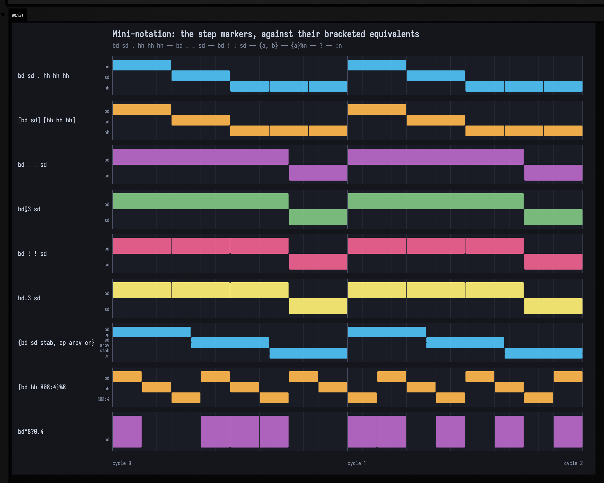
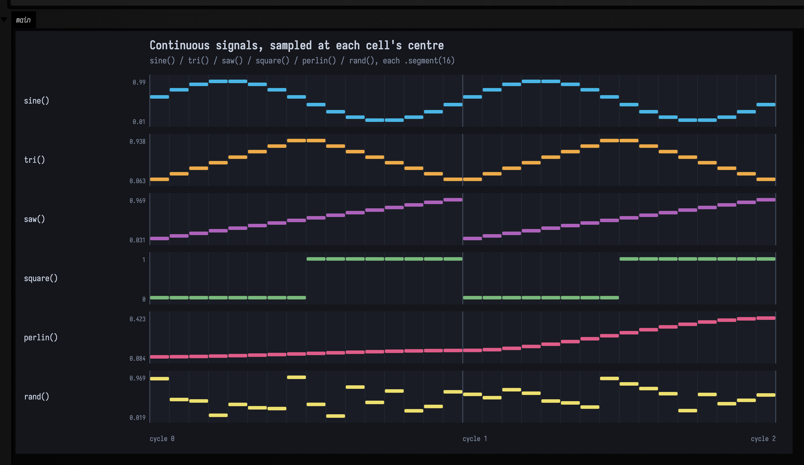
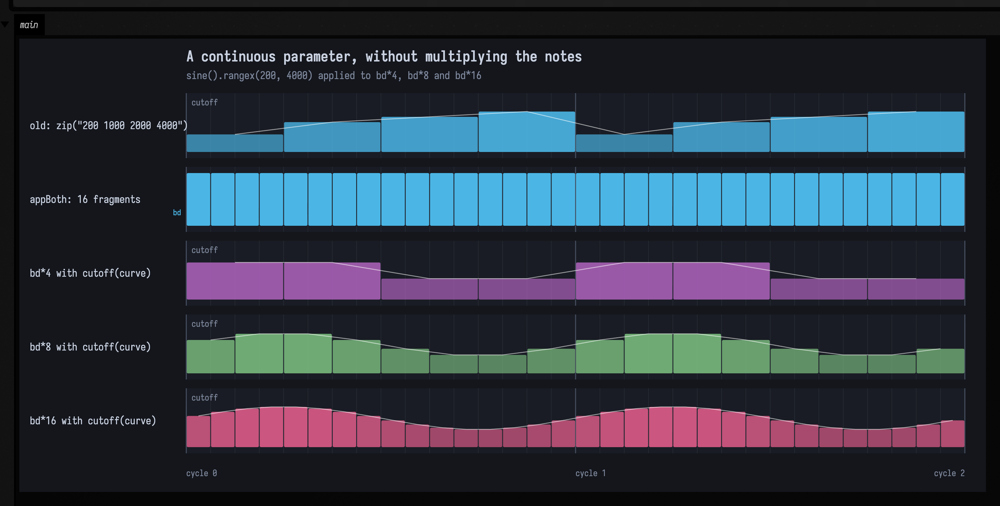
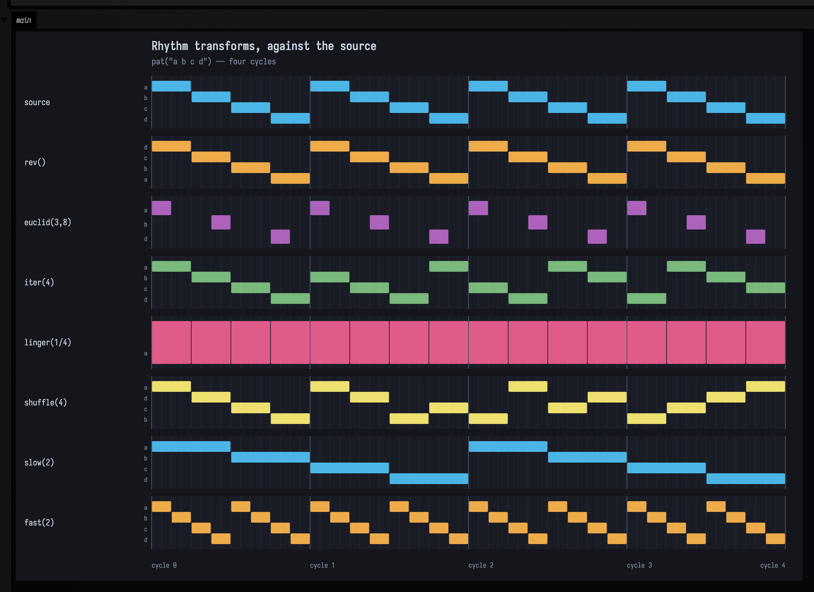
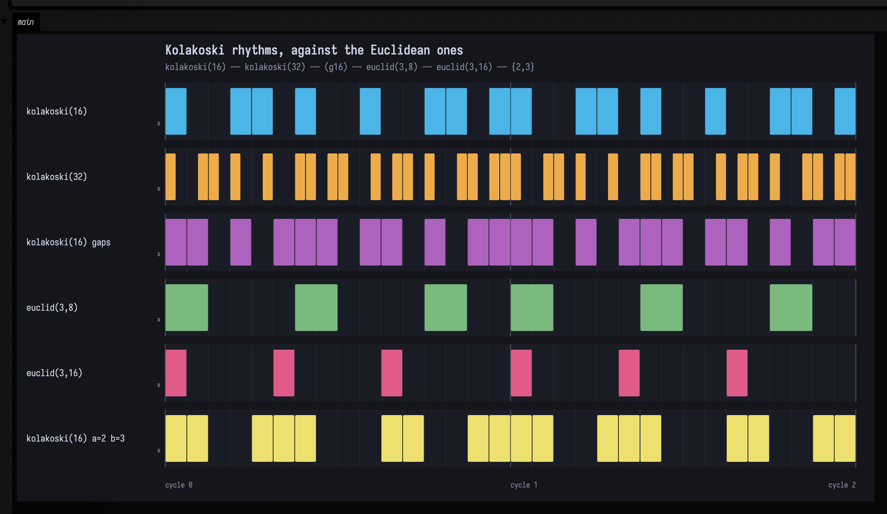
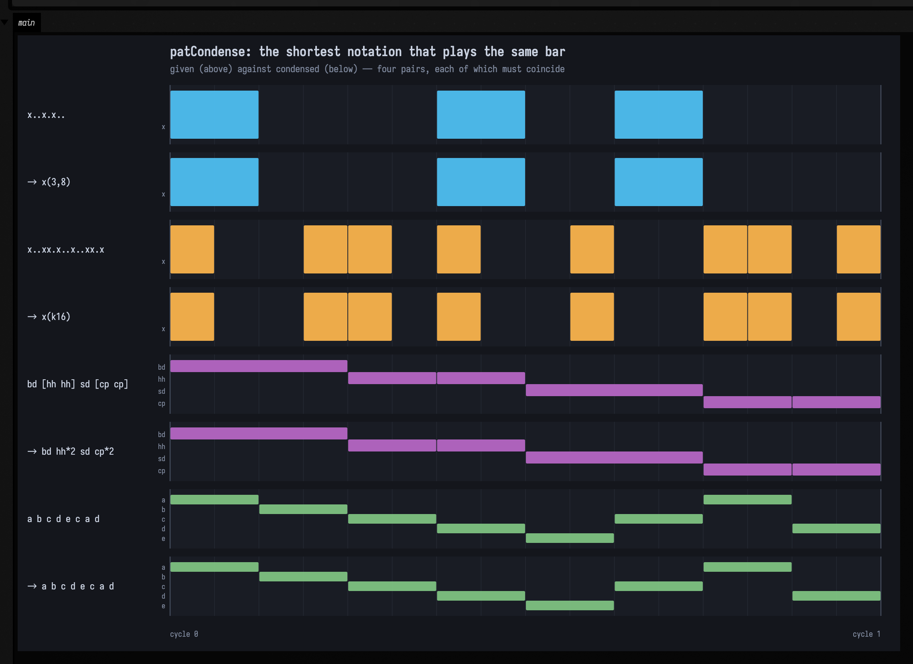
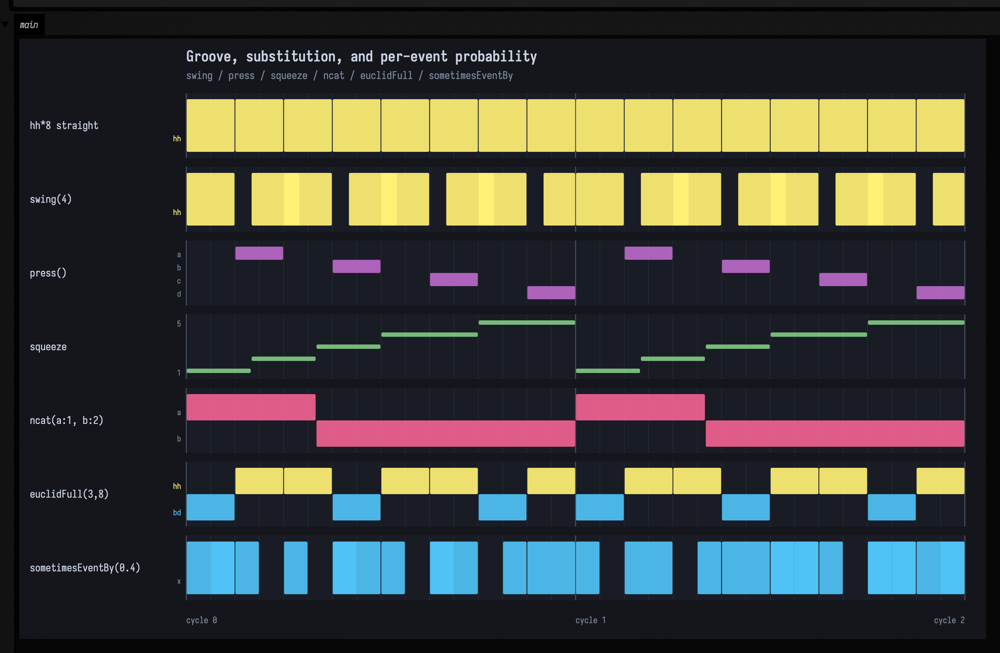
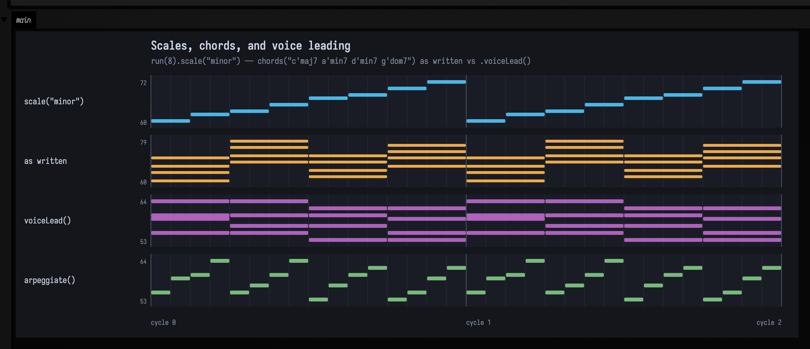
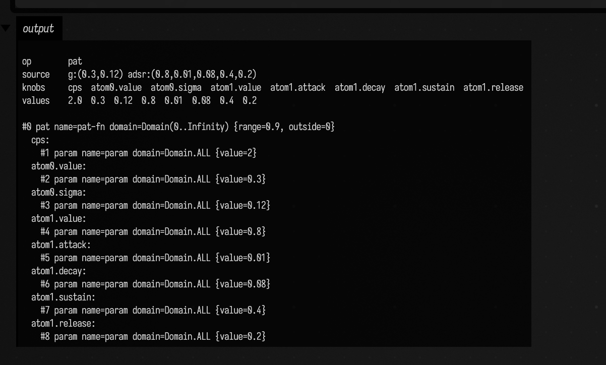

# Patterns: writing rhythm as a function of time

`pat("bd sd hh hh")` is a **pattern**, and a pattern is a function you can ask what is
sounding between *here* and *there*. Ask it about one cycle and you get four events. Ask
about the second half and you get two. Ask about a hundred cycles and it will tell you,
because nothing was ever stored; the events are computed from the query.

That one decision is what makes the rest composable. A pattern can be reversed, slowed,
sliced, stacked against another, or handed a continuous curve to read its volume from, and
none of those operations has to know how long the music is or where it will be sampled.
The design comes from [TidalCycles](https://tidalcycles.org), and where Field's operators
share a name with Tidal's they mean the same thing; the places they do not are called out
below.

The piano rolls below are drawn from live `PatPattern.events(...)` queries and the audio is
rendered offline. All three clips use the **stand-in synth** (`patVoice`): a sine for `bd`,
filtered noise for `sd` and `hh`. It needs no assets, so these figures regenerate on a clean
checkout, and it does not sound like a drum machine. Field can render the
same patterns through the real Tidal sample library instead;
[Sound: the Pattern → Audio Path](sound.md) puts the two voices side by side and says which
clip in these docs is which.

---

## Two things every pattern is made of

An **event** is a value with a span of time. A **query** is a span you ask about. The whole
language is functions from queries to lists of events.

```diffstatic_runner {data-lang=kotlin screenshot="assets/pattern_language/first-query.png" wait="1.5" capture="box" open-outputs="true" name="pat-doc-first-query" embed=true}
// Nothing is stored. Ask the same pattern three different questions.
val drums = pat("bd sd hh hh")

val answers = listOf(
    "one cycle" to PatArc(PatQ.ZERO, PatQ.ONE),
    "second half" to PatArc(PatQ.of(1, 2), PatQ.ONE),
    "cycle 97" to PatArc(PatQ.of(97), PatQ.of(98)),
).joinToString("\n") { (label, arc) ->
    "%-12s %s".format(label, drums.events(arc).joinToString("  ") { "${it.value}@${it.arc.start}" })
}
println(answers)
display("<pre>" + answers + "</pre>")
```

Time is exact rational arithmetic (`PatQ`), never floating point. A sixteenth note is
`1/16`, not `0.0625`, so a pattern subdivided into thirds and one subdivided into fifths
still line up perfectly fifteen cycles later.

---

## Mini-notation

The string inside `pat(...)` is the same mini-notation Tidal uses. Space separates steps,
brackets group, and a handful of suffixes modify a step.

| written | means |
| --- | --- |
| `bd sd` | two steps, half a cycle each |
| `bd [sd sd]` | the second half subdivided |
| `bd*4` | four times as fast |
| `bd/2` | half as fast — spans two cycles |
| `bd!3` | repeated three times |
| `bd@3 sd` | `bd` gets three quarters of the cycle |
| `bd ~ sd ~` | `~` is a rest |
| `<bd sd>` | alternates: `bd` one cycle, `sd` the next |
| `bd(3,8)` | Euclidean: three onsets spread over eight slots |
| `bd(k16)` | Kolakoski: sixteen steps of the self-describing figure (`g` for its gap reading) |
| `bd?0.3` | dropped 30% of the time, deterministically |
| `bd:3` | sample index 3, also readable as an `n` parameter |
| `{bd sd, hh hh hh}` | polymeter — layers of different lengths |
| `bd sd . hh hh hh` | `.` groups without brackets |

```diffstatic_runner {data-lang=kotlin screenshot="assets/pattern_language/mini-notation.png" wait="2" capture="box" open-outputs="true" name="pat-doc-mini-notation"}
:::static
// Each shorthand is drawn directly above the bracketed form it stands for, so a pair that
// does not line up is visible rather than merely wrong.
showPatRoll("mini-notation")
:::fold open the output pane
displayOpen("main")
:::endfold
```



Read the two polymeter lanes across the bar line: `{bd hh 808:4}%8` *phases*, and cycle 1 is
offset from cycle 0. That is the whole reason to write a polymeter instead of a fast
sequence.

---

## Continuous signals

`sine()`, `saw()`, `tri()`, `square()`, `perlin()` and `rand()` are patterns too. They
just answer *every* query with exactly one event, sampled at the query's exact midpoint.
They have no rhythm of their own, so you either give them one with `segment(n)` or hand
them to something that already has one.

```diffstatic_runner {data-lang=kotlin screenshot="assets/pattern_language/signals.png" wait="2" capture="box" open-outputs="true" name="pat-doc-signals"}
:::static
// Six signals through segment(16), two cycles. The polyline is the value each cell
// latched; the rectangle height is the same number.
showPatRoll("signals-segment")
:::fold open the output pane
displayOpen("main")
:::endfold
```



The midpoint convention is what makes the picture readable: `sine()` peaks a quarter of the
way in, `square()` switches exactly on the half, `saw()` climbs monotonically.

### A parameter can be a function

The useful consequence: a signal can drive a *parameter* without changing the rhythm.

```diffstatic_runner {data-lang=kotlin screenshot="assets/pattern_language/continuous-parameter.png" wait="2" capture="box" open-outputs="true" name="pat-doc-parameter"}
:::static
// Lane 1 is a cutoff staircase typed out by hand, one literal per note — the whole of what
// a pattern language without signals can do. Lane 2 is appBoth, which shatters four kicks
// into sixteen. Lanes 3-5 are `with(cutoff(curve))` over 4, 8 and 16 notes: the same curve,
// sampled at whatever density the rhythm happens to be, note count untouched.
showPatRoll("continuous-parameter")
:::fold open the output pane
displayOpen("main")
:::endfold
```



Hear it: sixteen hats a cycle, two cycles flat and then two with the gain following a
sine. Same notes, same count, one parameter now a function of time:

```diffstatic_runner {data-lang=kotlin audio="assets/pattern_language/gain-lfo.wav" audio-spec="gain-lfo-before-after" audio-renderer="afield.four.synth.PatSoundDocs" embed=true hidden=true name="pat-doc-gain-audio"}
// offline-rendered by PatSoundDocs — listen below
```

---

## Whose rhythm survives

When two patterns meet, the rhythm has to come from somewhere. There are exactly three
answers, and Field spells them the way Tidal does; the bar marks the side the structure
comes from.

| operator | structure | `pat("0 1")` against `pat("10 20 30")` |
| --- | --- | --- |
| `` `|+|` `` | both | 4 events — every intersection |
| `` `|+` `` | left | 2 events — exactly the left's |
| `` `+|` `` | right | 3 events — exactly the right's |

```diffstatic_runner {data-lang=kotlin screenshot="assets/pattern_language/structure-choice.png" wait="2" capture="box" open-outputs="true" name="pat-doc-structure"}
:::static
showPatRoll("structure-choice")
:::fold open the output pane
displayOpen("main")
:::endfold
```


Kotlin will not accept `/`, `<` or `>` in an identifier, so division is `` `|over|` `` and
the take-a-value family spells its arrow as an `L` or an `R`. The bar always keeps its
Tidal meaning.

---

## Rhythm transforms

```diffstatic_runner {data-lang=kotlin screenshot="assets/pattern_language/rhythm.png" wait="2" capture="box" open-outputs="true" name="pat-doc-rhythm"}
:::static
// pat("a b c d") and seven transforms over four cycles, so the per-cycle ones are visible.
showPatRoll("rhythm-transforms")
:::fold open the output pane
displayOpen("main")
:::endfold
```



`rev` mirrors, `euclid(3,8)` spaces three onsets over eight slots, `iter(4)` advances a
quarter each cycle, `shuffle(4)` permutes differently every cycle. Read the `slow(2)` lane
*across* the bar lines: `a b`, then `c d`, then round again.

### A rhythm that describes itself

A Euclidean rhythm needs its density decided in advance: `euclid(3,8)` is the answer to "three
onsets, eight slots". `kolakoski(16)` answers a different question. The terms of the word
`1 2 2 1 1 2 1 2 2 1 …` are read as alternating on- and off-runs, so the figure's own run lengths
spell out the word that made it — sixteen steps of it are `x..xx.x..x..xx.x`. In mini-notation it is
a `k` inside the Euclidean brackets, and `g` asks for the other reading:

```diffstatic {data-lang=kotlin}
struct(kolakoski(16), pat("bd"))    // the figure, as a bass drum
pat("bd(k16) hh*4")                 // the same, in a string
pat("bd(g16)")                      // each term as the gap to the next onset instead
```

```diffstatic_runner {data-lang=kotlin screenshot="assets/pattern_language/kolakoski.png" wait="2" capture="box" open-outputs="true" name="pat-doc-kolakoski"}
:::static
// Two Kolakoski step counts, the gap reading, two Euclidean rhythms for contrast, and the
// alphabet {2,3} — all over two cycles.
showPatRoll("kolakoski")
:::fold open the output pane
displayOpen("main")
:::endfold
```



Read the first half of the `kolakoski(32)` lane against the whole of `kolakoski(16)`: the same figure
at half the width. Turning the step count up *extends* a Kolakoski rhythm instead of re-placing it,
so the step count is a dial you can turn while the music plays. The two `euclid` lanes are there as
the counter-example — `euclid(3,16)`'s first half is not `euclid(3,8)`, because the step count is
part of the question a Euclidean rhythm answers.

The gap reading — `kolakoski(16, KolakoskiReading.GAPS)`, or `(g16)` in a string — reads the same
terms as distances between onsets rather than run lengths, which fills the bar in to
`xx.x.xxx.xx.x.xx`: eleven onsets in sixteen steps against the other reading's eight, and never more
than one rest between hits.

The alphabet is a parameter too. `kolakoski(16, a = 2, b = 3)` is the self-describing word over
`{2,3}` — `2 2 3 3 2 2 2 3 3 3 …` — which has no run shorter than two, so that last lane never leaves
a lone hit. `kolakoskiInv` and `kolakoskiFull` complete the family the way `euclidInv` and
`euclidFull` do, and `->kolakoski` is in [RectSL](rectsl_cheatsheet.md#rhythm-in-space) for laying
the figure out in space rather than in time.

### The shortest way to write a rhythm down

`patCondense` runs the parser backwards. Give it a rhythm and it hands back the shortest string that
plays it.

```diffstatic {data-lang=kotlin}
patCondense("x ~ ~ x ~ x ~ ~").notation          // x(3,8)
patCondense(kolakoskiMask(16)).notation          // x(k16)
patCondense("bd [hh hh] sd [cp cp]").notation    // bd hh*2 sd cp*2
pat("bd sd hh cp").rev().condense().notation     // cp hh sd bd
```

The search covers the grammar the rest of this page describes: atoms and `~`, `_` and `@n`, `[ ]` at
every divisor of a span, `!n`, `*n`, `(p,s,r)`, `(kN)` and `(gN)`, `,` and `< >`. It scores a
candidate by the length of the string and accepts it only if it is exact, and exact is settled by
playing it: every candidate goes back through `pat` and its events are compared to the target's. The
one-slot-per-step spelling is always in the running, so the answer is never longer than that.

A rhythm with nothing in it comes back as itself. `patCondense("a b c d e c a d")` is
`a b c d e c a d`, because no operator in the grammar shortens it.

```diffstatic_runner {data-lang=kotlin screenshot="assets/pattern_language/condense.png" wait="2" capture="box" open-outputs="true" name="pat-doc-condense"}
:::static
// Four pairs: a rhythm above, its condensation below, played. Each pair has to coincide.
showPatRoll("condense")
:::fold open the output pane
displayOpen("main")
:::endfold
```



Three kinds of target are refused rather than approximated, and `PatCondensation.refusal` says which.
A pattern that changes at random from cycle to cycle, such as `[a|b|c] d` or `bd*8?0.4`, has no period
to condense. A pattern whose events cross a bar line has no bar to spell them in. And a pattern
carrying parameters no atom can write down, like the `pan` that `jux` adds, would lose them.

Besides `notation`, a `PatCondensation` carries `flat` (the slot-by-slot spelling), `compression`
(the ratio of the two lengths), `structure` (the constructs in the answer, read back off its parse)
and `limits` (the search bounds, and which of them the run used).

This is also where the transcription path ends. `patTranscribe` recovers a step grid from audio and
writes it out one slot per step; `patCondense(transcription)` turns that into a figure. The loop it
belongs to is drawn in [Audio render and analysis](audio_render_analysis.md).

### Time spans cycles, and events can cross bar lines

`slow`, `fast`, `timeScale`, `density` and mini-notation's `/n` are defined in absolute
time, so `pat("a b c d").slow(2)` really does take two cycles: `a b` in the first, `c d` in
the second.

The consequence is that an event can straddle a bar line. `pat("a b c").slow(2)` is three
steps over two cycles, so `b` runs from `2/3` to `4/3`, straight through it. A player asks for one
cycle at a time, so it sees `b` twice, clipped both times, and would strike it twice if the
events did not know better.

They do. Every event carries both the **part** you can see and the **whole** it was clipped
from:

```diffstatic_runner {data-lang=kotlin screenshot="assets/pattern_language/whole-and-part.png" wait="1.5" capture="box" open-outputs="true" name="pat-doc-whole-part" embed=true}
val crossing = pat("a b c").slow(2)

val lines = buildList {
    // One wide query: three notes, and b genuinely spans the bar line.
    add("drawn    " + crossing.events(PatArc(PatQ.ZERO, PatQ.of(2)))
        .joinToString("  ") { "${it.value}[${it.arc}]" })
    // Cycle by cycle, b comes back twice — but only one fragment carries its onset.
    for (cycle in 0..1) {
        add("cycle $cycle  " + crossing.events(PatArc(PatQ.of(cycle), PatQ.of(cycle + 1)))
            .joinToString("  ") { "${it.value}[${it.arc}]" + if (it.hasOnset) "" else " (continues)" })
    }
    // And what actually gets played: three notes, each at its full length.
    add("played   " + crossing.eventSequence(0).take(3).toList()
        .joinToString("  ") { "${it.value}[${it.arc}]" })
}.joinToString("\n")
println(lines)
display("<pre>" + lines + "</pre>")
```

`hasOnset` is the difference, and `eventSequence`, which every scheduling path uses,
yields only the fragment that has one, widened back to the note's real length. A signal
event has no `whole` at all (`null`), because a continuous curve has no note to begin;
`segment(n)` is what gives it one.

---

## Groove

Swing here is exact rational time, not a nudge in milliseconds: `swing(4)` puts every
off-beat exactly a third of a subdivision late, and the pattern stays exactly quantised.

```diffstatic_runner {data-lang=kotlin screenshot="assets/pattern_language/groove.png" wait="2" capture="box" open-outputs="true" name="pat-doc-groove"}
:::static
showPatRoll("groove")
:::fold open the output pane
displayOpen("main")
:::endfold
```



Eight hats a cycle: two cycles dead straight, then two swung.

```diffstatic_runner {data-lang=kotlin audio="assets/pattern_language/swing.wav" audio-spec="swing-before-after" audio-renderer="afield.four.synth.PatSoundDocs" embed=true hidden=true name="pat-doc-swing-audio"}
// offline-rendered by PatSoundDocs — listen below
```

`chunk(n, f)` applies a transform to a different `1/n` of the bar each cycle, walking
through all of them before it repeats. `inside(n, f)` is its cycle-invariant cousin:
it slows down, transforms, and speeds back up, doing the same thing every cycle.

---

## Harmony and voice leading

Chords are written `root'name` (`c'maj7`, `a'min7`), and everything that applies to a
pattern applies to a pattern of chords.

`voiceLead()` chooses each chord's inversion and octave to minimise how far the voices have
to move, without changing the harmony.

```diffstatic_runner {data-lang=kotlin screenshot="assets/pattern_language/voice-leading.png" wait="2" capture="box" open-outputs="true" name="pat-doc-voice-leading"}
:::static
showPatRoll("voice-leading")
:::fold open the output pane
displayOpen("main")
:::endfold
```



Spelled from their own roots the progression spans 60–79 and leaps; voice-led it sits
inside 53–64 with near-horizontal lines where common tones are held. 83 semitones of
movement becomes 9, and the pitch-class sets are identical.

```diffstatic_runner {data-lang=kotlin audio="assets/pattern_language/voice-leading.wav" audio-spec="voice-leading" audio-renderer="afield.four.synth.PatSoundDocs" embed=true hidden=true name="pat-doc-voice-leading-audio"}
// offline-rendered by PatSoundDocs — listen below
```

---

## A rhythm as a curve — and as a graph you can fit

A pattern schedules *events*. Sometimes what you want from those events is not a note but a
**continuous curve**: an envelope to drive a parameter, a gesture to animate something with.
`patFn` does that: each event becomes a little kernel, and the value at any time is the
blend of the kernels around it. The kernel is chosen per atom, and its numbers are written
in the atom itself:

| atom | shape |
| --- | --- |
| `g:(value,sigma)` | a Gaussian bump |
| `tent:(value,radius)` | a linear tent |
| `box:(value,radius)` | a rectangle |
| `wendland:(value,radius)` `spline:(value,radius)` | compactly-supported smooth bumps |
| `env:(value,attack,release)` | an attack/release envelope |
| `adsr:(value,attack,decay,sustain,release)` | a full ADSR |

So `patFn("g:(0.9,0.18) g:(0.1,0.18)")` is a two-bump gesture that repeats every cycle, and a
`Functions.Fn` like any other, which means the whole `Functions` library applies to it.

From the inside it is a graph node, `op = "pat"`, and every number in the pattern text is
one of its leaves.

```diffstatic_runner {data-lang=kotlin screenshot="assets/pattern_language/fn-graph.png" wait="2" capture="box" open-outputs="true" name="pat-doc-fn-graph"}
import afield.stdlib.extractParameters
import afield.stdlib.graphNode
import afield.stdlib.graphText

val gesture = patFn("g:(0.3,0.12) adsr:(0.8,0.01,0.08,0.4,0.2)", cps = 2.0, range = 0.9)
val node = gesture.graphNode()

val report = """
op        ${node.op}
source    ${node.strings["source"]}
knobs     ${node.children.joinToString("  ") { it.role }}
values    ${gesture.extractParameters().joinToString("  ")}

${gesture.graphText()}
""".trimIndent()

println(report)
display("<pre>" + report + "</pre>")
```



Each atom's numbers are addressed by the role they play (`atom0.sigma`, `atom1.attack`)
rather than by position, and `cps` is a knob too. That matters because Field's numeric leaves are
exactly what the differentiable fitter tunes. **You can hand a rhythm to `fitGradient` and
have it recover the gesture's own numbers.**

Below, the target is a two-bump gesture and the seed has the right *structure* with the
wrong numbers: wrong heights, wrong widths. Adam moves the leaves until the curves
coincide, and the fitted result comes back out as **pattern text you can paste into a box**:

```diffstatic_runner {data-lang=kotlin screenshot="assets/pattern_language/fn-fit.png" wait="5" capture="box" open-outputs="true" name="pat-doc-fn-fit"}
import afield.stdlib.Functions
import afield.stdlib.fitGradient
import afield.stdlib.graphNode

with(Functions) {
    val target = patFn("g:(0.9,0.18) g:(0.1,0.18)", cps = 1.0, range = 0.9)
    val seed = patFn("g:(0.7,0.25) g:(0.3,0.12)", cps = 1.0, range = 0.9)

    val run = fitGradient(target, seed, domain = 0.0..2.0, iterations = 200, lr = 0.02, samples = 96)

    // A pat Fn runs to +infinity, so the plot is told which window to sweep.
    plot(target, 0.0..2.0, channel = "1 target", title = "target  g:(0.9,0.18) g:(0.1,0.18)")
    plot(run.fitted, 0.0..2.0, channel = "2 fitted", title = "fitted from a wrong-numbered seed")

    val report = """
    seed    ${seed.graphNode().strings["source"]}
    fitted  ${run.fitted.graphNode().strings["source"]}
    RMSE    ${"%.4f".format(run.initialError)} -> ${"%.4f".format(run.finalError)}
    """.trimIndent()
    println(report)
    display("<pre>" + report + "</pre>")
}
```


Both heights and both widths come back to three decimal places. What the fit *cannot* do is
re-assign values between atoms: seed it with the two heights swapped and it stalls at about
half the initial error, because getting to the answer needs a permutation and there is no
downhill path through one. Tuning numbers is `fitGradient`'s job; choosing which atom holds
which number is `evolve`'s.

Two smaller things. A number can be a `%binding` instead of a literal
(`g:(%loudness,0.2)`), resolved from the box's variables each cycle: live, but for that
reason not fittable, so such a pattern stays an ordinary opaque function. And because the
knobs are graph children, you can graft a *signal* into one instead of a constant, which
gives you a kernel width that drifts across the piece.

---

## Where Field differs from Tidal

Three names to know if you are coming from Tidal:

| Field | Tidal | note |
| --- | --- | --- |
| `cat` | `fastcat` | fits every argument into **one** cycle |
| `slowcat` | `cat` | one pattern per cycle — what `<a b>` is built on |
| `within(window, p)` | `compress` | squeezes a pattern *into* a window |
| `withinCycle(window, f)` | `within` | applies `f` *inside* a window, leaves the rest |

`fastcat` exists as an alias for `cat` when you want the code to say which one it means.

---

## Playing a pattern

`eventSequence` gives you the events in playing order. `scheduled(cps)` turns them into
wall-clock times. `respond {}` calls you back as each one arrives.

```diffstatic {data-lang=kotlin}
pat("bd sd hh hh").respond(cps = 2.0) { event ->
    println("${event.start}s  ${event.value}  gain=${event.num("gain")}")
}
```

Because a note is scheduled at its onset and carries its whole length, a pattern that
crosses bar lines plays correctly without the consumer knowing anything about cycles.

---

## Where to go next

- **The full operator surface, and the design decisions behind it** —
  `dev_docs/PATTERN_LANGUAGE.md` in the repository, including the whole/part model and the
  contract sweep.
- **Every roll and clip on this page, regenerated** — the nine piano rolls and eight `.wav` scenes
  are built headlessly; `dev_docs/PAT_GALLERY.md` documents the harness.
- **A loadable document** — the *Pattern language* starting point in the welcome screen
  opens eight boxes covering signals, structure choice, parameters, voice leading, groove
  and mini-notation, each with a live roll and most with audio. Edit any string and re-run.
