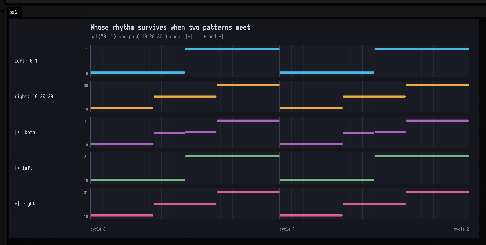
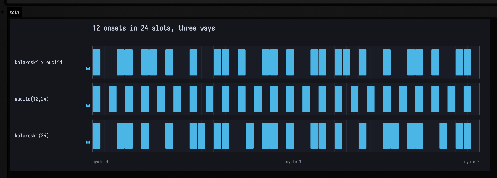
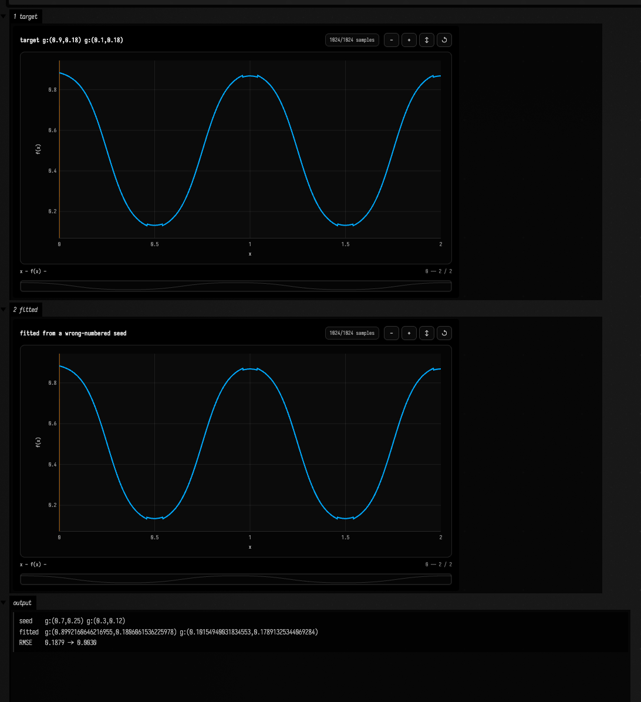

# Patterns: writing rhythm as a function of time

`pat("bd sd hh hh")` is a **pattern**, and a pattern is a function you can ask what is
sounding between *here* and *there*. Ask it about one cycle and you get four events. Ask
about the second half and you get two. Ask about a hundred cycles and it will tell you,
because nothing was ever stored; the events are computed from the query.

That one decision is what makes the rest composable. A pattern can be reversed, slowed,
sliced, stacked against another, or handed a continuous curve to read its volume from, and
none of those operations has to know how long the music is or where it will be sampled.
The design comes from [TidalCycles](https://tidalcycles.org), and where Field's operators
share a name with Tidal's they mean the same thing; the places they do not are called out
below.

The piano rolls below are drawn from live `PatPattern.events(...)` queries and the audio is
rendered offline. All three clips use the **stand-in synth** (`patVoice`): a sine for `bd`,
filtered noise for `sd` and `hh`. It needs no assets, so these figures regenerate on a clean
checkout, and it does not sound like a drum machine. Field can render the
same patterns through the real Tidal sample library instead;
[Sound: the Pattern → Audio Path](sound.md) puts the two voices side by side and says which
clip in these docs is which.

---

## Two things every pattern is made of

An **event** is a value with a span of time. A **query** is a span you ask about. The whole
language is functions from queries to lists of events.

```diffstatic_runner {data-lang=kotlin screenshot="assets/pattern_language/first-query.png" wait="1.5" capture="box" open-outputs="true" name="pat-doc-first-query" embed=true}
// Nothing is stored. Ask the same pattern three different questions.
val drums = pat("bd sd hh hh")

val answers = listOf(
    "one cycle" to PatArc(PatQ.ZERO, PatQ.ONE),
    "second half" to PatArc(PatQ.of(1, 2), PatQ.ONE),
    "cycle 97" to PatArc(PatQ.of(97), PatQ.of(98)),
).joinToString("\n") { (label, arc) ->
    "%-12s %s".format(label, drums.events(arc).joinToString("  ") { "${it.value}@${it.arc.start}" })
}
println(answers)
display("<pre>" + answers + "</pre>")
```

Time is exact rational arithmetic (`PatQ`), never floating point. A sixteenth note is
`1/16`, not `0.0625`, so a pattern subdivided into thirds and one subdivided into fifths
still line up perfectly fifteen cycles later.

---

## Mini-notation

The string inside `pat(...)` is a small language of its own, and it is the same mini-notation
[TidalCycles](https://tidalcycles.org) uses. A space divides, brackets group, and about a dozen
suffixes say the things a space cannot. It is small enough to learn in one sitting and dense
enough that a table of glosses does not teach it, so every form gets a card below: the notation,
a piano roll of exactly what it schedules, and a clip of it.

Three things to know before reading them. **Colour is the instrument** — `bd` blue, `sd` orange,
`cp` pink, `oh` green, `hh` yellow — and those colours *are* the drum map, so two bars that look
different sound different. **Height is pitch**, so the kick sits at the bottom of every lane and
the hats at the top, in this section and in every roll further down the page. And **the rolls are
queries, not drawings**: each rectangle is one real event out of `PatPattern.events(...)`, with the
figure's own test asserting there is exactly one rectangle per event, so a picture cannot flatter
the notation it illustrates. The clips are those same events rendered offline through the stand-in
synth, with the envelope scaled to each pattern's own shortest gap so a sixteenth-note hat still
articulates where a kick rings.

<!-- BEGIN GENERATED: PatMiniNotation.markdownSection -->
### Steps, and the space between them

A space is the only separator the notation has, and it always means *divide this level evenly*. Everything below is a way of saying something other than "evenly".

<div class="pat-mini" markdown>

`bd sd`
{: .pat-mini-source }


```diffstatic_runner {data-lang=kotlin audio="assets/pattern_language/mini/pat-mini-two-steps.wav" audio-spec="two-steps" audio-renderer="afield.four.synth.PatMiniNotation" embed=true hidden=true name="pat-mini-two-steps-audio"}
// showPatAudio(pat("bd sd"), cycles = 2, cps = 2)
```

Two steps, half a cycle each.

Colour is per instrument throughout this page: `bd` is always this blue, `sd` always this orange. The colours are the drum map, so two bars that look different sound different.

</div>

<div class="pat-mini" markdown>

`bd sd hh cp`
{: .pat-mini-source }


```diffstatic_runner {data-lang=kotlin audio="assets/pattern_language/mini/pat-mini-four-steps.wav" audio-spec="four-steps" audio-renderer="afield.four.synth.PatMiniNotation" embed=true hidden=true name="pat-mini-four-steps-audio"}
// showPatAudio(pat("bd sd hh cp"), cycles = 2, cps = 2)
```

Four steps, a quarter each. The cycle is divided by however many steps it finds.

</div>

<div class="pat-mini" markdown>

`bd ~ sd ~`
{: .pat-mini-source }


```diffstatic_runner {data-lang=kotlin audio="assets/pattern_language/mini/pat-mini-rest.wav" audio-spec="rest" audio-renderer="afield.four.synth.PatMiniNotation" embed=true hidden=true name="pat-mini-rest-audio"}
// showPatAudio(pat("bd ~ sd ~"), cycles = 2, cps = 2)
```

`~` is a rest — a step that takes up its share of the cycle and plays nothing.

The rest is not a quiet event; it is no event. Four steps are written and two rectangles are drawn, which is why the roll has gaps rather than gaps at low opacity.

</div>

<div class="pat-mini" markdown>

`bd [sd sd]`
{: .pat-mini-source }

![a piano roll of `bd [sd sd]` over 2 cycles](assets/pattern_language/mini/pat-mini-subdivide.svg)

```diffstatic_runner {data-lang=kotlin audio="assets/pattern_language/mini/pat-mini-subdivide.wav" audio-spec="subdivide" audio-renderer="afield.four.synth.PatMiniNotation" embed=true hidden=true name="pat-mini-subdivide-audio"}
// showPatAudio(pat("bd [sd sd]"), cycles = 2, cps = 2)
```

Brackets group. The bracket is **one step** that happens to contain two, so the pair shares the half-cycle the single `sd` would have had.

This is the recursion the whole notation rests on: a group is a step, so anything you can write at the top level you can write inside brackets.

</div>

<div class="pat-mini" markdown>

`bd [sd [hh hh]]`
{: .pat-mini-source }

![a piano roll of `bd [sd [hh hh]]` over 2 cycles](assets/pattern_language/mini/pat-mini-nested.svg)

```diffstatic_runner {data-lang=kotlin audio="assets/pattern_language/mini/pat-mini-nested.wav" audio-spec="nested" audio-renderer="afield.four.synth.PatMiniNotation" embed=true hidden=true name="pat-mini-nested-audio"}
// showPatAudio(pat("bd [sd [hh hh]]"), cycles = 2, cps = 2)
```

And it nests as deep as you care to go — the inner pair splits the inner half of the outer half.

</div>

### Two ways to group

Brackets are not the only way to carve up a cycle. One of these avoids the brackets and the other ignores the cycle's division entirely.

<div class="pat-mini" markdown>

`bd sd . hh hh hh`
{: .pat-mini-source }

![a piano roll of `bd sd . hh hh hh` over 2 cycles, drawn above `[bd sd] [hh hh hh]` so the two can be read against each other](assets/pattern_language/mini/pat-mini-dot-group.svg)

```diffstatic_runner {data-lang=kotlin audio="assets/pattern_language/mini/pat-mini-dot-group.wav" audio-spec="dot-group" audio-renderer="afield.four.synth.PatMiniNotation" embed=true hidden=true name="pat-mini-dot-group-audio"}
// showPatAudio(pat("bd sd . hh hh hh"), cycles = 2, cps = 2)
```

A standalone `.` groups what precedes it against what follows, with no brackets.

Read the two lanes against each other: this is **two halves**, not five fifths. The dot is the cheapest way to write an uneven division, and the second lane is the spelling it stands for.

</div>

<div class="pat-mini" markdown>

`bd sd, hh*4`
{: .pat-mini-source }


```diffstatic_runner {data-lang=kotlin audio="assets/pattern_language/mini/pat-mini-stack.wav" audio-spec="stack" audio-renderer="afield.four.synth.PatMiniNotation" embed=true hidden=true name="pat-mini-stack-audio"}
// showPatAudio(pat("bd sd, hh*4"), cycles = 2, cps = 2)
```

A comma **stacks** layers: both play through the same cycle, each divided on its own terms.

Two steps in one layer and four in the other. Nothing is renegotiated between them — a stack is simply two patterns queried together.

</div>

### Speed, repetition, and width

Four postfix modifiers, and two markers that spell two of them without the punctuation. Every one of them attaches to the step on its left, including a bracketed group.

<div class="pat-mini" markdown>

`bd*4`
{: .pat-mini-source }


```diffstatic_runner {data-lang=kotlin audio="assets/pattern_language/mini/pat-mini-fast.wav" audio-spec="fast" audio-renderer="afield.four.synth.PatMiniNotation" embed=true hidden=true name="pat-mini-fast-audio"}
// showPatAudio(pat("bd*4"), cycles = 2, cps = 2)
```

`*n` plays the step `n` times as fast — four kicks where one was written.

</div>

<div class="pat-mini" markdown>

`[bd sd]*2`
{: .pat-mini-source }

![a piano roll of `[bd sd]*2` over 2 cycles, drawn above `bd sd bd sd` so the two can be read against each other](assets/pattern_language/mini/pat-mini-fast-group.svg)

```diffstatic_runner {data-lang=kotlin audio="assets/pattern_language/mini/pat-mini-fast-group.wav" audio-spec="fast-group" audio-renderer="afield.four.synth.PatMiniNotation" embed=true hidden=true name="pat-mini-fast-group-audio"}
// showPatAudio(pat("[bd sd]*2"), cycles = 2, cps = 2)
```

`*n` on a group speeds up the whole group, so the pair happens twice.

</div>

<div class="pat-mini" markdown>

`bd/2`
{: .pat-mini-source }


```diffstatic_runner {data-lang=kotlin audio="assets/pattern_language/mini/pat-mini-slow.wav" audio-spec="slow" audio-renderer="afield.four.synth.PatMiniNotation" embed=true hidden=true name="pat-mini-slow-audio"}
// showPatAudio(pat("bd/2"), cycles = 4, cps = 2)
```

`/n` is the other direction: half as fast, so this one spans **two cycles** and you hear it twice in four.

Drawn over four cycles because a form that is slower than the bar has nothing to show inside one. Note that `pat` is still a function of time here — the event simply has an arc two cycles wide.

</div>

<div class="pat-mini" markdown>

`bd!3 sd`
{: .pat-mini-source }


```diffstatic_runner {data-lang=kotlin audio="assets/pattern_language/mini/pat-mini-repeat.wav" audio-spec="repeat" audio-renderer="afield.four.synth.PatMiniNotation" embed=true hidden=true name="pat-mini-repeat-audio"}
// showPatAudio(pat("bd!3 sd"), cycles = 2, cps = 2)
```

`!n` **repeats** the step, and each copy takes a slot of its own — so this is four steps, not two.

</div>

<div class="pat-mini" markdown>

`bd ! ! sd`
{: .pat-mini-source }


```diffstatic_runner {data-lang=kotlin audio="assets/pattern_language/mini/pat-mini-repeat-bare.wav" audio-spec="repeat-bare" audio-renderer="afield.four.synth.PatMiniNotation" embed=true hidden=true name="pat-mini-repeat-bare-audio"}
// showPatAudio(pat("bd ! ! sd"), cycles = 2, cps = 2)
```

A bare `!` repeats whatever preceded it, once per `!`.

Repeats accumulate rather than nest: two `!`s after `bd` give three kicks, which is what Tidal does. Nesting them would give four.

</div>

<div class="pat-mini" markdown>

`bd@3 sd`
{: .pat-mini-source }


```diffstatic_runner {data-lang=kotlin audio="assets/pattern_language/mini/pat-mini-elongate.wav" audio-spec="elongate" audio-renderer="afield.four.synth.PatMiniNotation" embed=true hidden=true name="pat-mini-elongate-audio"}
// showPatAudio(pat("bd@3 sd"), cycles = 2, cps = 2)
```

`@n` **widens** the step instead of repeating it: `bd` claims three of the four slots and sounds once.

</div>

<div class="pat-mini" markdown>

`bd _ _ sd`
{: .pat-mini-source }


```diffstatic_runner {data-lang=kotlin audio="assets/pattern_language/mini/pat-mini-elongate-bare.wav" audio-spec="elongate-bare" audio-renderer="afield.four.synth.PatMiniNotation" embed=true hidden=true name="pat-mini-elongate-bare-audio"}
// showPatAudio(pat("bd _ _ sd"), cycles = 2, cps = 2)
```

A standalone `_` extends the previous step by one slot — the same rhythm, written the way a notation-first person would write it.

`!` and `_` are the pair worth keeping straight, and the rolls make the difference plain: `bd ! ! sd` sounds three kicks, `bd _ _ sd` sounds one long one.

</div>

### Forms that make the next cycle different

Up to here the notation has described a single bar that then repeats. These four are the point at which it stops doing that, and they are the reason a pattern is a function of time rather than a list of notes. Each is drawn over four cycles.

<div class="pat-mini" markdown>

`<bd sd>`
{: .pat-mini-source }


```diffstatic_runner {data-lang=kotlin audio="assets/pattern_language/mini/pat-mini-alternate.wav" audio-spec="alternate" audio-renderer="afield.four.synth.PatMiniNotation" embed=true hidden=true name="pat-mini-alternate-audio"}
// showPatAudio(pat("<bd sd>"), cycles = 4, cps = 2)
```

Angle brackets take **one alternative per cycle**: kick, snare, kick, snare.

</div>

<div class="pat-mini" markdown>

`<bd sd cp> hh`
{: .pat-mini-source }


```diffstatic_runner {data-lang=kotlin audio="assets/pattern_language/mini/pat-mini-alternate-step.wav" audio-spec="alternate-step" audio-renderer="afield.four.synth.PatMiniNotation" embed=true hidden=true name="pat-mini-alternate-step-audio"}
// showPatAudio(pat("<bd sd cp> hh"), cycles = 4, cps = 2)
```

Alternation is a step like any other, so it can sit inside a sequence — the first half rotates through three while the hat stays put.

Three alternatives against a four-cycle figure, so the pattern takes three cycles to come back round and the fourth cycle here is the first one again.

</div>

<div class="pat-mini" markdown>

`bd*8?`
{: .pat-mini-source }


```diffstatic_runner {data-lang=kotlin audio="assets/pattern_language/mini/pat-mini-degrade.wav" audio-spec="degrade" audio-renderer="afield.four.synth.PatMiniNotation" embed=true hidden=true name="pat-mini-degrade-audio"}
// showPatAudio(pat("bd*8?"), cycles = 2, cps = 2)
```

`?` drops the step — half the time, by default. It is random but not arbitrary: the same cycle always drops the same notes.

</div>

<div class="pat-mini" markdown>

`hh*8?0.3`
{: .pat-mini-source }


```diffstatic_runner {data-lang=kotlin audio="assets/pattern_language/mini/pat-mini-degrade-p.wav" audio-spec="degrade-p" audio-renderer="afield.four.synth.PatMiniNotation" embed=true hidden=true name="pat-mini-degrade-p-audio"}
// showPatAudio(pat("hh*8?0.3"), cycles = 2, cps = 2)
```

…and `?p` sets the probability. Thirty per cent of sixteen hats, deterministically.

Deterministic matters more than it sounds: a pattern you can re-query is a pattern you can render offline, scrub backwards, or draw — which is how the clip under this roll was made, and why it matches the picture note for note.

</div>

<div class="pat-mini" markdown>

`[bd|sd|cp]`
{: .pat-mini-source }

![a piano roll of `[bd|sd|cp]` over 4 cycles](assets/pattern_language/mini/pat-mini-random-choice.svg)

```diffstatic_runner {data-lang=kotlin audio="assets/pattern_language/mini/pat-mini-random-choice.wav" audio-spec="random-choice" audio-renderer="afield.four.synth.PatMiniNotation" embed=true hidden=true name="pat-mini-random-choice-audio"}
// showPatAudio(pat("[bd|sd|cp]"), cycles = 4, cps = 2)
```

`|` picks **one** of the alternatives per cycle at random — where `<>` cycles through them in order.

The brackets are only for show here — a whole string is a group like any other, so bare `bd|sd|cp` parses to exactly this. (It did not until September 2026: `|` was reachable only from inside a `[…]`, and the bare form was a parse error.) Deterministic in the same way `?` is, so this figure is not a different picture every time the docs build runs.

</div>

### Polymeter

Braces divide by a *step count* rather than by the cycle, which is the one thing brackets and commas cannot express.

<div class="pat-mini" markdown>

`{bd sd, hh hh hh}`
{: .pat-mini-source }


```diffstatic_runner {data-lang=kotlin audio="assets/pattern_language/mini/pat-mini-polymeter.wav" audio-spec="polymeter" audio-renderer="afield.four.synth.PatMiniNotation" embed=true hidden=true name="pat-mini-polymeter-audio"}
// showPatAudio(pat("{bd sd, hh hh hh}"), cycles = 4, cps = 2)
```

Layers of different lengths, all stepping at the **first** layer's rate — two steps a cycle here, so the three hats take a cycle and a half.

This is not `[bd sd, hh hh hh]`. A comma would squeeze three hats into one cycle; the braces keep the hats at the kick's step size and let them run over.

</div>

<div class="pat-mini" markdown>

`{bd hh cp}%8`
{: .pat-mini-source }


```diffstatic_runner {data-lang=kotlin audio="assets/pattern_language/mini/pat-mini-polymeter-sub.wav" audio-spec="polymeter-sub" audio-renderer="afield.four.synth.PatMiniNotation" embed=true hidden=true name="pat-mini-polymeter-sub-audio"}
// showPatAudio(pat("{bd hh cp}%8"), cycles = 4, cps = 2)
```

`%n` sets that step rate explicitly: three atoms laid out eight steps to the cycle.

Read it across the bar line rather than within one. Three does not divide eight, so the figure **phases** — cycle 1 starts where cycle 0 left off, and it takes three cycles to return. That is the whole reason to write a polymeter instead of a fast sequence.

</div>

### Rhythms the notation generates for you

Two bracket suffixes that do not spell a rhythm out but *construct* one, from a step count and a rule.

<div class="pat-mini" markdown>

`bd(3,8)`
{: .pat-mini-source }


```diffstatic_runner {data-lang=kotlin audio="assets/pattern_language/mini/pat-mini-euclid.wav" audio-spec="euclid" audio-renderer="afield.four.synth.PatMiniNotation" embed=true hidden=true name="pat-mini-euclid-audio"}
// showPatAudio(pat("bd(3,8)"), cycles = 2, cps = 2)
```

Euclidean: spread three onsets as evenly as eight slots allow. Three against eight is `x..x..x.` — gaps of 3, 3 and 2, the tresillo.

This is Tidal's spelling, bead for bead, and so is every other `(pulses, steps)` pair. It was not always: until September 2026 Field's `bjorklund` stopped one pairing late and returned a *rotation* of this figure for a little over half of all inputs — the same necklace, equally even, starting on a different bead. `bd(3,8)` came out `x..x.x..`. A rotation is a different groove against the downbeat, which is the whole reason a shared notation has to agree on one.

</div>

<div class="pat-mini" markdown>

`bd(3,8,2)`
{: .pat-mini-source }


```diffstatic_runner {data-lang=kotlin audio="assets/pattern_language/mini/pat-mini-euclid-rotate.wav" audio-spec="euclid-rotate" audio-renderer="afield.four.synth.PatMiniNotation" embed=true hidden=true name="pat-mini-euclid-rotate-audio"}
// showPatAudio(pat("bd(3,8,2)"), cycles = 2, cps = 2)
```

A third number **rotates** the figure, which is how you ask for the spelling you had in mind rather than the one the algorithm starts on.

A positive offset rotates the figure earlier. This is the same three onsets as the card above, moved two slots round the cycle.

</div>

<div class="pat-mini" markdown>

`bd(3,8), cp(5,8)`
{: .pat-mini-source }


```diffstatic_runner {data-lang=kotlin audio="assets/pattern_language/mini/pat-mini-euclid-stack.wav" audio-spec="euclid-stack" audio-renderer="afield.four.synth.PatMiniNotation" embed=true hidden=true name="pat-mini-euclid-stack-audio"}
// showPatAudio(pat("bd(3,8), cp(5,8)"), cycles = 2, cps = 2)
```

Two Euclidean figures over the same eight slots. Three against five is where the interlocking gets interesting.

</div>

<div class="pat-mini" markdown>

`hh(k16)`
{: .pat-mini-source }


```diffstatic_runner {data-lang=kotlin audio="assets/pattern_language/mini/pat-mini-kolakoski.wav" audio-spec="kolakoski" audio-renderer="afield.four.synth.PatMiniNotation" embed=true hidden=true name="pat-mini-kolakoski-audio"}
// showPatAudio(pat("hh(k16)"), cycles = 2, cps = 2)
```

`k` asks for a Kolakoski rhythm instead — sixteen steps of the self-describing word, whose own run lengths spell the word back. `g` reads its gaps.

Unlike Euclid, turning the step count up **extends** a Kolakoski figure rather than re-placing it, so the first half of `k32` is `k16`. Field's own figure for that is further down this page.

</div>

### A value on a step

The last suffix is not about time at all.

<div class="pat-mini" markdown>

`bd:3 sd:1`
{: .pat-mini-source }


```diffstatic_runner {data-lang=kotlin audio="assets/pattern_language/mini/pat-mini-sample-index.wav" audio-spec="sample-index" audio-renderer="afield.four.synth.PatMiniNotation" embed=true hidden=true name="pat-mini-sample-index-audio"}
// showPatAudio(pat("bd:3 sd:1"), cycles = 2, cps = 2)
```

`:n` is the sample index — which `bd` out of the folder of kicks.

It arrives two ways at once: the atom is still `bd:3` for anything reading names, *and* the event carries `n = 3` for the parameter algebra. The colour still says kick, because `bd:3` is a kick.

</div>
<!-- END GENERATED: PatMiniNotation.markdownSection -->

Every card above is one line in a box, and the same renderer draws whatever you are editing:

```diffstatic {data-lang=kotlin}
showPatMini("polymeter-sub")                                     // the published card
showPatRollOf("mine" to pat("bd(5,8,2), hh*8?0.2"), cycles = 4)  // anything else, same scale
showPatAudio(pat("bd(5,8,2), hh*8?0.2"), cycles = 4, cps = 2.0)  // and hear it
```

---

## Continuous signals

`sine()`, `saw()`, `tri()`, `square()`, `perlin()` and `rand()` are patterns too. They
just answer *every* query with exactly one event, sampled at the query's exact midpoint.
They have no rhythm of their own, so you either give them one with `segment(n)` or hand
them to something that already has one.

```diffstatic_runner {data-lang=kotlin screenshot="assets/pattern_language/signals.png" wait="2" capture="box" open-outputs="true" name="pat-doc-signals"}
:::static
// Six signals through segment(16), two cycles. The polyline is the value each cell
// latched; the rectangle height is the same number.
showPatRoll("signals-segment")
:::fold open the output pane
displayOpen("main")
:::endfold
```


The midpoint convention is what makes the picture readable: `sine()` peaks a quarter of the
way in, `square()` switches exactly on the half, `saw()` climbs monotonically.

### A parameter can be a function

The useful consequence: a signal can drive a *parameter* without changing the rhythm.

```diffstatic_runner {data-lang=kotlin screenshot="assets/pattern_language/continuous-parameter.png" wait="2" capture="box" open-outputs="true" name="pat-doc-parameter"}
:::static
// Lane 1 is a cutoff staircase typed out by hand, one literal per note — the whole of what
// a pattern language without signals can do. Lane 2 is appBoth, which shatters four kicks
// into sixteen. Lanes 3-5 are `with(cutoff(curve))` over 4, 8 and 16 notes: the same curve,
// sampled at whatever density the rhythm happens to be, note count untouched.
showPatRoll("continuous-parameter")
:::fold open the output pane
displayOpen("main")
:::endfold
```


Hear it: sixteen hats a cycle, two cycles flat and then two with the gain following a
sine. Same notes, same count, one parameter now a function of time:

```diffstatic_runner {data-lang=kotlin audio="assets/pattern_language/gain-lfo.wav" audio-spec="gain-lfo-before-after" audio-renderer="afield.four.synth.PatSoundDocs" embed=true hidden=true name="pat-doc-gain-audio"}
// offline-rendered by PatSoundDocs — listen below
```

---

## Whose rhythm survives

When two patterns meet, the rhythm has to come from somewhere. There are exactly three
answers, and Field spells them the way Tidal does; the bar marks the side the structure
comes from.

<div data-code-lang="kotlin" markdown>

| operator | structure | `pat("0 1")` against `pat("10 20 30")` |
| --- | --- | --- |
| `` `|+|` `` | both | Produces four intersection events. Both rhythms contribute boundaries, so neither side alone determines the structure. |
| `` `|+` `` | left | Produces two events with the left pattern’s structure. Use it when the left side should keep its rhythm. |
| `` `+|` `` | right | Produces three events with the right pattern’s structure. Use it when the right side should keep its rhythm. |

</div>

```diffstatic_runner {data-lang=kotlin screenshot="assets/pattern_language/structure-choice.png" wait="2" capture="box" open-outputs="true" name="pat-doc-structure"}
:::static
showPatRoll("structure-choice")
:::fold open the output pane
displayOpen("main")
:::endfold
```



Kotlin will not accept `/`, `<` or `>` in an identifier, so division is `` `|over|` `` and
the take-a-value family spells its arrow as an `L` or an `R`. The bar always keeps its
Tidal meaning.

---

## Rhythm transforms

```diffstatic_runner {data-lang=kotlin screenshot="assets/pattern_language/rhythm.png" wait="2" capture="box" open-outputs="true" name="pat-doc-rhythm"}
:::static
// pat("a b c d") and seven transforms over four cycles, so the per-cycle ones are visible.
showPatRoll("rhythm-transforms")
:::fold open the output pane
displayOpen("main")
:::endfold
```


`rev` mirrors, `euclid(3,8)` spaces three onsets over eight slots, `iter(4)` advances a
quarter each cycle, `shuffle(4)` permutes differently every cycle. Read the `slow(2)` lane
*across* the bar lines: `a b`, then `c d`, then round again.

### A rhythm that describes itself

A Euclidean rhythm needs its density decided in advance: `euclid(3,8)` is the answer to "three
onsets, eight slots". `kolakoski(16)` answers a different question. The terms of the word
`1 2 2 1 1 2 1 2 2 1 …` are read as alternating on- and off-runs, so the figure's own run lengths
spell out the word that made it — sixteen steps of it are `x..xx.x..x..xx.x`. In mini-notation it is
a `k` inside the Euclidean brackets, and `g` asks for the other reading:

```diffstatic {data-lang=kotlin}
struct(kolakoski(16), pat("bd"))    // the figure, as a bass drum
pat("bd(k16) hh*4")                 // the same, in a string
pat("bd(g16)")                      // each term as the gap to the next onset instead
```

```diffstatic_runner {data-lang=kotlin screenshot="assets/pattern_language/kolakoski.png" wait="2" capture="box" open-outputs="true" name="pat-doc-kolakoski"}
:::static
// Two Kolakoski step counts, the gap reading, two Euclidean rhythms for contrast, and the
// alphabet {2,3} — all over two cycles.
showPatRoll("kolakoski")
:::fold open the output pane
displayOpen("main")
:::endfold
```


Read the first half of the `kolakoski(32)` lane against the whole of `kolakoski(16)`: the same figure
at half the width. Turning the step count up *extends* a Kolakoski rhythm instead of re-placing it,
so the step count is a dial you can turn while the music plays. The two `euclid` lanes are there as
the counter-example — `euclid(3,16)`'s first half is not `euclid(3,8)`, because the step count is
part of the question a Euclidean rhythm answers.

The gap reading — `kolakoski(16, KolakoskiReading.GAPS)`, or `(g16)` in a string — reads the same
terms as distances between onsets rather than run lengths, which fills the bar in to
`xx.x.xxx.xx.x.xx`: eleven onsets in sixteen steps against the other reading's eight, and never more
than one rest between hits.

The alphabet is a parameter too. `kolakoski(16, a = 2, b = 3)` is the self-describing word over
`{2,3}` — `2 2 3 3 2 2 2 3 3 3 …` — which has no run shorter than two, so that last lane never leaves
a lone hit. `kolakoskiInv` and `kolakoskiFull` complete the family the way `euclidInv` and
`euclidFull` do, and `->kolakoski` is in [RectSL](rectsl_cheatsheet.md#rhythm-in-space) for laying
the figure out in space rather than in time.

### Counting with one, placing with the other

The two figures answer different questions, which means they compose. Read the Kolakoski word as a
sequence of *densities* rather than durations — each term saying how many hits go into the next
group of slots — and let the Euclidean algorithm decide where inside the group those hits sit:

```diffstatic {data-lang=kotlin}
val counts = kolakoskiWord(8)                                  // 1 2 2 1 1 2 1 2 — sums to 12
val hybrid = pat(counts.joinToString(" ") { "[bd($it,3)]" })   // [bd(1,3)] [bd(2,3)] …
```

Eight groups of three slots is a twenty-four slot bar carrying twelve onsets, which is exactly the
density of `euclid(12,24)` — so the two lanes differ only in *distribution*. The Euclidean one is a
flat alternation, because that is what maximal evenness over that density is. The hybrid bunches:
the groups the word gives two hits to play them a slot apart, the ones it gives one sit alone, and
the pattern of which is which is the word describing itself. Locally maximally even, globally
self-describing.

```diffstatic_runner {data-lang=kotlin screenshot="assets/pattern_language/kolakoski-euclid.png" wait="2" capture="box" open-outputs="true" name="pat-doc-kolakoski-euclid"}
:::static
// Twelve onsets in twenty-four slots, three ways: the hybrid, the maximally even
// figure of the same density, and the word read as run lengths instead.
val counts = kolakoskiWord(8)
val hybrid = pat(counts.joinToString(" ") { "[bd($it,3)]" })
showPatRollOf(
    "kolakoski x euclid" to hybrid,
    "euclid(12,24)" to struct(euclid(12, 24), pat("bd")),
    "kolakoski(24)" to struct(kolakoski(24), pat("bd")),
    title = "12 onsets in 24 slots, three ways", cycles = 2
)
:::fold open the output pane
displayOpen("main")
:::endfold
```



The same rule run recursively is a rhythmic hierarchy: let the word say how many children a pulse
has, let `bjorklund` place them on the parent's own slot grid, and let each child run until the next
one so a level always tiles the bar. A count of one is then a pulse that holds rather than splits,
and the level sizes come out as the word's own partial sums — one, one, two, three, four, seven. The
whole scene, both figures and the audio, is the `kolakoski_euclid`
[transcript](agent_transcripts.md#kolakoski_euclid), openable from the welcome screen.

### The shortest way to write a rhythm down

`patCondense` runs the parser backwards. Give it a rhythm and it hands back the shortest string that
plays it.

```diffstatic {data-lang=kotlin}
patCondense("x ~ ~ x ~ x ~ ~").notation          // x(3,8)
patCondense(kolakoskiMask(16)).notation          // x(k16)
patCondense("bd [hh hh] sd [cp cp]").notation    // bd hh*2 sd cp*2
pat("bd sd hh cp").rev().condense().notation     // cp hh sd bd
```

The search covers the grammar the rest of this page describes: atoms and `~`, `_` and `@n`, `[ ]` at
every divisor of a span, `!n`, `*n`, `(p,s,r)`, `(kN)` and `(gN)`, `,` and `< >`. It scores a
candidate by the length of the string and accepts it only if it is exact, and exact is settled by
playing it: every candidate goes back through `pat` and its events are compared to the target's. The
one-slot-per-step spelling is always in the running, so the answer is never longer than that.

A rhythm with nothing in it comes back as itself. `patCondense("a b c d e c a d")` is
`a b c d e c a d`, because no operator in the grammar shortens it.

```diffstatic_runner {data-lang=kotlin screenshot="assets/pattern_language/condense.png" wait="2" capture="box" open-outputs="true" name="pat-doc-condense"}
:::static
// Four pairs: a rhythm above, its condensation below, played. Each pair has to coincide.
showPatRoll("condense")
:::fold open the output pane
displayOpen("main")
:::endfold
```


Three kinds of target are refused rather than approximated, and `PatCondensation.refusal` says which.
A pattern that changes at random from cycle to cycle, such as `[a|b|c] d` or `bd*8?0.4`, has no period
to condense. A pattern whose events cross a bar line has no bar to spell them in. And a pattern
carrying parameters no atom can write down, like the `pan` that `jux` adds, would lose them.

Besides `notation`, a `PatCondensation` carries `flat` (the slot-by-slot spelling), `compression`
(the ratio of the two lengths), `structure` (the constructs in the answer, read back off its parse)
and `limits` (the search bounds, and which of them the run used).

This is also where the transcription path ends. `patTranscribe` recovers a step grid from audio and
writes it out one slot per step; `patCondense(transcription)` turns that into a figure. The loop it
belongs to is drawn in [Audio render and analysis](audio_render_analysis.md).

### Time spans cycles, and events can cross bar lines

`slow`, `fast`, `timeScale`, `density` and mini-notation's `/n` are defined in absolute
time, so `pat("a b c d").slow(2)` really does take two cycles: `a b` in the first, `c d` in
the second.

The consequence is that an event can straddle a bar line. `pat("a b c").slow(2)` is three
steps over two cycles, so `b` runs from `2/3` to `4/3`, straight through it. A player asks for one
cycle at a time, so it sees `b` twice, clipped both times, and would strike it twice if the
events did not know better.

They do. Every event carries both the **part** you can see and the **whole** it was clipped
from:

```diffstatic_runner {data-lang=kotlin screenshot="assets/pattern_language/whole-and-part.png" wait="1.5" capture="box" open-outputs="true" name="pat-doc-whole-part" embed=true}
val crossing = pat("a b c").slow(2)

val lines = buildList {
    // One wide query: three notes, and b genuinely spans the bar line.
    add("drawn    " + crossing.events(PatArc(PatQ.ZERO, PatQ.of(2)))
        .joinToString("  ") { "${it.value}[${it.arc}]" })
    // Cycle by cycle, b comes back twice — but only one fragment carries its onset.
    for (cycle in 0..1) {
        add("cycle $cycle  " + crossing.events(PatArc(PatQ.of(cycle), PatQ.of(cycle + 1)))
            .joinToString("  ") { "${it.value}[${it.arc}]" + if (it.hasOnset) "" else " (continues)" })
    }
    // And what actually gets played: three notes, each at its full length.
    add("played   " + crossing.eventSequence(0).take(3).toList()
        .joinToString("  ") { "${it.value}[${it.arc}]" })
}.joinToString("\n")
println(lines)
display("<pre>" + lines + "</pre>")
```

`hasOnset` is the difference, and `eventSequence`, which every scheduling path uses,
yields only the fragment that has one, widened back to the note's real length. A signal
event has no `whole` at all (`null`), because a continuous curve has no note to begin;
`segment(n)` is what gives it one.

---

## Groove

Swing here is exact rational time, not a nudge in milliseconds: `swing(4)` puts every
off-beat exactly a third of a subdivision late, and the pattern stays exactly quantised.

```diffstatic_runner {data-lang=kotlin screenshot="assets/pattern_language/groove.png" wait="2" capture="box" open-outputs="true" name="pat-doc-groove"}
:::static
showPatRoll("groove")
:::fold open the output pane
displayOpen("main")
:::endfold
```


Eight hats a cycle: two cycles dead straight, then two swung.

```diffstatic_runner {data-lang=kotlin audio="assets/pattern_language/swing.wav" audio-spec="swing-before-after" audio-renderer="afield.four.synth.PatSoundDocs" embed=true hidden=true name="pat-doc-swing-audio"}
// offline-rendered by PatSoundDocs — listen below
```

`chunk(n, f)` applies a transform to a different `1/n` of the bar each cycle, walking
through all of them before it repeats. `inside(n, f)` is its cycle-invariant cousin:
it slows down, transforms, and speeds back up, doing the same thing every cycle.

---

## Harmony and voice leading

Chords are written `root'name` (`c'maj7`, `a'min7`), and everything that applies to a
pattern applies to a pattern of chords.

`voiceLead()` chooses each chord's inversion and octave to minimise how far the voices have
to move, without changing the harmony.

```diffstatic_runner {data-lang=kotlin screenshot="assets/pattern_language/voice-leading.png" wait="2" capture="box" open-outputs="true" name="pat-doc-voice-leading"}
:::static
showPatRoll("voice-leading")
:::fold open the output pane
displayOpen("main")
:::endfold
```


Spelled from their own roots the progression spans 60–79 and leaps; voice-led it sits
inside 53–64 with near-horizontal lines where common tones are held. 83 semitones of
movement becomes 9, and the pitch-class sets are identical.

```diffstatic_runner {data-lang=kotlin audio="assets/pattern_language/voice-leading.wav" audio-spec="voice-leading" audio-renderer="afield.four.synth.PatSoundDocs" embed=true hidden=true name="pat-doc-voice-leading-audio"}
// offline-rendered by PatSoundDocs — listen below
```

---

## A rhythm as a curve — and as a graph you can fit

A pattern schedules *events*. Sometimes what you want from those events is not a note but a
**continuous curve**: an envelope to drive a parameter, a gesture to animate something with.
`patFn` does that: each event becomes a little kernel, and the value at any time is the
blend of the kernels around it. The kernel is chosen per atom, and its numbers are written
in the atom itself:

<div class="field-reference" data-code-lang="kotlin" markdown>

| Pattern atom example | Shape and parameters |
| --- | --- |
| `pat("g:(1,0.12)")` | Places value 1 under a Gaussian influence kernel with spread 0.12 in the function’s time coordinate. Overlapping atoms contribute to a weighted average. |
| `pat("tent:(1,0.08)")` | Uses a linearly falling tent kernel of radius 0.08 around the event. Outside the radius it contributes no weight. |
| `pat("box:(1,0.08)")` | Uses a constant-weight box kernel of radius 0.08. Its boundary is abrupt rather than smoothly tapered. |
| `pat("wendland:(1,0.08) spline:(0,0.08)")` | Uses compactly supported smooth kernels around the events. Radius controls how far each event influences the weighted curve. |
| `pat("env:(1,0.01,0.2)")` | Uses an attack/release envelope for value 1. Attack and release control the rising and falling influence around the event. |
| `pat("adsr:(1,0.01,0.08,0.4,0.2)")` | Uses attack, decay, sustain and release parameters in that order. Sustain is a level; the other parameters describe envelope timing. |

</div>

So `patFn("g:(0.9,0.18) g:(0.1,0.18)")` is a two-bump gesture that repeats every cycle, and a
`Functions.Fn` like any other, which means the whole `Functions` library applies to it.

From the inside it is a graph node, `op = "pat"`, and every number in the pattern text is
one of its leaves.

```diffstatic_runner {data-lang=kotlin screenshot="assets/pattern_language/fn-graph.png" wait="2" capture="box" open-outputs="true" name="pat-doc-fn-graph"}
import afield.stdlib.extractParameters
import afield.stdlib.graphNode
import afield.stdlib.graphText

val gesture = patFn("g:(0.3,0.12) adsr:(0.8,0.01,0.08,0.4,0.2)", cps = 2.0, range = 0.9)
val node = gesture.graphNode()

val report = """
op        ${node.op}
source    ${node.strings["source"]}
knobs     ${node.children.joinToString("  ") { it.role }}
values    ${gesture.extractParameters().joinToString("  ")}

${gesture.graphText()}
""".trimIndent()

println(report)
display("<pre>" + report + "</pre>")
```


Each atom's numbers are addressed by the role they play (`atom0.sigma`, `atom1.attack`)
rather than by position, and `cps` is a knob too. That matters because Field's numeric leaves are
exactly what the differentiable fitter tunes. **You can hand a rhythm to `fitGradient` and
have it recover the gesture's own numbers.**

Below, the target is a two-bump gesture and the seed has the right *structure* with the
wrong numbers: wrong heights, wrong widths. Adam moves the leaves until the curves
coincide, and the fitted result comes back out as **pattern text you can paste into a box**:

```diffstatic_runner {data-lang=kotlin screenshot="assets/pattern_language/fn-fit.png" wait="5" capture="box" open-outputs="true" name="pat-doc-fn-fit"}
import afield.stdlib.Functions
import afield.stdlib.fitGradient
import afield.stdlib.graphNode

with(Functions) {
    val target = patFn("g:(0.9,0.18) g:(0.1,0.18)", cps = 1.0, range = 0.9)
    val seed = patFn("g:(0.7,0.25) g:(0.3,0.12)", cps = 1.0, range = 0.9)

    val run = fitGradient(target, seed, domain = 0.0..2.0, iterations = 200, lr = 0.02, samples = 96)

    // A pat Fn runs to +infinity, so the plot is told which window to sweep.
    plot(target, 0.0..2.0, channel = "1 target", title = "target  g:(0.9,0.18) g:(0.1,0.18)")
    plot(run.fitted, 0.0..2.0, channel = "2 fitted", title = "fitted from a wrong-numbered seed")

    val report = """
    seed    ${seed.graphNode().strings["source"]}
    fitted  ${run.fitted.graphNode().strings["source"]}
    RMSE    ${"%.4f".format(run.initialError)} -> ${"%.4f".format(run.finalError)}
    """.trimIndent()
    println(report)
    display("<pre>" + report + "</pre>")
}
```



Both heights and both widths come back to three decimal places. What the fit *cannot* do is
re-assign values between atoms: seed it with the two heights swapped and it stalls at about
half the initial error, because getting to the answer needs a permutation and there is no
downhill path through one. Tuning numbers is `fitGradient`'s job; choosing which atom holds
which number is `evolve`'s.

Two smaller things. A number can be a `%binding` instead of a literal
(`g:(%loudness,0.2)`), resolved from the box's variables each cycle: live, but for that
reason not fittable, so such a pattern stays an ordinary opaque function. And because the
knobs are graph children, you can graft a *signal* into one instead of a constant, which
gives you a kernel width that drifts across the piece.

---

## Where Field differs from Tidal

Three names to know if you are coming from Tidal:

| Field | Tidal | note |
| --- | --- | --- |
| `cat` | `fastcat` | fits every argument into **one** cycle |
| `slowcat` | `cat` | one pattern per cycle — what `<a b>` is built on |
| `within(window, p)` | `compress` | squeezes a pattern *into* a window |
| `withinCycle(window, f)` | `within` | applies `f` *inside* a window, leaves the rest |

`fastcat` exists as an alias for `cat` when you want the code to say which one it means.

---

## Playing a pattern

`eventSequence` gives you the events in playing order. `scheduled(cps)` turns them into
wall-clock times. `respond {}` calls you back as each one arrives.

```diffstatic {data-lang=kotlin}
pat("bd sd hh hh").respond(cps = 2.0) { event ->
    println("${event.start}s  ${event.value}  gain=${event.num("gain")}")
}
```

Because a note is scheduled at its onset and carries its whole length, a pattern that
crosses bar lines plays correctly without the consumer knowing anything about cycles.

---

## Where to go next

- **The full operator surface, and the design decisions behind it** —
  `dev_docs/PATTERN_LANGUAGE.md` in the repository, including the whole/part model and the
  contract sweep.
- **Every roll and clip on this page, regenerated** — the eight full-width piano rolls, the
  twenty-six mini-notation cards (a roll and a clip each) and the three longer `.wav` scenes are
  all built headlessly; `dev_docs/PAT_GALLERY.md` documents the harness.
- **A loadable document** — the *Pattern language* starting point in the welcome screen
  opens eight boxes covering signals, structure choice, parameters, voice leading, groove
  and mini-notation, each with a live roll and most with audio. Edit any string and re-run.
