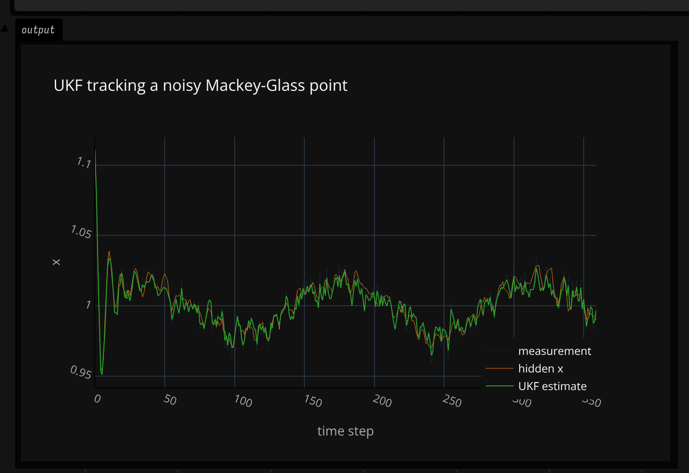
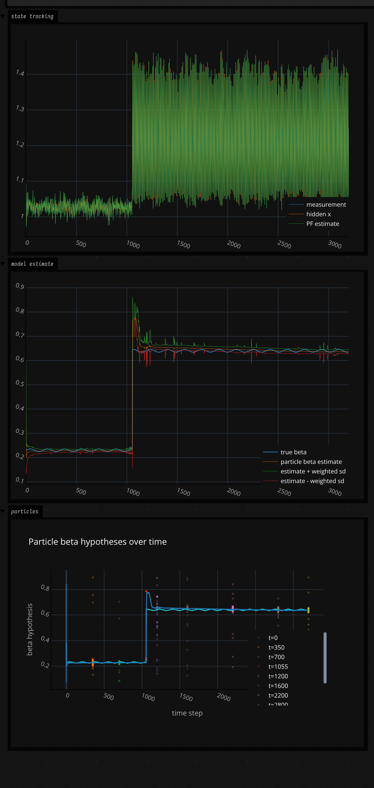

# Particle filter examples

`pf.kt` gives you two related tools: a small `UnscentedKalmanFilter` for nonlinear continuous state, and `UKFParticleFilter` for keeping several model hypotheses alive while each hypothesis carries its own UKF. These examples also use Field's Plotly bridge: a `Plot` can be sent straight to an output with `display(plot)`.

## Track a noisy Mackey-Glass point with a UKF

This is the smallest useful shape: one hidden point evolves through a nonlinear delayed map, and the only measurement is that point plus Gaussian error. The UKF predicts the nonlinear motion, then corrects from the scalar measurement.

```diffstatic_runner {data-lang=kotlin screenshot="assets/pf_examples/ukf_mackey_glass.png" wait="1.0" capture="box" open-outputs="true" padding="20"}
:::static
import afield.darkMode
import kotlin.random.Random
import space.kscience.plotly.*

fun diag(vararg values: Double): Matrix =
    Array(values.size) { r -> DoubleArray(values.size) { c -> if (r == c) values[r] else 0.0 } }

fun Random.gaussian(): Double {
    var u1 = nextDouble()
    while (u1 <= Double.MIN_VALUE) u1 = nextDouble()
    val u2 = nextDouble()
    return sqrt(-2.0 * ln(u1)) * cos(2.0 * PI * u2)
}

fun mackeyGlassStep(state: DoubleArray, beta: Double = 0.28): DoubleArray {
    val x = state[0].coerceIn(0.02, 3.0)
    val delayed = state[2].coerceIn(0.02, 3.0)
    val dx = beta * delayed / (1.0 + delayed.pow(10.0)) - 0.10 * x
    val next = (x + dx).coerceIn(0.02, 3.0)
    return doubleArrayOf(next, x, state[1])
}

val rng = Random(12)
val ukf = UnscentedKalmanFilter(
    initialState = doubleArrayOf(1.00, 0.96, 0.92),
    initialCovariance = diag(0.08, 0.08, 0.08),
    options = UKFOptions(alpha = 0.55)
)

val trueX = mutableListOf<Double>()
val measuredX = mutableListOf<Double>()
val estimatedX = mutableListOf<Double>()
var truth = doubleArrayOf(1.12, 1.05, 0.98)

repeat(360) { i ->
    val forcing = 0.020 * sin(i * 0.045)
    truth = mackeyGlassStep(truth, beta = 0.20 + forcing)
    truth[0] = (truth[0] + 0.003 * rng.gaussian()).coerceIn(0.02, 3.0)

    val measurement = truth[0] + 0.006 * rng.gaussian()

    ukf.predict(processNoise = diag(0.004, 0.004, 0.004)) { state ->
        mackeyGlassStep(state, beta = 0.20)
    }
    ukf.update(
        measurement = doubleArrayOf(measurement),
        measurementNoise = diag(0.05 * 0.05)
    ) { state ->
        doubleArrayOf(state[0])
    }

    trueX += truth[0]
    measuredX += measurement
    estimatedX += ukf.stateCopy()[0]
}

val sample = trueX.indices.toList()
val plot = Plotly.plot {
    trace {
        name = "measurement"
        x.set(sample)
        y.set(measuredX)
        line.width = 0.1
    }
    trace {
        name = "hidden x"
        x.set(sample)
        y.set(trueX)
        line.width = 0.5
    }
    trace {
        name = "UKF estimate"
        x.set(sample)
        y.set(estimatedX)
        line.width = 1.0
    }
    layout {
        title = "UKF tracking a noisy Mackey-Glass point"
        xaxis {
            title = "time step"
        }
        yaxis {
            title = "x"
        }
    }
}.darkMode()

display(plot)
```

The measurement trace jitters around the hidden state, while the UKF estimate follows the nonlinear trend without chasing every sample. The useful thing to notice in the code is that the observation model only returns `state[0]`, while the filter still carries the delayed coordinates it needs for prediction.



## Track the point while estimating the model

When the system itself is uncertain, use `UKFParticleFilter`. Here each particle has a different Mackey-Glass `beta` hypothesis and its own UKF for `[x, previousX, olderX]`. The measurements only see `x`, but the particle weights gradually favor hypotheses whose dynamics explain the observations.

```diffstatic_runner {data-lang=kotlin screenshot="assets/pf_examples/ukf_particle_filter_mackey_glass.png" wait="1.0" capture="box" open-outputs="true" padding="20"}
:::static
import afield.darkMode
import kotlin.random.Random
import space.kscience.plotly.*
import space.kscience.plotly.models.ScatterMode

data class MackeyGlassHypothesis(val beta: Double)
data class ParticleSnapshot(
    val step: Int,
    val beta: List<Double>
)

fun diag(vararg values: Double): Matrix =
    Array(values.size) { r -> DoubleArray(values.size) { c -> if (r == c) values[r] else 0.0 } }

fun Random.gaussian(): Double {
    var u1 = nextDouble()
    while (u1 <= Double.MIN_VALUE) u1 = nextDouble()
    val u2 = nextDouble()
    return sqrt(-2.0 * ln(u1)) * cos(2.0 * PI * u2)
}

fun mackeyGlassStep(state: DoubleArray, beta: Double): DoubleArray {
    val x = state[0].coerceIn(0.02, 3.0)
    val delayed = state[2].coerceIn(0.02, 3.0)
    val dx = beta * delayed / (1.0 + delayed.pow(10.0)) - 0.10 * x
    val next = (x + dx).coerceIn(0.02, 3.0)
    return doubleArrayOf(next, x, state[1])
}

val rng = Random(31)
val particleCount = 96
val particles = (0 until particleCount).map { i ->
    val beta = 0.08 + 0.76 * i.toDouble() / (particleCount - 1).toDouble()
    UKFParticle(
        ukf = UnscentedKalmanFilter(
            initialState = doubleArrayOf(
                0.80 + 0.18 * rng.gaussian(),
                0.80 + 0.18 * rng.gaussian(),
                0.80 + 0.18 * rng.gaussian()
            ),
            initialCovariance = diag(0.35, 0.35, 0.35),
            options = UKFOptions(alpha = 0.55)
        ),
        hypothesis = MackeyGlassHypothesis(beta),
        logWeight = 0.0
    )
}

val pf = UKFParticleFilter<MackeyGlassHypothesis>(
    initialParticles = particles,
    copyHypothesis = { it.copy() }
)

fun betaEstimate(): Double {
    val weights = pf.weights()
    return pf.particles.indices.sumOf { i -> weights[i] * pf.particles[i].hypothesis.beta }
}

fun betaStdDev(mean: Double): Double {
    val weights = pf.weights()
    val variance = pf.particles.indices.sumOf { i ->
        val d = pf.particles[i].hypothesis.beta - mean
        weights[i] * d * d
    }
    return sqrt(variance)
}

val trueX = mutableListOf<Double>()
val measuredX = mutableListOf<Double>()
val estimatedX = mutableListOf<Double>()
val trueBeta = mutableListOf<Double>()
val estimatedBeta = mutableListOf<Double>()
val betaSigma = mutableListOf<Double>()
val particleSnapshots = mutableListOf<ParticleSnapshot>()
val snapshotSteps = setOf(0, 350, 700, 1055, 1200, 1600, 2200, 2800, 3199)

var truth = doubleArrayOf(1.10, 1.08, 1.05)
var lastMeasurement = truth[1]
var olderMeasurement = truth[2]
repeat(3200) { i ->
    val baseBeta = if (i < 1055) 0.23 else 0.64
    val actualBeta = baseBeta + 0.006 * sin(i * 0.037)

    truth = mackeyGlassStep(truth, actualBeta)
    truth[0] = (truth[0] + 0.006 * rng.gaussian()).coerceIn(0.00, 3.0)
    val measurement = truth[0] + 0.006 * rng.gaussian()

    pf.predict(
        processNoise = { diag(0.003, 0.003, 0.003) },
        transition = { hypothesis, state ->
            mackeyGlassStep(state, hypothesis.beta)
        },
        evolveHypothesis = { hypothesis ->
            val broadProposalRate = if (i in 980..1240) 0.004 else 0.00025
            val beta = if (rng.nextDouble() < broadProposalRate) {
                0.05 + 0.85 * rng.nextDouble()
            } else {
                hypothesis.beta + 0.0002 * rng.gaussian()
            }
            hypothesis.copy(beta = beta.coerceIn(0.0, 1.0))
        }
    )
    pf.update(
        measurement = doubleArrayOf(measurement, lastMeasurement, olderMeasurement),
        measurementNoise = { diag(0.010 * 0.010, 0.014 * 0.014, 0.018 * 0.018) },
        observe = { _, state -> doubleArrayOf(state[0], state[1], state[2]) }
    )

    olderMeasurement = lastMeasurement
    lastMeasurement = measurement

    val resampled = pf.resampleIfNeeded(
        thresholdFraction = 0.55,
        random = rng,
        roughening = RougheningOptions(factor = 0.012, minimumStdDev = 1e-5)
    )
    if (resampled) {
        val centerBeta = betaEstimate()
        pf.roughenHypotheses(rng) { hypothesis, random ->
            val contracted = centerBeta + 0.82 * (hypothesis.beta - centerBeta)
            hypothesis.copy(beta = (contracted + 0.0007 * random.gaussian()).coerceIn(0.0, 1.0))
        }
    }

    trueX += truth[0]
    measuredX += measurement
    estimatedX += pf.estimateMean()[0]
    trueBeta += actualBeta
    val betaMean = betaEstimate()
    estimatedBeta += betaMean
    betaSigma += betaStdDev(betaMean)
    if (i in snapshotSteps) {
        particleSnapshots += ParticleSnapshot(
            step = i,
            beta = pf.particles.map { it.hypothesis.beta }
        )
    }
}

val sample = trueX.indices.toList()

val statePlot = Plotly.plot {
    trace {
        name = "measurement"
        x.set(sample)
        y.set(measuredX)
        line.width = 0.75
    }
    trace {
        name = "hidden x"
        x.set(sample)
        y.set(trueX)
        line.width = 0.5
    }
    trace {
        name = "PF estimate"
        x.set(sample)
        y.set(estimatedX)
        line.width = 0.5
    }
}.darkMode()

val betaPlot = Plotly.plot {
    trace {
        name = "true beta"
        x.set(sample)
        y.set(trueBeta)
        line.width = 1.5
    }
    trace {
        name = "particle beta estimate"
        x.set(sample)
        y.set(estimatedBeta)
        line.width = 0.5
    }
    trace {
        name = "estimate + weighted sd"
        x.set(sample)
        y.set(estimatedBeta.indices.map { estimatedBeta[it] + betaSigma[it] })
        line.width = 0.6
    }
    trace {
        name = "estimate - weighted sd"
        x.set(sample)
        y.set(estimatedBeta.indices.map { estimatedBeta[it] - betaSigma[it] })
        line.width = 0.6
    }
}.darkMode()

val particlePlot = Plotly.plot {
    layout {
        title = "Particle beta hypotheses over time"
        xaxis {
            title = "time step"
        }
        yaxis {
            title = "beta hypothesis"
        }
    }
    particleSnapshots.forEach { snapshot ->
        scatter {
            name = "t=${snapshot.step}"
            x.set(List(snapshot.beta.size) { snapshot.step })
            y.set(snapshot.beta)
            mode = ScatterMode.markers
            marker {
                size = 4.0
                opacity = 0.28
            }
        }
    }
    trace {
        name = "true beta"
        x.set(sample)
        y.set(trueBeta)
        line.width = 2.0
    }
    trace {
        name = "weighted estimate"
        x.set(sample)
        y.set(estimatedBeta)
        line.width = 2.0
    }
}.darkMode()

display("state tracking", statePlot)
display("model estimate", betaPlot)
display("particles", particlePlot)
```

The first Plotly panel repeats the hidden/measurement/estimate comparison. The second shows the true `beta`, the weighted particle estimate, and a weighted one-standard-deviation envelope. In the particle snapshot panel, each semi-transparent dot is one particle's `beta` hypothesis at a saved time step; darker vertical bands mean more particles are clumped at the same beta. The dots are intentionally unweighted, so a few exploratory particles can make the cloud look wider than the posterior shown by the standard-deviation envelope. The update step observes the current noisy point plus the two previous noisy point measurements; that pins the delayed state coordinates and prevents an incorrect `beta` from being hidden by a different latent delay state. Most beta motion is deliberately tiny, so the cloud can tighten. The broad proposal rate is raised only around the known transition window and kept very low elsewhere; that preserves enough diversity to catch the jump without continually repopulating far-away beta hypotheses after the estimate has settled. The post-resample `roughenHypotheses(...)` step contracts surviving beta hypotheses toward the current weighted estimate before adding a very small local jitter.


