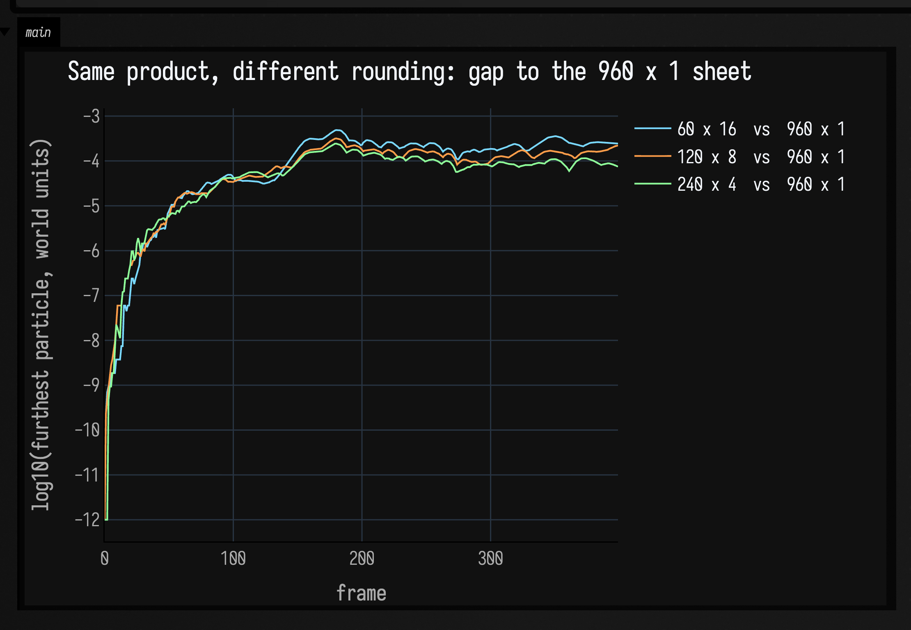

# Physics: particles, constraints and cloth

Field has a particle solver. `afield.four.physics.SimdVerlet` holds some thousands of particles in
flat float arrays, pulls them toward each other with distance constraints, and integrates them with
Verlet. `Cloth` wires a rectangular grid of those constraints for you. `SimdVerlet.debugLines()`
draws the solver's own state so you can see when the wiring is wrong.

It is a **CPU** solver with **no renderer of its own**. It hands you `FLine`s, and where those go is
your business: `showPlane` into a box output, `Box.lines` into the 3D view, an `afield.four`
renderer. Nothing here needs a GPU.

This page is not the API; the API is in the KDoc. It is about the thing you will get wrong, which is
that **`stiffness` and `iterations` are not two knobs.**

!!! note "If you just want the cloth on screen"
    Open the **`cloth_simdverlet_start`** starting point from Field's welcome screen, also listed in
    the [Agent Transcript Gallery](agent_transcripts.md): a 20 × 10 sheet, an explicit `loop { }`,
    and the debug view, already hanging. Come back here when you want to change the numbers.
    [Frames and the Animation Loop](animation_time_model.md#a-physics-system-in-the-loop) has the same
    scene as a moving picture, and explains why an integrator wants a fixed `dt`.

---

## What the solver holds

A `SimdVerlet.State3` is structure-of-arrays: `x`, `y`, `z`, the previous positions `px`, `py`, `pz`,
the force accumulators `ax`, `ay`, `az`, and an optional `invMass`. A particle is an *index* into all
of those at once, not an object. `SimdVerlet.State3.empty()` gives you an empty one; the simulation
grows it as things are added.

Two consequences of that layout will catch you:

- **`invMass == 0` means pinned.** There is no `pinned` flag. Infinite mass is how a particle is
  nailed down, and it is why `Cloth.pin` needs a state that actually has an `invMass` array.
- **The accumulators are scratch.** `step()` **zeroes** `ax/ay/az` at the top of every frame, then
  rebuilds them from gravity, the per-particle force generators, the registered
  `bulkForces`, the `accumulateForces` argument, and finally the constraint solve. Anything you write
  into `ax` *before* calling `step()` is thrown away. Inject forces through a generator or through
  `accumulateForces`, never by pre-accumulating.

  Two more stages run *after* integration, and they are not forces at all: every registered
  `positionProjections` pass (colliders move particles directly), then every `constraintEdits` pass
  (tearing removes constraint slots). See [the world layer](#also-in-the-box) below. The reason they
  are projections and edits rather than forces is the equivalence this page is about.

## Constraints are directed, and there are four of them

`DirectedConstraints4` gives every particle **four outgoing slots**: four neighbour indices, four
rest lengths, four stiffnesses, in parallel arrays. Four because that is exactly the
up/down/left/right neighbourhood of an interior particle in a grid: a cloth's whole topology fits
with nothing spare.

*Directed* is the word that matters. A constraint `i → j` writes its correction **only to `i`**. It
never scatters back to `j`, and that restriction is what makes the solve fast: with no scatter
writes, disjoint particle ranges can be solved on separate threads with a scratch buffer each, and
the whole inner loop vectorises through the JDK Incubator Vector API.

The price is that a symmetric spring is *two* constraints, and it is entirely possible to wire only
one of them. A one-way constraint is a real, useful thing — and also the classic bug. Keep it in
mind for [the debug view](#the-debug-view-draws-what-the-solver-holds) at the bottom of this page.

---

## The two knobs are one knob

Here is the intuition you are probably importing from somewhere else. In a position-based or
Gauss–Seidel solver, each iteration moves the particles and the next iteration sees the result, so
more iterations means a better-converged solve at the same stiffness: `iterations` buys you accuracy
and `stiffness` sets the material.

**That is not this solver.** `solveDirectedDist4InPlaceRange` runs its `iterations` passes over the
same unchanged positions, and each pass *adds* its correction into `ax/ay/az`. Nothing moves in
between; the integrator runs once, afterwards, on the sum. So

> N iterations at stiffness *k* are one iteration at stiffness *N·k*.

`iterations` does not buy convergence. It multiplies your spring constant. The only number the sheet
can feel is the **product**.

So take one product and split it four ways. Same cloth, same gravity, same `dt`, same 200 frames;
the only difference is where the factors of `stiffness × iterations = 960` sit.

```diffstatic_runner {data-lang=kotlin screenshot="assets/physics/equivalence.png" wait="4.0" capture="box" open-outputs="true" w="1020" h="820" padding="14" name="physics-equivalence"}
:::static
import afield.four.physics.*

:::fold the sheet, and a ruler for comparing two of them
// A 20 x 10 sheet hanging from every fourth particle of row 0. The plane view has y growing DOWN
// the screen, so row 0 is the top and gravity is +y. Curvature is off: springs only, so that the
// only thing in the picture is the thing being tested.
fun sheet(stiffness: Float) = SimdVerlet(SimdVerlet.State3.empty()).addCloth(
    width = 20, height = 10, spacing = 0.5f,
    stiffness = stiffness,
    curvatureStrength = 0f,
    pinned = { col, row -> row == 0 && col % 4 == 0 },
)

// The largest distance between corresponding particles of two sheets, in world units. Spacing is
// 0.5, so anything below ~1e-3 is invisible and anything below ~1e-6 is arithmetic noise.
fun apart(a: Cloth, b: Cloth): Double {
    var worst = 0.0
    for (k in 0 until a.count) {
        val i = a.base + k
        val j = b.base + k
        val dx = (a.sim.state.x[i] - b.sim.state.x[j]).toDouble()
        val dy = (a.sim.state.y[i] - b.sim.state.y[j]).toDouble()
        val dz = (a.sim.state.z[i] - b.sim.state.z[j]).toDouble()
        worst = maxOf(worst, kotlin.math.sqrt(dx * dx + dy * dy + dz * dz))
    }
    return worst
}

// Frame every panel identically, on a window that just contains all of them — so the panels are
// comparable AND none of them is mostly empty. cellHeight then follows the window's aspect.
fun fit(cloths: List<Cloth>, pad: Double = 0.5): Rect {
    var x0 = Double.MAX_VALUE; var y0 = Double.MAX_VALUE
    var x1 = -Double.MAX_VALUE; var y1 = -Double.MAX_VALUE
    for (c in cloths) for (i in c.base until c.end) {
        x0 = minOf(x0, c.sim.state.x[i].toDouble()); x1 = maxOf(x1, c.sim.state.x[i].toDouble())
        y0 = minOf(y0, c.sim.state.y[i].toDouble()); y1 = maxOf(y1, c.sim.state.y[i].toDouble())
    }
    return Rect(x0 - pad, y0 - pad, (x1 - x0) + 2 * pad, (y1 - y0) + 2 * pad)
}
:::endfold
// Four splits of one product. 60 x 16 is what the starting point ships.
val splits = listOf(60f to 16, 120f to 8, 240f to 4, 960f to 1)
val cloths = splits.map { (k, _) -> sheet(k) }

repeat(200) {
    splits.forEachIndexed { n, (_, iterations) ->
        cloths[n].step(dt = 1f / 60f, damping = 0.99f, gravity = 2f, iterations = iterations)
    }
}

// Every sheet measured against the last one — one iteration at the full product.
val reference = cloths.last()
val gaps = cloths.map { apart(it, reference) }
:::fold draw the four sheets on one shared window
val window = fit(cloths)
showPlaneGrid(
    *splits.mapIndexed { n, (k, iterations) ->
        val gap = if (n == splits.lastIndex) "the reference"
        else "furthest particle from the 960 x 1 sheet: ${"%.3g".format(gaps[n])} world units"
        "stiffness ${k.toInt()} x $iterations iterations\n$gap" to cloths[n].sim.debugLines()
    }.toTypedArray(),
    columns = 2, cellWidth = 470, cellHeight = (470 * window.h / window.w).toInt(), window = window,
)
:::endfold
```


Four different-looking settings, one sheet. The furthest any particle strays from the reference is
**0.000224 world units**: less than half a thousandth of the 0.5 grid spacing, after two hundred
frames. If you were turning `iterations` up expecting the drape to tighten, you were turning
`stiffness` up by the same factor and would have got there sixteen times cheaper by typing it.

### Where floating point catches up

The equivalence is exact in real arithmetic and *not quite* exact in `float`: adding `k·e` sixteen
times is not the same rounding as adding `16k·e` once. A hanging sheet amplifies small differences,
so that last-bit difference does not stay last-bit. Below is the same four runs with the gap measured
every frame, plotted as its base-10 logarithm.

```diffstatic_runner {data-lang=kotlin screenshot="assets/physics/equivalence_drift.png" wait="4.0" capture="box" open-outputs="true" w="1080" h="620" padding="14" name="physics-equivalence-drift"}
:::static
import afield.four.physics.*

:::fold the same sheet and ruler as above
fun sheet(stiffness: Float) = SimdVerlet(SimdVerlet.State3.empty()).addCloth(
    width = 20, height = 10, spacing = 0.5f,
    stiffness = stiffness,
    curvatureStrength = 0f,
    pinned = { col, row -> row == 0 && col % 4 == 0 },
)

fun apart(a: Cloth, b: Cloth): Double {
    var worst = 0.0
    for (k in 0 until a.count) {
        val i = a.base + k
        val j = b.base + k
        val dx = (a.sim.state.x[i] - b.sim.state.x[j]).toDouble()
        val dy = (a.sim.state.y[i] - b.sim.state.y[j]).toDouble()
        val dz = (a.sim.state.z[i] - b.sim.state.z[j]).toDouble()
        worst = maxOf(worst, kotlin.math.sqrt(dx * dx + dy * dy + dz * dz))
    }
    return worst
}
:::endfold
val splits = listOf(60f to 16, 120f to 8, 240f to 4, 960f to 1)
val cloths = splits.map { (k, _) -> sheet(k) }
val traces = splits.dropLast(1).map { mutableListOf<Number>() }

repeat(400) {
    splits.forEachIndexed { n, (_, iterations) ->
        cloths[n].step(dt = 1f / 60f, damping = 0.99f, gravity = 2f, iterations = iterations)
    }
    // Floor the log at 1e-12 so a frame where two sheets are bit-identical stays on the axis
    // instead of going to negative infinity.
    for (n in traces.indices) {
        traces[n] += kotlin.math.log10(maxOf(apart(cloths[n], cloths.last()), 1e-12))
    }
}
:::fold plot the three gaps
showSignals(
    *splits.dropLast(1).mapIndexed { n, (k, iterations) ->
        "${k.toInt()} x $iterations  vs  960 x 1" to traces[n].toList()
    }.toTypedArray(),
    channel = "main",
    title = "Same product, different rounding: gap to the 960 x 1 sheet",
    xTitle = "frame", yTitle = "log10(furthest particle, world units)",
)
:::endfold
```



Two things in that plot. The gap climbs eight orders of magnitude in the first hundred frames, from
below the `1e-12` floor to about `1e-4` — and then it **stops**, and stays at `1e-4` for the
remaining three hundred. Damping of 0.99 and a sheet that has found its drape put a ceiling on the
amplification, so the difference saturates at roughly a five-thousandth of one particle spacing:
invisible, permanently.

Read that as a note about *reproducibility*, not about correctness. Two algebraically identical
settings are the same cloth for as long as anyone is watching, and are not the same array of floats.
If you need a run to reproduce bit-exactly (recording, regression-testing), pin the split as well as
the product.

### Tune the product

Because there is only one number, there is only one ladder to climb. Same sheet, same 400 frames, and
the worst strain any single constraint reaches at any point in the run: `|length − rest| / rest`,
where 100 % means a spring stretched to twice its rest length.

```diffstatic_runner {data-lang=kotlin screenshot="assets/physics/tuning_ladder.png" wait="6.0" capture="box" open-outputs="true" w="1660" h="1000" padding="14" name="physics-tuning-ladder"}
:::static
import afield.four.physics.*

:::fold the sheet, and a strain meter that reads the solver's own rest lengths
fun sheet(stiffness: Float, curvature: Float = 0f) =
    SimdVerlet(SimdVerlet.State3.empty()).addCloth(
        width = 20, height = 10, spacing = 0.5f,
        stiffness = stiffness,
        curvatureStrength = curvature,
        pinned = { col, row -> row == 0 && col % 4 == 0 },
    )

// Worst |length - rest| / rest over every live slot of every particle. Read straight out of the
// constraint set, so it is the strain the SOLVER thinks it has, not one recomputed from the grid.
fun strain(cloth: Cloth): Double {
    val c = cloth.constraints
    val s = cloth.sim.state
    var worst = 0.0
    for (i in cloth.base until cloth.end) {
        val neighbours = intArrayOf(c.n0[i], c.n1[i], c.n2[i], c.n3[i])
        val rests = floatArrayOf(c.r0[i], c.r1[i], c.r2[i], c.r3[i])
        val stiffs = floatArrayOf(c.s0[i], c.s1[i], c.s2[i], c.s3[i])
        for (slot in 0 until 4) {
            val j = neighbours[slot]
            if (j < 0 || stiffs[slot] == 0f || rests[slot] <= 0f) continue
            val dx = (s.x[i] - s.x[j]).toDouble()
            val dy = (s.y[i] - s.y[j]).toDouble()
            val dz = (s.z[i] - s.z[j]).toDouble()
            val length = kotlin.math.sqrt(dx * dx + dy * dy + dz * dz)
            worst = maxOf(worst, kotlin.math.abs(length - rests[slot]) / rests[slot])
        }
    }
    return worst
}

// Frame every panel identically, on a window that just contains all of them — so the panels are
// comparable AND none of them is mostly empty. cellHeight then follows the window's aspect.
fun fit(cloths: List<Cloth>, pad: Double = 0.5): Rect {
    var x0 = Double.MAX_VALUE; var y0 = Double.MAX_VALUE
    var x1 = -Double.MAX_VALUE; var y1 = -Double.MAX_VALUE
    for (c in cloths) for (i in c.base until c.end) {
        x0 = minOf(x0, c.sim.state.x[i].toDouble()); x1 = maxOf(x1, c.sim.state.x[i].toDouble())
        y0 = minOf(y0, c.sim.state.y[i].toDouble()); y1 = maxOf(y1, c.sim.state.y[i].toDouble())
    }
    return Rect(x0 - pad, y0 - pad, (x1 - x0) + 2 * pad, (y1 - y0) + 2 * pad)
}
:::endfold
// Run one setting for 400 frames. If it blows up, stop at the first non-finite frame and rewind the
// positions to the last finite one, so the panel shows the last state that was still a cloth.
fun runLadder(stiffness: Float, iterations: Int, curvature: Float = 0f): Triple<Cloth, Double, Int> {
    val cloth = sheet(stiffness, curvature)
    val s = cloth.sim.state
    val lastX = s.x.copyOf(); val lastY = s.y.copyOf(); val lastZ = s.z.copyOf()
    var peak = 0.0
    var blewUpAt = -1
    for (frame in 1..400) {
        cloth.step(dt = 1f / 60f, damping = 0.99f, gravity = 2f, iterations = iterations)
        val now = strain(cloth)
        if (!now.isFinite()) { blewUpAt = frame; break }
        peak = maxOf(peak, now)
        s.x.copyInto(lastX); s.y.copyInto(lastY); s.z.copyInto(lastZ)
    }
    if (blewUpAt > 0) { lastX.copyInto(s.x); lastY.copyInto(s.y); lastZ.copyInto(s.z) }
    return Triple(cloth, peak, blewUpAt)
}

// Each rung twice: springs alone, and again with the curvature force the starting place ships,
// because that is the difference between this ladder and the one in dev_docs.
val ladder = listOf(0.8f to 8, 8f to 8, 20f to 16, 60f to 16).map { (k, i) ->
    Triple(k to i, runLadder(k, i), runLadder(k, i, curvature = 100f))
}
:::fold draw the ladder on one shared window, so the rungs are comparable
fun verdict(result: Triple<Cloth, Double, Int>): String {
    val (_, peak, blewUpAt) = result
    return if (blewUpAt > 0) "NOT FINITE from frame $blewUpAt" else "${"%.0f".format(peak * 100)} %"
}

val window = fit(ladder.map { it.second.first })
showPlaneGrid(
    *ladder.map { (setting, bare, curved) ->
        val (k, iterations) = setting
        "stiffness $k x $iterations  (product ${"%.0f".format(k * iterations)})\n" +
            "peak strain ${verdict(bare)}  ·  with curvature 100: ${verdict(curved)}" to
            bare.first.sim.debugLines()
    }.toTypedArray(),
    columns = 4, cellWidth = 380, cellHeight = (380 * window.h / window.w).toInt(), window = window,
)
:::endfold
```


The captions read **971 %** peak strain at a product of 6 (one spring at more than ten times its
rest length, which is why that panel is a tall web rather than a cloth), then **196 %** at 64,
**52 %** at 320, and **19 %** at 960, which is what the starting point ships.

Note that strain falls *more slowly* than the product rises: 160 times the product, between the
first rung and the last, buys 51 times less strain. These are peaks over the whole run, reached while
the sheet is still falling, so they are not the equilibrium sag, which is a good reason to measure
the number in your own scene rather than to interpolate this table.

The second half of each caption adds the curvature force, which does *not* buy strain headroom:
turning it up to 100 leaves the floppiest rung a bit tighter (971 % → 738 %) and makes every other
rung **worse** (196 → 230, 52 → 66, 19 → 25). That is the accumulator again. The curvature pass adds
into the same `ax/ay/az` the springs do, so at these strengths it is one more load on the sheet
rather than a stiffener.

!!! note "The repository records a different ladder"
    `dev_docs/physics/SIMDVERLET_4_CONSTRAINTS.md` runs the same four rungs and reports 1949 % /
    116 % / 32 % / 11 %. Those are *settled* values read off a box that has stopped moving, on a
    scene that ships the curvature force; the numbers above are peaks over the fall with curvature
    off. The note itself puts the two about 1.7 times apart on every stable rung. Same ordering,
    same conclusion, two different questions.

### Divergence at the high end

At a high enough product the solve does what explicit integration does: the correction overshoots,
the overshoot is corrected harder, and the run stops being a number. There is no automatic clamp and
nothing prints a warning: a diverging run simply goes quiet, because a `NaN` coordinate draws
nothing.

The strain trace carries plenty of warning before the `NaN` arrives, for anyone who is watching it.

```diffstatic_runner {data-lang=kotlin screenshot="assets/physics/divergence.png" wait="5.0" capture="box" open-outputs="true" w="1200" h="620" padding="14" name="physics-divergence"}
:::static
import afield.four.physics.*

:::fold the sheet and the strain meter, exactly as above
fun sheet(stiffness: Float) = SimdVerlet(SimdVerlet.State3.empty()).addCloth(
    width = 20, height = 10, spacing = 0.5f,
    stiffness = stiffness, curvatureStrength = 0f,
    pinned = { col, row -> row == 0 && col % 4 == 0 },
)

fun strain(cloth: Cloth): Double {
    val c = cloth.constraints
    val s = cloth.sim.state
    var worst = 0.0
    for (i in cloth.base until cloth.end) {
        val neighbours = intArrayOf(c.n0[i], c.n1[i], c.n2[i], c.n3[i])
        val rests = floatArrayOf(c.r0[i], c.r1[i], c.r2[i], c.r3[i])
        val stiffs = floatArrayOf(c.s0[i], c.s1[i], c.s2[i], c.s3[i])
        for (slot in 0 until 4) {
            val j = neighbours[slot]
            if (j < 0 || stiffs[slot] == 0f || rests[slot] <= 0f) continue
            val dx = (s.x[i] - s.x[j]).toDouble()
            val dy = (s.y[i] - s.y[j]).toDouble()
            val dz = (s.z[i] - s.z[j]).toDouble()
            val length = kotlin.math.sqrt(dx * dx + dy * dy + dz * dz)
            worst = maxOf(worst, kotlin.math.abs(length - rests[slot]) / rests[slot])
        }
    }
    return worst
}
:::endfold
// The rung that settles, and the next one up, traced frame by frame. Once a trace stops being
// finite it stops: there is nothing after that to plot.
val watched = listOf(60f to 16, 100f to 16, 150f to 16)
val traces = watched.map { (k, iterations) ->
    val cloth = sheet(k)
    val trace = mutableListOf<Number>()
    var diedAt = -1
    var warnedAt = -1
    for (frame in 1..400) {
        cloth.step(dt = 1f / 60f, damping = 0.99f, gravity = 2f, iterations = iterations)
        val now = strain(cloth)
        if (!now.isFinite()) { diedAt = frame; break }
        // 100 % strain — a spring at twice its rest length — is the point of no return here.
        if (warnedAt < 0 && now > 1.0) warnedAt = frame
        trace += kotlin.math.log10(maxOf(now, 1e-4))
    }
    Triple("${k.toInt()} x $iterations", trace, if (diedAt > 0) warnedAt to diedAt else null)
}

// The headline goes in the title rather than in a series label, so the legend stays narrow and the
// plot keeps the width.
val blewUp = traces.first { it.third != null }
val (past100, nan) = blewUp.third!!
:::fold plot the three traces
showSignals(
    *traces.map { (label, trace, _) -> label to trace.toList() }.toTypedArray(),
    channel = "main",
    title = "Peak strain per frame — ${blewUp.first}: 100 % at $past100, NaN at $nan",
    xTitle = "frame", yTitle = "log10(peak strain)",
)
:::endfold
```


Two of those three settle and stay settled, flat at about 20 % strain for four hundred frames. The
third leaves them at frame 83, and by frame 161 the coordinates are `NaN` — **78 frames**, or 1.3
seconds at 60 fps, between "visibly wrong" and "gone". Once it is past 100 % it never comes back: the
climb from 10⁰ to 10²⁰ takes about seventy frames and nothing in the solver arrests it.

Note the middle trace. `100 × 16` is a product of **1600** and it settles, so the ceiling at this
`dt` is somewhere between 1600 and 2400: not a round number, and not one you should carry to
another scene. Gravity is loading the top row with forty particles' weight here; a smaller sheet or a
lighter one will take more.

So **watch the peak strain, not the picture.** The measurement is twenty lines of Kotlin, folded
into the block above; it is cheap, and it goes wrong long before the drawing does.

!!! warning "Stability goes as `stiffness × iterations × dt²`"
    All the numbers on this page are at `dt = 1/60`. Run the same settings at `dt = 1/30` and you
    have multiplied the term that decides stability by four. This is the main reason [the frames
    page](animation_time_model.md#a-physics-system-in-the-loop) argues for handing the solver a
    *fixed* `dt` rather than the wall-clock time since the last frame: a `dt` that jitters with the
    frame rate is a stiffness that jitters with the frame rate.

---

## Curvature and the size of its default

Distance constraints alone give you a net, not a fabric. Nothing in them resists *bending*: a sheet
can fold to a crease and every spring is still at rest length. `Cloth` adds an optional curvature
force: each interior particle is pulled toward the mean of its four axis neighbours, which flattens
the sheet and takes the kink out of the festoons.

It is registered as **one bulk pass over the whole patch**, in `SimdVerlet.bulkForces`, rather than as
a force generator per particle: the per-particle path would charge `width × height` coroutine
resumes every frame for what is a single scalar sweep. `cloth.curvatureStrength = 0f` switches it off
live without unregistering anything.

The trap is that `curvatureStrength` defaults to **0.05**, and it accumulates into the *same*
`ax/ay/az` the constraint solve does, so it is competing against `stiffness × iterations`, not
against 1.

```diffstatic_runner {data-lang=kotlin screenshot="assets/physics/curvature.png" wait="5.0" capture="box" open-outputs="true" w="1180" h="720" padding="14" name="physics-curvature"}
:::static
import afield.four.physics.*

:::fold the sheet, now with a curvature strength, and the same ruler
fun sheet(curvature: Float) = SimdVerlet(SimdVerlet.State3.empty()).addCloth(
    width = 20, height = 10, spacing = 0.5f,
    stiffness = 60f,
    curvatureStrength = curvature,
    pinned = { col, row -> row == 0 && col % 4 == 0 },
)

fun apart(a: Cloth, b: Cloth): Double {
    var worst = 0.0
    for (k in 0 until a.count) {
        val i = a.base + k
        val j = b.base + k
        val dx = (a.sim.state.x[i] - b.sim.state.x[j]).toDouble()
        val dy = (a.sim.state.y[i] - b.sim.state.y[j]).toDouble()
        val dz = (a.sim.state.z[i] - b.sim.state.z[j]).toDouble()
        worst = maxOf(worst, kotlin.math.sqrt(dx * dx + dy * dy + dz * dz))
    }
    return worst
}

// Frame every panel identically, on a window that just contains all of them — so the panels are
// comparable AND none of them is mostly empty. cellHeight then follows the window's aspect.
fun fit(cloths: List<Cloth>, pad: Double = 0.5): Rect {
    var x0 = Double.MAX_VALUE; var y0 = Double.MAX_VALUE
    var x1 = -Double.MAX_VALUE; var y1 = -Double.MAX_VALUE
    for (c in cloths) for (i in c.base until c.end) {
        x0 = minOf(x0, c.sim.state.x[i].toDouble()); x1 = maxOf(x1, c.sim.state.x[i].toDouble())
        y0 = minOf(y0, c.sim.state.y[i].toDouble()); y1 = maxOf(y1, c.sim.state.y[i].toDouble())
    }
    return Rect(x0 - pad, y0 - pad, (x1 - x0) + 2 * pad, (y1 - y0) + 2 * pad)
}
:::endfold
// Off, the library default, and two settings picked to be on the same scale as stiffness x
// iterations = 960. Everything else is identical.
val strengths = listOf(0f, 0.05f, 20f, 100f)
val cloths = strengths.map { sheet(it) }

repeat(300) { cloths.forEach { it.step(dt = 1f / 60f, damping = 0.99f, gravity = 2f, iterations = 16) } }

// Measured against the sheet with no curvature force at all.
val gaps = cloths.map { apart(it, cloths.first()) }
:::fold draw the four
val window = fit(cloths)
showPlaneGrid(
    *strengths.mapIndexed { n, strength ->
        val label = if (strength == 0f) "curvature off" else "curvatureStrength = $strength"
        "$label\nfurthest particle from the sheet with none: ${"%.3g".format(gaps[n])} world units" to
            cloths[n].sim.debugLines()
    }.toTypedArray(),
    columns = 2, cellWidth = 470, cellHeight = (470 * window.h / window.w).toInt(), window = window,
)
:::endfold
```


At `stiffness × iterations = 960` the default `0.05` moves the furthest particle **0.000889 world
units** away from a sheet with no curvature force at all: under a five-hundredth of one grid
spacing, after three hundred frames. `20` moves it by **0.357** and `100` by **0.911**, and you can
see both of those in the picture as a visibly flatter sheet with shallower festoons.

So the default is not a gentle setting; next to springs this stiff it is a rounding error. If you
turned curvature on, expected the sheet to flatten, and saw nothing happen, that is why. Pick a
curvature strength by looking at `stiffness × iterations` first. It wants to be within an order of
magnitude or two of the product, not of 1.

---

## `Cloth`

`sim.addCloth(width, height, ...)` appends a grid patch to a simulation **that may already contain
other particles**, wires the four slots, pins what `pinned` selects, registers the curvature pass, and
hands back a handle that speaks grid coordinates: `cloth[col, row]` is a particle index, `position`,
`pin`, `teleport`, `grabNearest` and `lines()` all address the grid rather than the flat arrays.

Three things about that shape are contracts rather than conveniences.

**One constraint set per simulation, not per cloth.** The solver walks `0 until state.size` and
indexes the slot arrays by *particle* index, so a set cannot cover only part of a simulation. A cloth
adopts `sim.constraints4` if there already is one and otherwise publishes the one it creates. Two
cloths in one simulation therefore share a single set. If you drive the simulation yourself rather
than through `cloth.step(...)`, you must pass it: `sim.step(dt, damping, gravity, iterations,
sim.constraints4)`. The no-constraints overload solves nothing, and the sheet falls apart with no error.

**`cloth.step(...)` steps the whole simulation.** It is a convenience for the common case where the
cloth *is* the simulation. With other systems in the same `SimdVerlet`, drive it yourself.

**A cloth is a contiguous index range and does not survive removals below it.** Its particles are
`[base, base + count)`, and both the slots and the curvature sweep are written in those terms.
`applyQueuedRemovalsSwap` compacts and renumbers. Appending particles after a cloth is fine; deleting
particles from underneath one is not.

Dragging goes through `grabNearest`, which installs a **PID position controller** on the nearest
particle rather than teleporting it. The difference matters: a teleport moves one particle out of the
sheet and lets the solve fight it back, while a controller pulls *through* the constraint solve, so
the sheet follows the hand instead of snapping at it.

---

## The debug view draws what the solver holds

`SimdVerlet.debugLines()` returns `FLine`s: one segment per live distance constraint, a dot per
particle, pinned particles in their own colour, and optional velocity whiskers. It draws the
*constraint set*, where `cloth.lines()` draws the *grid you asked for*.

Those are different pictures exactly when something is wrong. Below, one interior particle has had
one of its four slots re-pointed at a particle most of a sheet away, with the rest length measured
from the layout so that the constraint starts satisfied and never announces itself as a snap or a
crease.

```diffstatic_runner {data-lang=kotlin screenshot="assets/physics/debug_view.png" wait="5.0" capture="box" open-outputs="true" w="1080" h="900" padding="14" name="physics-debug-view"}
:::static
import afield.four.physics.*

:::fold the sheet, and the ruler
fun sheet() = SimdVerlet(SimdVerlet.State3.empty()).addCloth(
    width = 20, height = 10, spacing = 0.5f,
    stiffness = 60f, curvatureStrength = 0f,
    pinned = { col, row -> row == 0 && col % 4 == 0 },
)

fun apart(a: Cloth, b: Cloth): Double {
    var worst = 0.0
    for (k in 0 until a.count) {
        val i = a.base + k
        val j = b.base + k
        val dx = (a.sim.state.x[i] - b.sim.state.x[j]).toDouble()
        val dy = (a.sim.state.y[i] - b.sim.state.y[j]).toDouble()
        val dz = (a.sim.state.z[i] - b.sim.state.z[j]).toDouble()
        worst = maxOf(worst, kotlin.math.sqrt(dx * dx + dy * dy + dz * dz))
    }
    return worst
}

// Frame every panel identically, on a window that just contains all of them — so the panels are
// comparable AND none of them is mostly empty. cellHeight then follows the window's aspect.
fun fit(cloths: List<Cloth>, pad: Double = 0.5): Rect {
    var x0 = Double.MAX_VALUE; var y0 = Double.MAX_VALUE
    var x1 = -Double.MAX_VALUE; var y1 = -Double.MAX_VALUE
    for (c in cloths) for (i in c.base until c.end) {
        x0 = minOf(x0, c.sim.state.x[i].toDouble()); x1 = maxOf(x1, c.sim.state.x[i].toDouble())
        y0 = minOf(y0, c.sim.state.y[i].toDouble()); y1 = maxOf(y1, c.sim.state.y[i].toDouble())
    }
    return Rect(x0 - pad, y0 - pad, (x1 - x0) + 2 * pad, (y1 - y0) + 2 * pad)
}
:::endfold
val good = sheet()
val bad = sheet()

// The bug. Particle (4, 7) keeps four slots, but slot 0 — its downward neighbour — now points at
// (16, 2), most of a sheet away. The rest length is measured from the layout, so the constraint starts satisfied
// and contributes almost no force: this is the kind of wiring mistake that does not announce itself.
val from = bad[4, 7]
val to = bad[16, 2]
val s = bad.sim.state
val rest = kotlin.math.sqrt(
    ((s.x[from] - s.x[to]).toDouble()).let { it * it } +
        ((s.y[from] - s.y[to]).toDouble()).let { it * it } +
        ((s.z[from] - s.z[to]).toDouble()).let { it * it }
).toFloat()
bad.constraints.setSlot(from, 0, to, rest, 60f)

repeat(200) {
    good.step(dt = 1f / 60f, damping = 0.99f, gravity = 2f, iterations = 16)
    bad.step(dt = 1f / 60f, damping = 0.99f, gravity = 2f, iterations = 16)
}

val divergence = apart(good, bad)
:::fold four panels: the wireframe of each, then the solver's own view of each
val window = fit(listOf(good, bad))
val pale = vec(0.74, 0.82, 0.94, 0.8)
fun wire(c: Cloth) = c.lines().onEach { it.color = pale; it.thickness = 1.2 }

showPlaneGrid(
    "cloth.lines() — correctly wired\nthe grid, drawn row by row and column by column" to wire(good),
    "cloth.lines() — one slot mis-wired\nfurthest particle from the correct sheet: ${"%.3g".format(divergence)} world units" to wire(bad),
    "sim.debugLines() — correctly wired\none segment per live constraint, pins in red" to good.sim.debugLines(),
    "sim.debugLines() — one slot mis-wired\nthe same sheet; the bug is the long diagonal" to bad.sim.debugLines(),
    columns = 2, cellWidth = 470, cellHeight = (470 * window.h / window.w).toInt(), window = window,
)
:::endfold
```


The top row is the picture you would naturally draw, and the two sheets in it are **0.611 world
units** apart at their furthest particle, more than a whole grid spacing. The bug is not subtle in
its effect; it is just invisible in that drawing, because `cloth.lines()` walks rows and columns *by
index* and the grid it draws is still the grid you asked for. The bottom row is the same two sheets
with the constraint set drawn instead, and the bug is the long diagonal running up across the
right-hand panel.

The dedup rule keeps that bug visible. A **symmetric** pair (`i → j` *and* `j → i`, as a `Cloth`
grid wires it) is drawn once; a **one-way** constraint is drawn by its owner. Deduplicating on
`j < i` alone would hide the asymmetry the view exists to show.

Two more things about the drawing:

- **It follows the set the simulation actually solves** — `constraints4` if there is one, otherwise
  the 3-slot `constraints`. An unused slot (neighbour `-1`, or zero stiffness) draws nothing, so a
  constraint that was never wired shows up as a *gap*.
- **`thickness` and `pointSize` are in the units the output uses.** Pixels of the mapped frame for
  `showPlane` / `showPlaneGrid`; world units for `Box.lines` and the `afield.four` renderers, where
  they want to be very much smaller. The dot radius convention is `pointSize * 3`.

Pass `particles = cloth.base until cloth.end` to draw one cloth out of a busier simulation, and
`velocityScale` to get a whisker per particle of one frame's travel, which is the fastest way to see
that a sheet has begun to vibrate before it becomes visible as motion.

---

## Also in the box

`afield.four.physics` holds more than the particle solver, and the rest is not covered here:

- **The world layer** — `Collider`/`ColliderSet` (sphere, plane, box, capsule and a general signed
  distance function), `Tearing`, `Wind`, and `Strand`, a rope that can be knotted to a cloth. These
  are what let a sheet drape, come apart and fly. A collider is a **post-solve position projection**
  rather than a force, and that choice falls straight out of the equivalence above: a penalty force
  runs once against springs that are acting at `stiffness × iterations`, so it either fails to hold
  or explodes. `dev_docs/physics/SIMDVERLET_5_WORLD.md` has the argument and the measurements.
- **`OctreeBarnesHut`** — an octree with Barnes–Hut summarisation, for the *n*-body case where every
  particle pulls on every other one.
- **`PointDriver`**, in `PointController.kt` — a standalone position controller, position in and
  force out, which identifies the host integrator as it runs. It is not what `grabNearest` uses;
  that is the much plainer PID in `SimdVerlet.addPidPositionController`.
- **`JoltPhysicsWorld`** and **`Dyn4jScene`** — bridges to a full rigid-body engine, in 3D and 2D
  respectively. Different tool, different problem: `SimdVerlet` has no notion of a rigid body. Its
  colliders project particles out of shapes rather than resolving two-body contacts, so you can
  move a collider between frames but nothing the cloth touches is pushed back by it.
- **`SimdVerletDyn4jBridge`** — the two of them talking.

## Where to look next

- **[Simulation, in the codebase reference](reference/simulation.md)** — every public declaration in
  this package, with the KDoc that sits beside it, on one browsable page. It is also where the two
  neighbours this page does not cover live: Kratos, which answers the same kind of question slowly
  and correctly instead of quickly and approximately, and
  [tetrahedral meshing](reference/simulation.md#tetgen-kt), which is what stands between a solid and
  a solver that wants elements.
- **[Frames and the Animation Loop](animation_time_model.md#a-physics-system-in-the-loop)** — the same
  cloth as a moving picture, and the argument for a fixed `dt`. It also has the generator layer that
  `addPidPositionController` is written in.
- **[Agent Transcript Gallery](agent_transcripts.md)** — `cloth_simdverlet_start`, the openable
  starting point.
- **[FLine Examples](fline_examples.md)** — `debugLines()` and `cloth.lines()` both return `FLine`s,
  so everything you can do to a line applies to them.
- **[Visualizers & Controls](visualizers.md)** and **[Field's 3D Output](three_output.md)** — where
  to send those lines other than `showPlane`.
- `dev_docs/physics/SIMDVERLET_4_CONSTRAINTS.md`, in the repository, for the four-slot design
  rationale and the list of runnable entry points.

Every code block above runs as printed, in a box, and on the CPU; the figures on this page are what
the documentation build gets when it runs them.
