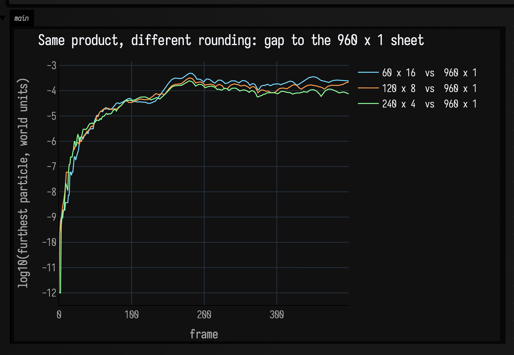

# Physics: particles, constraints and cloth

Make a sheet of cloth, pin some of its particles, and watch it settle. Field's particle solver
uses distance constraints to hold the sheet together; `Cloth` sets up the rectangular grid for you.
`SimdVerlet.debugLines()` draws the solver's state, so you can see the particles and their
connections as you adjust it.

The solver runs on the CPU. Its debug drawing is made of `FLine`s: show them in a box with
`showPlane`, use `Box.lines` for a 3D view, or send them to a Field 4 renderer.

The API is in the [codebase reference](reference/simulation.md). This page covers the thing that
surprises people: `stiffness` and `iterations` act as one knob.

!!! note "If you just want the cloth on screen"
    Open the [`cloth_simdverlet_start`](agent_transcripts.md#cloth_simdverlet_start) starting point
    from Field's welcome screen: a 20 × 10 sheet, an explicit `loop { }`,
    and the debug view, already hanging. Come back here when you want to change the numbers.
    [Frames and the Animation Loop](animation_time_model.md#a-physics-system-in-the-loop) has the same
    scene as a moving picture, and explains why an integrator wants a fixed `dt`.

---

## What the solver holds

A `SimdVerlet.State3` is structure-of-arrays: `x`, `y`, `z`, the previous positions `px`, `py`, `pz`,
the force accumulators `ax`, `ay`, `az`, and an optional `invMass`. A particle is an *index* into all
of those at once, not an object. `SimdVerlet.State3.empty()` gives you an empty one; the simulation
grows it as things are added.

Two consequences of that layout:

- **`invMass == 0` means pinned.** There is no `pinned` flag. Infinite mass is how a particle is
  nailed down, and it is why `Cloth.pin` needs a state that actually has an `invMass` array.
- **The accumulators are scratch.** `step()` **zeroes** `ax/ay/az` at the top of every frame, then
  rebuilds them from gravity, the per-particle force generators, the registered
  `bulkForces`, the `accumulateForces` argument, and finally the constraint solve. Anything you write
  into `ax` *before* calling `step()` is thrown away. Inject forces through a generator or through
  `accumulateForces`, never by pre-accumulating.

  Two more stages run *after* integration, and they are not forces at all: every registered
  `positionProjections` pass (colliders move particles directly), then every `constraintEdits` pass
  (tearing removes constraint slots). See [the world layer](#also-in-the-box) below. The reason they
  are projections and edits rather than forces is the equivalence this page is about.

## Constraints are directed, and there are four of them

`DirectedConstraints4` gives every particle **four outgoing slots**: four neighbour indices, four
rest lengths, four stiffnesses, in parallel arrays. Four because that is exactly the
up/down/left/right neighbourhood of an interior particle in a grid: a cloth's whole topology fits
with nothing spare.

*Directed* is literal: a constraint `i → j` writes its correction **only to `i`**. It
never scatters back to `j`, and that restriction is what makes the solve fast: with no scatter
writes, disjoint particle ranges can be solved on separate threads with a scratch buffer each, and
the whole inner loop vectorises through the JDK Incubator Vector API.

The price is that a symmetric spring is *two* constraints, and it is entirely possible to wire only
one of them. A one-way constraint is a real, useful thing — and also the classic bug. Keep it in
mind for [the debug view](#the-debug-view-draws-what-the-solver-holds) at the bottom of this page.

---

## The two knobs are one knob

Here is the intuition you are probably importing from somewhere else. In a position-based or
Gauss–Seidel solver, each iteration moves the particles and the next iteration sees the result, so
more iterations means a better-converged solve at the same stiffness: `iterations` buys you accuracy
and `stiffness` sets the material.

**That is not this solver.** `solveDirectedDist4InPlaceRange` runs its `iterations` passes over the
same unchanged positions, and each pass *adds* its correction into `ax/ay/az`. Nothing moves in
between; the integrator runs once, afterwards, on the sum. So

> N iterations at stiffness *k* are one iteration at stiffness *N·k*.

`iterations` does not buy convergence. It multiplies your spring constant. The only number the sheet
can feel is the **product**.

So take one product and split it four ways. Same cloth, same gravity, same `dt`, same 200 frames;
the only difference is where the factors of `stiffness × iterations = 960` sit.

```diffstatic_runner {data-lang=kotlin screenshot="assets/physics/equivalence.png" wait="4.0" capture="box" open-outputs="true" w="1020" h="820" padding="14" name="physics-equivalence"}
:::static
import afield.simulation.physics.*

:::fold the sheet, and a ruler for comparing two of them
/*
A 20 x 10 sheet hanging from every fourth particle of row 0. The plane view has y growing DOWN
the screen, so row 0 is the top and gravity is +y. Curvature is off: springs only, so that the
only thing in the picture is the thing being tested.
*/
fun sheet(stiffness: Float) =
    SimdVerlet(SimdVerlet.State3.empty())
        .addCloth(
            width = 20,
            height = 10,
            spacing = 0.5f,
            stiffness = stiffness,
            curvatureStrength = 0f,
            pinned = { col, row -> row == 0 && col % 4 == 0 },
        )

// The largest distance between corresponding particles of two sheets, in world units. Spacing is
// 0.5, so anything below ~1e-3 is invisible and anything below ~1e-6 is arithmetic noise.
fun apart(a: Cloth, b: Cloth): Double {
    var worst = 0.0
    for (k in 0 until a.count) {
        val i = a.base + k
        val j = b.base + k
        val dx = (a.sim.state.x[i] - b.sim.state.x[j]).toDouble()
        val dy = (a.sim.state.y[i] - b.sim.state.y[j]).toDouble()
        val dz = (a.sim.state.z[i] - b.sim.state.z[j]).toDouble()
        worst = maxOf(worst, kotlin.math.sqrt(dx * dx + dy * dy + dz * dz))
    }
    return worst
}

// Frame every panel identically, on a window that just contains all of them — so the panels are
// comparable AND none of them is mostly empty. cellHeight then follows the window's aspect.
fun fit(cloths: List<Cloth>, pad: Double = 0.5): Rect {
    var x0 = Double.MAX_VALUE
    var y0 = Double.MAX_VALUE
    var x1 = -Double.MAX_VALUE
    var y1 = -Double.MAX_VALUE
    for (c in cloths) for (i in c.base until c.end) {
        x0 = minOf(x0, c.sim.state.x[i].toDouble())
        x1 = maxOf(x1, c.sim.state.x[i].toDouble())
        y0 = minOf(y0, c.sim.state.y[i].toDouble())
        y1 = maxOf(y1, c.sim.state.y[i].toDouble())
    }
    return Rect(x0 - pad, y0 - pad, (x1 - x0) + 2 * pad, (y1 - y0) + 2 * pad)
}
:::endfold
// Four splits of one product. 60 x 16 is what the starting point ships.
val splits = [60f to 16, 120f to 8, 240f to 4, 960f to 1]
val cloths = splits.map { (k, _) -> sheet(k) }

repeat(200) {
    splits.forEachIndexed { n, (_, iterations) ->
        cloths[n].step(dt = 1f / 60f, damping = 0.99f, gravity = 2f, iterations = iterations)
    }
}

// Every sheet measured against the last one — one iteration at the full product.
val reference = cloths.last()
val gaps = cloths.map { apart(it, reference) }
:::fold draw the four sheets on one shared window
val window = fit(cloths)
showPlaneGrid(
    *splits
        .mapIndexed { n, (k, iterations) ->
            val gap =
                if (n == splits.lastIndex) "the reference"
                else "furthest particle from the 960 x 1 sheet: ${"%.3g".format(gaps[n])} world units"
            "stiffness ${k.toInt()} x $iterations iterations\n$gap" to cloths[n].sim.debugLines()
        }
        .toTypedArray(),
    columns = 2,
    cellWidth = 470,
    cellHeight = (470 * window.h / window.w).toInt(),
    window = window,
)
:::endfold
```


The four settings give one sheet. The captions show how far the furthest particle strays from the
reference: a tiny fraction of the grid spacing, after two hundred frames. Turning `iterations` up to
tighten the drape turns `stiffness` up by the same factor, and setting `stiffness` directly gets
there at a fraction of the cost.

### Where floating point catches up

The equivalence is exact in real arithmetic and *not quite* exact in `float`: adding `k·e` sixteen
times is not the same rounding as adding `16k·e` once. A hanging sheet amplifies small differences,
so that last-bit difference does not stay last-bit. Below is the same four runs with the gap measured
every frame, plotted as its base-10 logarithm.

```diffstatic_runner {data-lang=kotlin screenshot="assets/physics/equivalence_drift.png" wait="4.0" capture="box" open-outputs="true" w="1080" h="620" padding="14" name="physics-equivalence-drift"}
:::static
import afield.simulation.physics.*

:::fold the same sheet and ruler as above
fun sheet(stiffness: Float) =
    SimdVerlet(SimdVerlet.State3.empty())
        .addCloth(
            width = 20,
            height = 10,
            spacing = 0.5f,
            stiffness = stiffness,
            curvatureStrength = 0f,
            pinned = { col, row -> row == 0 && col % 4 == 0 },
        )

fun apart(a: Cloth, b: Cloth): Double {
    var worst = 0.0
    for (k in 0 until a.count) {
        val i = a.base + k
        val j = b.base + k
        val dx = (a.sim.state.x[i] - b.sim.state.x[j]).toDouble()
        val dy = (a.sim.state.y[i] - b.sim.state.y[j]).toDouble()
        val dz = (a.sim.state.z[i] - b.sim.state.z[j]).toDouble()
        worst = maxOf(worst, kotlin.math.sqrt(dx * dx + dy * dy + dz * dz))
    }
    return worst
}
:::endfold
val splits = [60f to 16, 120f to 8, 240f to 4, 960f to 1]
val cloths = splits.map { (k, _) -> sheet(k) }
val traces = splits.dropLast(1).map { mutableListOf<Number>() }

repeat(400) {
    splits.forEachIndexed { n, (_, iterations) ->
        cloths[n].step(dt = 1f / 60f, damping = 0.99f, gravity = 2f, iterations = iterations)
    }
    // Floor the log at 1e-12 so a frame where two sheets are bit-identical stays on the axis
    // instead of going to negative infinity.
    for (n in traces.indices) {
        traces[n] += kotlin.math.log10(maxOf(apart(cloths[n], cloths.last()), 1e-12))
    }
}
:::fold plot the three gaps
showSignals(
    *splits
        .dropLast(1)
        .mapIndexed { n, (k, iterations) ->
            "${k.toInt()} x $iterations  vs  960 x 1" to traces[n].toList()
        }
        .toTypedArray(),
    channel = "main",
    title = "Same product, different rounding: gap to the 960 x 1 sheet",
    xTitle = "frame",
    yTitle = "log10(furthest particle, world units)",
)
:::endfold
```



The gap climbs by many orders of magnitude in the first hundred frames, then levels off and stays
flat. Damping and a sheet that has found its drape put a ceiling on the amplification, so the
difference settles far below anything you could see.

Two algebraically identical settings therefore give the same-looking cloth, but not the same array
of floats. If you need a run to reproduce bit-exactly (for a recording or a regression test), pin
the split as well as the product.

### Tune the product

Because there is only one number, there is only one ladder to climb. Same sheet, same 400 frames, and
the worst strain any single constraint reaches at any point in the run: `|length − rest| / rest`,
where 100 % means a spring stretched to twice its rest length.

```diffstatic_runner {data-lang=kotlin screenshot="assets/physics/tuning_ladder.png" wait="6.0" capture="box" open-outputs="true" w="1660" h="1000" padding="14" name="physics-tuning-ladder"}
:::static
import afield.simulation.physics.*

:::fold the sheet, and a strain meter that reads the solver's own rest lengths
fun sheet(stiffness: Float, curvature: Float = 0f) =
    SimdVerlet(SimdVerlet.State3.empty())
        .addCloth(
            width = 20,
            height = 10,
            spacing = 0.5f,
            stiffness = stiffness,
            curvatureStrength = curvature,
            pinned = { col, row -> row == 0 && col % 4 == 0 },
        )

// Worst |length - rest| / rest over every live slot of every particle. Read straight out of the
// constraint set, so it is the strain the SOLVER thinks it has, not one recomputed from the grid.
fun strain(cloth: Cloth): Double {
    val c = cloth.constraints
    val s = cloth.sim.state
    var worst = 0.0
    for (i in cloth.base until cloth.end) {
        val neighbours = intArrayOf(c.n0[i], c.n1[i], c.n2[i], c.n3[i])
        val rests = floatArrayOf(c.r0[i], c.r1[i], c.r2[i], c.r3[i])
        val stiffs = floatArrayOf(c.s0[i], c.s1[i], c.s2[i], c.s3[i])
        for (slot in 0 until 4) {
            val j = neighbours[slot]
            if (j < 0 || stiffs[slot] == 0f || rests[slot] <= 0f) continue
            val dx = (s.x[i] - s.x[j]).toDouble()
            val dy = (s.y[i] - s.y[j]).toDouble()
            val dz = (s.z[i] - s.z[j]).toDouble()
            val length = kotlin.math.sqrt(dx * dx + dy * dy + dz * dz)
            worst = maxOf(worst, kotlin.math.abs(length - rests[slot]) / rests[slot])
        }
    }
    return worst
}

// Frame every panel identically, on a window that just contains all of them — so the panels are
// comparable AND none of them is mostly empty. cellHeight then follows the window's aspect.
fun fit(cloths: List<Cloth>, pad: Double = 0.5): Rect {
    var x0 = Double.MAX_VALUE
    var y0 = Double.MAX_VALUE
    var x1 = -Double.MAX_VALUE
    var y1 = -Double.MAX_VALUE
    for (c in cloths) for (i in c.base until c.end) {
        x0 = minOf(x0, c.sim.state.x[i].toDouble())
        x1 = maxOf(x1, c.sim.state.x[i].toDouble())
        y0 = minOf(y0, c.sim.state.y[i].toDouble())
        y1 = maxOf(y1, c.sim.state.y[i].toDouble())
    }
    return Rect(x0 - pad, y0 - pad, (x1 - x0) + 2 * pad, (y1 - y0) + 2 * pad)
}
:::endfold
// Run one setting for 400 frames. If it blows up, stop at the first non-finite frame and rewind the
// positions to the last finite one, so the panel shows the last state that was still a cloth.
fun runLadder(stiffness: Float, iterations: Int, curvature: Float = 0f): Triple<Cloth, Double, Int> {
    val cloth = sheet(stiffness, curvature)
    val s = cloth.sim.state
    val lastX = s.x.copyOf()
    val lastY = s.y.copyOf()
    val lastZ = s.z.copyOf()
    var peak = 0.0
    var blewUpAt = -1
    for (frame in 1..400) {
        cloth.step(dt = 1f / 60f, damping = 0.99f, gravity = 2f, iterations = iterations)
        val now = strain(cloth)
        if (!now.isFinite()) {
            blewUpAt = frame
            break
        }
        peak = maxOf(peak, now)
        s.x.copyInto(lastX)
        s.y.copyInto(lastY)
        s.z.copyInto(lastZ)
    }
    if (blewUpAt > 0) {
        lastX.copyInto(s.x)
        lastY.copyInto(s.y)
        lastZ.copyInto(s.z)
    }
    return Triple(cloth, peak, blewUpAt)
}

// Each rung twice: springs alone, and again with the curvature force the starting place ships,
// because that is the difference between this ladder and the one in dev_docs.
val ladder =
    [0.8f to 8, 8f to 8, 20f to 16, 60f to 16].map { (k, i) ->
        Triple(k to i, runLadder(k, i), runLadder(k, i, curvature = 100f))
    }
:::fold draw the ladder on one shared window, so the rungs are comparable
fun verdict(result: Triple<Cloth, Double, Int>): String {
    val (_, peak, blewUpAt) = result
    return if (blewUpAt > 0) "NOT FINITE from frame $blewUpAt" else "${(peak * 100).f0} %"
}

val window = fit(ladder.map { it.second.first })
showPlaneGrid(
    *ladder
        .map { (setting, bare, curved) ->
            val (k, iterations) = setting
            "stiffness $k x $iterations  (product ${(k * iterations).f0})\n" +
                "peak strain ${verdict(bare)}  ·  with curvature 100: ${verdict(curved)}" to bare.first.sim.debugLines()
        }
        .toTypedArray(),
    columns = 4,
    cellWidth = 380,
    cellHeight = (380 * window.h / window.w).toInt(),
    window = window,
)
:::endfold
```


At the lowest product some springs stretch to many times their rest length, which is why that panel
is a tall web rather than a cloth. Strain falls as the product rises, up to the 960 the starting
point ships.

Strain falls more slowly than the product rises. The captions are peaks over the whole run, reached
while the sheet is still falling, so they are not the sag at rest. Measure the strain in your own
scene rather than interpolating these.

The second half of each caption adds the curvature force, and it does not give you strain headroom.
At 100 it makes every rung a little worse, a few percent at the stiff end. The curvature pass
adds into the same `ax/ay/az` the springs do, so at these strengths it is one more load on the sheet
rather than a stiffener.

??? aside "The repository records a different ladder"
    [`SIMDVERLET_4_CONSTRAINTS.md`](https://github.com/OpenEndedGroup/Field4/blob/main/dev_docs/physics/SIMDVERLET_4_CONSTRAINTS.md) runs the same four rungs and reports different
    numbers. Those are settled values read off a box that has stopped moving, on a scene with the
    curvature force on; the captions here are peaks over the fall with curvature off. The ordering
    is the same.

### Divergence at the high end

At a high enough product the solve does what explicit integration does: the correction overshoots,
the overshoot is corrected harder, and the run stops being a number. Nothing is clamped. The first
step that leaves a coordinate non-finite prints a warning in the box's output naming the step size
and iteration count, and `sim.diverged` turns true.

The strain trace carries plenty of warning before the `NaN` arrives, for anyone who is watching it.

```diffstatic_runner {data-lang=kotlin screenshot="assets/physics/divergence.png" wait="5.0" capture="box" open-outputs="true" w="1200" h="620" padding="14" name="physics-divergence"}
:::static
import afield.simulation.physics.*

:::fold the sheet and the strain meter, exactly as above
fun sheet(stiffness: Float) =
    SimdVerlet(SimdVerlet.State3.empty())
        .addCloth(
            width = 20,
            height = 10,
            spacing = 0.5f,
            stiffness = stiffness,
            curvatureStrength = 0f,
            pinned = { col, row -> row == 0 && col % 4 == 0 },
        )

fun strain(cloth: Cloth): Double {
    val c = cloth.constraints
    val s = cloth.sim.state
    var worst = 0.0
    for (i in cloth.base until cloth.end) {
        val neighbours = intArrayOf(c.n0[i], c.n1[i], c.n2[i], c.n3[i])
        val rests = floatArrayOf(c.r0[i], c.r1[i], c.r2[i], c.r3[i])
        val stiffs = floatArrayOf(c.s0[i], c.s1[i], c.s2[i], c.s3[i])
        for (slot in 0 until 4) {
            val j = neighbours[slot]
            if (j < 0 || stiffs[slot] == 0f || rests[slot] <= 0f) continue
            val dx = (s.x[i] - s.x[j]).toDouble()
            val dy = (s.y[i] - s.y[j]).toDouble()
            val dz = (s.z[i] - s.z[j]).toDouble()
            val length = kotlin.math.sqrt(dx * dx + dy * dy + dz * dz)
            worst = maxOf(worst, kotlin.math.abs(length - rests[slot]) / rests[slot])
        }
    }
    return worst
}
:::endfold
// The rung that settles, and the next one up, traced frame by frame. Once a trace stops being
// finite it stops: there is nothing after that to plot.
val watched = [60f to 16, 100f to 16, 150f to 16]
val traces = watched.map { (k, iterations) ->
    val cloth = sheet(k)
    val trace = mutableListOf<Number>()
    var diedAt = -1
    var warnedAt = -1
    for (frame in 1..400) {
        cloth.step(dt = 1f / 60f, damping = 0.99f, gravity = 2f, iterations = iterations)
        val now = strain(cloth)
        if (!now.isFinite()) {
            diedAt = frame
            break
        }
        // 100 % strain — a spring at twice its rest length — is the point of no return here.
        if (warnedAt < 0 && now > 1.0) warnedAt = frame
        trace += kotlin.math.log10(maxOf(now, 1e-4))
    }
    Triple("${k.toInt()} x $iterations", trace, if (diedAt > 0) warnedAt to diedAt else null)
}

// The headline goes in the title rather than in a series label, so the legend stays narrow and the
// plot keeps the width.
val blewUp = traces.first { it.third != null }
val (past100, nan) = blewUp.third!!
:::fold plot the three traces
showSignals(
    *traces.map { (label, trace, _) -> label to trace.toList() }.toTypedArray(),
    channel = "main",
    title = "Peak strain per frame — ${blewUp.first}: 100 % at $past100, NaN at $nan",
    xTitle = "frame",
    yTitle = "log10(peak strain)",
)
:::endfold
```


Two of the three settle and stay flat for the whole run. The third leaves them, and the title gives
the frame where it passes 100 % strain and the frame where its coordinates become `NaN`: about a
second at 60 fps between visibly wrong and gone. Once it is past 100 % it never comes back.

The middle trace, `100 × 16`, settles, so the ceiling at this `dt` lies between its product and the
top one's. Do not carry that number to another scene: a smaller or lighter sheet takes more.

Watch the peak strain rather than the picture. The measurement is the short `strain` function folded
into the block above. It is cheap, and it goes wrong long before the drawing does.

!!! warning "Stability goes as `stiffness × iterations × dt²`"
    All the numbers on this page are at `dt = 1/60`. Run the same settings at `dt = 1/30` and you
    have multiplied the term that decides stability by four. This is the main reason [the frames
    page](animation_time_model.md#a-physics-system-in-the-loop) argues for handing the solver a
    *fixed* `dt` rather than the wall-clock time since the last frame: a `dt` that jitters with the
    frame rate is a stiffness that jitters with the frame rate.

---

## Curvature

Distance constraints alone give you a net, not a fabric. Nothing in them resists *bending*: a sheet
can fold to a crease and every spring is still at rest length. `Cloth` adds an optional curvature
force: each interior particle is pulled toward the mean of its four axis neighbours, which flattens
the sheet and takes the kink out of the festoons.

It is registered as **one bulk pass over the whole patch**, in `SimdVerlet.bulkForces`, rather than as
a force generator per particle: the per-particle path would charge `width × height` coroutine
resumes every frame for what is a single scalar sweep. `cloth.curvatureStrength = 0f` switches it off
live without unregistering anything.

`curvatureStrength` accumulates into the same `ax/ay/az` the constraint solve does, so its scale is
the springs', and it defaults to a third of `stiffness`: 20 for the sheet below.

```diffstatic_runner {data-lang=kotlin screenshot="assets/physics/curvature.png" wait="5.0" capture="box" open-outputs="true" w="1180" h="720" padding="14" name="physics-curvature"}
:::static
import afield.simulation.physics.*

:::fold the sheet, now with a curvature strength, and the same ruler
fun sheet(curvature: Float) =
    SimdVerlet(SimdVerlet.State3.empty())
        .addCloth(
            width = 20,
            height = 10,
            spacing = 0.5f,
            stiffness = 60f,
            curvatureStrength = curvature,
            pinned = { col, row -> row == 0 && col % 4 == 0 },
        )

fun apart(a: Cloth, b: Cloth): Double {
    var worst = 0.0
    for (k in 0 until a.count) {
        val i = a.base + k
        val j = b.base + k
        val dx = (a.sim.state.x[i] - b.sim.state.x[j]).toDouble()
        val dy = (a.sim.state.y[i] - b.sim.state.y[j]).toDouble()
        val dz = (a.sim.state.z[i] - b.sim.state.z[j]).toDouble()
        worst = maxOf(worst, kotlin.math.sqrt(dx * dx + dy * dy + dz * dz))
    }
    return worst
}

// Frame every panel identically, on a window that just contains all of them — so the panels are
// comparable AND none of them is mostly empty. cellHeight then follows the window's aspect.
fun fit(cloths: List<Cloth>, pad: Double = 0.5): Rect {
    var x0 = Double.MAX_VALUE
    var y0 = Double.MAX_VALUE
    var x1 = -Double.MAX_VALUE
    var y1 = -Double.MAX_VALUE
    for (c in cloths) for (i in c.base until c.end) {
        x0 = minOf(x0, c.sim.state.x[i].toDouble())
        x1 = maxOf(x1, c.sim.state.x[i].toDouble())
        y0 = minOf(y0, c.sim.state.y[i].toDouble())
        y1 = maxOf(y1, c.sim.state.y[i].toDouble())
    }
    return Rect(x0 - pad, y0 - pad, (x1 - x0) + 2 * pad, (y1 - y0) + 2 * pad)
}
:::endfold
// Off, a weak 0.05, the default at this stiffness (60 / 3 = 20), and 100. Everything else is identical.
val strengths = [0f, 0.05f, 20f, 100f]
val cloths = strengths.map { sheet(it) }

repeat(300) { cloths.forEach { it.step(dt = 1f / 60f, damping = 0.99f, gravity = 2f, iterations = 16) } }

// Measured against the sheet with no curvature force at all.
val gaps = cloths.map { apart(it, cloths.first()) }
:::fold draw the four
val window = fit(cloths)
showPlaneGrid(
    *strengths
        .mapIndexed { n, strength ->
            val label = if (strength == 0f) "curvature off" else "curvatureStrength = $strength"
            "$label\nfurthest particle from the sheet with none: ${"%.3g".format(gaps[n])} world units" to
                cloths[n].sim.debugLines()
        }
        .toTypedArray(),
    columns = 2,
    cellWidth = 470,
    cellHeight = (470 * window.h / window.w).toInt(),
    window = window,
)
:::endfold
```


At `stiffness × iterations = 960`, `0.05` barely moves the sheet: the caption's distance is a tiny
fraction of one grid spacing. The default of `20` and `100` move it visibly, giving a flatter sheet
with shallower festoons.

---

## `Cloth`

`sim.addCloth(width, height, ...)` appends a grid patch to a simulation **that may already contain
other particles**, wires the four slots, pins what `pinned` selects, registers the curvature pass, and
hands back a handle that speaks grid coordinates: `cloth[col, row]` is a particle index, `position`,
`pin`, `teleport`, `grabNearest` and `lines()` all address the grid rather than the flat arrays.

Three rules follow from that shape.

**One constraint set per simulation, not per cloth.** The solver walks `0 until state.size` and
indexes the slot arrays by *particle* index, so a set cannot cover only part of a simulation. A cloth
adopts `sim.constraints4` if there already is one and otherwise publishes the one it creates. Two
cloths in one simulation therefore share a single set, and `sim.step(dt, damping, gravity,
iterations)` solves it.

**`cloth.step(...)` steps the whole simulation.** It is a convenience for the common case where the
cloth *is* the simulation. With other systems in the same [`SimdVerlet`](reference/simulation.md#simdverlet-kt-simdverlet), drive it yourself.

**A cloth is a contiguous index range.** Its particles are `[base, base + count)`, and both the
slots and the curvature sweep are written in those terms. Appending particles after a cloth is fine;
`queueRemove` refuses a particle inside or below one, since removing it would renumber the cloth.

Dragging goes through `grabNearest`, which installs a **PID position controller** on the nearest
particle rather than teleporting it. The difference matters: a teleport moves one particle out of the
sheet and lets the solve fight it back, while a controller pulls *through* the constraint solve, so
the sheet follows the hand instead of snapping at it.

Here two copies of the same hanging sheet have their bottom-centre corner carried four units to the
right over thirty steps (the orange line is the hand's path). One is teleported each step and one is
held by `grabNearest`:

```diffstatic_runner {data-lang=kotlin screenshot="assets/physics/cloth_grab.png" embed=true wait="4.0" capture="box" open-outputs="true" w="1080" h="560" padding="14" name="physics-cloth-grab" alt="Two panels of the same pinned cloth after its bottom-centre corner has been carried right along an orange line. On the left, teleported, a fan of long stretched constraints runs from the middle of the sheet to the corner. On the right, grabbed, the grid stays even and the corner region folds after the hand."}
import afield.simulation.physics.*

fun sheet() =
    SimdVerlet(SimdVerlet.State3.empty())
        .addCloth(
            width = 20,
            height = 12,
            spacing = 0.5f,
            stiffness = 60f,
            pinned = { col, row -> row == 0 && col % 4 == 0 },
        )

val snapped = sheet()
val followed = sheet()
repeat(120) {
    snapped.step(dt = 1f / 60f, damping = 0.99f, gravity = 2f, iterations = 16)
    followed.step(dt = 1f / 60f, damping = 0.99f, gravity = 2f, iterations = 16)
}

// The bottom-centre corner of each sheet, and a hand that carries it 4 units right over 30 steps.
val start = followed.position(10, 11)
followed.grabNearest(start.x(), start.y(), start.z())
val hand = FLine()
repeat(30) { k ->
    val target = vec(start.x() + 4.0 * (k + 1) / 30, start.y().toDouble(), start.z().toDouble())
    hand.lineTo(target.x, target.y)
    snapped.teleport(10, 11, target)
    followed.moveGrabbed(target.x.toFloat(), target.y.toFloat(), target.z.toFloat())
    snapped.step(dt = 1f / 60f, damping = 0.99f, gravity = 2f, iterations = 16)
    followed.step(dt = 1f / 60f, damping = 0.99f, gravity = 2f, iterations = 16)
}

fun drawn(c: Cloth) = c.lines().onEach {
    it.color = vec(0.74, 0.82, 0.94, 0.8)
    it.thickness = 1.2
} +
        hand.also {
            it.color = vec(1.0, 0.55, 0.2, 1.0)
            it.thickness = 2.0
        }
showPlaneGrid(
    "teleport: the corner is moved out of the sheet each step" to drawn(snapped),
    "grabNearest: a PID controller pulls the corner through the solve" to drawn(followed),
    columns = 2,
    cellWidth = 480,
)
```

---

## The debug view draws what the solver holds

`SimdVerlet.debugLines()` returns `FLine`s: one segment per live distance constraint, a dot per
particle, pinned particles in their own colour, and optional velocity whiskers. It draws the
*constraint set*, where `cloth.lines()` draws the *grid you asked for*.

Those are different pictures exactly when something is wrong. Below, one interior particle has had
one of its four slots re-pointed at a particle most of a sheet away, with the rest length measured
from the layout so that the constraint starts satisfied and never announces itself as a snap or a
crease.

```diffstatic_runner {data-lang=kotlin screenshot="assets/physics/debug_view.png" wait="5.0" capture="box" open-outputs="true" w="1080" h="900" padding="14" name="physics-debug-view"}
:::static
import afield.simulation.physics.*

:::fold the sheet, and the ruler
fun sheet() =
    SimdVerlet(SimdVerlet.State3.empty())
        .addCloth(
            width = 20,
            height = 10,
            spacing = 0.5f,
            stiffness = 60f,
            curvatureStrength = 0f,
            pinned = { col, row -> row == 0 && col % 4 == 0 },
        )

fun apart(a: Cloth, b: Cloth): Double {
    var worst = 0.0
    for (k in 0 until a.count) {
        val i = a.base + k
        val j = b.base + k
        val dx = (a.sim.state.x[i] - b.sim.state.x[j]).toDouble()
        val dy = (a.sim.state.y[i] - b.sim.state.y[j]).toDouble()
        val dz = (a.sim.state.z[i] - b.sim.state.z[j]).toDouble()
        worst = maxOf(worst, kotlin.math.sqrt(dx * dx + dy * dy + dz * dz))
    }
    return worst
}

// Frame every panel identically, on a window that just contains all of them — so the panels are
// comparable AND none of them is mostly empty. cellHeight then follows the window's aspect.
fun fit(cloths: List<Cloth>, pad: Double = 0.5): Rect {
    var x0 = Double.MAX_VALUE
    var y0 = Double.MAX_VALUE
    var x1 = -Double.MAX_VALUE
    var y1 = -Double.MAX_VALUE
    for (c in cloths) for (i in c.base until c.end) {
        x0 = minOf(x0, c.sim.state.x[i].toDouble())
        x1 = maxOf(x1, c.sim.state.x[i].toDouble())
        y0 = minOf(y0, c.sim.state.y[i].toDouble())
        y1 = maxOf(y1, c.sim.state.y[i].toDouble())
    }
    return Rect(x0 - pad, y0 - pad, (x1 - x0) + 2 * pad, (y1 - y0) + 2 * pad)
}
:::endfold
val good = sheet()
val bad = sheet()

/*
The bug. Particle (4, 7) keeps four slots, but slot 0 — its downward neighbour — now points at
(16, 2), most of a sheet away. The rest length is measured from the layout, so the constraint starts satisfied
and contributes almost no force: this is the kind of wiring mistake that does not announce itself.
*/
val from = bad[4, 7]
val to = bad[16, 2]
val s = bad.sim.state
val rest =
    kotlin.math
        .sqrt(
            ((s.x[from] - s.x[to]).toDouble()).let { it * it } +
                ((s.y[from] - s.y[to]).toDouble()).let { it * it } +
                ((s.z[from] - s.z[to]).toDouble()).let { it * it },
        )
        .toFloat()
bad.constraints.setSlot(from, 0, to, rest, 60f)

repeat(200) {
    good.step(dt = 1f / 60f, damping = 0.99f, gravity = 2f, iterations = 16)
    bad.step(dt = 1f / 60f, damping = 0.99f, gravity = 2f, iterations = 16)
}

val divergence = apart(good, bad)
:::fold four panels: the wireframe of each, then the solver's own view of each
val window = fit([good, bad])
val pale = vec(0.74, 0.82, 0.94, 0.8)
fun wire(c: Cloth) = c.lines().onEach {
    it.color = pale
    it.thickness = 1.2
}

showPlaneGrid(
    "cloth.lines() — correctly wired\nthe grid, drawn row by row and column by column" to wire(good),
    "cloth.lines() — one slot mis-wired\nfurthest particle from the correct sheet: ${"%.3g".format(divergence)} world units" to
        wire(bad),
    "sim.debugLines() — correctly wired\none segment per live constraint, pins in red" to good.sim.debugLines(),
    "sim.debugLines() — one slot mis-wired\nthe same sheet; the bug is the long diagonal" to bad.sim.debugLines(),
    columns = 2,
    cellWidth = 470,
    cellHeight = (470 * window.h / window.w).toInt(),
    window = window,
)
:::endfold
```


The top row is the picture you would naturally draw. The caption shows the two sheets more than a
grid spacing apart at their furthest particle, yet the bug is invisible in that drawing, because
`cloth.lines()` walks rows and columns *by index*, so the grid it draws is still the grid you asked
for. The bottom row is the same two sheets with the constraint set drawn instead, and the bug is the
long diagonal running up across the right-hand panel.

The dedup rule keeps that bug visible. A **symmetric** pair (`i → j` *and* `j → i`, as a `Cloth`
grid wires it) is drawn once; a **one-way** constraint is drawn by its owner. Deduplicating on
`j < i` alone would hide the asymmetry the view exists to show.

Two more things about the drawing:

- **It follows the set the simulation actually solves** — `constraints4` if there is one, otherwise
  the 3-slot `constraints`. An unused slot (neighbour `-1`, or zero stiffness) draws nothing, so a
  constraint that was never wired shows up as a *gap*.
- **`thickness` and `pointSize` are in the units the output uses.** Pixels of the mapped frame for
  `showPlane` / `showPlaneGrid`; world units for `Box.lines` and the Field 4 renderers, where
  they want to be very much smaller. The dot radius convention is `pointSize * 3`.

Pass `particles = cloth.base until cloth.end` to draw one cloth out of a busier simulation, and
`velocityScale` to get a whisker per particle of one frame's travel, which is the fastest way to see
that a sheet has begun to vibrate before it becomes visible as motion.

---

## A slinky walking down stairs

A slinky set going at the top of a flight walks down it on its own, end over end, on nothing but
the energy of its fall. The scene below is a [`SlinkyOnStairs`](reference/simulation.md#slinky-kt-slinkyonstairs):
a 40-coil [`Slinky`](reference/simulation.md#slinky-kt-slinky) standing shut on the top step of a
[`StaircaseCollider`](reference/simulation.md#simdverletcolliders-kt-staircasecollider). For its
first 0.6 s a hand lifts the top coil over in an arc and puts it down on the next step, the way
you would start one. Then it lets go, and the slinky is on its own.
[`step`](reference/simulation.md#slinky-kt--slinkyonstairs--step) advances the simulation, and
[`lines`](reference/simulation.md#slinky-kt--slinkyonstairs--lines) draws the current coils and stairs.

The box shows the walk at a fifth of its speed, because at full speed a flip takes about a quarter
of a second. Slowing it down does not change it: the scene always steps in substeps of 1/600 s,
so a frame of 1/300 s shown sixty times a second is the same walk, slowed by five. The stair and spring controls start the slinky again. The slow-motion slider changes playback
speed without restarting it.

```diffstatic_runner {data-lang=kotlin video="assets/physics/slinky_walk.mp4" capture="box" open-outputs="true" wait-output="true" wait-output-kind="display" execution="launch" duration="20" fps="24" timeout="300" w="760" h="620" embed=true name="physics-slinky-walk" alt="a rainbow slinky, drawn side-on as forty coloured coil lines on grey stairs, in slow motion: a hand lifts its top coil over in an arc onto the next step down and lets go, and the slinky walks on by itself, its top end falling over the edge and pulling the rest after it while the bottom coils lift, arc over and land past the others, flip after flip, the caption counting flips and steps down"}
:::static
import afield.simulation.physics.*

// Lengths are in coil diameters. The slow-motion factor changes only how fast the picture runs.
var run = 1.5f
var rise = 1.1f
var stiffness = 32000f
var slowMotion = 5

fun start() = SlinkyOnStairs(run = run, rise = rise, stiffness = stiffness)
var scene = start()

controlGroup("slinky") {
    slider("tread depth", min = 1.2, max = 2.6, step = 0.05, initialValue = 1.5) {
        run = it.toFloat()
        scene = start()
    }
    slider("step rise", min = 0.6, max = 3.0, step = 0.05, initialValue = 1.1) {
        rise = it.toFloat()
        scene = start()
    }
    slider("spring constant", min = 8000.0, max = 48000.0, step = 1000.0, initialValue = 32000.0) {
        stiffness = it.toFloat()
        scene = start()
    }
    slider("slow motion", min = 1.0, max = 10.0, step = 1.0, initialValue = 5.0) { slowMotion = it.toInt() }
    button("start again") { down -> if (down) scene = start() }
}

// One frame of the picture every sixtieth of a second, each a slowMotion-th of a sixtieth of the walk.
val clock = AnimationClock.nowSeconds()
var shown = 0.0
loop {
    val now = AnimationClock.nowSeconds() - clock
    var catchUp = 0
    while (shown < now && catchUp++ < 4) {
        scene.step(1f / 60f / slowMotion)
        shown += 1.0 / 60.0
    }
    shown = maxOf(shown, now - 0.1)

    val c = scene.slinky.centroid()
    showPlane(
        scene.lines(),
        window = Rect(c.x - 5.0, c.y - 3.5, 10.0, 7.0),
        width = 720,
        height = 504,
        title = "a slinky walking down stairs · 1/$slowMotion speed",
        caption = "t = ${scene.time.f2} s · ${scene.flips} flips · ${scene.stepsDescended.f1} steps down",
    )
}
```

The hand's arc tips the stack over the edge. From then on each flip is the same three movements:
the coils at the top fall over the nosing and stretch the spring down to the next tread, the
stretched spring pulls the coils left behind up off their step, and they arc over the others and
land beyond them. On these stairs the slinky soon settles into a stride of two or three steps a
flip, and keeps it for as long as there are stairs.

### One flip

Eight moments of one flip, a thirtieth of a second apart, from the same walk once it has settled
into its stride:

```diffstatic_runner {data-lang=kotlin screenshot="assets/physics/slinky_one_flip.png" wait="3.0" capture="box" open-outputs="true" w="1180" h="560" padding="14" name="physics-slinky-one-flip"}
:::static
import afield.simulation.physics.*

// Walk twenty flips into the default scene, then take a picture every two frames.
val scene = SlinkyOnStairs()
while (scene.flips < 20) scene.step()
val moments = (0 until 8).map { k ->
    if (k > 0) repeat(2) { scene.step() }
    "t = ${scene.time.f3} s" to scene.lines(halfWidth = 3.5f)
}

showPlaneGrid(*moments.toTypedArray(), columns = 4, cellWidth = 270, cellHeight = 230)
```


The two ends trade places. The violet coils that were at the back lift off and travel over the
whole spring, and the flip ends with the slinky stretched out again, further down the flight,
red end trailing.

### What the model holds

A slinky seen side-on is a stack of short lines, one per coil, and that is how `Slinky` stores it:
two particles per coil, one for each rim, in the same `SimdVerlet` as everything else on this
page.

- **Axial stiffness.** Neighbouring rims are joined by two rail springs in `constraints4`, at
  `stiffness`. Their rest length is shorter than the wire is thick (`preload`), so at rest the
  coils press together and it takes a pull to open them, as with the real toy.
- **Coil–coil contact.** A coil cannot come closer to the next than one wire thickness. The
  contact pushes against the lower coil's face and turns that coil like a lever about the point
  where it is pushed, so a shut stack is stiff in bending (bending it would push one side of a
  coil through its neighbour) while an open stretch bends freely. Touching coils stop dead
  against each other, so every landing loses the energy it should.
- **Shear.** Crossed diagonal springs between neighbouring coils (`shearStiffness`) keep the coils
  stacked across the axis rather than sliding off each other like a deck of cards.
- **Stairs with edges.** The stairs push on each coil along its length, not only at its rims, so
  a step's nosing cannot slip between two particles and hang the slinky on it.

Everything that walks the slinky comes out of the fall. The springs are real springs, and every
projection in the coil pass moves particles along its constraint's whole gradient, so it keeps
momentum and can only take energy out. A slinky stretched open and let go in empty space, with no
drag, snaps shut and rings down to nothing without ever gaining energy
(`SlinkyTest.aSnappedSlinkyOnlyLosesEnergy` checks exactly that), and a shut stack stood on a
floor stays still. The walk is what is left when the
drop of each step pays for the next flip.

### One step at a time, and then it stops

On longer treads the stride changes. The walk below is the same slinky with a softer spring, on
treads 2.1 diameters deep: each flip now lands exactly one step down, the gait a slinky has on a
real staircase. It is also the gait that runs out. One step's drop only just pays for one flip,
and after about twenty of them the slinky lands shut on a tread and stays there. This video
runs at full speed.

```diffstatic_runner {data-lang=kotlin video="assets/physics/slinky_one_step.mp4" capture="box" open-outputs="true" wait-output="true" wait-output-kind="display" execution="launch" duration="16" fps="24" timeout="300" w="760" h="620" embed=true name="physics-slinky-one-step" alt="the rainbow slinky on stairs with deeper treads, at full speed: each flip lands it exactly one step lower, and after about twenty flips it lands shut on a tread, leaning over, and stays there while the caption stops counting"}
:::static
import afield.simulation.physics.*

val scene = SlinkyOnStairs(run = 2.1f, stiffness = 16000f)

val clock = AnimationClock.nowSeconds()
var shown = 0.0
loop {
    val now = AnimationClock.nowSeconds() - clock
    var catchUp = 0
    while (shown < now && catchUp++ < 4) {
        scene.step()
        shown += 1.0 / 60.0
    }
    shown = maxOf(shown, now - 0.1)

    val c = scene.slinky.centroid()
    showPlane(
        scene.lines(),
        window = Rect(c.x - 5.0, c.y - 3.5, 10.0, 7.0),
        width = 720,
        height = 504,
        title = "one step a flip · tread 2.1, spring 16000",
        caption = "t = ${scene.time.f1} s · ${scene.flips} flips · ${scene.stepsDescended.f1} steps down",
    )
}
```

A slinky stopping is part of the toy, and it stops here for the reason it stops on a real
staircase: each flip loses a little more at its landing than the step gave it, until one flip is
short of what it takes to lift the far end over. Where it comes to rest is less like the toy. The
shut stack ends up leaning over at about 45°, its coils slid sideways over each other, which a
real slinky's wire would not allow: the model's shear springs are softer than a real helix.

### Down an up escalator

Give the staircase a `stepPeriod` and its treads rise, one step every `stepPeriod` seconds, carrying
up whatever stands on them. A slinky can walk down an escalator that is moving up, and stay where
it is. The idea comes from the [slinky escalator benchmark](https://morethanamachine.com/posts/slinky-escalator-benchmark/)
on More Than a Machine.

An escalator moving at a constant speed is no different from still stairs if you ride along with
it: gravity, the spring and the friction against the treads all behave the same way in that
frame; only the still air, a light drag, can tell them apart. So the slinky walks down the moving
treads as it walks down still ones, at its own pace of about ten steps a second, and the
escalator decides only where that walk ends up. Set the
treads rising at the slinky's own pace and it stays put. `SlinkyOnStairs` starts the escalator at
the moment the hand lets go, and gives everything the treads' velocity then, as if the hand had
been riding the escalator all along.

```diffstatic_runner {data-lang=kotlin video="assets/physics/slinky_escalator.mp4" capture="box" open-outputs="true" wait-output="true" wait-output-kind="display" execution="launch" duration="20" fps="24" timeout="300" w="760" h="620" embed=true name="physics-slinky-escalator" alt="the rainbow slinky in slow motion on grey stairs whose treads rise toward the upper left; it walks end over end down the moving treads, and the caption shows the steps it has walked and the steps the escalator has carried up climbing together"}
:::static
import afield.simulation.physics.*

// 0.09 s per step is about the slinky's own pace on these stairs.
var stepPeriod = 0.09f
val slowMotion = 5

fun start() = SlinkyOnStairs(stepPeriod = stepPeriod)
var scene = start()

controlGroup("escalator") {
    slider("seconds per step", min = 0.06, max = 0.3, step = 0.005, initialValue = 0.09) {
        stepPeriod = it.toFloat()
        scene.stepPeriod = stepPeriod
    }
    button("start again") { down -> if (down) scene = start() }
}

val clock = AnimationClock.nowSeconds()
var shown = 0.0
loop {
    val now = AnimationClock.nowSeconds() - clock
    var catchUp = 0
    while (shown < now && catchUp++ < 4) {
        scene.step(1f / 60f / slowMotion)
        shown += 1.0 / 60.0
    }
    shown = maxOf(shown, now - 0.1)

    // Follow the slinky; the caption says how far the escalator has moved it from its start.
    val c = scene.slinky.centroid()
    val behind = scene.stairsTravelled - scene.stepsDescended
    showPlane(
        scene.lines(),
        window = Rect(c.x - 5.0, c.y - 3.5, 10.0, 7.0),
        width = 720,
        height = 504,
        title = "a slinky on an up escalator · ${scene.stepPeriod.f3} s per step · 1/$slowMotion speed",
        caption = "t = ${scene.time.f2} s · walked ${scene.stepsDescended.f1} steps · " +
            "escalator ${scene.stairsTravelled.f1} · carried up ${behind.f1}",
    )
}
```

The escalator in the video rises at 0.09 s a step, which is about the slinky's own pace on
these stairs. The caption's two counts climb together, and the slinky never gets carried more than
a few steps up from where it was let go.

Thirty seconds on four escalators, plotted as how many steps each slinky has been carried up from
where it was let go (zero is staying put, below zero is outwalking the escalator):

```diffstatic_runner {data-lang=kotlin screenshot="assets/physics/slinky_escalators.png" wait="3.0" capture="box" open-outputs="true" w="1100" h="520" padding="14" name="physics-slinky-escalators"}
:::static
import afield.simulation.physics.*

// Steps carried up from the start, sampled ten times a second, for thirty seconds.
fun carriedUp(scene: SlinkyOnStairs): Pair<List<Double>, List<Double>> {
    val seconds = ArrayList<Double>()
    val steps = ArrayList<Double>()
    var frame = 0
    while (scene.time < 30f) {
        scene.step()
        if (frame++ % 6 == 0) {
            seconds += scene.time.toDouble()
            steps += (scene.stairsTravelled - scene.stepsDescended).toDouble()
        }
    }
    return seconds to steps
}

val (t1, matched) = carriedUp(SlinkyOnStairs(stepPeriod = 0.09f))
val (t2, slower) = carriedUp(SlinkyOnStairs(stepPeriod = 0.12f))
val (t3, slowest) = carriedUp(SlinkyOnStairs(stepPeriod = 0.15f))
val (t4, oneStep) = carriedUp(SlinkyOnStairs(run = 2.1f, stiffness = 16000f, stepPeriod = 0.6f))

showChart(
    Chart(
        title = "steps carried up from the start",
        xLabel = "seconds",
        yLabel = "steps",
    )
        .line("0.09 s per step", t1, matched)
        .line("0.12 s per step", t2, slower)
        .line("0.15 s per step", t3, slowest)
        .line("one step a flip, 0.6 s per step", t4, oneStep)
)
```

![A line chart of steps carried up against seconds, over thirty seconds. The blue line, 0.09 s per step, wanders within about ten steps of zero for the whole run. The orange line, 0.12 s per step, climbs to about 35 steps by eleven seconds, then turns and walks back down past zero. The green line, 0.15 s per step, falls steadily to about minus 105: that escalator is too slow, and the slinky outwalks it. The yellow line, the one-step slinky on a 0.6 s escalator, stays at zero for nine seconds and then rises in a straight line as the stopped slinky rides the escalator up.](assets/physics/slinky_escalators.png)

The slinky walks at its own pace whatever the escalator does. An escalator near that pace holds it
in place (blue); a slower one lets it walk away down the treads (green); and between the two, the
slinky's own small changes of stride carry it up for a while and then back down (orange). The
one-step slinky keeps pace with its slower escalator for nine seconds. Then, as on still stairs,
it runs out, comes to rest on a tread, and rides the escalator up at exactly the treads' speed.

## Also in the box

`afield.simulation.physics` holds more than the particle solver, and the rest is not covered here:

- **The world layer** — `Collider`/`ColliderSet` (sphere, plane, box, capsule and a general signed
  distance function), `Tearing`, `Wind`, and `Strand`, a rope that can be knotted to a cloth. These
  are what let a sheet drape, come apart and fly. A collider is a **post-solve position projection**
  rather than a force, and that choice falls straight out of the equivalence above: a penalty force
  runs once against springs that are acting at `stiffness × iterations`, so it either fails to hold
  or explodes.
- **`OctreeBarnesHut`** — an octree with Barnes–Hut summarisation, for the *n*-body case where every
  particle pulls on every other one.
- **`PointDriver`**, in `PointController.kt` — a standalone position controller, position in and
  force out, which identifies the host integrator as it runs. It is not what `grabNearest` uses;
  that is the much plainer PID in `SimdVerlet.addPidPositionController`.
- **`JoltPhysicsWorld`** and **`Dyn4jScene`** — bridges to a full rigid-body engine, in 3D and 2D
  respectively. Different tool, different problem: `SimdVerlet` has no notion of a rigid body. Its
  colliders project particles out of shapes rather than resolving two-body contacts. A collider
  with a velocity carries what it touches, but nothing it touches pushes back on it.
- **`SimdVerletDyn4jBridge`** — the two of them talking.
- **`afield.simulation.physics.pressure`** — a closed triangle mesh relaxed as a pressurized
  membrane, with tethers and supports. [Pressure membranes](pressure_membranes.md) covers it.

## Solve a material or flow field

Use the optional Kratos worker when you want a field such as stress, temperature or velocity
inside or around a shape.

- [Structural playground](agent_transcripts.md#kratos_structural_playground) compares two element
  orders under the same load on an L-bracket. [Into Kratos](tetgen.md#into-kratos) shows how to
  prepare the volume mesh.
- [Thermal playground](agent_transcripts.md#kratos_thermal_playground) lets you vary the shape and
  conductivity and look at the resulting temperature field.
- [Flow playground](agent_transcripts.md#kratos_flow_playground) integrates streamlines through
  the solved flow around an obstacle and colours them by speed.
- [Parameter study](agent_transcripts.md#kratos_parameter_study) runs repeated thermal solves and
  compares the results on a heat map, with the chosen shape beside it.

## Where to look next

- [Simulation reference](reference/simulation.md) lists the available solvers and their inputs.
- [Frames and the Animation Loop](animation_time_model.md#a-physics-system-in-the-loop) — the same
  cloth as a moving picture, and the argument for a fixed `dt`. It also has the generator layer that
  `addPidPositionController` is written in.
- [Agent Transcript Gallery](agent_transcripts.md#cloth_simdverlet_start) — `cloth_simdverlet_start`, the openable
  starting point.
- [FLine Examples](fline_examples.md) — `debugLines()` and `cloth.lines()` both return `FLine`s,
  so everything you can do to a line applies to them.
- [Agent Transcript Gallery](agent_transcripts.md#slinky_escalator) — `slinky_escalator`, the
  walking slinky with its sliders, as an openable document.
- The slinky is open for more. Stiffer shear, so that a stopped slinky rests square instead of
  leaning; a one-step gait that keeps going rather than running out (heavier
  coils, a stiffer shut stack, or stairs whose drop pays for exactly one flip); the slinky in
  3D, with coils as rings, which needs a shear model that stands without pumping energy; and the
  same walk in real units against a filmed toy. The sweeps so far are in
  [`SLINKY_ESCALATOR.md`](https://github.com/OpenEndedGroup/Field4/blob/main/dev_docs/physics/SLINKY_ESCALATOR.md).
- [Evolving Creatures](evolving_creatures.md) — bodies of points and springs simulated with
  `SimdVerlet`, which a genetic algorithm breeds to swim on water or crawl along a floor.
- [Visualizers & Controls](visualizers.md) and [Field's 3D Output](three_output.md) — where
  to send those lines other than `showPlane`.

??? aside "Design notes"
    [`SIMDVERLET_4_CONSTRAINTS.md`](https://github.com/OpenEndedGroup/Field4/blob/main/dev_docs/physics/SIMDVERLET_4_CONSTRAINTS.md) has the four-slot design
    rationale and the list of runnable entry points;
    [`SIMDVERLET_5_WORLD.md`](https://github.com/OpenEndedGroup/Field4/blob/main/dev_docs/physics/SIMDVERLET_5_WORLD.md) has the argument and measurements behind
    colliders as projections.

## API reference

- Constructing cloth, strands and collision constraints:
  [`SimdVerlet`](reference/simulation.md#simdverlet-kt-simdverlet) —
  [`addCloth`](reference/simulation.md#cloth-kt--addcloth).
