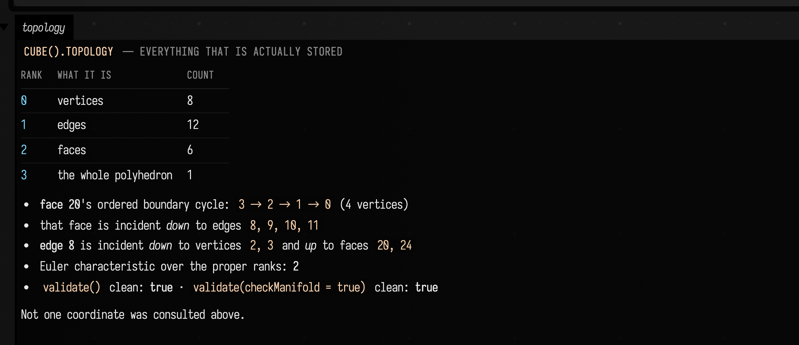
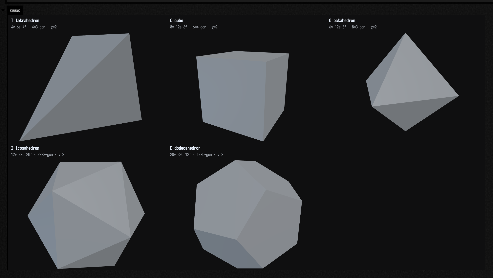
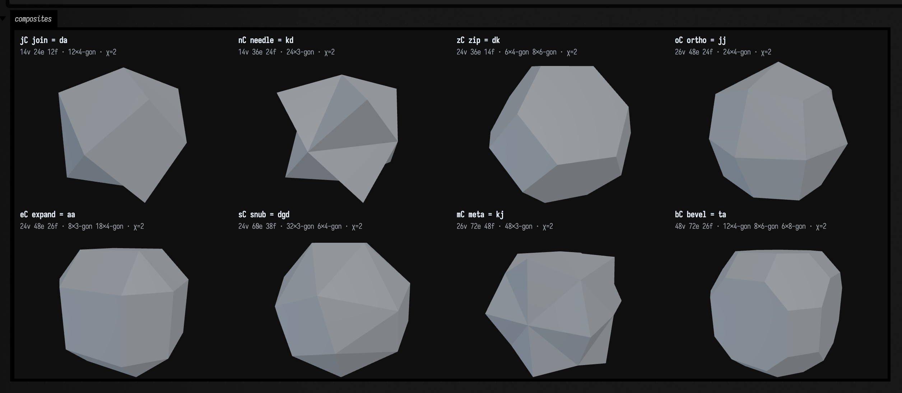
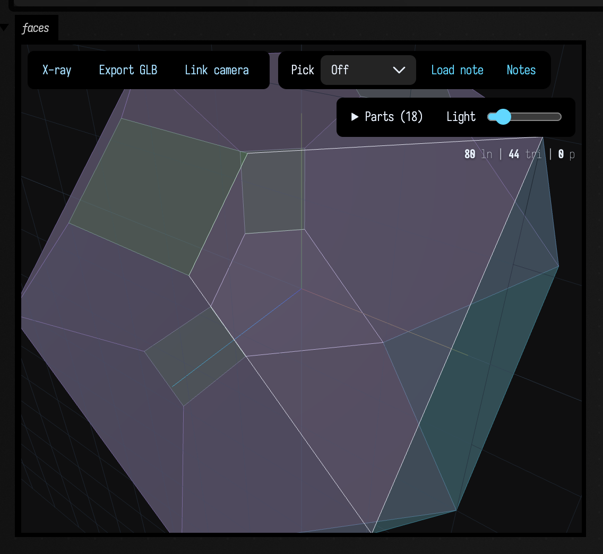

# Polytopes: topology first, coordinates later

*`afield.stdlib.polytope` — an incidence topology, a Conway operator algebra over it, element
provenance that survives every operator, and only then coordinates.*

*Every declaration used below is listed, with its KDoc, in the codebase reference:
[Polytopes](reference/polytopes.md) — the topology, the operator algebra, the three realization
verbs and the `FLine` adapters, file by file. The nonlinear solver that `relax` and the Ceres
realization path lean on has its own page, [Solvers](reference/solvers.md).*

Most "polyhedron libraries" are mesh libraries wearing a hat. You get vertices, faces as triangles,
maybe a normal, and every question you actually want to ask — *which* face is this, where did it
come from, what was it before the last operator ran — has to be reconstructed from floating-point
positions after the fact.

This one is built the other way round. The authoritative value is a **ranked incidence topology**:
elements with identities, incidences between adjacent ranks, and an explicit ordered boundary cycle
for every polygon. It knows nothing about coordinates, `FLine`s, triangles, normals or a renderer.
Coordinates are a **separate, optional, replaceable layer** on top. Triangles are derived last of
all, and they carry a map back to the polygon they came from.

Here is what that buys you, before any of the explanation. Every colour below is read out of the
**lineage**, not out of a coordinate:

```diffstatic_runner {data-lang=kotlin screenshot="assets/polytope_examples/hero.png" wait="8.0" capture="box" open-outputs="true" w="1180" h="720" padding="14"}
:::static
import afield.stdlib.polytope.*

// One expression: kis of bevel of the dodecahedron. Three chained operators, 360 output faces.
val chain = conway("kbD")
val run = chain.polyhedron.canonicalize()
val solid = if (run.converged) run.polyhedron else chain.polyhedron

// Now colour every one of those faces by the element of the ORIGINAL DODECAHEDRON it descends
// from. Not by position, not by normal, not by size — `sourceElements` walks each output face's
// lineage back through kis, through truncate, through ambo, to a single seed element. The
// symmetry you can see is therefore a picture of the incidence structure, not of the geometry.
fun hsv(hue: Double, s: Double, v: Double): Triple<Double, Double, Double> {
    val h = ((hue % 1.0) + 1.0) % 1.0
    val i = Math.floor(h * 6).toInt()
    val f = h * 6 - i
    val p = v * (1 - s)
    val q = v * (1 - f * s)
    val t = v * (1 - (1 - f) * s)
    return when (i % 6) {
        0 -> Triple(v, t, p); 1 -> Triple(q, v, p); 2 -> Triple(p, v, t)
        3 -> Triple(p, q, v); 4 -> Triple(t, p, v); else -> Triple(v, p, q)
    }
}

:::fold colour each face by the seed pentagon its lineage flattens to, and draw
// Which of the dodecahedron's twelve pentagons does an output face descend from? Element ids are
// allocated rank by rank, so "the lowest source id" would silently pick a vertex every time — ask
// for the rank-2 sources specifically. A face over the interior of one pentagon has exactly one; a
// face straddling an original edge or corner has two or three, and gets a neutral grey.
val faces = solid.topology.elements(2)
fun seedFacesOf(id: ElementId) =
    chain.sourceElements(id).filter { it.rank == 2 }.map { it.id.value }.sorted()

val pentagons = faces.flatMap { seedFacesOf(it.id) }.distinct().sorted()
val share = faces.groupingBy { seedFacesOf(it.id).size }.eachCount().toSortedMap()

// A face over one pentagon takes that pentagon's hue. A face straddling two or three of them takes
// the blend — so the seams of the original dodecahedron colour themselves in between, and the
// twelve-fold pattern reads without a single line being drawn. Saturation and brightness carry a
// second signal: how many seed vertices and edges the face also touches.
fun hueOf(pentagon: Int) = pentagons.indexOf(pentagon).toDouble() / pentagons.size
val faceLines = solid.toFaceFLines { face, line ->
    val owners = seedFacesOf(face.id)
    val sources = chain.sourceElements(face.id)
    val corners = sources.count { it.rank == 0 }
    val edges = sources.count { it.rank == 1 }
    val sat = (1.00 - 0.16 * corners).coerceIn(0.38, 1.0)
    val value = (0.78 + 0.16 * edges + 0.12 * owners.size).coerceIn(0.74, 1.0)
    val mixed = if (owners.isEmpty()) Triple(0.70, 0.74, 0.80) else owners
        .map { hsv(hueOf(it), sat, value) }
        .reduce { a, b -> Triple(a.first + b.first, a.second + b.second, a.third + b.third) }
        .let { Triple(it.first / owners.size, it.second / owners.size, it.third / owners.size) }
    line.filled = true
    line.stroked = false
    line.color = vec(mixed.first, mixed.second, mixed.third, if (owners.size == 1) 0.32 else 0.21)
    line.hoverColor = vec(0.98, 0.99, 1.00, 0.95)
}

threeLines(faceLines, channel = "hero", name = "kbD, canonical, coloured by seed provenance",
    height = 560, autoFrame = true, editable = false)
displayOpen("hero")

val topology = solid.topology
markdown("what you are looking at", listOf(
    "`kbD` = kis · bevel · dodecahedron, canonicalized",
    "${topology.elements(0).size} vertices · ${topology.elements(1).size} edges · " +
        "${topology.elements(2).size} faces · chi = ${topology.eulerCharacteristic()}",
    "seed pentagons found in the lineage: ${pentagons.size}",
    "output faces by how many of those pentagons they straddle: $share",
    "canonical: converged = ${run.converged}, reason = ${run.reason}, " +
        "tangency radius spread ${"%.3e".format(run.initialDiagnostics.tangencyRadiusSpread)} " +
        "→ ${"%.3e".format(run.finalDiagnostics.tangencyRadiusSpread)}",
).joinToString("<br/>"))
:::endfold
```

![A near-spherical solid built from 360 small translucent triangles, layered so the far side shows through the near side. The colours run right around the spectrum — magenta, purple, blue, teal, green, yellow, orange — and gather into twelve rounded patches, one for each pentagon of the original dodecahedron, with blended in-between colours along the seams where a triangle straddles two pentagons. A readout underneath reports 182 vertices, 540 edges, 360 faces, twelve seed pentagons, and that 240 faces sit over one pentagon while 120 straddle two](assets/polytope_examples/hero.png)

That is three chained Conway operators on a dodecahedron — `kis · bevel · D`, 360 output faces —
canonicalized, and drawn as translucent polygons. The picture is doing one job: **the colours are
provenance**. Each output face asked its own lineage which of the seed's twelve pentagons it descends
from, walking back through `kis`, through `truncate`, through `ambo`, and answered in a hue. The 240
faces that sit over a single pentagon take its colour; the 120 that straddle two take the blend, so
the original dodecahedron's edges draw themselves in intermediate colours.

Nothing here consulted a position, a normal, a face size or a distance. The twelve-fold symmetry in
that image is a picture of the **incidence structure**, and it survived three operators that each
threw all the coordinates away and made new ones. The rest of this page is how that works.

Everything on this page was produced by the docs build running the code shown above it, in a live
Field. No figure is drawn by hand and no number is typed by a human — where a count, a diagnostic or
an error message appears, it was printed by the library.

!!! info "Where the pieces live"

    | what you want | where it is |
    |---|---|
    | ranked elements, incidence, face cycles, validation, abstract dual | `Topology.kt` — `PolytopeTopology`, `PolytopeTopologyBuilder`, `Element`, `ElementId` |
    | the five Platonic seeds, `Realization3`, `PolyhedralObject` | `Solids.kt` |
    | operators, realization policies, lineage, deployment records | `Transforms.kt` — `ConwayOperator`, `RealizationPolicy3`, `PolytopeTransformResult` |
    | prefix notation `daC`, `k4aC` | `Conway.kt` — `parseConwayExpression`, `conway` |
    | selectors and per-element scalar fields | `Parameters.kt` — `ElementSelectors`, `ElementParameters` |
    | constraint relaxation and its diagnostics | `RealizationSolver.kt` — `relax`, `solveRealization`, `geometryDiagnostics` |
    | the named constraint families a plan is made of | `Constraints.kt` — `RealizationConstraint`, `RelaxationPlan` |
    | coordinates from combinatorics, and the gauge | `Realize.kt` — `realize`, `SpectralRealization`, `RigidGauge` |
    | the canonical form and its diagnostics | `Canonical.kt` — `canonicalize`, `CanonicalDiagnostics` |
    | combinatorial orbits and the symmetry readout | `Symmetry.kt` — `combinatorialOrbits`, `symmetryDeviation` |
    | rank-4 seeds, derived face lattices, projections | `Polytope4.kt` — `tesseract`, `twentyFourCell`, `Projection4` |
    | one `FLine` per face, provenance-preserving triangles | `FieldAdapters.kt` — `toFaceFLines`, `triangulate`, `toEdgeFLines` |
    | compact inspection values for a live prompt | `Summaries.kt`, `PolytopeVisualizers.kt` |

    The full architecture note, including the roadmap this page does *not* cover, is
    `dev_docs/POLYTOPE_ALGEBRA.md` in the repository.

## A polyhedron is not a mesh

`PolytopeTopology` stores elements by rank, incidences between **adjacent** ranks only, and — for
rank 2 — an explicit ordered vertex cycle, because unoriented incidence alone does not choose a
traversal of a polygon. Rank 3, for an ordinary polyhedron, is the single whole-polyhedron element.

```diffstatic_runner {data-lang=kotlin screenshot="assets/polytope_examples/topology_readout.png" wait="1.5" capture="box" open-outputs="true" w="800" h="560" padding="14"}
:::static
import afield.stdlib.polytope.*

val t = cube().topology

val face = t.elements(2).first()
val cycle = t.faceCycle(face.id)
val edgesOfFace = t.incidentDown(face.id)
val anEdge = ElementId(edgesOfFace.first())

:::fold format the read-out as a table
val ranks = (0..t.rank).joinToString("\n") { r ->
    "| $r | ${listOf("vertices", "edges", "faces", "the whole polyhedron").getOrElse(r) { "?" }} | ${t.elements(r).size} |"
}
markdown("topology", """
#### `cube().topology` — everything that is actually stored

| rank | what it is | count |
|---|---|---|
$ranks

- **face ${face.id.value}**'s ordered boundary cycle: `${cycle.joinToString(" → ")}` (${cycle.size} vertices)
- that face is incident *down* to edges `${edgesOfFace.joinToString(", ")}`
- **edge ${anEdge.value}** is incident *down* to vertices `${t.incidentDown(anEdge).joinToString(", ")}`
  and *up* to faces `${t.incidentUp(anEdge).joinToString(", ")}`
- Euler characteristic over the proper ranks: **${t.eulerCharacteristic()}**
- `validate()` clean: **${t.validate().isValid}** ·
  `validate(checkManifold = true)` clean: **${t.validate(checkManifold = true).isValid}**

Not one coordinate was consulted above.
""", width = 720)
:::endfold
```



Element ids are **globally scoped within one topology**, not per-rank indices — that is why the
cube's first face is element 20 rather than face 0. An id identifies *this element of this
topology*, so an incidence array can mix ranks without ambiguity and provenance can name a source
element without also having to say which array it was in.

Two details in that read-out are load-bearing:

- **Incidence is reciprocal and adjacent-rank only.** There is no vertex→face incidence stored; you
  walk. `validate()` checks reciprocity, edge endpoint counts, that every face cycle vertex really
  is on one of the face's edges, that every incident edge occurs in the cycle, and that the
  boundary is a single connected degree-2 loop.
- **Manifoldness is an opt-in stricter pass**, not a precondition. `validate(checkManifold = true)`
  additionally requires every edge to have exactly two faces. Non-manifold structures stay legal at
  the core level, because the core is not only for closed surfaces.

## Coordinates are the second layer, and they are optional

`PolyhedralObject` is `topology` + a **nullable** `Realization3` + element attributes. `Realization3`
is an immutable ownership boundary around Field's mutable `Vec3`: public reads hand back copies, and
coordinates are indexed in exactly the same order as `topology.elements(0)`.

The honest way to show that the topology really is independent is to take the coordinates away and
watch which operations still work.

```diffstatic_runner {data-lang=kotlin screenshot="assets/polytope_examples/abstract_dual.png" wait="1.5" capture="box" open-outputs="true" w="980" h="520" padding="14"}
:::static
import afield.stdlib.polytope.*

// Drop the cube's coordinates on purpose. The topology survives verbatim.
val abstractCube = PolyhedralObject(cube().topology)
val d = abstractCube.transform(ConwayOperator.DUAL).polyhedron

// Ask it for geometry anyway, and keep whatever it says.
val refusal = try { d.toFaceFLines(); "no exception — unexpected" }
    catch (e: Throwable) { "${e::class.simpleName}: ${e.message}" }
val triRefusal = try { d.triangulate(); "no exception — unexpected" }
    catch (e: Throwable) { "${e::class.simpleName}: ${e.message}" }

// Now, and only now, choose a policy that says where the dual's vertices go.
val rd = cube().dual(DualCentroidRealization).polyhedron

:::fold lay the two columns side by side
markdown("dual", """
#### A dual with no coordinates at all

| | abstract dual | dual + `DualCentroidRealization` |
|---|---|---|
| `polyhedron.realization` | `${d.realization}` | `Realization3(${rd.realization?.size} vertices)` |
| topology counts | ${d.topology.elements(0).size}v ${d.topology.elements(1).size}e ${d.topology.elements(2).size}f | ${rd.topology.elements(0).size}v ${rd.topology.elements(1).size}e ${rd.topology.elements(2).size}f |
| closed manifold | ${d.topology.validate(checkManifold = true).isValid} | ${rd.topology.validate(checkManifold = true).isValid} |
| isomorphic to `octahedron()` | ${d.topology.isCombinatoriallyIsomorphicTo(octahedron().topology)} | ${rd.topology.isCombinatoriallyIsomorphicTo(octahedron().topology)} |
| `toFaceFLines()` | `$refusal` | ${rd.toFaceFLines().size} FLines |
| `triangulate()` | `$triRefusal` | ${rd.triangulate().triangleCount} triangles |

The left column is a complete, valid, checkable octahedron. It simply has nowhere to be.
""", width = 900)
:::endfold
```


Both refusals are real caught exceptions, not descriptions of them. That is the whole point of the
column: the combinatorial claims — valid, closed, isomorphic to an octahedron — are all *decidable*
with no coordinates in the object, and the geometry-shaped calls fail loudly rather than inventing a
placeholder embedding.

`isCombinatoriallyIsomorphicTo` is deliberately small: it is a rank-3 helper that tries vertex
bijections filtered by a degree/face-size signature and then compares edge and face multisets up to
rotation and reversal. It is not a general incidence-poset graph-isomorphism solver, and it says so.

## The operator vocabulary

Thirteen operators. Five are primitives implemented directly on the topology; eight are named
composites that rewrite into primitives before anything runs. This table is generated from
`ConwayOperator.entries` and `primitiveExpansion`, so it cannot drift from the enum.

```diffstatic_runner {data-lang=kotlin screenshot="assets/polytope_examples/operator_table.png" wait="1.5" capture="box" open-outputs="true" w="860" h="640" padding="14"}
:::static
import afield.stdlib.polytope.*

val rows = ConwayOperator.entries.joinToString("\n") { op ->
    // primitiveExpansion is in EXECUTION order (seed outward). Prefix notation writes it
    // the other way round, so reverse it to get the string you would actually type.
    val execution = op.primitiveExpansion.joinToString("") { it.symbol.toString() }
    val written = op.primitiveExpansion.reversed().joinToString("") { it.symbol.toString() }
    "| `${op.symbol}` | ${op.displayName} | ${if (op.primitive) "primitive" else "composite"} " +
        "| `$execution` | `${written}C` |"
}
markdown("ops", """
#### `ConwayOperator.entries`

| letter | name | kind | primitives, seed outward | equivalent notation |
|---|---|---|---|---|
$rows
""", width = 780)
```


Read the last two columns together and the direction convention becomes obvious.
`primitiveExpansion` is in **execution order, seed outward** — `join` runs *ambo* and then *dual* —
while prefix notation writes the outermost operator first, so you type `daC`. The library keeps both
orders and reports both: `notationHistory` is what you asked for, `history` is what actually ran.

### The seeds

Five Platonic seeds, each a fully realized `PolyhedralObject`. All the pictures below are Field's own
CPU mesh rasteriser (`TriMesh.renderPng`) fed with `toTriMesh()`; the captions under each are read
off the **topology**, not off the mesh.

```diffstatic_runner {data-lang=kotlin screenshot="assets/polytope_examples/seeds_gallery.png" wait="2.5" capture="box" open-outputs="true" w="1240" h="820" padding="14"}
:::static
import afield.stdlib.polytope.*
import java.util.Base64

:::fold one small gallery helper, reused by the two galleries below
fun Box.gallery(channel: String, columns: Int, cell: Int, panels: List<Pair<String, PolyhedralObject>>) {
    val view = MeshView(width = cell, height = (cell * 0.84).toInt(), wireframe = false, distance = 2.3)
    display(channel, buildString {
        append("<div style='display:grid;grid-template-columns:repeat($columns,minmax(0,1fr));gap:10px'>")
        for ((label, p) in panels) {
            val t = p.topology
            val png = Base64.getEncoder().encodeToString(p.toTriMesh().renderPng(view, caption = "", title = null))
            append("<div><div style='color:#e6ecf4;font-weight:600;font-family:monospace;font-size:13px;padding-bottom:3px'>$label</div>")
            append("")
            append("<div style='color:#93a4ba;font-family:monospace;font-size:11px;padding-top:4px'>")
            append("${t.elements(0).size}v ${t.elements(1).size}e ${t.elements(2).size}f · ")
            append(t.elements(2).groupingBy { t.faceCycle(it.id).size }.eachCount().toSortedMap()
                .entries.joinToString(" ") { "${it.value}×${it.key}-gon" })
            append(" · &chi;=${t.eulerCharacteristic()}</div></div>")
        }
        append("</div>")
    })
}
:::endfold

gallery("seeds", columns = 3, cell = 380, panels = listOf(
    "T  tetrahedron" to tetrahedron(),
    "C  cube" to cube(),
    "O  octahedron" to octahedron(),
    "I  icosahedron" to icosahedron(),
    "D  dodecahedron" to dodecahedron(),
))
```



`cube()` is the odd one out and it is worth knowing: the other four place their vertices on the unit
sphere, while `cube()` has side length 2, so its vertices sit at radius √3. That matters later,
because the realization solver's default targets are derived from the *incoming* mean edge length
and mean radius.

### The five primitives

```diffstatic_runner {data-lang=kotlin screenshot="assets/polytope_examples/primitives_gallery.png" wait="3.0" capture="box" open-outputs="true" w="1240" h="800" padding="14"}
:::static
import afield.stdlib.polytope.*
import java.util.Base64

:::fold the same gallery helper as above
fun Box.gallery(channel: String, columns: Int, cell: Int, panels: List<Pair<String, PolyhedralObject>>) {
    val view = MeshView(width = cell, height = (cell * 0.84).toInt(), wireframe = false, distance = 2.3)
    display(channel, buildString {
        append("<div style='display:grid;grid-template-columns:repeat($columns,minmax(0,1fr));gap:10px'>")
        for ((label, p) in panels) {
            val t = p.topology
            val png = Base64.getEncoder().encodeToString(p.toTriMesh().renderPng(view, caption = "", title = null))
            append("<div><div style='color:#e6ecf4;font-weight:600;font-family:monospace;font-size:13px;padding-bottom:3px'>$label</div>")
            append("")
            append("<div style='color:#93a4ba;font-family:monospace;font-size:11px;padding-top:4px'>")
            append("${t.elements(0).size}v ${t.elements(1).size}e ${t.elements(2).size}f · ")
            append(t.elements(2).groupingBy { t.faceCycle(it.id).size }.eachCount().toSortedMap()
                .entries.joinToString(" ") { "${it.value}×${it.key}-gon" })
            append(" · &chi;=${t.eulerCharacteristic()}</div></div>")
        }
        append("</div>")
    })
}
:::endfold

// One seed, five primitives. `conway(...)` parses and evaluates in one call.
gallery("primitives", columns = 3, cell = 380, panels = listOf(
    "C    the seed" to conway("C").polyhedron,
    "dC   dual" to conway("dC").polyhedron,
    "aC   ambo" to conway("aC").polyhedron,
    "kC   kis" to conway("kC").polyhedron,
    "tC   truncate" to conway("tC").polyhedron,
    "gC   gyro" to conway("gC").polyhedron,
))
```


Each caption's face-degree histogram tells you what the operator did combinatorially:

- **`d` dual** swaps vertices and faces and leaves edges alone: the cube's 8/12/6 becomes 6/12/8.
- **`a` ambo** puts a vertex at every edge midpoint; the new faces are one per old face *plus* one
  per old vertex, so `aC` has 6 squares and 8 triangles.
- **`k` kis** raises an apex over every face and fans it into triangles.
- **`t` truncate** cuts every vertex off; the old faces grow to twice as many sides (squares →
  octagons) and each cut leaves a new face.
- **`g` gyro** is the genuinely interesting one — a real topology transform, not a fake-up: every
  *directed* half-edge becomes a pentagon, so `gC` is 24 pentagons and nothing else.

The `gC` panel is the one to stop at, because it looks like a bug and is not. Its caption says
38 vertices, 60 edges and 24 pentagons, and its picture is a cube. Both are true:
`GyroSubdivisionRealization` places the new directed-edge points *along* the existing edges and the
new face centres *at* the existing face centroids, so every one of those 24 pentagons lies flat in
one of the cube's six original square planes. Flat shading has nothing to shade differently. The
combinatorics changed completely; the embedding did not move a single point off the surface.

Draw the polygon boundaries instead of the shading and the 24 pentagons appear:

```diffstatic_runner {data-lang=kotlin screenshot="assets/polytope_examples/gyro_boundaries.png" wait="2.5" capture="box" open-outputs="true" w="960" h="700" padding="14"}
:::static
import afield.stdlib.polytope.*
import afield.stdlib.TriMesh
import java.util.Base64

// Shading cannot separate coplanar faces, so give each polygon its own colour instead. The
// triangle -> source-polygon map is what makes that possible on a triangle mesh at all.
val gyro = conway("gC").polyhedron
val g = gyro.triangulate()
val faceOrder = gyro.topology.elements(2).mapIndexed { i, f -> f.id.value to i }.toMap()

val colors = FloatArray(g.mesh.vertexCount * 3)
for (tri in 0 until g.triangleCount) {
    // A hue wheel over the 24 pentagons; nothing here knows or cares where they are in space.
    val turn = faceOrder.getValue(g.sourceFace(tri).value) * 2.0 * Math.PI / faceOrder.size
    for (k in 0..2) {
        val vi = g.mesh.indices[tri * 3 + k]
        colors[vi * 3] = (0.55 + 0.42 * Math.cos(turn)).toFloat()
        colors[vi * 3 + 1] = (0.55 + 0.42 * Math.cos(turn - 2.09)).toFloat()
        colors[vi * 3 + 2] = (0.55 + 0.42 * Math.cos(turn + 2.09)).toFloat()
    }
}
val painted = TriMesh(g.mesh.positions, g.mesh.indices, g.mesh.normals, null, colors)

:::fold one figure with its own caption
val png = Base64.getEncoder().encodeToString(painted.renderPng(
    MeshView(wireframe = false, width = 860, height = 560, distance = 2.4), caption = "", title = null,
))
// The claim, measured rather than asserted: 24 faces sharing only 6 distinct outward normals.
val distinctNormals = gyro.topology.elements(2)
    .map { gyro.faceNormal(it.id) }
    .map { "%.3f,%.3f,%.3f".format(it.x, it.y, it.z) }
    .distinct()

display("gyro", """
    
    <div style='color:#93a4ba;font:12px monospace;padding-top:8px;line-height:1.6'>
      gC &middot; ${gyro.topology.elements(2).size} faces, all
      ${gyro.topology.elements(2).map { gyro.topology.faceCycle(it.id).size }.distinct().joinToString("/")}-gons
      &middot; ${distinctNormals.size} distinct face normals: ${distinctNormals.joinToString(" ") { "($it)" }}
    </div>
""".trimIndent())
:::endfold
```


That is the separation the library is built around, in one picture: **the operator changed the
topology, and a realization policy — a different, replaceable argument — decided that the new
vertices should stay on the old surface.** Hand `gyro` a different `RealizationPolicy3` and the same
24 pentagons can be anywhere you like.

### The named composites

```diffstatic_runner {data-lang=kotlin screenshot="assets/polytope_examples/composites_gallery.png" wait="3.5" capture="box" open-outputs="true" w="1240" h="800" padding="14"}
:::static
import afield.stdlib.polytope.*
import java.util.Base64

:::fold the same gallery helper as above
fun Box.gallery(channel: String, columns: Int, cell: Int, panels: List<Pair<String, PolyhedralObject>>) {
    val view = MeshView(width = cell, height = (cell * 0.84).toInt(), wireframe = false, distance = 2.3)
    display(channel, buildString {
        append("<div style='display:grid;grid-template-columns:repeat($columns,minmax(0,1fr));gap:10px'>")
        for ((label, p) in panels) {
            val t = p.topology
            val png = Base64.getEncoder().encodeToString(p.toTriMesh().renderPng(view, caption = "", title = null))
            append("<div><div style='color:#e6ecf4;font-weight:600;font-family:monospace;font-size:13px;padding-bottom:3px'>$label</div>")
            append("")
            append("<div style='color:#93a4ba;font-family:monospace;font-size:11px;padding-top:4px'>")
            append("${t.elements(0).size}v ${t.elements(1).size}e ${t.elements(2).size}f · ")
            append(t.elements(2).groupingBy { t.faceCycle(it.id).size }.eachCount().toSortedMap()
                .entries.joinToString(" ") { "${it.value}×${it.key}-gon" })
            append(" · &chi;=${t.eulerCharacteristic()}</div></div>")
        }
        append("</div>")
    })
}
:::endfold

gallery("composites", columns = 4, cell = 290, panels = listOf(
    "jC   join = da" to conway("jC").polyhedron,
    "nC   needle = kd" to conway("nC").polyhedron,
    "zC   zip = dk" to conway("zC").polyhedron,
    "oC   ortho = jj" to conway("oC").polyhedron,
    "eC   expand = aa" to conway("eC").polyhedron,
    "sC   snub = dgd" to conway("sC").polyhedron,
    "mC   meta = kj" to conway("mC").polyhedron,
    "bC   bevel = ta" to conway("bC").polyhedron,
))
```



Composites are *rewritten*, not reimplemented — `conway("bC")` runs `ambo` and then `truncate`, and
the result reports exactly that.

All thirteen are declared on both receivers, so a chain reads the same wherever a step sits in it and
a composite can follow a primitive without a detour through the parser:

```diffstatic_runner {data-lang=kotlin screenshot="assets/polytope_examples/operator_chaining.png" wait="2.0" capture="box" open-outputs="true" w="900" h="360" padding="14"}
:::static
import afield.stdlib.polytope.*

// Each of these is a composite applied to the result of a primitive. Before the thirteen were
// named on both receivers, none of them compiled.
val chains = listOf(
    "cube().ambo().bevel()" to cube().ambo().bevel(),
    "cube().kis().needle()" to cube().kis().needle(),
    "cube().truncate().ortho()" to cube().truncate().ortho(),
    "cube().dual().zip()" to cube().dual().zip(),
)

:::fold one row per chain: what was asked for, and what actually ran
markdown("chains", """
| chain | result | asked for | actually ran | &chi; |
|---|---|---|---|---|
${chains.joinToString("\n") { (source, r) ->
    val t = r.polyhedron.topology
    "| `$source` | ${t.elements(0).size}v ${t.elements(1).size}e ${t.elements(2).size}f " +
        "| `${r.notationHistory.joinToString(" ") { it.displayName }}` " +
        "| `${r.history.joinToString(" ") { it.displayName }}` " +
        "| ${t.eulerCharacteristic()} |"
}}

`notationHistory` keeps the operators you named; `history` is the primitive trace that ran. A
composite is rewritten before anything executes, so the two columns differ exactly where a chain
used one — `bevel` is `ta`.
""", width = 900)
:::endfold
```


The two history columns are worth reading twice. You asked for `bevel` and the object recorded that
you asked for it *and* that `ambo truncate` is what ran. The notation is a receipt for the
computation, not an echo of the call — which is what lets a composite sit anywhere in a chain
without the lineage becoming a lie.

## Prefix notation, and what it refuses

`parseConwayExpression` parses; `conway` parses and evaluates. Whitespace is ignored anywhere, the
seed must be the final character, and evaluation is right-to-left — `daC` is `d(a(C))`. Only `k` and
`t` accept a degree index; `kN` restricts kis to faces of degree *N* and `tN` restricts truncate to
vertices of degree *N*.

```diffstatic_runner {data-lang=kotlin screenshot="assets/polytope_examples/parser_table.png" wait="2.0" capture="box" open-outputs="true" w="1100" h="620" padding="14"}
:::static
import afield.stdlib.polytope.*

fun row(src: String): String = try {
    val e = parseConwayExpression(src)
    val r = e.evaluate()
    val t = r.polyhedron.topology
    "| `$src` | `${e.seed.symbol}` " +
        "| ${e.invocations.joinToString(" then ") { i -> i.operator.displayName + (i.degree?.let { "($it)" } ?: "") }.ifEmpty { "— (the bare seed)" }} " +
        "| ${r.history.joinToString("") { it.symbol.toString() }.ifEmpty { "—" }} " +
        "| ${t.elements(0).size}v ${t.elements(1).size}e ${t.elements(2).size}f |"
} catch (ex: ConwayParseException) {
    "| `$src` | — | **${ex.message}** | — | — |"
}

val cases = listOf("C", "dC", "daC", "adC", "bC", "k4aC", "t4kC", "sD", "qC", "a4C", "4kC", "k2C", "dx")
markdown("parser", """
| written | seed | invocations, seed outward | primitives run | output |
|---|---|---|---|---|
${cases.joinToString("\n") { row(it) }}
""", width = 1020)
```


Compare rows two and three: `daC` and `adC` are different objects, 14v/24e/12f against 12v/24e/14f,
which is the clearest possible demonstration that the notation is read right-to-left. The last five
rows are the parser's real messages, including the byte offset it failed at.

## Provenance: every output element remembers where it came from

This is the part a mesh cannot give you. Each `PolytopeTransformResult` carries, for every output
element, an `ElementLineage` tree: either `Source` (an element of the original seed) or `Derived`
with the operation, a **role** string, and its parents. `sourceElements(id)` flattens the tree back
to the seed.

```diffstatic_runner {data-lang=kotlin screenshot="assets/polytope_examples/lineage.png" wait="2.0" capture="box" open-outputs="true" w="1000" h="560" padding="14"}
:::static
import afield.stdlib.polytope.*

val result = conway("bC")   // bevel = ambo then truncate

fun describe(l: ElementLineage): String = when (l) {
    is ElementLineage.Source -> "seed r${l.element.rank}#${l.element.id.value}"
    is ElementLineage.Derived ->
        "${l.operation.displayName}/${l.role}(" + l.parents.joinToString(", ") { describe(it) } + ")"
}

val faces = result.polyhedron.topology.elements(2)
val roles = faces.groupingBy { (result.lineage(it.id) as ElementLineage.Derived).role }.eachCount().toSortedMap()
val sample = faces.first()

:::fold format
markdown("lineage", """
#### `conway("bC")` — what every output face remembers

- written: `${result.notationHistory.joinToString("") { it.symbol.toString() }}`
  (${result.notationHistory.joinToString { it.displayName }})
- primitives actually run, seed outward: `${result.history.joinToString("") { it.symbol.toString() }}`
- output: ${result.polyhedron.topology.elements(0).size}v ${result.polyhedron.topology.elements(1).size}e ${faces.size}f

| output face role | count |
|---|---|
${roles.entries.joinToString("\n") { "| `${it.key}` | ${it.value} |" }}

Output face **${sample.id.value}**, in full:

~~~
${describe(result.lineage(sample.id))}
~~~

flattened to seed elements: ${result.sourceElements(sample.id).joinToString { "rank ${it.rank} / id ${it.id.value}" }}
""", width = 920)
:::endfold
```


The role histogram is the useful shape of this. After a bevel, 14 of the 26 faces descend from the
cube's own faces and vertices via `ambo`, and 12 are the faces the truncation cut. You did not have
to guess that from geometry; you asked.

The roles the primitives emit are a small fixed vocabulary — `face-center`, `vertex-face`,
`edge-midpoint`, `original-face`, `original-vertex`, `face-apex`, `kis-triangle`,
`vertex-edge-point`, `truncated-face`, `partially-truncated-face`, `directed-edge-point`,
`gyro-pentagon` — and they are addressable, which is the next section.

## Selectors: naming a set of elements without naming indices

`ElementSelector` is a SAM predicate over an `ElementSelectionContext` (the object, the element, and
its lineage when there is one). `ElementSelectors` supplies the useful ones and they compose with
`and`, `or` and `!`.

```diffstatic_runner {data-lang=kotlin screenshot="assets/polytope_examples/selectors.png" wait="2.0" capture="box" open-outputs="true" w="1020" h="560" padding="14"}
:::static
import afield.stdlib.polytope.*

val kisCube = cube().kis()          // apex over every square

val cases = listOf<Pair<String, ElementSelector>>(
    "ElementSelectors.rank(0)" to ElementSelectors.rank(0),
    "ElementSelectors.rank(2)" to ElementSelectors.rank(2),
    "faceDegree(3)" to ElementSelectors.faceDegree(3),
    "vertexDegree(4)" to ElementSelectors.vertexDegree(4),
    "vertexDegree(6)" to ElementSelectors.vertexDegree(6),
    "provenanceRole(\"face-apex\")" to ElementSelectors.provenanceRole("face-apex"),
    "provenanceRole(\"original-vertex\")" to ElementSelectors.provenanceRole("original-vertex"),
    "vertexDegree(4) and !provenanceRole(\"face-apex\")" to
        (ElementSelectors.vertexDegree(4) and !ElementSelectors.provenanceRole("face-apex")),
)

// Two receivers, deliberately different: on a PolyhedralObject there is no lineage to consult,
// so the provenance selectors match nothing. On a transform result they can see it.
val rows = cases.joinToString("\n") { (label, s) ->
    "| `$label` | ${kisCube.polyhedron.selectElements(s).size} | ${kisCube.selectElements(s).size} |"
}
markdown("selectors", """
#### `cube().kis()` — 14 vertices, 36 edges, 24 triangles

| selector | matches on the `PolyhedralObject` | matches on the `PolytopeTransformResult` |
|---|---|---|
$rows

The two columns differ exactly where a selector needs lineage.
""", width = 940)
```


That difference is the design, not a wart. A selector runs against a context, and a bare
`PolyhedralObject` has no transform history to have a role in. Ask a transform result and lineage is
there.

The last row is worth a second look, because it is the trap. `vertexDegree(4)` matches exactly the
six apexes kis raised. Negating a `provenanceRole` selector on the *bare object* negates a predicate
that matched nothing, so `!provenanceRole(...)` is vacuously true and the composed selector still
matches all six. Ask the transform result and it correctly matches none. A negated provenance test is
only meaningful where lineage exists.

## Deployed parameters: a scalar field over the selected elements

Selection says *where*; an `ElementDoubleParameter` says *how much*, per element. The selective
`kis`, `truncate` and `gyro` overloads take both, evaluate the parameter once per selected source,
and record what they resolved in a `TransformDeployment` — so the operation is inspectable and
replayable after the fact.

Below, a scalar is written onto each of a dodecahedron's twelve faces as an ordinary attribute, kis
is deployed with `ElementParameters.attribute("spike")`, and then — the part that matters — the same
scalar is painted back onto the *rendered triangles* by following `triangulate()`'s
triangle → source-polygon map.

```diffstatic_runner {data-lang=kotlin screenshot="assets/polytope_examples/parameter_field.png" wait="3.0" capture="box" open-outputs="true" w="900" h="760" padding="14"}
:::static
import afield.stdlib.polytope.*
import afield.stdlib.TriMesh
import java.util.Base64

// One scalar per face of a dodecahedron: spike height rises from left to right.
var source = dodecahedron()
val realization = source.realization!!
val index = source.topology.elements(0).mapIndexed { i, v -> v.id.value to i }.toMap()
for (f in source.topology.elements(2)) {
    val x = source.topology.faceCycle(f.id).map { realization[index.getValue(it)].x }.average()
    source = source.withAttribute(f.id, "spike", 0.08 + 0.80 * (x + 1.0) / 2.0)
}

// Selection and parameter are separate arguments, on purpose.
val result = source.kis(ElementSelectors.rank(2), ElementParameters.attribute("spike"))
val out = result.polyhedron
val g = out.triangulate()

val deployed = result.deployments.single().scalarParameters
val values = deployed.values.mapNotNull { it["heightScale"] }
val lo = values.min()
val hi = values.max()

// Paint the deployed scalar back onto the render mesh. This is only possible because
// triangulate() kept sourceFace(triangle) -> the polygon each triangle came from.
val colors = FloatArray(g.mesh.vertexCount * 3)
for (tri in 0 until g.triangleCount) {
    val v = (out.attributes[g.sourceFace(tri)]["spike"] as? Number)?.toDouble() ?: lo
    val u = ((v - lo) / (hi - lo)).coerceIn(0.0, 1.0)
    for (k in 0..2) {
        val vi = g.mesh.indices[tri * 3 + k]
        colors[vi * 3] = (0.20 + 1.10 * u).toFloat()
        colors[vi * 3 + 1] = (0.86 - 0.30 * u).toFloat()
        colors[vi * 3 + 2] = (1.00 - 0.78 * u).toFloat()
    }
}
val painted = TriMesh(g.mesh.positions, g.mesh.indices, g.mesh.normals, null, colors)

:::fold one figure, with its own caption, so nothing is read off a mesh-level summary
val png = Base64.getEncoder().encodeToString(painted.renderPng(
    MeshView(wireframe = false, width = 820, height = 560, distance = 2.3, yawDegrees = 0.0, pitchDegrees = 6.0),
    caption = "", title = null,
))
display("field", """
    
    <div style='color:#93a4ba;font:12px monospace;padding-top:8px;line-height:1.6'>
      kis deployed over ${deployed.size} faces &middot;
      heightScale resolved ${"%.3f".format(lo)} &hellip; ${"%.3f".format(hi)}<br/>
      output ${out.topology.elements(0).size}v ${out.topology.elements(1).size}e ${out.topology.elements(2).size}f
      &middot; ${g.triangleCount} triangles over ${g.triangleFaceIds.toSet().size} source polygons
    </div>
""".trimIndent())
:::endfold
```


Three separate facts are visible in that one picture:

1. **The parameter really is non-uniform** — the spikes get longer left to right, and the printed
   range is the range the deployment record resolved, not a range chosen for the caption.
2. **The colour survived the trip through triangulation.** The attribute lives on the *polygon*.
   Triangles are derived. Painting the field onto the render mesh only works because
   `TriangulatedGeometry` kept `sourceFace(triangle)`.
3. **Selection and parameter are orthogonal.** Here the selector is "every face", and only the
   scalar varies. Restrict the selector and you get selective *and* non-uniform kis, which is what
   the loadable demo at the bottom of this page does.

## Realization: three verbs, three promises

Everything above this point is combinatorics. Turning it into coordinates is a separate decision,
and the library keeps it as three separate calls precisely because they promise different things:

| verb | what you give it | what it promises |
|---|---|---|
| `realize(policy)` | a topology, with or without coordinates | coordinates built from the combinatorics by a declared construction |
| `relax(plan)` | an embedding you already have | that embedding, improved under a declared set of named constraints |
| `canonicalize(...)` | an embedding, or none | the symmetry-respecting representative — **with stated guarantees**, and a reported failure when they do not apply |

The per-operator realization policies you have been looking at all through this page — centroid
dual, edge-midpoint ambo, face-normal kis, along-edge truncation, gyro subdivision — are local
heuristics, and the pictures have been saying so. Look back at the `gyro` figure: every group of new
faces is still coplanar with the square it subdivided, because the policy placed the new vertices on
that square. The combinatorics of `gC` are those of the pentagonal icositetrahedron; the coordinates
the operator handed back are not.

### `relax(...)`: repair the embedding you have

`relax(plan)` runs a pure-Kotlin nonlinear least-squares pass over the vertex coordinates. A
`RelaxationPlan` is a list of named, immutable constraint values — `edge-length`, `face-planarity`,
`centroid`, `common-radius`, `proximity`, `edge-tangency`, `tangency-centroid`, `symmetry-orbit` —
plus a least-squares configuration and an optional gauge. Because the plan is *data* it prints,
diffs and reweights (`plan.withWeight("edge-length", 0.0)`), and the result reports each family's
unweighted geometric error before and after, so you can see which constraint gave way. Topology and
attributes are untouched — the result is `copy(realization = solved)` and nothing else.
`solveRealization()` survives as a wrapper that compiles its five weights into
`RelaxationPlan.regularize()`, and is what the figure below calls.

!!! warning "What relaxation is not"

    Quoting the source, which is careful about it:

    > *This is a general constraint relaxation, not a claim of a unique Conway "canonical form". The
    > defaults are useful for the symmetric finite polyhedra produced here. Disable common-radius or
    > common-edge constraints for deliberately irregular objects.*

    Levenberg–Marquardt from the supplied embedding is a **local** method, and the `referenceWeight`
    term deliberately biases it toward where it started. Nothing here checks for self-intersection or
    inversion — degenerate faces are *reported*, not repaired. If you want the canonical form, ask
    for it by name; that is the next section.

```diffstatic_runner {data-lang=kotlin screenshot="assets/polytope_examples/realization.png" wait="3.0" capture="box" open-outputs="true" w="1220" h="780" padding="14"}
:::static
import afield.stdlib.polytope.*
import afield.stdlib.Vec3
import java.util.Base64
import kotlin.random.Random

// Take a real Conway output and jitter every vertex. The topology is not touched at all.
val clean = conway("aC").polyhedron
val rng = Random(7)
val jittered = clean.copy(realization = Realization3(clean.realization!!.vertexCoordinates.map {
    Vec3(it).add(
        (rng.nextDouble() - 0.5).toFloat() * 0.62f,
        (rng.nextDouble() - 0.5).toFloat() * 0.62f,
        (rng.nextDouble() - 0.5).toFloat() * 0.62f,
    )
}))

val solved = jittered.solveRealization()

:::fold render the three embeddings and their diagnostics as one figure
val view = MeshView(width = 400, height = 340, wireframe = false, distance = 2.5)
fun panel(label: String, p: PolyhedralObject): String {
    val png = Base64.getEncoder().encodeToString(p.toTriMesh().renderPng(view, caption = "", title = null))
    return "<div><div style='color:#e6ecf4;font:600 13px monospace;padding-bottom:3px'>$label</div>" +
        "</div>"
}
fun row(label: String, d: RealizationDiagnostics) =
    ("<tr><td style='padding:2px 14px 2px 0'>%s</td><td>%.5f</td><td>%.3e</td>" +
        "<td>%.3e</td><td>%.3e</td><td>%d</td></tr>").format(
        label, d.edgeLengthMean, d.edgeLengthRmsDeviation, d.maxFacePlanarityError,
        d.facePlanarityRmsError, d.degenerateFaces.size)

display("solve", """
    <div style='display:grid;grid-template-columns:repeat(3,minmax(0,1fr));gap:10px'>
      ${panel("aC as built", clean)}
      ${panel("every vertex jittered", jittered)}
      ${panel("solveRealization()", solved.polyhedron)}
    </div>
    <table style='color:#c3ccd9;font:12px monospace;border-collapse:collapse;padding-top:10px;margin-top:10px'>
      <thead style='color:#6d7787'><tr>
        <th style='text-align:left;padding-right:14px'>embedding</th><th>edge mean</th>
        <th>edge RMS dev</th><th>max planarity err</th><th>planarity RMS</th><th>degenerate</th>
      </tr></thead>
      <tbody>
        ${row("aC as built", clean.geometryDiagnostics())}
        ${row("jittered", solved.initialDiagnostics)}
        ${row("after solveRealization()", solved.finalDiagnostics)}
      </tbody>
    </table>
    <div style='color:#93a4ba;font:12px monospace;padding-top:8px'>
      converged = ${solved.converged} &middot; iterations = ${solved.iterations} &middot;
      rmsResidual = ${"%.3e".format(solved.rmsResidual)} &middot; reason = ${solved.reason} &middot;
      topology object identical = ${solved.polyhedron.topology === jittered.topology}
    </div>
""".trimIndent())
:::endfold
```


Read the table, not the pictures: the pictures only tell you the shape came back, whereas the
diagnostics say by how much. Note the middle row is `solved.initialDiagnostics` and the last is
`solved.finalDiagnostics` — the solver measures its own input and output, so a solve that did
nothing useful would say so rather than being invisible.

Note also that the recovered edge mean is the *jittered* mean, not the original: with
`targetEdgeLength = null` the target is whatever the input's mean edge length happened to be. The
solver regularises the shape it was given; it does not know what shape you wish you had given it.

### `canonicalize(...)`: the form the combinatorics already determined

The **canonical form** of a polyhedron is the embedding where every edge is tangent to one common
sphere, the centroid of those tangency points is the origin, and every face is planar. It is not a
prettier relaxation — it is a specific object, and for the polyhedra this library produces it is
*the* object:

!!! info "The guarantee, stated"

    For a convex polyhedron — by Steinitz's theorem, for any 3-connected planar graph — the canonical
    form **exists and is unique** up to Möbius transformations of the sphere. Pinning the tangency
    centroid at the origin picks one representative; the gauge removes the remaining rigid and scale
    freedom. That covers every Conway operator over a Platonic seed, which is to say everything on
    this page.

    Nothing is guaranteed for non-convex, self-intersecting, higher-genus or non-3-connected input.
    There, the run still returns `converged` and its diagnostics, and expects you to look.

Two methods sit behind one policy. `RECIPROCAL` is Hart's dual reciprocation, whose fixed point is
exactly the mutual polar reciprocity of primal and dual about one midsphere — tens of iterations.
`LOCAL_RELAXATION` is planarize / tangentify / recentre — thousands of iterations, but bounded local
moves. The default runs the first and polishes with the second.

```diffstatic_runner {data-lang=kotlin screenshot="assets/polytope_examples/canonical.png" wait="4.0" capture="box" open-outputs="true" w="1220" h="820" padding="14"}
:::static
import afield.stdlib.polytope.*
import java.util.Base64

// The gyro-cube, exactly as the operator built it, and the same combinatorics canonicalized.
val built = conway("gC").polyhedron
val run = built.canonicalize()

// Both panels are gauged to the same mean edge length, so the comparison is about shape, not size.
val gauge = RigidGauge()
val before = built.normalize(gauge)
val after = run.polyhedron.normalize(gauge)

:::fold render the two embeddings and the three defining conditions
val view = MeshView(width = 430, height = 380, wireframe = false, distance = 3.2)
fun panel(label: String, p: PolyhedralObject): String {
    val png = Base64.getEncoder().encodeToString(p.toTriMesh().renderPng(view, caption = "", title = null))
    return "<div><div style='color:#e6ecf4;font:600 13px monospace;padding-bottom:3px'>$label</div>" +
        "</div>"
}
fun row(label: String, d: CanonicalDiagnostics) =
    ("<tr><td style='padding:2px 14px 2px 0'>%s</td><td>%.3e</td><td>%.3e</td>" +
        "<td>%.3e</td><td>%.4f</td><td>%.3e</td></tr>").format(
        label, d.tangencyRadiusSpread, d.tangencyCentroidOffset, d.maxFacePlanarityError,
        d.dihedralAngleMean, d.dihedralAngleSpread)

display("canon", """
    <div style='display:grid;grid-template-columns:repeat(2,minmax(0,1fr));gap:12px'>
      ${panel("gC as the operator built it", before)}
      ${panel("gC.canonicalize()", after)}
    </div>
    <table style='color:#c3ccd9;font:12px monospace;border-collapse:collapse;margin-top:12px'>
      <thead style='color:#6d7787'><tr>
        <th style='text-align:left;padding-right:14px'>embedding</th>
        <th>tangency radius spread</th><th>tangency centroid offset</th>
        <th>max planarity err</th><th>dihedral mean</th><th>dihedral spread</th>
      </tr></thead>
      <tbody>
        ${row("as built", run.initialDiagnostics)}
        ${row("canonical", run.finalDiagnostics)}
      </tbody>
    </table>
    <div style='color:#93a4ba;font:12px monospace;padding-top:8px'>
      converged = ${run.converged} &middot; reason = ${run.reason} &middot;
      reciprocal iterations = ${run.reciprocalIterations} &middot;
      relaxation iterations = ${run.relaxationIterations} &middot;
      reseeded = ${run.reseeded}
      <br/>distinct face degrees, before and after =
      ${before.topology.elements(2).mapNotNull { before.topology.faceCycleOrNull(it.id)?.size }.distinct().sorted()}
      &rarr;
      ${after.topology.elements(2).mapNotNull { after.topology.faceCycleOrNull(it.id)?.size }.distinct().sorted()}
      &middot; topology object identical = ${run.polyhedron.topology === built.topology}
    </div>
""".trimIndent())
:::endfold
```

![Two shaded solids side by side. The left is a plain grey cube — no creases are visible at all, because its twenty-four pentagonal faces lie flat in groups of four on the six square faces of the original cube. The right is the pentagonal icositetrahedron: twenty-four congruent pentagons on a near-spherical body. Below them a table shows the tangency radius spread falling from 3.318e-01 to 9.184e-08 and the dihedral angle spread from 1.571 to 2.807e-07, while the tangency centroid offset and max planarity error start at exactly zero](assets/polytope_examples/canonical.png)

The left panel looks like a plain cube because, as a solid, it *is* one: all twenty-four pentagons
are there, but they lie flat in groups of four on the six original squares, so there is not a single
visible crease. The two panels **have the same topology object** — the last line of the readout
asserts it with `===`, not equality, and both report the same single face degree, `[5]`. Nothing was
added, removed or re-identified; only the coordinates moved. The combinatorics of the gyro-cube
always were the combinatorics of the pentagonal icositetrahedron, and the operator's local
realization policy was simply not in a position to say so.

Read the table rather than the pictures, and read it carefully, because it is more interesting than
"all the numbers got smaller":

- `maxFacePlanarityError` starts at **exactly zero**. Every face of the flat cube is already planar.
- `tangencyCentroidOffset` also starts at **exactly zero**. The flat cube is already centred.
- `tangencyRadiusSpread` starts at `3.3e-01`. This is the condition that fails — no single sphere is
  tangent to all sixty edges — and it is the one canonicalisation is actually for.

So "planar and centred" is not a weak version of canonical; it is a *different* thing, and an
embedding can satisfy both while being nowhere near the canonical form. `tangencyRadiusSpread` is the
relative spread of the distances from the centre to each edge's closest point — zero exactly when one
midsphere touches every edge. The dihedral spread collapsing from `1.571` (which is π/2 — the flat
cube's faces meet either at a right angle or not at all) to `2.8e-07` is the same fact seen from
another side: in the canonical form all twenty-four pentagons meet at one common angle.

Note `reseeded = true` in the readout: the iteration could not get there from the flat cube, restarted
from a spectral embedding, and says so rather than hiding it. Which is the subject of the next
section.

!!! warning "Where it gives up, and says so"

    Because the canonical form is fixed by the combinatorics, a starting embedding the iteration
    cannot use is not by itself a reason to fail: when an attempt diverges or plateaus, the run
    restarts from a spectral embedding and `CanonicalizeResult.reseeded` records which embedding the
    answer came from.

    That is not a promise that every input converges. `kkC` — kis applied twice to the cube — is the
    worked counter-example for *these two iterations*: neither finds its canonical form, and the
    library returns `converged = false` with `reason = "max iterations"` and finite coordinates,
    rather than a smoothed lie. A test pins that failure as a *reported* one, so it cannot quietly
    start returning garbage instead.

    It is no longer a gap in the library, though. `relaxWithCeres` reaches it in 12 iterations and
    about 6 ms, at a tangency spread of order `1e-8`, and why it can is worth knowing — because it was
    never solver horsepower. `canonicalize()` on `kkC` does not merely run out of its iteration budget:
    it moves *away* from the answer, ending worse than the embedding it started from and with a minimum
    dihedral angle of 0.003 radians — a collapsed sliver rather than a solid. The next section measures
    all three side by side.

    `Realization3` stores Field's single-precision `Vec3`, so the achievable residual floor is about
    `1e-7` relative, however good the iteration is.

#### The counter-example, and what actually fixes it

Three embeddings of the same combinatorics: `kkC` as `kis kis C` built it, what `canonicalize()`
converges to, and what `relaxWithCeres` reaches. Nothing about the topology differs between them.

```diffstatic_runner {data-lang=kotlin screenshot="assets/polytope_examples/kkc_canonical.png" wait="6.0" capture="box" open-outputs="true" w="1240" h="620" padding="14" requires="ceres"}
:::static
import afield.stdlib.polytope.*
import java.util.Base64

// kis applied twice to the cube: 38 vertices, 108 edges, 72 faces. The standing counter-example.
// relaxWithCeres needs the native wrapper: ./gradlew buildCeresRedistributable
val seed = conway("kkC").polyhedron
val iterated = seed.canonicalize()
val solved = seed.relaxWithCeres(RelaxationPlan.canonicalConditions(), CeresRelaxationOptions(maxIterations = 500))

:::fold gauge all three to one scale, render them, and tabulate the three defining conditions
val gauge = RigidGauge()
val panels = listOf(
    "kkC as built" to seed.normalize(gauge),
    "canonicalize()" to iterated.polyhedron.normalize(gauge),
    "relaxWithCeres()" to solved.realization.polyhedron.normalize(gauge),
)
val view = MeshView(width = 380, height = 340, wireframe = false, distance = 3.2)
fun panel(label: String, p: PolyhedralObject): String {
    val png = Base64.getEncoder().encodeToString(p.toTriMesh().renderPng(view, caption = "", title = null))
    return "<div><div style='color:#e6ecf4;font:600 13px monospace;padding-bottom:3px'>$label</div>" +
        "</div>"
}
fun row(label: String, p: PolyhedralObject): String {
    val d = p.canonicalDiagnostics()
    return ("<tr><td style='padding:2px 14px 2px 0'>%s</td><td>%.3e</td><td>%.3e</td><td>%.3e</td>" +
        "<td>%.3f</td></tr>").format(
        label, d.tangencyRadiusSpread, d.tangencyCentroidOffset, d.maxFacePlanarityError,
        d.dihedralAngleMin)
}

display("kkc", """
    <div style='display:grid;grid-template-columns:repeat(3,minmax(0,1fr));gap:12px'>
      ${panels.joinToString("") { (label, p) -> panel(label, p) }}
    </div>
    <table style='color:#c3ccd9;font:12px monospace;border-collapse:collapse;margin-top:12px'>
      <thead style='color:#6d7787'><tr>
        <th style='text-align:left;padding-right:14px'>embedding</th>
        <th>tangency radius spread</th><th>tangency centroid offset</th>
        <th>max planarity err</th><th>min dihedral</th>
      </tr></thead>
      <tbody>${panels.joinToString("") { (label, p) -> row(label, p) }}</tbody>
    </table>
    <div style='color:#93a4ba;font:12px monospace;padding-top:8px'>
      canonicalize(): converged = ${iterated.converged} &middot; reason = ${iterated.reason}
      <br/>relaxWithCeres(): ${solved.summary}
    </div>
""".trimIndent())
:::endfold
```

![Three shaded solids in a row above a table. The left, kkC as built, is a compact spiky ball of triangles. The middle, canonicalize(), is not a solid at all — it has collapsed to a thin diagonal sliver a few pixels wide, essentially a line. The right, relaxWithCeres(), is a clean stellated form with deep triangular spikes. The table gives tangency radius spread 3.386e-01, 1.930e+00 and 5.104e-08 for the three, and minimum dihedral angle 0.955, 0.003 and 0.340; canonicalize() reports converged = false with reason max iterations, while relaxWithCeres converges in 12 iterations](assets/polytope_examples/kkc_canonical.png)

Read the middle column, not the outer two. `canonicalize()` reports `converged = false`, and it would
be easy to read that as "needed more iterations". It is not: the embedding it hands back is *worse than
the one it was given*, with a minimum dihedral angle of 0.003 and a tangency spread that has risen from
`3.4e-01` to `1.9e+00`. It has not stalled on the way to the answer — it has walked somewhere else. And
it is somewhere the objective actively rewards: an edge
tangency is measured from the centre to the **line** through an edge, so as that edge shrinks its
direction becomes arbitrary and it satisfies its own constraint for nothing. Collapsing edges removes
constraints, and a formulation that lets them collapse has a spurious zero-cost minimum sitting next
to the answer.

`relax` minimises the identical formula and falls into the same trap, just on a different solid: on
`kkT` it reports a tangency spread of `1.2e-04` for a solid with an edge at seven ten-thousandths of
the mean edge length. `RelaxationPlan.canonicalConditions()` therefore carries a one-sided floor under
edge length by default — `MinEdgeLengthConstraint`, exactly zero above itself and so bit-identical on a
healthy solid — which opens that edge by an order of magnitude and makes the reported spread *worse*,
because the flattering number was measuring a fold. So the
fix was not a stronger solver: it was three changes to how the problem is *posed* — each face's plane
carried as a free unit normal plus an offset rather than an origin and a normal (which has an exact
two-dimensional null space per face, 144 of `kkC`'s 474 parameters), a one-sided floor under edge
length that is inert on a healthy solid, and a gauge term for the rotation the canonical conditions
leave free. `dev_docs/CERES.md` works through all three with the parameter counts.

### `realize(...)`: coordinates from the combinatorics alone

If the canonical form really is determined by the topology, then a correct implementation should be
able to reach it *without ever being shown the operator's coordinates*. `SpectralRealization` builds
an embedding from the three eigenvectors of the vertex graph Laplacian with the smallest non-zero
eigenvalues, optionally projected to the sphere. For a vertex-transitive graph those three modes span
one degenerate eigenspace and the embedding already *is* the symmetric solid; otherwise it is a good
starting point, and the KDoc says that rather than claiming a finished object.

```diffstatic_runner {data-lang=kotlin screenshot="assets/polytope_examples/spectral.png" wait="4.0" capture="box" open-outputs="true" w="1240" h="840" padding="14"}
:::static
import afield.stdlib.polytope.*
import java.util.Base64

// Throw the coordinates away and keep only the incidence structure.
val topologyOnly: PolytopeTopology = conway("gC").polyhedron.topology

val spectral = topologyOnly.realize(SpectralRealization())
val recovered = spectral.canonicalize()

// The same combinatorics reached the other way, for comparison.
val fromOperator = conway("gC").polyhedron.canonicalize()

:::fold render the two routes and their agreement
val view = MeshView(width = 380, height = 330, wireframe = false, distance = 3.2)
val gauge = RigidGauge()
fun panel(label: String, p: PolyhedralObject): String {
    val png = Base64.getEncoder().encodeToString(
        p.normalize(gauge).toTriMesh().renderPng(view, caption = "", title = null))
    return "<div style='min-width:0'><div style='color:#e6ecf4;font:600 13px monospace;" +
        "white-space:nowrap;overflow:hidden;text-overflow:ellipsis;padding-bottom:4px'>$label</div>" +
        "</div>"
}
val dev = recovered.polyhedron.symmetryDeviation()
display("spectral", """
    <div style='display:grid;grid-template-columns:repeat(3,minmax(0,1fr));gap:10px'>
      ${panel("1 &middot; spectral only", spectral)}
      ${panel("2 &middot; canonicalize()", recovered.polyhedron)}
      ${panel("3 &middot; canonicalize()", fromOperator.polyhedron)}
    </div>
    <div style='color:#c3ccd9;font:12px monospace;padding-top:12px;line-height:1.7'>
      1 &middot; spectral only &rarr; tangency spread
      ${"%.3e".format(spectral.canonicalDiagnostics().tangencyRadiusSpread)},
      dihedral mean ${"%.4f".format(spectral.canonicalDiagnostics().dihedralAngleMean)} rad
      <br/>2 &middot; from combinatorics alone &rarr; tangency spread
      ${"%.3e".format(recovered.finalDiagnostics.tangencyRadiusSpread)},
      dihedral mean ${"%.4f".format(recovered.finalDiagnostics.dihedralAngleMean)} rad
      <br/>3 &middot; from the operator's coordinates &rarr; tangency spread
      ${"%.3e".format(fromOperator.finalDiagnostics.tangencyRadiusSpread)},
      dihedral mean ${"%.4f".format(fromOperator.finalDiagnostics.dihedralAngleMean)} rad
      <br/><span style='color:#6d7787'>2 and 3 agree on the dihedral mean to</span>
      ${"%.2e".format(
          Math.abs(recovered.finalDiagnostics.dihedralAngleMean -
              fromOperator.finalDiagnostics.dihedralAngleMean))} rad
      <br/><br/><span style='color:#6d7787'>symmetry readout of the recovered solid</span>
      <br/>vertex-radius spread ${"%.3e".format(dev.vertexRadiusSpread)} &middot;
      edge-length spread ${"%.3e".format(dev.edgeLengthSpread)} &middot;
      face-distance spread ${"%.3e".format(dev.faceDistanceSpread)}
      <br/>combinatorial classes &mdash; vertices ${dev.orbits.vertexClassSizes} &middot;
      edges ${dev.orbits.edgeClassSizes} &middot; faces ${dev.orbits.faceClassSizes} &middot;
      fully transitive = ${dev.orbits.fullyTransitive}
    </div>
""".trimIndent())
:::endfold
```


Panels 2 and 3 came from completely different starting coordinates — one from an eigen-decomposition
of a graph that had never seen a coordinate, one from the operator's own placement on the faces of a
cube — and landed on the same solid, agreeing on the mean dihedral angle to around `1e-9` radians.
That agreement is this page's strongest single claim, and it is the argument for the whole
topology-first design: the shape was a property of the incidence structure the entire time.

Panel 1 is worth its own note, because it shows the spectral construction is doing real work rather
than handing the canonicaliser a random cloud. From the graph alone it reaches a tangency spread of
`2.0e-02` — about sixteen times better than the `3.3e-01` of the flat cube the operator produced, and
already within a fraction of a percent of the right mean dihedral angle. That is why it is the
reseeding fallback in the previous section, and why the reseed rescues the case rather than merely
restarting it.

The symmetry readout underneath is `combinatorialOrbits()`, which refines the ranked incidence
structure by iterated incidence-colour relabelling. Every automorphism preserves colours, so each
class is a *union* of true orbits and constraining a class is at least as strong as constraining an
orbit — but refinement is not a complete invariant, so where a class is strictly coarser than its
orbits the `symmetry-orbit` constraint family simply reports a real residual rather than pretending.
`fullyTransitive = false` here is correct and not a defect: the pentagonal icositetrahedron is
face-transitive but not vertex-transitive, and the class sizes say exactly that.

## Rank 4: the same core, one dimension up

Nothing above this point is specific to three dimensions. `PolytopeTopology` is rank-general, and
`Polytope4` is what happens when you actually use it at a rank the Conway surface operators cannot
reach: the 5-cell, the tesseract, the 16-cell and the self-dual 24-cell, with `Realization4`, an
abstract `dual()`, and viewing projections.

The face lattice is **derived, not declared**. `convexPolytope4(coordinates, facetNormals)` takes
vertex coordinates and outward facet normals; each normal's supporting hyperplane picks out a cell,
every pair of cells whose shared vertices are affinely two-dimensional is a polygon, each polygon's
boundary order comes from an angular sort in its own 2-plane, and the edges are the polygons'
consecutive pairs. A wrong derivation therefore shows up as a wrong *published count*, not as a shape
nobody checked.

This is also where the rank-3 assumptions get audited. An edge of a 4-polytope belongs to three or
four polygons, never two, so `validate(checkManifold = true)` must **reject** a tesseract — and does.
`Polytope4` refuses a rank-3 topology outright, in its constructor. `PolyhedralObject` is the
permissive one: it checks a realization's length and its attribute keys, not the rank, so a rank-4
topology wraps up in one without complaint. The rank-3 assumption is enforced by the operators that
depend on it — the Conway surface transforms require rank 3, and `triangulate`, FLine conversion and
face normals each require a realization — which is where a mismatched topology is really caught.

```diffstatic_runner {data-lang=kotlin screenshot="assets/polytope_examples/rank4.png" wait="3.0" capture="box" open-outputs="true" w="1180" h="760" padding="14"}
:::static
import afield.stdlib.polytope.*

val seeds = listOf("5-cell" to fiveCell(), "tesseract" to tesseract(),
    "16-cell" to sixteenCell(), "24-cell" to twentyFourCell())

// Viewing is a Projection4 above realization, deliberately not part of the geometry.
val projection = RotatedProjection4(
    a = 0, b = 3, angle = 0.30, then = PerspectiveProjection4(eye = 4.2))

val rows = seeds.joinToString("") { (name, p) ->
    val s = p.summary()
    val manifold = runCatching { p.topology.validate(checkManifold = true).isValid }.getOrDefault(false)
    "<tr><td style='padding:2px 16px 2px 0'>$name</td><td>${s.vertices}</td><td>${s.edges}</td>" +
        "<td>${s.polygons}</td><td>${s.cells}</td><td>${s.eulerCharacteristic}</td>" +
        "<td>${s.cellPolygonCounts}</td><td>$manifold</td></tr>"
}

:::fold draw the tesseract's projected wireframe and print the four seeds' derived counts
val lines = tesseract().toEdgeFLines(projection) { _, line ->
    line.stroked = true
    line.thickness = 2.0
    line.color = vec(0.30, 0.82, 0.96, 0.85)
}
threeLines(lines, channel = "rank4", name = "tesseract, rotated perspective projection",
    height = 430, autoFrame = true, editable = false)
displayOpen("rank4")

markdown("counts", """
<table style='color:#c3ccd9;font:12px monospace;border-collapse:collapse'>
  <thead style='color:#6d7787'><tr>
    <th style='text-align:left;padding-right:16px'>seed</th><th>V</th><th>E</th><th>F</th><th>C</th>
    <th>V-E+F-C</th><th>polygons per cell</th><th>closed 2-manifold?</th>
  </tr></thead>
  <tbody>$rows</tbody>
</table>
""".trimIndent())
:::endfold
```


Every one of those rows reports `V − E + F − C = 0`, which is the Euler relation for a convex
4-polytope, and every one reports **`false`** for the closed-2-manifold check — correctly, because a
4-polytope is not a surface, and a validator that said `true` would be broken.

There is no `triangulate()` for rank 4. A projected 4-polytope's polygons do not bound a surface, and
filling them would imply one that does not exist — so `toEdgeFLines` and `toCellEdgeFLines` give
Field a wireframe and stop there. `OrthographicProjection4` is available and is honest about being
unreadable: it collapses the tesseract's two cubes exactly onto each other, which is a test
assertion, not an accident.

## Into Field: one FLine per face

`toFaceFLines()` produces one closed, outward-wound `FLine` per polygonal face, with the face's id,
rank and propagated attributes attached as line properties. Not a triangle mesh with a face id
bolted on — the polygons *are* the output, so Field's ordinary `filled`, `stroked`, `hoverColor` and
`onClick` all work per face with no parallel rendering model.

```diffstatic_runner {data-lang=kotlin screenshot="assets/polytope_examples/face_flines.png" wait="3.0" capture="box" open-outputs="true" w="1240" h="700" padding="14"}
:::static
import afield.stdlib.polytope.*

// Truncate four of an ambo-ed cube's twelve vertices, then colour every output face by the
// role its lineage reports. Nothing here inspects a coordinate to decide a colour.
val seed = conway("aC")
val chosen = seed.polyhedron.topology.elements(0).filterIndexed { i, _ -> i % 3 == 0 }.map { it.id }
val result = seed.truncate(ElementSelectors.ids(chosen), ElementParameters.constant(0.30))
val out = result.polyhedron

val palette = mapOf(
    "original-face" to vec(0.30, 0.82, 0.96, 0.30),
    "truncated-face" to vec(1.00, 0.62, 0.24, 0.34),
    "partially-truncated-face" to vec(0.72, 0.58, 1.00, 0.32),
    "vertex-face" to vec(0.55, 0.95, 0.62, 0.32),
)
val faceLines = out.toFaceFLines { face, line ->
    val role = (result.lineage(face.id) as ElementLineage.Derived).role
    line.filled = true
    line.stroked = true
    line.thickness = 1.6
    line.color = palette[role] ?: vec(0.5, 0.5, 0.55, 0.25)
    line.hoverColor = vec(0.96, 0.98, 1.00, 0.95)
}

threeLines(faceLines, channel = "faces", name = "role-coloured faces", height = 460,
    autoFrame = true, editable = false)
displayOpen("faces")
```



That view is the live `threeLines(...)` viewer, so in a real box you can orbit it, hover a face and —
if you set `onClick` — pick one and read its provenance back. The
[loadable demo](#a-loadable-demo) at the foot of this page does exactly that.

??? aside "The one thing on this page that is not captured"

    The figure above is a real capture of the real viewer, but it is a *still*. Hover highlighting
    and the click-to-inspect provenance card need a mouse, and the docs build does not have one, so
    they are described here rather than shown. Replay the loadable demo to see them.

What each of those lines is carrying, from the same transform:

```diffstatic_runner {data-lang=kotlin screenshot="assets/polytope_examples/face_fline_properties.png" wait="2.0" capture="box" open-outputs="true" w="1020" h="480" padding="14"}
:::static
import afield.stdlib.polytope.*

val seed = conway("aC")
val chosen = seed.polyhedron.topology.elements(0).filterIndexed { i, _ -> i % 3 == 0 }.map { it.id }
val result = seed.truncate(ElementSelectors.ids(chosen), ElementParameters.constant(0.30))
val out = result.polyhedron
val faceLines = out.toFaceFLines()

val roles = out.topology.elements(2)
    .groupingBy { (result.lineage(it.id) as ElementLineage.Derived).role }.eachCount().toSortedMap()
val first = faceLines.first()

markdown("carried", """
| | |
|---|---|
| deployments recorded | ${result.deployments.joinToString(", ") { d -> "`${d.operation.displayName}` → " + (d.selectedSources?.let { "${it.size} selected" } ?: "whole natural domain (`null`)") }} |
| selected source vertices | ${result.deployments.last().selectedSources?.size} of ${seed.polyhedron.topology.elements(0).size} |
| output | ${out.topology.elements(0).size}v ${out.topology.elements(1).size}e ${out.topology.elements(2).size}f |
| `toFaceFLines()` returned | ${faceLines.size} FLines — one per polygonal face |
| roles present | ${roles.entries.joinToString(", ") { "`${it.key}` × ${it.value}" }} |
| properties on the first line | `${first.properties.filterKeys { it.startsWith("polytope") }}` |
| its node count | ${first.nodes.size} nodes for a ${out.topology.faceCycle(ElementId(first.properties[POLYTOPE_FACE_ID_PROPERTY] as Int)).size}-gon — the extra one is the `Close` marker |
""", width = 940)
```

![A table reporting two recorded deployments — ambo over its whole natural domain and truncate over four selected vertices — that four of twelve source vertices were selected, that the output is 24 vertices, 40 edges and 18 faces, that toFaceFLines returned 18 FLines, the role histogram of three original faces, eleven partially truncated faces and four vertex faces, the polytopeFaceId and polytopeFaceRank properties carried on the first line, and that line's node count against the face's polygon degree](assets/polytope_examples/face_fline_properties.png)

Both deployments are recorded, not just the selective one: a uniform operator's `selectedSources` is
`null`, which means "the operator's complete natural domain", and an explicit selection is a set. The
distinction survives into the replay record, so a chain can be re-run exactly.

### Triangles, derived last, that still know where they came from

`triangulate()` projects each face from its actual 3D plane by dropping its Newell normal's dominant
axis, runs Field's existing `FloatEarcut` in 2D, and flips any triangle whose winding disagrees with
the face. It **duplicates polygon corners between faces** on purpose: `TriMesh` stores normals per
vertex, and a creased polyhedron needs a different flat normal on each side of an edge.

That duplication has a consequence worth seeing rather than being told about.

```diffstatic_runner {data-lang=kotlin screenshot="assets/polytope_examples/triangulation.png" wait="2.5" capture="box" open-outputs="true" w="1060" h="560" padding="14"}
:::static
import afield.stdlib.polytope.*

val p = conway("tC").polyhedron       // truncated cube: octagons and triangles
val g = p.triangulate()

// The polytope's own view of the object, and the render mesh's view of the same object.
markdown("tri", """
#### `conway("tC").polyhedron.triangulate()`

| | the polytope says | the render mesh says |
|---|---|---|
| vertices | ${p.topology.elements(0).size} abstract | ${g.mesh.vertexCount} render vertices |
| faces | ${p.topology.elements(2).size} polygons ${p.topology.elements(2).groupingBy { p.topology.faceCycle(it.id).size }.eachCount().toSortedMap().entries.joinToString(", ") { "(${it.value}×${it.key}-gon)" }} | ${g.triangleCount} triangles |
| Euler characteristic | ${p.topology.eulerCharacteristic()} | ${g.mesh.topology().eulerCharacteristic} |
| closed | ${p.topology.validate(checkManifold = true).isValid} | watertight = ${g.mesh.topology().isWatertight} |

Both are right. `triangulate()` duplicates every polygon corner so each face can carry its own flat
normal, so the *render* mesh is ${p.topology.elements(2).size} disconnected polygons. The topology
is the thing that knows the solid is closed.

- distinct source polygons across all triangles: **${g.triangleFaceIds.toSet().size}**
- distinct abstract vertices across all render vertices: **${g.vertexElementIds.toSet().size}**
- flat normals present: **${g.mesh.normals != null}**
- `mesh.summary()`: `${g.mesh.summary()}`
""", width = 980)
```


If you only ever had the mesh you would have to conclude the truncated cube was fourteen loose
polygons with a boundary. The topology is not a lossy summary of the triangles; the triangles are a
lossy projection of the topology, and `sourceFace` / `sourceVertex` are the receipt.

`FanFaceTriangulator` remains available as an explicitly convex-only strategy.
`EarcutFaceTriangulator` is the default, handles simple concave faces, and — as of the boundary model
in the next section — cuts holes out of them too.

## A face can have holes

A rank-2 element used to be one closed cycle of vertices. It is now an **outer cycle plus zero or
more inner rings**: `faceCycle` still returns the outer one, `faceHoles` returns the inner rings, and
`faceRings` returns all of them. Nothing about a hole-free face changed — its `faceRings` is a list
of one, and it takes the identical path through both adapters.

The consequence is not only a rendering one. A face with a hole is a **surface with boundary**, so an
object containing one stops being a closed manifold, and every operation that is only defined for a
closed manifold has to say so rather than quietly produce nonsense.

```diffstatic_runner {data-lang=kotlin screenshot="assets/polytope_examples/face_with_a_hole.png" wait="2.5" capture="box" open-outputs="true" w="1000" h="620" padding="14"}
:::static
import afield.stdlib.polytope.*

val solid = cubeWithWindow(side = 0.45f)
val topology = solid.topology
val windowed = topology.elements(2).single { topology.faceHasHoles(it.id) }
val geometry = solid.triangulate()
val rimTriangles = (0 until geometry.triangleCount).count { geometry.sourceFace(it) == windowed.id }
val manifold = topology.validate(checkManifold = true)

// Everything a holed face refuses, and the message it refuses with. Caught, not described.
val refusals = listOf<Pair<String, () -> Any>>(
    "topology.dual()" to { topology.dual() },
    "solid.bevel()" to { solid.bevel() },
    "solid.toOff()" to { solid.toOff() },
    "solid.triangulate(FanFaceTriangulator)" to { solid.triangulate(FanFaceTriangulator) },
).map { (name, call) ->
    name to (runCatching { call() }.exceptionOrNull()?.message ?: "no exception — unexpected")
}

:::fold the boundary, the two characteristics, and the refusals
markdown("window", """
#### One face, two boundary rings

| | value |
|---|---|
| outer cycle (`faceCycle`) | ${topology.faceCycle(windowed.id).size} vertices |
| inner rings (`faceHoles`) | ${topology.faceHoles(windowed.id).map { it.size }} |
| all rings (`faceRings`) | ${topology.faceRings(windowed.id).size} |
| &chi; counting elements | ${topology.eulerCharacteristic()} |
| &chi; counting cells | ${topology.cellularEulerCharacteristic()} |
| closed manifold | ${manifold.isValid}, with ${manifold.issues.size} one-sided window edges |
| triangles cut from that face | $rimTriangles — a solid square is 2 |

#### What a holed face refuses, by name

| call | message |
|---|---|
${refusals.joinToString("\n") { (call, message) -> "| `$call` | $message |" }}
""", width = 940)
:::endfold
```


The two characteristics are the crux. Counting *elements* still gives 2, because the incidence poset
of a cube with a window still has a cube's elements. Counting *cells* gives 1, because a disk with
one hole contributes `1 - 1`: a sphere with a window punched in it is a disk, and χ of a disk is 1.
Both numbers are correct and they answer different questions, which is exactly why the API offers
both instead of picking one and being subtly wrong half the time.

The four refusals come from two chokepoints, not from four hand-written guards — one at the entry to
the transform machinery and one in `dual()` — so a fourteenth operator inherits the refusal for free
rather than being remembered about.

### The hole, in pixels, beside the same face without one

The claim that a hole is really a hole is a claim about triangles, so the honest way to make it is to
build the identical face twice — once with the inner ring declared, once with it dropped — and render
both. Back-face culling is deliberately **on**: a rim triangle wound the wrong way would be *missing*
here exactly as it would be missing on a GPU, so this is a winding test as well as a hole test.

```diffstatic_runner {data-lang=kotlin screenshot="assets/polytope_examples/face_hole_counterfactual.png" wait="3.0" capture="box" open-outputs="true" w="880" h="480" padding="14"}
:::static
import afield.stdlib.polytope.*
import afield.stdlib.MeshView
import afield.stdlib.Vec3
import afield.stdlib.renderPng
import java.util.Base64

val hole = 0.45f

:::fold one square face, built by hand, optionally with one inner ring
// This is the whole of the hole API from a caller's side: record the ring's edges as
// incidences of the same face, then declare the ring with addFaceHole. Winding is a
// convention — outer counter-clockwise about the normal, inner clockwise — and nothing
// downstream leans on it, because the tessellator decides which ring is outer geometrically.
fun plate(withRing: Boolean): PolyhedralObject {
    val outer = listOf(Vec3(-1f, -1f, 0f), Vec3(1f, -1f, 0f), Vec3(1f, 1f, 0f), Vec3(-1f, 1f, 0f))
    val inner = listOf(
        Vec3(-hole, -hole, 0f), Vec3(-hole, hole, 0f), Vec3(hole, hole, 0f), Vec3(hole, -hole, 0f),
    )
    // buildList, not `outer + inner`: a box has afield.graphics in scope, where
    // `List<Vec3> + List<Vec3>` is element-wise vector addition and returns four points.
    val points = buildList { addAll(outer); if (withRing) addAll(inner) }
    val rings = if (withRing) listOf(listOf(0, 1, 2, 3), listOf(4, 5, 6, 7)) else listOf(listOf(0, 1, 2, 3))

    val builder = PolytopeTopologyBuilder(rank = 3)
    val vertices = points.map { builder.addElement(0) }
    val face = builder.addElement(2)
    for (ring in rings) for (i in ring.indices) {
        val edge = builder.addElement(1)
        builder.addIncidence(vertices[ring[i]], edge)
        builder.addIncidence(vertices[ring[(i + 1) % ring.size]], edge)
        builder.addIncidence(edge, face)
    }
    builder.setFaceCycle(face, rings.first().map { vertices[it] })
    rings.drop(1).forEach { ring -> builder.addFaceHole(face, ring.map { vertices[it] }) }
    builder.addIncidence(face, builder.addElement(3))
    return PolyhedralObject(builder.buildValidated(), Realization3(points))
}
:::endfold

val view = MeshView(
    yawDegrees = 0.0, pitchDegrees = 0.0, distance = 2.2,
    width = 300, height = 260, wireframe = true, cullBackFaces = true,
)
val cells = listOf(true, false).map { withRing ->
    val panel = plate(withRing)
    val png = Base64.getEncoder().encodeToString(panel.toTriMesh().renderPng(view, caption = "", title = null))
    val t = panel.topology
    val face = t.elements(2).single()
    """
    <div>
      <div style='color:#e6ecf4;font:600 13px monospace;padding-bottom:3px'>
        ${if (withRing) "addFaceHole(face, ring)" else "the same plate, no ring"}</div>
      
      <div style='color:#93a4ba;font:11px monospace;padding-top:4px'>
        ${t.elements(0).size}v ${t.elements(1).size}e &middot; ${t.faceRings(face.id).size} ring(s)
        &middot; ${panel.triangulate().triangleCount} triangles</div>
    </div>
    """
}
display("plates", "<div style='display:grid;grid-template-columns:1fr 1fr;gap:12px'>${cells.joinToString("")}</div>")
```


Eight triangles against two, from the same outer outline. Neither picture is a description of the
other: both came out of `triangulate()` on an object built by the code above it, and the window in
the left one is empty because no triangle was generated there, not because something was drawn over
it.

What is deliberately *not* here: a hole ring that touches its outer boundary, a face with two nested
rings, and star polygons. Those are named as remaining work rather than quietly half-supported. The
realization verbs are the other honest gap — `relax` and `canonicalize` build their problem from
outer rings only, so hole vertices are unconstrained. No shipped path reaches that today, because the
Conway operators refuse a holed face before a realizer ever sees one.

## The registered value printers

The mathematical types contain no HTML. `PolytopeVisualizers.kt` registers printers that reduce each
large immutable value to a public data class from `Summaries.kt` and then hand *that* to Field's
ordinary reflective visualizer. So the topology stays independent of presentation, and any of these
is a useful last expression in a live box.

```diffstatic_runner {data-lang=kotlin screenshot="assets/polytope_examples/value_printers.png" wait="2.5" capture="box" open-outputs="true" w="1100" h="720" padding="14"}
:::static
import afield.stdlib.polytope.*

var seed = cube()
seed.topology.elements(2).take(2).forEach { seed = seed.withAttribute(it.id, "lift", 0.4) }
val result = seed.kis(ElementSelectors.attributeEquals("lift", 0.4), ElementParameters.attribute("lift"))

// Registered printers, not bespoke HTML: each of these reduces to a data class in Summaries.kt.
viz("inspection", listOf(result, result.polyhedron.triangulate()))
```

![Field's reflective value visualizer showing a PolytopeTransformSummary — a TransformDeploymentSummary naming the kis operation and a selected count of two, then the output PolyhedralObjectSummary with the lift attribute key, a Realization3Summary of ten vertices, and a PolytopeTopologySummary reporting cellularEulerCharacteristic 2, closedManifold true, element counts 10, 20, 12, 1, Euler characteristic 2, face degree counts of eight triangles and four squares, faceHoleCount 0, and valid true — followed by a TriangulatedGeometrySummary of 40 render vertices, 16 triangles, 12 source polygon faces, 10 source vertex elements and flat normals present](assets/polytope_examples/value_printers.png)

The `…` links are the visualizer's ordinary lazy expansion for nested values, not a rendering
failure — click one in a live box and it fetches the rest.

`println(result.summary())` and `viz("inspection", result)` report the same underlying facts, because
they go through the same public summary functions. Useful last expressions:

```diffstatic {data-lang=kotlin}
:::static
polyhedron
polyhedron.topology
result
result.deployments.first()
polyhedron.triangulate()
polyhedron.solveRealization()
```

## A loadable demo

Two operation transcripts build a working document you can open, edit and re-run:

- **`dev_docs/agents/transcripts/polytope_conway_demo.yaml`** — one compact box that marks two
  opposite cube faces with different heights, applies `kis` only there, and sends the polygon faces
  to the on-canvas viewer. Hover a face, click it, and a provenance card reports the output face id,
  the transform role, the deployed height, the source elements and the 3D hit position.
- **`dev_docs/agents/transcripts/polytope_conway_gallery.yaml`** — the four questions this page is
  organised around, as four small boxes: a Conway-expression gallery you can retype, a topology-only
  dual shown honestly before a policy supplies coordinates, a non-uniform parameter field painted
  onto the output faces, and a realization before/after that leaves the diagnostics as its final
  value.
- **`dev_docs/agents/transcripts/polytope_canonical_gallery.yaml`** — one box that evaluates a Conway
  expression, canonicalizes it, and draws the realized and canonical forms side by side in the
  viewer with the diagnostics underneath. Change `val expression = "gD"` to `"ktC"`, `"bD"` or
  `"sD"` and re-run: the notation re-parses, both solids redraw, and the tangency-radius spread
  drops by six orders of magnitude. Set it to `"kkC"` and watch this box report an honest failure — it
  calls `canonicalize()`, which does not reach that one; `relaxWithCeres` does.

Replay any of them from the repository root:

```diffstatic {data-lang=bash}
uv run --project . --group backdoor python tools/field_backdoor.py --json --port 9477 \
  --command 'macro write polytope_conway_gallery --file dev_docs/agents/transcripts/polytope_conway_gallery.yaml' \
  --command 'macro run polytope_conway_gallery'
```

Both are exercised by the transcript execution smoke, so their box bodies cannot rot silently.

## What this does not do yet

Kept here because the architecture note is careful about it and a documentation page that quietly
drops the caveats is worse than no page:

- A face is a **single** ordered vertex cycle. No holes, no annuli, and star/self-intersecting
  polygons are not represented — pretending Earcut handles them would make their winding and filling
  rules ambiguous.
- Transform parameters are maps of `String` to `Double` in the deployment records. There are no typed
  parameter descriptors, domains, units or composition yet.
- All three realization verbs exist, but there is no **Wythoff construction** to supply a symmetry
  specification and a high-quality initial embedding — the canonicaliser rediscovers symmetry
  numerically instead of being told it. `kkC` is no longer an algorithmic gap — `relaxWithCeres`
  reaches it exactly — but the two pure-Kotlin iterations still do not, so a caller who wants a
  guaranteed canonical form needs the native solver. `kkT`, `kkO` and `kkI` reach spread `1e-4` rather
  than machine precision even there.
- `relax(...)` builds its Jacobian by finite differences over `3·V` parameters. That is a
  tens-of-vertices tool, not a mesh optimiser.
- Normals are flat only. Smooth and crease-aware generation, and stable face/edge/vertex picking ids
  through the *triangle* path, are still to come — the `FLine` path already has picking via callbacks.
- Rank 4 has four seeds, projections and a wireframe adapter, but no operator algebra: the Conway
  operators are surface operators and do not lift. Ranks above 4 are reachable by the core and
  entirely unexercised.
- The composite operators are declared only on `PolyhedralObject`, not on `PolytopeTransformResult`,
  so `cube().ambo().bevel()` does not compile although `cube().ambo().kis()` does. Use the prefix
  notation (`conway("baC")`) until that is fixed.

## See also

- [Polytopes reference](reference/polytopes.md) — every public declaration in
  `afield.stdlib.polytope`, with the KDoc that lives beside it: the operator algebra and its
  composition rules, the realization verbs and their diagnostics, the attribute and selector algebra,
  and the `FLine`/`TriMesh` adapters. This page is the tour; that one is the index.
- [Solvers reference](reference/solvers.md) — the Ceres constraint vocabulary behind `relax` and
  `CeresRealization`, plus the expression VM for residuals the vocabulary cannot say.
- [Meshes & 3D Geometry](mesh_examples.md) — `TriMesh`, `MeshView`, `showMesh` and the CPU rasteriser
  every gallery on this page is rendered by.
- [FLine Examples](fline_examples.md) — `threeLines(...)`, `onClick`, `hoverColor` and the rest of
  the output surface `toFaceFLines()` plugs into.
- [Voronoi, Contours & Clusters](spatial_geometry_examples.md) — the other geometry family that
  hands back structure rather than pixels.
- [Agent Transcript Gallery](agent_transcripts.md) — how the loadable demos above are stored and
  replayed.
