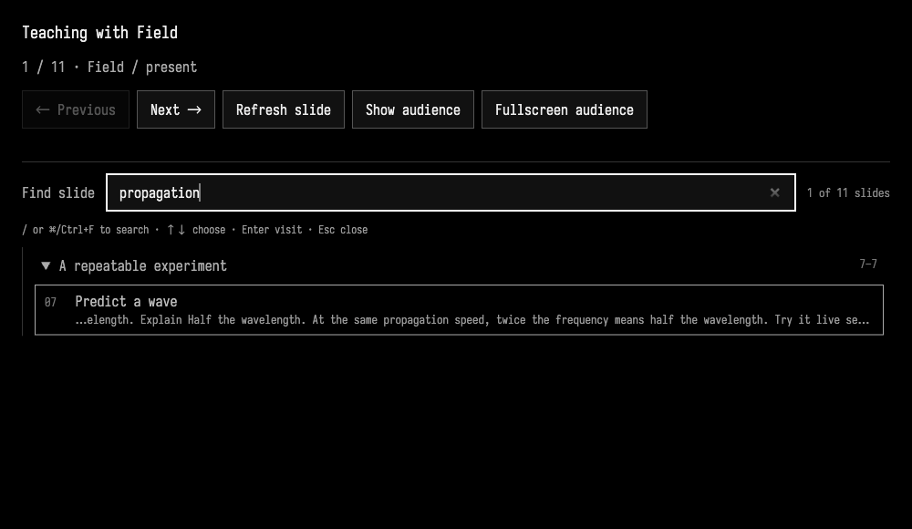
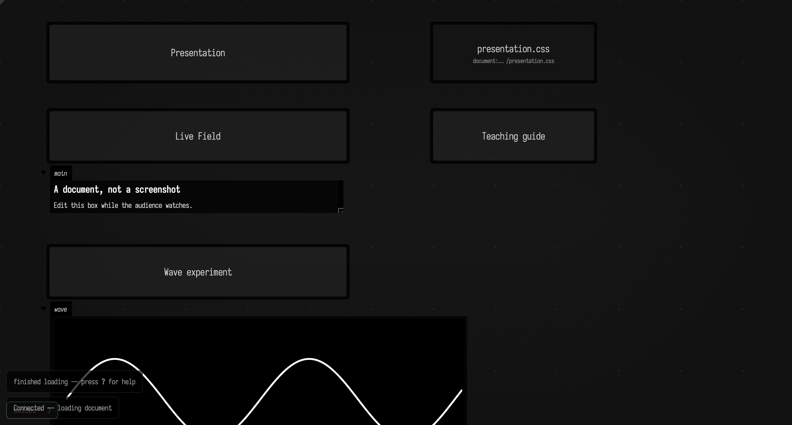
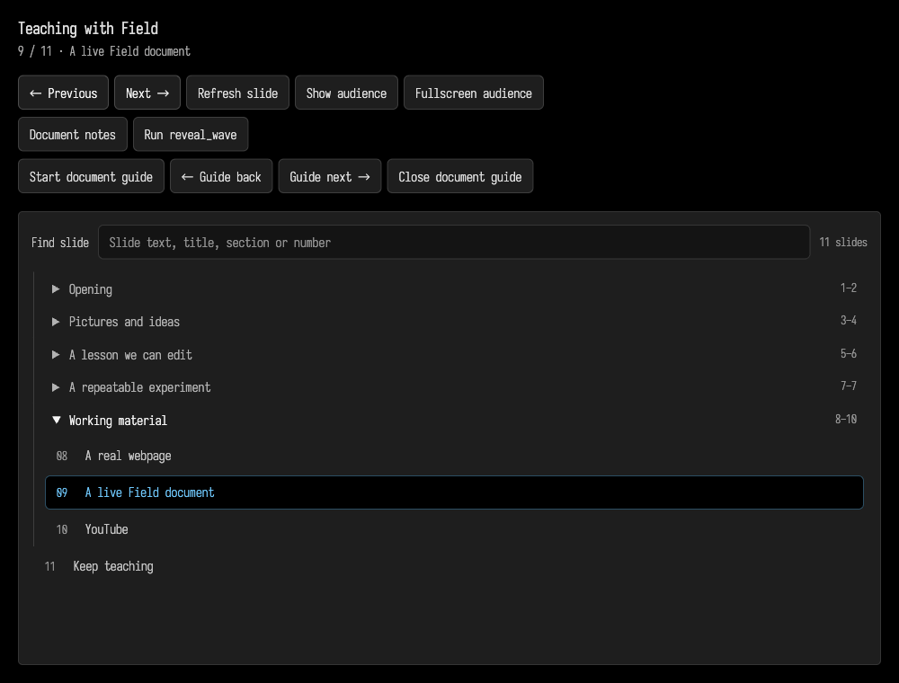
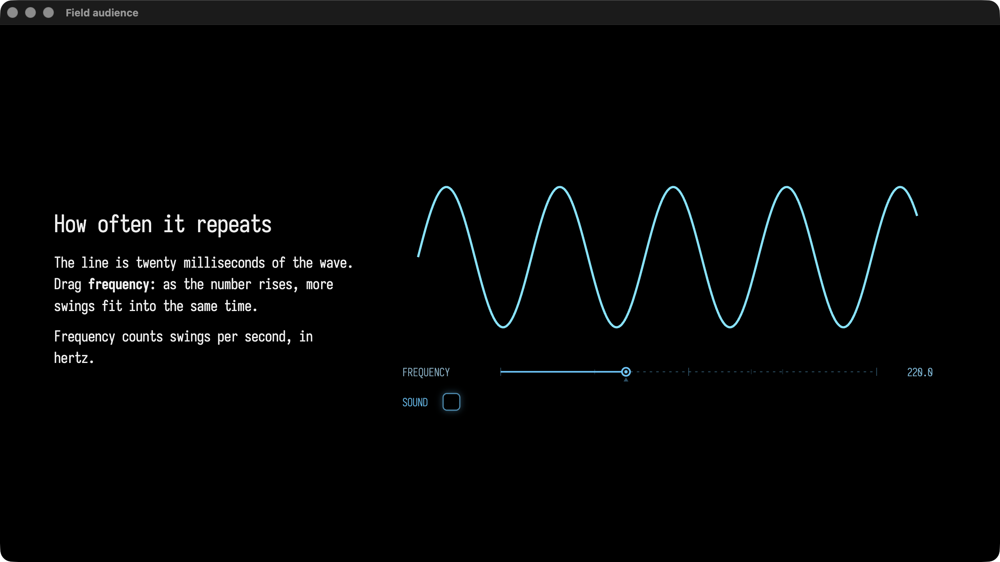
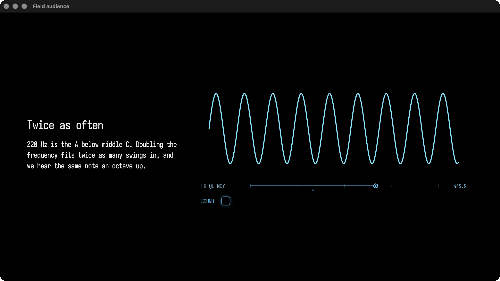

# Presenting with Field

With a few lines of Kotlin, Field can produce presentations that combine HTML slides, real webpages, YouTube video, live Field documents ([show a live document](#bring-the-working-material-on-screen)) and live figures placed beside the prose ([live figures](#live-figures-beside-prose)). A presentation is itself a document you can teach from. The audience gets a separate window; your Field document keeps the source and guide notes. Saved macros and interactive guides work inside the live document on the audience display.

## Start a presentation

With [Field running](installation.md) in its Electron app, open Welcome:

1. Expand **Kits** beneath Starting points and Templates, then press **Add presentation starter kit**.
2. Press **Restart Field**. Field prepares the registered kit before restarting; the same Electron window reconnects.
3. Expand **Kits → Presentations** and press **Create document** beside **Teaching with Field**.

Field copies the starting point into your workspace as a new document, and notes which version of
the kit it came from so the talk can be updated later ([Reuse the starter as a kit](#reuse-the-starter-as-a-kit)). Its **Teaching guide**, **Live Field** and **Presentation** boxes start in order, opening the audience and presenter windows. Each new talk is an editable document; the installed starting point stays unchanged. See [Kits and Starting Points](kits.md#add-a-self-contained-kit-in-welcome) for adding a kit from another folder.

Use **Next**, **Previous** or a named step in the presenter controls. **Show audience** brings the audience window forward; **Fullscreen audience** makes that window fullscreen. In the audience, the arrow keys, Page Up/Down and Space navigate slides. F8 and F9 navigate backwards and forwards while a live webpage or Field document has focus, leaving their ordinary editing keys available.

Edit the **Presentation** box and run it again to update the talk. It keeps the current step where possible. **Refresh slide** redraws the current step; it does not rerun the box's source. Close the audience or controller to stop presenting.

Nothing needs installing for each talk: the presentation is an ordinary document folder with Kotlin sidecars, guides, macros and files. Keep that folder in Git if you want version history and collaboration. Put shared media in `files/` and refer to it by filename, for example `img { src = mediaName }`, rather than copying it into each slide.

For a standalone copy, the starter remains available as **presentation** under **Templates** on Welcome. That route does not register the package or create a managed package instance. In a browser, the document and its guides remain usable; the separate audience display requires the Electron app.

## Organize a long talk

The presenter has a scrollable outline, with collapsible sections and numbered slides. Wrap related steps in `section`; sections can nest. Next and Previous still follow source order across section boundaries. Flat talks need no changes.

```diffstatic {data-lang=kotlin}
presentation(title = "A lesson about motion") {
        section("Opening") {
            step("The question") { audienceMarkdown("# What makes things move?") }
        }
        section("Experiments") {
            section("Waves") {
                step("Predict") { audienceMarkdown("# What happens at twice the frequency?") }
                step("Try it") { audienceDocument("wave-study") }
            }
            step("Discuss") { audienceMarkdown("# What changed?") }
        }
    }
    .present()
```

`audienceDocument("wave-study")` puts the live Field document named `wave-study` on the audience display; [Bring the working material on screen](#bring-the-working-material-on-screen) covers its macros and guides.

### Keyboard search

**Find slide** searches as you type across slide titles, authored HTML/Markdown text, reveal text,
image descriptions, section names and slide numbers. Multiple words may occur in different parts
of the slide; matching ignores case and accents. Body matches show a short excerpt.

In the presenter controls, press ++slash++ or ++cmd+f++ to focus search. ++arrow-up++ and ++arrow-down++ choose a match;
++enter++ visits that slide. The query stays ready for another hop. ++escape++ clears the query and
returns focus to the current slide in the outline, where the usual presentation navigation keys work.
Typing and choosing a match leave the audience on the current slide until Enter.

Search includes authored reveals, and visits their containing slide at its beginning. It does not
open live webpages or documents to index their dynamic contents. The index is cached with the talk;
**Refresh slide** updates it after body edits, and rerunning **Presentation** updates a changed outline.
Jumping to a slide reveals its section. Other section disclosure choices are preserved.




## Write slides with Kotlin and HTML

Presentation steps use Field's existing guide system. A step's `audience` block uses standard [kotlinx.html](https://github.com/Kotlin/kotlinx.html) builders, so Kotlin functions, loops and completion work inside it. Text added with `+` is escaped by the library.

Run this in a box to open a two-step talk:

```diffstatic {data-lang=kotlin}
import kotlinx.html.*

presentation(title = "A lesson about motion") {
        step("Welcome") {
            audience {
                h1 { +"Working with motion" }
                p { +"Change the code while the audience watches." }
            }
            markdownNote("Begin with the question. [[next]]")
        }
        step("Try it") {
            audience {
                h1 { +"What changes?" }
                ul {
                    for (word in ["Position", "Speed", "Direction"]) {
                        li { +word }
                    }
                }
            }
            markdownNote("Ask for a prediction. [[back]] [[finish]]")
        }
    }
    .present()
```

The audience has a black background, Iosevka type and a 1920 × 1080 layout scaled to fit its window. Standard HTML tags and CSS control the layout. The `columns` and `muted` classes provide a simple starting layout. Audience fragments support HTML and CSS; use a webpage step for a full page with scripts. Use `audienceMarkdown("# Heading\nSome text")` for a Markdown slide, or `audienceHtml(fragment)` for existing HTML.


### Mix Markdown, images and HTML

Inside `audience`, `.md` turns a string into a rendered Markdown fragment. Unary `+` inserts that fragment; ordinary strings still become escaped HTML text. Indented triple-quoted Markdown is dedented, and headings, emphasis, lists, tables and code fences use Field's Markdown renderer.

```diffstatic {data-lang=kotlin}
audience {
    stylesheet("presentation.css")
    +"""
        # A question about motion
        Something _worth trying_ in the live document.

        1. Predict what changes.
        2. Run the experiment.
    """
        .md
}
```

`fullScreenImage` fills the audience display with a picture and its credit. It contains the entire image by default; `AudienceImageFit.Cover` crops it to fill the available space. `imageBeside` puts the picture and its credit beside HTML or Markdown content. `imageOnLeft = false` moves it to the right.

```diffstatic {data-lang=kotlin}
audience {
    stylesheet("presentation.css")
    fullScreenImage("wave.svg", alt = "A sine wave", citation = "Author · source · license")
}

// Use a separate step for the second layout.
audience {
    stylesheet("presentation.css")
    imageBeside("wave.svg", alt = "A sine wave", citation = "Author · source · license") {
        +"""
            # A small change.
            Make a prediction, then try it in Field.
        """
            .md
    }
}
```

Keep image files in the document's `files/` directory and reference them by filename. The starter includes an editable SVG example. Credits are separate text, so they stay readable and editable.


### Edit the stylesheet in Field

Select the starter's **presentation.css** box to edit its CSS with Field's normal editor. It is a file box linked to `files/presentation.css`; edits write to that actual file. `stylesheet("presentation.css")` loads it into the slide. Press **Refresh slide** to fetch the saved CSS again without recompiling the talk. Re-running the **Presentation** box also reloads it.

You can drag the file from the document's `files/` directory onto the canvas and choose a document-relative link to create the same kind of editor box. A stylesheet copied into the document root is referenced as `stylesheet("../presentation.css")`, since slide media paths start in `files/`. For a few declarations on one HTML container, the usual `style = "color:white"` property remains available.


The image layouts use `field-image-full`, `field-image-beside` and `field-image-text` classes. Override those selectors in the stylesheet to adjust spacing, image size, type or credit placement.

`markdownNote`, `selectBox`, `selectBoxByName`, annotations, `onEnter`, `onExit` and link callbacks are the same guide operations used elsewhere in Field. Notes stay in the hosting document. A step without an audience surface shows its note HTML to the audience too. To present an existing guide this way, run it first, then choose **Presentation → Present Current Guide**.

Steps cross-fade by default. Set `transitionMs` on `presentation` to a duration from 0 to 2000 milliseconds. Going backwards uses the same transition. If a web surface cannot provide a snapshot, navigation proceeds with a direct switch. Navigation runs the destination step's callbacks, so make an `onEnter` action safe to revisit if it changes a document or creates output.

## Themes and simple builds

The starter includes **Black**, **Paper**, **Slate** and **Lecture** in `files/themes/`. Each is one CSS file,
with Iosevka type, solid backgrounds and matching image credits. Black is the default.
Copy the contents of `themes/paper.css` or `themes/slate.css` into the editable **presentation.css**
box, save, then **Refresh slide**. That changes every starter slide which uses that stylesheet.
To theme one HTML slide, use `stylesheet("themes/paper.css")`. For a Markdown slide file,
set its top-level `stylesheet` to `themes/paper.css`. No installation or asset build is needed.

The three colour variables are `--field-slide-bg`, `--field-slide-fg` and `--field-slide-muted`.
Image layouts and credits use them too. Images keep their original colours.

| Black | Paper | Slate |
| --- | --- | --- |
|  |  |  |

### Lecture: images, banners and airy lists

**Lecture** follows a quiet teaching-slide layout: an ink-blue background, warm Iosevka lettering,
a fine inset frame and small, right-aligned image credits. It is one [editable CSS file](assets/presentation_studio/lecture.css).
Use `stylesheet("themes/lecture.css")` on a slide, or copy it into **presentation.css** for a whole talk.
The standard `fullScreenImage` and `imageBeside` helpers pick up the image layouts automatically.
Use `lecture-banner` with a `lecture-tagline` for a big title and its right-aligned aside, or
`lecture-list` for a heading and generously spaced, unbulleted list.

| Large image with a credit | Image and text |
| --- | --- |
|  |  |
| Banner and tagline | Airy list |
|  |  |

On forward entry the theme gives the picture, words and credit a small stagger, with a four-pixel
settle on text. Pictures stay almost fully visible during the crossfade. Back and Refresh show the
finished layout immediately; retained content stays still, and reduced motion disables the animation.
No `fadeIn` wrappers or slide scripts are needed. Edit `--lecture-beat` (45 ms between parts),
`--lecture-settle` (360 ms) or `--lecture-banner-size` in the CSS to adjust it.

The starter includes this complete example as `files/examples/lecture.kt`. Paste it into a new box
and run it. The pictures are Field's editable SVG studies; replace their filenames and credits with
your own. Each image is referenced from `files/`, so it can be shared by many slides.

```diffstatic {data-lang=kotlin}
// Paste into a new Field box and run. Uses shared files beside this example's parent folder.
import kotlinx.html.*

presentation(title = "Lecture layouts", transitionMs = 450) {
        step("A large image") {
            audience {
                stylesheet("themes/lecture.css")
                fullScreenImage(
                    "examples/lecture-comparison.svg",
                    alt = "Two editable line studies: a regular field and a field with interruptions",
                    citation = "Field · editable SVG line studies · examples/lecture-comparison.svg",
                )
            }
        }
        step("A figure and some text") {
            audience {
                stylesheet("themes/lecture.css")
                imageBeside(
                    "examples/lecture-lines.svg",
                    alt = "A square field of short diagonal lines, with a few intentional gaps",
                    citation = "Field · editable line study · examples/lecture-lines.svg",
                ) {
                    h2 { +"A rule with room for interruption" }
                    p { +"A small omission changes the rhythm of the whole field." }
                    p(classes = "muted") { +"Make a prediction. Change the rule. Look again." }
                }
            }
        }
        step("Mapping") {
            audience {
                stylesheet("themes/lecture.css")
                div(classes = "lecture-banner") {
                    h1 { +"Mapping" }
                    p(classes = "lecture-tagline") { +"New physics" }
                }
            }
        }
        step("Media art and design") {
            audience {
                stylesheet("themes/lecture.css")
                div(classes = "lecture-list") {
                    h1 { +"Media art and design = everything else" }
                    ul {
                        for (topic in
                            [
                                "Net art",
                                "Installation art",
                                "VFX",
                                "Experimental film",
                                "Computer games",
                                "Odd music",
                                "Emerging and dying technologies",
                            ]) {
                            li { +topic }
                        }
                    }
                }
            }
        }
    }
    .present()
```

### Explicit fades and layered builds

`fadeIn` fades a text block, image or group from transparent to opaque. It starts after the
whole-slide crossfade finishes. Back and Refresh show the completed build immediately;
the operating system's reduced-motion setting disables the element animation.

```diffstatic {data-lang=kotlin}
step("A figure") {
    audience {
        stylesheet("presentation.css")
        fadeIn(durationMs = 600) {
            fullScreenImage("wave.svg", alt = "A sine wave", citation = "Our study")
        }
    }
    reveal("Add an explanation", dimPrevious = 0.25) {
        fadeIn {
            h1 { +"One curve. Many questions." }
        }
    }
}
```

`reveal` adds a named cue. It retains the preceding HTML view at the chosen opacity and lays
new content on top. Set `dimPrevious = 1.0` to keep its original brightness.
Successive reveals retain the whole previous composition, so earlier layers dim again.
Retained content stays visible but cannot receive clicks or keyboard focus. Its fades are already
complete; only the new layer animates. This works with HTML, Markdown and shared images.
Use ordinary cues for native webpages, YouTube or live Field documents.


For the same effect across two separate slides, keep a reusable fragment:

```diffstatic {data-lang=kotlin}
val figure = audienceFragment {
    stylesheet("presentation.css")
    fullScreenImage("wave.svg", alt = "A sine wave")
}
presentation {
    step("Look") { audience(figure) }
    step("Discuss") {
        audienceOver(figure, dimPrevious = 0.2) {
            fadeIn { h1 { +"What would you change?" } }
        }
    }
}
    .present()
```

The image remains one shared file. `durationMs` accepts 0–10000 and the optional `delayMs`
accepts 0–60000. Layout is ordinary HTML/CSS; the fade does not move or reflow the content.
In an AI4-authored slide's JSON cue, use `retainPrevious: true`, `previousOpacity: 0.25`
and `fadeMs: 350`. Without these fields, a cue replaces the previous view.

## Let AI4 help write a slide

The starter also loads `files/talk.slides.json` with `slides("talk.slides.json")` inside its Kotlin
presentation. That file holds ordinary Markdown slides, presenter notes, section paths and reveals.
Each slide has a stable ID. Kotlin still describes the live experiments and their actions.

Open [AI4](ai4_tools.md), Field's AI chat, in the presentation document and try:

> Add a short slide about frequency after `ask-a-question`. Give it a prediction and a reveal.
> Keep the existing style and slides. Save the slide, but don't present it yet.

AI4 can read `guides/HANDOFF.md`, inspect the file with **PresentationReadRequest**, then use
**PresentationWriteSlideRequest** to insert or revise one slide. Writes require the revision from
the latest read; a concurrent edit refuses the write rather than overwriting it. These tools work
through the same registry for chat and automation. Reading an outline does not load every slide body;
AI4 can request one slide by ID and page a long outline with `offset` and `limit`.

**Refresh slide** reloads an existing slide's body from disk. Re-run **Presentation** after adding
slides, changing titles or sections, or changing the number/order of reveals. Explicit slide IDs keep
the current slide selected when earlier slides are inserted. Saving a slide never runs Kotlin,
executes a macro or opens the audience window.

The file can also be edited as JSON in Field. To start a content-only talk around it:

```diffstatic {data-lang=kotlin}
presentation(title = "Our lesson") {
        slides("talk.slides.json")
    }
    .present()
```

## Reveal, experiment and reset

A slide can contain named **cues**. Next advances through its cues before moving to the next slide;
Previous walks backwards through the views. The presenter status shows the current cue. A cue can
replace the audience content, select code, and declare an `onEnter` action:

```diffstatic {data-lang=kotlin}
presentation(title = "A prediction") {
        step("What changes?", id = "prediction") {
            audienceMarkdown("# Twice the frequency?\nMake a prediction.")
            cue("Explain") {
                audienceMarkdown("# Half the wavelength.\nAssume the propagation speed stays constant.")
            }
            cue("Try it") {
                audienceDocument("wave-study", interactiveGuide = false)
            }
        }
    }
    .present()
```

A cue action runs once on forward entry in this built talk. Back, Refresh and revisiting that cue do
not replay it. **Run cue again** explicitly repeats the current action. Rebuilding or stopping a talk
starts a new run. A step's own `onEnter` and `onExit` callbacks run every time the step is entered or left.


For an experiment, capture the source you want to return to, then attach an explicit reset:

```diffstatic {data-lang=kotlin}
// experiment is a Box in this working document.
val baseline = LessonCheckpoint.capture(experiment)
presentation {
    step("Experiment", id = "experiment") {
        audienceMarkdown("# Change one thing, then observe.")
        checkpoint("Original source") {
            baseline.restore()
            // Run the experiment's setup here if it needs to recreate its outputs.
        }
    }
}
    .present()
```

`LessonCheckpoint` captures only the named boxes' local `code` text by default; pass
`properties = listOf("code", "fragment")` for additional local text properties. Restore stops those
boxes and restores their captured text. It does not undo arbitrary runtime objects, output, files,
other boxes or network effects. Baselines are held in memory for this built talk. Capture before
experimenting; rebuilding from edited source establishes a new baseline.

**Reset: …** runs the declared reset and returns that slide to its initial cue. The starter's
**Predict a wave** lesson restores **Wave experiment** and runs its saved `run_wave` setup macro.
Change `frequency` in that box, run it, then reset and try again. Starting from the kit creates an
editable document copy, preserving the installed teaching material.


## Bring the working material on screen

A step can show a webpage, YouTube player or existing Field document instead of an HTML slide:

```diffstatic {data-lang=kotlin}
presentation(title = "Working examples", transitionMs = 450) {
        step("Website") {
            audienceWebpage("https://example.org/")
            markdownNote("Interact with the page directly. [[next]]")
        }
        step("Video") {
            audienceYouTube("M7lc1UVf-VE")
            markdownNote("Replace this with a video for the lesson. [[back]] [[next]]")
        }
        step("Live document") {
            audienceDocument("my-example", macro = "reset-example")
            markdownNote("Run the saved macro when ready. [[back]] [[finish]]")
        }
    }
    .present()
```

Replace `my-example` with a document that exists in the running workspace, and `reset-example` with a saved macro in that document. Field checks that the document exists before opening it. A typo cannot silently create a new document.

At a Field-document step, **Document notes** opens its Markdown guide. **Start document guide** starts its interactive guide, with separate **Guide next** and **Guide back** controls. A box in that document must have built a `slideShow { ... }` first; the starter's **Teaching guide** box does this. The outer presentation and inner document guide have separate navigation. Pass `interactiveGuide = false` to `audienceDocument` if it has no interactive guide.

The starter's **A live Field document** step opens the talk's own document in the audience window.
Its boxes are live: the **Live Field** box shows its output, and **Wave experiment** draws its wave.



At the same step the presenter gains **Document notes**, **Run reveal_wave** (the step's `macro`)
and the document-guide controls above the outline.



**Run reset-example** runs the named saved macro only when pressed. It uses Field's normal macro runner in the displayed document. The audience can edit and run its real boxes, use the editor and interact with output panels. The starter's **Run reveal_wave** demonstrates a macro that creates and runs a wave box.

Each live surface fills the audience window by default. Pass `rect = listOf(0.04, 0.16, 0.92, 0.80)` to place it within a fraction of the window: `[x, y, width, height]`.

Webpages use top-level, isolated Electron views, allowing sites with iframe restrictions to load normally. A site's login, network, DRM and playback rules still apply. YouTube uses its embed player and needs a video that permits embedding. Navigation failures appear in the presenter controls.

## Live figures beside prose

A slide can hold a live figure: the output of a box in the talk's own document, with its sliders,
drawing and sound, placed beside the text that explains it. The audience can drag the figure's
controls, and each step can set them. This is how an explainer is built in Field: the figures are
boxes, and the slides are the words between them.

The figure here is an ordinary box called `sine`. It draws twenty milliseconds of a sine wave,
shows a frequency slider and a sound checkbox, and plays the tone:

```diffstatic {data-lang=kotlin}
val pitch = Param(220f)
val loudness = Param(0f)

fun draw(hz: Double) = lines(
    fline {
        moveTo(0.0, 120.0)
        for (x in 1..640) lineTo(x.toDouble(), 120.0 - 90.0 * sin(2 * PI * hz * 0.02 * x / 640))
        thickness = 2.0
        color = vec(0.4, 0.9, 1.0, 1.0)
    },
    channel = "wave",
    w = 640.0,
    h = 240.0,
)

draw(220.0)
controlGroup {
    slider("frequency", 110.0, 880.0, step = 1.0, initialValue = 220.0, law = ControlLaw.LOGARITHMIC) {
        pitch.base = it.toFloat()
        draw(it)
    }
    checkbox("sound") { loudness.base = if (it) 0.15f else 0f }
}

audio(SineOsc(pitch), gain = loudness)
```

In the Presentation box, `figureBeside("sine") { ... }` puts that box's output on the right of the
prose. `control("sine", "frequency", 220.0)` says what the slider reads when the step comes up, and
a cue can move it, here gliding up an octave over a second and a half:

```diffstatic {data-lang=kotlin}
presentation(title = "A sine wave and its pitch") {
        step("Twice as often", id = "octave") {
            audience {
                figureBeside("sine") {
                    +"""
                        ## Twice as often

                        220 Hz is the A below middle C. Doubling the frequency fits
                        twice as many swings in, and we hear the same note an octave up.
                    """
                        .md
                }
            }
            control("sine", "frequency", 220.0)
            control("sine", "sound", false)
            cue("Up an octave") { control("sine", "frequency", 440.0, glideMs = 1500) }
        }
    }
    .present()
```





`figure("sine")` places a figure without the two-column layout, for instance two figures side by
side in `div(classes = "columns") { ... }`. Name output channels to show only part of a box:
`figure("sine", "wave")` shows the drawing without its controls, so two slots can show two views of
one box, and a slider in one moves the other. A figure is found by its box name when the
Presentation box runs, so a name that matches no box, or several, stops the talk with an error.

A `three { ... }` figure can be turned by dragging it on the audience display, as in an output
panel. When a slider or a cue redraws it, the camera stays where the audience left it.

Next, Previous and a jump in the outline all set the controls a step and its cues declare, in
order, so going back to a slide puts its figure back as the slide describes it. **Refresh slide**
leaves the controls where the audience put them. `control(figure, label, true)` ticks a checkbox.
Inside a box, `setControl("frequency", 330.0)` moves one of its own controls the same way, its
callback running as if someone had dragged it.

The talk runs its figures. When a slide comes up, its figure boxes start if they are not running;
when the talk moves to a slide that does not show them, it stops those it started. Sound and
animation therefore play only while their slide is on screen, and stopping the talk silences them.
A box you started yourself keeps running.

A figure that is played rather than set uses keys. `keys("low", "middle", "high", letters = "wer") { key, down -> ... }`
in a `controlGroup` lays out a row of hold buttons and says which one moved; on a slide the
letters play them too, once someone has clicked into the figure, and a key let go anywhere, or a
window that loses focus, releases it. A figure that both moves and sounds is one box: return
`loop { ... } + audio(...)`, and the talk starts and stops the two together.

A slide with figures has a **Reset: figures** button in the presenter controls. It forgets every
control change the audience made, runs the figures again from their initial values, and returns to
the slide's first cue. A slide with its own `checkpoint` shows that instead.

On the audience display a figure is drawn as one picture with its controls beneath it: the box's
output channels without their panel headers, borders or resize handles, scaled up to fill the slot
with its proportions kept, and with compact controls (two columns once there are more than three).
All of its text is in Field's Iosevka. For a line of text beside the picture, such as a measured
value, use `markdown("readout", "10 of 12 rays land · cos 30° = **0.87**")` rather than HTML with
its own styles; the figure sets its size and colour to match the talk.

An animated drawing keeps its framing. When a `loop { }` redraws `lines(...)` every frame, the first
frame decides the scale and position and later frames keep them, so something moving near the edge
does not rescale the whole picture; relaunching the box, or **Reset: figures**, frames it afresh.
Pass `framing = LinesFraming.fixed(0.0, 0.0, 640.0, 300.0)` to choose the frame yourself, or
`framing = LinesFraming.Fit` to refit every frame.

A figure can animate and be dragged at once. `lines(..., onDrag = { e -> ... })` hands the box each
press, move and release on the drawing as `LinesDragEvent(x, y, phase)`, in the lines' own
coordinates, while the box goes on redrawing every frame: pull a ringing string aside and let go.
`editable = true` is for drawings whose own points the reader moves; in a figure it shows no editing
tools unless the box also asks for `drawing = true`, and lines marked `fixed = true` stay put.

The four-slide deck this section comes from is the `explainer_sine_pitch` transcript in
[Agent transcripts](agent_transcripts.md); it ends with the figure you can hear.

!!! note "Figures need the Electron app"
    A figure is a separate live view laid over its slot on the audience display, so it appears in
    Field's Electron app only. Fades and reveals apply to the prose around it; the figure itself
    stays live.

### Arrange the document in slide order

A talk with many figures puts many large output panels on one canvas. **Arrange Boxes by
Presentation** in the command palette lays the document out the way the talk runs: the
Presentation box first, then every figure box in the order the slides first use it, in one row.
Each box goes after the previous one's footprint, its frame and every open output panel, with a
gap, so no panel covers another. Boxes the slides never use go at the end. One undo puts
everything back, and the new positions are saved with the document.

To have a deck arrange itself whenever its Presentation box runs, call `arrangeBoxes()` before
`present()`:

```diffstatic {data-lang=kotlin}
presentation(title = "Lights and Shadows") {
        step("Opening", id = "opening") { audience { figureBeside("opening_scene") { +"# Lights and Shadows".md } } }
    }
    .arrangeBoxes()
    .present()
```

A figure has panels only once it has run, so arranging first runs each figure box that has shown
nothing yet, waits for its output, and stops it again. Only a canvas knows how large each panel is
drawn, so the document has to be open in Field for the arrangement to happen.

## Reuse the starter as a kit

The [Presentations package](kits.md#add-a-self-contained-kit-in-welcome) is declared by `field-kit.json`. It supplies the starting point, its guide and the order of the boxes to run. Documents created through Kits belong to the **kit-presentation** Project and record their package and runtime revisions in `.field-kit-instance.json`.

To update a managed talk, close it, use **Check source for updates** on Welcome's Presentations card, then restart Field. Under **Your documents**, choose **Inspect update** before **Apply update to closed document** and **Run**. Package updates compare the original starting files, your current files and the new starting point. They preserve unrelated edits and refuse conflicts, including changes to the same talk source or `metadata.edn`. Updates are explicit; installing a new package never silently rewrites a lecture.

A talk also contains a second, smaller kit of its own, described by `kit.json`: it supplies the teaching-guide helper and the shared stylesheet. Their source is in `roles/`, and `files/kit.json` records which version of them the document has. The authored **Presentation** box and **Live Field** example are outside those roles. `showKit()` reports both: this inner helper/style kit, item by item, and a line for the outer package with the revision the talk was made from, the installed revision and what an update would change.

Keep the document folder, including `.field-kit-instance.json` when present, in Git. On another machine, add the package revision that instance records and restart Field before using **Run**. Keep package source versions in Git too, so that revision can be installed again. The [kit guide](kits.md#starting-point-revisions-and-instance-updates) explains package snapshots, shared Project resources and recovery.

## Optional Motion Canvas scenes

[Motion Canvas](https://motioncanvas.io/) can supply scenes for talks that need its animation system. Its TypeScript/TSX project is an optional scene source. It is not required by the Kotlin starter.

For a Motion Canvas talk, install Node.js 22 or newer with npm, then create and install the separate example from your Field checkout:

```diffstatic {data-lang=bash}
node tools/presentation/new-talk.mjs ~/animated-talk
cd ~/animated-talk
npm ci
```

Open Field with that folder as its workspace, then choose **Presentation → Open Motion Canvas Project…** and select it. **Attach source files to Field** adds editable links to its scenes and `presentation.json`. Linked TSX uses the project's TypeScript configuration and installed libraries for completion and diagnostics. Running `npm run check` inside the talk checks the scenes.

`src/project.ts` orders Motion Canvas scenes, and `beginSlide('name')` supplies cue names. `presentation.json` attaches live content to those cues. See the [Motion Canvas starter](https://github.com/OpenEndedGroup/Field4/tree/main/tools/presentation/example) for that project format. Its webpages, YouTube and live Field documents use the same Electron host as Kotlin presentations.
