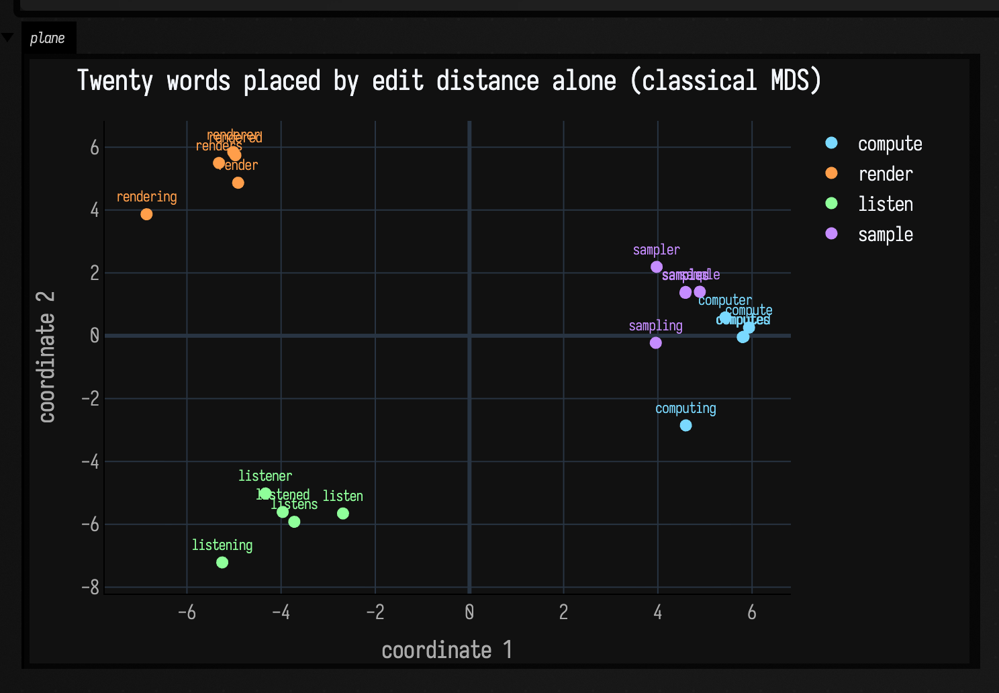
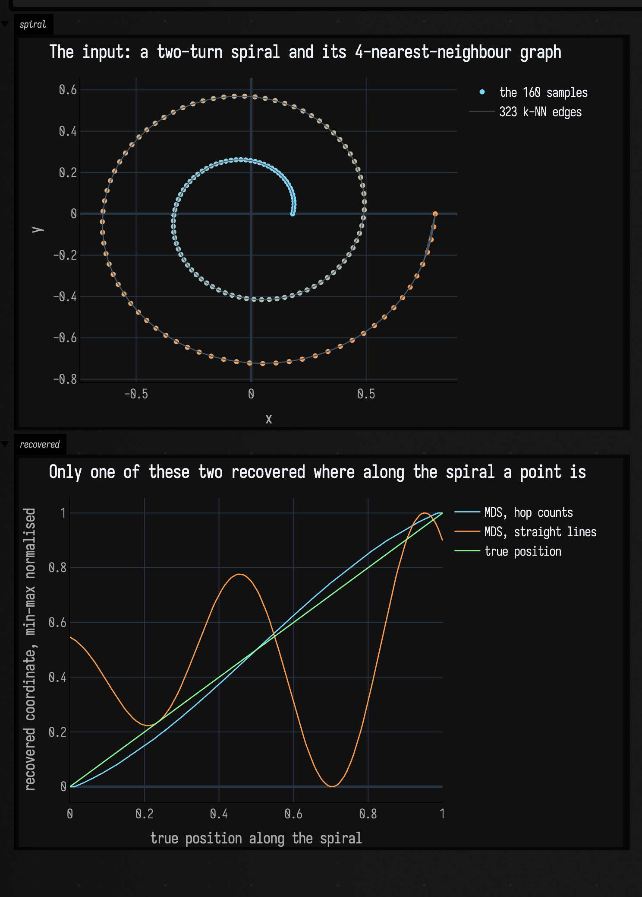
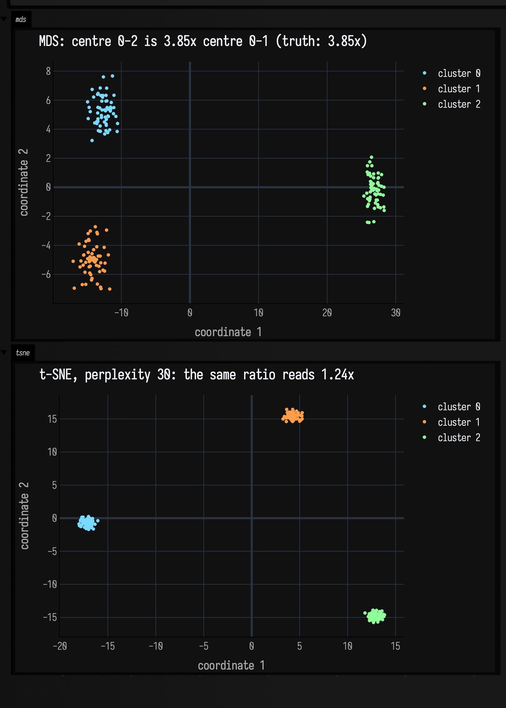
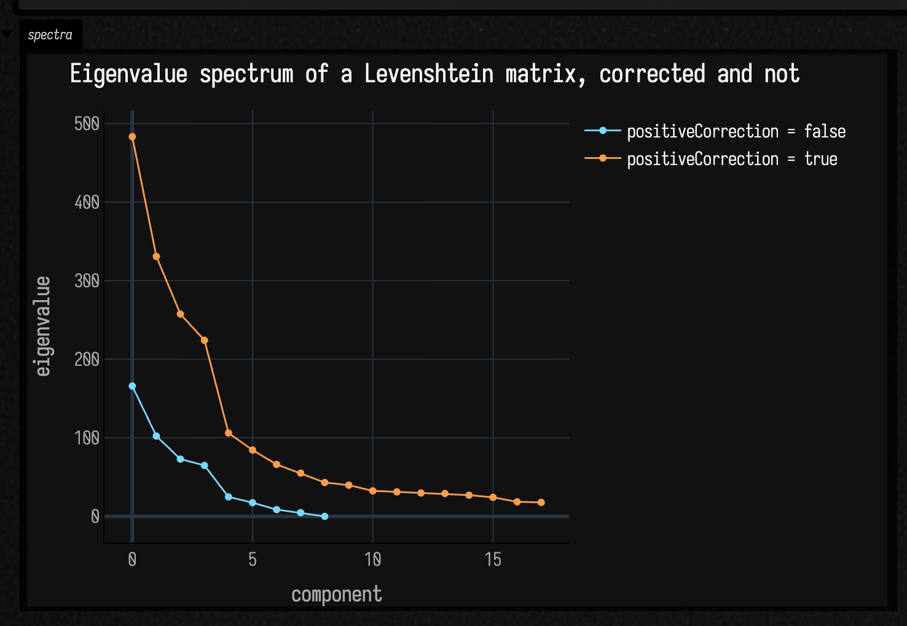

# Projecting a distance matrix

*Every public declaration used below is listed, with its KDoc, in the codebase reference:
[Data](reference/data.md#smile-mds-kt) and [Math](reference/math.md).*

Sometimes the data is not a signal and not a table. It is a **set of things** plus one number for
each pair of them: how far apart those two are. Twenty words and an edit distance. A hundred and
sixty samples along a curve and the number of hops between them. A thousand mel frames and a
Wasserstein distance. There is nothing to plot, because the things have no coordinates, which is the
whole problem, and it is what `afield/stdlib/smile_mds.kt` is for. Give it the distances and it
invents coordinates that reproduce them as closely as two dimensions allow.

Four functions and five result types. Two of them take vectors and compute the distances for you,
which is what the [speech-embedding](audio_ai_speech_embeddings.md) and
[short-time spectral](audio_ai_spectral_embeddings.md) pages use. The other two take a **distance
matrix you computed yourself**, and `smileMdsDistances`' own one-line summary says what that is for:
"useful for transport, edit, and graph distances". Both examples below are one of those, and neither
has anything to do with sound.

!!! note "On Apple Silicon the eigensolver is LAPACK, not ARPACK"

    Smile takes its top-*d* eigenpairs from ARPACK, and bytedeco's `libarpack.2.dylib` for
    `macosx-arm64` needs `libgfortran.5`, `libquadmath.0` and `libgcc_s.1.1`, none of which any
    bytedeco artifact in this build ships on that platform
    (`build.gradle.kts:119#val arpackVersion = "3.9.1-1.5.12"`). So `smileMds` probes the binding
    once and falls back to LAPACK's `dsyevd` when it is missing
    (`smile_mds.kt:349#private val arpackAvailable: Boolean by lazy {`), which is the path the
    numbers on this page were measured on. `smileTsne` does not touch ARPACK either way.

## Where the family lives

<div class="field-data-table" markdown>

| what you have | what to call | what comes back |
|---|---|---|
| equal-length vectors, and you want cosine or Euclidean distance computed for you | `smileMds` (`smile_mds.kt:88#fun smileMds(`) | `SmileMdsProjection` — `coordinates`, `scores`, `proportion` |
| **a symmetric distance matrix you built yourself** | `smileMdsDistances` (`smile_mds.kt:159#fun smileMdsDistances(`) | `SmileMdsProximityProjection` — the same three, plus the `label` you passed |
| vectors, but you care about local neighbourhoods rather than global geometry | `smileTsne` (`smile_mds.kt:180#fun smileTsne(`) | `SmileTsneProjection` — `coordinates`, `cost`, `seed` |
| **your own matrix, t-SNE** | `smileTsneDistances` (`smile_mds.kt:240#fun smileTsneDistances(`) | `SmileTsneProximityProjection` |

</div>

`SmileMdsDistance` is `COSINE` or `EUCLIDEAN` and only matters to the two vector-taking calls; the
matrix-taking calls never see your vectors at all, which is exactly why they accept a distance no
vector could express.

Three limits, before you reach for any of it. None of these projections is invertible, and none can
place a new point without refitting everything, so this is not dimensionality reduction for a model.
Nothing here assigns labels either: a picture with visible clumps is a picture, not a partition. And
none of it is cheap at scale, because the proximity matrix is `n²` doubles
(`smile_mds.kt:111#val proximity = Array(vectors.size) { DoubleArray(vectors.size) }`), 191 MiB at
5000 rows and 3.0 GiB at 20 000, before Smile allocates its own.

## A distance you wrote yourself

Twenty words, four families of five: `compute`/`computes`/`computed`/`computer`/`computing`, then
the same five shapes on `render`, `listen` and `sample`. The distance is Levenshtein: the number of
single-character insertions, deletions and substitutions between two strings. There is no vector
anywhere; a word is not a point in any space until this call gives it one.

```diffstatic_runner {data-lang=kotlin screenshot="assets/projection_examples/edit_distance_words.png" wait="2.0" capture="box" open-outputs="true" w="980" h="720" padding="16"}
:::static
import afield.darkMode
import space.kscience.plotly.*
import space.kscience.plotly.models.ScatterMode
import space.kscience.plotly.models.TextPosition

val families = listOf(
    listOf("compute", "computes", "computed", "computer", "computing"),
    listOf("render", "renders", "rendered", "renderer", "rendering"),
    listOf("listen", "listens", "listened", "listener", "listening"),
    listOf("sample", "samples", "sampled", "sampler", "sampling"),
)
val words = families.flatten()

// Ordinary Levenshtein, in the fence rather than from the stdlib: `afield.brief.editDistance`
// exists but is `internal`, and naming a doc-local helper after a stdlib symbol would put a false
// "Used in" back-reference in the generated reference.
val wordEditDistance = { a: String, b: String ->
    var previous = IntArray(b.length + 1) { it }
    for (i in 1..a.length) {
        val current = IntArray(b.length + 1)
        current[0] = i
        for (j in 1..b.length) {
            val substitution = previous[j - 1] + if (a[i - 1] == b[j - 1]) 0 else 1
            current[j] = minOf(previous[j] + 1, current[j - 1] + 1, substitution)
        }
        previous = current
    }
    previous[b.length]
}

val distances = Array(words.size) { a ->
    DoubleArray(words.size) { b -> wordEditDistance(words[a], words[b]).toDouble() }
}
val projection = smileMdsDistances(distances, dimensions = 2, label = "levenshtein")

// What the picture cost. The plane distances are compared against the input ones two ways: a
// correlation, and Kruskal's stress-1 at the scale that minimises it (classical MDS does not
// promise the plane is in the same units as the input, so an unscaled stress would measure the
// units rather than the fit).
val plane = Array(words.size) { a ->
    DoubleArray(words.size) { b ->
        val dx = projection.coordinates[a][0] - projection.coordinates[b][0]
        val dy = projection.coordinates[a][1] - projection.coordinates[b][1]
        sqrt(dx * dx + dy * dy)
    }
}
val pairsIn = ArrayList<Double>()
val pairsOut = ArrayList<Double>()
for (a in words.indices) for (b in 0 until a) { pairsIn += distances[a][b]; pairsOut += plane[a][b] }
val r = StatsDependence.pearson(pairsIn.toDoubleArray(), pairsOut.toDoubleArray())
val scale = pairsIn.indices.sumOf { pairsIn[it] * pairsOut[it] } / pairsIn.indices.sumOf { pairsOut[it] * pairsOut[it] }
val stress = sqrt(
    pairsIn.indices.sumOf { (pairsIn[it] - scale * pairsOut[it]).let { d -> d * d } } /
        pairsIn.indices.sumOf { pairsIn[it] * pairsIn[it] }
)

// The claim the picture makes, as a count rather than an impression: does each word's nearest
// neighbour still come from its own family?
val ownFamily = { matrix: Array<DoubleArray> ->
    words.indices.count { row ->
        val nearest = words.indices.filter { it != row }.minByOrNull { matrix[row][it] }!!
        nearest / 5 == row / 5
    }
}
val lost = words.indices.filter { row ->
    val nearest = words.indices.filter { it != row }.minByOrNull { plane[row][it] }!!
    nearest / 5 != row / 5
}.map { words[it] }

val within = ArrayList<Double>(); val between = ArrayList<Double>()
for (a in words.indices) for (b in 0 until a) {
    if (a / 5 == b / 5) within += distances[a][b] else between += distances[a][b]
}
println("input edit distance: within-family mean ${"%.3f".format(within.average())}, " +
    "between-family mean ${"%.3f".format(between.average())} (smallest between-family ${between.min()})")
println("retained eigenvalues ${projection.scores.joinToString { "%.3f".format(it) }}, " +
    "proportion ${projection.proportion.joinToString { "%.4f".format(it) }} (sums to ${projection.proportion.sum()})")
println("plane vs input: r = ${"%.4f".format(r)}, stress-1 = ${"%.4f".format(stress)}")
println("nearest neighbour in own family: ${ownFamily(distances)}/20 by edit distance, " +
    "${ownFamily(plane)}/20 in the plane; lost: $lost")
:::fold draw the twenty words
val palette = listOf("#7ad9ff", "#ff9e4a", "#8fff9a", "#c58cff")
display("plane", Plotly.plot {
    families.forEachIndexed { family, members ->
        val rows = members.indices.map { family * 5 + it }
        scatter {
            name = members.first()
            mode = ScatterMode.`markers+text`
            x.set(rows.map { projection.coordinates[it][0] })
            y.set(rows.map { projection.coordinates[it][1] })
            text.set(rows.map { words[it] })
            textposition = TextPosition.`top center`
            marker { size = 9.0; color(palette[family]) }
            textfont { color(palette[family]); size = 11 }
        }
    }
    layout {
        title = "Twenty words placed by edit distance alone (classical MDS)"
        xaxis { title = "coordinate 1" }
        yaxis { title = "coordinate 2" }
    }
}.darkMode())
:::endfold
```



Read the numbers the fence prints rather than the shape. The mean edit distance inside a family is
**2.000** and between families **6.720**, so a reader would expect four clumps, and four clumps is
what appears. What the projection *destroyed* to get them is on the last line: by edit distance, all
**20 of 20** words have a same-family nearest neighbour; in the plane, **18 of 20** do. The two that
lose it are `computing` and `sampling`, and the arithmetic behind that is the cost of a projection in
miniature. The `compute` and `sample` families are 4 apart *form for form*:
`compute`/`sample`, `computed`/`sampled`, `computing`/`sampling`, all exactly 4, and 4 is the smallest
between-family distance anywhere in the set. Meanwhile every `-ing` form is 3 from its own stem, the
largest within-family distance there is. So `computing` sits 3 from its family and 4 from `sampling`,
a margin of one, and one is what two dimensions cannot hold: in the plane its nearest neighbour is
`sampling`. `sampling` does worse still: its plane-nearest is `computer`, which is 6 away in the
input. Those are the two clumps that touch in the figure above, and they touch for a reason you can
read off the distance matrix before you draw anything.

The fit itself: the plane distances correlate with the edit distances at **r = 0.8475**, with a
stress-1 of **0.2780**. Stress-1 above 0.2 is usually called poor, so that is a poor fit, and it is
what squeezing a nineteen-dimensional structure into two costs. Ask for more dimensions and it
improves the way you would expect: `dimensions = 3` gives r = 0.9258 and stress 0.1547,
`dimensions = 4` gives 0.9500 and 0.1146. Nothing forces you to draw all the dimensions you fit.

And `proportion` sums to **1.0000** here, which is not the reassurance it looks like. It is the retained eigenvalues divided
by *their own* L1 norm (`smile_mds.kt:454#val norm = proportion.sumOf { abs(it) }`), so it sums to 1
whether you kept 2 components or 15. It tells you how the components you kept divide up between
themselves and nothing whatever about how much you threw away. The stress figure above is the number
that answers that, and you have to compute it yourself.

## A graph distance: hop count on a KNN spiral

The second case the KDoc advertises. Take 160 points along a two-turn spiral, join each to its four
nearest neighbours with `vec2KnnGraph` (`graph_connectivity.kt:584#fun vec2KnnGraph(`), and count
hops. That is a distance defined entirely by the graph: two points on adjacent arms of the spiral
are close in the plane and far apart along the curve, and hop count is the one that knows it.

Feed the hop matrix to `smileMdsDistances` and you have Isomap in about fifteen lines. The check is
built in: the spiral has a true parameter, the position along it, and a projection that has
understood the curve must recover a coordinate that is monotone in that parameter.

```diffstatic_runner {data-lang=kotlin screenshot="assets/projection_examples/graph_hops_spiral.png" wait="2.0" capture="box" open-outputs="true" w="1000" h="760" padding="16"}
:::static
import afield.darkMode
import space.kscience.plotly.*
import space.kscience.plotly.models.ScatterMode

val n = 160
val t = DoubleArray(n) { it / (n - 1.0) }
val xy = Array(n) { i ->
    val theta = 2.0 * PI * 2.0 * t[i]
    val radius = 0.18 + 0.62 * t[i]
    doubleArrayOf(radius * cos(theta), radius * sin(theta))
}
val points = (0 until n).map { vec(xy[it][0], xy[it][1]) }

// k = 4 works here because the arms are further apart than the samples are: the radial gap between
// successive turns is 0.62 / 2 = 0.310 and the mean spacing along the curve is 0.0389, eight times
// smaller. The guard against a shortcut edge is printed below rather than assumed — an edge joining
// two arms would join points far apart in index, and this graph's worst is 4.
val graph = vec2KnnGraph(points, k = 4)
val adjacency = Array(n) { graph.neighbors(it).toIntArray() }

// Breadth-first hop counts from every point: an unweighted geodesic over the k-NN graph.
val hops = Array(n) { source ->
    val depth = IntArray(n) { -1 }
    depth[source] = 0
    val queue = ArrayDeque<Int>()
    queue += source
    while (queue.isNotEmpty()) {
        val at = queue.removeFirst()
        for (next in adjacency[at]) if (depth[next] < 0) {
            depth[next] = depth[at] + 1
            queue += next
        }
    }
    DoubleArray(n) { depth[it].toDouble() }
}

val geodesic = smileMdsDistances(hops, dimensions = 2, label = "graph hops")
// The control: the same 160 points, projected from their ordinary straight-line distances. In two
// dimensions that can only give the spiral back, rotated.
val straight = smileMds(xy, dimensions = 2, distance = SmileMdsDistance.EUCLIDEAN, positiveCorrection = false)

// MDS axes have arbitrary sign, so orient both to agree with t before comparing them.
val orient = { coordinates: Array<DoubleArray> ->
    val raw = DoubleArray(n) { coordinates[it][0] }
    val sign = if (StatsDependence.spearman(t, raw) < 0.0) -1.0 else 1.0
    DoubleArray(n) { sign * raw[it] }
}
val geodesicAxis = orient(geodesic.coordinates)
val straightAxis = orient(straight.coordinates)

println("graph: ${graph.edges.size} edges, worst |i - j| over an edge = ${graph.edges.maxOf { abs(it.i - it.j) }}" +
    " (a shortcut between arms would be large); diameter ${hops.maxOf { it.max() }.toInt()} hops")
println("coordinate 1 vs position along the spiral, Spearman rho:")
println("  from hop counts        ${"%.4f".format(StatsDependence.spearman(t, geodesicAxis))}")
println("  from straight-line d   ${"%.4f".format(StatsDependence.spearman(t, straightAxis))}")
println("proportion: hops ${geodesic.proportion.joinToString { "%.4f".format(it) }}, " +
    "straight-line ${straight.proportion.joinToString { "%.4f".format(it) }}")
:::fold the spiral and the two recovered coordinates
val normalise = { values: DoubleArray ->
    val lo = values.min(); val span = (values.max() - lo).takeIf { it > 1e-12 } ?: 1.0
    values.map { (it - lo) / span }
}
display("spiral", Plotly.plot {
    scatter {
        name = "the 160 samples"
        mode = ScatterMode.markers
        x.set(xy.map { it[0] }); y.set(xy.map { it[1] })
        // One colour per point, running cyan to orange with position along the curve, so the
        // figure says which end of the spiral is which.
        marker { size = 6.0; colors(t.map { "rgb(${(122 + 133 * it).toInt()}, ${(217 - 59 * it).toInt()}, ${(255 - 181 * it).toInt()})" }) }
    }
    // All 323 edges as ONE trace rather than 323, with a NaN between each pair. Plotly leaves a gap
    // in a line at a non-finite value, which is the cheap way to draw a whole graph in one go; 323
    // traces would also mean 323 legend entries.
    val edgeX = ArrayList<Double>(); val edgeY = ArrayList<Double>()
    graph.edges.forEach { edge ->
        edgeX += xy[edge.i][0]; edgeX += xy[edge.j][0]; edgeX += Double.NaN
        edgeY += xy[edge.i][1]; edgeY += xy[edge.j][1]; edgeY += Double.NaN
    }
    scatter {
        name = "${graph.edges.size} k-NN edges"
        mode = ScatterMode.lines
        x.set(edgeX); y.set(edgeY)
        line { width = 0.8; color("#4a5a6a") }
    }
    layout { title = "The input: a two-turn spiral and its 4-nearest-neighbour graph"; xaxis { title = "x" }; yaxis { title = "y" } }
}.darkMode())
showSignals(
    "MDS, hop counts" to normalise(geodesicAxis),
    "MDS, straight lines" to normalise(straightAxis),
    "true position" to normalise(t),
    x = t.toList(),
    channel = "recovered",
    title = "Only one of these two recovered where along the spiral a point is",
    xTitle = "true position along the spiral",
    yTitle = "recovered coordinate, min-max normalised",
)
:::endfold
```



The number under the second figure is **1.0000**. MDS on hop counts
recovers a coordinate whose rank order along the spiral is *exactly* the true one, a Spearman rho of
1.0000 with no exceptions in 160 points, while the same MDS on straight-line distances gets
**0.2325**, because in two dimensions the straight-line fit can only reproduce the spiral, and the
spiral's x-coordinate crosses the same value four times. Against a fitted arc length rather than a
rank, the graph coordinate is linear at Pearson **0.9852** against **0.3238**.

Nothing here is a property of MDS; it is a property of the distance you chose. Both fits are the
same call with the same options. Change the matrix and the projection answers a different question —
which is why the matrix-taking entry point exists.

What has to be checked is the graph, and the fence checks it: **worst `|i − j|` over an edge = 4**,
so no edge has jumped between arms. A single shortcut edge would collapse two arms into one and the
rho above would fall off a cliff. Raise `k` until that happens and you can watch it go.

## MDS or t-SNE? Measure what each one destroys

The usual advice is that MDS preserves global distances and t-SNE preserves local neighbourhoods.
That is true, and it is also two measurements, because the *size* of the distortion is what decides
whether a picture can be believed.

Three Gaussian clusters of sixty points each in twelve dimensions, with unit spread and centres
placed so that one fact is checkable: cluster 1 is 10 away from cluster 0 and cluster 2 is 40 away. So one true fact
about the data is that clusters 0 and 2 are about four times further apart than clusters 0 and 1,
and either projection either keeps that or does not.

```diffstatic_runner {data-lang=kotlin screenshot="assets/projection_examples/mds_versus_tsne.png" wait="10.0" capture="box" open-outputs="true" w="1020" h="900" padding="16"}
:::static
import afield.darkMode
import space.kscience.plotly.*
import space.kscience.plotly.models.ScatterMode

val dimensions = 12
val perCluster = 60
val rng = java.util.Random(4)
val centres = listOf(
    DoubleArray(dimensions),
    DoubleArray(dimensions).also { it[0] = 10.0 },
    DoubleArray(dimensions).also { it[1] = 40.0 },
)
val data = ArrayList<DoubleArray>()
val label = ArrayList<Int>()
centres.forEachIndexed { cluster, centre ->
    repeat(perCluster) {
        data += DoubleArray(dimensions) { centre[it] + rng.nextGaussian() }
        label += cluster
    }
}
val vectors = data.toTypedArray()
val n = vectors.size

val mds = smileMds(vectors, dimensions = 2, distance = SmileMdsDistance.EUCLIDEAN, positiveCorrection = false)
val tsne = smileTsne(vectors, dimensions = 2, distance = SmileMdsDistance.EUCLIDEAN, perplexity = 30.0)

// Measurement one: the ratio of two between-cluster distances. Scale-free on purpose, because
// neither projection promises to keep the units, and a ratio is what a reader takes off a picture.
val gap = { coordinates: Array<DoubleArray>, a: Int, b: Int ->
    val centroid = { cluster: Int ->
        val rows = (0 until n).filter { label[it] == cluster }
        DoubleArray(coordinates[0].size) { c -> rows.sumOf { coordinates[it][c] } / rows.size }
    }
    val ca = centroid(a); val cb = centroid(b)
    sqrt(ca.indices.sumOf { (ca[it] - cb[it]).let { d -> d * d } })
}
val ratio = { coordinates: Array<DoubleArray> -> gap(coordinates, 0, 2) / gap(coordinates, 0, 1) }

// Measurement two: of each point's ten nearest neighbours in twelve dimensions, how many are still
// among its ten nearest in the plane?
val nearest = { source: Array<DoubleArray>, row: Int, k: Int ->
    (0 until n).filter { it != row }
        .sortedBy { other -> source[row].indices.sumOf { (source[row][it] - source[other][it]).let { d -> d * d } } }
        .take(k).toSet()
}
val recall = { coordinates: Array<DoubleArray>, k: Int ->
    (0 until n).sumOf { row -> nearest(vectors, row, k).intersect(nearest(coordinates, row, k)).size / k.toDouble() } / n
}

println("true    0-1 ${"%.3f".format(gap(vectors, 0, 1))}  0-2 ${"%.3f".format(gap(vectors, 0, 2))}  ratio ${"%.4f".format(ratio(vectors))}")
println("MDS     0-1 ${"%.3f".format(gap(mds.coordinates, 0, 1))}  0-2 ${"%.3f".format(gap(mds.coordinates, 0, 2))}  ratio ${"%.4f".format(ratio(mds.coordinates))}")
println("t-SNE   0-1 ${"%.3f".format(gap(tsne.coordinates, 0, 1))}  0-2 ${"%.3f".format(gap(tsne.coordinates, 0, 2))}  ratio ${"%.4f".format(ratio(tsne.coordinates))}")
println("10-nearest-neighbour recall: MDS ${"%.4f".format(recall(mds.coordinates, 10))}, " +
    "t-SNE ${"%.4f".format(recall(tsne.coordinates, 10))}")

// Perplexity is the dial between the two, so sweep it rather than describing it.
val sweep = listOf(5.0, 30.0, 100.0).map { perplexity ->
    val fit = smileTsne(vectors, dimensions = 2, distance = SmileMdsDistance.EUCLIDEAN, perplexity = perplexity)
    Triple(perplexity, ratio(fit.coordinates), recall(fit.coordinates, 10))
}
sweep.forEach { (perplexity, gapRatio, knn) ->
    println("t-SNE perplexity ${"%.0f".format(perplexity)}: ratio ${"%.4f".format(gapRatio)}, recall ${"%.4f".format(knn)}")
}

// The seed matters, and it matters in one direction only.
val again = smileTsne(vectors, dimensions = 2, distance = SmileMdsDistance.EUCLIDEAN, perplexity = 30.0)
val other = smileTsne(vectors, dimensions = 2, distance = SmileMdsDistance.EUCLIDEAN, perplexity = 30.0, seed = 7L)
val drift = { a: Array<DoubleArray>, b: Array<DoubleArray> ->
    (0 until n).maxOf { row -> (0..1).maxOf { c -> abs(a[row][c] - b[row][c]) } }
}
println("refit at the default seed: worst coordinate difference ${drift(tsne.coordinates, again.coordinates)}")
println("refit at seed 7: worst coordinate difference ${"%.4f".format(drift(tsne.coordinates, other.coordinates))}, " +
    "cost ${"%.4f".format(tsne.cost)} vs ${"%.4f".format(other.cost)}")
:::fold the two planes, side by side
val palette = listOf("#7ad9ff", "#ff9e4a", "#8fff9a")
val panel = { coordinates: Array<DoubleArray>, caption: String ->
    Plotly.plot {
        (0..2).forEach { cluster ->
            val rows = (0 until n).filter { label[it] == cluster }
            scatter {
                name = "cluster $cluster"
                mode = ScatterMode.markers
                x.set(rows.map { coordinates[it][0] })
                y.set(rows.map { coordinates[it][1] })
                marker { size = 5.0; color(palette[cluster]) }
            }
        }
        layout { title = caption; xaxis { title = "coordinate 1" }; yaxis { title = "coordinate 2" } }
    }.darkMode()
}
display("mds", panel(mds.coordinates, "MDS: centre 0-2 is ${"%.2f".format(ratio(mds.coordinates))}x centre 0-1 (truth: ${"%.2f".format(ratio(vectors))}x)"))
display("tsne", panel(tsne.coordinates, "t-SNE, perplexity 30: the same ratio reads ${"%.2f".format(ratio(tsne.coordinates))}x"))
:::endfold
```



The two panels show the same data and disagree about the most obvious thing in it.

| | between-centre ratio 0–2 : 0–1 | 10-nearest-neighbour recall |
|---|---|---|
| truth, in twelve dimensions | **3.8485** | 1.0 by definition |
| MDS | **3.8489** | 0.2922 |
| t-SNE, perplexity 30 | **1.2369** | **0.4761** |

MDS gets the global geometry right to four significant figures, 3.8489 against 3.8485, which is
not a surprise once you see why: the three centres span a two-dimensional subspace of the twelve, so
two components are genuinely enough to hold them. And it pays for that with the worst local
structure of anything here: of each point's ten nearest neighbours in twelve dimensions, MDS keeps
**2.9**.

t-SNE inverts both. It keeps **4.8** of the ten neighbours, 63% more than MDS, and it reports the
two clusters that are 3.85 times further apart as **1.24** times further apart. The distance you
would read off that picture is wrong by a factor of **3.1**, and no amount of squinting recovers it.
That factor is what "do not read distance between t-SNE clusters" is protecting you from, and the
coordinates in the figure are where it can be measured.

Perplexity is the dial between the two behaviours, and the sweep is monotone in both directions at
once:

| perplexity | between-centre ratio | 10-NN recall |
|---|---|---|
| 5 | 1.0247 | 0.5067 |
| 30 | 1.2369 | 0.4761 |
| 100 | 3.2761 | 0.2894 |

At perplexity 5 the three clusters come out essentially equidistant, a ratio of 1.02 against a true 3.85,
with the best local structure on the page. At 100 the ratio is nearly right at 3.28 and the local
recall has fallen below MDS's. So a t-SNE plot cannot be read at all without knowing its perplexity,
and the default of 30 sits at the end of that range where global distance means least.

The seed matters as much. Two fits of the same data at the same seed are **bit-identical**, which is
what makes a live-coded box redraw the same picture when you re-run it. Two fits at *different*
seeds are not remotely the same picture: the worst coordinate moves by **30.59** while the reported
`cost` barely moves at all, 0.1709 against 0.1707 — an equally good answer and a completely
different plot. If a t-SNE figure is going into something anyone else will read, the seed belongs in
the caption.

??? note "The lock behind that guarantee"

    Smile's t-SNE initialiser draws from `smile.math.MathEx`'s **process-wide** random source, so
    `smileTsne` installs `seed` and runs the fit inside a lock
    (`smile_mds.kt:156#private val smileTsneLock = Any()`). The worst coordinate difference between
    two same-seed fits above is exactly `0.0`.

    The lock also means concurrent t-SNE fits queue rather than parallelise. On a long fit that is
    visible, and it is the price of the guarantee.

## `positiveCorrection`

A cosine distance is not Euclidean. Neither is an edit distance or a hop count. For such a matrix
the double-centred learning matrix has negative eigenvalues, and classical MDS has nothing to take a
square root of. `positiveCorrection`, on by default, adds a constant to every off-diagonal
dissimilarity, chosen as the largest real eigenvalue of a `2n × 2n` system, until the matrix is
positive semi-definite (`smile_mds.kt:409#val constant = additiveConstant(proximity, learning)`).

The word-distance matrix from the first fence is a clean test, because Levenshtein is a metric that
obeys the triangle inequality and is still not Euclidean.

```diffstatic_runner {data-lang=kotlin screenshot="assets/projection_examples/positive_correction.png" wait="2.0" capture="box" open-outputs="true" w="980" h="560" padding="16"}
:::static
val families = listOf(
    listOf("compute", "computes", "computed", "computer", "computing"),
    listOf("render", "renders", "rendered", "renderer", "rendering"),
    listOf("listen", "listens", "listened", "listener", "listening"),
    listOf("sample", "samples", "sampled", "sampler", "sampling"),
)
val words = families.flatten()
val wordEditDistance = { a: String, b: String ->
    var previous = IntArray(b.length + 1) { it }
    for (i in 1..a.length) {
        val current = IntArray(b.length + 1)
        current[0] = i
        for (j in 1..b.length) {
            val substitution = previous[j - 1] + if (a[i - 1] == b[j - 1]) 0 else 1
            current[j] = minOf(previous[j] + 1, current[j - 1] + 1, substitution)
        }
        previous = current
    }
    previous[b.length]
}
val distances = Array(words.size) { a ->
    DoubleArray(words.size) { b -> wordEditDistance(words[a], words[b]).toDouble() }
}

// How many dimensions will each setting give you before the spectrum runs out of positive
// eigenvalues? Ask for more and more until the call refuses.
val spectra = listOf(false, true).map { correction ->
    var accepted = 0
    var scores = DoubleArray(0)
    var refusal = "never refused"
    for (dimension in 2..18) {
        try {
            val fit = smileMdsDistances(distances, dimensions = dimension, positiveCorrection = correction)
            accepted = dimension
            scores = fit.scores
        } catch (refused: IllegalArgumentException) {
            refusal = refused.message.orEmpty().substringAfter("smileMds: ")
            break
        }
    }
    Triple(correction, accepted, scores) to refusal
}
spectra.forEach { (result, refusal) ->
    val (correction, accepted, scores) = result
    println("positiveCorrection = $correction: largest usable dimensions = $accepted")
    println("  spectrum ${scores.joinToString { "%.2f".format(it) }}")
    println("  $refusal")
}

// And what it costs in the plane, which is the part that is easy to guess wrong.
listOf(false, true).forEach { correction ->
    val fit = smileMdsDistances(distances, dimensions = 2, positiveCorrection = correction)
    val pairsIn = ArrayList<Double>(); val pairsOut = ArrayList<Double>()
    for (a in words.indices) for (b in 0 until a) {
        pairsIn += distances[a][b]
        val dx = fit.coordinates[a][0] - fit.coordinates[b][0]
        val dy = fit.coordinates[a][1] - fit.coordinates[b][1]
        pairsOut += sqrt(dx * dx + dy * dy)
    }
    val scale = pairsIn.indices.sumOf { pairsIn[it] * pairsOut[it] } / pairsIn.indices.sumOf { pairsOut[it] * pairsOut[it] }
    val stress = sqrt(
        pairsIn.indices.sumOf { (pairsIn[it] - scale * pairsOut[it]).let { d -> d * d } } /
            pairsIn.indices.sumOf { pairsIn[it] * pairsIn[it] }
    )
    println("two dimensions, positiveCorrection = $correction: " +
        "r = ${"%.4f".format(StatsDependence.pearson(pairsIn.toDoubleArray(), pairsOut.toDoubleArray()))}, " +
        "stress-1 = ${"%.4f".format(stress)}")
}
:::fold the two spectra
showSignals(
    "positiveCorrection = false" to spectra[0].first.third.toList(),
    "positiveCorrection = true" to spectra[1].first.third.toList(),
    channel = "spectra",
    title = "Eigenvalue spectrum of a Levenshtein matrix, corrected and not",
    xTitle = "component",
    yTitle = "eigenvalue",
)
:::endfold
```



Uncorrected, this matrix gives you **9** dimensions and no more. The spectrum runs 165.81,
102.20, 72.87, 64.80, 24.78, 17.39, 8.54, 4.70, then a ninth component at machine zero, and the
tenth is genuinely negative at **−1.03**, at which point the call refuses, because there is no real
square root of a negative eigenvalue. Corrected, all **18** requestable dimensions are
comfortably positive, the smallest of them 17.75.

That is what the flag buys: **dimensions, not accuracy.** In two dimensions the *uncorrected* fit is
fractionally the better of the two, at r 0.8533 and stress 0.2626 against 0.8475 and 0.2780 with the
correction on. The additive constant inflates every distance by the same amount, which flattens the
relative differences the projection is trying to reproduce. So if you only ever want two or three
components out of a non-Euclidean matrix, `positiveCorrection = false` is sometimes slightly
better; the default is `true` because "the call throws for reasons about the
tenth eigenvalue" is a worse first experience than losing 0.015 of a correlation.

## Sharp edges

- **The proximity matrix is `n²` doubles, and Smile allocates more on top.** 7.6 MiB at n = 1000,
  191 MiB at 5000, 3.0 GiB at 20 000, 19 GiB at 50 000. A long trajectory has to be sampled before
  it is projected. `smileMds` builds the matrix itself
  (`smile_mds.kt:111#val proximity = Array(vectors.size) { DoubleArray(vectors.size) }`), so the cost
  applies even when you never see it.
- **`dimensions` must be at least 2**, and all four entry points say so themselves rather than
  letting Smile's own message through
  (`smile_mds.kt:97#require(dimensions in 2 until vectors.size)` for the vector pair,
  `smile_mds.kt:280#require(dimensions in 2 until distances.size)` for the matrix pair). If you want
  one number per thing, fit two and use the first column.
- **MDS axes have arbitrary sign and arbitrary rotation.** They are eigenvectors; nothing pins the
  direction. The spiral fence flips the sign to agree with the known parameter before comparing, and
  any code that compares two fits has to do something equivalent.
- **A rank-deficient fit is fine; a negative eigenvalue is not.** Asking for as many components as
  the data has structure gives a column of zeros, which is correct. Asking for more than an
  uncorrected non-Euclidean matrix can support raises `IllegalArgumentException`
  (`smile_mds.kt:440#val floor = -1e-9 * max(1.0, abs(values[retained.first()]))`).
- **`proportion` always sums to 1.** See the first fence. It is not an explained-variance figure.
- **t-SNE logs every tenth iteration to slf4j at INFO**, which is ~75 lines per fit. Harmless, and
  loud if you are watching a log.
- **t-SNE needs at least four rows and a perplexity below the row count**, and its axes carry no
  meaning at all: not units, not order, not orientation. Only the neighbourhoods do.

## Choosing, in one paragraph

If the quantity you want to read off the picture is a *distance*, as in this pair being twice as far
apart as that pair, use MDS, and report a stress figure alongside it so the reader knows what two dimensions
cost. If the quantity you want is *membership*, as in these things belonging together and that one
not, use t-SNE, quote the perplexity and the seed, and do not let anyone measure between the clumps. If
your things are vectors and cosine or Euclidean is the right distance, `smileMds` and `smileTsne`
build the matrix for you; if the distance is something only you can compute, whether an edit distance, a
transport cost, a hop count or a diff size, `smileMdsDistances` and `smileTsneDistances` are the
entry points, and the two worked examples above are both of that kind. Above a few thousand things,
sample first: everything here is quadratic in memory before it is anything else.

For the audio-specific wrappers over these same four functions, see
[speech-reactive learned spaces](audio_ai_speech_embeddings.md) and
[short-time spectral spaces](audio_ai_spectral_embeddings.md); for the graph constructions the second
fence borrows, [Neighbors & graphs](graph_connectivity_examples.md); and for the dependence
coefficients the fences use to check themselves, [Statistics & dependence](statistics_examples.md).
