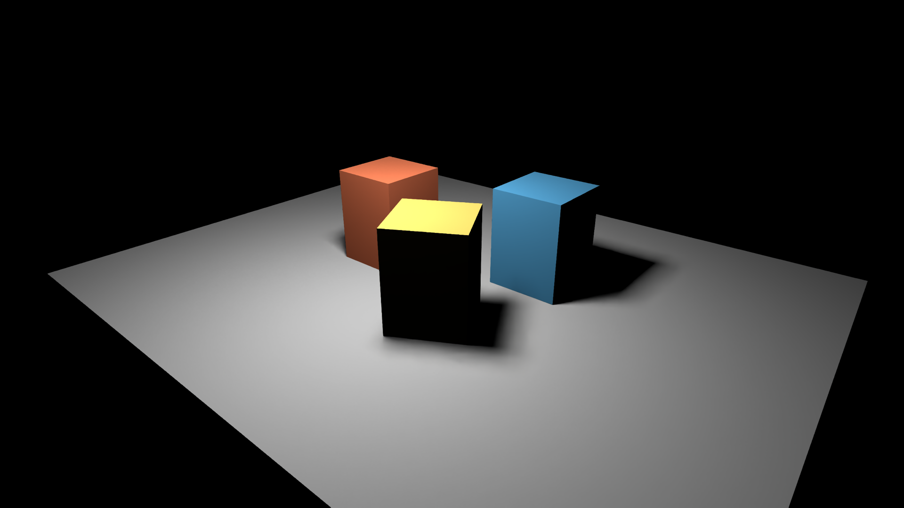
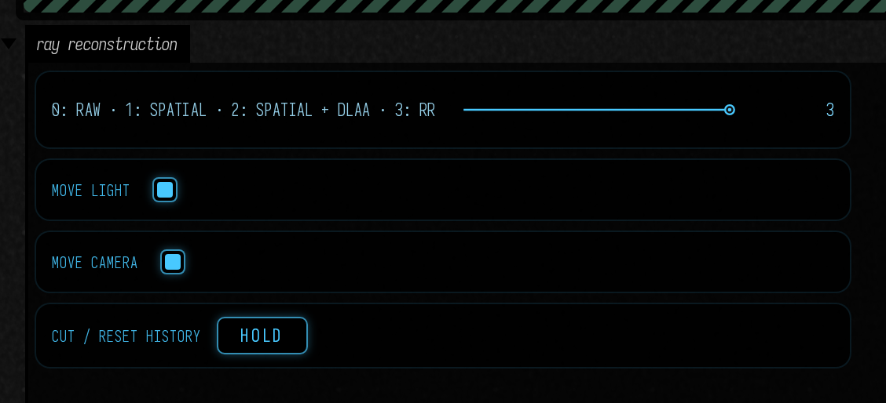

# Ray Reconstruction

Ray Reconstruction turns the raw samples from [RTXDI](direct_lighting.md) into a temporally reconstructed image. It is another choice of finish for the lighting experiment: you can compare it directly with the existing spatial filter and with spatial filtering followed by DLAA.



## Open the experiment

Open **Starting points → ray_reconstruction**. The scene has a moving area light, a moving camera, and four interchangeable paths, all at 1920 × 1080:

- **0: Raw** shows RTXDI's unfiltered light samples.
- **1: Spatial** uses Field's surface-guided spatial filter.
- **2: Spatial + DLAA** adds native-resolution neural antialiasing to that filter.
- **3: RR** gives the raw light samples and surface guides directly to Ray Reconstruction.

Stop the camera and light independently. **Cut / reset history** jumps the animation and discards old samples. The raw image remains available throughout; RR does not run after the spatial filter, and an extra DLAA pass does not run after RR.



<video controls muted loop playsinline preload="metadata" src="assets/ray_reconstruction/comparison.mp4" width="3840" height="2160" style="max-width:100%;height:auto;aspect-ratio:16/9"></video>

Top left: raw. Top right: spatial. Bottom left: spatial + DLAA. Bottom right: RR. The four panels follow the same animation, with a camera cut halfway through and an instance edit later. Use fullscreen to inspect disocclusion and shadow boundaries.

## Use it in a renderer

The adapter records into Field's command buffer and consumes Field-owned images. `DlssReconstruction(..., rayReconstruction=true)` selects RR. `evaluate` then requires a `RayReconstructionGuides` value in addition to color, depth, motion, and frame state.

```diffstatic
val rr = DlssReconstruction(renderer, size, size, ReconstructionMode.DLAA,
    rayReconstruction = true)

// Outside the render pass, after producing these sampled images:
rr.evaluate(command, ReconstructionInputs(rawLight, depth, motion), frame,
    RayReconstructionGuides(diffuseAlbedo, specularAlbedo, normalRoughness,
        camera.modelView(), projection.evaluateUniform()))
```

Guides must describe the light actually being reconstructed. This experiment's RTXDI bridge is Lambertian: its specular albedo is zero and roughness is one. Those values describe this material model; they are not substitutes for missing glossy data. Glossy and path-traced RR are still outside this example.

Normals are world-space unit vectors, packed with linear roughness in alpha. Diffuse and specular albedo are linear RGB. Depth uses Vulkan's standard 0–1 projection, with background at one. Motion points from the current pixel to its previous position, in input pixels, without jitter. Camera matrices are unjittered. Fabricate now applies raster jitter separately so its motion vectors retain that meaning. Specular hit distance is optional and is not fabricated for this diffuse scene.

## Cost and limits

The [measurement file](assets/ray_reconstruction/measurements.json) records GPU pass timings, SDK memory, and static error against a 4,096-candidate reference. Timings exclude presentation and should be compared only at the recorded resolution and sample budget.

On this RTX 4090, native 1080p RR costs **6.22 ms median / 6.23 ms p95**, over 100 evaluations after 64 warm-up frames. The DLAA pass after spatial filtering costs 1.34 ms. The SDK reports about 94 MB of shared allocations, excluding Field's lighting and guide images.

Against the static reference, RGB MSE is 0.000150 for raw lighting, 0.000047 for RR, and 0.0000091 for the spatial filter. RR improves the raw signal here, but the spatial filter is the closer static match in this simple diffuse scene. Movement, disocclusion, and your intended look are additional reasons to compare the paths.

RR can make noisy illumination substantially smoother, but history can also soften intentional discontinuities. Reset after a cut or semantic edit, and inspect motion as well as still frames. This first bridge supports opaque mono direct lighting; alpha coverage, transmission, glossy reflections, and latent pigment channels need their own verified signal contracts.

Use the same optional [NGX installation](neural_reconstruction.md#optional-installation) as DLAA/SR. RR availability is queried separately, including its required extensions before device creation. Ordinary rendering remains available when the SDK or feature is absent.

The capstone [From modules to reconstruction](reconstruction_plumbing.md#extend-the-graph-to-ray-reconstruction) exposes the five-guide conversion and command ordering in the **rr_plumbing** Starting Point, ready to adapt to your own render targets.
