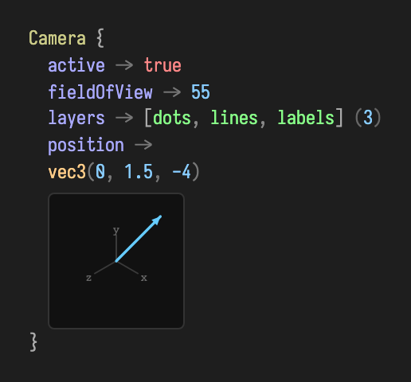
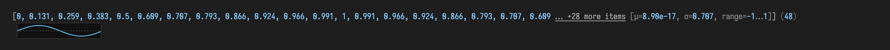
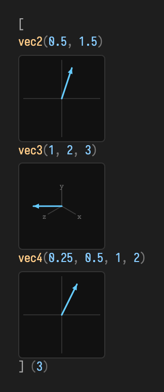
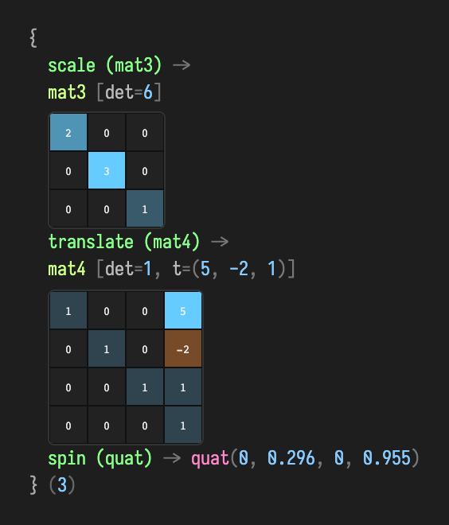
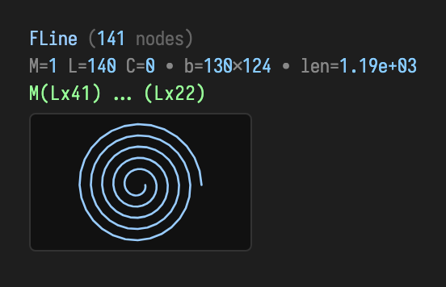
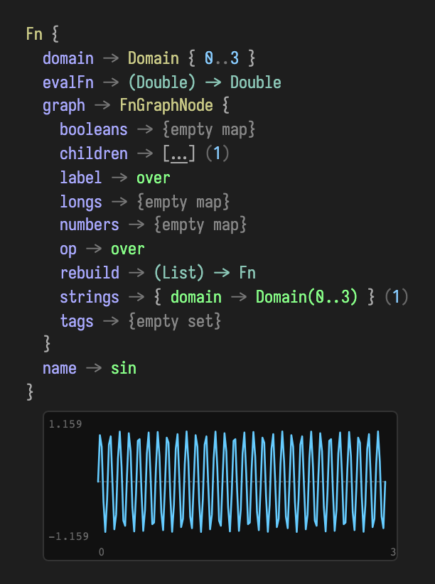

# Reading your values: Field's inline visualizers

Most environments answer "what is this value?" with a line of `toString()`. Field answers with a *picture*. Whenever you ask Field to show a value, the **value visualizer** turns it into a compact HTML view — a reflective tree for arbitrary objects, and, for the types Field draws with, a little inline graphic that reads at a glance. A small per-type colour palette distinguishes parts of the view.

This page is a worked tour of what that renderer produces today. Every image below was captured straight from the real renderer (`ValueVisualizer.visualize(...)`, in `src/jvmMain/kotlin/afield/visualization/ValueVisualizer.kt`) — nothing here is a mock-up.

## How you reach it

The visualizer is the engine behind Field's "pretty" value output. You reach it three ways, all of which call the same code:

```diffstatic {data-lang=kotlin}
:::static
value.h                       // the .h extension: value -> pretty HTML
display("inspect", value.h)   // drop that HTML into a named output channel
box.viz(value = value)        // convenience: visualize into the box's "viz" channel
```

`.h` is the lightweight view used throughout Field; its heavier sibling `.h2` opens a paged browser for large structures. (For the full family of *instruments* — inline `__m` probes, control surfaces, synth scopes — see [Visualizers, Displays, and Little Instruments](visualizers.md). This page is only about the value renderer itself.)

The built-in and reflective paths are deliberately forgiving: they track recursion by reference,
cap depth and preview sizes, catch reflective getter failures, and guard optional plots and
thumbnails (including a throwing `Fn.evalFn`). Objects implementing `ToHTML` and callbacks
registered with `registerValuePrinter` are extension points whose returned HTML is trusted; those
callbacks are not wrapped by the renderer and should handle their own failures.

## The reflective tree

Give the visualizer an ordinary object — a data class, a map, anything with readable properties — and it walks the members into an indented tree. Numbers, booleans, strings, and nested values are each rendered by the same rules, recursively.

```diffstatic {data-lang=kotlin}
:::static
data class Camera(
    val position: Vector3f,
    val fieldOfView: Double,
    val active: Boolean,
    val layers: List<String>
)

val cam = Camera(Vector3f(0f, 1.5f, -4f), 55.0, true, listOf("dots", "lines", "labels"))
cam.h
```



Notice that the tree is not flat text: the nested `position` is itself rendered as a `vec3`, and `layers` collapses to a list with a size count. The renderer keeps only a handful of fields inline (with a "… +N more fields" expander for the rest) so a large object never floods the output.

## Numeric collections, with stats

Arrays and lists of numbers get a preview plus a one-line statistical summary — mean, standard deviation, and range — so you can judge a buffer without scrolling through it. Long collections elide the middle:

```diffstatic {data-lang=kotlin}
:::static
val samples = DoubleArray(48) { i -> sin(i / 48.0 * 2.0 * Math.PI) }
samples.h
```



The tail reads `… +28 more items [μ=8.90e-17, σ=0.707, range=−1…1] (48)`: the sampled sine averages to ~0, has the expected 0.707 RMS spread, and spans −1…1 — visible immediately, without a plot. The same treatment applies to `IntArray`, `FloatArray`, and numeric `List`s.

## Vectors, matrices, and quaternions

Field's generated linear-algebra types render as compact, colour-coded tokens rather than as reflective trees — the point of a `vec3` is its three numbers, not its class internals:

```diffstatic {data-lang=kotlin}
:::static
listOf(vec(0.5, 1.5), vec(1.0, 2.0, 3.0), vec(0.25, 0.5, 1.0, 2.0)).h
```



Matrices summarise rather than dump every cell: a `mat3` shows its determinant, a `mat4` shows determinant plus extracted translation, and a quaternion shows its four components. Here they are keyed by a map, which the visualizer renders as a tree — a good way to label several related values at once:

```diffstatic {data-lang=kotlin}
:::static
linkedMapOf(
    "scale (mat3)"     to Matrix3f().set(2f,0f,0f, 0f,3f,0f, 0f,0f,1f),
    "translate (mat4)" to Matrix4f().identity().apply { set(3,0,5f); set(3,1,-2f); set(3,2,1f) },
    "spin (quat)"      to Quaternionf().rotateY(0.6f)
).h
```



The `mat3` reports `det=6` (2 × 3 × 1), the `mat4` reports `det=1, t=(5, -2, 1)`, and the quaternion shows its normalized components. For the algebra behind these types, see [Linear Algebra](linear_algebra.md).

## An `FLine`, drawn

An [`FLine`](fline_examples.md) — Field's core drawable path — is where the renderer stops summarising and starts *drawing*. Alongside its node counts, bounding box, length, and a compressed path signature, it appends a small inline SVG thumbnail of the actual geometry:

```diffstatic {data-lang=kotlin}
:::static
val spiral = FLine()
val steps = 140
for (i in 0..steps) {
    val t = i.toDouble() / steps
    val a = t * 5.0 * 2.0 * Math.PI
    val r = 8.0 + t * 60.0
    val x = 80.0 + Math.cos(a) * r
    val y = 80.0 + Math.sin(a) * r
    if (i == 0) spiral.moveTo(x, y) else spiral.lineTo(x, y)
}
spiral.h
```



The header reads `FLine (141 nodes)`, then `M=1 L=140 C=0 · b=130×124 · len=1.19e+03`, then the run-compressed signature `M(Lx41) … (Lx22)`, and finally the thumbnail. The thumbnail is normalised into its box and only rendered for paths under a complexity budget, so pasting a huge path into a value view never becomes a rendering hazard — you get the stats and signature, and the drawing is skipped with a note.

## An `Fn`, plotted

The richest case is a [`Functions.Fn`](functions_examples.md). Field keeps the full reflective tree — its `domain`, `evalFn`, `graph`, and `name` — because that graph is the function's rebuildable structure. Then, below it, it appends a safe SVG line plot of the function sampled over a finite window of its domain:

```diffstatic {data-lang=kotlin}
:::static
with(Functions) {
    val fn = sin(10) over (0.0..3.0)
    fn.h
}
```



The plot mirrors `Fn`'s own sampling rules: an unbounded domain falls back to a preview window, non-finite samples become gaps in the curve rather than spikes, a zero-straddling range draws a dashed baseline, and faint labels mark the value and domain extents (here `1.159 / −1.159` over `0 … 3`). If a function is non-finite everywhere, or its `evalFn` throws, the plot is simply omitted and the tree stands on its own — the value display is never allowed to fail.

## The shape of the whole thing

Read top to bottom, the vocabulary is consistent: primitives and small values render inline; structures become trees; numeric buffers pick up stats; and the types Field draws with (`FLine`, `Fn`) grow an inline graphic. This inline-graphics vocabulary is still growing — expect more types to earn their own thumbnails over time — but the principle is fixed: *a value you can see is a value you can reason about.*

When you want more than a still summary — live histories, control surfaces, synth scopes, or a browsable inspector for large data — reach for the wider [instrument family](visualizers.md).
