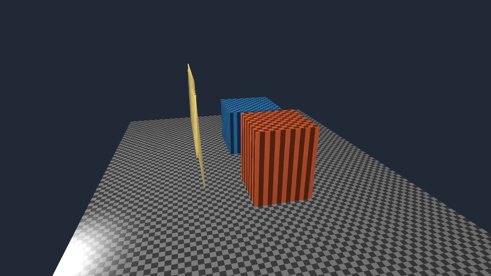
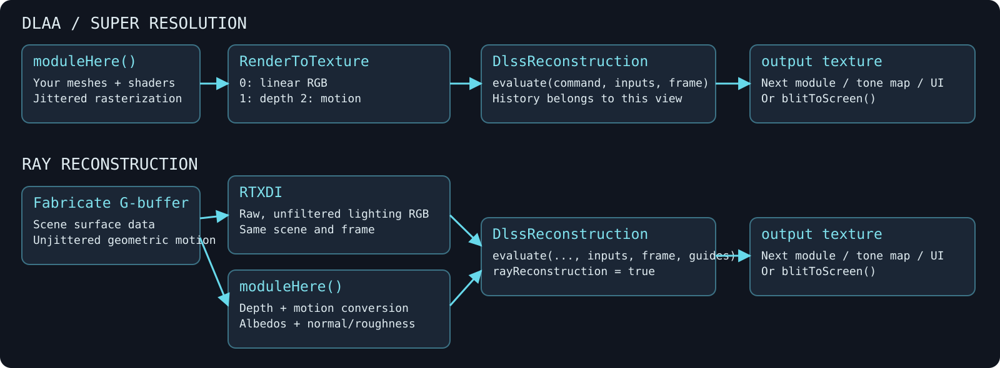
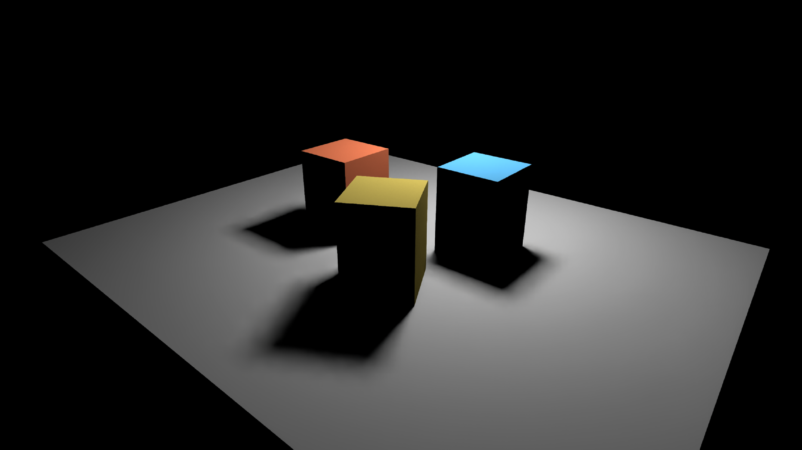

# From modules to reconstruction

**Your module still renders the scene. Reconstruction is another consumer of its images.** Start with a `moduleHere()` module drawing into a `RenderToTexture`, give that render the depth and motion it needs for history, then record DLAA or Super Resolution after the source pass. Ray Reconstruction extends the same graph with raw lighting and material guides.

Open **Starting points → reconstruction_plumbing** for the complete DLAA/SR wiring, or **Starting points → rr_plumbing** for the RTXDI/RR version. Both put the scheduling in the editable Kotlin box and the attachment writes in its **vertex** and **fragment** properties. Run the **renderer** box, then the scene box. The existing [Neural Reconstruction](neural_reconstruction.md) and [Ray Reconstruction](ray_reconstruction.md) Starting Points remain the comparison instruments with more controls.



## The graph you are building



For DLAA and SR, the order is:

**Meshes + `moduleHere()` → source render target [RGB, depth, motion] → `DlssReconstruction.evaluate()` → output texture → display or another module.**

For RR, it becomes:

**Fabricate G-buffer → raw RTXDI lighting + guide-conversion `moduleHere()` → `evaluate(..., guides)` → output texture → display or another module.**

These are GPU passes in Field's existing command stream. The native NGX adapter receives Vulkan image handles; there is no CPU image readback between them. A texture binding makes an image accessible to a shader. It does **not** schedule the module that produces it. The explicit `render` calls below are what establish that order.

## First choose the two sizes

The output size is the image you want to display. Query the SDK before allocating the smaller source:

```diffstatic
val outputSize = ReconstructionSize(1920, 1080)
val mode = ReconstructionMode.QUALITY
val inputSize = DlssReconstruction.recommend(renderer, outputSize, mode).optimal
val neural = DlssReconstruction(renderer, inputSize, outputSize, mode)
```

`DLAA` uses native resolution. `QUALITY`, `PERFORMANCE` and `ULTRA_PERFORMANCE` choose supported smaller inputs. On this machine their recommended inputs for 1080p are 1280 × 720, 960 × 540 and 640 × 360. Query your runtime instead of encoding those numbers into the renderer.

In **reconstruction_plumbing**, change `mode` at the top of the box and rerun it to recreate the resources. Its **Bypass reconstruction** control shows the *same source-sized render*, enlarged for display. This is useful for seeing what information SR receives; it is different from the native-resolution Source comparison on the main experiment page. Without NGX, this Starting Point allocates a native-resolution source and shows it with a diagnostic.

## Write a small G-buffer from `moduleHere()`

A single raster module can write several attachments at once:

```diffstatic
val source = RenderToTexture(renderer) {
    width = inputSize.width
    height = inputSize.height
    useDepth = true
    colorAttachments = 3
    colorFormats = listOf(
        VK_FORMAT_R16G16B16A16_SFLOAT, // opaque linear HDR color
        VK_FORMAT_R32_SFLOAT,         // sampled projected depth
        VK_FORMAT_R32G32_SFLOAT       // current → previous motion, input pixels
    )
}
val sceneModule = moduleHere {
    source.apply()
    depthTest = true
    depthWrite = true
    blend = false
}
source += "scene" to sceneModule
// Add your meshes to sceneModule as usual.
```

`renderer` is inherited from the parent renderer box. `source.apply()` configures the module's attachments and render pass. The corresponding fragment outputs are:

```diffstatic
layout(location=0) out vec4 color;
layout(location=1) out float depth;
layout(location=2) out vec2 motion;
```

This example writes depth into an R32F **color** attachment as well as using an ordinary depth-test attachment. That makes the sampled guide and its background convention explicit. A compatible sampled D32F depth image is also accepted by the adapter.

| Image | What it contains | What it must not stand in for |
|---|---|---|
| Color | Opaque, linear HDR RGB; alpha one; pre-exposure supplied explicitly | Latent pigment coordinates, coverage, or already composited UI |
| Depth | Standard Vulkan projected depth in [0,1], background 1 | Distance in world units, a reversed-Z buffer without conversion |
| Motion | Previous pixel position minus current pixel position, in **input pixels**, X right / Y down | Optical flow substituted without validating correspondences |

If your existing target contains only RGBA, that is the first piece, not the complete reconstruction input. A fixed planar image really can have a constant plane depth and zero geometric motion. An arbitrary animated fragment function does not acquire valid motion merely because you fill another attachment with zero.

## Make jitter and motion agree

Reconstruction asks for slightly different subpixel observations of the scene. Each rendered frame uses:

```diffstatic
val jitter = ReconstructionJitter.halton(frameIndex, inputSize, outputSize)
```

The sample's vertex shader projects each point at the current and previous camera/object state, keeping those two clip positions **unjittered** for motion. Only the raster position receives jitter:

```diffstatic
gl_Position = nowClip;
gl_Position.xy += vec2(2*jitter.x/inputWidth, -2*jitter.y/inputHeight)
                  * gl_Position.w;
```

The Y sign here follows Field's Vulkan viewport convention. The fragment shader converts the unjittered positions into top-left-origin UVs, then input-pixel displacement:

```diffstatic
vec2 nowUV  = nowClip.xy / nowClip.w * vec2(.5, -.5) + .5;
vec2 prevUV = oldClip.xy / oldClip.w * vec2(.5, -.5) + .5;
motion = (prevUV - nowUV) * inputSize;
depth = gl_FragCoord.z;
```

A point moving four input pixels right must write **(−4, 0)**. Keep object transforms as well as camera transforms from the previous rendered frame. Jitter goes into rasterization and the `ReconstructionFrame` value; it does not go into these motion vectors. The Starting Point's shaders contain the complete version, including background pixels.

A shader can change color without moving a surface. That appearance change is not represented by fictional geometry motion. For a deliberate discontinuity, reset history or draw that layer after reconstruction. UI, coverage-dependent effects, and imagery whose temporal character must remain untouched are also good candidates for a later pass.

## Record producer, then consumer

The Starting Point installs one `Target` in `renderer.renderList.preTargets`. Its `render` method owns the sequence:

```diffstatic
source.render(command, index)
neural.evaluate(command,
    ReconstructionInputs(
        source.imageViewArray[0],
        source.imageViewArray[1],
        source.imageViewArray[2]
    ),
    ReconstructionFrame(frameIndex, jitter, revision = sceneRevision)
)
```

`source.render` ends its render pass and leaves the attachments available for sampled reads. `evaluate` runs **outside** a render pass, on the same graphics queue, and handles the NGX output's storage/read transitions. It validates sizes, formats, sampled usage and the single mip/layer contract. Its output is an ordinary Field `RenderToTexture`:

```diffstatic
neural.output.blitToScreen(name = "finished image")
```

To use the output in another module, bind it through the usual `fromViews` texture resolver and schedule that consumer after evaluation. Keep tone mapping, UI and later compositing there. Do not also register `source` independently in `preTargets`: that would render it twice. Likewise, binding `neural.output` alone will not call `evaluate` for you.

Advance the frame index and previous transforms when this target actually records a frame. A coroutine tick while a window is minimized is not a new rendered observation.

## Extend the graph to Ray Reconstruction

Open **Starting points → rr_plumbing**. It reuses the existing Fabricate scene and RTXDI implementation, then makes the format/convention conversion visible in `moduleHere()`. The five guide attachments are:

| Attachment | Format | Origin in this experiment |
|---|---|---|
| 0: depth | R32F | Fabricate position attachment's projected depth in `.w` |
| 1: motion | RG32F | `-velocity.xy * inputDimensions` from Field's current-minus-previous UV velocity |
| 2: diffuse albedo | RGBA16F | Actual linear RGB albedo of the Lambertian lighting bridge |
| 3: specular albedo | RGBA16F | Zero RGB because this bridge has no specular lobe |
| 4: normal + roughness | RGBA16F | World-space unit normal in RGB; roughness one for this bridge |

The source is the **raw** RTXDI output. The conversion module samples surface data with nearest filtering; it does not infer materials from the finished RGB image. Zero specular and roughness one describe this actual diffuse model. Copying those constants into a glossy renderer would misdescribe its lighting. The current adapter does not supply optional specular hit distance.

```diffstatic
scene.bundle.gBuffer.render(command, index)
scene.lighting.render(command, index)
guides.render(command, index)
rr.evaluate(command,
    ReconstructionInputs(scene.lighting.output,
        guides.imageViewArray[0], guides.imageViewArray[1]),
    ReconstructionFrame(frameIndex, jitter, revision = sceneRevision),
    RayReconstructionGuides(
        guides.imageViewArray[2], guides.imageViewArray[3], guides.imageViewArray[4],
        scene.bundle.scene.camera.modelView(),
        scene.bundle.scene.projection.evaluateUniform()
    )
)
```

The camera matrices passed to RR remain unjittered. Fabricate's separate `rasterJitterNdc` supplies the raster offset. All these inputs describe the same frame and the same BRDF. The sample removes their independent frame-graph registrations before taking ownership of their order.

RR is created with `rayReconstruction = true` and is queried separately from SR. This Starting Point uses native 1080p so you can inspect the bridge without also changing render resolution. **Bypass to raw lighting** immediately exposes the unfiltered signal. RR replaces the denoising/reconstruction stage; the example neither spatially filters its input nor adds DLAA afterward.



## History and ownership belong to the graph

The adapter owns its NGX view and reconstructed output; your graph owns source images, guide images, modules and meshes. Use one context per temporal view. Stop/recreate it at a frame boundary, and keep inputs alive until submitted GPU work completes. The Starting Points remove scheduled passes before closing their adapters, then retire their owned Vulkan resources through `renderer.cleanup`. Their cleanup closures retain the exact allocation and renderer that created it, rather than looking up a mutable box property after a rerun or after the parent has stopped.

Call `reset("reason")` for camera cuts, semantic shader/material edits and bypass transitions. A changed scene revision also resets history. The adapter detects replaced input images, skipped frame indices and resumed presentation. Size, mode or format changes require a new context and compatible targets. The Starting Points watch shader changes and include an explicit **Cut / reset history** button; after changes to bound textures or lighting semantics, use that button too. Layout changes require rerunning the box to rebuild its resources.

A failed compatible shader compilation retains Field's last working module. Once a change succeeds, invalidate history. A successful SDK return does not establish that your motion sign, guide semantics or color space are right—inspect the inputs, and compare movement with bypass.

## Where learned shaders fit

The [learned shader workflow](learned_shader.md#train-on-your-own-modulehere-shader) replaces a function that produces RGB. It can therefore replace a color-producing pass in this graph, but its output does not manufacture depth, motion, normals or BRDF guides. Keep those producers, and ensure that they still describe the image being reconstructed.

For the current `(screen x, screen y, parameter) → RGB` network, camera and other unrepresented inputs are fixed during training. It is not a learned scene representation that supports arbitrary new camera motion. Train and inspect that approximation first, then decide whether temporal reconstruction improves its intended look. The learned model, SR and RR are independently bypassable tools.

The editable Starting Points are the reference implementations for this page. They are tested through Field's actual renderer on the RTX 4090, including bypass, reset, replacement of the scene and normal Stop cleanup. The [SR](neural_reconstruction.md#on-the-rtx-4090) and [RR](ray_reconstruction.md#cost-and-limits) pages contain measured GPU costs and their limits.
