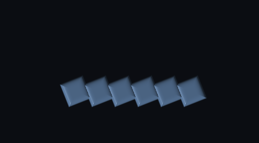
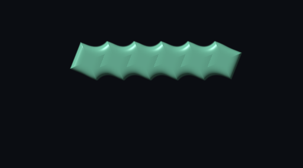
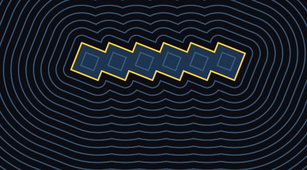

# RectSL cheatsheet

RectSL is Field's rectangle scene language. It creates animated rectangle geometry on the CPU, samples exact object state for analysis, and lowers sampled scenes into `afield.four` buffers. StackSL is the material language: RectSL decides where rectangles are and what object/material metadata they carry; StackSL decides how a material shades.

Every section below carries a short snippet and a pointer into
[RectSL examples](rectsl_examples.md), where the same words appear as complete, rendered
clips. The snippets here are fragments — they assume a scene header and are compiled
inside one — so when you want a program to copy and run, follow the pointer.

A RectSL string starts with `#rectsl` when embedded in Kotlin:

```diffstatic {data-lang=kotlin}
import afield.rectsl.*

val source = """
#rectsl
->wall 4 4 meters
->duration 4
->fps 20

"left" rect
  -1 0 ->xy
  1 ->square
  '( 0 -1  2 0  4 3 ) ->x
  '( 0 0   2 1  4 0 ) ->alpha
;

dup "right" ->rename
  ->mirror-x
;
"""

val program = RectAnimationOracle.compile(source).program!!
val frame = program.sample(2.0)
```

## Model

RectSL is a small stack language with scene side effects. Numbers, strings, colors, quotes, selections, rects, groups, paints, and scalar tracks can sit on the stack. Most geometry words apply to the active rect/group or to the current selection.

Words beginning with `->` are mutators: they consume values and write through to
the active rect, group, selection, or scene. Ordinary words transform stack values,
query the scene, control evaluation, or construct new values/nodes. Thus
`f0 tau *` computes an angle while `f0 tau * ->rot` commits that angle to the
active object. The arrow is part of the word, not optional punctuation.

| Syntax | Meaning |
| --- | --- |
| `# comment` | comment to end of line |
| `12`, `-0.25`, `1e-3` | number |
| `0xffaa33` | RGB color literal |
| `"name"` | string literal |
| `'( ... )` | quoted RectSL block |
| `: name ... ;` | definition |
| `material name '( ... )` | named StackSL material definition |

## Kotlin entry points

| API | Purpose |
| --- | --- |
| `RectAnimationOracle.compile(source)` | Parse, type-check, and build a `RectProgram`. |
| `RectProgram.sample(time)` | Sample exact rectangle/group state at a time in seconds. |
| `lowerSampledScene(sample)` | Convert a sampled scene to CPU mesh data. |
| `RectSLRenderRunner.renderJpgSequence(source, settings)` | Render a JPG frame sequence through a Field renderer. |
| `RectSLRenderSettings(...)` | Output path, fps, quality, renderer, frame inclusion, and wait policy. |
| `RectSLEditorExtension.javascript()` | Monaco embedded-language support for `#rectsl` Kotlin strings. |

## Scene words

Every scene opens by saying how big the wall is, in what units, and how long the clip
runs. Below: a wall 1600×900 *pixels* wide, cropped to fill whatever it is drawn into,
on a near-black background, four seconds at thirty frames a second — then one gold
200-pixel square in the middle of it. Change `pixels` to `meters` and nothing about the
geometry changes; the unit is a statement about what the numbers mean, which the
renderer and the `afield.four` lowering both read.

```diffstatic {data-lang=rectsl}
#rectsl
->wall 1600 900 pixels    # or `12 8 meters`, or `12 8 abstract`
->fit cover               # contain | cover | stretch
->background 0x0a0a12
->duration 4
->fps 30

"mark" rect  0 0 ->xy  200 ->square  0xffcc33 solid ->fill ;
```

Worked: [Kaleidoscope](rectsl_examples.md#kaleidoscope) for `->background`,
[Grid field](rectsl_examples.md#grid-field) for `pixels` with `->fit cover`, and
[Paint & scene kit](rectsl_examples.md#paint-scene-kit) for `->fit stretch`.

Every word here is **prefix**: it reads its arguments forward out of the source rather
than off the stack, so there is nothing to push first. `->background` is the one
hybrid — a colour *literal* after it is read forward, anything else comes off the stack.

| Word | Reads | Notes |
| --- | --- | --- |
| `->wall meters` | `->wall <w> <h> meters` | Physical wall size in meters. `meter`/`m` also accepted. |
| `->wall pixels` | `->wall <w> <h> pixels` | Wall size in pixel units. `pixel`/`px` also accepted. |
| `->wall abstract` | `->wall <w> <h> abstract` | Wall size in arbitrary units. `units`/`unit` also accepted. |
| `->duration` | `->duration <seconds>` | Scene duration in seconds. |
| `->fps` | `->fps <framesPerSecond>` | Sampling/render frame rate. |
| `->background` | `->background <0xrrggbb>`, or `color ->background` | Sets scene background. |
| `->fit contain` | `->fit contain` | Preserve aspect ratio and fit inside target. |
| `->fit cover` | `->fit cover` | Preserve aspect ratio and cover target. |
| `->fit stretch` | `->fit stretch` | Stretch wall coordinates to target. |

## Objects and groups

A scene is a tree of named rects and groups, and the names are how you get back to
anything after you have moved on. Below: a group `orbit` holding two squares — one
authored, one a `clone` of it shifted along +x, both tagged `petal`. Then the whole
group is deep-copied into a `twin` three units lower, and finally every `petal`
anywhere in the scene (four of them now, two per copy) is gathered out of its
existing parent into a new group `petals`.

`clone` copies the active object; `copy-deep` copies a group *and its descendants*, so
the `twin` gets its own cells rather than sharing them.

```diffstatic {data-lang=rectsl}
"orbit" group
  "cell" rect  0 0 ->xy  1.2 ->square  "petal" ->tag ;
  "cell" ->select clone  2.5 0 ->xy ;
end

"orbit" ->select copy-deep  "twin" ->rename  0 -3 ->translate ;
all rects  '( "petal" tagged? ) filter  "petals" ->group-selected ;
```

Worked: [Groups, selections, and StackSL material](rectsl_examples.md#groups-selections-and-stacksl-material),
and [Selection & logic](rectsl_examples.md#selection-logic), which walks the whole
tree and exercises `rect?`, `group?`, `id` and `copy-deep` in one scene.

| Word | Stack | Notes |
| --- | --- | --- |
| `rect` | `[id] -- rect` | Creates a rect. If the top stack value is a string, it becomes the id. |
| `group` | `[id] -- group` | Opens a group scope. New objects become group children until `end` / `end-group`. |
| `end`, `end-group` | `--` | Closes the current group. |
| `->select` | `id -- object` | Selects a rect or group and pushes its reference. |
| `->rename` | `name -- object` | Renames the active object or a reference from the stack. |
| `->tag` | `name --` | Adds a tag to the active object or current selection. |
| `id` | `-- id` | Pushes the active object id. |
| `rect?` | `-- bool` | `1` when the active object is a rect. |
| `group?` | `-- bool` | `1` when the active object is a group. |
| `tagged?` | `tag -- bool` | Tests the active object for a tag. |
| `copy`, `clone` | `-- object` | Shallow copy of the active object. |
| `copy-deep`, `clone-deep` | `-- object` | Deep copy of a group and its descendants. |
| `->group-selected` | `selection [id] -- group` | Reparents selected objects into a new group. |

## Geometry and ordering

Three rects, three different ways of being animated. `mark` sets each channel by hand:
it slides from x=-5 to x=+5 while turning a full revolution, at eight-tenths scale and
seven-tenths opacity, on draw layer 2 and at the front of it — and it exists only
between t=0.5 and t=3.5. Wherever a channel takes a number it also takes a quote, and
the quote becomes a keyed track; that is the whole of how motion is written.

`dart` gives up authoring rotation at all: it travels a curve in x and y, and
`->face-travel` reads its heading back out of those two tracks by finite difference, so
an elongated rect reads as an arrowhead pointing where it is going. `bullet` authors
*one* crossing and then `->live` fires 24 copies of it down 24 lanes, each starting
0.18 s after the last and alive for 2.5 s — an emitter with no simulation in it.

```diffstatic {data-lang=rectsl}
"mark" rect
  0 0 ->xy  2 0.6 ->wh
  '( 0=-5  4=5 ) ->x              # a quote in a channel is a track
  '( 0=0   4=6.28318 ) ->rot
  0.8 ->scale  0.7 ->alpha
  2 ->layer  0.2 ->z  ->front
  0.5 ->appear  3.5 ->vanish
;

"dart" rect  1.1 0.26 ->wh       # drawn along its own +x, so it reads as an arrow
  '( 0=-5  4=5 ) ->x  '( 0=-3  2=3  4=-3 ) ->y
  ->face-travel                   # rotation taken from its own travel
;

"bullet" rect  0.42 ->square  '( 0=-8  2.5=8 ) ->x
  24 '( -3 f 6 * + ->y   i 0.18 *  2.5 ->live ) array
;
```

Worked: [Named tracks and draw layers](rectsl_examples.md#named-tracks-and-draw-layers)
for `->layer`/`->z`, [Facing the way you travel](rectsl_examples.md#facing-the-way-you-travel)
for `->face-travel` and `->face-travel-at`, and
[Spawning and despawning](rectsl_examples.md#spawning-and-despawning-life-windows)
for `->appear`/`->vanish`/`->live`.

| Word | Stack | Notes |
| --- | --- | --- |
| `->xy` | `x y --` | Center position in wall coordinates. |
| `->nxy` | `nx ny --` | Normalized position in `[-1, 1]` wall space. |
| `->x`, `->y` | `scalar --` | Constant or animated coordinate. A quote becomes a TCB track. |
| `->wh` | `width height --` | Rect size. |
| `->nwh` | `nw nh --` | Normalized size relative to wall dimensions. |
| `->w`, `->h` | `scalar --` | Width or height. |
| `->square` | `size --` | Sets width and height together. |
| `->rot`, `->rotation` | `scalar --` | Rotation in radians. |
| `->rotate` | `scalar --` | Adds rotation to the active object/selection. |
| `->face-travel` | `--` | Auto-orient: sets rotation to the heading of the object's own x/y tracks (local +x points along travel). |
| `->face-travel-at` | `offset --` | Like `->face-travel`, but adds a fixed angle offset (correct for how the art is drawn). |
| `->scale` | `scalar --` | Uniform scale. |
| `->scale-xy` | `sx sy --` | Nonuniform scale. |
| `->alpha` | `scalar --` | Opacity. |
| `->opacity*` | `factor --` | Multiplies opacity. |
| `->appear` | `t --` | Hard-gate visibility on: invisible before `t`, unchanged from `t`. |
| `->vanish` | `t --` | Hard-gate visibility off: unchanged before `t`, invisible from `t`. |
| `->live` | `birth life --` | Emitter primitive: play the object's animation from `birth` (local time 0 = `birth`) and show it only during `[birth, birth+life]`. |
| `->z` | `scalar --` | Per-rect depth metadata. |
| `->layer` | `number|string|track --` | Draw layer. Higher layers render later. |
| `->front`, `->back` | `--` | Move active object/selection within its layer. |

## Paint and material

A rect is filled in one of three ways, and all three are here. `panel` takes a flat
mid-blue built channel-by-channel, and places itself in normalised wall space — dead
centre, four-fifths of the wall wide and two-fifths tall — rather than in wall units.
`chip` takes a gold-to-magenta ramp baked across its own width on the CPU, *and* a
StackSL material `tint` on top of it, fed four numbers of its own through `->shader`
that the shader body can read. `ghost` shows the shorthand: a colour with alpha in it,
no track needed.

The `material tint '( … )` body is StackSL, not RectSL — a fragment program, compiled
and checked with the rest of Field's shader stack.

```diffstatic {data-lang=rectsl}
material tint '(
  uv 4.0 * sin abs
)

"panel" rect  0.5 0.5 ->nxy  0.8 0.4 ->nwh
  rgb 0.12 0.34 0.62  solid ->fill
;

"chip" rect  0 -2.6 ->xy  1 ->square
  0xffcc33 0xff2266  -0.5 0  0.5 0  linear ->fill   # two-colour ramp across the rect
  0.1 0.2 0.5 0 ->shader                            # per-rect data its material reads
  tint ->material
;

"ghost" rect  3 -2.6 ->xy  1 ->square  rgba 0.9 0.4 0.2 0.5 solid ->fill ;
```

Worked: [Paint & scene kit](rectsl_examples.md#paint-scene-kit) for `rgb`/`rgba`/`->shader`,
[Gradient sweep](rectsl_examples.md#gradient-sweep) for `linear`, and
[Groups, selections, and StackSL material](rectsl_examples.md#groups-selections-and-stacksl-material)
for a material on a whole selection.

`rgb`, `rgba` and `material` are **prefix**: they read their arguments forward out of the
source, not off the stack. So it is `rgb 0.9 0.4 0.2`, never `0.9 0.4 0.2 rgb` — and no
expression can be spliced into those slots, only literals. Everything else in the table
is stack-based as written, `linear` included.

| Word | Stack / reads | Notes |
| --- | --- | --- |
| `rgb` | `rgb <r> <g> <b>` → `-- color` | Builds an RGB color from three 0..1 literals. |
| `rgba` | `rgba <r> <g> <b> <a>` → `-- color` | Builds an RGBA color from four 0..1 literals. |
| `solid` | `color -- paint` | Solid fill paint. |
| `linear` | `color0 color1 x0 y0 x1 y1 -- paint` | CPU-baked two-color fill across the rect. |
| `->fill` | `paint --` | Assigns fill paint. |
| `material` | `material <name> '( ... )` | Compiles the quote source as a named StackSL rect material. |
| `name ->material` | `materialName --` | Assigns a material defined earlier in the program, or a built-in one, to the active rect/selection. |
| `->shader` | `x y z w --` | Sets per-rect shader data. |

Material StackSL receives rect/material data from the generated shader harness. Prefer RectSL for geometry and StackSL for fragment math; do not duplicate shape layout inside StackSL unless the shape is genuinely shader-only.

## Tracks

Track quotes are flat `time value` pairs. An optional `=` may sit between the
time and value of a key to read the pairing aloud: `0=0.2` means "0.2 at time
0". The two forms are interchangeable and may be mixed:

```diffstatic {data-lang=text}
'( 0 -1  2 0  4 1 ) linear
'( 0=-1  2=0  4=1 ) linear
```

A track can also be named once and referred to by many rects, which is how several
objects come to share one motion rather than four copies of it that drift apart. Below,
`rise` is a straight ramp from -3 to +3 and `pulse` is a stepped envelope; `bar` drives
its y from the first and its opacity from the second, with `smooth` softening the steps
into an eased curve on the way in. Its scale gets a TCB curve slackened by `tcb!`.

The last line is the other direction: `alpha-track` reads the opacity curve *back off*
the rect, lifts every key by 0.1, clamps the result into `[0, 1]`, and assigns it again.
Every animated channel can be read as well as written, which is what makes a track a
value rather than a side effect.

```diffstatic {data-lang=rectsl}
linear-track "rise" '( 0=-3  2=0  4=3 )
hold-track "pulse" '( 0=0.2  2=1  3=0.45 )

"bar" rect  0 0 ->xy  0.7 1.8 ->wh
  "rise" track-ref ->y
  "pulse" track-ref smooth ->alpha
  '( 0=0.6  2=1.6  4=0.6 ) tcb  -0.4 0 0 tcb!  ->scale
  alpha-track  0.1 value+  0 1 clamp-values  ->alpha   # read it back, reshape, reassign
;
```

Worked: [Named tracks and draw layers](rectsl_examples.md#named-tracks-and-draw-layers),
and [Key lenses](rectsl_examples.md#key-lenses), which sets and re-reads every animated
channel in turn.

The three definition words are **prefix**: `track`, `linear-track` and `hold-track` read
a name and a quote forward out of the source. Everything else here is stack-based.

| Word | Stack / reads | Notes |
| --- | --- | --- |
| `tcb` | `quote -- track` | Smooth scalar track using TCB interpolation. |
| `linear` | `quote -- track` | Linear scalar track. |
| `hold` | `quote -- track` | Step/hold scalar track. |
| `tcb!` | `track tension continuity bias -- track` | Sets default TCB parameters. |
| `track` | `track <name> '( ... )` | Defines a named TCB track. |
| `linear-track` | `linear-track <name> '( ... )` | Defines a named linear track. |
| `hold-track` | `hold-track <name> '( ... )` | Defines a named hold track. |
| `track-ref` | `name -- track` | Pushes a named track for reuse. |
| `x-track`, `y-track` | `-- track` | Pushes the active x/y track. |
| `w-track`, `h-track` | `-- track` | Pushes width/height tracks. |
| `rot-track`, `rotation-track` | `-- track` | Pushes rotation track. |
| `scale-x-track`, `scale-y-track` | `-- track` | Pushes scale tracks. |
| `alpha-track` | `-- track` | Pushes alpha track. |
| `z-track`, `layer-track` | `-- track` | Pushes ordering tracks. |

## Track transforms

A track is a value, so it can be bent before it is assigned. All five rects below ride
the *same* three-key sweep from x=-8 to x=+8; only the time axis differs. `delayed`
starts a second and a half late, `faster` runs its keys 1.4× closer together, `bounced`
plays forward then backward over a two-second period, and `eased` shapes the
interpolation with a Penner curve and then loops it. Stacked in rows, one motion falls
into a round — which is the cheapest way to see what a retiming word actually did.

```diffstatic {data-lang=rectsl}
"plain"   rect  0  3 ->xy  1 ->square  '( 0=-8  2=0  4=8 ) ->x ;
"delayed" rect  0  1 ->xy  1 ->square  '( 0=-8  2=0  4=8 ) 1.5 delay-time ->x ;
"faster"  rect  0 -1 ->xy  1 ->square  '( 0=-8  2=0  4=8 ) 1.4 time* ->x ;
"bounced" rect  0 -3 ->xy  1 ->square  '( 0=-8  1=8  2=-8 ) 2 pingpong-time ->x ;
"eased"   rect  0 -5 ->xy  1 ->square  '( 0=-8  2=8 ) ease-in-out 2 loop-time ->x ;
```

Worked: [Time canon](rectsl_examples.md#time-canon) for the retiming words side by side,
[Easing ladder](rectsl_examples.md#easing-ladder) for the easings pulling apart, and
[Key lenses](rectsl_examples.md#key-lenses) for `value+`, `clamp-values` and the
`keys-before`/`keys-after`/`keys-between` window filters.

| Word | Stack | Notes |
| --- | --- | --- |
| `delay-time` | `track seconds -- track` | Shifts key times later. |
| `scale-time` | `track factor -- track` | Scales key times. |
| `reverse-time` | `track -- track` | Reverses key times. |
| `loop-time` | `track period -- track` | Loops over a period. |
| `pingpong-time` | `track period -- track` | Alternates forward/backward over a period. |
| `time+` | `track seconds -- track` | Alias-style key-time shift. |
| `time*` | `track factor -- track` | Alias-style key-time scale. |
| `snap-time` | `track grid -- track` | Snaps key times to a grid. |
| `value+` | `track amount -- track` | Adds to all key values. |
| `value*` | `track factor -- track` | Multiplies all key values. |
| `clamp-values` | `track low high -- track` | Clamps key values. |
| `keys-before` | `track time -- track` | Keeps keys before time. |
| `keys-after` | `track time -- track` | Keeps keys after time. |
| `keys-between` | `track start end -- track` | Keeps keys in a time window. |
| `ease-in` | `scalar -- track` | Quadratic ease-in. |
| `ease-out` | `scalar -- track` | Quadratic ease-out. |
| `ease-in-out` | `scalar -- track` | Symmetric ease-in/out. |
| `ease-smoothstep`, `smooth` | `scalar -- track` | Hermite smoothstep. |

## Selection and transforms

Build first, then sort the scene out by logic. `pip` is one spinning square tagged
`spark`, reproduced nine times by `array` — each copy's opacity set from its centred
fraction, so the row is brightest at the ends — and then spread 1.4 units apart by
`->stagger`. The next four lines never name an individual rect again: a mirrored clone
is folded across the axis x=3 and pushed to the front of its layer; every rect in the
scene is dimmed a further 10%; every object *tagged* `spark` is scaled up; and the
original's whole timeline is made to loop every two seconds.

A selection is a value like a track is: `all`, `rects`, `children` and `descendants`
produce one, `filter` narrows it, and `each`/`map` run a quote against every member.
Which is how an operation applies to nine copies you never gave names to.

```diffstatic {data-lang=rectsl}
"pip" rect  0 0 ->xy  0.8 ->square  "spark" ->tag
  '( 0=0  4=6.28318 ) ->rot
  9 '( fc abs 0.7 *  0.3 +  ->alpha ) array
  1.4 0 ->stagger
;

"pip" ->select clone  "mirrored" ->rename  3 ->mirror-x-at  ->front ;
all rects  '( 0.9 ->opacity* ) each ;
all  '( "spark" tagged? ) filter  '( 1.2 ->scale ) map ;
"pip" ->select  2 ->loop-all-time ;
```

Worked: [Selection & logic](rectsl_examples.md#selection-logic) for the tree-walking and
filtering words, [Whole-timeline transforms](rectsl_examples.md#whole-timeline-transforms)
for the `*-all-time` family and `->stagger`,
[Stagger cascade](rectsl_examples.md#stagger-cascade) for `->stagger-time`, and
[Kaleidoscope](rectsl_examples.md#kaleidoscope) for the mirrors with `->front`/`->back`.

| Word | Stack | Notes |
| --- | --- | --- |
| `all` | `-- selection` | Every node. |
| `roots` | `-- selection` | Top-level nodes. |
| `selected` | `-- selection` | Current active object/selection. |
| `children` | `selection -- selection` | Direct children of groups. |
| `descendants` | `selection -- selection` | All descendants. |
| `rects`, `groups` | `selection -- selection` | Type filters. |
| `tagged` | `selection tag -- selection` | Tag filter. |
| `each` | `selection quote -- selection` | Apply a quote to each selected object. |
| `map` | `selection quote -- selection` | Map a quote over selected objects. |
| `filter`, `where` | `selection quote -- selection` | Keep objects whose quote returns true. |
| `->mirror-x`, `->mirror-y` | `--` | Mirror around axis 0. |
| `->mirror-x-at`, `->mirror-y-at` | `axis --` | Mirror around a custom axis. |
| `->translate` | `dx dy --` | Translate active object/selection. |
| `->offset` | `dx dy --` | Offset position constants/tracks. |
| `->stagger` | `dx dy --` | Increasing positional offset over selection order. |
| `->delay-all-time` | `seconds --` | Delay every track on active object/selection. |
| `->scale-all-time` | `factor --` | Scale every key time. |
| `->reverse-all-time` | `--` | Reverse every track across scene duration. |
| `->loop-all-time` | `period --` | Loop every track. |
| `->pingpong-all-time` | `period --` | Ping-pong every track. |
| `->stagger-time` | `stepSeconds --` | Increasing time delay over selection order. |

## Loops and blocks

Three loops, three shapes of the same idea. `times` runs its body eight times with the
index in `i`, so the first row is eight cells spread 2.2 units apart — and their opacity
comes out of a *predicate* rather than a curve: cells 2 through 6 are dimmed, the rest
bright, written with comparisons and `not`. `range` counts over an explicit interval.
`repeat` does the same but reaches for `loop-count` to normalise its index into `[0, 1]`
first, which is how a loop places things by fraction rather than by step.

`apply` runs a quote right there, which is useful when a modifier wants to be grouped.

```diffstatic {data-lang=rectsl}
8 '(
  "cell" rect  i 3.5 -  2.2 *  3 ->xy  1.2 ->square
    i 2 >=  i 6 <=  and  not  0.55 *  0.45 +  ->alpha
    '( 0.9 ->opacity* ) apply
) times

0 6 '( "dot" rect  i 2 * 6 -  0 ->xy  0.6 ->square ) range

4 '( "tick" rect  i loop-count 1 - /  8 *  4 -  -3 ->xy  0.5 ->square ) repeat
```

Worked: [Selection & logic](rectsl_examples.md#selection-logic) for `times` with the
comparison words, [Grid field](rectsl_examples.md#grid-field) for `grid`'s cell context,
and [Paint & scene kit](rectsl_examples.md#paint-scene-kit) for `loop-count`, `apply`
and `defer`.

| Word | Stack | Notes |
| --- | --- | --- |
| `apply` | `quote --` | Evaluate a quote immediately. |
| `defer` | `quote -- quote` | No-op marker; quotes are already values. |
| `times` | `count quote --` | Runs quote `count` times and pushes the index before each run. |
| `repeat` | `count quote --` | Runs quote `count` times. Use `i`, `n`, or `loop-count` inside. |
| `range` | `start end quote --` | Runs quote for each integer in `[start, end)`, or descending when `end < start`. |
| `i` | `-- number` | Current loop index/value. |
| `loop-count`, `n` | `-- number` | Count for the current loop. |

## Array primitives

Array primitives *reproduce a subexpression with modification*: the Fischinger idea of one shape multiplied into a rhythm of copies, each shifted in space, time, size, or colour. Inside any `repeat`/`range`/`array`/`grid`/`radial` body the per-copy context words below are available; combine them with `mix`, `->offset`, `->rotate`, `->polar`, and `->delay-all-time` to vary each copy.

The first scene below is one tall thin rect reproduced eight times around a circle of
radius 3, each copy turned by its own share of a full turn (`f0 tau *`) so the whole
thing reads as a flower rather than eight rects that happen to be in a ring. The second
builds a 5×3 grid and gives each cell an opacity from its own distance out from the
centre — `colc`/`rowc` are the *centred* column and row, so the middle cell is 0 — which
is the shortest way to a field that falls off from the middle.

Neither loop names a copy. The body sees only its position in the array (`f0` here,
`colc`/`rowc` there), and everything else follows from that.

```diffstatic {data-lang=rectsl}
# eight petals fanned around a centre, each rotated to face outward
"petal" rect  0.4 1.2 ->wh
  8 3 '( f0 tau * ->rot ) radial
;

# a centered grid whose cell alpha ripples with distance from the middle
5 3 '(
  "c" rect  colc 1.4 *  rowc 1.4 * ->xy  1 ->square
    colc abs rowc abs max  0.4 *  1 swap -  ->alpha
  ) grid
```

Worked: [Reproduction with modification](rectsl_examples.md#reproduction-with-modification-array-primitives)
runs the whole family as animated clips —
[Radial bloom](rectsl_examples.md#radial-bloom),
[Grid ripple](rectsl_examples.md#grid-ripple),
[Spiral shards](rectsl_examples.md#spiral-shards),
[arc/spiral/sunflower](rectsl_examples.md#more-array-generators-arc-spiral-sunflower),
and [Splitting](rectsl_examples.md#splitting-one-shell-becomes-a-spray) with its
[recursive cascade](rectsl_examples.md#recursive-splitting-a-cascade).

| Word | Stack | Notes |
| --- | --- | --- |
| `array` | `[template] count quote -- selection` | Reproduce a template object `count` times, running `quote` on each copy with array context. Element 0 is the template itself; the rest are fresh clones (deep for groups). Template is the active object, or a rect/group taken from the stack. Pushes the selection of all copies. |
| `radial` | `[template] count radius quote -- selection` | Like `array`, but each copy is first placed on a circle of `radius` at angle `ordinal/count · tau`, then `quote` runs. |
| `arc` | `[template] count radius start sweep quote -- selection` | Aimed spread: places `count` copies on an arc of `radius`, from angle `start` across `sweep` radians (endpoints inclusive), then runs `quote`. |
| `spiral` | `[template] count r0 r1 turns quote -- selection` | Places `count` copies on a spiral: radius ramps `r0`→`r1` while the angle sweeps `turns · tau`. |
| `phyllotaxis`, `sunflower` | `[template] count scale quote -- selection` | Golden-angle sunflower: copy `i` at angle `i · 137.5°` and radius `scale · √i`. |
| `grid` | `cols rows quote -- selection` | Runs `quote` `cols·rows` times to build fresh cells, with grid context available. Close each cell with `;` like `repeat`. Pushes the selection of created objects. |
| `->split` | `[template] count t quote -- selection` | At time `t` the template vanishes and `count` shards are born at its split-point position (sampled from its tracks). Each shard's flight is authored by `quote` around the origin in split-relative local time (array context available), then placed at the split point. Pushes the shard selection. |
| `->polar` | `angle radius --` | Place the active object on a circle: `x = radius·cos angle`, `y = radius·sin angle`. |
| `f` | `-- number` | Normalized fraction `ordinal/(n-1)` in `[0, 1]`; `0` for a single element. Pairs with `mix`. |
| `f0` | `-- number` | Cyclic fraction `ordinal/n` in `[0, 1)`; handy for rings (`f0 tau *`). |
| `fc` | `-- number` | Centered fraction `2f-1` in `[-1, 1]`. |
| `ic` | `-- number` | Centered index `ordinal - (n-1)/2`, symmetric around 0. |
| `col`, `row` | `-- number` | Current column/row inside `grid`. |
| `cols`, `rows` | `-- number` | Grid dimensions inside `grid`. |
| `colc`, `rowc` | `-- number` | Centered column/row: `col-(cols-1)/2`, `row-(rows-1)/2`. |

## Data visualization

Dense data is an explicit target for RectSL. A **colormap** turns a value in `[0, 1]` into a perceptually-uniform colour; a **`Data`** value is a plain numeric list you can normalize and bind to size/colour; the **chart words** fold both into ready-made bar charts, heatmaps, and scatter plots. All three emit ordinary rects: `each`, `->stagger-time`, `group` and tracks all still apply to the result.

Five figures, each one line of real work. The first is a colormap made visible: 24 thin
rects laid across the wall, each filled with `viridis` sampled at its own fraction. The
second is a bar chart of eight literal numbers — and because `bars` hands back a
*selection*, the next two lines fade the bars in and stagger that fade 0.08 s per bar, so
a static chart becomes an animated one without touching the chart word. The third
computes its own field (48 samples of a sine) and tiles it into an 8×6 heatmap; the
fourth plots y against x; the last reads a list's min, max, length and one element
without consuming it, then charts it anyway.

```diffstatic {data-lang=rectsl}
# a colour legend: 24 thin rects sweeping one colormap across the wall
"swatch" rect  0.6 3 ->wh
  24 '( fc 11 *  0 ->offset  "viridis" f colormap solid ->fill ) array
;

# a bar chart from literal data, staggered fade-in, coloured by value
'( 3 7 2 9 5 8 4 6 ) data  normalize  "magma" bars
  '( '( 0=0 0.6=1 ) ease-out ->alpha ) each
  0.08 ->stagger-time

# a heatmap of a computed field (linspace + data-map fill the grid)
0 1 48 linspace  '( 6 * sin 1 + ) data-map  8 6 "turbo" heat

# a scatter plot: y against x, coloured by y
0 1 20 linspace  dup  '( 3 * sin ) data-map  "plasma" scatter

# data helpers: extent / dmin / dmax / data-len / data-at read without consuming
'( 10 20 30 40 ) data
  dup extent drop drop  dup dmin drop  dup dmax drop
  dup data-len drop  dup 2 data-at drop  normalize "coolwarm" bars
```

Worked: [Data visualization](rectsl_examples.md#data-visualization) renders each of these
on its own — [Colormap legend](rectsl_examples.md#colormap-legend),
[Bar chart from data](rectsl_examples.md#bar-chart-from-data),
[Heatmap of a computed field](rectsl_examples.md#heatmap-of-a-computed-field),
[Scatter plot](rectsl_examples.md#scatter-plot), and
[Reading a Data value](rectsl_examples.md#reading-a-data-value).

### Colormaps

| Word | Stack | Notes |
| --- | --- | --- |
| `colormap`, `cmap` | `name t -- color` | Look up a named ramp at `t` in `[0, 1]` (clamped). Pushes a `Color` usable anywhere colour is (`solid`, `linear`, `->fill`, `rgb`). Names: `viridis`, `magma`, `inferno`, `plasma`, `turbo`, `coolwarm` (diverging), `grayscale`. |

### Data

| Word | Stack | Notes |
| --- | --- | --- |
| `data` | `quote -- data` | Run `quote` and collect every `Number` it leaves into a `Data` list (`'( 3 1 4 1 5 ) data`, or computed: `'( 8 times [ i i * ] ) data`). |
| `linspace` | `lo hi count -- data` | `count` evenly spaced values from `lo` to `hi` inclusive. |
| `normalize` | `data -- data` | Rescale a list to `[0, 1]` by its own min/max (a flat list maps to `0.5`). |
| `extent` | `data -- min max` | Push the list's minimum then maximum. |
| `dmin`, `dmax` | `data -- number` | Minimum / maximum of a list. |
| `data-len` | `data -- number` | Number of values. |
| `data-at` | `data i -- number` | Value at index `i` (clamped to range). |
| `data-map` | `data quote -- data` | Transform each value through `quote` (the value is on the stack; `i`/`f` array context is available). |

### Chart idioms

| Word | Stack | Notes |
| --- | --- | --- |
| `bars` | `data name -- selection` | Bottom-anchored bar chart spanning the wall; bar height and colour both from the value normalized by the list's extent, coloured with colormap `name`. Pushes the selection of bars. |
| `heat`, `heatmap` | `data cols rows name -- selection` | Row-major grid heatmap filling the wall (row 0 at top); each cell coloured with colormap `name` by its normalized value. Pushes the selection of cells. |
| `scatter` | `xdata ydata name -- selection` | Plot `(->x, ->y)` points as small squares, each axis normalized to the wall; colour follows normalized `->y` through colormap `name`. Pushes the selection of points. |

### Plotting layer

The chart idioms above each normalize by their own extent and fill the wall. The **plotting layer** adds a *shared* coordinate frame so several series overlay in one domain, with axes, ticks, numeric labels, and legends. Set a `->domain` (or let the first series adopt its own extent) and optional `->frame`/`->margins`; then `axes`, the domain-aware series (`line`/`plot`, `area`, `points`), and `colorbar`/`legend` all map through it. `bars`, `heat` and `scatter` do not read that frame; they keep normalizing by their own extent, and the two sets of words sit side by side in one scene. RectSL has no text primitive, so tick and colorbar labels are numerals drawn as a 3×5 grid of rects: numbers only, no titles or series names.

One figure, three series. The domain is stated once — x from 0 to 10, y from 0 to 1 — and
margins are reserved around it, which is where the tick numerals go. `axes` draws the
rules, nice-number ticks and gridlines *first*, so the data paints over them. Then the
same 40-sample sine appears as a filled area, a cosine as a polyline, and a coarser
12-sample sine as points; all three land in the one coordinate system, so they can be
compared rather than merely stacked. A continuous colour bar and a five-swatch key
finish it.

```diffstatic {data-lang=rectsl}
#rectsl
->wall 16 10 abstract
->duration 3
->fps 30

# one shared domain, axes underneath, three series overlaid, plus legends
0 10 ->xdomain   0 1 ->ydomain      # or `0 10  0 1 ->domain` in one go
0.12 0.14 0.12 0.06 ->margins       # or just `->frame` for sensible defaults
axes
0 10 40 linspace  dup '( 0.7 * sin 1 + 2 / ) data-map   "viridis" area
0 10 40 linspace  dup '( 0.55 * cos 1 + 2 / ) data-map  "plasma"  line
0 10 12 linspace  dup '( 0.9 * sin 1 + 2 / ) data-map   "turbo"   points
"viridis" colorbar
5 "turbo" legend
```

Worked: [A plotted figure](rectsl_examples.md#a-plotted-figure-shared-domain-axes-overlaid-series-legends),
which shows the same figure both with `->frame`/`->domain` and with the axes set by hand.

| Word | Stack | Notes |
| --- | --- | --- |
| `->domain` | `x0 x1 y0 y1 --` | Set an explicit shared x and y data domain. Series and `axes` map data → the plot frame through it. |
| `->xdomain`, `->ydomain` | `lo hi --` | Set just the x (or y) domain. |
| `->margins` | `l r b t --` | Reserve plot-frame margins as wall fractions (left/right/bottom/top) — room for axis labels and a colorbar. |
| `->frame` | `--` | Apply sensible default margins (used only when none are set, so an explicit `->margins` wins). |
| `axes` | `-- selection` | Draw x/y axis rules, nice-number ticks, numeric tick labels (in the margins), and faint gridlines for the current domain. Draw it *before* the series so they paint on top. |
| `line`, `plot` | `xdata ydata name -- selection` | Polyline through the shared domain as rotated thin rects, coloured along colormap `name` by point order. |
| `area` | `xdata ydata name -- selection` | Column-filled area from the `->y = 0` baseline to each sample, coloured by normalized `->y`. |
| `points` | `xdata ydata name -- selection` | Domain-aware scatter (shares the frame with other series); colour follows normalized `->y`. |
| `colorbar` | `name -- selection` | A continuous colour ramp for `name` in the right margin, with min/mid/max numerals from the y domain. |
| `legend` | `count name -- selection` | A key of `count` discrete colour swatches sampling colormap `name`, stacked top-right. |

## Musicality — the pattern language as scene structure

RectSL's array primitives distribute copies in *space*. The musical layer distributes them in
*time*, by borrowing [Field's Tidal-inspired pattern language](pattern_language.md) whole. The two
fit together because they are already the same shape. A RectSL track is `sample(t)`; a pattern is
`events(arc)`. Both are pure functions of time, with no simulation state. So a pattern **is** a
track, and a pattern event, which carries an onset and a real duration, **is** a `->live` window.

Everything the mini-notation can say therefore arrives intact: polymeter `{a b c}%8`, Euclid
`bd(3,8)`, per-cycle alternation `<a b>`, `?` degrade, `.` grouping, `@` elongation. RectSL does
not parse any of it.

### Clock

A cycle is the pattern language's bar. `->cps` states cycles per second directly; `->tempo` states
it as a musician would. The two spellings of tempo commute: `->tempo` remembers its bpm, so
`->beats-per-cycle` re-derives from it whichever order they appear in.

Below, no time in the program is written in seconds. `->tempo 120` with four beats to
the cycle makes a bar two seconds long, and `->duration-cycles 4` makes the clip four
bars — eight seconds, nowhere stated. The two rects then *compute* positions out of
musical units: one beat is 0.5 s, two cycles is 4 s, `cycle-secs` is 2, and
`scene-cycles` is 4. Change the tempo and every one of those numbers moves with it.

```diffstatic {data-lang=rectsl}
->tempo 120          # a 4/4 bar at two seconds
->beats-per-cycle 4
->duration-cycles 4  # …so the piece is eight seconds long, unwritten

"beat" rect  0.6 ->square  1 beats 8 *   2 cycles 4 * ->xy ;
"cyc"  rect  0.6 ->square  cycle-secs 4 *  scene-cycles 1 - ->xy ;
```

The four scene-level clock words are **prefix**: they read a number forward out of the
source. The four conversions are ordinary stack words.

| Word | Stack / reads | Notes |
| --- | --- | --- |
| `->cps` | `->cps <n>` | Cycles per second. Default `1`, so a cycle is a second and a scene that never mentions the clock is unaffected. |
| `->tempo` | `->tempo <bpm>` | Beats per minute; `cps = bpm / 60 / beatsPerCycle`. |
| `->beats-per-cycle` | `->beats-per-cycle <n>` | Beats in a cycle. Four (a 4/4 bar) by default. |
| `->duration-cycles` | `->duration-cycles <n>` | Scene duration in cycles rather than seconds. Set the tempo first. |
| `beats` | `n -- seconds` | Convert beats to seconds. |
| `cycles` | `n -- seconds` | Convert cycles to seconds. |
| `cycle-secs` | `-- seconds` | The length of one cycle. |
| `scene-cycles` | `-- number` | How many cycles the scene lasts. |

### `pat`: one copy per event

`pat` is `array` indexed by rhythm instead of by ordinal. `"bd*4"` is four events a bar,
so over four bars the `kick` template below becomes sixteen copies — one per strike, each
alive for exactly its own quarter-note and no longer. Its body is authored in *local*
time, where 0 is that copy's own birth: every strike drops from y=5.5 to 0 over 0.34 s
and flashes up and out over half a second. `step` is the index within the bar, so the
sixteen strikes also march across the wall and restart at each bar line.

The second rect reads the event rather than just counting it: which sample name fired
(`atom`, `atom?`), how long its whole is (`dur`), which cycle it fell in (`cyc`), and any
parameter the notation attached to it (`"n" param`). `"bd:2 sd cp*2"` carries a `2` on the
first event, which is where that opacity comes from.

```diffstatic {data-lang=rectsl}
->tempo 120
->duration-cycles 4

# one template, sixteen strikes: four a bar, each alive for its own quarter
"kick" rect  1.3 ->square  0xff5a3c solid ->fill
  "bd*4" '(
      step 1.5 -  4.2 * ->x
      '( 0=5.5  0.34=0 ) ease-out ->y
      '( 0=0  0.10=1  0.5=0 ) linear ->alpha
  ) pat
;

# the per-event context: which atom, how long, which cycle, what it carries
"ctx" rect  0.5 ->square
  "bd:2 sd cp*2" '(
      t 2 * 9 - ->x
      cyc 2 *  step 0.4 *  +  3 - ->y
      "n" param 0.1 *  0.4 + ->alpha
      "bd:2" atom? 0.4 * ->rotate
      dur 3 *  0.3 + ->scale
      atom ->tag
  ) pat
;
```

Worked: [Four to the floor](rectsl_examples.md#four-to-the-floor) is `pat` at its plainest
against a clock; [The rest of the surface](rectsl_examples.md#the-rest-of-the-surface)
puts every per-event context word on screen at once.

| Word | Stack | Notes |
| --- | --- | --- |
| `pat` | `[template] pattern quote -- selection` | Reproduce the template **once per event**, each copy `->live` for exactly that event's window. The quote authors the copy's flight in *local* time (0 is its own birth), like `->split`. Anything the quote creates is given the same window, so `pat` composes with `array`, `grid` and `->split`. An all-rests pattern shows nothing. |
| `t` | `-- seconds` | This event's onset. |
| `dur` | `-- seconds` | This event's length — its *whole*, not a fragment. |
| `cyc` | `-- number` | Which cycle the onset falls in. |
| `step` | `-- number` | Index within the cycle, restarting at each bar line. |
| `atom` | `-- string` | The event's mini-notation value: `bd`, `808:4`, `c'maj7`. |
| `atom?` | `name -- bool` | `1` when this event's atom is `name`. |
| `param` | `key -- number` | A named parameter carried on the event (`gain`, `pan`, `n`, `note`, …). |
| `param?` | `key -- bool` | `1` when the event carries that parameter. |

`i`, `n`, `f`, `f0`, `fc` and `ic` work inside a `pat` body exactly as they do inside `array`.

### Patterns as values

`mini` turns text into a rhythm; the signal words build continuous patterns. Both coerce to a
track wherever RectSL wants one: `sine ->alpha` and `"0 0.25 0.5" ->rot` need no conversion
word. A bare string is read as mini-notation **only when it contains numbers**, so a misplaced
name still errors rather than silently becoming zero.

Seven rects, seven kinds of pattern, all of them assigned straight into `->x` with no
conversion word. `smooth` takes a raw sine, scaled to span the wall, and a second copy of
it into rotation. `stepped` is the *same* sine put through `segment 8`, which samples it
eight times a bar — so it holds, then snaps, which is the quality that reads as musical
rather than as easing. `steps` is a bare mini-notation string of numbers. `held` uses
`hold-pat` so the rest in `"-6 ~ 6"` keeps the previous value instead of dropping to
zero. The last three remap a triangle into `[-5, 5]`, round a saw onto a quarter grid,
and centre seeded Perlin noise around zero.

```diffstatic {data-lang=rectsl}
->tempo 90
->duration-cycles 4

"smooth"    rect  1 ->square   sine 12 * 6 -  ->x   3.4 ->y   sine tau * ->rot ;
"stepped"   rect  1 ->square   sine 8 segment  12 *  6 -  ->x   1.6 ->y ;
"steps"     rect  0.9 ->square  "0 3 -3 6" ->x   -0.2 ->y ;   # a string with numbers is mini-notation
"held"      rect  0.9 ->square  "-6 ~ 6" mini nums hold-pat ->x   -2 ->y ;
"remapped"  rect  0.8 ->square  tri -5 5 pat-range ->x   -3.6 ->y ;
"quantised" rect  0.8 ->square  saw 0.25 quantise 16 * 8 -  ->x   -4.6 ->y ;
"noisy"     rect  0.8 ->square  7 perlin bipolar 6 *  ->x   4.4 ->y ;
```

Worked: [Signals, stepped and smooth](rectsl_examples.md#signals-stepped-and-smooth), and
[Kolakoski rhythms](rectsl_examples.md#kolakoski-rhythms) for `kolakoski`/`kolakoski-gaps`
against `euclid`.

| Word | Stack | Notes |
| --- | --- | --- |
| `mini` | `text -- pattern` | Parse mini-notation. |
| `sine`, `cosine`, `saw`, `isaw`, `tri`, `square` | `-- signal` | Continuous signals over `[0,1]`, one cycle long. |
| `rand`, `perlin` | `seed -- signal` | Deterministic noise — granularity-free, identical on any machine. |
| `nums` | `pattern -- signal` | Read a rhythm's atoms as numbers. |
| `texts` | `signal -- pattern` | The other direction. |
| `segment` | `signal n -- signal` | Sample a continuous signal into `n` events per cycle — how a smooth curve becomes stepped. |
| `pat-range` | `signal lo hi -- signal` | Remap `[0,1]` to `[lo,hi]`. (`range` is already the loop word.) |
| `quantise`, `quantize` | `signal step -- signal` | Round values to a grid. |
| `bipolar` | `signal -- signal` | `[0,1]` to `[-1,1]`. |
| `euclid` | `pulses steps rotation -- pattern` | A Euclidean rhythm as events — the onsets only, not a mask. |
| `kolakoski` | `steps rotation -- pattern` | A Kolakoski rhythm as events. The terms of the self-describing word `1 2 2 1 1 2 …` read as alternating on/off run lengths, so the figure's own run lengths spell the word back: `x..xx.x..x..xx.x` over sixteen steps. |
| `kolakoski-gaps` | `steps rotation -- pattern` | `kolakoski`, reading each term as the gap to the next onset instead of a run length: `xx.x.xxx.xx.x.xx` — eleven onsets in sixteen steps against the run reading's eight, and never more than one rest between hits. |
| `hold-pat` | `signal -- track` | Sample-and-hold: a rest keeps the previous value instead of falling to zero. Pure — it looks backwards, it does not remember. |

### Pattern transforms

Time transforms that work on rhythms and signals alike. Repetition is cheap; repetition
that *differs* is what reads as alive, and these are the operators that make bar `n+1`
unlike bar `n`.

Six rows, all the same three-hit figure, each varied a different way. `plain` is the
reference. `faster` doubles its speed but only on cycles 0, 3, 6…, so the row lurches
once every three bars. `walking` rotates the bar a further quarter each cycle — the
walking feel, with no quote needed. `echoed` superimposes a copy shifted an eighth of a
cycle, with each of *its* events doubled. `swung` delays every second subdivision of an
eighth-note grid in exact rational time, so the row is swung yet still quantised.
`sometimes` squeezes a deterministic half of its events into the back of their own slots,
turning four-on-the-floor off-beat without moving the grid.

```diffstatic {data-lang=rectsl}
->cps 1
->duration-cycles 8

"plain"     rect  0.7 ->square  "bd*3" '( f0 14 * 7 -  4.2 ->xy ) pat ;
"faster"    rect  0.7 ->square  "bd*3" mini 3 '( 2 fast ) every '( f0 14 * 7 -  2.4 ->xy ) pat ;
"walking"   rect  0.7 ->square  "bd sd hh cp" mini 4 iter '( f0 14 * 7 -  0.6 ->xy ) pat ;
"echoed"    rect  0.7 ->square  "bd*3" mini 1 8 '( 2 ply ) off '( f0 14 * 7 -  -1.2 ->xy ) pat ;
"swung"     rect  0.7 ->square  "bd*8" mini 4 swing '( f0 14 * 7 -  -3 ->xy ) pat ;
"sometimes" rect  0.7 ->square  "bd*4" mini 0.5 '( press ) sometimes-by '( f0 14 * 7 -  -4.6 ->xy ) pat ;
```

Worked: [Variation operators](rectsl_examples.md#variation-operators) is exactly this scene
animated; [The rest of the surface](rectsl_examples.md#the-rest-of-the-surface) covers the
transforms not shown here.

| Word | Stack | Notes |
| --- | --- | --- |
| `fast`, `slow` | `pattern n -- pattern` | Absolute-time, so `slow` spans cycles rather than dropping material. |
| `rev`, `palindrome` | `pattern -- pattern` | Reverse; reverse every other cycle. |
| `iter`, `iter-back` | `pattern n -- pattern` | Rotate the bar one `1/n` further each cycle. The walking feel, with no quote needed. |
| `ply` | `pattern n -- pattern` | Repeat each event `n` times in its own slot. |
| `stut` | `pattern n gapDen -- pattern` | `n` strikes per event, a `1/gapDen` of a cycle apart. |
| `linger` | `pattern num den -- pattern` | Repeat the first `num/den` of the cycle for the whole cycle. |
| `pat-rot` | `pattern n -- pattern` | Rotate values against the rhythm, keeping the onsets. |
| `shuffle` | `pattern n -- pattern` | Deterministically reorder `n` slots per cycle. |
| `degrade-by` | `pattern p -- pattern` | Drop events with probability `p`, deterministically. |
| `swing`, `swing-by` | `pattern n -- pattern` / `pattern num den n -- pattern` | Delay every second subdivision of a `2n` grid, in exact rational time — swung but still quantised. |
| `press`, `press-by` | `pattern -- pattern` / `pattern num den -- pattern` | Squeeze each event into the later part of its own slot: four-on-the-floor becomes off-beat without touching the grid. |
| `pat-delay` | `pattern num den -- pattern` | Shift by `num/den` of a cycle. |
| `every` | `pattern k quote -- pattern` | Apply the quote only on cycles `0, k, 2k, …`. |
| `off` | `pattern num den quote -- pattern` | Superimpose a copy shifted `num/den` of a cycle, transformed by the quote. |
| `superimpose` | `pattern quote -- pattern` | Superimpose a transformed copy, unshifted. |
| `inside`, `outside` | `pattern n quote -- pattern` | Apply the quote at a slower / faster time base. |
| `sometimes-by` | `pattern p quote -- pattern` | Transform a proportion `p` of events. The two halves partition exactly — nothing is both transformed and untouched, nothing is dropped. |
| `stack-pat`, `cat-pat` | `a b -- pattern` | Play together; play one per half-cycle. |

The quote in `every`/`off`/`superimpose`/`inside`/`outside`/`sometimes-by` runs **once, at compile
time**, against a pattern the implementation names. That is why Tidal's `chunk` is absent: it
applies its transform to a different slice of the bar on every cycle, so there is no one pattern
to hand the quote, and a pattern holding a live interpreter would be re-entered from the render
loop. `iter` gives the same walking feel without a quote.

### Variation on a selection

These apply the same ideas to scene objects rather than to rhythms, which makes them useful on
material that has nothing to do with patterns.

`flash` is the one a loop cannot do: a full-wall white rect at zero opacity, sitting
behind everything, which comes up to 0.14 *only on every fourth bar*. Both versions of
the track are kept and chosen between per sample, so any mutator can be made conditional
this way. `twin` gets a mirrored, dimmer partner — left and right being the spatial
reading of stereo pan. `echo` gets a copy of itself half a second late and fainter. `row`
is eight copies whose entry times are staggered, with every odd one pushed a further
0.6 of a step late — swing applied to space — and then a deterministic quarter of them
dropped out, per object, per cycle.

```diffstatic {data-lang=rectsl}
->tempo 90
->duration-cycles 4

"flash" rect  16 9 ->wh  0 0 ->xy  0xffffff solid ->fill  0 ->alpha  ->back
  selected 4 '( 0.14 ->alpha ) ->every      # only on every fourth bar
;
"twin" rect  0.7 ->square  5 2.6 ->xy
  selected '( 0.45 ->alpha ) ->jux           # a mirrored, dimmer partner
;
"echo" rect  0.6 ->square  '( 0=-8  4=8 ) linear ->x  0.4 ->y
  selected 0.5 '( 0.4 ->alpha ) ->off        # a delayed, transformed copy
;
"row" rect  0.5 ->square  -7 -5.4 ->xy
  8 '( ic 1.6 * 0 ->offset ) array
  0.12 0.6 ->stagger-swing
  0.25 ->degrade
;
```

Worked: [Four to the floor](rectsl_examples.md#four-to-the-floor) for `->every` and
`->euclid`; [Signals, stepped and smooth](rectsl_examples.md#signals-stepped-and-smooth)
for `->jux`, `->off`, `->stagger-swing` and `->degrade`.

| Word | Stack | Notes |
| --- | --- | --- |
| `->every` | `selection k quote -- selection` | Let the quote take effect only on cycles `0, k, 2k, …`. Both versions of every track are kept and chosen between per sample, so *any* mutator becomes conditional. |
| `->off` | `selection seconds quote -- selection` | Superimpose a delayed, transformed echo. |
| `->jux` | `selection quote -- selection` | A mirrored twin, transformed by the quote — left/right being the spatial reading of stereo pan. |
| `->degrade` | `selection p -- selection` | Deterministic per-object, per-cycle dropout. |
| `->stagger-swing` | `selection step amount -- selection` | `->stagger-time`, with every odd copy pushed a further `amount` of a step late. |

### Rhythm in space

`strip` is `pat` spending the subdivision on *where* rather than on *when*: one cycle
spans the wall, and each copy is centred on its event and as wide as the event is long.
So `"bd [sd sd] hh*4"` comes out as a ruler — one wide mark, two half-width, four
quarter-width — from the same string that `pat` would read as a rhythm. That is visual
music read literally rather than metaphorically, and it is why mini-notation belongs on
the geometry side at all.

The second rect lays sixteen equal slots across the wall and then lets the figure decide
which stay lit. The off-steps are hidden rather than deleted; RectSL has no node removal.

```diffstatic {data-lang=rectsl}
->tempo 120
->duration-cycles 2

# the same notation, spent on *where* instead of on *when*
"tick" rect  0.34 ->square
  "bd [sd sd] hh*4" '( -3.9 ->y  0.55 ->alpha ) strip
;

# sixteen slots laid out in space; the figure decides which stay lit
"slot" rect  0.55 1.8 ->wh
  16 '( f 15 *  7.5 -  2.8 ->xy ) array
  16 0 ->kolakoski        # or `5 16 0 ->euclid`
;
```

Worked: [Four to the floor](rectsl_examples.md#four-to-the-floor) reads `pat` and `strip`
side by side on the same string; [Kolakoski rhythms](rectsl_examples.md#kolakoski-rhythms)
compares the two maskings.

| Word | Stack | Notes |
| --- | --- | --- |
| `strip` | `[template] pattern quote -- selection` | Lay one copy per event **across the wall** instead of across time. One cycle spans the wall; each copy is centred on its event and as wide as the event is long. The body sees the same `t`/`dur`/`step`/`atom` context a `pat` body does. |
| `->euclid` | `selection pulses steps rotation -- selection` | Keep the Euclidean onsets of a selection and hide the rest. The off-steps are hidden rather than deleted — RectSL has no node removal. |
| `->kolakoski` | `selection steps rotation -- selection` | The same layout on the Kolakoski figure — its run-length reading, which is the one that reads as a rhythm along a row. Turn `steps` up past the selection and the mask wraps, as `->euclid`'s does. |

## Distribution curves (Functions bridge)

Linear `mix` is rarely the shape you want across an array. RectSL borrows [`afield.stdlib.Functions`](functions_examples.md), a tested library of easings, distributions and noise defined over `[0, 1]`. That is exactly the range of the array fraction `f`. `ease` shapes a scalar/track through the full Penner family; the curve words push a reusable `Fn` value you `sample` at `f` (or any x). The curves are graph-backed, so the Functions rewrite/evolve tooling can optimise an array's distribution toward a target.

Three arrays, three distributions. The first spreads nine copies evenly and eases their
opacity across the array with an elastic overshoot, so the fade overshoots and settles
rather than ramping. The second is spaced evenly too, but takes its opacity from a
gaussian *sampled at the array fraction* — bright in the middle, dark at the edges — and
its rotation from seeded value noise, which is scatter you get the same every run. The
third shows the two curve combinators: `tile 3` repeats one bell into a comb of three
identical bumps across sixteen copies, and `reflect` mirrors a noise curve about 0.5
before it nudges each copy sideways.

`f` is the array fraction, already in `[0, 1]`, which is exactly the domain these curves
are defined over. That is the whole of the bridge.

```diffstatic {data-lang=rectsl}
# alpha eased across the array with an elastic overshoot
"c" rect  1 ->square
  9 '( ic 1.4 *  0 ->offset   f "elastic-out" ease ->alpha ) array
;

# a gaussian falloff and reproducible noise scatter, sampled at f
"d" rect  0.6 ->square  0 -3 ->xy
  12 '(
    ic 1.1 *  0 ->offset
    gaussian f sample ->alpha
    7 noise f sample  2 *  ->rotate
  ) array
;

# `reflect` mirrors a curve about 0.5; `tile` repeats it k times across the array
"e" rect  0.4 ->square  0 3 ->xy
  16 '(
    ic 0.9 *  0 ->offset
    gaussian 3 tile  f sample  2 *  0.2 +  ->scale
    7 noise reflect  f sample  0.3 *  0 ->translate
  ) array
;
```

Worked: [Distribution curves](rectsl_examples.md#distribution-curves-the-functions-bridge)
for the [gaussian comb](rectsl_examples.md#gaussian-comb) and
[eased orbit](rectsl_examples.md#eased-orbit),
[Curve transforms](rectsl_examples.md#curve-transforms) for `tile` and `reflect`, and
[Evolving a distribution](rectsl_examples.md#evolving-a-distribution-toward-a-target) for
what the graph-backed curves buy you.

| Word | Stack | Notes |
| --- | --- | --- |
| `ease` | `->x name -- ->x` / `track name -- track` | Shape a value through a named Penner easing. `name` is any of `linear`, `quad-in/out/in-out`, `cubic-…`, `quart-…`, `quint-…`, `sine-…`, `expo-…`, `circ-…`, `back-…`, `elastic-…`, `bounce-…`, `smoothstep`, `smootherstep`. A constant eases to a number; a keyed track eases its interpolation. |
| `gaussian` | `-- Fn` | A bell curve centred at `0.5` — bright in the middle of the array, dark at the edges. |
| `noise` | `seed -- Fn` | Seeded value-noise curve — deterministic, reproducible scatter. |
| `fbm` | `seed -- Fn` | Seeded fractal (fBm) noise curve — richer, multi-octave scatter. |
| `sample` | `Fn x -- number` | Evaluate a curve at `x` (use the array fraction `f`). |
| `reflect` | `Fn -- Fn` | Mirror a curve about `0.5`: `reflect(->x) = fn(1-x)`. |
| `tile` | `Fn k -- Fn` | Repeat a curve `k` times across `[0, 1]`. |

Note: `gaussian`/`noise`/`fbm` here build CPU `Fn` curves on the RectSL stack; the `fbm`/`palette` seen inside `material '( … )` quotes are StackSL GPU words in a separate language: same names, different context.

### Kotlin escape (experimental)

For anything the built-in words don't cover, `{{ … }}` drops into Kotlin (in a `with(Functions){ … }` scope) anywhere a value is expected. Whatever the Kotlin returns — a Number, an `Fn`, or a `Track<Double>` — is pushed onto the stack: the whole `Functions` API is available inline. The escape also sees the array context (`i`, `n`, `f`, `f0`, `fc`, `ic`) and can vary per copy:

```diffstatic {data-lang=rectsl}
# a curve sampled at f, and a per-copy value computed straight in Kotlin
"c" rect  1 ->square
  9 '( {{ i * 1.2 }} 0 ->offset   {{ sin(2) through gain(0.5) }} f sample ->alpha ) array
;
```

Cost: each unique escape is compiled to a lambda **once** (~76 ms of K2 compile, plus ~5 ms), then **invoked per use** as a plain JVM call. An escape inside an `array` body pays that compile once rather than per copy. It needs a live Kotlin engine. A Field box has one (or pass it via `compileRectSL(source, engine = …)`), so escapes work while live-editing. Inside a long-running graphics render the box's *own* engine is unusable: it is busy running the render behind a single-threaded REPL. The render harness therefore pre-warms every escape on a separate idle engine before the render starts (`prewarmRectSLEscapes` → `compileRectSL(…, precompiledEscapes = …)`) and then only invokes cached lambdas. Gallery `.rectsl` programs get a dedicated engine of their own and can carry escapes too: see the `inline-functions` example.

## Stack and scalar operators

One `grid`, and every number in it computed rather than typed. Each cell knows its own
centred column and row, so `colc dup * rowc dup * + sqrt` is its distance out from the
middle — and from that one quantity the cell derives its opacity (a smoothstepped falloff,
floored at 0.05 and clamped), its size (a power curve of the same distance, so cells
shrink outward non-linearly), and its rotation (the two axes averaged, then quantised to
quarter-turns of π, so the field reads as banded rather than smooth).

`dup`, `over`, `swap` and `drop` are how a value gets used twice without being named.
There are no variables here; the stack *is* the working set.

```diffstatic {data-lang=rectsl}
12 7 '(
  "c" rect
    colc 1.1 *  rowc 1.1 * ->xy
    colc dup *  rowc dup *  +  sqrt                 # distance from the middle
    dup  0 5 smoothstep  neg 1 +  0.05 max  0 1 clamp  0.9 *  0.1 +  ->alpha
    5 min  neg 5 +  5 /  0.4 pow  0.4 *  0.4 +  ->square
    col cols 1 - /  row rows 1 - /  over  +  0.5 *  swap drop
    4 *  ceil  4 /  pi *  ->rot
  ) grid
```

Worked: [Grid field](rectsl_examples.md#grid-field) is this scene animated, and
[Selection & logic](rectsl_examples.md#selection-logic) covers the comparison and
boolean words. The whole
[operator-coverage set](rectsl_examples.md#operator-coverage-the-rest-of-the-language)
is guaranteed to exercise every word in this cheatsheet at least once — a test fails
if that stops being true.

| Word | Stack | Notes |
| --- | --- | --- |
| `dup` | `a -- a a` | Duplicate top value. |
| `drop` | `a --` | Drop top value. |
| `swap` | `a b -- b a` | Swap top two values. |
| `over` | `a b -- a b a` | Copy second value. |
| `+`, `add` | `a b -- out` | Add constants/tracks. |
| `-`, `sub` | `a b -- out` | Subtract. |
| `*`, `mul` | `a b -- out` | Multiply. |
| `/`, `div` | `a b -- out` | Divide, protecting zero. |
| `mod`, `pow`, `min`, `max` | `a b -- out` | Scalar binary math. |
| `neg`, `negate`, `abs`, `floor`, `ceil`, `fract`, `sqrt`, `sin`, `cos` | `a -- out` | Scalar unary math. |
| `clamp` | `value low high -- out` | Clamp to a range. |
| `sat`, `saturate` | `value -- out` | Clamp to `[0, 1]`. |
| `mix`, `lerp` | `a b t -- out` | Linear interpolation. |
| `smoothstep` | `low high x -- out` | Hermite step. |
| `<`, `lt`, `<=`, `lte`, `>`, `gt`, `>=`, `gte`, `=`, `eq`, `!=`, `<>`, `neq` | `a b -- bool` | Numeric/string comparisons where supported. |
| `and`, `or`, `not` | `bool... -- bool` | Boolean operators using nonzero truth. |
| `pi`, `tau` | `-- number` | Constants. |

## Lowering to GLSL: a scene as a signed distance field

A RectSL scene can be lowered to a self-contained GLSL function (no uniforms,
no buffers, no samplers) that answers *how far is this point from the nearest
visible rectangle, at this instant*:

```diffstatic {data-lang=kotlin}
import afield.rectsl.*

val program = RectAnimationOracle.compile(source).program
val sdf = RectSLGlsl.emitSdf(program, functionName = "scene")

sdf.glsl                 // float scene(vec2 p, float t) { … }, plus its helpers
sdf.rectCount            // how many rects the field unions
sdf.trackFunctionCount   // distinct animation curves it had to emit
sdf.notes                // fidelity caveats; empty means nothing was approximated
```

### Why so little of the language has to come along

RectSL is a *staged* language, and that is what makes this small. The stack VM
runs once, at compile time, and everything expressive about the language is
spent there: `array`, `grid`, `radial`, `sunflower`, every selection word,
`each` / `filter` / `map`, the chart and plotting layers, the `{{ … }}` Kotlin
escapes. What survives into the `SceneProgram` is a flat list of rects whose
channels are tracks, and *that* is what reaches the GPU. A hundred-copy
`phyllotaxis` does not need a GPU implementation of `phyllotaxis`; by the time
the emitter sees it, it is a hundred rects.

So the answer to "how much of RectSL ports to GLSL" is: the part you never
write by hand.

### What comes out

This scene —

```diffstatic {data-lang=text}
#rectsl
->wall 8 5 abstract
->duration 4

"bar" rect
  0.9 2.6 ->wh
  '( 0=-2.6  4=2.6 ) ->x
  '( 0=0  2=1.1  4=0 ) tcb ->y
  '( 0=0  4=1.5708 ) ->rot
;
```

— lowers to three curve functions, one shape, and a union. The `->y` curve is
shown; the `->x` and `->rot` curves are elided:

```diffstatic {data-lang=glsl}
float rectslTrack1(float t) {
    if (t <= 0.0) return 0.0;
    if (t >= 4.0) return 0.0;
    if (t < 2.0) {
        float u = clamp((t - 0.0) / 2.0, 0.0, 1.0);
        float u2 = u * u;
        float u3 = u2 * u;
        return (2.0 * u3 - 3.0 * u2 + 1.0) * 0.0 + (u3 - 2.0 * u2 + u) * 0.55
             + (-2.0 * u3 + 3.0 * u2) * 1.1 + (u3 - u2) * 0.0;
    }
    // ... the 2..4 span, same shape, different constants
    return 0.0;
}

// bar
float rectslShape0(vec2 p, float t) {
    vec2 c = vec2(0.0);
    float rot = 0.0;
    c += vec2(rectslTrack0(t), rectslTrack1(t));
    rot += rectslTrack2(t);
    return rectslRect(p, c, abs(0.5 * vec2(0.9, 2.6)), rot);
}

// 1 rect(s), unioned. Positive outside, negative inside.
float scene(vec2 p, float t) {
    return rectslShape0(p, t);
}
```

Nothing is sampled into a table. The TCB track came out as cubic Hermite spans
with its tangents already solved on the CPU, which is why a curve that needs a
tension/continuity/bias solver in Kotlin is four multiply-adds in the shader.
Easings are emitted as the Penner closed forms, time warps as arithmetic on `t`,
and RectSL's guards travel with them: a `/` still returns `0` on a zero
divisor, and `mod` still truncates where GLSL's `mod()` would floor.

Constants fold, and equal tracks share a function. A twelve-copy `array` driven
by one animated template emits **one** curve and twelve literals, not twelve
copies of the curve.

### What survives the lowering

It is shape, not picture. A RectSL scene is painter's-algorithm 2D (z-sorted
rects composited with per-rect alpha, fill, and material), and a distance field
is a set, where `min` is union and layering has no meaning. Fill, material, and
draw order are dropped.

Visibility is not dropped: a rect gated to zero by `->appear`, `->vanish`, or
`->live` contributes no silhouette, exactly as it draws nothing on the CPU.

### What you get for the trade

Things a rasterized quad cannot do, all of which are one line over the same float:

```diffstatic {data-lang=glsl}
float d = scene(p, t);

float fill    = 1.0 - smoothstep(0.0, 0.01, d);     // antialiased at any zoom
float outline = 1.0 - smoothstep(0.0, 0.01, abs(d) - 0.03);
float glow    = exp(-8.0 * max(d, 0.0));            // falls off outside the shape
vec2  normal  = normalize(vec2(dFdx(d), dFdy(d)));  // for beveling or lighting
```

Because `t` is an argument rather than a frame index, and every track is
closed-form, a fragment can ask the scene about instants that were never
rendered. That is true motion blur, from the shape itself:

```diffstatic {data-lang=glsl}
float blurred = 1e9;
for (int i = 0; i < 8; ++i) {
    blurred = min(blurred, scene(p, t + float(i) * (1.0 / 480.0)));
}
```

Rects can also *combine*, which RectSL itself has no vocabulary for. This one
is not a look: it changes the set, so it happens in the emitter. Pass
`RectSLSdfOptions(blendRadius = k)` and the `min` inside the union tree becomes a
polynomial smooth minimum, and the copies of an `array` fuse into one body as they
pass each other. (Rects gated invisible are excluded from the blend; their `1e9`
sentinel would otherwise smear across the neighbourhood.)

### The looks, rendered

You do not have to write any of the above. `RectSLSdfLook` is that vocabulary as
data, `RectSLSdfShader.fragment(scene, look)` assembles a whole fragment shader
from it, and `RectSLSdfLook.PRESETS` carries one worked example per capability:

| Preset | What it demonstrates |
| --- | --- |
| `fill` | Antialiased interior, one pixel of edge at any resolution. |
| `outline` | A band `|d| < w` at any `w`. No stroke geometry. |
| `glow` | `exp(-k·max(d,0))` — falloff with *distance*, outside the shape. |
| `contours` | Iso-distance lines, inside and out. The proof it is a distance. |
| `relief` | Per-pixel normals from the gradient, lit. |
| `blend` | `smin` between rects (via `blendRadius`), so copies fuse. |
| `carve` | `max(d, -c)` against a *second* emitted scene. |
| `motion-blur` | 24 instants inside one frame, from the closed-form tracks. |

All eight are rendered on
[the examples page](rectsl_examples.md#the-scene-as-a-distance-field-on-the-gpu),
next to the raster-versus-SDF counterfactual and the resolution pair. Two of
them sit together here, because a description does not convey the difference:
the same scene under `min` and under `smin`:

<div style="display:grid;grid-template-columns:repeat(auto-fit,minmax(240px,1fr));gap:10px;">
<figure style="margin:0;">

<figcaption><code>relief</code> — hard creases where the copies meet under
<code>min</code>.</figcaption>
</figure>
<figure style="margin:0;">

<figcaption><code>blend</code> — the same scene, <code>blendRadius = 0.55</code>.</figcaption>
</figure>
</div>

And the one that shows what the field is, rather than what it draws: iso-distance
lines every 0.22 wall units, continuing inside the shape because the distance is
signed.



To put it on screen and moving, replay
`dev_docs/agents/transcripts/rectsl_sdf_live.yaml` into a fresh document: two
boxes, a Window + Renderer and one box that compiles a scene, emits the field,
wraps it in a look, and draws it with a fullscreen triangle and a clock.

### Fidelity

The emitted **geometry** is checked against the CPU sampler to `1e-9` across the
whole gallery, and every gallery scene is **compiled through shaderc** as part of
the build: a shader that will not compile fails the build rather than the
pipeline.

The **pixels** are checked too. `RectSLGalleryHarness.measureSdfAgreement` renders
a probe shader that reports `scene(p, t)` as a 24-bit fixed-point number instead
of drawing it, reads the framebuffer back, and compares it against
`program.sample(t)`. The probe also reports `p.x` and `p.y`, on channels of their
own, so the pixel→wall mapping is recovered from the shader's own answers rather
than assumed. `measureGallerySdfAgreement` then repeats it across a spread of the
real gallery, one scene per distinct feature signature: groups, named easings and
every rect count get covered rather than one hand-picked shape. Measured over 51,000
points and eleven programs: **max 2.47e-06** wall units, mean under 1e-06. That is
the one unavoidable difference, and it is exactly what it should be. The sampler
works in `double` and a shader in `float`; expect about `1e-6` of a wall unit, not
the ulp.

**What is approximated: two kinds of track.** `->degrade`'s dropout gate is neither
of them, despite being a 64-bit integer hash. It lowers **exactly**: a 64-bit value
is a `uvec2` lane pair, `umulExtended` gives the exact 32×32→64 product the
multiplies need, and the final `k / 2^53 < probability` test is an integer
comparison in disguise. The threshold folds to an exact 53-bit integer on the CPU
and is compared with an unsigned 64-bit `<`, with no float anywhere in the
decision. `ordinal` and the salt are known at emit time, so two of the three hash
inputs fold to a single literal. The only residual difference is which cycle `t`
belongs to, since `floor(t · cps)` runs in `float` here and `double` there: a
disagreement possible only within about an ulp of a cycle boundary, where the gate
is discontinuous anyway.

The two that remain baked are the pattern queries: rational arithmetic over a
mini-notation tree, an interpreter rather than a formula, and a different kind of
problem. Nothing here can be lowered even in principle. A `PatPattern` is a
`(PatArc) -> List<PatEvent>` lambda, so the emitter cannot tell a `"bd*4"` from a
`sine` from the outside, let alone find a closed form for it. It samples them, and
what the sampling costs depends on which of the two the track turns out to be.
`emitSdf` returns one `RectSLSdfBake` per sampled track (the classification, the
rate, and the measurement it made of itself), and the sentence in `notes` is that
report read aloud.

A **rhythm** is piecewise constant, so the only question is *where its edges are*,
and each edge is found by bisection rather than snapped to the sample grid. It
lands within a microsecond, which is the resolution `PatTrack` works at anyway: it
quantises its query to a millionth of a cycle. `"1 ~ 3"` therefore steps at
0.666667s rather than at two thirds, and the emitted step has to land on the same
side of that, or every frame instant sitting on the exact rational shows the next
value early. The five stepped bakes in the gallery disagree with their own sampler
at no instant the emitter probes, and the two focused cases in `RectSLSdfBakeTest` agree
across a grid 40× finer than the bake.

A **signal** (`sine`, `tri`, `perlin`) has no plateaus and so no exactness to
claim. Both a hold chain and a ramp through the samples are built and measured, and
the closer one is emitted: for `sine` over a 0-to-1 range that is the ramp, at
0.000024 against the staircase's 0.0086; for `saw` and `isaw` it is the staircase,
because a straight line would smear the once-a-cycle wrap across a whole interval.
The gallery's seven sampled tracks are worst-case **0.31%** of what the track does
at all, and the ramps among them are under 0.005%.

`rand` is neither a rhythm nor a signal. It hashes the reduced rational instant it
is handed, so it has no value *between* samples: bake it eight times finer and the
deviation does not fall (0.96 → 0.97 of a 0-to-1 range). That is what an `ALIASED`
bake reports: the deviation matters, *and* halving the rate does not make it worse.
Raising it would not make it better either. One gallery track is in that state,
`3 rand 0.2 quantize` in the musicality-surface example, and it is reported rather
than fixed because no rate fixes it.

The gate's lowering is held to a stronger standard than that, because it can be:
6720 (ordinal, cycle, probability, salt) points agree **bit for bit** with the CPU
track, and the pixel differential then covers a `->degrade` scene end to end, where
a wrong hash would not be a small numeric error but a *different set of rectangles*,
so it shows up at the scale of the wall rather than at 1e-6.
