# Talking a scene into existence

Describe an animation in AI4 chat. The model writes it as [RectSL](rectsl_cheatsheet.md), Field's
language of animated rectangles, in a Field box, and a window plays the scene, looping, while you
talk. Before replying, the model looks at what it made: exact frames at chosen times, the whole clip
with the events in it, which line of the program made each rectangle, variants side by side, and
comparisons showing what an edit left alone. Each accepted change is a saved revision. You can drag a
slider and watch the window follow, adopt a variant, or type into the scene yourself, and the model
builds on what you did.

This is the RectSL counterpart of [Talking a shader into existence](stacksl_conversation.md) and
[Talking a function into existence](function_conversation.md). RectSL is one of Field's main
languages: a box under a RectSL root is a scene, played live in the window above it. Its AI4 chat has
tools that check, draw, compare and version the scene.

## Start

In any document, select a box — press **n** to make one — and choose **Make a RectSL Scene** from
the command palette. A root box, **RectSL window**, appears above it and opens a window; the box
becomes a scene, a wall with one turning gold square, and plays in it. Select the scene and press
**command/ctrl-4** to open AI4 chat. Configure an AI provider through Field's welcome page if you have
not already; see [AI features](aiFeatures.md).

The scene box edits its `rectSL` property, and the window follows every edit that compiles; a
problem is marked on its line — `Unknown word: ->yy (did you mean '->xy' or '->y'?)` — and the window
keeps the last scene that compiled. Running the box (command/ctrl-return) checks your scene in as a
revision. The root holds no code: it is the box whose main language is RectSL, and it opens its
window when a scene beneath it starts. Stopping the root, or closing the window, stops the scenes in
it; running one again reopens the window. **Set Main Language: RectSL** on a box you made yourself
does the same, and every box beneath it is a scene.

The recorded sessions below started from a blank wall.
[Download that starter](assets/rectsl_conversation/rectsl_conversation.zip) to begin from the same
place: unzip it into your Field workspace, keeping the `rectsl_conversation` folder intact, and open
it. It has two boxes:

| Box | What it is |
| --- | --- |
| **RectSL window** | The RectSL root. It holds no code; its window opens when the scene starts. |
| **the scene — talk here (AI4)** | The scene. Select it and press **command/ctrl-4** to open AI4 chat. |

The scene starts as an empty wall:

<!-- rectsl-study-source:starter -->
```diffstatic {data-lang=rectsl}
# A blank wall, 16 by 9 metres, six seconds long. Describe what you want to see in this box's AI4 chat.
->wall 16 9 meters
->duration 6
->fps 30
->background 0x14141a
```
<!-- /rectsl-study-source:starter -->

Try this in the scene box's chat:

> Paper lanterns drifting up a night sky, a few at a time, swaying a little as they rise, warm
> orange against deep blue.

An accepted edit appears in the scene box as RectSL, one object per paragraph with a comment on
each, and in the window as soon as it is accepted. Every RectSL box's chat has the study tools, and
each scene keeps its own history under `studies/<box id>/` in its document.

## The editor and the window

The editor and the window point at each other. Put the cursor on a line of the scene and the window
outlines the rectangles that line makes: a `rect`, the copies an `array` below it makes, every part
of a `group` from the group's line, or — from a comment — the statement beneath it. Click a
rectangle in the window and the editor goes to the line that made it, selecting the scene box if it
was not selected.

The model sees the same thing: `InspectRectSLStudy`, which it reads before editing, reports the line
the person's cursor is on, so "this one" names a line — as in the last turn of the
[lanterns session](#lanterns-at-dusk), where it named the flame.


The window of the finished lanterns, held at 13.5 seconds, with the editor's cursor on line 36,
`"flame" rect …`. The line makes the flame of the lantern template, and the array below it copied
that into every lantern, so every flame in view is outlined.

## The wall, the window and the GPU

A scene is a wall (`->wall 16 9 meters`) and a duration (`->duration 6`). The wall's centre is
`(0, 0)`, `+x` is right and `+y` is up; the window shows the whole wall, fitted as the scene's
`->fit` says, with black around it when the window's shape differs, and loops the duration.

A running scene is lowered to a triangle mesh every frame and drawn with the scene's StackSL
materials. An edit that keeps the same materials only swaps the scene the mesh is filled from, so a
new number moves a rectangle on the next frame; a new material builds a new pipeline.

Colours are sRGB as typed, and they blend as typed. `0x808080` is the mid grey a colour picker
shows, and a rectangle at 3% opacity over a dark sky is a faint wash, as it is in a design tool and
in the [RectSL gallery](rectsl_examples.md). The window's swapchain would blend in linear light
instead, where the same 3% of bright orange is a clearly visible box, so the window draws the scene
into an 8-bit target of its own size and shows that.

The tools draw their evidence the same way, on the same GPU, into an offscreen target read back
after the frame: the model sees exact frames at the times it asks for rather than wherever the
window's loop has got to. In the recorded sessions an accepted edit, with its preview, took 0.8–1.7
s; a sheet of three variants at three times 1.8 s; a comparison under 1 s; a trace 0.4 s. With no
window, a CPU reference draws the same geometry at one sample per pixel, and every result says which
drew it.

The **study card** in the scene box's output is the person's side of the study. It shows:

- the clip as a filmstrip, frames evenly across it;
- the window's clock: **play**, **restart**, and a scrubber that holds the window at any moment;
- a slider for every number in the scene, grouped under the line it is on and the comment that says
  what that line does, and a swatch for every colour. Moving one previews the change **in the
  window** as you drag, without touching the program; **Keep these numbers** makes the new values a
  revision, **Reset** puts the window back;
- any variants the model has offered, each with **Adopt**;
- the revision history, each with **Restore**;
- exports in progress, which can be cancelled;
- **Check in the editor's scene** when you have typed an edit you have not run.

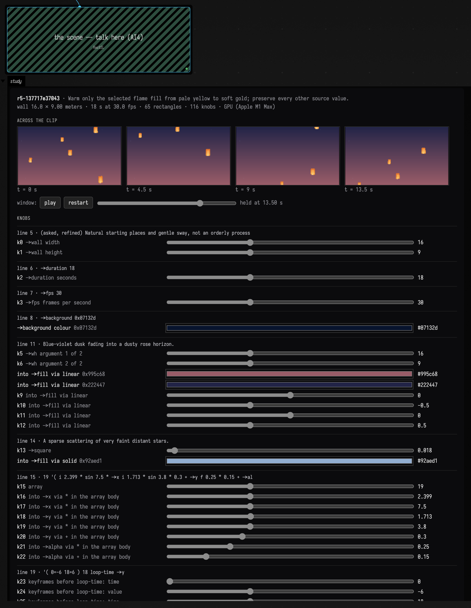

This is the scene box of the finished lanterns session, reopened in Field. Its window, held at 13.5
seconds with the scrubber:

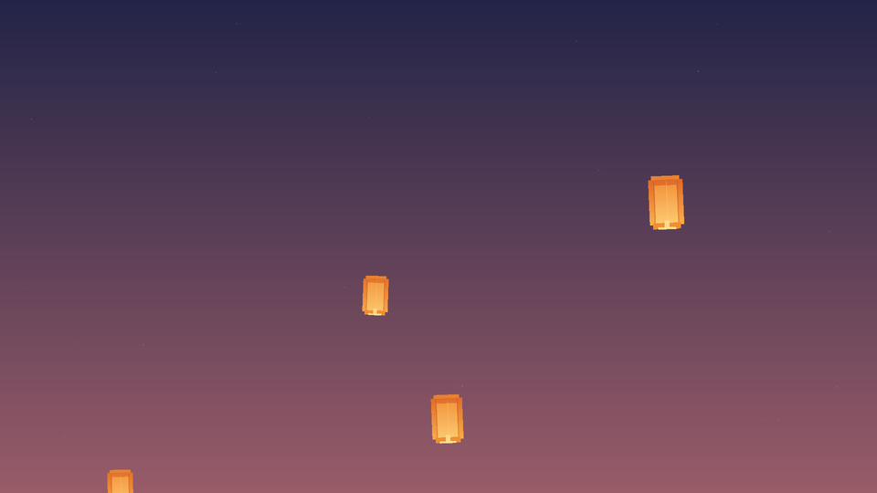

## The tools

AI4 offers these tools to any conversation opened on a box's `rectSL` property, and each works on
that box's scene. They are library code, in
[`afield.rectsl.study`](assets/rectsl_conversation/RectSLStudyTools.kt), registered through
[AI4's tool interface](aiFeatures.md#give-the-ai-a-tool-of-your-own):

| Tool | Purpose |
| --- | --- |
| `RectSLStudyGuide` | How to work on a study — the wall, idioms, traps and style — or the words guide searched for a word. |
| `InspectRectSLStudy` | Read the checked scene, any unchecked hand edit, history, the lines that make rectangles, warnings, knobs, and the line the person's cursor is on. |
| `EditRectSLStudy` | Replace the whole scene: compile, check, activate, and return a preview against the parent. |
| `PatchRectSLStudy` | Exact local text replacements, through the same checks. |
| `SetRectSLNumbers` | Change numbers and hex colours by knob index, rewritten in place. |
| `ObserveRectSLStudy` | Frames at chosen times, with what is visible, palette, detail and motion. |
| `TimelineRectSLStudy` | The whole clip as frames, a chart of what is visible and moving, and what happens in it — each object once, with the lines that made it. |
| `TraceRectSLStudy` | Every visible rectangle outlined and labelled with the line that made it, or the scene after each line. |
| `KnobsRectSLStudy` | What reads each number, and how much a 10% nudge to it changes the frames. |
| `SweepRectSLNumber` | One number at several values, side by side, without publishing. |
| `TryRectSLVariants` | Up to eight candidate scenes beside the current one, without publishing; held for Adopt. |
| `AdoptRectSLVariant` | Publish a held variant as a revision. |
| `RestoreRectSLRevision` | Make an earlier revision current again, as a new revision. |
| `CompareRectSLStudy` | Show that an edit changed only what it should: in pixels outside a region, and in which rectangles moved, appeared or went. |
| `ExportRectSLStudy` | Draw a still or the whole clip into the document's `files/` folder, in the background. |

Every edit carries the revision and the source hash it was based on. If you type while the model is
preparing an edit, the stale edit is refused and your text stays. A refused or failed edit changes
nothing. The check refuses a scene that does not compile, or whose materials do not, with the
problem and its line.

Knowing where each rectangle came from is what several tools share. The compiler records the line
of the word that made each rectangle — a `rect`, or the `array` that cloned it — so `Trace` can label
a frame, `Timeline` can name the line behind each rectangle that enters, leaves, stops or fades, and
`Compare` can report changes by line. Name the rectangles that matter (`"moon" rect`): comparisons match
rectangles by name across revisions.

A document can add tools of its own from a box, as
[the StackSL page shows](stacksl_conversation.md#adding-a-tool-of-your-own); gate one on a
conversation focused on `rectSL` and it sits beside these.

## Three recorded sessions

Each session below is a real AI4 conversation with the window running, recorded with gpt-6-astra
through OpenAI. The pictures are the images the tools returned to the model, and the model's own
captures of the live window. Between turns, a person acted in Field: adopting a variant, keeping a
slider value, editing the scene by hand.

### Lanterns at dusk

> Paper lanterns drifting up a night sky, a few at a time, swaying a little as they rise, warm
> orange against deep blue.

The model read the guide, searched the words guide for loops and delays, and wrote the scene with
one `EditRectSLStudy`: a lantern of nine rectangles — crown, paper, lit fold, paper fold, two seams,
lower lip, mouth and flame — inside a group that sways, and an `array` that makes five lanterns of
it, each starting later (`->delay-all-time`) on an 18-second rise. It looked at the window before
replying:

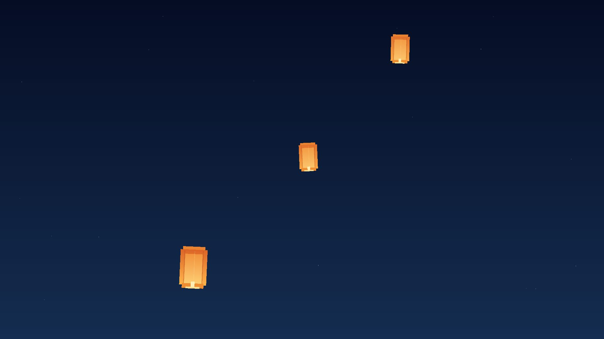

The second request asked for a less orderly sky, and a patch varied the lanterns' start places,
sizes and speeds. The third asked for moods:

> Show me three moods for the sky behind them — dusk, deep midnight, and a festival night with more
> lanterns — without changing how the lanterns move.

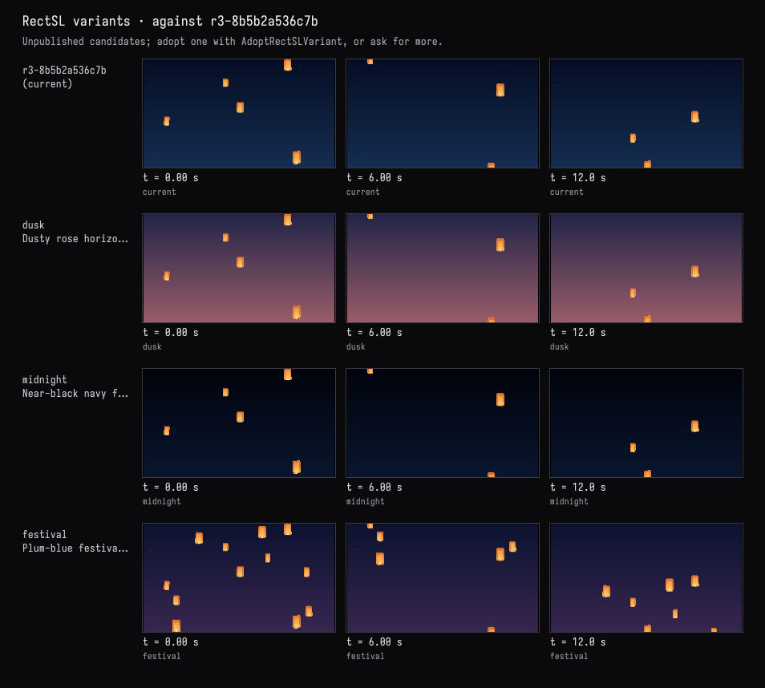

The person adopted **dusk** in the card. Only the sky's gradient changed:

<!-- rectsl-study-source:lanterns-dusk -->
```diff {data-lang=rectsl}
:::before
# Blue air, lighter near the unseen horizon.
"night" rect 16 9 ->wh 0x142d50 0x050d24 0 -0.5 0 0.5 linear ->fill ;
:::after
# Blue-violet dusk fading into a dusty rose horizon.
"night" rect 16 9 ->wh 0x995c68 0x222447 0 -0.5 0 0.5 linear ->fill ;
```
<!-- /rectsl-study-source:lanterns-dusk -->

> Make it loop seamlessly: no lantern should pop in or out when the clip wraps around. Show me it
> doesn't.

The model observed frames on both sides of the wrap, looked at the timeline, and found nothing to
fix: each lantern's rise repeats every 18 seconds and its sway every 6, and a lantern wraps from
the top to the bottom of its path off the wall. It reported the change in pixels across the seam,
0.60%, beside 0.58–0.61% between neighbouring frames elsewhere:

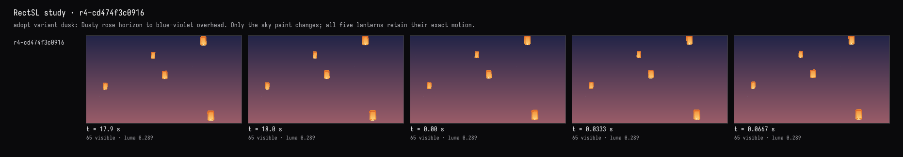

It then exported two loops as a clip into `files/`, to watch the seam at 18 seconds:

<video controls loop muted playsinline width="640" src="assets/rectsl_conversation/lanterns/lanterns-seam-check-two-loops.mp4"></video>

Then the person put the editor's cursor on line 36, `"flame" rect …`, and the window outlined every
lantern's flame, as in the picture [above](#the-editor-and-the-window). Without naming it:

> Make this one glow a little warmer, and leave everything else exactly as it is.

The model's `InspectRectSLStudy` reported the person at line 36. It changed that line's colour, from
pale yellow to soft gold, which every lantern's flame shares, and compared the two revisions: two
lines' rectangles changed, the flame's and the copies the array made of it, in fill only; the other
60 did not.

<!-- rectsl-study-source:lanterns-flame -->
```diff {data-lang=rectsl}
:::before
  "flame" rect 0 -0.42 ->xy 0.095 0.13 ->wh 0xffedb4 solid ->fill ;
:::after
  "flame" rect 0 -0.42 ->xy 0.095 0.13 ->wh 0xffd98c solid ->fill ;
```
<!-- /rectsl-study-source:lanterns-flame -->

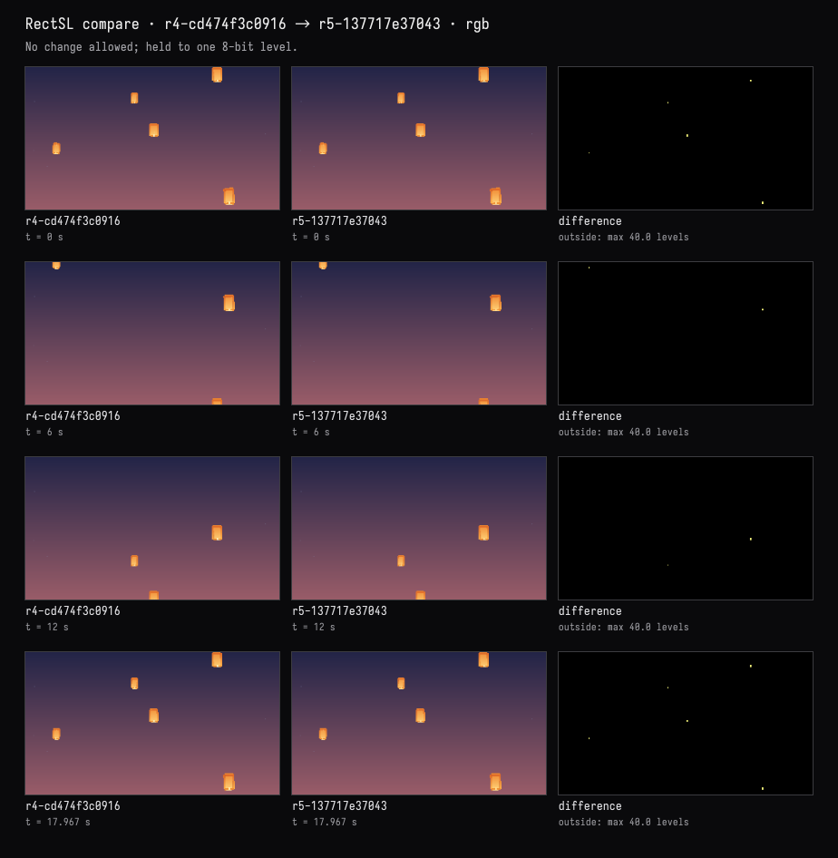

<!-- rectsl-study-source:lanterns-final -->
??? example "The complete scene · r5-137717e37043"

    ```diffstatic {data-lang=rectsl}
    # (asked) Paper lanterns drifting up a night sky, a few at a time,
    # swaying a little as they rise, warm orange against deep blue.
    # (chosen) An 18-second loop, five irregularly scattered lanterns with varied sizes and rise speeds.
    # (asked, refined) Natural starting places and gentle sway, not an orderly procession.
    ->wall 16 9 meters
    ->duration 18
    ->fps 30
    ->background 0x07132d

    # Blue-violet dusk fading into a dusty rose horizon.
    "night" rect 16 9 ->wh 0x995c68 0x222447 0 -0.5 0 0.5 linear ->fill ;

    # A sparse scattering of very faint distant stars.
    "stars" rect 0.018 ->square 0x92aed1 solid ->fill
    19 '( i 2.399 * sin 7.5 * ->x i 1.713 * sin 3.8 * 0.3 + ->y f 0.25 * 0.15 + ->alpha ) array ;

    # The whole paper lantern sways as a unit; its rise wraps only outside the wall.
    "lantern" group
      '( 0=-6 18=6 ) 18 loop-time ->y
      '( 0=-0.18 3=0.18 6=-0.18 ) ease-in-out 6 loop-time ->x
      '( 0=-0.045 3=0.045 6=-0.045 ) ease-in-out 6 loop-time ->rot

      # Narrow crown and broad warm paper body.
      "crown" rect 0 0.45 ->xy 0.55 0.13 ->wh 0xe98230 solid ->fill ;
      "paper" rect 0.67 0.88 ->wh 0xffb74d 0xdb6225 0 -0.5 0 0.5 linear ->fill ;

      # A luminous central fold with darker seams along the sides.
      "lit-fold" rect 0 -0.04 ->xy 0.43 0.74 ->wh 0xffd57a 0xf08b35 0 -0.5 0 0.5 linear ->fill ;
      "left-seam" rect -0.23 0 ->xy 0.018 0.83 ->wh 0xb74e22 solid ->fill 0.4 ->alpha ;
      "right-seam" rect 0.23 0 ->xy 0.018 0.83 ->wh 0xb74e22 solid ->fill 0.4 ->alpha ;
      "paper-fold" rect 0.02 0.02 ->xy 0.013 0.77 ->wh 0xffe2a2 solid ->fill 0.24 ->alpha ;

      # The folded bottom lip, bright opening, and little heat source.
      "lower-fold" rect 0 -0.46 ->xy 0.54 0.12 ->wh 0xef8e32 solid ->fill ;
      "mouth" rect 0 -0.505 ->xy 0.35 0.045 ->wh 0xffdf92 solid ->fill ;
      "flame" rect 0 -0.42 ->xy 0.095 0.13 ->wh 0xffd98c solid ->fill ;
    end

    # Deep copies keep the paper details together. Independent variations avoid a diagonal procession.
    # Rise durations vary, with a short offscreen pause so every path still loops cleanly at 18 s.
    "lantern" ->select
    5 '(
      '( 0=-6 14=6 ) linear i 1.7 * sin 0.14 * 1.05 + time* 18 loop-time ->y
      i 2.399 * sin 5.9 * 0 ->offset
      i 2.63 * sin 0.18 * 0.85 + ->scale
      i 1.71 * sin -6 * -8 + ->delay-all-time
    ) array ;
    ```
<!-- /rectsl-study-source:lanterns-final -->

### A tide under a rising moon

> A tide of tall, thin bars across the whole wall, rising and falling like a wave that travels from
> left to right. Deep sea colours, darker towards the bottom.

The model wrote 80 bars from one template with track arithmetic: a linear phase track, offset by
each bar's place (`f tau * -`), through `sin`, sets both the bar's height and its centre, so every
bar keeps its foot on the floor of the wall.

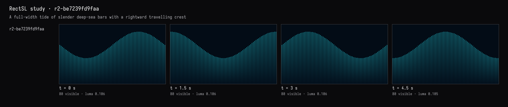

> Add a moon that rises slowly on the right, with a shimmer of its light on the water beneath it.

The model built the moon from 64 horizontal slices, each as wide as a circle is at that height, and
the shimmer from 30 short strokes that follow the water's height beneath it:

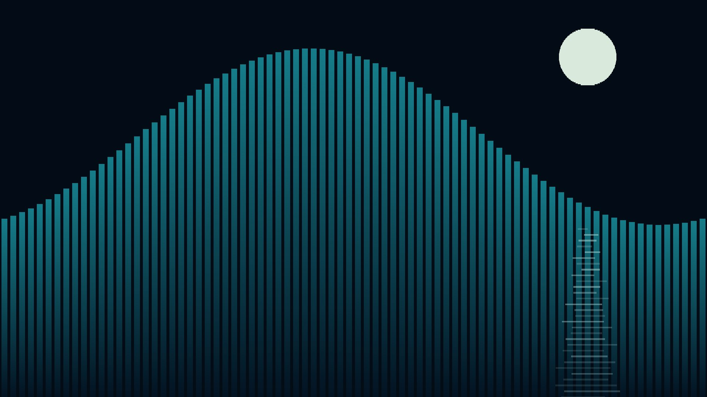

The person widened the moon in the card, moving knob 22 from 1.3 to 1.8 and pressing Keep.

> Make the wave twice as fast, but leave the moon and its shimmer exactly as they are — and show me
> they didn't change.

The model changed one number, the end of the wave's phase track:

<!-- rectsl-study-source:tide-faster -->
```diff {data-lang=rectsl}
:::before
"tide" rect
  0.135 ->w
  0x031322 0x167c89  0 -0.5  0 0.5 linear ->fill
  80 '(
    fc 7.9 * ->x
    '( 0=0 6=6.28318530718 ) linear
    f tau * - sin 2.0 * 5.9 +
    dup ->h
    0.5 * 4.5 - ->y
  ) array ;
:::after
"tide" rect
  0.135 ->w
  0x031322 0x167c89  0 -0.5  0 0.5 linear ->fill
  80 '(
    fc 7.9 * ->x
    '( 0=0 6=12.56637061436 ) linear
    f tau * - sin 2.0 * 5.9 +
    dup ->h
    0.5 * 4.5 - ->y
  ) array ;
```
<!-- /rectsl-study-source:tide-faster -->

It compared the two revisions twice, at nine times. By rectangle: the 80 bars changed only in
animated position and height, the 64 moon slices and 30 shimmer strokes not at all, and nothing was
added or removed. In pixels: nothing outside the water changed by even one level. It also noted
that the person's wider moon was kept.

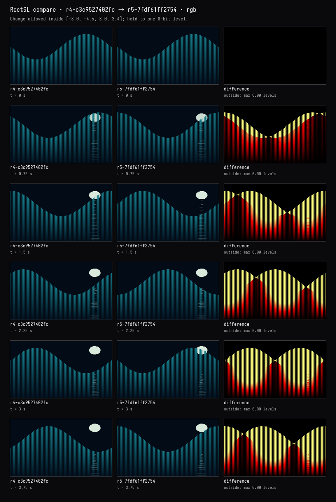

<!-- rectsl-study-source:tide-final -->
??? example "The complete scene · r5-7fdf61ff2754"

    ```diffstatic {data-lang=rectsl}
    # asked: tall thin bars across the wall, a tide travelling left to right;
    # deep sea colours, darker towards the bottom.
    # chosen: 80 bottom-anchored bars, a three-second wave cycle in a six-second clip.
    # added: a slowly rising moon on the right, with broken shimmering light below.
    # The moon and reflection fade at the loop seam so the rise can begin again.
    ->wall 16 9 meters
    ->duration 6
    ->fps 30
    ->background 0x030c16

    # A round moon made from fine horizontal slices, behind the tide.
    linear-track "moon-rise" '( 0=2.45 6=3.55 )
    linear-track "moon-visibility" '( 0=0 0.8=1 4.9=1 6=0 )
    "moon" rect
      5.3 ->x
      0.022 ->h
      0xd9e9dc solid ->fill
      "moon-visibility" track-ref ->alpha
      64 '(
        fc dup * 1 swap - sqrt 1.8 * ->w
        "moon-rise" track-ref fc 0.65 * + ->y
      ) array ;

    # The tide: each bar rises and falls, its foot held at the bottom of the wall.
    # Subtracting the horizontal phase makes the crest travel to the right.
    "tide" rect
      0.135 ->w
      0x031322 0x167c89  0 -0.5  0 0.5 linear ->fill
      80 '(
        fc 7.9 * ->x
        '( 0=0 6=12.56637061436 ) linear
        f tau * - sin 2.0 * 5.9 +
        dup ->h
        0.5 * 4.5 - ->y
      ) array ;

    # Broken moonlight follows the local water height and spreads towards the viewer.
    # Each small horizontal ripple varies independently in width, offset and brightness.
    "moon-shimmer" rect
      0.038 ->h
      0xa0cece solid ->fill
      30 '(
        '( 0=0 6=25.13274122872 ) linear i 2.37 * + sin
        0.11 * 5.3 + ->x
        '( 0=0 6=6.28318530718 ) linear
        5.24925861106 - sin 2 * 1.4 +
        4.0 + 1 f - * 4.5 - ->y
        '( 0=0 6=25.13274122872 ) linear i 1.73 * + sin
        0.16 * 0.8 + f 1.2 * 0.35 + * ->w
        '( 0=0 6=25.13274122872 ) linear i 2.13 * + sin
        0.22 * 0.48 + 1 f 0.65 * - *
        "moon-visibility" track-ref * ->alpha
      ) array ;
    ```
<!-- /rectsl-study-source:tide-final -->

### A visual score

> A visual score in the spirit of Oskar Fischinger: rows of vertical rectangles that pulse on a
> steady beat at 120 beats a minute, four beats to a bar, with the first beat of each bar stronger.
> A black ground, cream and vermilion.

The model wrote one bar-long named track, `four-beats`, with a taller key every half second and a
taller still on the downbeat, and drove all six rows of cream and vermilion strokes from it.

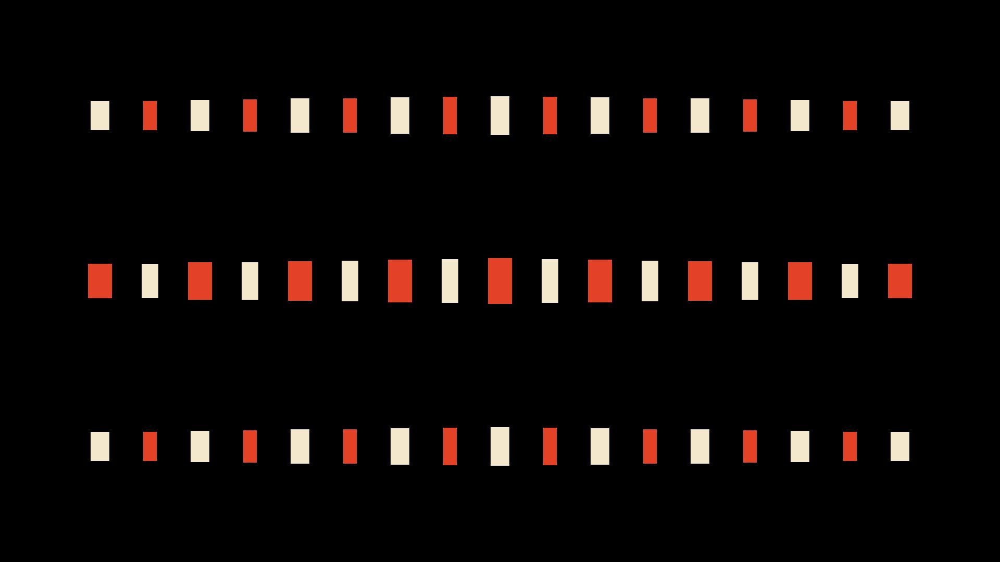

> Make the lower rows answer the top row, each one a beat later, like a canon.

A patch delayed the middle rows' copy of the track by half a second and the bottom rows' by a
second. Then the person typed a warm black over the pure black ground, in the editor: the window
followed as they typed, the study reported an unchecked edit, and they pressed **Check in** on the
card.

> Which line makes the rectangles that flash on the downbeat? Make that accent linger a little
> longer, without touching anything else.

`TraceRectSLStudy` outlined every rectangle with the line that made it:

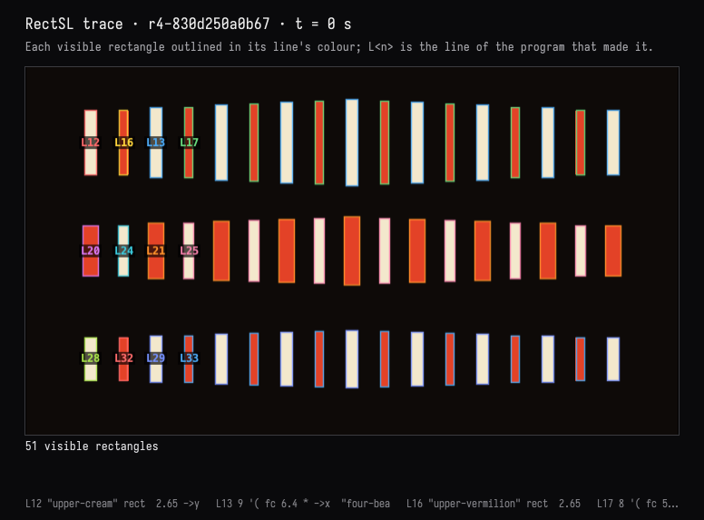

The model's answer: the rectangles are made on lines 12–13 and 16–17 of the top row (and their
counterparts below), but the flash comes from line 9, the shared track. It moved one number there
with `SetRectSLNumbers`, the release after the downbeat, so the accent lingers 120 ms longer in
every row, canon included:

<!-- rectsl-study-source:score-accent -->
```diff {data-lang=rectsl}
:::before
linear-track "four-beats" '( 0=2.1  0.22=0.62  0.44=0.62  0.5=1.4  0.72=0.62  0.94=0.62  1=1.4  1.22=0.62  1.44=0.62  1.5=1.4  1.72=0.62  1.94=0.62  2=2.1 )
:::after
linear-track "four-beats" '( 0=2.1  0.34=0.62  0.44=0.62  0.5=1.4  0.72=0.62  0.94=0.62  1=1.4  1.22=0.62  1.44=0.62  1.5=1.4  1.72=0.62  1.94=0.62  2=2.1 )
```
<!-- /rectsl-study-source:score-accent -->

A comparison confirmed nothing else changed, the person's warm background included.

<!-- rectsl-study-source:score-final -->
??? example "The complete scene · r5-d3311447473f"

    ```diffstatic {data-lang=rectsl}
    # (asked) A Fischinger-inspired visual score: vertical rectangles, 120 BPM, 4/4, stronger first beat; lower rows answer in a one-beat canon.
    # (chosen) Three symmetrical rows; cream and vermilion on black. Top leads, middle +0.5 s, bottom +1 s; six-second loop.
    ->wall 16 9 meters
    ->duration 6
    ->fps 30
    ->background 0x0e0a08

    # One two-second bar: sharp attacks every 0.5 s, short releases, and a larger downbeat.
    linear-track "four-beats" '( 0=2.1  0.34=0.62  0.44=0.62  0.5=1.4  0.72=0.62  0.94=0.62  1=1.4  1.22=0.62  1.44=0.62  1.5=1.4  1.72=0.62  1.94=0.62  2=2.1 )

    # Upper register: nine cream strokes, gently taller toward the centre.
    "upper-cream" rect  2.65 ->y  0.30 ->w  0xf3e8cc solid ->fill
    9 '( fc 6.4 * ->x  "four-beats" track-ref 2 loop-time fc abs -0.25 * 1 + value* ->h ) array ;

    # Eight vermilion strokes interleaved in the upper register.
    "upper-vermilion" rect  2.65 ->y  0.22 ->w  0xe34227 solid ->fill
    8 '( fc 5.6 * ->x  "four-beats" track-ref 2 loop-time fc abs -0.25 * 1 + value* ->h ) array ;

    # Central register answers the top one beat later, retaining its heavier weight.
    "middle-vermilion" rect  0 ->y  0.38 ->w  0xe34227 solid ->fill
    9 '( fc 6.4 * ->x  "four-beats" track-ref 2 loop-time 0.5 delay-time fc abs -0.30 * 1.18 + value* ->h ) array ;

    # Central cream strokes share the middle row's one-beat delay.
    "middle-cream" rect  0 ->y  0.26 ->w  0xf3e8cc solid ->fill
    8 '( fc 5.6 * ->x  "four-beats" track-ref 2 loop-time 0.5 delay-time fc abs -0.30 * 1.18 + value* ->h ) array ;

    # Lower register answers another beat later: two beats behind the top.
    "lower-cream" rect  -2.65 ->y  0.30 ->w  0xf3e8cc solid ->fill
    9 '( fc 6.4 * ->x  "four-beats" track-ref 2 loop-time 1 delay-time fc abs -0.25 * 1 + value* ->h ) array ;

    # Lower vermilion strokes share the bottom row's two-beat delay.
    "lower-vermilion" rect  -2.65 ->y  0.22 ->w  0xe34227 solid ->fill
    8 '( fc 5.6 * ->x  "four-beats" track-ref 2 loop-time 1 delay-time fc abs -0.25 * 1 + value* ->h ) array ;
    ```
<!-- /rectsl-study-source:score-final -->

## The saved conversations

Each turn's transcript keeps the request, the tool activity, every image returned to the model, and
its reply. The person's actions between turns are shown where they happened.

| Session | Turns |
| --- | --- |
| Lanterns at dusk | [Paper lanterns](assets/rectsl_conversation/lanterns/01-lanterns.html) · [A less orderly sky](assets/rectsl_conversation/lanterns/02-scatter.html) · [Three skies](assets/rectsl_conversation/lanterns/03-moods.html) · [A seamless loop, shown](assets/rectsl_conversation/lanterns/04-loop.html) · [This one, warmer](assets/rectsl_conversation/lanterns/05-flame.html) |
| A tide under a rising moon | [The tide](assets/rectsl_conversation/tide/01-tide.html) · [A moon and its shimmer](assets/rectsl_conversation/tide/02-moon.html) · [Twice as fast](assets/rectsl_conversation/tide/03-faster.html) |
| A visual score | [A score at 120 bpm](assets/rectsl_conversation/score/01-score.html) · [A canon](assets/rectsl_conversation/score/02-canon.html) · [Which line? A longer accent](assets/rectsl_conversation/score/03-accent.html) |

The three documents ship with Field, under `dev_docs/agents/demos/rectsl_conversation_lanterns`,
`…_tide` and `…_score`. Each holds its revisions, its held variants, the tool I/O of every turn, and
the chat. Copy one into your workspace rather than opening it in place, because continuing the
conversation adds to its history:

```diffstatic {data-lang=bash}
cp -R dev_docs/agents/demos/rectsl_conversation_lanterns ~/Documents/AFieldWorkspace/
```

Open the copy: the window opens and plays the finished scene, and the scene box shows its card. The
recorded turns are in the scene box's AI4 chat. Opening the chat does not call a model; sending a
message continues from the last revision.

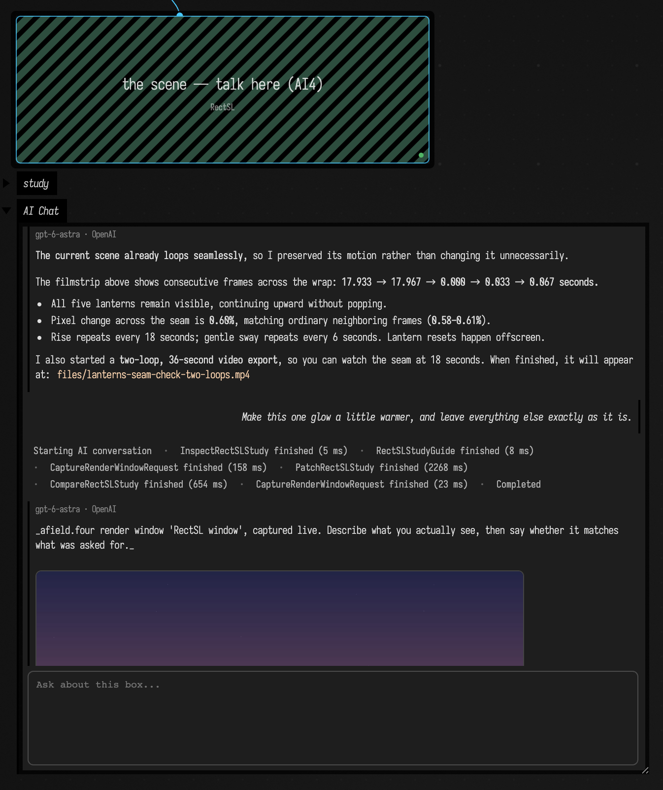

## Limits

- The evidence is sampled. Frames are exact at the times and sizes asked for; a rectangle thinner
  than a pixel at that size can vanish from a frame without vanishing from the scene, and a
  comparison holds at pixel centres and at those times.
- Visibility and events come from the scene, not the pixels: a rectangle is visible when it is not
  transparent and meets the wall, even if another covers it. An object — a top-level group, or a
  rectangle in none — enters with its first part and leaves with its last; touching is reported
  between objects of comparable size, so a lantern passing a star, or the sky it rises through, is not
  an event.
- Comparisons match rectangles by name. An unnamed rectangle's id (`rect-12`) moves when a line
  above it adds one.
- `{{ … }}` Kotlin escapes work, and compile once each on a Kotlin engine of their own the first
  time they are seen.
- With the window closed, the CPU reference draws the evidence; it is exact for geometry and plain
  fills and interprets StackSL materials, more slowly. The tools report which drew each result.

??? aside "How these sessions were recorded, and what checks them"

    Each turn went through the `ai-assist` RPC that Field's chat panel sends; the prompts are in each
    document's `prompts/`. The person-side actions clicked the card's Adopt, Keep and Check in
    buttons in a headless browser; for Keep, the slider's value was set first. The score's hand edit
    wrote the scene box's `rectSL` through the property the editor syncs to; no keystrokes were
    simulated. Before the lanterns' last turn the same browser clicked the scene box and set the
    editor's cursor on line 36, and the action was kept only once Inspect reported the person there. Each action is recorded in `conversations/*.human.json`. Both halves are
    `tools/conversation_demo.py` (`record` and `act`), which keeps the document running between
    invocations. The four screenshots of Field itself come from
    `tools/capture_rectsl_conversation.py`, which reopens a copy of the lanterns document and first
    checks that the chat Field restores is byte for byte the one saved. For the outline it puts the
    editor's cursor on the flame's line through the editor, as a click there would. A click in the
    window reaches the same code, but no automation here can click a native window without moving
    the person's own pointer, so that path is checked by calling it from a box.

    The sessions were recorded with a box of Kotlin above the scene that opened the window. Since
    then the root holds no code and the language opens the window itself; the documents lost that
    box's Kotlin, and nothing the tools saw depended on which opened it.

    The first lanterns turn was recorded twice. The first recording drew the window in linear light,
    where the model's faint 2.5% glows around each lantern came out as dark maroon boxes; that is
    what moved blending onto the typed values, as the gallery does, and the turn was recorded again.
    In the lanterns loop turn, image captions still printed times to three significant figures, so
    17.933 s and 17.967 s both read "18.0"; they print to the millisecond now.

    `RectSLConversationExamplesTest` replays all three on the CPU reference, a different renderer
    from the GPU the sessions used. Every saved revision must still pass the check, the scene box
    must hold `HEAD`, and each person-side action must have produced the revision it records. It
    checks two claims directly: in the tide, the moon and shimmer at r5 are the moon and shimmer at
    r4 at every sampled time; in the score, only the downbeat's release moved. The FIELD_TEST
    `rectsl.study.gpu-agreement` draws seven scenes on the GPU and the CPU reference and pins pixels
    that would catch a flip, an untyped colour, a target that does not blend, blending in the wrong
    space, or a stale time.
