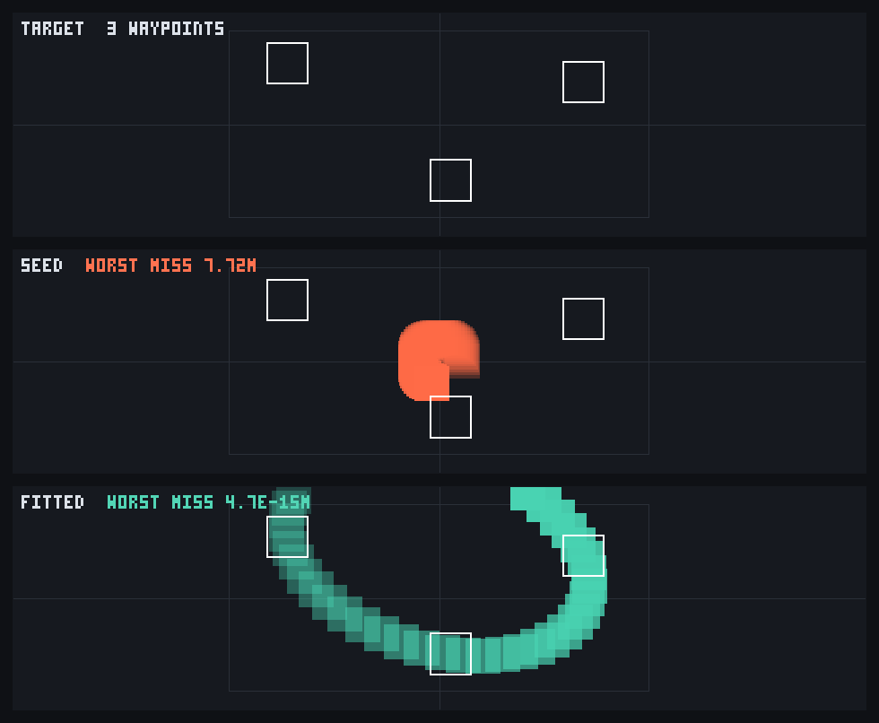

# RectSL Inverse Animation

A RectSL animation is normally read forwards: you write the tracks, and the sampler tells you where
the rectangles went. This page is about running that arrow backwards — saying **where a rect should
be, and when**, and letting a gradient work out the numbers that put it there.



Three bands, one image. The top band is where the rect was *asked* to go — three waypoints, three
instants. The middle band is what the seed parameters actually do: a small, badly-phased circle near
the origin that misses every waypoint, worst miss 7.72 wall metres. The bottom band is the same
animation with the six numbers solved, threading all three waypoints to within 5·10⁻¹⁵ metres. The
faint rectangle is the wall; the solved arc leaves it, which is allowed and is why the figure shows a
fifth more than the wall rather than cropping the answer.

## The three backends

`ddf732260` made the RectSL track IR symbolic, and said why: a Kotlin closure "cannot be printed,
compared, serialized, rewritten, or emitted as GLSL". Every scalar op in the IR now names itself, and
each one owns three columns:

| column | what it is | where it runs |
| --- | --- | --- |
| `eval:` | `(Double) -> Double` | the CPU sampler |
| `glsl:` | a shader expression | [the SDF backend](rectsl_cheatsheet.md) |
| `fn:` | an `afield.stdlib.Functions.Fn` transform | [the exact gradient](autodiff_examples.md) |

The third one is the interesting one, because it does not change *where* RectSL runs — it changes
what RectSL can do. `Fn` is Field's own expression type, and `autodiff_fn.kt` differentiates an `Fn`
graph exactly with respect to its numeric leaves. A track that lowers to an `Fn` is a track you can
take the derivative of, and therefore a track you can **solve**.

## Two identities make it possible

`Fn` was not designed as a general expression language, and two gaps look fatal until they are not.

**`Fn` has no "apply a unary function to another `Fn`'s value" op.** Its differentiable value
transforms are `flip`, `abs`, `exp`, `log`, `pow`, `clamp`, `scaleY`, `offsetY` and pointwise
arithmetic. There is no `sin`: `Functions.sin` is an *oscillator* over the sample position,
`offset + amplitude·sin(2π·frequency·x + phase)`, which is not a composition. But its `phase` child
is evaluated **at x**, so

```
sin(frequency = 0, phase = u, amplitude = 1, offset = 0)   ==   sin(u(x))
```

exactly — `0 + 1·sin(2π·0·x + u)` collapses term by term with no rounding at all. That one identity
carries the whole trigonometric family, and with it most of the Penner easings.

**`Fn` has no piecewise-in-x op, and every keyframed track is piecewise.** A clamped-ramp sum fixes
it. For keys `(tᵢ, vᵢ)` and any segment shape `Sᵢ` with `Sᵢ(0) = vᵢ` and `Sᵢ(1) = vᵢ₊₁`,

```
v(t)  =  v₀ + Σᵢ [ Sᵢ(clamp01((t - tᵢ) / (tᵢ₊₁ - tᵢ))) - vᵢ ]
```

is *identically* the clamped piecewise interpolant. Inside span *j* every earlier term is
`vᵢ₊₁ - vᵢ` and every later one is zero, so the sum telescopes to `vⱼ + (vⱼ₊₁ - vⱼ)·Sⱼ(u)`; before
the first key everything is 0 and after the last everything is 1, which is exactly what the sampler's
clamping does. It needs only clamp / divide / multiply / add, so linear, eased and TCB tracks all
lower — and so do the `*-in-out` easings, which are piecewise but continuous at the halfway point and
therefore yield to the same trick.

## Declaring an unknown

```
# a bar whose height and offset are to be solved for, not authored
"sweep" track-ref 1.0 free-param gain * 0.0 free-param bias + ->x
```

`free-param` marks a number you are willing to have chosen for you. Every backend still reads it as
the constant it presently is, so a scene with free parameters plays exactly as written and renders
exactly as written; only the differentiable backend treats it specially, labelling its `Fn` leaf so a
fitter can find which θ slot it landed in.

```kotlin
val fit = track.fitParameters(
    listOf(TrackFitTarget(1.0, -6.0), TrackFitTarget(3.0, 6.0))
)
fit.parameters        // {gain=4.0, bias=-8.0}
fit.initialResidual   // 3.606
fit.finalResidual     // 2.6e-15
fit.fitted            // the same track, solved — samplable, renderable, emittable as GLSL
```

`fitParameters` is not `fitGradient`, and the difference matters. `fitGradient` moves **every**
numeric leaf, which is right for a whole graph and wrong for a lowered track: most of its leaves are
not parameters at all but key times, clamp bounds, the `0.5` in an easing, the `-1.0` that mirrors a
reversed clock. Left to descend freely, Adam walks the `0.0` and the `1.0` of a keyed track's
`clamp01` past each other and `coerceIn` throws. So the loss and the Adam update are `fitGradient`'s
shape over a **mask**: only the named parameters ever move. Everything under the mask is borrowed —
the gradient is `Fn.gradientAt`, one backward sweep through the same `FnFormulas` table `Fn.eval` is
pinned against.

## One step, and most of the refusals go away

The first version of this backend refused 14.2% of the gallery's tracks in five different ways. Four
of those five turned out to be the *same* missing primitive, and it was a primitive the stdlib had
already written down as its own biggest gap: `FnNonDifferentiable`'s KDoc said, in as many words,
that the piecewise oscillators "need only an `FnExpr.Floor`".

So `Fn` gained a `floor`. It is a first-class node **and** differentiable, which reads like a
contradiction and is not: the derivative of a staircase is zero everywhere it exists, and zero is
what it reports. On its own that makes it a dead end, exactly as `sign` is. Inside something else it
is the opposite, and the reason is one line of arithmetic:

```
clamp01(floor(x) + 1)   ==   1 where x >= 0, 0 below it — exactly, for every x
```

That is an exact step function, and a step is *every hard edge in an animation language*. RectSL has
three: a visibility gate, a hold track, and the wrap of a looped clock. All three lower through that
one expression, plus a fourth thing — the `expo-*` and `elastic-*` easings, whose closed forms do not
reach their own endpoints (`expo-in` is 2⁻¹⁰ at u=0, not 0) and which in a keyed track spend most of
their time exactly at those endpoints. `closed(u)·(1−floor(u))·(1−floor(1−u)) + floor(u)` is that
branch structure written as arithmetic.

| | before `floor` | after |
| --- | --- | --- |
| gallery tracks that lower | 2363 / 2754 (85.8%) | **2638 / 2754 (95.8%)** |
| channel values compared | 302,293 | **328,451 of 333,207 (98.6%)** |
| easings that lower | 29 / 38 | **35 / 38** |
| distinct refusal reasons | 5 | **1** |
| worst relative disagreement | 6.6·10⁻¹⁶ | 6.6·10⁻¹⁶ (unchanged) |

## What is still refused, and whether that is permanent

A wrong derivative is worse than no derivative, so the lowering never guesses. `Track.toFn()` returns
`RectSLFnLowering.Refused(why, closable, missing)` rather than a null or a plausible-looking zero —
and `closable` is the distinction a reader actually needs, borrowed from the stdlib's own
`FnOpStatus`: **not yet written** is a different fact from **no honest lowering exists**.

| refused | closable? | why, and what it would take |
| --- | --- | --- |
| `->face-travel` headings | yes | `atan2` has no `Fn` op. Needs an `FnExpr.Atan` plus atan2's quadrant fix-up, which the exact step can now supply. This is the whole of the remaining 4.2%. |
| `/` by a non-constant | yes | RectSL's `/` returns 0 where `\|divisor\| <= 1e-12`. An exact indicator exists now; what blocks it is that the suppressed branch still evaluates `a/b` and yields `0·inf` = NaN. A *constant* divisor folds the guard exactly. |
| `smoothstep` with non-constant edges | yes | the same `0·inf` problem, for the coincident-edge guard. |
| `mod` | yes | Kotlin's `%` truncates toward zero, and `trunc` is not `floor`; it needs a sign primitive. A constant pair still folds. |
| `bounce-*` easings | yes | four parabolic arcs, each join needing its own clamped ramp. Expressible with the machinery that is now here; not yet expressed. |
| the pattern tracks | **no** | an interpreter over a mini-notation tree, not an expression of fixed shape — the same reason `FnNonDifferentiable` refuses `pat` itself. |

There is a matching honesty rule in the fitter. A staircase's derivative really is zero, so a
parameter reachable *only* through a `floor`, a gate or a hold has no path to the value at all —
present in the graph and unsolvable. `fitParameters` refuses that by name instead of printing a
residual that never moved and calling it convergence. A parameter *beside* a staircase is still fine:
under a floor it is refused, beside a gate it solves from residual 3.0 to 6.2·10⁻¹⁵.

## How much of it is checked

`ddf732260` shipped a 37,057-line characterization golden: every sampled rect of all 34 gallery
programs at 41 times each, to full double precision, **generated from pre-refactor code**. So it is
an oracle with no code path in common with the symbolic IR, let alone with a backend written after
it. `RectSLFnBackendTest` reads it as data and recomputes each rect's nine numeric channels through
Fn-lowered tracks:

| measurement | value |
| --- | --- |
| gallery tracks that lower | 2638 of 2754 (95.8%) |
| channel values compared | 328,451 of 333,207 across all 33 compilable programs (98.6%) |
| worst relative disagreement | **6.6·10⁻¹⁶** |
| worst absolute disagreement | **1.3·10⁻¹⁵** |
| easings lowered | 35 of 38, worst disagreement 8.9·10⁻¹⁶ over a 1001-point grid |
| exact gradient vs central difference | worst **7.1·10⁻¹¹** over twenty-one parameterised shapes |
| the exact step, at its own boundary | exact, including at `-0.0` |
| a looped clock across 4.5 periods | **bit-identical** (0.0); ping-pong 8.9·10⁻¹⁶; a hold track 5.6·10⁻¹⁷ |

That last row is the one that matters for a fit. Agreeing on values proves nothing about a
derivative — a second interpreter can reproduce `eval` everywhere and still differentiate the wrong
function — so the gradient is checked against a central finite difference, which is its only oracle
that does not involve trusting the gradient. 7.1·10⁻¹¹ is the finite difference's own truncation
error at a 1e-6 relative step, not the gradient's.

Two honest notes about the evidence. The differential test has to compose group and rect transforms
somewhere, and the `Fn` backend is scalar-only, so that composition is transcribed from
`SceneProgram.sample`; a companion test runs the same transcription with the *original* tracks and
requires bit-equality with the golden across 333,207 channel values, which is what stops the
transcription from rotting. And the figure at the top of this page is a CPU raster rather than a GPU
capture — every rectangle in it is real geometry sampled from the real track at a real instant, but
it is not the shader's own answer.

## The rest of what a symbolic IR bought

`ddf732260` named five things a closure cannot be: printed, compared, serialized, rewritten, or
emitted as GLSL. GLSL shipped with it; this page is the differentiable backend; and the remaining
three are small once the IR is data.

- `Track.describe()` prints a tree as its algebra —
  `ADD(MUL(linear[0.0=0.0 4.0=4.0], ?gain=1.0), ?bias=0.0)` — rather than as nested constructors.
- **Comparison came free.** The IR is data classes, so two tracks built by the same `array` body are
  already `==`; the GLSL emitter's function deduplication has been relying on that since the refactor
  without anyone writing it down.
- `Track.simplify()` is the general rewriter, and `substituteParameters` the targeted one a fit uses.

The simplifier is worth a paragraph because of what it *refuses*. Its contract is that a rewritten
track samples **bit-identically**, and the gallery corpus broke the first reflexive rule within a
minute: `0 - x` is not `-x`, because `0.0 - 0.0` is `+0.0` while `-(0.0)` is `-0.0`. Signed zero is
observable here — `HeadingTrack` takes `atan2`, and `atan2(+0.0, -1.0)` is `+π` while
`atan2(-0.0, -1.0)` is `-π`, half a turn apart — so a rewrite that "only" changes the sign of a zero
can spin a rectangle through 180°. Five reflexive rewrites are therefore refused and asserted as
refused: `x + 0`, `0 - x`, and all three `mix` degeneracies (`mix(a, b, 1)` is `a + (b - a)`, which is
simply not `b` in floating point). What survives still takes the gallery from 8197 nodes to 6442
(21.4% smaller), because the constant fold does the heavy lifting.

## A limitation worth knowing

`TcbKey` holds a `Double`, so a keyed track's key *values* cannot themselves be free parameters.
Parameters compose *around* a keyed track — gain, bias, phase, frequency, a `mix` weight — rather
than inside one. Making keys track-valued is a larger change to the IR and has not been made.

TCB tangents are also baked at lowering time. They are derived from the key values and times, so a
fit that moved a key value ought to move the tangents with it; the lowered derivative is exact for
the spline whose tangents are the ones it baked.

## See it moving

Replay `dev_docs/agents/transcripts/rectsl_inverse_animation.yaml` through the agent backdoor, or
open it from the welcome screen's starting points. Box one solves the six-parameter arc above and
draws the three-band figure into its own output; box two does the same from RectSL source using
`free-param`, and prints the track IR as its own algebra before and after the solve.
