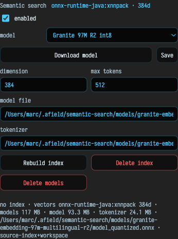
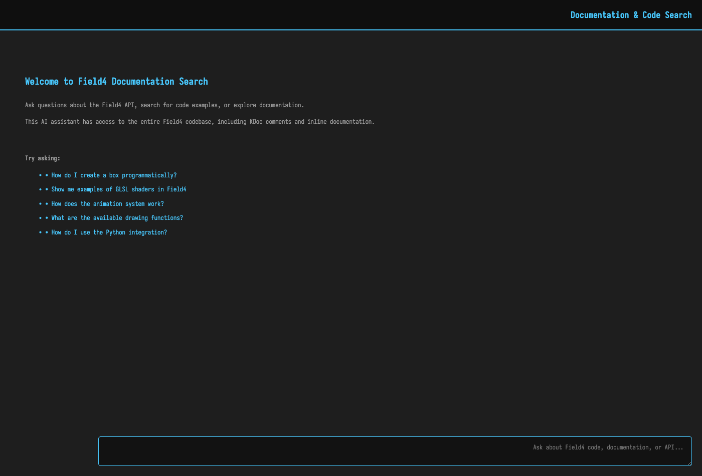

# The Semantic Index

The [`/welcome`](history_overview.md) search box does not do what you might expect. Type into it and it does not filter document *names* — it searches the *contents* of every box you have ever written, by meaning. Ask for "the thing that wiggled a line around a point" and it will find the box where you wrote `randomWiggle`, even though none of those words appear in it.

That is the **semantic index** at work: a local, meaning-aware index of your whole history with Field. (It is the search box at the top of the document list on the [welcome dashboard](history_overview.md).)

## What it indexes

The index is built from three corpora:

- **workspace** — *your* documents. It walks every document in your workspace, reads each box's code and text properties, and splits them into per-declaration fragments. This is the "history" corpus: a searchable memory of everything you have built, across every document, not just the one you have open.
- **field-internals** — Field's own Kotlin source declarations, so the same search can turn up the built-in function you half-remember.
- **documentation** — the pages of this documentation set.

You can scope a query to any of these, and within the workspace corpus you can narrow to a specific document, box, or property.

## How it works

Under the hood the index is a local [Apache Lucene](https://lucene.apache.org/) index, stored under `~/.afield/semantic-search/`. It never leaves your machine.

Search blends three signals — dense vector similarity (semantic "meaning" matching), classic BM25 keyword scoring, and symbol-name matching — and fuses their rankings together, so a query lands whether you remember the *idea*, the *words*, or the *name*.

The dense-vector half is optional. With a small embedding model downloaded it does true semantic matching; without one it gracefully falls back to the keyword-and-symbol baseline and reports itself as running with the embedder disabled. Everything still works either way — you just lose the "search by vibe" quality.

## Managing it

The **Semantic search** panel in the `/welcome` AI section is the control room:

- an **enabled** toggle and a live status badge
- a **model preset** picker with a **Download model** button (models are cached under `~/.afield/semantic-search/models/`)
- **Rebuild index**, **Delete index**, and **Delete models** actions, with a progress bar for long rebuilds

The index tracks whether its contents have drifted from your workspace and reports itself as stale when they have, so you know when a rebuild is worth running. A rebuild happens on a background thread — you can keep working while it recollects.

## A second, conversational search

There is a related but distinct feature worth knowing about. **Search Documentation & Code** — `command/ctrl-shift-d`, or the command of the same name — opens a conversational search over Field's code and docs in the documentation pane.

This one is powered by the AI provider's own retrieval over Field's uploaded source rather than the local Lucene index, and it answers in prose rather than a hit list. Use the `/welcome` search box to find *your own* work by meaning; use `command/ctrl-shift-d` to ask questions *about Field* and get an explained answer.

## Why it is a "history" tool

The workspace corpus is the point. Field accumulates documents for as long as you use it, and after a while "where did I do that thing?" becomes a real question. The semantic index is the answer: it turns the entire sediment of your past work into something you can interrogate by describing what you half-remember, instead of hunting through filenames.
