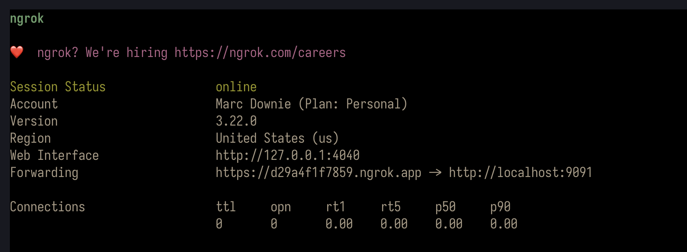
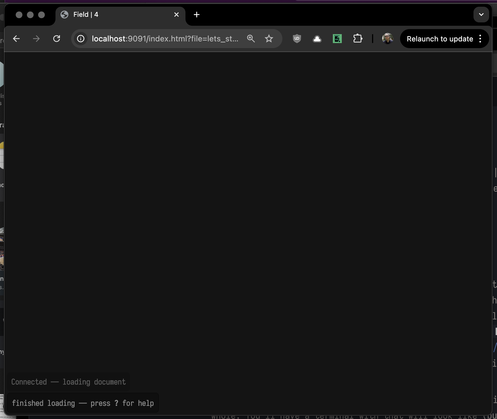
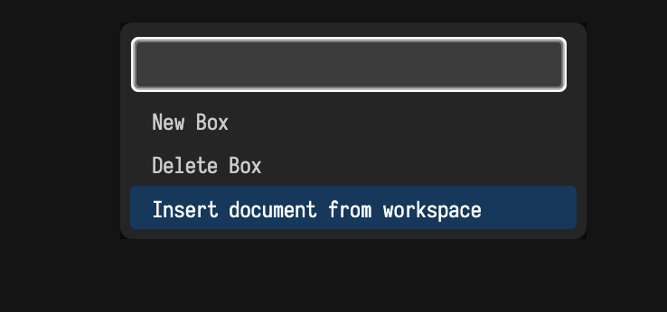
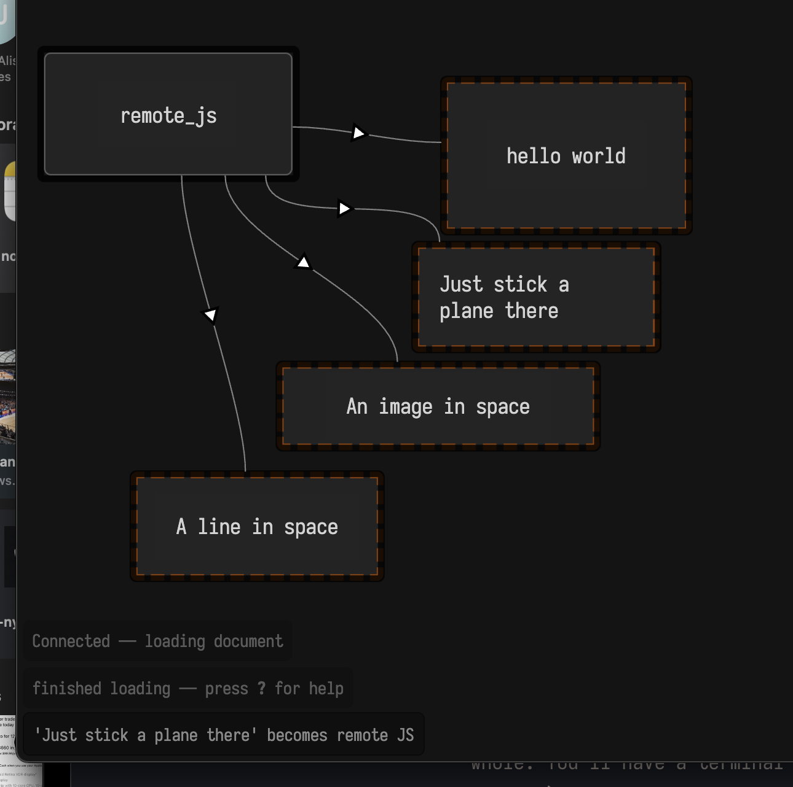
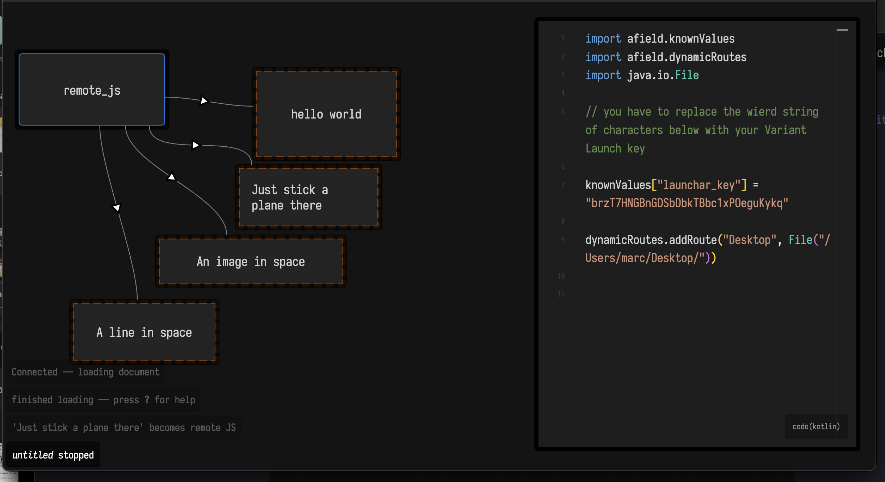
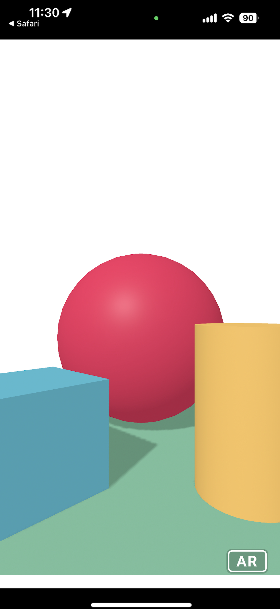
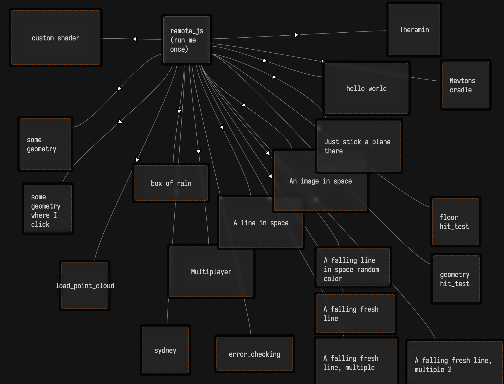

# Sketch 2, in Field·4

This page will take you into making your first steps in Field·4's RemoteJS graphics system for mobile AR. First, you'll want to have a working Field·4 installation — make sure you have the latest version downloaded.

## Prerequisites

You'll need a secure proxy service. This will accomplish two things. Firstly, it will give you a (transient) domain name that routes all the way back to your machine. Secondly, it will give you a certificate that will attest to the world that you own that domain name (which will let people use `https` rather than `http` to speak to that machine). I use `ngrok` — [https://ngrok.com/](https://ngrok.com/). Sign up for a free-tier account, and follow the installation instructions (and Slack Marc with screenshots if you get stuck).

Run `ngrok http localhost:9091` — this will bridge Field to the internet as a whole. You'll have a terminal with that will look like (but not be exactly the same as): 

Take note of the domain that ngrok has assigned you. For me it's `https://d29a4f1f7859.ngrok.app`. 

Now with Field·4 running, you can access the UI by going to [http://localhost:9091/index.html?file=lets_start_sketch2](http://localhost:9091/index.html?file=lets_start_sketch2). This will get you a blank screen: 

Press `f1` to bring up the menu and select "insert document from workspace": 

Select "remote", and you'll be greeted with the demo:

.

If you want to serve assets, take a look inside `remote_js`: 

.

Edit that `dynamicRoutes` line to point to the directory you want to serve.

*Run that remote_js box once* — it will set our license key for Variant Launch. Now you can navigate (on your cell phone) to a url like `https://d29a4f1f7859.ngrok.app/remote_ar/index.html` — this will depend on the url that ngrok has assigned you. If all goes well, that will ultimately open an AR capable session on your phone with a scene that looks like:

Press that AR button! You now have a live connection to that "web page" that's doing mobile VR. Code you run in any of the boxes highlighted in dashed-red borders will actually run on your cell phone — errors, `print` commands, autocomplete and run-status will magically be transported _back_ from your phone to your laptop. The starting place for Sketch 2 (as well as the live versions of Sketch 1 we played with in class) are there. 

# Sketch 2 — a rubric of sorts

Sketch 2 is about writing some code to make an _interactive line_. As usual, you can use any tool to accomplish this task, but the plan here is to focus on _interactions_ that are _accumulative_ somehow — that is, have a dynamic amount of geometry. Any and all ideas after this are welcome, including — change the number of lines, add noise, make it sketchy, make a mirrored pair, change the noise based on the speed of interaction.

Be interactive yourselves — ask for help, ask for features, ask for example code. I'll see you on slack.

## Advanced cheat-sheet

Field 007b+ has a template called `advanced_remote` that you can add instead of `remote`. It looks like:

And contains lots of extensions of "the line in space code". Consider it a cookbook.