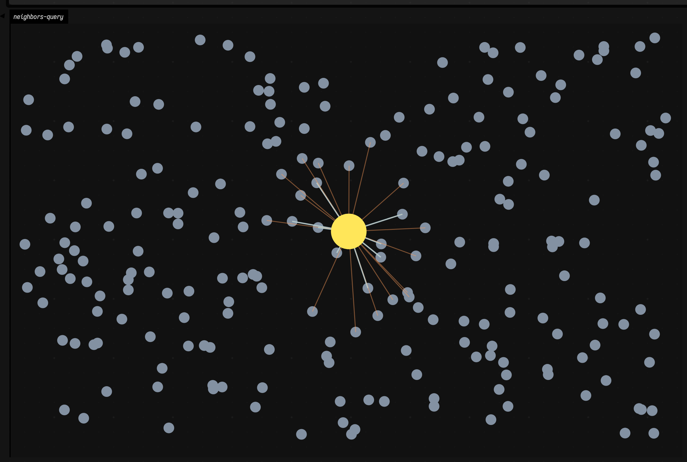
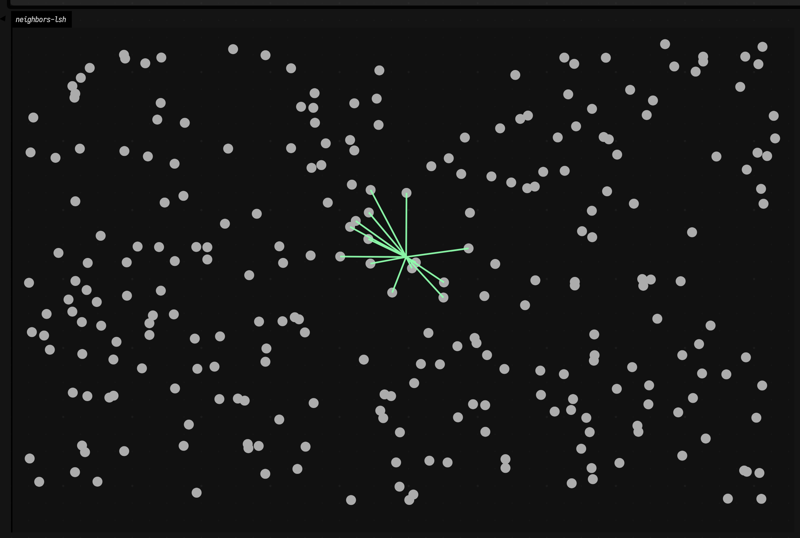

# Smile neighbors to FLine examples

Nearest-neighbor search sounds simple until it starts driving an actual system. Which points are "near" enough for a gesture? How dense is the region around this event? Can an approximate index keep up without quietly changing the answer too much? These examples draw the neighborhoods so the behavior of the search is not hidden behind an API.

## Query neighborhood with exact and approximate search

There is more than one kind of "nearby". Sometimes you want the closest `k` things, sometimes you want everything inside a radius, and sometimes you want an approximate answer because you care more about speed than perfection. Those choices come up in clustering, picking, live interaction, and spatial music systems all the time.

```diffstatic_runner {data-lang=kotlin screenshot="assets/smile_neighbors_examples/query_edges.png" wait="1.0" capture="window" open-outputs="true"}
:::static
import afield.graphics.FLine
import afield.stdlib.*

val points = List(220) {
    vec(80.0 + random() * 900.0, 70.0 + random() * 550.0)
}

val exact = vec2NN(points, mode = VecNNMode.EXACT)
val approx = vec2NN(points, mode = VecNNMode.APPROXIMATE)

val q = vec(530.0, 340.0)
val kExact = exact.kNearest(q, 10)
val kApprox = approx.kNearest(q, 10)
val radius = exact.withinRadius(q, 140.0)

val cloud = fline {
    points.forEach { p -> moveTo(p.x, p.y) }
    pointed = true
    pointSize = 3.0
    stroked = false
    color = vec(0.7, 0.78, 0.88, 0.7)
}

fun edgeSet(neighbors: List<VecNeighbor2>, c: Vec4, t: Double): FLine = fline {
    neighbors.forEach { n ->
        moveTo(q.x, q.y)
        lineTo(n.point.x, n.point.y)
    }
    color = c
    thickness = t
}

val queryDot = fline {
    moveTo(q.x, q.y)
    pointed = true
    pointSize = 10.0
    stroked = false
    color = vec(1.0, 0.9, 0.35, 1.0)
}

lines(
    listOf(
        cloud,
        edgeSet(kApprox, vec(0.55, 1.0, 0.66, 0.35), 1.2),
        edgeSet(kExact, vec(0.56, 0.86, 1.0, 0.95), 2.2),
        edgeSet(radius, vec(1.0, 0.62, 0.36, 0.45), 1.5),
        queryDot
    ),
    channel = "neighbors-query",
    w = 1120.0,
    h = 720.0,
    fitToSize = true
)
```

So we ask all three questions of the same cloud and from the same query point. Nothing else changes: same geometry, same source set, same drawing. If the answers differ, they should differ for a reason you can see.



The picture makes those meanings distinct. The exact set is the reference answer, the approximate set is the compromise you might accept in real-time work, and the radius query tells a different story entirely: not rank, but local density. That distinction matters in picking, local clustering, and proximity-sensitive drawing. For graph structures built on similar point sets, continue with [Graph connectivity examples](graph_connectivity_examples.md).

## Diff: tune LSH build options

Approximate search only becomes real once you start tuning it. How wide should the buckets be? How many projections do you spend? When does "fast enough" turn into "wrong in a way that matters"?

```diff_runner {data-lang=kotlin screenshot="assets/smile_neighbors_examples/lsh_tuning.png" wait="1.0" capture="box"}
:::before
import afield.graphics.FLine
import afield.stdlib.*

val points = List(260) { vec(50.0 + random() * 1000.0, 50.0 + random() * 600.0) }
val q = vec(550.0, 330.0)
val index = vec2NN(points, mode = VecNNMode.APPROXIMATE)
val nn = index.kNearest(q, 14)

val edges = fline {
    nn.forEach { n -> moveTo(q.x, q.y); lineTo(n.point.x, n.point.y) }
    color = vec(0.62, 0.9, 1.0, 0.95)
    thickness = 2.0
}
val dots = fline { points.forEach { p -> moveTo(p.x, p.y) }; pointed = true; pointSize = 2.4; stroked = false; color = vec(1,1,1,0.65) }
lines(listOf(dots, edges), channel = "neighbors-lsh", w = 1120.0, h = 720.0, fitToSize = true)
:::after
import afield.graphics.FLine
import afield.stdlib.*

val points = List(260) { vec(50.0 + random() * 1000.0, 50.0 + random() * 600.0) }
val q = vec(550.0, 330.0)
val index = vec2NN(
    points,
    mode = VecNNMode.APPROXIMATE,
    options = VecNNBuildOptions(lshBucketWidth = 0.75, lshProjectionCount = 14, lshUniversalHashSize = 20011)
)
val nn = index.kNearest(q, 14)

val edges = fline {
    nn.forEach { n -> moveTo(q.x, q.y); lineTo(n.point.x, n.point.y) }
    color = vec(0.56, 1.0, 0.68, 0.95)
    thickness = 2.4
}
val dots = fline { points.forEach { p -> moveTo(p.x, p.y) }; pointed = true; pointSize = 2.4; stroked = false; color = vec(1,1,1,0.65) }
lines(listOf(dots, edges), channel = "neighbors-lsh", w = 1120.0, h = 720.0, fitToSize = true)
```

The diff keeps the query, the point cloud, and the drawing identical, and changes only the LSH build options. That makes the tuning itself visible instead of hiding it inside a bigger rewrite.



And that is the useful lesson: tuning is not bookkeeping. It changes which geometric relationships your later code will believe in. If a neighborhood feels unstable, fix the index before you build a clustering, pathing, or interaction layer on top of it. For point-cloud structures that persist beyond a single query, move on to [Graph connectivity examples](graph_connectivity_examples.md) and [Correlations examples](correlations_examples.md).
