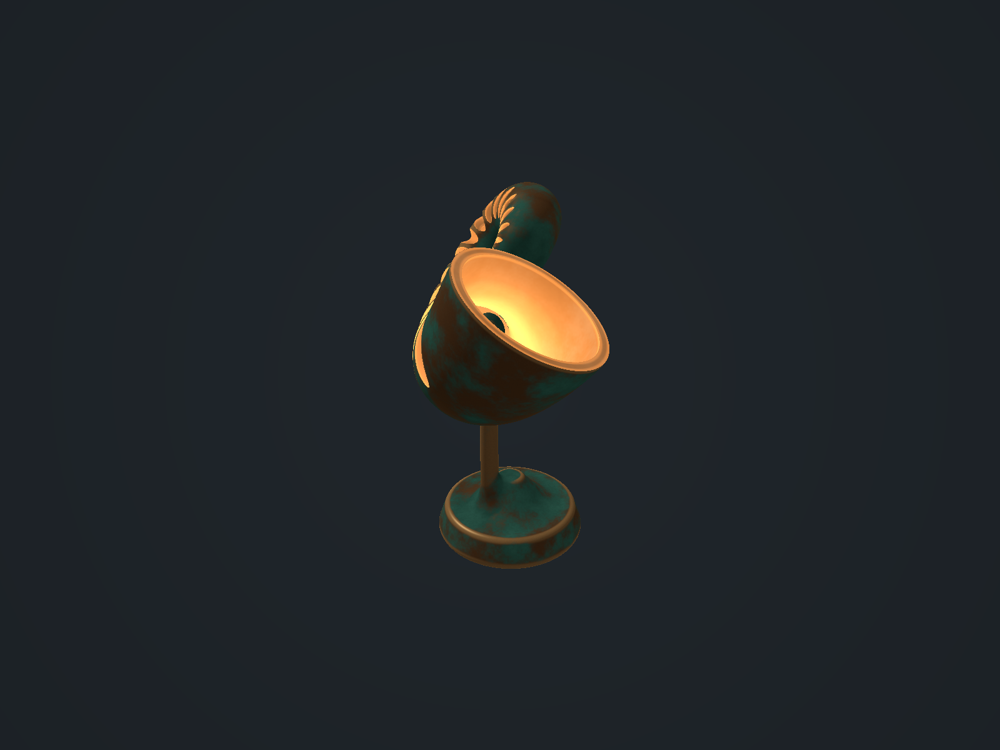
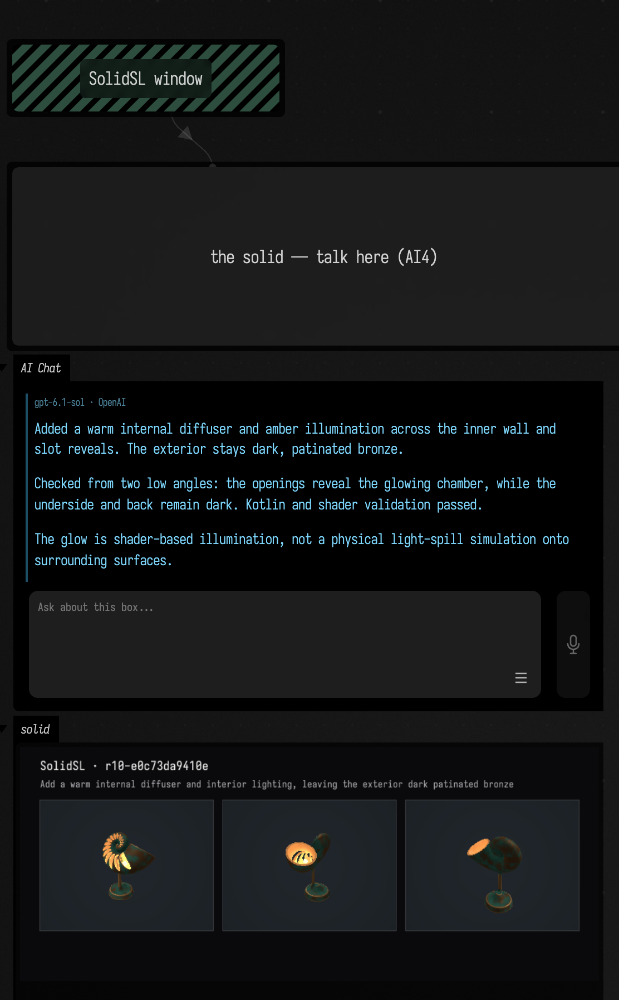
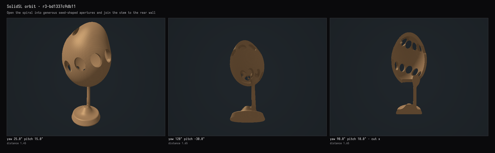
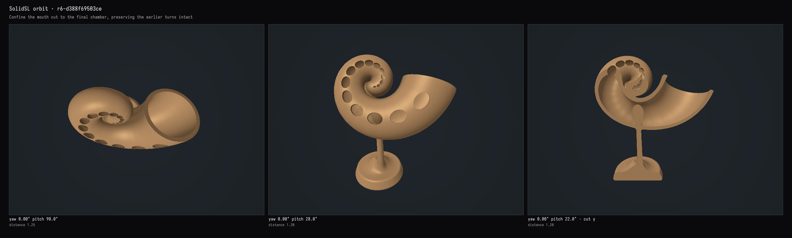
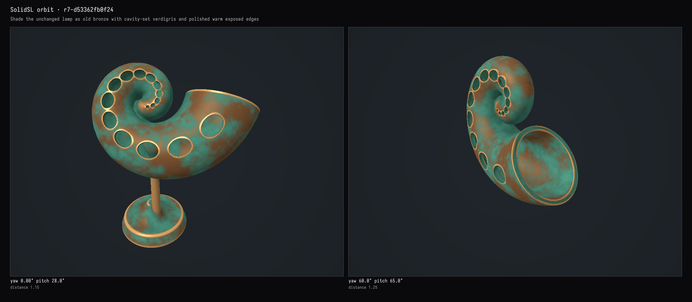
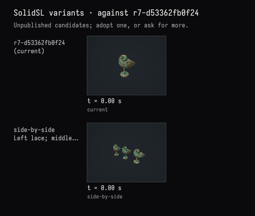
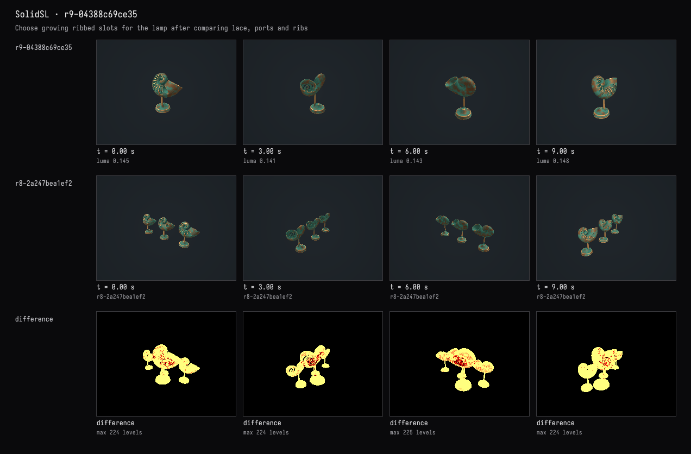
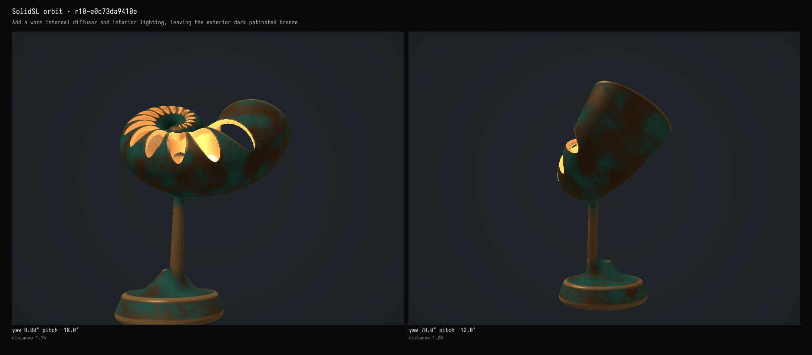

# Talking a solid into existence

Describe a 3D object in AI4 chat. The model writes it as [SolidSL](solid_notation.md): ordinary
Kotlin in a Field box whose last expression is a solid. A window above the box keeps the current
version turning. Before replying, the model looks at what it made from any side it chooses, close
up, from below, or cut open in section. It also asks what the shape is: how big the tree is, whether
the march is exact, and whether it would build as a printable mesh. Each accepted change is a saved
revision. The colour is GLSL the model writes too, so the conversation can go past the shape to what
the surface is made of.

This is the SolidSL counterpart of [Talking a function into existence](function_conversation.md),
[Talking a shader into existence](stacksl_conversation.md) and
[Talking a scene into existence](rectsl_conversation.md). The recorded session below starts from a
sphere and ends with a cast bronze nautilus lamp, glowing from inside:



## Start

In any document, select a box (press **n** to make one) and choose **Make a SolidSL Study** from
the command palette. A root box, **SolidSL window**, appears above it and opens a window. The box
becomes a study: an empty one gets the starter below, it is checked in as the first revision, and
the window starts turning it. Select the study and press ++cmd+4++ to open AI4 chat. Configure an AI
provider through Field's welcome page if you have not already; see [AI features](aiFeatures.md).

The starter is a sphere:

```diffstatic {data-lang=kotlin}
// A solid, written in SolidSL. Describe what you want in this box's AI4 chat.
// The last expression is the solid: a SolidExpr, or solid.shaded(glsl) for shading of its own.
import afield.lang.solidsl.*
import afield.lang.solidsl.study.*

sphere(1.0)
```

The box holds Kotlin, and the study checks it the way it checks the model's edits: it is compiled,
its last expression must be a `SolidExpr` or a `SolidScene`, and the shader made from it must build
on the window's GPU. Nothing is published unless all three pass. Each study keeps its history under
`studies/<box id>/` in its document. The box's output, **solid**, shows the current revision from
three sides:



## What the box holds

A SolidSL expression does not compute geometry. `cuboid(4, 2, 1) - cylinder(3, 0.4)` builds a small
tree that records "a cuboid, minus a cylinder", and the study reads that tree. The window turns its
distance function, sphere-traced in a fragment shader. [A solid, written down](solid_notation.md)
has the whole vocabulary: spheres, boxes, cylinders and tori, swept and revolved profiles, hard and
smooth booleans, shells and rounding. z is up.

To give the solid a surface of its own, end the box with `solid.shaded(glsl)`. The GLSL defines one
function:

```diffstatic {data-lang=glsl}
vec3 shade(vec3 p, vec3 n, vec3 rd, float t)
```

It returns the linear colour of the surface point `p`, with normal `n`, seen along the ray `rd`, at
`t` seconds. It may call `sdScene(p)` (the solid's distance), `softShadow(p, l)`,
`occlusion(p, n)`, and read `CENTRE` and `RADIUS`. Leave it out and the solid is lit by a default
key light, fill and rim. A shading function the GPU will not compile is a failed check, with the
compiler's message, and the window keeps the last revision that built.

## What the model can do

Every SolidSL study's chat has these tools:

| Tool | What it does |
| --- | --- |
| `SolidStudyGuide` | How to work: vocabulary, coordinates, idioms, the `shade()` contract, traps. |
| `InspectSolidStudy` | The checked Kotlin, revision history, the numbers in it, and the line your cursor is on. |
| `EditSolidStudy` / `PatchSolidStudy` / `SetSolidNumbers` | Replace the Kotlin, patch it, or change numbers in it, each guarded by the revision read and previewed against its parent. |
| `ObserveSolidStudy` | The turntable: a frame at `t` seconds looks from 35 + 30t degrees, so 0, 3, 6 and 9 walk round the solid. |
| `OrbitSolidStudy` | Up to nine views of the model's choosing, by yaw, pitch and distance, each optionally cut open along x, y or z on the camera's side. |
| `DescribeSolidStudy` | Bounds, tree size before and after the simplifier, the shader's size and safe march step, and whether Manifold's exact path would build it. |
| `CompareSolidStudy`, `TrySolidVariants`, `AdoptSolidVariant`, `SweepSolidNumber`, `RestoreSolidRevision` | What an edit left alone, candidates side by side, a number at several values, and going back. |

The pictures come from the window's GPU, in the same shader the window runs. With no window they
come from a CPU tracer of the same distance field, with the default lighting only, and every result
says which one drew it.

## The nautilus lamp

A real AI4 conversation, five turns long, recorded with the window running, so every picture the
model saw came from the GPU. The pictures here are the ones it was sent.

### A lamp, not a bracket

> I'd like something more interesting than a CAD bracket: a small cast lamp, like a
> nautilus-inspired shade. A hollow, thin-walled shell with a spiral of openings winding around it,
> standing on a slender stem with a heavier, flared foot. It should feel cast and grown rather than
> machined.

The model read the guide, wrote a first draft with `EditSolidStudy`, and looked at its preview. It
didn't like it: "The first pass reads too much like an egg with a fine seam." It patched the
openings larger and moved the stem's joint to the back of the shade. Then it orbited the result, from
the front, from below, and cut open along x to check the shade was hollow:



It said what it had and had not made: "This is a form study—not yet a fabrication-ready lamp."

### Make it coil

> It still reads as an egg with holes. Make it actually nautilus-like: the shell should coil — a
> chamber that grows as it winds, the openings following that growth line and getting larger toward
> the mouth. Look at it from above and in section to check the coil and that the wall stays thin and
> even.

The model rebuilt the shade as 64 spheres along a logarithmic spiral, each larger than the last,
blended into one envelope with `smoothUnion` and given a wall with `shelled`. The view from above
caught a mistake the turntable had not: "the mouth cut was clipping an earlier turn". It confined
that cut to the last chamber and looked again, from above, face on, and in section:



The coil, as the box now has it:

```diffstatic {data-lang=kotlin}
// A logarithmic centreline: both its radius and its chamber grow as it winds.
val sweep = 2.60 * PI
val growth = 0.28
val coreRadius = 0.15
val wallHalf = 0.045
val samples = 64
val coilParts =
    List(samples) { i ->
        val t = sweep * i / (samples - 1.0)
        val r = coreRadius * exp(growth * t)
        val a = t - sweep
        val chamberRadius = 0.05 + 0.42 * r
        sphere(chamberRadius).at(r * cos(a), r * sin(a), 0.0)
    }
// Blend overlapping round sections, then offset that same field on both sides.
// Shelled(half) gives a nominal full wall of 0.09 throughout the growing chamber.
val envelope = run {
    var layer = coilParts
    while (layer.size > 1) {
        layer =
            layer.chunked(2).map { pair ->
                if (pair.size == 1) pair[0] else smoothUnion(pair[0], pair[1], 0.075)
            }
    }
    layer.single()
}
val wall = envelope.shelled(wallHalf)
```

The pairwise blend is the model's own idea. A smooth union of 64 parts written as one left fold
nests 64 deep; blending in pairs keeps the tree, and the shader made from it, shallow.

### Old bronze, written as shading

> Now the material, written as shading: old patinated bronze, verdigris green settling into the
> hollows and creases, worn warm and polished on the high edges that catch the light.

The geometry did not change. The model wrote a `shade()` that measures how the surface bends by
sampling `sdScene` around each point. Concave places collect verdigris, and convex ridges wear back to
bronze and take a sharper highlight:

```diffstatic {data-lang=glsl}
    // Tangential field samples distinguish concave hollows from convex worn lips.
    vec3 u = normalize(cross(n, abs(n.z) < 0.9 ? vec3(0,0,1) : vec3(0,1,0)));
    vec3 v = cross(n,u);
    float e = 0.045;
    float bend = (sdScene(p+e*u)+sdScene(p-e*u)+sdScene(p+e*v)+sdScene(p-e*v)
                  -4.0*sdScene(p))/e;
    float hollow = smoothstep(0.015, 0.23, -bend);
    float ridge = smoothstep(0.13, 0.65, bend);
```



### Three kinds of opening

> Try three different characters for the openings before we commit — say, one delicate and lacy, one
> with fewer bold ports, and one where they become ribs between slots. Show them side by side and
> adopt the one you think suits a lamp best, saying why.

`TrySolidVariants` drew the three as candidates beside the current lamp. Each variant got its own
row, drawn small, too small to judge the holes in. The model then wrote a fourth "variant" that put
all three lamps side by side in one solid, so it could see them at once:



It chose the ribs: "The slots reinforce the shell's growth and suggest bands of escaping light;
they also give the patina and polished edges a strong rhythm." It adopted them as a revision and
checked the turntable:



The workaround points at a weakness in the tool. Since the recording, variant tiles are drawn at
320 pixels by default instead of 160, and `TrySolidVariants` takes a `size`.

### Light from inside

> Make it a lamp at last: light glowing from inside, warm, spilling out through the openings so the
> inner wall shows, while the outside stays dark bronze. Check it from a low angle.

The model added a small sphere inside the outer chamber as the diffuser, and extended `shade()` to
work out which faces are inside the coil. It repeats the spiral's own formula in GLSL to find the
nearest chamber. Faces turned inward glow amber, falling off with distance from the diffuser.
Outside faces keep the patina, darker. It looked from two low angles:



It said what the shading does not do: "The glow is shader-based illumination, not a physical
light-spill simulation onto surrounding surfaces." `DescribeSolidStudy(exact = true)` would say the
same about printing it. A smooth blend has no exact form, so this lamp is a field the GPU draws, not
a closed mesh Manifold can build.

??? aside "How this session was recorded"

    The five turns were sent with `tools/conversation_demo.py record --study solidsl`, through the
    `ai-assist` RPC that Field's chat panel uses, to gpt-6.1-sol through OpenAI, with the study's
    window open. No tool call was scripted. The document, with every prompt, transcript, tool I/O
    log and revision, is `dev_docs/agents/demos/solidsl_conversation_example`; it opens in Field
    with the saved chat restored. The five turns took 90, 132, 54, 148 and 74 seconds, and used about
    1.6 million input tokens, almost all of them cached, and 14 thousand output tokens.

    The two pictures of Field itself come from `tools/capture_solid_conversation.py`, which reopens
    a copy of that document on a Field of its own and checks that the study draws on the GPU first.
    They were taken after two changes the recording led to. The default camera distance went from 2.2
    bounding radii to 1.6: in every turn the model moved closer by hand, to about 1.2. The variant
    tiles were also enlarged, as described above. The images in the walkthrough are the ones the
    model was sent, at the old defaults.

## Where to go next

- [A solid, written down](solid_notation.md): SolidSL itself, its two lowerings, its refusals,
  and solving for the numbers in a solid.
- [Studies](studies.md): the operations every study shares: revisions, guards, variants and
  comparisons.
- [Talking a shader into existence](stacksl_conversation.md) and
  [Talking a scene into existence](rectsl_conversation.md): the same kind of conversation, about a
  StackSL program and a RectSL scene.
