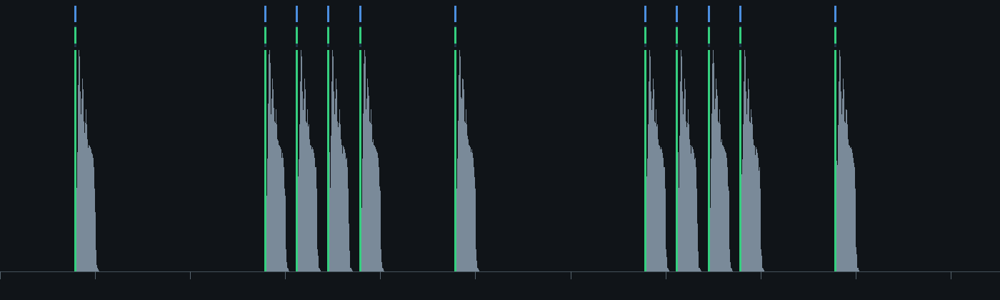

# Sonic Pi

[Sonic Pi](https://sonic-pi.net) v5 is a live-coding instrument with a genuinely good synth engine, a
sample library, and an idea of time that a text editor can drive. Field talks to it in *owned* mode:
Field starts the Sonic Pi server itself and becomes the client it expects, so there is no Sonic Pi
window — a Field box is the buffer, and Sonic Pi's log, errors and per-line activity come back into
that box.

## Linux AppImage setup

Field can use the Sonic Pi v5 AppImage directly. Leave the AppImage executable in `~/Downloads`;
the first call to `sonicPi(...)` finds the newest matching image and extracts its `usr` tree into
`~/.cache/field4/sonic-pi/appimages/`. Later boots reuse that cache. To keep the image elsewhere,
set `FIELD_SONIC_PI_APPIMAGE=/absolute/path/to/Sonic-Pi.AppImage` before starting Field.

The v5.0.0 Linux image's bundled Ruby extension for YAML links to `libyaml-0.so.2`. On Arch Linux
and CachyOS, install that small runtime dependency once:

```bash
sudo pacman -S --needed libyaml
```

Do not start the Sonic Pi GUI when using it from Field. Field starts and owns the daemon itself;
that is how it receives v5's one-time control token, routes errors back to the right box, and stops
the audio job when you stop the box.

Owned mode is not a preference. Every interesting message in Sonic Pi's control API is authenticated
with a token the server mints at boot, and v5 prints that token exactly once, to the daemon's stdout.
The long-standing trick of scraping it out of `daemon.log` no longer works: in v5 the boot-time token
log is commented out, and the only surviving one runs inside the daemon's *exit* handler, so it lands
in the log after the daemon has stopped. If you did not start the server, you cannot ask it to run
anything. (A Sonic Pi you launched yourself is still reachable, but only over the unauthenticated cue
port — `SonicPi.cue`.)

## A box that is a piece of music

`#sonicpi` marks a region of Ruby inside an ordinary Kotlin string. `#` is a comment in Ruby, so the
marker is a legal line of the program it introduces — Sonic Pi reads straight past it, and counts it,
which is what keeps its line numbers and the box's line numbers in step.

```diffstatic {data-lang=kotlin}
:::static
sonicPi("""
#sonicpi
live_loop :bikes do
  with_synth :dsaw do
    with_fx :reverb, room: 0.5, mix: 0.3 do
      start_note = chord([:b1, :e2, :b3].choose, :minor).choose
      play start_note, release: 8, cutoff: 90, detune: rrand(0, 0.2)
    end
  end
  sleep 8
end
""")
```

Returning the result as the box's last expression is what ties the music to the box. The box stays lit
for as long as the `live_loop` runs, and stopping the box stops the music — Sonic Pi's job is
cancelled through the same path any other Field launch is.

That mapping matters most for the shape of code above. A `live_loop` never finishes on its own, so
without it the box would flash green for a few milliseconds, go idle, and leave a loop playing with
nothing in the interface admitting responsibility for it.

## Errors arrive late, and land on the line

Sonic Pi reports errors asynchronously, and code inside a `live_loop` fails on its own thread — often
long after the run that started it finished. A mistake there is invisible unless something is still
listening.

Consider a typo that Ruby is happy to parse:

```diffstatic {data-lang=kotlin}
:::static
sonicPi("""
#sonicpi
live_loop :bikes do
  start_note = chord(:e1, :minor).choose
  final_no te = chord(:e2, :minor).choose
  play start_note, note: final_note
  sleep 8
end
""")
```

`final_no te` is not a syntax error. Ruby reads it as `final_no(te = …)`, a call to a method that does
not exist, so nothing complains until the loop runs that line — and then it raises on thread
`:live_loop_bikes`, not on the thread that ran the box.

`Box.sonicPi` wires the box up as the destination before sending the code, so what comes back is put
where it belongs:

```diffstatic {data-lang=text}
:::static
[sonic-pi error in run 2 at line 5] Runtime Error Sonic Pi doesn't know a function called `final_no`

buffer bikes, line 5 - thread :live_loop_bikes
NoMethodError: undefined method 'final_no'
  final_no te = chord(:e2, :minor).choose
```

The line number is marked in the editor as well as printed, and a fresh run clears the previous
marker. Line 5 there is line 5 of the box, not line 5 of some string: the offset between the two is
inferred from where the literal sits in the box's own code, because it is zero only when the
`sonicPi(` call happens to be the first line.

## What is making sound, and where

Sonic Pi tells its client which line just triggered a note. `play`, `synth`, `sample`, `control`,
`play_chord` and the `with_fx` / `live_loop` block boundaries each report the caller's line, so the
editor can show the music moving through the code.

Two things are worth knowing before trusting it. It arrives at musical rate rather than human rate —
two loops at a modest tempo produce something like sixteen reports a second — so the display samples
recency instead of repainting per note, and a line cools off over about half a second rather than
latching on. And it reports *triggering*, not audibility: a `play` at `amp: 0` still creates a node
and still reports, so a lit line does not prove you can hear it.

```diffstatic {data-lang=kotlin}
:::static
val music = sonicPi("""
#sonicpi
live_loop :drums do
  sample :bd_haus, amp: 0.4
  sleep 0.5
end

live_loop :bass do
  use_synth :tb303
  play :e1, release: 0.4, amp: 0.4
  sleep 1
end
""")

// which lines have triggered sound, and how often
music.activity()          // {2=13, 3=13, 5=13, 7=7, 9=7, 11=7}
music.sonicPi.activeLines(withinMs = 500)
```

## The editor knows Sonic Pi's vocabulary

A `#sonicpi` region gets highlighting, hover documentation and completions: functions, the opts of the
function you are calling, and — filtered by context — synth, FX and sample names. `use_synth :` offers
synths; `sample :` offers samples.

None of that vocabulary is written down in Field. Sonic Pi already describes its own language, so
`tools/generate_sonic_pi_vocabulary.py` extracts every signature, opt, synth, FX and sample name from
the installed app:

```diffstatic {data-lang=bash}
:::static
tools/generate_sonic_pi_vocabulary.py
# wrote src/commonMain/resources/sonicpi-vocabulary.json from Sonic Pi 5.0.0:
#   238 fns, 66 synths, 42 fx, 206 samples in 18 groups
```

Several hundred signatures typed out by hand would be wrong somewhere and would rot at the next
release. Extracted, they are correct by construction: v5's new `link_audio` and `set_drive!` appeared
in completions the moment Sonic Pi was installed, without anyone noticing they were new.
`--check` fails when the committed vocabulary no longer matches the installed app.

Here is a region in the editor, with the vocabulary in play:

```diffstatic_runner {data-lang=kotlin capture="ui" region="editor" screenshot="assets/sonic_pi/sonicpi_region.png" wait="0" timeout="120" embed=true hidden=true name="sonicpi-region"}
ui.eval("var s=document.createElement('style');s.textContent='.tick_text.ok{display:none !important}';document.head.appendChild(s);return 'setup';")
ui.openEditor(id)
ui.pause(700)
// Set the model rather than typing it. Typing leaves Monaco's auto-indent and auto-close in the
// picture, and the region only exists once its *closing* triple quote does — a half-typed literal
// has nothing for the extension to highlight, which is exactly what the first attempt captured.
// The triple quote is built from a char code so it does not have to survive three levels of quoting.
ui.eval(
    "var q = String.fromCharCode(34).repeat(3);" +
    "var code = ['sonicPi(' + q, '#sonicpi', 'live_loop :bikes do', '  use_synth :dsaw'," +
    " '  with_fx :reverb, room: 0.5 do', '    play :e2, amp: 0.4, release: 8'," +
    " '    sample :bd_haus', '  end', '  sleep 8', 'end', q + ')'].join('\\n');" +
    "window.globalEditor.getModel().setValue(code); return 'set';"
)
ui.pause(1500)
```

## Field patterns as a Sonic Pi sequencer

Field already owns a pattern algebra. `pat("bd [hh hh] sd")` parses Tidal-style mini-notation, keeps
every transform exact in *rational* cycle space, and has `.every(4) { it.rev() }`, `.degradeBy`,
euclidean rhythms, polymeters and continuous control signals on top of it (`TidalPatterns.md`).
Sonic Pi has 66 synths, 42 FX, 206 samples and a scheduler that is sample-accurate. Until
`SonicPiPatterns.kt` these were strangers: the only way to reach Sonic Pi from Field was to type
Sonic Pi's own language into a string literal, which the pattern algebra cannot see into.

There are two ways to join them, they are good at different things, and both are here.

### compile — the pattern becomes a program

`sonicPiProgram(...)` lowers named layers to a `live_loop` each. The result is ordinary Sonic Pi
that you can read, paste into a `#sonicpi` region and edit by hand.

```diffstatic {data-lang=kotlin}
:::static
println(pat("bd ~ [bd bd bd] bd").sonicPiSource(cps = 0.5, cycles = 1, name = "groove"))
```

```diffstatic {data-lang=ruby}
:::static
#sonicpi
# Generated from a Field pattern. Ordinary Sonic Pi from here on — edit it freely.
#
#   layer groove
#
# use_bpm makes one beat exactly one Field cycle, so every sleep below is the cycle
# fraction the pattern computed. Rational(n, d) appears where a decimal would round.
# 0.5 cycles/second, 1 cycle(s) per loop.

live_loop :groove do
  use_bpm 60 * 0.5
  use_synth :beep
  sample :bd_haus
  sleep 0.5
  sample :bd_haus
  sleep Rational(1, 12)
  sample :bd_haus
  sleep Rational(1, 12)
  sample :bd_haus
  sleep Rational(1, 12)
  sample :bd_haus
  sleep 0.25
end
```

Two decisions in that output are worth naming, because both are the difference between a lowering
that works and one that nearly works.

**`use_bpm 60 * cps` makes one Sonic Pi beat exactly one Field cycle.** So every `sleep` in the
emitted program *is* the cycle fraction the pattern computed — the lattice is the pattern's own, and
nothing in the body depends on the tempo. Change `cps` and only the `use_bpm` line moves.

**`Rational(1, 12)`, not `0.0833`.** Three even hits inside a quarter of a bar is a position no
decimal can hold, and a `live_loop` runs for a great deal longer than the minute it takes a rounded
`sleep` to lose a beat. A decimal is emitted when the denominator is a product of 2s and 5s, because
then it terminates and reads the way a musician expects; a Ruby `Rational` otherwise.

`cycles` is the one parameter that needs thought. A pattern that varies per cycle — `<a b>`,
`.every(4)`, `.iter` — needs a loop long enough to contain the variation, or the emitted program
plays cycle 0 for ever.

### Atoms become instruments, checked against the installed vocabulary

An atom resolves in order: an explicit override, then a real sample name, then a real synth name,
then a note (`c4`, `e2`, `60`), then the drum-machine aliases — `bd`, `sd`, `hh`, `cp`, `oh`, `amen`
and forty more. "Real" means *present in `sonicpi-vocabulary.json`*, the file extracted from the
installed app.

That check is not decoration. Sonic Pi answers `sample :bd_hauz` by doing nothing at all — no error,
no sound — and a `live_loop` playing three of its four voices is very hard to debug from the sound.
So a mistyped alias is a failing test rather than a silence, and an atom that matches nothing is
named in a comment at the top of the emitted program instead of being quietly dropped.

Notes come out as MIDI numbers rather than `:c4` on purpose: Field puts middle C at `c5`, Sonic Pi
at `:c4`, and emitting the number the pattern meant removes a whole class of off-by-an-octave that
neither side would report.

Control patterns arrive through `PatAlgebra`'s parameters, so `with(gain(sine().range(0.2, 0.8)))`
works unchanged. Three of them are conversions rather than renames, and they are the ones that would
otherwise be wrong in a way you can hear but not see:

| Field | Sonic Pi | why it is not a rename |
| --- | --- | --- |
| `gain` | `amp:` | — |
| `pan` | `pan:` | Field's pan is `0..1`, Sonic Pi's is `-1..1` |
| `cutoff` | `cutoff:` on a synth, `lpf:` on a sample | Field's cutoff is **Hz**, Sonic Pi's is a **MIDI note number** |

Anything else is passed through only if the vocabulary says the target accepts it. `cutoff` is not
an opt of `:beep`, so on a `:beep` layer it is dropped *and recorded* — in
`SonicPiProgram.droppedOpts` and in a comment in the program — rather than sent for Sonic Pi to
ignore. Which synth a layer's bare notes play on is a property of the layer:

```diffstatic {data-lang=kotlin}
:::static
sonicPiProgram(
    sonicPiLayer("drums", pat("bd ~ [bd bd bd] bd")),
    sonicPiLayer("bass", pat("<e3 g3> ~ e4 ~") with cutoff(700.0), synth = "tb303"),
    cps = 0.5,
    cycles = 4
)
```

### FX wrap a layer

`with_fx` is where Sonic Pi is furthest ahead of anything Field has, so a layer can carry a chain of
it. Names and opts are checked when the layer is built, against the same extracted vocabulary — and
that check earns its keep here more than anywhere else, because Sonic Pi's answer to
`with_fx :revreb` is a runtime error on the `live_loop`'s own thread, minutes into a performance.

```diffstatic {data-lang=kotlin}
:::static
sonicPiProgram(
    sonicPiLayer(
        "bass", pat("e3 ~ [e4 g3] ~") with cutoff(700.0), synth = "tb303",
        fx = listOf(sonicPiFx("reverb", "room" to 0.8), sonicPiFx("echo", "phase" to 0.25, "decay" to 4))
    ),
    cps = 0.5
)
```

```diffstatic {data-lang=ruby}
:::static
live_loop :bass do
  use_bpm 60 * 0.5
  use_synth :tb303
  with_fx :reverb, room: 0.8 do
    with_fx :echo, decay: 4, phase: 0.25 do
      play 40, cutoff: 77.0382
      sleep 0.5
      play 52, cutoff: 77.0382
      sleep 0.125
      play 43, cutoff: 77.0382
      sleep 0.375
    end
  end
end
```

The FX wrap the body rather than the `use_bpm`, and each one adds an `end` inside the `live_loop`.
That second detail is the only reason this is worth a paragraph: a reader that counted the first
`end` as the loop's would close the loop early and read a period of zero. `synth.sonic-pi.patterns`
runs the whole differential oracle again through two nested FX and requires the lattice to be
identical to the dry layer's.

### drive — Field's clock sequences, Sonic Pi sounds

The other direction sends one `/run-code` per event, through the same `PatResponseSpec` machinery
that drives every other live pattern in Field. There is no `live_loop` to redefine, so the pattern
stays editable mid-bar, and a continuous signal is sampled once per note — which a compiled loop
cannot do.

```diffstatic {data-lang=kotlin}
:::static
(pat("bd*4, [~ cp]*2, hh*8") with gain(sine().range(0.15, 0.5)))
    .sonicPiLive(cps = 0.5)
```

The trade is timing. Each event is a UDP message plus Sonic Pi's own scheduling latency, so onsets
carry a roughly constant offset and a few milliseconds of jitter, where a compiled `live_loop` is
sample-accurate. A constant offset is not a sequencer problem — every event carries the same one.

### Measured, not assumed

`synth.sonic-pi.patterns` is a differential oracle, and it reads the emitted *text* rather than the
emitter's own event list. That distinction is the whole test: comparing the emitter against the
pattern only proves the emitter can enumerate, while everything that can reach a listener lives in
the gap between that list and the text — a third rendered as `0.333333`, a `sleep` delta that does
not accumulate back to the position it came from, a missing pad at the end of the loop so the second
bar arrives early. So the program is parsed back and compared to the pattern's own `PatQ` positions,
with no floating point anywhere in the comparison.

```diffstatic {data-lang=text}
:::static
55 patterns x 3 tempos, 346 events, agreement exact in PatQ
53/53 = 100.0% of the Sonic Pi-meaningful Pat surface
44 aliases: 40 sample, 2 synth — all present
```

None of that says Sonic Pi then *does* what the program says. `sonicpi.pattern.timing` answers that
on the real engine with `pat("bd ~ [bd bd bd] bd")` at a quarter cycle per second — a triplet inside
a binary bar, chosen so that a detector cannot pass by accident. It runs twice: once at `amp: 0`,
measuring Sonic Pi's own line-activity reports, and once audible at a master volume of 0.15,
recorded through Sonic Pi's recorder and analysed in process. It skips loudly on machines without
Sonic Pi; `FIELD_SONIC_PI_REQUIRED=1` turns that skip (or a boot that never becomes ready) into a
failure on machines whose job is to exercise the external engine.

```diffstatic {data-lang=text}
:::static
flash: recall 1.000, mean |error| 2.114 ms, worst 5.038 ms   (bound asserted at 25 ms)

observed intervals (samples): [96000, 16000, 16000, 16000, 48000, 96000, 16000, 16000, 16000, 48000]
pattern  intervals (samples): [96000, 16000, 16000, 16000, 48000, 96000, 16000, 16000, 16000, 48000]
audio: recall 1.000, worst 0.000 ms                          (bound asserted at 2 ms)
```

Every one of eleven onsets across eight seconds, triplets included, landed on exactly the sample the
pattern's rational schedule names. That is not luck: SuperCollider schedules bundles
sample-accurately, and the lowering emits `Rational(1, 3)` rather than `0.333`, so there is nothing
left to drift.



Getting to that number took two corrections, and both first presented as a pass. A flux peak in a
256-sample window can only say which *frame* something happened in, so the probe read `0.0 ms` at a
resolution of 2.7 ms — a measurement coarser than the thing it measures reports zero whatever the
truth is. And `bd_haus` has a secondary energy rise 129 ms into its decay, which a first-past-the-post
refractory reported in place of the real attack that followed it. Onsets are now refined to the
sample and deduplicated afterwards, against the pattern's own smallest gap.

### A document to open

`public/docs/assets/sonicpi_pattern_demo/metadata.edn` is a loadable Field document with three
boxes. The first needs no Sonic Pi at all — it is a text transformation, and it prints the program
and the atom resolutions. The second plays it. The third drives Sonic Pi from Field's clock.


**1 — A pattern, lowered to Sonic Pi.** Needs nothing installed.

```diffstatic {data-lang=kotlin}
:::static
// Pat plays Sonic Pi — the program, before you hear it.
//
// Field's pattern algebra keeps musical structure exact in rational cycle space. Sonic Pi has 66
// synths, 42 FX, 206 samples and a sample-accurate scheduler. This is the join: a pattern is
// lowered to ordinary Sonic Pi source that you can read, paste into a #sonicpi region, and edit.
//
//   public/docs/sonic_pi.md — "Field patterns as a Sonic Pi sequencer"
//
// Nothing here needs Sonic Pi installed. It is a text transformation.

// A triplet inside a binary bar — three even hits inside the third quarter. This is exactly where
// a lowering that wrote `sleep 0.333` would start drifting, and it is why the emitter writes
// Rational(1, 3) instead.
val groove = pat("bd ~ [bd bd bd] bd")

println(groove.sonicPiSource(cps = 0.5, cycles = 1, name = "groove"))

// use_bpm makes one Sonic Pi beat exactly one Field cycle, so the sleeps above ARE the pattern's
// cycle fractions. Nothing about them depends on the tempo — change cps and only use_bpm moves.

// Atoms resolve against the *installed* vocabulary, in order: a real sample name, then a real
// synth name, then a note, then the drum-machine aliases.
println()
println(SonicPiVocabulary)
val kit = SonicPiInstruments()
listOf("bd", "hh", "bd_tek", "tb303", "c4", "60", "nonesuch").forEach {
    println("  %-10s -> %s".format(it, kit.resolve(it) ?: "NOTHING — this atom would be silent"))
}
```

**2 — Hear it.** Turn your volume down first.

```diffstatic {data-lang=kotlin}
:::static
// Hear it.
//
// The same lowering, played. Sonic Pi 5 has to be installed; Field starts it itself — owned mode,
// so there is no Sonic Pi window and this box is the buffer. The box stays lit while the music
// runs, and the stop button stops it.
//
// Turn your volume down before you run this.

// Three things a layer can carry beyond its pattern: which synth its bare notes play on, an FX
// chain wrapped around its live_loop, and parameters from the pattern algebra. Every FX name and
// every FX opt below is checked against the installed vocabulary when the layer is built — Sonic
// Pi's answer to `with_fx :revreb` is a runtime error on the loop's own thread, minutes in.
//
// Field's octave numbering puts middle C at c5 = 60, one octave below Sonic Pi's :c4. That is why
// the lowering emits MIDI numbers rather than :symbols — the number the pattern meant survives.
sonicPiPattern(
    sonicPiLayer("drums", pat("bd ~ [bd bd bd] bd")),
    sonicPiLayer(
        "hats",
        pat("[hh hh hh hh]").degradeBy(0.35, salt = 4) with gain(0.35),
        fx = listOf(sonicPiFx("echo", "phase" to 0.125, "decay" to 2, "mix" to 0.3))
    ),
    sonicPiLayer(
        "bass",
        pat("<e3 g3> ~ e4 ~").every(4) { it.rev() } with cutoff(700.0),
        synth = "tb303",
        fx = listOf(sonicPiFx("reverb", "room" to 0.7, "mix" to 0.4))
    ),
    cps = 0.5,
    cycles = 4
)
```

**3 — Field's clock, Sonic Pi's instrument.**

```diffstatic {data-lang=kotlin}
:::static
// The other direction: Field's clock is the sequencer, Sonic Pi is the instrument.
//
// One /run-code per event instead of a live_loop. Slightly less accurate — a UDP hop of jitter per
// note, measured at a few milliseconds — and completely live: edit the pattern below, re-run, and
// the next event goes out changed, with no live_loop to redefine.
//
// The thing a compiled loop cannot do is on the last line: a continuous signal sampled once per
// note, so the hats breathe.

(pat("bd*4, [~ cp]*2, hh*8") with gain(sine().range(0.15, 0.5)))
    .sonicPiLive(cps = 0.5)
```

## Streaming Field's audio into Sonic Pi

v5 added `link_audio`, which subscribes to another Ableton Link peer's published audio channel and
treats it exactly like a soundcard input. Field already publishes one, so Field's output can be an
input to a Sonic Pi patch — with reverb on it, or a filter, or whatever else Sonic Pi does to a live
input — and the two share tempo over the same Link session.

Field publishes as a *peer* with *channels*: the peer name comes from `LinkAudioInterface.shared`, the
channel from `enableLinkOutput`. Name the channel `Main` and the Sonic Pi side is a one-liner, since
that is `link_audio`'s default.

```diffstatic {data-lang=kotlin}
:::static
// Field: publish as peer "Field4", channel "Main"
FieldAudioEngine.shared().enableLinkOutput(name = "Main")
```

```diffstatic {data-lang=ruby}
:::static
#sonicpi
# Sonic Pi: subscribe, and treat it like any other live input
with_fx :reverb, room: 0.8 do
  link_audio "Field4", amp: 1
end
```

One prerequisite is easy to lose a long time to: **Sonic Pi's Link visibility defaults to Off**, and no
Sonic Pi *language* function turns it on — only the GUI's Link toggle, which owned mode does not have.
Until it is on, neither side can see the other, `link_audio` still accepts the call without
complaining, and you get silence with nothing to explain it. There is a second, separate gate for
Sonic Pi *publishing* its own channels, also off by default.

```diffstatic {data-lang=ruby}
:::static
#sonicpi
@link_api.link_enable                    # /clock/visibility 2 — NetworkWide (1 is loopback-only)
@link_api.link_audio_publish_set!(true)  # only needed for Sonic Pi to publish *its* output
puts @link_api.link_get_visibility       #=> 2
```

That the two implementations actually interoperate is measured rather than assumed.
`sonicpi.link-audio.probe` publishes a 440 Hz sine from Field, has Sonic Pi subscribe and record its
own mixer output, and measures the recording at 440 Hz against a control frequency:

```diffstatic {data-lang=text}
:::static
Field sees 1 Link peer(s)
Sonic Pi reports 1 Link peer(s), bpm 120.0     # adopted Field's Link tempo, was 60
overall RMS ......... 0.059291
energy at 440.0 Hz ... 0.040832
energy at 1170.0 Hz .. 0.000006  (control)
tone / control ...... 7423.66
VERDICT: YES — 440.0 Hz dominates the recording, so Field's channel reached Sonic Pi
```

The probe commits PCM to the Link sink directly rather than through an audio device, so it does not
depend on which soundcard the machine happens to have selected.

## Ports, tokens and shutting down

The daemon prints one line to stdout and nothing else identifies it: five ports and the token, in the
daemon's own order.

```diffstatic {data-lang=text}
:::static
30201 30198 30197 30199 4560 -1374997887
#     ^      ^     ^     ^    ^
#     |      |     |     |    token — a random *signed* 32-bit int, so often negative
#     |      |     |     osc-cues (4560 when free)
#     |      |     scsynth — still its historical name, though SuperSonic replaced scsynth in v5
#     |      gui-send-to-spider — where /run-code goes
#     gui-listen-to-spider — bound by us, where the log and errors come back
```

Whoever holds the token has to keep sending `/daemon/keep-alive`, or the daemon reaps its whole
process tree. That is a feature: if Field dies, Sonic Pi takes itself down rather than leaving an
orphaned audio server behind. Do not trust the "more frequently than every 3s" in Sonic Pi's own
`daemon.rb` header, though — v5's `KillSwitch` sleeps 40s before it starts watching and then gives up
only after five empty 10s windows, so the real grace period is nearer 90s. Field sends every 1.2s and
asks the daemon to exit outright on close.

One consequence is worth recognising, because it presents as a mystery: a Sonic Pi that was started
and then abandoned holds the cue port for that whole grace period, which quietly pushes the *next*
boot onto a random cue port. If `oscCues` is not 4560, suspect a stranded daemon rather than a
configuration change.

## Notes on getting this wrong

Two failure modes cost real time and are hard to recognise from the symptom.

**A shifted OSC argument reads as a rejected token.** OSC pads every string and typetag to a multiple
of four bytes, adding *nothing* when the length is already aligned. Pad an already-aligned `,is`
typetag by a further four and every argument after it shifts, so `/run-code`'s token arrives as `0`
and Sonic Pi ignores the message — while unauthenticated messages like `/version` keep working
perfectly, which sends you looking in entirely the wrong place. The only evidence is
`Invalid token: 0` in `~/.sonic-pi/log/spider.log`. Field goes through JavaOSC, which gets this right;
the smoke test pins the alignment so a future change of OSC library fails loudly instead of silently.

**Stopping is not instant, and should not look like it.** Sonic Pi's activity reports are queued
against scheduled audio time, so whatever was already scheduled when a stop landed still drains —
about 1.5 seconds in practice. A test that demands silence the instant the box stops is testing the
wrong thing.
