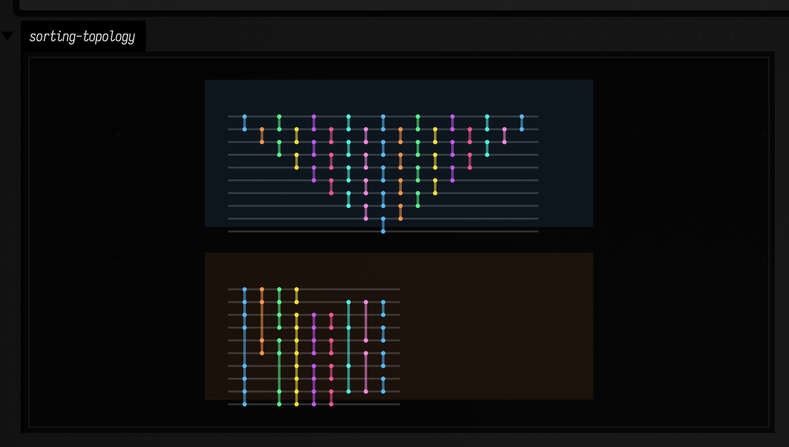
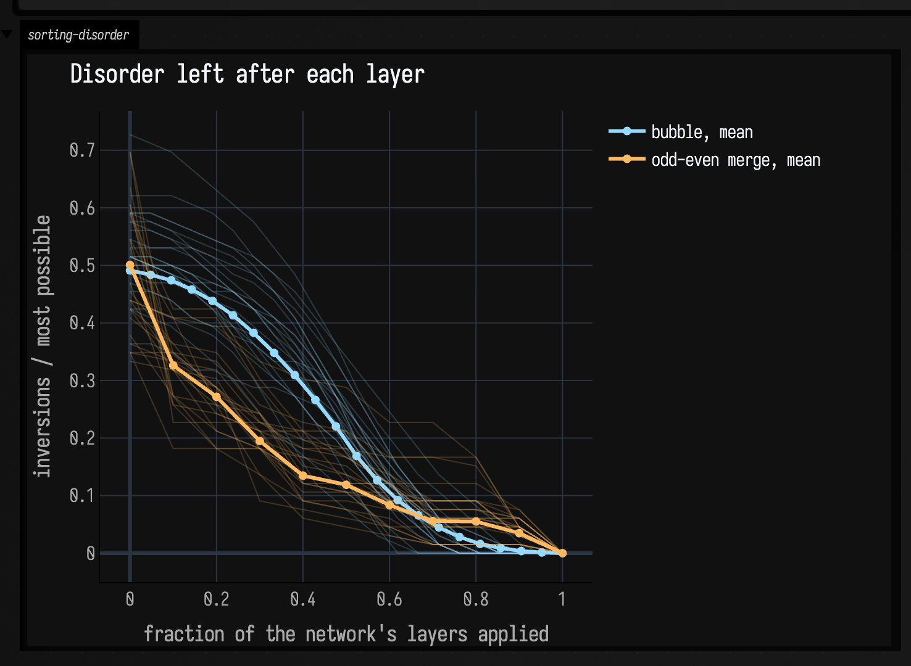
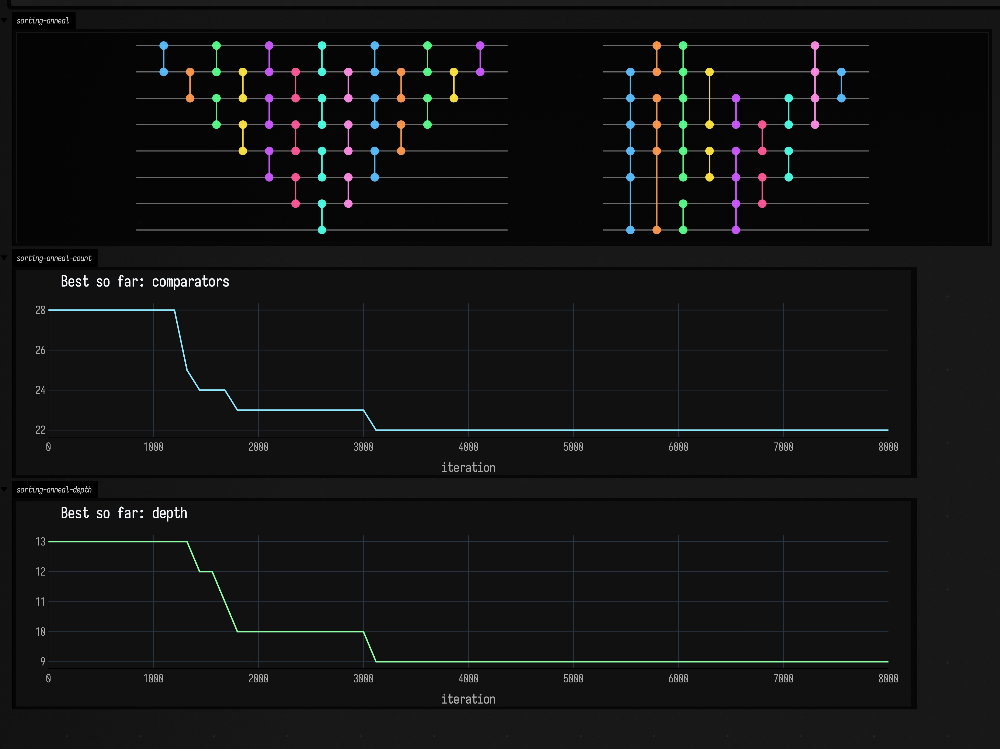
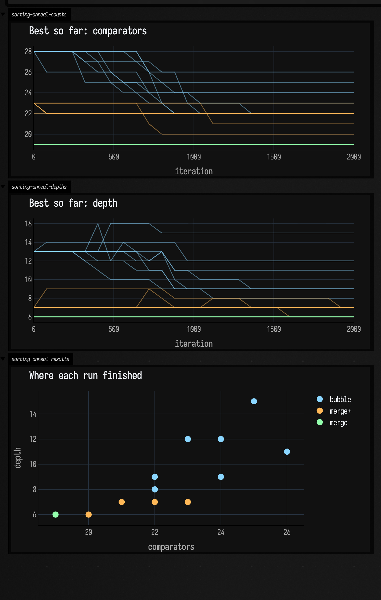

# Sorting networks to FLine examples

*Every public declaration used below is listed, with its KDoc, in the codebase reference: [`sorting_networks.kt`](reference/data.md#sorting-networks-kt). Start from [what's already in the box](reference/index.md).*

Sorting networks make an algorithm hold still. The compare-and-swap plan is fixed ahead of time; the data is what moves. That makes them good material for pictures: topology first, then disorder collapse, then search over the topology itself.

## Topology: bubble drag versus odd-even-merge economy

Start with the fabric of the network. Same wire count, different cost profile: bubble spends comparators and depth generously; odd-even merge is much more disciplined.

```diffstatic_runner {data-lang=kotlin screenshot="assets/sorting_networks_examples/topology_compare.png" wait="1.0" capture="box"}
:::static
import afield.graphics.FLine

val bubble = SortingNetwork.bubble(10)
val merge = SortingNetwork.oddEvenMerge(10)

fun shift(lines: List<FLine>, dx: Double, dy: Double) = lines.map { it + vec(dx, dy, 0) }

fun panel(x: Double, y: Double, w: Double, h: Double, color: Vec4) = fline {
    moveTo(x, y)
    lineTo(x + w, y)
    lineTo(x + w, y + h)
    lineTo(x, y + h)
    close()
    filled = true
    stroked = true
    thickness = 1.2
    this.color = color
}

val frames = listOf(
    panel(30.0, 40.0, 1030.0, 390.0, vec(0.08, 0.14, 0.20, 0.55)),
    panel(30.0, 500.0, 1030.0, 390.0, vec(0.18, 0.11, 0.07, 0.52)),
)

lines(
    frames +
        shift(bubble.toFLines(wireSpacing = 34.0, layerSpacing = 46.0, margin = 42.0), 70.0, 95.0) +
        shift(merge.toFLines(wireSpacing = 34.0, layerSpacing = 46.0, margin = 42.0), 70.0, 555.0),
    channel = "sorting-topology",
    w = 1120.0,
    h = 940.0,
    fitToSize = true
)
```

Bubble is not wrong; it is extravagant. It spends more columns, more waiting, and more opportunities for values to shuffle. Odd-even merge is more architectural. You can read the reduction in cost before running a single input through it.



## Disorder collapse across layers

Structure is only half the story. The behavioral question is how quickly a fixed network destroys inversions once a random permutation enters it. `layerTrace(...)` makes that visible by exposing the intermediate states.

```diffstatic_runner {data-lang=kotlin screenshot="assets/sorting_networks_examples/disorder_decay.png" wait="1.0" capture="box"}
:::static
import afield.graphics.FLine

val n = 12
val meanSamples = 180
val traceCount = 24
val bubble = SortingNetwork.bubble(n)
val merge = SortingNetwork.oddEvenMerge(n)
val maxInv = n * (n - 1) / 2.0

fun randomPermutation(size: Int): IntArray {
    val xs = (0 until size).toMutableList()
    xs.shuffle()
    return xs.toIntArray()
}

fun inversions(values: IntArray): Int {
    var inv = 0
    for (i in values.indices) for (j in i + 1 until values.size) if (values[i] > values[j]) inv++
    return inv
}

fun profile(net: SortingNetwork): List<Double> {
    val sums = DoubleArray(net.depth() + 1)
    repeat(meanSamples) {
        net.layerTrace(randomPermutation(n)).forEachIndexed { index, snapshot ->
            sums[index] += inversions(snapshot) / maxInv
        }
    }
    return sums.map { it / meanSamples.toDouble() }
}

fun traceFamily(net: SortingNetwork, count: Int): List<List<Double>> = List(count) {
    net.layerTrace(randomPermutation(n)).map { inversions(it) / maxInv }
}

val bubbleTraces = traceFamily(bubble, traceCount)
val mergeTraces = traceFamily(merge, traceCount)
val bubbleProfile = profile(bubble)
val mergeProfile = profile(merge)

fun axis() = listOf(
    fline {
        moveTo(70, 580); lineTo(1120, 580)
        moveTo(70, 120); lineTo(70, 580)
        color = vec(1, 1, 1, 0.22)
        thickness = 1.2
    },
    fline {
        for (i in 0..8) {
            val y = 580.0 - i / 8.0 * 430.0
            moveTo(70, y); lineTo(1120, y)
        }
        val maxDepth = maxOf(bubbleProfile.size, mergeProfile.size) - 1
        for (i in 0..maxDepth) {
            val x = 70.0 + i.toDouble() / maxDepth.coerceAtLeast(1).toDouble() * 1050.0
            moveTo(x, 120.0); lineTo(x, 580.0)
        }
        color = vec(1, 1, 1, 0.08)
        thickness = 1.0
    }
)

fun curve(values: List<Double>, color: Vec4, thickness: Double): FLine = fline {
    values.forEachIndexed { i, v ->
        val x = 70.0 + i.toDouble() / (values.size - 1).coerceAtLeast(1).toDouble() * 1050.0
        val y = 580.0 - v * 430.0
        if (i == 0) moveTo(x, y) else lineTo(x, y)
    }
    this.color = color
    this.thickness = thickness
}

fun markers(values: List<Double>, color: Vec4, size: Double): FLine = fline {
    filled = true
    stroked = false
    values.forEachIndexed { i, v ->
        val x = 70.0 + i.toDouble() / (values.size - 1).coerceAtLeast(1).toDouble() * 1050.0
        val y = 580.0 - v * 430.0
        moveTo(x - size, y - size)
        lineTo(x + size, y - size)
        lineTo(x + size, y + size)
        lineTo(x - size, y + size)
        close()
    }
    this.color = color
}

val markers =
    bubbleTraces.map { curve(it, vec(0.58, 0.85, 1.0, 0.12), 1.2) } +
        mergeTraces.map { curve(it, vec(1.0, 0.73, 0.38, 0.12), 1.2) } +
        listOf(
            curve(bubbleProfile, vec(0.58, 0.85, 1.0, 0.95), 3.2),
            curve(mergeProfile, vec(1.0, 0.73, 0.38, 0.95), 3.2),
            markers(bubbleProfile, vec(0.58, 0.85, 1.0, 0.95), 4.5),
            markers(mergeProfile, vec(1.0, 0.73, 0.38, 0.95), 4.5),
        )

lines(
    axis() + markers,
    channel = "sorting-disorder",
    w = 1190.0,
    h = 660.0,
    fitToSize = true
)
```

The plot answers the dynamic question at two scales. The faint lines are individual random permutations; the brighter lines are means. Both networks converge, but not with the same rhythm. Bubble has more depth to spend, so the descent stretches out. Odd-even merge does more decisive work per layer and reaches zero with fewer synchronized rounds. Comparator count alone hides that difference.



## Annealing search leaves a visible trail

This picture is about synthesis rather than execution. `SortingNetwork.anneal(...)` emits a trajectory of improving candidates, not only a final network.

```diffstatic_runner {data-lang=kotlin screenshot="assets/sorting_networks_examples/anneal_search.png" wait="1.0" capture="box" timeout="70"}
:::static
import afield.graphics.FLine

val baseline = SortingNetwork.bubble(8)
val history = mutableListOf<Pair<Int, SortingNetwork>>()

val best = SortingNetwork.anneal(
    n = 8,
    iterations = 8_000,
    seed = 7L,
    progressEvery = 120
) { iter, net ->
    history += iter to net
}

fun shift(lines: List<FLine>, dx: Double, dy: Double) = lines.map { it + vec(dx, dy, 0) }

fun chartFrame(x: Double, y: Double, w: Double, h: Double) = listOf(
    fline {
        moveTo(x, y); lineTo(x + w, y); lineTo(x + w, y + h); lineTo(x, y + h); close()
        filled = true
        stroked = true
        thickness = 1.0
        color = vec(0.10, 0.12, 0.16, 0.55)
    },
    fline {
        moveTo(x, y + h); lineTo(x + w, y + h)
        moveTo(x, y); lineTo(x, y + h)
        color = vec(1, 1, 1, 0.18)
        thickness = 1.0
    }
)

fun plotMetric(
    originX: Double,
    originY: Double,
    width: Double,
    height: Double,
    values: List<Pair<Int, Double>>,
    maxX: Double,
    maxY: Double,
    color: Vec4
): FLine = fline {
    values.forEachIndexed { idx, (iteration, value) ->
        val x = originX + iteration / maxX * width
        val y = originY + height - value / maxY * height
        if (idx == 0) moveTo(x, y) else lineTo(x, y)
    }
    this.color = color
    this.thickness = 2.8
}

val countValues = history.map { it.first to it.second.comparators.size.toDouble() }
val depthValues = history.map { it.first to it.second.depth().toDouble() }
val maxCount = countValues.maxOf { it.second }
val maxDepth = depthValues.maxOf { it.second }
val maxIter = history.maxOf { it.first }.toDouble().coerceAtLeast(1.0)

lines(
    chartFrame(60.0, 320.0, 1100.0, 190.0) +
        chartFrame(60.0, 560.0, 1100.0, 190.0) +
        shift(baseline.toFLines(wireSpacing = 26.0, layerSpacing = 26.0, margin = 28.0), 70.0, 50.0) +
        shift(best.toFLines(wireSpacing = 26.0, layerSpacing = 26.0, margin = 28.0), 660.0, 50.0) +
        listOf(
            plotMetric(60.0, 320.0, 1100.0, 190.0, countValues, maxIter, maxCount, vec(0.56, 0.92, 1.0, 0.95)),
            plotMetric(60.0, 560.0, 1100.0, 190.0, depthValues, maxIter, maxDepth, vec(0.56, 1.0, 0.66, 0.95)),
        ),
    channel = "sorting-anneal",
    w = 1220.0,
    h = 820.0,
    fitToSize = true
)
```

The search is no longer abstract. You can see the starting network, the final network, and the staircase of best-so-far improvements between them. Optimization becomes a path with plateaus, drops, and eventual structure.



## Annealing as a family of regimes

One annealing run is anecdote. A more useful picture broadens the configuration space: different seed topologies, starting temperatures, and random seeds. The search becomes a landscape of possible descents rather than one lucky staircase.

```diffstatic_runner {data-lang=kotlin screenshot="assets/sorting_networks_examples/anneal_regimes.png" wait="1.0" capture="box" timeout="90"}
:::static
import afield.graphics.FLine

data class RunConfig(
    val family: String,
    val initial: SortingNetwork,
    val initialTemp: Double,
    val finalTemp: Double,
    val seed: Long,
    val traceColor: Vec4,
    val pointColor: Vec4,
)

data class RunResult(
    val config: RunConfig,
    val counts: List<Pair<Int, Double>>,
    val depths: List<Pair<Int, Double>>,
    val best: SortingNetwork,
)

val merge = SortingNetwork.oddEvenMerge(8)
val mergeDense =
    SortingNetwork(
        8,
        merge.comparators +
            listOf(
                SortingComparator(0, 1),
                SortingComparator(2, 3),
                SortingComparator(4, 5),
                SortingComparator(6, 7),
            ),
    )

val configs =
    listOf(
        Triple("bubble", SortingNetwork.bubble(8), vec(0.54, 0.84, 1.0, 0.22)),
        Triple("merge+", mergeDense, vec(1.0, 0.72, 0.34, 0.22)),
        Triple("merge", merge, vec(0.58, 1.0, 0.68, 0.22)),
    ).flatMapIndexed { familyIndex, (family, initial, color) ->
        listOf(0.7 to 0.05, 1.5 to 0.02, 3.2 to 0.01).flatMapIndexed { tempIndex, (startTemp, endTemp) ->
            (0 until 3).map { seed ->
                RunConfig(
                    family = family,
                    initial = initial,
                    initialTemp = startTemp,
                    finalTemp = endTemp,
                    seed = (familyIndex * 100 + tempIndex * 10 + seed).toLong(),
                    traceColor = color,
                    pointColor =
                        when (family) {
                            "bubble" -> vec(0.54, 0.84, 1.0, 0.88)
                            "merge+" -> vec(1.0, 0.72, 0.34, 0.88)
                            else -> vec(0.58, 1.0, 0.68, 0.88)
                        },
                )
            }
        }
    }

val iterations = 2_000
val progressEvery = 80

val runs = configs.map { config ->
    val countTrace = mutableListOf<Pair<Int, Double>>()
    val depthTrace = mutableListOf<Pair<Int, Double>>()
    val best =
        SortingNetwork.anneal(
            n = 8,
            initialNetwork = config.initial,
            iterations = iterations,
            initialTemp = config.initialTemp,
            finalTemp = config.finalTemp,
            seed = config.seed,
            progressEvery = progressEvery,
        ) { iter, net ->
            countTrace += iter to net.comparators.size.toDouble()
            depthTrace += iter to net.depth().toDouble()
        }
    RunResult(
        config = config,
        counts = if (countTrace.lastOrNull()?.first == iterations) countTrace else countTrace + (iterations to best.comparators.size.toDouble()),
        depths = if (depthTrace.lastOrNull()?.first == iterations) depthTrace else depthTrace + (iterations to best.depth().toDouble()),
        best = best,
    )
}

val maxCount = runs.maxOf { run -> run.counts.maxOf { it.second } }
val maxDepth = runs.maxOf { run -> run.depths.maxOf { it.second } }
val minComparators = runs.minOf { it.best.comparators.size }.toDouble()
val maxComparators = runs.maxOf { it.best.comparators.size }.toDouble()
val minDepth = runs.minOf { it.best.depth() }.toDouble()
val maxDepthPoint = runs.maxOf { it.best.depth() }.toDouble()

fun chartFrame(x: Double, y: Double, w: Double, h: Double) = listOf(
    fline {
        moveTo(x, y); lineTo(x + w, y); lineTo(x + w, y + h); lineTo(x, y + h); close()
        filled = true
        stroked = true
        thickness = 1.0
        color = vec(0.10, 0.12, 0.16, 0.55)
    },
    fline {
        moveTo(x, y + h); lineTo(x + w, y + h)
        moveTo(x, y); lineTo(x, y + h)
        color = vec(1, 1, 1, 0.18)
        thickness = 1.0
    }
)

fun traceCurve(
    values: List<Pair<Int, Double>>,
    originX: Double,
    originY: Double,
    width: Double,
    height: Double,
    maxY: Double,
    color: Vec4,
): FLine = fline {
    values.forEachIndexed { idx, (iteration, value) ->
        val x = originX + iteration / iterations.toDouble() * width
        val y = originY + height - value / maxY * height
        if (idx == 0) moveTo(x, y) else lineTo(x, y)
    }
    this.color = color
    this.thickness = 1.6
}

fun scatterPoints(): List<FLine> =
    runs.map { run ->
        val x = 80.0 + (run.best.comparators.size - minComparators) / (maxComparators - minComparators + 1e-9) * 1080.0
        val y = 880.0 - (run.best.depth() - minDepth) / (maxDepthPoint - minDepth + 1e-9) * 180.0
        fline {
            filled = true
            stroked = false
            moveTo(x - 7, y - 7)
            lineTo(x + 7, y - 7)
            lineTo(x + 7, y + 7)
            lineTo(x - 7, y + 7)
            close()
            color = run.config.pointColor
        }
    }

val countCurves = runs.map { traceCurve(it.counts, 80.0, 80.0, 1080.0, 180.0, maxCount, it.config.traceColor) }
val depthCurves = runs.map { traceCurve(it.depths, 80.0, 340.0, 1080.0, 180.0, maxDepth, it.config.traceColor) }

lines(
    chartFrame(80.0, 80.0, 1080.0, 180.0) +
        chartFrame(80.0, 340.0, 1080.0, 180.0) +
        chartFrame(80.0, 620.0, 1080.0, 260.0) +
        countCurves +
        depthCurves +
        scatterPoints(),
    channel = "sorting-anneal-regimes",
    w = 1240.0,
    h = 940.0,
    fitToSize = true
)
```

Here the quantity of traces matters. Bubble-seeded runs and merge-seeded runs end in different places and descend differently. Some cool quickly and freeze, some stay mobile longer, some improve depth without improving comparator count, and some stall. The bottom scatter collapses those histories into a small cloud of trade-offs between size and depth.



Sorting networks are one of the rare algorithmic objects whose static form and dynamic behavior are equally drawable. For adjacent topics where fixed structure meets plotted behavior, continue with [Graph connectivity examples](graph_connectivity_examples.md) and [Boolean networks examples](boolean_networks_examples.md).
