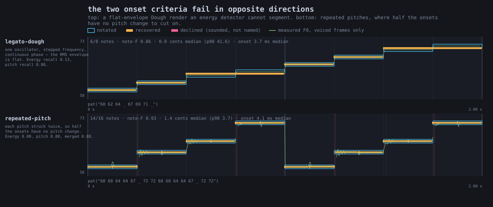
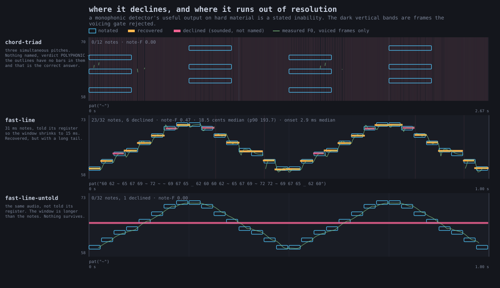

# Sound: from a pattern to something you can hear

`pat("bd ~ sd ~")` is a schedule. It says *kick, rest, snare, rest* and it says exactly
when — but a schedule makes no sound. Something has to turn each event into samples.

Field has **three** things that turn a *pattern's* events into samples, offline, with no audio device
and no realtime engine, and they sound nothing alike. One is a tiny synthesiser that ships in the
source tree. The second is the genuine Tidal drum library, if you happen to have it. The third is a
**Faust program compiled at runtime and played polyphonically**: a pattern's notes become
`freq`/`gate`/`gain` writes on a bank of voices, scheduled to the sample. This page follows one
pattern all the way down the **first two**, and **every audio figure below says which of them
produced it.** The third has a page of its own,
[Faust: a box that is a signal processor](faust.md#a-pattern-plays-it).

Three counts the pattern voices that can render **offline**. There is a fourth that cannot, and it is
excluded from the sentence above by the "no audio device, no realtime engine" clause rather than by
being less of a voice: `patSpatial` plays a pattern through dough and places each `spat` group in
space with Steam Audio's HRTF, in realtime only. Where it puts a note is written in the pattern as an
`az`/`dist` tag, which is the thing about it worth reading — see
[A pattern in space](pat_spatial.md).

Eight things in Field make samples by one route or another, and
[Making a sound in Field: every path there is](sound_paths.md) maps all eight and helps you pick.

**Three quarters** of the audio published elsewhere in these docs is the first voice below, and the
rest is not. [Most of the audio in these docs is the
stand-in](#most-of-the-audio-in-these-docs-is-the-stand-in) says which is which.

---

## The path

| stage | what it is | where |
| --- | --- | --- |
| `pat("bd ~ sd ~")` | mini-notation parsed into a `PatPattern<String>` | [Patterns & Rhythm](pattern_language.md) |
| `.events(arc)` | the schedule, as values with rational spans | `PatPattern` |
| `showPatRoll` | those events drawn | `PatPianoRollGallery.kt` |
| `patVoice` → `patRenderStereo` | **the stand-in**: one oscillator per event | `PatSoundDocs.kt` |
| `DirtSampleLibrary` → `patRenderStereoDirt` | **real samples**, mixed into a buffer | `DirtRender.kt` |
| `WavFloatArrayWriter` | a 16-bit PCM WAV, or bytes into a box's output | `WavFloatArrayWriter.kt` |
| `patTranscribe` | **back the other way**: the buffer heard as pitched notes, and a `pat("…")` string that re-renders | `PatTranscription.kt` |
| `patTranscribeAuto` | the same, with the register estimated instead of declared | `PatTranscription.kt` |
| `showPatTranscriptionOf` | notated against recovered, overlaid on one MIDI axis | `PatTranscriptionGallery.kt` |

The pattern language itself is documented on [its own page](pattern_language.md) and this one
does not restate it. All that carries over here is that a pattern is a *function from a query to
a list of events*, and that both voices below consume exactly the same list.

The last two rows run the path backwards. `patTranscribe` takes a finite buffer and returns pitched
note events plus the mini-notation that reproduces them, so the output of analysis is the same kind
of object as the input to synthesis, and you can feed it straight back to the renderer.

It is monophonic and says so: a triad is reported as `POLYPHONIC` and named as nothing rather than
reported as its loudest note, while a sawtooth's full harmonic stack is not refused, because timbre
is not polyphony.

One parameter dominates all the thresholds: **the register you declare.** It sets the analysis
window and therefore the shortest note that can be resolved, and on identical audio the difference
between declaring it and not is onset recall 0.91 against 0.03. If you cannot declare one, call
`patTranscribeAuto`, which estimates it from a cheap wide first pass; estimating is about as good
as being told, and much better than leaving the wide default in place. It refuses rather than
transcribing when the first pass says the material is not one line.

A wrong output carries a warning naming where it is wrong, and any case carrying a warning is
classified as a refusal. So the guarantee is a narrow one, and worth stating exactly: an error is
never silent. Act on that one — a plausible parseable wrong answer gets believed where a flagged
one does not.

`dev_docs/pitch_transcription_roundtrip.md` has the per-case accuracy table, the four-hop round
trip, the classification of every corpus case, and which figures are held against an asserted floor
and which are single observations. The runnable version is the
[pitch_transcription_roundtrip](agent_transcripts.md) starting point.

### What that looks like

Every panel below plots the notation you wrote as a **hollow outline** and what the detector heard back
out of the render as a **solid bar**, on one shared MIDI axis, so the exceptions are the only thing you
have to look at. Vertical position and left edge are measurements; bar *length* is not, because a
recovered note ends where its pitch stopped being stable, and that reaches into the previous note's
decay.

The clean case first: a stepped scale, wide leaps over three octaves, and a run detuned by 25/50/75/50
cents. The bars sit on the outlines, and in the third panel they sit off them by exactly the detuning.


Segmentation is harder, and the two available criteria fail in **opposite** directions rather than
one being better than the other. A flat-envelope Dough render has no energy transients to cut on
(energy recall 0.13) but clean pitch steps (0.86); a line that strikes each pitch
twice has the transients but no pitch change at half of them (energy 0.13, pitch 0.81, 0.88 merged):



A **refusal** looks like this. Three simultaneous pitches gives 0 of 12 notes, a `POLYPHONIC`
verdict and `pat("~")`: the outlines have no bars in them at all, and that is the correct answer
rather than a failure. The same audio at 31 ms per
note recovers 23 of 32 when it is *told* its register and 0 of 32 when it is not, because the analysis
window is then longer than the notes; the output is again `pat("~")` rather than a plausible parseable
wrong one:



Those three are **committed captures** from the `synth.pat.transcription` FIELD_TEST, which asserts
that every rectangle in each file corresponds to a reference note, a recovered note or a declined
span, that no coordinate is non-finite, and that the panels which are supposed to disagree do:

```diffstatic {data-lang=bash}
PAT_TRANSCRIPTION_DIR=/tmp/pat-transcription python3 tools/run_field_tests.py --id synth.pat.transcription
```

---

## The events, before anything makes a sound

One kick-and-snare and eight hats, stacked. Two cycles.

```diffstatic_runner {data-lang=kotlin screenshot="assets/sound_render_path/the-beat-roll.png" wait="2" capture="box" open-outputs="true" name="sound-doc-beat-roll"}
:::static
// The pattern the two A/B figures below render. Nothing here is audio yet — these are
// the events, and both voices are handed exactly this list.
showPatRollOf(
    "bd ~ sd ~" to pat("bd ~ sd ~"),
    "hh*8" to pat("hh*8"),
    title = "pat(\"bd ~ sd ~, hh*8\")",
    subtitle = "the schedule both voices are given",
    cycles = 2,
)
:::fold open the output pane
displayOpen("main")
:::endfold
```


Ten events a cycle — the two `~` are rests and produce nothing at all — at exact rational
positions. Nothing so far has an opinion about what a kick drum sounds like.

---

## The stand-in voice

`patVoice` is that opinion, and it is a small one: **one oscillator, one
one-pole lowpass, one exponential-decay envelope**, per event. Pitch comes from the event's
value when it parses as a MIDI number, and otherwise from a drum map with five entries in it:

<div class="field-reference" data-code-lang="kotlin" markdown>

| Pattern example | What the stand-in plays |
| --- | --- |
| `pat("bd ~ kick ~")` | Both names select a 62 Hz sine voice. This is a deterministic kick stand-in, not a recording from a sample library. |
| `pat("~ sd ~ snare")` | Both names select the 190 Hz noise voice. |
| `pat("cp ~ clap ~")` | Both names select the 900 Hz noise voice. The higher noise setting distinguishes claps from the snare stand-in. |
| `pat("hh*8")` | `hh` and `hat` select the 6200 Hz noise voice. |
| `pat("~ oh ~ oh")` | Selects the 4200 Hz noise voice. It gives the open-hat token a different sound from `hh`. |
| `pat("custom ~")` | An unrecognised token uses the voice’s `baseHz`. Use Dirt rendering when a token is meant to name an actual sample. |

</div>

`showPatAudio(pattern)` renders through it and drops an audio player into the box's output.
Here is the beat:

```diffstatic_runner {data-lang=kotlin audio="assets/sound_render_path/beat-stand-in.wav" audio-spec="beat-stand-in" audio-renderer="afield.four.synth.SoundRenderPathDocs" embed=true hidden=true name="sound-doc-beat-stand-in"}
// showPatAudio(pat("bd ~ sd ~, hh*8") with gain(0.9))
// offline-rendered through patVoice by SoundRenderPathDocs — listen below
```

**Voice: the stand-in synth (`patVoice`).** No sample library was used.

That is not a drum machine. It is a sine and some filtered white noise, arranged in the shape
of a drum machine. It is nonetheless the **default**, for a good reason: it needs no assets. It
renders identically on a clean checkout, in CI, on a machine that has never heard of
SuperCollider, and it is deterministic, so a committed `.wav` regenerates byte-stably. A figure
that always works and sounds approximate beats a figure that sounds right on one laptop.

It is a *measurement* target before it is a musical one. `PatSoundDocs`' scenes verify pitch,
onset count, stereo decorrelation and swing ratios against the rendered audio, and a plain sine
is a much easier thing to measure a pitch in than a sampled kick.

---

## The real samples

`DirtRender` (`src/jvmMain/kotlin/afield/four/synth/DirtRender.kt`) is the other half.
`DirtSamples.kt` plays the genuine Tidal sample set **live** and only live: `playDirt` needs
`respondAhead`, a clock and an audio device, none of which exist in a docs build or a headless
box. `patRenderStereoDirt` mixes the same library straight into a buffer instead.

The same beat, the same ten events a cycle, the same `gain` / `pan` / `speed` annotations:

```diffstatic_runner {data-lang=kotlin audio="assets/sound_render_path/beat-dirt.wav" audio-spec="beat-dirt" audio-renderer="afield.four.synth.SoundRenderPathDocs" embed=true hidden=true name="sound-doc-beat-dirt"}
// showDirtAudio(pat("bd ~ sd ~, hh*8") with gain(0.9))
// offline-rendered from the Dirt-Samples quark by SoundRenderPathDocs — listen below
```

**Voice: real Dirt-Samples one-shots, every token matched.**

Two details do most of the work in making that sound like drums rather than like a sampler
being triggered:

* **Hits are one-shots.** A sample plays to its natural end rather than being gated by the
  length of the arc that triggered it. That is what SuperDirt does, and it is the reason a
  snare sounds like a snare instead of a click: an eighth-note arc is far shorter than the
  snare's tail.
* **Only events with an onset trigger.** A fragment carried over from a previous query arc is
  a continuation, not a new hit; re-triggering it would flam.

### How the library is found

`DirtRender.dirtSampleRoot()` probes, in order:

1. `$FIELD_DIRT_SAMPLES`, if set and non-blank — the documented override;
2. `~/Library/Application Support/SuperCollider/downloaded-quarks/Dirt-Samples` (macOS);
3. `~/.local/share/SuperCollider/downloaded-quarks/Dirt-Samples` (Linux);
4. `~/Dirt-Samples`.

Dirt-Samples ships as a SuperCollider *quark*, so anybody who has ever run Tidal already has
it at one of those. That is why `dirtSampleRoot()` goes looking instead of asking you for a
path. The library is **not vendored**: roughly 400MB of third-party audio with mixed
per-folder licensing has no business inside this repository. The probe is not cached, so
setting `FIELD_DIRT_SAMPLES` and rendering in the same session gets you what you asked for.

---

## Two fallbacks, at different granularities

The two are easy to confuse and they mean very different things.

**No library on this machine: the whole render falls back.** `patRenderStereoDirt` returns
the `patRenderStereo` render exactly, the same samples rather than an approximation, and
`DirtRenderResult.usedSamples` is `false`. Nothing breaks and no figure fails to generate;
the caller is simply told, and can say so.

**Library present, one token missing from it: only that event falls back.** A pattern of
MIDI note numbers, or one naming a drum Dirt has never heard of, must not go silent just
because the library loaded successfully. The unrecognised events are voiced by `patVoice` and
mixed on top of the sampled ones, and `DirtRenderResult.unmatched` names them.

`pat("bd zzzznotadrum bd hh")` is the second case: `bd` and `hh` are in every
Dirt install and `zzzznotadrum` is in none. You can hear where the join falls: three sampled
drums and one square-wave blip, in one bar.

```diffstatic_runner {data-lang=kotlin audio="assets/sound_render_path/per-event-fallback.wav" audio-spec="per-event-fallback" audio-renderer="afield.four.synth.SoundRenderPathDocs" embed=true hidden=true name="sound-doc-per-event-fallback"}
// showDirtAudio(pat("bd zzzznotadrum bd hh") with gain(0.9),
//               voice = patVoice(wave = PatWave.SQUARE, baseHz = 330.0, ...))
// offline-rendered by SoundRenderPathDocs — listen below
```

**Voice: real Dirt-Samples where the library had the token, the stand-in synth per event where it did not.**

`describe()` names exactly which, in one line a demo box can print:

```diffstatic {data-lang=text}
Dirt samples: bd hh — synth voice for zzzznotadrum
```

and for the whole-render fallback, the same call names the override rather than failing
silently:

```diffstatic {data-lang=text}
synth voice (no Dirt-Samples found; set FIELD_DIRT_SAMPLES to use real samples)
```

---

## Most of the audio in these docs is the stand-in

On most of the site, the stand-in synth *is* what you are hearing, and the mini-notation cards on
[Patterns & Rhythm](pattern_language.md) are most of that on their own. The reason is the one given
above: a primer that plays `bd*4` and `bd(3,8)` and `{bd hh cp}%8` needs a voice that renders
identically on a clean checkout with no sample library anywhere near it, and whose onsets can be
*counted out of the rendered audio* and checked against the schedule.

Where another page publishes something else, it is not standing in for anything.
`DoughDspSoundDocs` runs a plate reverb, a phaser, a resonant lowpass and a soft clipper on real
signals, and a plate reverb ringing down *is* the thing [that page](dough_dsp_sound.md) is about; a
few are a Faust program compiled at runtime, two of those a pattern playing it as a polyphonic
instrument on
[Faust](faust.md#what-it-sounds-like-at-eight-voices-and-at-one). The clips on
[A pattern in space](pat_spatial.md) are **half a path** — the mono source Steam Audio is handed,
not the spatialised output, because that half is realtime-only and needs a binary this repository
does not carry.

The clip-by-clip census, and the one piece of audio no code can regenerate, are in
`dev_docs/DOCS_AUDIO_PROVENANCE_AGREEMENT.md`.

---

## Getting real drums in your own box

Install the quark (`Quarks.install("Dirt-Samples")` in SuperCollider, or clone
[tidalcycles/Dirt-Samples](https://github.com/tidalcycles/Dirt-Samples)) and then change one
call:

```diffstatic {data-lang=kotlin}
// the stand-in
showPatAudio(pat("bd ~ sd ~, hh*8") with gain(0.9))

// the real thing — same shape, same annotations
val played = showDirtAudio(pat("bd ~ sd ~, hh*8") with gain(0.9))
println(played.describe())          // say which voice you actually got
```

Both put a player in the box's output. `showPatAudio` hands back the rendered
`PatSoundDocs.Stereo` so you can plot or measure it as well as listen to it;
`showDirtAudio` hands back a `DirtRenderResult`, which carries the same audio in `.audio`
plus `usedSamples`, `matched` and `unmatched`. Print `describe()` and the box tells you
which voice it found rather than leaving you to guess from the sound.

If you want to be sure, force it:

```diffstatic {data-lang=bash}
FIELD_DIRT_SAMPLES=/path/to/Dirt-Samples ./field.sh
```

A loadable Field document with all of this side by side is committed at
`public/docs/assets/sound_render_path/`. Open `public/docs/assets` as the workspace and
`sound_render_path` as the document, then play box 1 and box 2 back to back.

---

## What a "Voice:" caption promises

Every *"Voice: …"* sentence on this page is produced by a check rather than typed, so a caption
cannot outlive the code that rendered its clip. What the check establishes is narrower than it
looks: a clip captioned as the stand-in has to match a fresh synth render, and a clip captioned as
real samples has to *not* match one. It can tell you an asset did not come from the synth; it
cannot tell you it came from the Tidal library specifically.

Print the whole table with `run_field_tests.py --id synth.docs.audio.provenance`. The method, the
correlation figures and the pinned family counts are in
`dev_docs/DOCS_AUDIO_PROVENANCE_AGREEMENT.md`.
